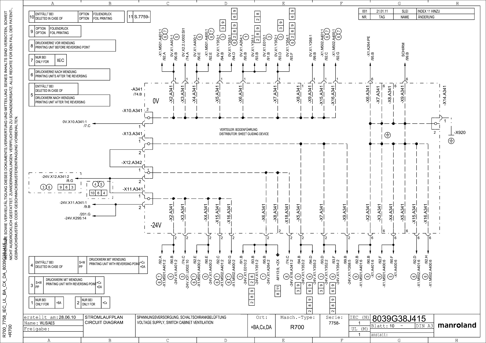

# +BA_Cx_DA — Sheet 10 of 247 — SPANNUNGSVERSORGUNG, SCHALTSCHRANKBELÜFTUNG

**VOLTAGE SUPPLY, SWITCH CABINET VENTILATION**

> Part of the manroland **R700** printing press IEC/UL circuit diagrams.
> Drawing class: **Stromlaufplan / Circuit diagram** (DIN A3).
> Document `+BA_Cx_DA` covers the **Printing units / main switch cabinet** machine section.

## At a glance

| Field | Value |
|---|---|
| Document | `+BA_Cx_DA`  (8039G38J415) |
| Sheet | **10** of 247 |
| Section (DE) | SPANNUNGSVERSORGUNG, SCHALTSCHRANKBELÜFTUNG |
| Section (EN) | VOLTAGE SUPPLY, SWITCH CABINET VENTILATION |
| Section type | POWER_SUPPLY — Voltage supply |
| Machine type | `R700` |
| Series | `7758` |
| Created | 28.06.10 |
| Replaces | — |
| Columns used | A, B, C, D, E, F, G, H |
| Path numbers | — |
| Labels on sheet | 322 |
| Cross-refs out | 44 |
| Cross-refs in | 75 |

**Previous:** [+BA_Cx_DA sheet 9](SHEET_0009.md) · **Next:** [+BA_Cx_DA sheet 11](SHEET_0011.md) · **Document TOC:** [_TOC.md](_TOC.md)  (+BA_Cx_DA) · **Master TOC:** [all sheets](../_MASTER_TOC.md)

## Sheet image (300 DPI, exact vector render)



_Rendered directly from the PDF vector layer at 300 DPI (1-bit), no OCR and no resampling. Use it to confirm anything ambiguous in the text below._

## Cross-references on this sheet

Each entry is a wire leaving this sheet. The printed token is `/sheet.column`; the link resolves to that sheet inside the same document.

| Ref | Target sheet | Col | Path | Destination on target | Target section | From col |
|---|---|---|---|---|---|---|
| `/74.A` | [+BA_Cx_DA sheet 74](SHEET_0074.md) | A | — | 0V.X2.2.U002:SI1 | FEUCHTWERK | C |
| `/92.A` | [+BA_Cx_DA sheet 92](SHEET_0092.md) | A | — | X1.M501.A401:1 | BOGENFÜHRUNG, DRUCKWERK NACH WENDUNG | C |
| `/92.A` | [+BA_Cx_DA sheet 92](SHEET_0092.md) | A | — | X1.M501.A401:1 | BOGENFÜHRUNG, DRUCKWERK NACH WENDUNG | C |
| `/92.E` | [+BA_Cx_DA sheet 92](SHEET_0092.md) | E | — | X1.M501.A400:1 | BOGENFÜHRUNG, DRUCKWERK NACH WENDUNG | D |
| `/92.C` | [+BA_Cx_DA sheet 92](SHEET_0092.md) | C | — | X1.M502.A401:1 | BOGENFÜHRUNG, DRUCKWERK NACH WENDUNG | F |
| `/92.G` | [+BA_Cx_DA sheet 92](SHEET_0092.md) | G | — | X1.M502.A400:1 | BOGENFÜHRUNG, DRUCKWERK NACH WENDUNG | F |
| `/90.B` | [+BA_Cx_DA sheet 90](SHEET_0090.md) | B | — | 0V.X1.A401:1 | BOGENFÜHRUNG | C |
| `/90.E` | [+BA_Cx_DA sheet 90](SHEET_0090.md) | E | — | 0V.X1.A400:1 | BOGENFÜHRUNG | D |
| `/94.B` | [+BA_Cx_DA sheet 94](SHEET_0094.md) | B | — | 0V.X1.Y353:1 | BOGENFÜHRUNG (BLASROHRE) | D |
| `/94.D` | [+BA_Cx_DA sheet 94](SHEET_0094.md) | D | — | 0V.X1.Y355:1 | BOGENFÜHRUNG (BLASROHRE) | D |
| `/95.B` | [+BA_Cx_DA sheet 95](SHEET_0095.md) | B | — | 0V.X1.A264:1 | BLAS/SAUGLUFT MIT MOTORVENTILEINSTELLUNG | D |
| `/93.B` | [+BA_Cx_DA sheet 93](SHEET_0093.md) | B | — | 0V.X1.Y351:1 | BOGENFÜHRUNG (BLASROHRE) | E |
| `/91.B` | [+BA_Cx_DA sheet 91](SHEET_0091.md) | B | — | 0V.X1.E010:1 | BOGENFÜHRUNG WENDETROMMEL | E |
| `/93.D` | [+BA_Cx_DA sheet 93](SHEET_0093.md) | D | — | 0V.X1.Y352:1 | BOGENFÜHRUNG (BLASROHRE) | E |
| `/93.F` | [+BA_Cx_DA sheet 93](SHEET_0093.md) | F | — | 0V.X1.Y354:1 | BOGENFÜHRUNG (BLASROHRE) | E |
| `/99.B` | [+BA_Cx_DA sheet 99](SHEET_0099.md) | B | — | 0V.X1.Y268:1 | BLAS/SAUGLUFT MIT MOTORVENTILEINSTELLUNG | F |
| `/95.B` | [+BA_Cx_DA sheet 95](SHEET_0095.md) | B | — | X1.A264:PE | BLAS/SAUGLUFT MIT MOTORVENTILEINSTELLUNG | G |
| `/90.B` | [+BA_Cx_DA sheet 90](SHEET_0090.md) | B | — | X1.A264:PE | BOGENFÜHRUNG | G |
| `/99.B` | [+BA_Cx_DA sheet 99](SHEET_0099.md) | B | — | SCHIRM | BLAS/SAUGLUFT MIT MOTORVENTILEINSTELLUNG | G |
| `/74.B` | [+BA_Cx_DA sheet 74](SHEET_0074.md) | B | — | — | FEUCHTWERK | B |
| `/7.C` | [+BA_Cx_DA sheet 7](SHEET_0007.md) | C | — | 0V.X10.A341:1 | SPANNUNGSVERSORGUNG, SCHALTSCHRANKBELÜFTUNG | A |
| `/8.G` | [+BA_Cx_DA sheet 8](SHEET_0008.md) | G | — | 24V.X12.A341:2 | SPANNUNGSVERSORGUNG, SCHALTSCHRANKBELÜFTUNG | A |
| `/9.B` | [+BA_Cx_DA sheet 9](SHEET_0009.md) | B | — | 24V.X11.A341:1 | SPANNUNGSVERSORGUNG, SCHALTSCHRANKBELÜFTUNG | A |
| `/201.G` | [+BA_Cx_DA sheet 201](SHEET_0201.md) | G | — | 24V.K295:14 | OPTION: | A |
| `/92.H` | [+BA_Cx_DA sheet 92](SHEET_0092.md) | H | — | — | BOGENFÜHRUNG, DRUCKWERK NACH WENDUNG | G |
| `/92.E` | [+BA_Cx_DA sheet 92](SHEET_0092.md) | E | — | — | BOGENFÜHRUNG, DRUCKWERK NACH WENDUNG | C |
| `/90.E` | [+BA_Cx_DA sheet 90](SHEET_0090.md) | E | — | — | BOGENFÜHRUNG | D |
| `/92.G` | [+BA_Cx_DA sheet 92](SHEET_0092.md) | G | — | — | BOGENFÜHRUNG, DRUCKWERK NACH WENDUNG | D |
| `/90.B` | [+BA_Cx_DA sheet 90](SHEET_0090.md) | B | — | — | BOGENFÜHRUNG | C |
| `/74.C` | [+BA_Cx_DA sheet 74](SHEET_0074.md) | C | — | — | FEUCHTWERK | C |
| `/92.C` | [+BA_Cx_DA sheet 92](SHEET_0092.md) | C | — | — | BOGENFÜHRUNG, DRUCKWERK NACH WENDUNG | D |
| `/91.B` | [+BA_Cx_DA sheet 91](SHEET_0091.md) | B | — | — | BOGENFÜHRUNG WENDETROMMEL | D |
| `/93.B` | [+BA_Cx_DA sheet 93](SHEET_0093.md) | B | — | — | BOGENFÜHRUNG (BLASROHRE) | D |
| `/95.B` | [+BA_Cx_DA sheet 95](SHEET_0095.md) | B | — | — | BLAS/SAUGLUFT MIT MOTORVENTILEINSTELLUNG | E |
| `/74.C` | [+BA_Cx_DA sheet 74](SHEET_0074.md) | C | — | — | FEUCHTWERK | E |
| `/94.B` | [+BA_Cx_DA sheet 94](SHEET_0094.md) | B | — | — | BOGENFÜHRUNG (BLASROHRE) | E |
| `/94.D` | [+BA_Cx_DA sheet 94](SHEET_0094.md) | D | — | — | BOGENFÜHRUNG (BLASROHRE) | E |
| `/93.D` | [+BA_Cx_DA sheet 93](SHEET_0093.md) | D | — | — | BOGENFÜHRUNG (BLASROHRE) | F |
| `/93.F` | [+BA_Cx_DA sheet 93](SHEET_0093.md) | F | — | — | BOGENFÜHRUNG (BLASROHRE) | F |
| `/99.B` | [+BA_Cx_DA sheet 99](SHEET_0099.md) | B | — | — | BLAS/SAUGLUFT MIT MOTORVENTILEINSTELLUNG | F |
| `/92.B` | [+BA_Cx_DA sheet 92](SHEET_0092.md) | B | — | — | BOGENFÜHRUNG, DRUCKWERK NACH WENDUNG | F |
| `/92.F` | [+BA_Cx_DA sheet 92](SHEET_0092.md) | F | — | — | BOGENFÜHRUNG, DRUCKWERK NACH WENDUNG | G |
| `/90.F` | [+BA_Cx_DA sheet 90](SHEET_0090.md) | F | — | — | BOGENFÜHRUNG | G |
| `/92.D` | [+BA_Cx_DA sheet 92](SHEET_0092.md) | D | — | — | BOGENFÜHRUNG, DRUCKWERK NACH WENDUNG | G |

### Incoming references (sheets that point here)

Every other sheet that sends a wire to this one. `Back-ref` is the token printed on *that* sheet; `Path` is its line number.

| From sheet | Cols | Back-ref | Path | Refs | What continues there |
|---|---|---|---|---|---|
| [+BA_Cx_DA#7](SHEET_0007.md) | C | `/7.C` | — | 1 | 0V.X10.A341:1 |
| [+BA_Cx_DA#8](SHEET_0008.md) | G | `/8.G` | — | 1 | — |
| [+BA_Cx_DA#9](SHEET_0009.md) | B | `/9.B` | — | 1 | — |
| [+BA_Cx_DA#74](SHEET_0074.md) | A, B, C | `/74.A`, `/74.B`, `/74.C` | — | 4 | — |
| [+BA_Cx_DA#90](SHEET_0090.md) | A, E, F | `/90.A`, `/90.E`, `/90.F` | — | 6 | 0V.X1.A400:1; 0V.X1.A401:1; 24V.X1.A400:2; 24V.X1.A401:2; X1.A400:6; X1.A401:6 |
| [+BA_Cx_DA#91](SHEET_0091.md) | A, B | `/91.A`, `/91.B` | — | 2 | 0V.X1.E010:1; 24V.X1.E010:2 X1.Y351:4 |
| [+BA_Cx_DA#92](SHEET_0092.md) | A, B, C, D, E, F, G, H | `/92.A`, `/92.B`, `/92.C`, `/92.D`, `/92.E`, `/92.F`, `/92.G`, `/92.H` | — | 12 | X1.M501.A400:1; X1.M501.A400:2; X1.M501.A400:6; X1.M501.A401:1; X1.M501.A401:2; X1.M501.A401:6; X1.M502.A400:1; X1.M502.A400:2; X1.M502.A400:6; X1.M502.A401:1; |
| [+BA_Cx_DA#93](SHEET_0093.md) | C | `/93.C` | — | 6 | 0V.X1.Y351:1 0V.X1.Y352:1 0V.X1.Y354:1; 24V.X1.Y351:2 24V.X1.Y354:2; 24V.X1.Y352:2 |
| [+BA_Cx_DA#94](SHEET_0094.md) | B | `/94.B` | — | 4 | 0V.X1.Y353:1 0V.X1.Y355:1; 24V.X1.Y353:2 24V.X1.Y355:2 |
| [+BA_Cx_DA#95](SHEET_0095.md) | B | `/95.B` | — | 3 | 0V.X1.A264:1; 24V.X1.A264:2; X1.A264:PE |
| [+BA_Cx_DA#99](SHEET_0099.md) | A | `/99.A` | — | 3 | 0V.X1.Y268:1; 24V.X1.Y268:5; SCHIRM |
| [+BA_Cx_DA#153](SHEET_0153.md) | B | `/153.B` | — | 3 | — |
| [+BA_Cx_DA#156](SHEET_0156.md) | H | `/156.H` | — | 3 | — |
| [+BA_Cx_DA#159](SHEET_0159.md) | B | `/159.B` | — | 3 | — |
| [+BA_Cx_DA#161](SHEET_0161.md) | B | `/161.B` | — | 3 | — |
| [+BA_Cx_DA#162](SHEET_0162.md) | E | `/162.E` | — | 3 | — |
| [+BA_Cx_DA#163](SHEET_0163.md) | H | `/163.H` | — | 3 | — |
| [+BA_Cx_DA#165](SHEET_0165.md) | F | `/165.F` | — | 3 | — |
| [+BA_Cx_DA#166](SHEET_0166.md) | E | `/166.E` | — | 3 | — |
| [+BA_Cx_DA#171](SHEET_0171.md) | H | `/171.H` | — | 3 | — |
| [+BA_Cx_DA#172](SHEET_0172.md) | D | `/172.D` | — | 3 | — |
| [+BA_Cx_DA#173](SHEET_0173.md) | G | `/173.G` | — | 1 | — |
| [+BA_Cx_DA#201](SHEET_0201.md) | F | `/201.F` | — | 1 | 24V.K295:14 |


## Devices on this sheet

| Tag | Class | Class meaning (IEC) | Col | Sub | Terminal | Sign |
|---|---|---|---|---|---|---|
| `A341` | A | Baugruppe / assembly, module, PC board | B | — | — | — |
| `X920` | X | Klemme / terminal, plug connector | H | — | — | — |
| `X4.A341` | — | cross-device reference | C | — | — | — |
| `X3.A341` | — | cross-device reference | C | — | — | — |
| `X2.A341` | — | cross-device reference | C | — | — | — |
| `X10.A341` | — | cross-device reference | B | — | — | — |
| `X13.A341` | — | cross-device reference | B | — | — | — |
| `X12.A342` | — | cross-device reference | B | — | — | — |
| `X3.A341` | — | cross-device reference | C | — | — | — |
| `X2.A341` | — | cross-device reference | C | — | — | — |
| `X11.A341` | — | cross-device reference | B | — | — | — |
| `X4.A341` | — | cross-device reference | D | — | — | — |
| `X15.A341` | — | cross-device reference | D | — | — | — |
| `X16.A341` | — | cross-device reference | D | — | — | — |
| `X5.A341` | — | cross-device reference | D | — | — | — |
| `X5.A341` | — | cross-device reference | E | — | — | — |
| `X18.A341` | — | cross-device reference | E | — | — | — |
| `X6.A341` | — | cross-device reference | E | — | — | — |
| `X7.A341` | — | cross-device reference | F | — | — | — |
| `X14.A341` | — | cross-device reference | H | — | — | — |
| `X6.A341` | — | cross-device reference | F | — | — | — |
| `X9.A341` | — | cross-device reference | G | — | — | — |
| `X4.A341` | — | cross-device reference | G | — | — | — |
| `X2.A341` | — | cross-device reference | F | — | — | — |
| `X15.A341` | — | cross-device reference | G | — | — | — |
| `X16.A341` | — | cross-device reference | G | — | — | — |
| `X9.A341` | — | cross-device reference | F | — | — | — |
| `X6.A341` | — | cross-device reference | D | — | — | — |
| `X7.A341` | — | cross-device reference | E | — | — | — |
| `X9.A341` | — | cross-device reference | E | — | — | — |
| `X15.A341` | — | cross-device reference | F | — | — | — |
| `X16.A341` | — | cross-device reference | F | — | — | — |
| `X1.A264:PE` | — | cross-device reference | F | — | PE | — |
| `X1.A401:6` | — | cross-device reference | G | — | 6 | — |
| `X1.A400:6` | — | cross-device reference | G | — | 6 | — |
| `X1.M501.A400:6` | — | cross-device reference | G | — | 6 | — |
| `X1.M501.A401:1` | — | cross-device reference | C | — | 1 | — |
| `X1.M501.A401:2` | — | cross-device reference | C | — | 2 | — |
| `X1.M501.A400:1` | — | cross-device reference | D | — | 1 | — |
| `X1.M501.A400:2` | — | cross-device reference | D | — | 2 | — |
| `X1.M502.A401:2` | — | cross-device reference | D | — | 2 | — |
| `X1.M502.A401:6` | — | cross-device reference | G | — | 6 | — |
| `X1.M502.A401:1` | — | cross-device reference | F | — | 1 | — |
| `X1.M502.A400:6` | — | cross-device reference | H | — | 6 | — |
| `X1.M501.A401:6` | — | cross-device reference | F | — | 6 | — |
| `X1.M502.A400:1` | — | cross-device reference | F | — | 1 | — |
| `X1.M502.A400:2` | — | cross-device reference | D | — | 2 | — |
| `NR.` | — | cross-device reference | F | — | — | — |
| `21.01.11` | — | cross-device reference | G | — | — | — |
| `X8.A341` | — | cross-device reference | E | — | — | — |
| `X7.A341` | — | cross-device reference | G | — | — | — |
| `X8.A341` | — | cross-device reference | G | — | — | — |
| `X3.A341` | — | cross-device reference | G | — | — | — |
| `X5.A341` | — | cross-device reference | G | — | — | — |
| `X8.A341` | — | cross-device reference | E | — | — | — |
| `S.7759` | — | cross-device reference | C | — | — | — |

## Potentials / nets

| Potential | Count | Columns | Attached devices | Terminals |
|---|---|---|---|---|
| `0V` | 13 | A, C, D, E | `2`, `A264`, `A341`, `A400`, `A401`, `E010`, `U002`, `X1`, `X10`, `X2`, `Y268`, `Y351`, `Y352`, `Y353`, `Y354`, `Y355` | `1`, `SI1` |
| `24V` | 16 | A, C, D, E, F | `A264`, `A341`, `A400`, `A401`, `E010`, `K295`, `U002`, `X1`, `X11`, `X12`, `X18`, `X31`, `Y268`, `Y351`, `Y352`, `Y353`, `Y354`, `Y355` | `1`, `10`, `14`, `2`, `5` |


A potential such as `L24+/4` or `M24+` is a named supply/return rail; every place it appears on this sheet is electrically common.

## Wire-end annotations (grouped as printed)

A wire that continues elsewhere is annotated with a small cluster: the destination description, the path/line number `#NN`, and the `/sheet.column` cross reference. Each row below is one such cluster exactly as it is grouped on the drawing.

| Col | Y | Path | Cross-ref | Text on the wire |
|---|---|---|---|---|
| G | 24.3 | — | — | `001 21.01.11 SLEI INDEX 11 HINZU` |
| D | 24.5 | — | — | `9 6 9 8 2 6` |
| E | 24.5 | — | — | `9 6 9 8 2 6` |
| E | 31.6 | — | — | `8 2 9 8 2` |
| A | 31.8 | — | — | `10 OPTION OPTION` |
| A | 31.8 | — | — | `ENTFÄLLT BEI DELETED IN CASE OF FOLIENDRUCK FOIL PRINTING` |
| B | 36.4 | — | — | `11 S.7759` |
| G | 38.5 | — | — | `NR. TAG NAME ÄNDERUNG` |
| D | 52.9 | — | — | `9 3 3` |
| E | 52.9 | — | — | `9 3` |
| A | 67.2 | — | — | `9 OPTION OPTION FOLIENDRUCK FOIL PRINTING` |
| C | 68.6 | — | `/74.A` | `0V.X2.2.U002:SI1` |
| C | 71.2 | — | `/92.A`, `/92.A` | `X1.M501.A401:1` |
| D | 71.2 | — | `/92.E` | `X1.M501.A400:1` |
| F | 71.2 | — | `/92.C` | `X1.M502.A401:1` |
| F | 71.2 | — | `/92.G` | `X1.M502.A400:1` |
| C | 74.5 | — | — | `7 6` |
| D | 74.5 | — | — | `7 6` |
| F | 74.5 | — | — | `7 6` |
| F | 74.5 | — | — | `7 6` |
| C | 84.8 | — | `/90.B` | `0V.X1.A401:1` |
| D | 84.8 | — | `/90.E` | `0V.X1.A400:1` |
| D | 84.8 | — | `/94.B` | `0V.X1.Y353:1` |
| D | 84.8 | — | `/94.D` | `0V.X1.Y355:1` |
| D | 84.8 | — | `/95.B` | `0V.X1.A264:1` |
| E | 84.8 | — | `/93.B` | `0V.X1.Y351:1` |
| E | 84.8 | — | `/91.B` | `0V.X1.E010:1` |
| E | 84.8 | — | `/93.D` | `0V.X1.Y352:1` |
| E | 84.8 | — | `/93.F` | `0V.X1.Y354:1` |
| F | 84.8 | — | `/99.B` | `0V.X1.Y268:1` |
| D | 87.8 | — | — | `1` |
| G | 88.2 | — | `/95.B`, `/90.B` | `X1.A264:PE` |
| C | 88.7 | — | — | `5` |
| D | 88.7 | — | — | `5` |
| E | 88.7 | — | — | `3` |
| E | 88.7 | — | — | `3` |
| A | 102.7 | — | — | `8 DRUCKWERKE VOR WENDUNG PRINTING UNIT BEFORE REVERSING POINT` |
| G | 104.9 | — | `/99.B` | `SCHIRM` |
| A | 138.1 | — | — | `7 NUR BEI` |
| A | 143.6 | — | — | `ONLY FOR IEC` |
| A | 173.5 | — | — | `6 DRUCKWERKE NACH WENDUNG PRINTING UNITS AFTER THE REVERSING` |
| C | 190.2 | — | — | `1` |
| C | 190.2 | — | — | `1` |
| D | 190.2 | — | — | `1` |
| D | 190.2 | — | — | `1` |
| D | 190.2 | — | — | `1` |
| E | 190.2 | — | — | `1` |
| F | 190.2 | — | — | `1` |
| F | 190.2 | — | — | `1` |
| F | 190.2 | — | — | `1` |
| G | 190.2 | — | — | `6` |
| G | 190.2 | — | — | `6` |
| E | 207.2 | — | — | `1` |
| G | 207.2 | — | — | `6 6` |
| A | 208.9 | — | — | `ENTFÄLLT BEI DELETED IN CASE OF` |
| C | 209.2 | — | — | `X2.A341` |
| C | 209.2 | — | — | `X3.A341` |
| C | 209.2 | — | — | `X4.A341` |
| D | 209.2 | — | — | `X5.A341` |
| D | 209.2 | — | — | `X6.A341` |
| E | 209.2 | — | — | `X7.A341` |
| E | 209.2 | — | — | `X8.A341` |
| E | 209.2 | — | — | `X9.A341` |
| F | 209.2 | — | — | `X15.A341` |
| F | 209.2 | — | — | `X16.A341` |
| F | 209.2 | — | — | `X6.A341` |
| G | 209.2 | — | — | `X9.A341` |
| H | 209.2 | — | — | `X14.A341` |
| G | 210.6 | — | — | `X7.A341` |
| G | 210.6 | — | — | `X8.A341` |
| B | 214.3 | — | — | `A341` |
| B | 227.4 | — | `/74.B` | — |
| A | 228.5 | — | — | `5` |
| A | 237.3 | — | — | `DRUCKWERK NACH WENDUNG PRINTING UNIT AFTER THE REVERSING` |
| C | 242.2 | — | — | `0V` |
| C | 264.6 | — | — | `2` |
| B | 266.8 | — | — | `X10.A341` |
| H | 292.2 | — | — | `1` |
| A | 295.1 | — | `/7.C` | `0V.X10.A341:1` |
| C | 306.4 | — | — | `1` |
| D | 315.3 | — | — | `DISTRIBUTOR: SHEET GUIDING DEVICE VERTEILER: BOGENFÜHRUNG` |
| H | 320.6 | — | — | `2 X920` |
| B | 323.4 | — | — | `X13.A341` |
| C | 341.9 | — | — | `1` |
| C | 370.2 | — | — | `2` |
| B | 394.3 | — | — | `X12.A342` |
| C | 412.7 | — | — | `1` |
| C | 413.5 | — | — | `1` |
| A | 429.7 | — | `/8.G` | `24V.X12.A341:2` |
| C | 441.1 | — | — | `2` |
| B | 449.6 | — | — | `4 5` |
| A | 456.0 | — | — | `3 6 9 6 3` |
| B | 459.5 | — | — | `X11.A341` |
| B | 470.2 | — | — | `10 6 4` |
| C | 476.5 | — | — | `1` |
| A | 493.5 | — | `/9.B` | `24V.X11.A341:1` |
| C | 499.8 | — | — | `X2.A341` |
| C | 499.8 | — | — | `X3.A341` |
| D | 499.8 | — | — | `X4.A341` |
| D | 499.8 | — | — | `X15.A341` |
| D | 499.8 | — | — | `X16.A341` |
| E | 499.8 | — | — | `X6.A341` |
| E | 499.8 | — | — | `X8.A341` |
| E | 499.8 | — | — | `X18.A341` |
| E | 499.8 | — | — | `X5.A341` |
| F | 499.8 | — | — | `X7.A341` |
| F | 499.8 | — | — | `X9.A341` |
| F | 499.8 | — | — | `X2.A341` |
| G | 499.8 | — | — | `X3.A341` |
| G | 499.8 | — | — | `X4.A341` |
| G | 499.8 | — | — | `X5.A341` |
| G | 499.8 | — | — | `X15.A341` |
| G | 499.8 | — | — | `X16.A341` |
| C | 504.8 | — | — | `2` |
| A | 521.9 | — | `/201.G` | `24V.K295:14` |
| C | 547.0 | — | — | `24V` |
| E | 563.0 | — | — | `2` |
| G | 563.0 | — | — | `6 6` |
| C | 580.0 | — | — | `2` |
| C | 580.0 | — | — | `2` |
| D | 580.0 | — | — | `2` |
| D | 580.0 | — | — | `2` |
| D | 580.0 | — | — | `2` |
| E | 580.0 | — | — | `2` |
| E | 580.0 | — | — | `2` |
| E | 580.0 | — | — | `2` |
| F | 580.0 | — | — | `2` |
| F | 580.0 | — | — | `2` |
| G | 580.0 | — | — | `6` |
| G | 580.0 | — | — | `6` |
| G | 580.0 | — | — | `6` |
| H | 580.0 | — | — | `6` |
| G | 627.0 | — | `/92.H` | — |
| C | 627.3 | — | `/92.E` | — |
| D | 627.3 | — | `/90.E` | — |
| D | 627.3 | — | `/92.G` | — |
| C | 627.6 | — | `/90.B` | — |
| C | 627.6 | — | `/74.C` | — |
| D | 627.6 | — | `/92.C` | — |
| D | 627.6 | — | `/91.B` | — |
| D | 627.6 | — | `/93.B` | — |
| E | 627.6 | — | `/95.B` | — |
| E | 627.6 | — | `/74.C` | — |
| E | 627.6 | — | `/94.B` | — |
| E | 627.6 | — | `/94.D` | — |
| F | 627.6 | — | `/93.D` | — |
| F | 627.6 | — | `/93.F` | — |
| F | 627.6 | — | `/99.B` | — |
| F | 627.6 | — | `/92.B` | — |
| G | 627.6 | — | `/92.F` | — |
| G | 627.6 | — | `/90.F` | — |
| G | 627.6 | — | `/92.D` | — |
| B | 634.1 | — | — | `DRUCKWERK MIT WENDUNG PRINTING UNIT WITH REVERSING POINT+Cx` |
| E | 636.4 | — | — | `M113:9, +ZX` |
| C | 637.2 | — | — | `X1.M501.A401:2` |
| C | 637.2 | — | — | `24V.X1.A401:2` |
| D | 637.2 | — | — | `X1.M501.A400:2` |
| D | 637.2 | — | — | `24V.X1.A400:2` |
| D | 637.2 | — | — | `X1.M502.A401:2` |
| D | 637.2 | — | — | `X1.M502.A400:2` |
| D | 637.2 | — | — | `24V.X1.E010:2` |
| E | 637.2 | — | — | `24V.X1.Y351:2` |
| E | 637.2 | — | — | `24V.X1.A264:2` |
| E | 637.2 | — | — | `24V.X18.A341:2` |
| E | 637.2 | — | — | `24V.X1.Y353:2` |
| F | 637.2 | — | — | `24V.X1.Y355:2` |
| F | 637.2 | — | — | `24V.X1.Y352:2` |
| F | 637.2 | — | — | `24V.X1.Y354:2` |
| C | 637.5 | — | — | `24V.X31.U002:10` |
| F | 637.5 | — | — | `24V.X1.Y268:5` |
| F | 637.5 | — | — | `X1.M501.A401:6` |
| G | 637.5 | — | — | `X1.A401:6` |
| G | 637.5 | — | — | `X1.M501.A400:6` |
| G | 637.5 | — | — | `X1.A400:6` |
| G | 637.5 | — | — | `X1.M502.A401:6` |
| H | 637.5 | — | — | `X1.M502.A400:6` |
| B | 641.1 | — | — | `PP S+W` |
| A | 641.2 | — | — | `4 ENTFÄLLT BEI DELETED IN CASE OF` |
| C | 651.9 | — | — | `+DA` |
| E | 676.0 | — | — | `1` |
| D | 676.5 | — | — | `8 2 9 8 2` |
| C | 676.9 | — | — | `7 6` |
| C | 676.9 | — | — | `5` |
| C | 676.9 | — | — | `5` |
| C | 676.9 | — | — | `7 6` |
| D | 676.9 | — | — | `5` |
| D | 676.9 | — | — | `7 6` |
| D | 676.9 | — | — | `7 6` |
| D | 676.9 | — | — | `3` |
| E | 676.9 | — | — | `6` |
| E | 676.9 | — | — | `9 3 3` |
| E | 676.9 | — | — | `6` |
| F | 676.9 | — | — | `3` |
| F | 676.9 | — | — | `6` |
| F | 676.9 | — | — | `6` |
| F | 676.9 | — | — | `5` |
| G | 676.9 | — | — | `6` |
| G | 676.9 | — | — | `5` |
| G | 676.9 | — | — | `6` |
| G | 676.9 | — | — | `6` |
| A | 683.8 | — | — | `PP S+W DRUCKWERK MIT WENDUNG PRINTING UNIT WITH REVERSING POINT` |
| B | 691.0 | — | — | `+Cx +DA` |
| A | 696.2 | — | — | `3` |
| E | 697.8 | — | — | `9 6 9 8 2` |
| F | 697.8 | — | — | `9 3` |
| F | 697.8 | — | — | `9 6 9 8 2` |
| E | 702.0 | — | — | `11 8` |
| A | 733.3 | — | — | `1 NUR BEI` |
| B | 733.3 | — | — | `NUR BEI` |
| A | 738.7 | — | — | `ONLY FOR +BA 2 +Cx` |
| B | 744.0 | — | — | `ONLY FOR` |


## Reconstructed tables

This sheet carries tabular content (pin map / terminal assignment / index). The grid below was rebuilt from the drawing's own rule lines, so each row is exactly one physical row of the table.

### Table 1 — 6 data rows × 3 columns (at x=283.5, y=289.1)

| C1 | C2 | C3 |
|---|---|---|
| `1 X13.A341 1` |  |  |
| `2 X12.A342` |  |  |
| `1 1` |  |  |
| `2 X11.A341` |  |  |
| `1` |  |  |
| `2` | `X2.A341` | `X3.A341` |


### Table 2 — 1 data rows × 8 columns (at x=481.9, y=289.1)

|  |  | VERTEILER: DISTRIBUTOR: | SHEET | BOGENFÜHRUNG GUIDING DEVICE |  |  |  |
|---|---|---|---|---|---|---|---|
| `X4.A341` | `X15.A341` | `X16.A341` |  | `X6.A341` | `X8.A341` | `X18.A341` | `X5.A341` |


### Table 3 — 2 data rows × 1 columns (at x=1057.3, y=289.1)

| C1 |
|---|
| `1` |
| `2` |


## Notes and free text on this sheet

| Text | Col | Y (pt) |
|---|---|---|
| `VERTEILER: BOGENFÜHRUNG` | D | 315.28 |
| `DISTRIBUTOR: SHEET GUIDING DEVICE` | D | 325.9 |
| `SCHIRM` | G | 104.88 |
| `M113:9, +ZX` | E | 636.38 |
| `TAG` | G | 38.61 |
| `NAME` | G | 38.59 |
| `ÄNDERUNG` | G | 38.65 |
| `SLEI` | G | 24.44 |
| `INDEX 11 HINZU` | H | 24.47 |
| `NUR BEI` | A | 733.33 |
| `ONLY FOR` | A | 744.02 |
| `+BA` | A | 740.44 |
| `+Cx` | B | 740.56 |
| `DRUCKWERK MIT WENDUNG` | A | 683.75 |
| `PRINTING UNIT WITH REVERSING POINT` | A | 694.39 |
| `S+W` | A | 690.72 |
| `PP` | A | 701.35 |
| `ENTFÄLLT BEI` | A | 641.22 |
| `DELETED IN CASE OF` | A | 651.87 |
| `NUR BEI` | B | 733.33 |
| `ONLY FOR` | B | 744.02 |
| `S+W` | B | 641.11 |
| `DRUCKWERK MIT WENDUNG` | B | 634.15 |
| `PRINTING UNIT WITH REVERSING POINT+Cx` | B | 641.35 |
| `+DA` | C | 651.89 |
| `+DA` | B | 701.5 |
| `DRUCKWERKE NACH WENDUNG` | A | 173.52 |
| `PRINTING UNITS AFTER THE REVERSING` | A | 184.17 |
| `DRUCKWERK NACH WENDUNG` | A | 237.3 |
| `PRINTING UNIT AFTER THE REVERSING` | A | 247.95 |
| `IEC` | A | 143.55 |
| `DRUCKWERKE VOR WENDUNG` | A | 102.65 |
| `PRINTING UNIT BEFORE REVERSING POINT` | A | 113.3 |
| `OPTION` | A | 67.21 |
| `FOLIENDRUCK` | A | 67.25 |
| `FOIL PRINTING` | A | 77.86 |
| `OPTION` | B | 31.78 |
| `FOLIENDRUCK` | B | 31.82 |
| `FOIL PRINTING` | B | 42.42 |

## Complete label inventory (exact text from the drawing)

Every text object inside the drawing area of this sheet, in DIN reading order (column A→H, then top→bottom). This is the authoritative list: if a string is not here it is not printed on this sheet.

| Col | Y | X | Dir | Type | Text |
|---|---|---|---|---|---|
| A | 31.8 | 87.0 | → | text | `ENTFÄLLT BEI` |
| A | 37.1 | 71.7 | → | number | `10` |
| A | 42.4 | 87.0 | → | text | `DELETED IN CASE OF` |
| A | 67.2 | 87.6 | → | text | `OPTION` |
| A | 67.3 | 122.5 | → | text | `FOLIENDRUCK` |
| A | 72.6 | 75.0 | → | number | `9` |
| A | 77.8 | 87.6 | → | text | `OPTION` |
| A | 77.9 | 122.5 | → | text | `FOIL PRINTING` |
| A | 102.7 | 87.0 | → | text | `DRUCKWERKE VOR WENDUNG` |
| A | 108.0 | 75.0 | → | number | `8` |
| A | 113.3 | 87.0 | → | text | `PRINTING UNIT BEFORE REVERSING POINT` |
| A | 138.1 | 87.0 | → | text | `NUR BEI` |
| A | 143.4 | 75.1 | → | number | `7` |
| A | 143.5 | 140.0 | → | text | `IEC` |
| A | 148.7 | 87.6 | → | text | `ONLY FOR` |
| A | 173.5 | 87.0 | → | text | `DRUCKWERKE NACH WENDUNG` |
| A | 178.9 | 75.1 | → | number | `6` |
| A | 184.2 | 87.0 | → | text | `PRINTING UNITS AFTER THE REVERSING` |
| A | 208.9 | 87.0 | → | text | `ENTFÄLLT BEI` |
| A | 219.6 | 87.0 | → | text | `DELETED IN CASE OF` |
| A | 228.5 | 75.0 | → | number | `5` |
| A | 237.3 | 87.0 | → | text | `DRUCKWERK NACH WENDUNG` |
| A | 247.9 | 87.0 | → | text | `PRINTING UNIT AFTER THE REVERSING` |
| A | 295.1 | 153.6 | → | potential | `0V.X10.A341:1` |
| A | 429.7 | 102.3 | → | potential | `24V.X12.A341:2` |
| A | 439.6 | 162.4 | → | cross-reference | `/8.G` |
| A | 456.0 | 146.4 | → | number | `9` |
| A | 456.0 | 160.6 | → | number | `6` |
| A | 456.0 | 174.8 | → | number | `3` |
| A | 456.7 | 104.3 | → | number | `3` |
| A | 456.7 | 118.5 | → | number | `6` |
| A | 493.5 | 146.0 | → | potential | `24V.X11.A341:1` |
| A | 531.8 | 157.9 | → | potential | `24V.K295:14` |
| A | 641.2 | 87.0 | → | text | `ENTFÄLLT BEI` |
| A | 646.6 | 75.1 | → | number | `4` |
| A | 651.7 | 193.3 | → | text | `PP` |
| A | 651.9 | 87.0 | → | text | `DELETED IN CASE OF` |
| A | 683.8 | 112.5 | → | text | `DRUCKWERK MIT WENDUNG` |
| A | 690.7 | 87.6 | → | text | `S+W` |
| A | 694.4 | 112.5 | → | text | `PRINTING UNIT WITH REVERSING POINT` |
| A | 696.2 | 75.0 | → | number | `3` |
| A | 701.4 | 87.0 | → | text | `PP` |
| A | 733.3 | 87.0 | → | text | `NUR BEI` |
| A | 738.7 | 75.4 | → | number | `1` |
| A | 738.7 | 188.5 | → | number | `2` |
| A | 740.4 | 137.9 | → | text | `+BA` |
| A | 744.0 | 87.6 | → | text | `ONLY FOR` |
| B | 31.8 | 193.9 | → | text | `OPTION` |
| B | 31.8 | 228.8 | → | text | `FOLIENDRUCK` |
| B | 36.4 | 314.2 | → | number | `11` |
| B | 42.4 | 193.9 | → | text | `OPTION` |
| B | 42.4 | 228.8 | → | text | `FOIL PRINTING` |
| B | 214.3 | 320.9 | → | device tag | `A341` |
| B | 227.4 | 326.8 | → | cross-reference | `/74.B` |
| B | 266.8 | 299.1 | → | device ref | `X10.A341` |
| B | 305.0 | 205.2 | → | cross-reference | `/7.C` |
| B | 323.5 | 299.1 | → | device ref | `X13.A341` |
| B | 394.3 | 297.6 | → | device ref | `X12.A342` |
| B | 449.6 | 231.9 | → | number | `4` |
| B | 449.6 | 246.0 | → | number | `5` |
| B | 459.5 | 300.5 | → | device ref | `X11.A341` |
| B | 470.2 | 221.7 | → | number | `10` |
| B | 470.2 | 238.5 | → | number | `6` |
| B | 470.2 | 252.7 | → | number | `4` |
| B | 503.4 | 205.5 | → | cross-reference | `/9.B` |
| B | 521.9 | 195.3 | → | cross-reference | `/201.G` |
| B | 634.1 | 218.8 | → | text | `DRUCKWERK MIT WENDUNG` |
| B | 641.1 | 193.9 | → | text | `S+W` |
| B | 641.4 | 218.8 | → | text | `PRINTING UNIT WITH REVERSING POINT+Cx` |
| B | 691.0 | 237.1 | → | text | `+Cx` |
| B | 701.5 | 237.1 | → | text | `+DA` |
| B | 733.3 | 200.4 | → | text | `NUR BEI` |
| B | 740.6 | 251.3 | → | text | `+Cx` |
| B | 744.0 | 201.0 | → | text | `ONLY FOR` |
| C | 36.5 | 329.0 | → | device ref | `S.7759` |
| C | 68.6 | 445.3 | ↕ | potential | `0V.X2.2.U002:SI1` |
| C | 71.2 | 388.6 | ↕ | device ref | `X1.M501.A401:1` |
| C | 74.5 | 401.4 | ↕ | number | `7` |
| C | 84.8 | 417.0 | ↕ | potential | `0V.X1.A401:1` |
| C | 84.8 | 473.7 | ↕ | potential | `0V.X1.A400:1` |
| C | 88.7 | 401.4 | ↕ | number | `6` |
| C | 88.7 | 429.7 | ↕ | number | `5` |
| C | 128.1 | 398.5 | ↕ | cross-reference | `/92.A` |
| C | 128.1 | 426.9 | ↕ | cross-reference | `/90.B` |
| C | 128.1 | 455.2 | ↕ | cross-reference | `/74.A` |
| C | 190.2 | 427.2 | → | number | `1` |
| C | 190.2 | 455.5 | → | number | `1` |
| C | 209.2 | 414.2 | ↕ | device ref | `X2.A341` |
| C | 209.2 | 442.5 | ↕ | device ref | `X3.A341` |
| C | 209.2 | 470.9 | ↕ | device ref | `X4.A341` |
| C | 242.2 | 374.5 | → | potential | `0V` |
| C | 264.7 | 359.1 | → | number | `2` |
| C | 306.4 | 339.0 | → | number | `1` |
| C | 341.8 | 339.0 | → | number | `1` |
| C | 370.2 | 339.9 | → | number | `2` |
| C | 412.7 | 339.0 | → | number | `1` |
| C | 413.5 | 360.6 | → | number | `1` |
| C | 441.1 | 339.9 | → | number | `2` |
| C | 476.5 | 339.0 | → | number | `1` |
| C | 499.8 | 414.2 | ↕ | device ref | `X2.A341` |
| C | 499.8 | 442.5 | ↕ | device ref | `X3.A341` |
| C | 504.8 | 339.9 | → | number | `2` |
| C | 547.0 | 369.1 | → | potential | `24V` |
| C | 580.0 | 427.7 | → | number | `2` |
| C | 580.0 | 456.1 | → | number | `2` |
| C | 627.3 | 473.6 | ↕ | cross-reference | `/92.E` |
| C | 627.6 | 416.9 | ↕ | cross-reference | `/90.B` |
| C | 627.6 | 445.3 | ↕ | cross-reference | `/74.C` |
| C | 627.9 | 388.6 | ↕ | cross-reference | `/92.A` |
| C | 637.2 | 398.6 | ↕ | device ref | `X1.M501.A401:2` |
| C | 637.2 | 426.9 | ↕ | potential | `24V.X1.A401:2` |
| C | 637.5 | 455.3 | ↕ | potential | `24V.X31.U002:10` |
| C | 651.9 | 343.4 | → | text | `+DA` |
| C | 676.9 | 387.2 | ↕ | number | `7` |
| C | 676.9 | 415.6 | ↕ | number | `5` |
| C | 676.9 | 443.9 | ↕ | number | `5` |
| C | 676.9 | 472.3 | ↕ | number | `7` |
| C | 691.1 | 387.2 | ↕ | number | `6` |
| C | 691.1 | 472.3 | ↕ | number | `6` |
| D | 24.5 | 570.8 | ↕ | number | `9` |
| D | 38.7 | 570.8 | ↕ | number | `6` |
| D | 52.9 | 542.5 | ↕ | number | `9` |
| D | 60.0 | 570.8 | ↕ | number | `9` |
| D | 67.0 | 542.5 | ↕ | number | `3` |
| D | 71.2 | 502.0 | ↕ | device ref | `X1.M501.A400:1` |
| D | 74.1 | 570.8 | ↕ | number | `8` |
| D | 74.5 | 514.8 | ↕ | number | `7` |
| D | 84.8 | 530.3 | ↕ | potential | `0V.X1.Y353:1` |
| D | 84.8 | 558.7 | ↕ | potential | `0V.X1.Y355:1` |
| D | 84.8 | 587.0 | ↕ | potential | `0V.X1.A264:1` |
| D | 84.8 | 615.4 | ↕ | potential | `0V.X1.Y351:1` |
| D | 87.8 | 599.3 | ↕ | number | `1` |
| D | 88.2 | 570.8 | ↕ | number | `2` |
| D | 88.7 | 486.4 | ↕ | number | `5` |
| D | 88.7 | 514.8 | ↕ | number | `6` |
| D | 88.7 | 543.1 | ↕ | number | `3` |
| D | 102.9 | 571.5 | ↕ | number | `6` |
| D | 127.8 | 568.6 | ↕ | cross-reference | `/94.D` |
| D | 128.1 | 483.6 | ↕ | cross-reference | `/90.E` |
| D | 128.1 | 511.9 | ↕ | cross-reference | `/92.E` |
| D | 128.1 | 540.2 | ↕ | cross-reference | `/94.B` |
| D | 128.1 | 596.9 | ↕ | cross-reference | `/95.B` |
| D | 190.2 | 483.9 | → | number | `1` |
| D | 190.2 | 540.6 | → | number | `1` |
| D | 190.2 | 597.3 | → | number | `1` |
| D | 209.2 | 527.6 | ↕ | device ref | `X5.A341` |
| D | 209.2 | 584.2 | ↕ | device ref | `X6.A341` |
| D | 315.3 | 538.6 | → | text | `VERTEILER: BOGENFÜHRUNG` |
| D | 325.9 | 537.7 | → | text | `DISTRIBUTOR: SHEET GUIDING DEVICE` |
| D | 499.7 | 527.5 | ↕ | device ref | `X15.A341` |
| D | 499.7 | 555.9 | ↕ | device ref | `X16.A341` |
| D | 499.8 | 499.2 | ↕ | device ref | `X4.A341` |
| D | 580.0 | 512.8 | → | number | `2` |
| D | 580.0 | 541.1 | → | number | `2` |
| D | 580.0 | 569.5 | → | number | `2` |
| D | 627.3 | 502.0 | ↕ | cross-reference | `/90.E` |
| D | 627.3 | 558.7 | ↕ | cross-reference | `/92.G` |
| D | 627.6 | 530.4 | ↕ | cross-reference | `/92.C` |
| D | 627.6 | 587.0 | ↕ | cross-reference | `/91.B` |
| D | 627.6 | 615.4 | ↕ | cross-reference | `/93.B` |
| D | 637.2 | 483.6 | ↕ | device ref | `X1.M501.A400:2` |
| D | 637.2 | 511.9 | ↕ | potential | `24V.X1.A400:2` |
| D | 637.2 | 540.3 | ↕ | device ref | `X1.M502.A401:2` |
| D | 637.2 | 568.6 | ↕ | device ref | `X1.M502.A400:2` |
| D | 637.2 | 597.0 | ↕ | potential | `24V.X1.E010:2` |
| D | 676.5 | 613.3 | ↕ | number | `8` |
| D | 676.9 | 500.6 | ↕ | number | `5` |
| D | 676.9 | 529.0 | ↕ | number | `7` |
| D | 676.9 | 557.3 | ↕ | number | `7` |
| D | 676.9 | 585.6 | ↕ | number | `3` |
| D | 690.5 | 613.3 | ↕ | number | `2` |
| D | 691.1 | 529.0 | ↕ | number | `6` |
| D | 691.1 | 557.3 | ↕ | number | `6` |
| D | 711.9 | 613.3 | ↕ | number | `9` |
| D | 726.1 | 613.3 | ↕ | number | `8` |
| D | 740.1 | 613.3 | ↕ | number | `2` |
| E | 24.5 | 712.5 | ↕ | number | `9` |
| E | 31.6 | 627.5 | ↕ | number | `8` |
| E | 38.7 | 712.5 | ↕ | number | `6` |
| E | 45.6 | 627.5 | ↕ | number | `2` |
| E | 52.9 | 684.2 | ↕ | number | `9` |
| E | 60.0 | 712.5 | ↕ | number | `9` |
| E | 67.0 | 627.5 | ↕ | number | `9` |
| E | 67.0 | 684.2 | ↕ | number | `3` |
| E | 74.1 | 712.5 | ↕ | number | `8` |
| E | 81.2 | 627.5 | ↕ | number | `8` |
| E | 84.8 | 643.7 | ↕ | potential | `0V.X1.E010:1` |
| E | 84.8 | 672.1 | ↕ | potential | `0V.X1.Y352:1` |
| E | 84.8 | 700.4 | ↕ | potential | `0V.X1.Y354:1` |
| E | 84.8 | 757.1 | ↕ | potential | `0V.X1.Y268:1` |
| E | 88.2 | 712.5 | ↕ | number | `2` |
| E | 88.7 | 656.5 | ↕ | number | `3` |
| E | 88.7 | 684.9 | ↕ | number | `3` |
| E | 95.2 | 627.5 | ↕ | number | `2` |
| E | 102.9 | 713.2 | ↕ | number | `6` |
| E | 127.8 | 682.0 | ↕ | cross-reference | `/93.D` |
| E | 128.1 | 625.3 | ↕ | cross-reference | `/93.B` |
| E | 128.1 | 653.6 | ↕ | cross-reference | `/91.B` |
| E | 128.7 | 710.3 | ↕ | cross-reference | `/93.F` |
| E | 190.2 | 682.3 | → | number | `1` |
| E | 207.3 | 739.0 | → | number | `1` |
| E | 209.2 | 669.3 | ↕ | device ref | `X7.A341` |
| E | 209.2 | 726.0 | ↕ | device ref | `X8.A341` |
| E | 209.2 | 754.3 | ↕ | device ref | `X9.A341` |
| E | 499.7 | 697.6 | ↕ | device ref | `X18.A341` |
| E | 499.8 | 640.9 | ↕ | device ref | `X6.A341` |
| E | 499.8 | 669.3 | ↕ | device ref | `X8.A341` |
| E | 499.8 | 726.0 | ↕ | device ref | `X5.A341` |
| E | 563.0 | 682.9 | → | number | `2` |
| E | 580.0 | 654.5 | → | number | `2` |
| E | 580.0 | 711.2 | → | number | `2` |
| E | 580.0 | 739.6 | → | number | `2` |
| E | 627.6 | 643.7 | ↕ | cross-reference | `/95.B` |
| E | 627.6 | 700.4 | ↕ | cross-reference | `/74.C` |
| E | 627.6 | 728.8 | ↕ | cross-reference | `/94.B` |
| E | 627.6 | 757.1 | ↕ | cross-reference | `/94.D` |
| E | 636.4 | 677.1 | ↕ | text | `M113:9, +ZX` |
| E | 637.2 | 625.3 | ↕ | potential | `24V.X1.Y351:2` |
| E | 637.2 | 653.7 | ↕ | potential | `24V.X1.A264:2` |
| E | 637.2 | 710.4 | ↕ | potential | `24V.X18.A341:2` |
| E | 637.2 | 738.7 | ↕ | potential | `24V.X1.Y353:2` |
| E | 676.0 | 641.8 | ↕ | number | `1` |
| E | 676.9 | 699.0 | ↕ | number | `6` |
| E | 676.9 | 727.4 | ↕ | number | `3` |
| E | 676.9 | 755.7 | ↕ | number | `6` |
| E | 697.7 | 726.7 | ↕ | number | `9` |
| E | 697.7 | 755.0 | ↕ | number | `9` |
| E | 702.0 | 677.1 | ↕ | number | `11` |
| E | 711.9 | 726.7 | ↕ | number | `3` |
| E | 711.9 | 755.0 | ↕ | number | `6` |
| E | 719.0 | 677.1 | ↕ | number | `8` |
| E | 733.2 | 755.0 | ↕ | number | `9` |
| E | 747.4 | 755.0 | ↕ | number | `8` |
| E | 761.4 | 755.0 | ↕ | number | `2` |
| F | 24.3 | 887.7 | → | number | `001` |
| F | 38.5 | 886.7 | → | device ref | `NR.` |
| F | 71.2 | 785.5 | ↕ | device ref | `X1.M502.A401:1` |
| F | 71.2 | 813.8 | ↕ | device ref | `X1.M502.A400:1` |
| F | 74.5 | 798.2 | ↕ | number | `7` |
| F | 74.5 | 826.6 | ↕ | number | `7` |
| F | 88.2 | 898.8 | ↕ | device ref | `X1.A264:PE` |
| F | 88.7 | 798.2 | ↕ | number | `6` |
| F | 88.7 | 826.6 | ↕ | number | `6` |
| F | 127.3 | 823.7 | ↕ | cross-reference | `/92.G` |
| F | 127.8 | 795.4 | ↕ | cross-reference | `/92.C` |
| F | 128.1 | 767.0 | ↕ | cross-reference | `/99.B` |
| F | 190.2 | 767.3 | → | number | `1` |
| F | 190.2 | 795.7 | → | number | `1` |
| F | 190.2 | 824.0 | → | number | `1` |
| F | 209.2 | 782.7 | ↕ | device ref | `X15.A341` |
| F | 209.2 | 811.0 | ↕ | device ref | `X16.A341` |
| F | 209.2 | 896.1 | ↕ | device ref | `X6.A341` |
| F | 499.8 | 782.7 | ↕ | device ref | `X7.A341` |
| F | 499.8 | 839.4 | ↕ | device ref | `X9.A341` |
| F | 499.8 | 896.1 | ↕ | device ref | `X2.A341` |
| F | 580.0 | 796.3 | → | number | `2` |
| F | 580.0 | 852.9 | → | number | `2` |
| F | 627.6 | 785.5 | ↕ | cross-reference | `/93.D` |
| F | 627.6 | 813.8 | ↕ | cross-reference | `/93.F` |
| F | 627.6 | 842.1 | ↕ | cross-reference | `/99.B` |
| F | 627.6 | 870.5 | ↕ | cross-reference | `/92.B` |
| F | 627.6 | 898.8 | ↕ | cross-reference | `/90.B` |
| F | 637.2 | 767.0 | ↕ | potential | `24V.X1.Y355:2` |
| F | 637.2 | 795.4 | ↕ | potential | `24V.X1.Y352:2` |
| F | 637.2 | 823.7 | ↕ | potential | `24V.X1.Y354:2` |
| F | 637.5 | 852.1 | ↕ | potential | `24V.X1.Y268:5` |
| F | 637.5 | 880.5 | ↕ | device ref | `X1.M501.A401:6` |
| F | 676.9 | 784.1 | ↕ | number | `3` |
| F | 676.9 | 812.4 | ↕ | number | `6` |
| F | 676.9 | 869.1 | ↕ | number | `6` |
| F | 676.9 | 897.5 | ↕ | number | `5` |
| F | 697.7 | 783.4 | ↕ | number | `9` |
| F | 697.7 | 811.7 | ↕ | number | `9` |
| F | 711.9 | 783.4 | ↕ | number | `3` |
| F | 711.9 | 811.7 | ↕ | number | `6` |
| F | 733.2 | 811.7 | ↕ | number | `9` |
| F | 747.4 | 811.7 | ↕ | number | `8` |
| F | 761.4 | 811.7 | ↕ | number | `2` |
| G | 24.4 | 922.5 | → | device ref | `21.01.11` |
| G | 24.4 | 984.6 | → | text | `SLEI` |
| G | 38.6 | 928.3 | → | text | `TAG` |
| G | 38.6 | 981.7 | → | text | `NAME` |
| G | 38.6 | 1024.3 | → | text | `ÄNDERUNG` |
| G | 104.9 | 983.9 | ↕ | text | `SCHIRM` |
| G | 128.1 | 908.8 | ↕ | cross-reference | `/95.B` |
| G | 128.1 | 993.8 | ↕ | cross-reference | `/99.B` |
| G | 190.2 | 909.6 | → | number | `6` |
| G | 190.2 | 994.7 | → | number | `6` |
| G | 207.3 | 938.0 | → | number | `6` |
| G | 207.3 | 966.3 | → | number | `6` |
| G | 209.2 | 981.1 | ↕ | device ref | `X9.A341` |
| G | 210.6 | 921.6 | ↕ | device ref | `X7.A341` |
| G | 210.6 | 949.9 | ↕ | device ref | `X8.A341` |
| G | 499.7 | 1009.4 | ↕ | device ref | `X15.A341` |
| G | 499.7 | 1037.8 | ↕ | device ref | `X16.A341` |
| G | 499.8 | 924.4 | ↕ | device ref | `X3.A341` |
| G | 499.8 | 952.8 | ↕ | device ref | `X4.A341` |
| G | 499.8 | 981.1 | ↕ | device ref | `X5.A341` |
| G | 563.0 | 938.0 | → | number | `6` |
| G | 563.0 | 994.7 | → | number | `6` |
| G | 580.0 | 909.6 | → | number | `6` |
| G | 580.0 | 966.3 | → | number | `6` |
| G | 580.0 | 1023.0 | → | number | `6` |
| G | 627.0 | 1040.6 | ↕ | cross-reference | `/92.H` |
| G | 627.6 | 927.2 | ↕ | cross-reference | `/92.F` |
| G | 627.6 | 955.5 | ↕ | cross-reference | `/90.F` |
| G | 627.6 | 1012.3 | ↕ | cross-reference | `/92.D` |
| G | 637.5 | 908.8 | ↕ | device ref | `X1.A401:6` |
| G | 637.5 | 937.1 | ↕ | device ref | `X1.M501.A400:6` |
| G | 637.5 | 965.5 | ↕ | device ref | `X1.A400:6` |
| G | 637.5 | 1022.2 | ↕ | device ref | `X1.M502.A401:6` |
| G | 676.9 | 925.8 | ↕ | number | `6` |
| G | 676.9 | 954.2 | ↕ | number | `5` |
| G | 676.9 | 1010.8 | ↕ | number | `6` |
| G | 676.9 | 1039.2 | ↕ | number | `6` |
| H | 24.5 | 1023.2 | → | text | `INDEX 11 HINZU` |
| H | 209.2 | 1084.6 | ↕ | device ref | `X14.A341` |
| H | 292.2 | 1087.4 | → | number | `1` |
| H | 320.6 | 1112.3 | → | device tag | `X920` |
| H | 321.3 | 1062.7 | → | number | `2` |
| H | 580.0 | 1051.4 | → | number | `6` |
| H | 637.5 | 1050.5 | ↕ | device ref | `X1.M502.A400:6` |

## Reading-order text block

The same content as a plain block, grouped by DIN column — convenient to paste or to match against a visual description.

```text
=== Column A ===
  31.8   87.0  text         ENTFÄLLT BEI
  37.1   71.7  numeric      10
  42.4   87.0  text         DELETED IN CASE OF
  67.2   87.6  text         OPTION
  67.3  122.5  text         FOLIENDRUCK
  72.6   75.0  numeric      9
  77.8   87.6  text         OPTION
  77.9  122.5  text         FOIL PRINTING
 102.7   87.0  text         DRUCKWERKE VOR WENDUNG
 108.0   75.0  numeric      8
 113.3   87.0  text         PRINTING UNIT BEFORE REVERSING POINT
 138.1   87.0  text         NUR BEI
 143.4   75.1  numeric      7
 143.5  140.0  text         IEC
 148.7   87.6  text         ONLY FOR
 173.5   87.0  text         DRUCKWERKE NACH WENDUNG
 178.9   75.1  numeric      6
 184.2   87.0  text         PRINTING UNITS AFTER THE REVERSING
 208.9   87.0  text         ENTFÄLLT BEI
 219.6   87.0  text         DELETED IN CASE OF
 228.5   75.0  numeric      5
 237.3   87.0  text         DRUCKWERK NACH WENDUNG
 247.9   87.0  text         PRINTING UNIT AFTER THE REVERSING
 295.1  153.6  net          0V.X10.A341:1
 429.7  102.3  net          24V.X12.A341:2
 439.6  162.4  xref         /8.G
 456.0  146.4  numeric      9
 456.0  160.6  numeric      6
 456.0  174.8  numeric      3
 456.7  104.3  numeric      3
 456.7  118.5  numeric      6
 493.5  146.0  net          24V.X11.A341:1
 531.8  157.9  net          24V.K295:14
 641.2   87.0  text         ENTFÄLLT BEI
 646.6   75.1  numeric      4
 651.7  193.3  text         PP
 651.9   87.0  text         DELETED IN CASE OF
 683.8  112.5  text         DRUCKWERK MIT WENDUNG
 690.7   87.6  text         S+W
 694.4  112.5  text         PRINTING UNIT WITH REVERSING POINT
 696.2   75.0  numeric      3
 701.4   87.0  text         PP
 733.3   87.0  text         NUR BEI
 738.7   75.4  numeric      1
 738.7  188.5  numeric      2
 740.4  137.9  text         +BA
 744.0   87.6  text         ONLY FOR
=== Column B ===
  31.8  193.9  text         OPTION
  31.8  228.8  text         FOLIENDRUCK
  36.4  314.2  numeric      11
  42.4  193.9  text         OPTION
  42.4  228.8  text         FOIL PRINTING
 214.3  320.9  devtag       A341
 227.4  326.8  xref         /74.B
 266.8  299.1  devref       X10.A341
 305.0  205.2  xref         /7.C
 323.5  299.1  devref       X13.A341
 394.3  297.6  devref       X12.A342
 449.6  231.9  numeric      4
 449.6  246.0  numeric      5
 459.5  300.5  devref       X11.A341
 470.2  221.7  numeric      10
 470.2  238.5  numeric      6
 470.2  252.7  numeric      4
 503.4  205.5  xref         /9.B
 521.9  195.3  xref         /201.G
 634.1  218.8  text         DRUCKWERK MIT WENDUNG
 641.1  193.9  text         S+W
 641.4  218.8  text         PRINTING UNIT WITH REVERSING POINT+Cx
 691.0  237.1  text         +Cx
 701.5  237.1  text         +DA
 733.3  200.4  text         NUR BEI
 740.6  251.3  text         +Cx
 744.0  201.0  text         ONLY FOR
=== Column C ===
  36.5  329.0  devref       S.7759
  68.6  445.3  net          0V.X2.2.U002:SI1
  71.2  388.6  devref       X1.M501.A401:1
  74.5  401.4  numeric      7
  84.8  417.0  net          0V.X1.A401:1
  84.8  473.7  net          0V.X1.A400:1
  88.7  401.4  numeric      6
  88.7  429.7  numeric      5
 128.1  398.5  xref         /92.A
 128.1  426.9  xref         /90.B
 128.1  455.2  xref         /74.A
 190.2  427.2  numeric      1
 190.2  455.5  numeric      1
 209.2  414.2  devref       X2.A341
 209.2  442.5  devref       X3.A341
 209.2  470.9  devref       X4.A341
 242.2  374.5  net          0V
 264.7  359.1  numeric      2
 306.4  339.0  numeric      1
 341.8  339.0  numeric      1
 370.2  339.9  numeric      2
 412.7  339.0  numeric      1
 413.5  360.6  numeric      1
 441.1  339.9  numeric      2
 476.5  339.0  numeric      1
 499.8  414.2  devref       X2.A341
 499.8  442.5  devref       X3.A341
 504.8  339.9  numeric      2
 547.0  369.1  net          24V
 580.0  427.7  numeric      2
 580.0  456.1  numeric      2
 627.3  473.6  xref         /92.E
 627.6  416.9  xref         /90.B
 627.6  445.3  xref         /74.C
 627.9  388.6  xref         /92.A
 637.2  398.6  devref       X1.M501.A401:2
 637.2  426.9  net          24V.X1.A401:2
 637.5  455.3  net          24V.X31.U002:10
 651.9  343.4  text         +DA
 676.9  387.2  numeric      7
 676.9  415.6  numeric      5
 676.9  443.9  numeric      5
 676.9  472.3  numeric      7
 691.1  387.2  numeric      6
 691.1  472.3  numeric      6
=== Column D ===
  24.5  570.8  numeric      9
  38.7  570.8  numeric      6
  52.9  542.5  numeric      9
  60.0  570.8  numeric      9
  67.0  542.5  numeric      3
  71.2  502.0  devref       X1.M501.A400:1
  74.1  570.8  numeric      8
  74.5  514.8  numeric      7
  84.8  530.3  net          0V.X1.Y353:1
  84.8  558.7  net          0V.X1.Y355:1
  84.8  587.0  net          0V.X1.A264:1
  84.8  615.4  net          0V.X1.Y351:1
  87.8  599.3  numeric      1
  88.2  570.8  numeric      2
  88.7  486.4  numeric      5
  88.7  514.8  numeric      6
  88.7  543.1  numeric      3
 102.9  571.5  numeric      6
 127.8  568.6  xref         /94.D
 128.1  483.6  xref         /90.E
 128.1  511.9  xref         /92.E
 128.1  540.2  xref         /94.B
 128.1  596.9  xref         /95.B
 190.2  483.9  numeric      1
 190.2  540.6  numeric      1
 190.2  597.3  numeric      1
 209.2  527.6  devref       X5.A341
 209.2  584.2  devref       X6.A341
 315.3  538.6  text         VERTEILER: BOGENFÜHRUNG
 325.9  537.7  text         DISTRIBUTOR: SHEET GUIDING DEVICE
 499.7  527.5  devref       X15.A341
 499.7  555.9  devref       X16.A341
 499.8  499.2  devref       X4.A341
 580.0  512.8  numeric      2
 580.0  541.1  numeric      2
 580.0  569.5  numeric      2
 627.3  502.0  xref         /90.E
 627.3  558.7  xref         /92.G
 627.6  530.4  xref         /92.C
 627.6  587.0  xref         /91.B
 627.6  615.4  xref         /93.B
 637.2  483.6  devref       X1.M501.A400:2
 637.2  511.9  net          24V.X1.A400:2
 637.2  540.3  devref       X1.M502.A401:2
 637.2  568.6  devref       X1.M502.A400:2
 637.2  597.0  net          24V.X1.E010:2
 676.5  613.3  numeric      8
 676.9  500.6  numeric      5
 676.9  529.0  numeric      7
 676.9  557.3  numeric      7
 676.9  585.6  numeric      3
 690.5  613.3  numeric      2
 691.1  529.0  numeric      6
 691.1  557.3  numeric      6
 711.9  613.3  numeric      9
 726.1  613.3  numeric      8
 740.1  613.3  numeric      2
=== Column E ===
  24.5  712.5  numeric      9
  31.6  627.5  numeric      8
  38.7  712.5  numeric      6
  45.6  627.5  numeric      2
  52.9  684.2  numeric      9
  60.0  712.5  numeric      9
  67.0  627.5  numeric      9
  67.0  684.2  numeric      3
  74.1  712.5  numeric      8
  81.2  627.5  numeric      8
  84.8  643.7  net          0V.X1.E010:1
  84.8  672.1  net          0V.X1.Y352:1
  84.8  700.4  net          0V.X1.Y354:1
  84.8  757.1  net          0V.X1.Y268:1
  88.2  712.5  numeric      2
  88.7  656.5  numeric      3
  88.7  684.9  numeric      3
  95.2  627.5  numeric      2
 102.9  713.2  numeric      6
 127.8  682.0  xref         /93.D
 128.1  625.3  xref         /93.B
 128.1  653.6  xref         /91.B
 128.7  710.3  xref         /93.F
 190.2  682.3  numeric      1
 207.3  739.0  numeric      1
 209.2  669.3  devref       X7.A341
 209.2  726.0  devref       X8.A341
 209.2  754.3  devref       X9.A341
 499.7  697.6  devref       X18.A341
 499.8  640.9  devref       X6.A341
 499.8  669.3  devref       X8.A341
 499.8  726.0  devref       X5.A341
 563.0  682.9  numeric      2
 580.0  654.5  numeric      2
 580.0  711.2  numeric      2
 580.0  739.6  numeric      2
 627.6  643.7  xref         /95.B
 627.6  700.4  xref         /74.C
 627.6  728.8  xref         /94.B
 627.6  757.1  xref         /94.D
 636.4  677.1  text         M113:9, +ZX
 637.2  625.3  net          24V.X1.Y351:2
 637.2  653.7  net          24V.X1.A264:2
 637.2  710.4  net          24V.X18.A341:2
 637.2  738.7  net          24V.X1.Y353:2
 676.0  641.8  numeric      1
 676.9  699.0  numeric      6
 676.9  727.4  numeric      3
 676.9  755.7  numeric      6
 697.7  726.7  numeric      9
 697.7  755.0  numeric      9
 702.0  677.1  numeric      11
 711.9  726.7  numeric      3
 711.9  755.0  numeric      6
 719.0  677.1  numeric      8
 733.2  755.0  numeric      9
 747.4  755.0  numeric      8
 761.4  755.0  numeric      2
=== Column F ===
  24.3  887.7  numeric      001
  38.5  886.7  devref       NR.
  71.2  785.5  devref       X1.M502.A401:1
  71.2  813.8  devref       X1.M502.A400:1
  74.5  798.2  numeric      7
  74.5  826.6  numeric      7
  88.2  898.8  devref       X1.A264:PE
  88.7  798.2  numeric      6
  88.7  826.6  numeric      6
 127.3  823.7  xref         /92.G
 127.8  795.4  xref         /92.C
 128.1  767.0  xref         /99.B
 190.2  767.3  numeric      1
 190.2  795.7  numeric      1
 190.2  824.0  numeric      1
 209.2  782.7  devref       X15.A341
 209.2  811.0  devref       X16.A341
 209.2  896.1  devref       X6.A341
 499.8  782.7  devref       X7.A341
 499.8  839.4  devref       X9.A341
 499.8  896.1  devref       X2.A341
 580.0  796.3  numeric      2
 580.0  852.9  numeric      2
 627.6  785.5  xref         /93.D
 627.6  813.8  xref         /93.F
 627.6  842.1  xref         /99.B
 627.6  870.5  xref         /92.B
 627.6  898.8  xref         /90.B
 637.2  767.0  net          24V.X1.Y355:2
 637.2  795.4  net          24V.X1.Y352:2
 637.2  823.7  net          24V.X1.Y354:2
 637.5  852.1  net          24V.X1.Y268:5
 637.5  880.5  devref       X1.M501.A401:6
 676.9  784.1  numeric      3
 676.9  812.4  numeric      6
 676.9  869.1  numeric      6
 676.9  897.5  numeric      5
 697.7  783.4  numeric      9
 697.7  811.7  numeric      9
 711.9  783.4  numeric      3
 711.9  811.7  numeric      6
 733.2  811.7  numeric      9
 747.4  811.7  numeric      8
 761.4  811.7  numeric      2
=== Column G ===
  24.4  922.5  devref       21.01.11
  24.4  984.6  text         SLEI
  38.6  928.3  text         TAG
  38.6  981.7  text         NAME
  38.6 1024.3  text         ÄNDERUNG
 104.9  983.9  text         SCHIRM
 128.1  908.8  xref         /95.B
 128.1  993.8  xref         /99.B
 190.2  909.6  numeric      6
 190.2  994.7  numeric      6
 207.3  938.0  numeric      6
 207.3  966.3  numeric      6
 209.2  981.1  devref       X9.A341
 210.6  921.6  devref       X7.A341
 210.6  949.9  devref       X8.A341
 499.7 1009.4  devref       X15.A341
 499.7 1037.8  devref       X16.A341
 499.8  924.4  devref       X3.A341
 499.8  952.8  devref       X4.A341
 499.8  981.1  devref       X5.A341
 563.0  938.0  numeric      6
 563.0  994.7  numeric      6
 580.0  909.6  numeric      6
 580.0  966.3  numeric      6
 580.0 1023.0  numeric      6
 627.0 1040.6  xref         /92.H
 627.6  927.2  xref         /92.F
 627.6  955.5  xref         /90.F
 627.6 1012.3  xref         /92.D
 637.5  908.8  devref       X1.A401:6
 637.5  937.1  devref       X1.M501.A400:6
 637.5  965.5  devref       X1.A400:6
 637.5 1022.2  devref       X1.M502.A401:6
 676.9  925.8  numeric      6
 676.9  954.2  numeric      5
 676.9 1010.8  numeric      6
 676.9 1039.2  numeric      6
=== Column H ===
  24.5 1023.2  text         INDEX 11 HINZU
 209.2 1084.6  devref       X14.A341
 292.2 1087.4  numeric      1
 320.6 1112.3  devtag       X920
 321.3 1062.7  numeric      2
 580.0 1051.4  numeric      6
 637.5 1050.5  devref       X1.M502.A400:6
```

---
_Generated from the PDF vector text layer; no OCR. Source: `R700_7758_IEC_UL_BA_CX_DA_8039G38J415_p`, sheet 10._
