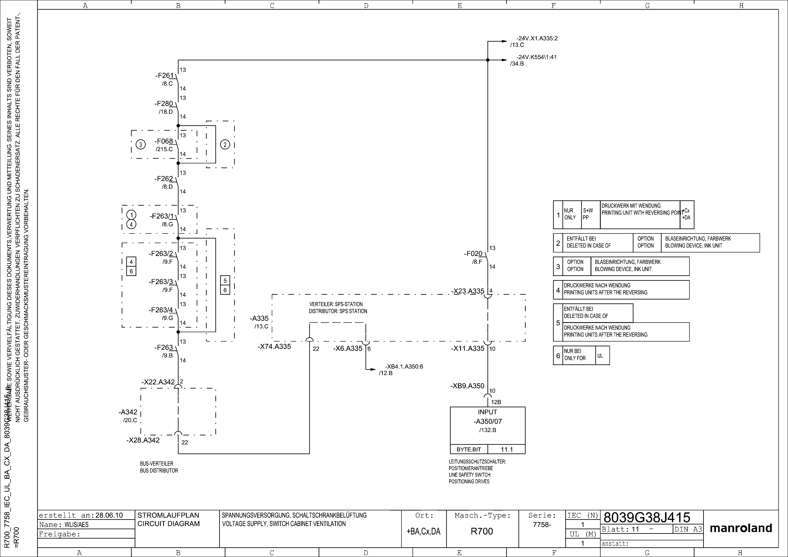

# +BA_Cx_DA — Sheet 11 of 247 — SPANNUNGSVERSORGUNG, SCHALTSCHRANKBELÜFTUNG

**VOLTAGE SUPPLY, SWITCH CABINET VENTILATION**

> Part of the manroland **R700** printing press IEC/UL circuit diagrams.
> Drawing class: **Stromlaufplan / Circuit diagram** (DIN A3).
> Document `+BA_Cx_DA` covers the **Printing units / main switch cabinet** machine section.

## At a glance

| Field | Value |
|---|---|
| Document | `+BA_Cx_DA`  (8039G38J415) |
| Sheet | **11** of 247 |
| Section (DE) | SPANNUNGSVERSORGUNG, SCHALTSCHRANKBELÜFTUNG |
| Section (EN) | VOLTAGE SUPPLY, SWITCH CABINET VENTILATION |
| Section type | POWER_SUPPLY — Voltage supply |
| Machine type | `R700` |
| Series | `7758` |
| Created | 28.06.10 |
| Replaces | — |
| Columns used | A, B, C, D, E, F, G, H |
| Path numbers | — |
| Labels on sheet | 119 |
| Cross-refs out | 16 |
| Cross-refs in | 23 |

**Previous:** [+BA_Cx_DA sheet 10](SHEET_0010.md) · **Next:** [+BA_Cx_DA sheet 12](SHEET_0012.md) · **Document TOC:** [_TOC.md](_TOC.md)  (+BA_Cx_DA) · **Master TOC:** [all sheets](../_MASTER_TOC.md)

## Sheet image (300 DPI, exact vector render)



_Rendered directly from the PDF vector layer at 300 DPI (1-bit), no OCR and no resampling. Use it to confirm anything ambiguous in the text below._

## Cross-references on this sheet

Each entry is a wire leaving this sheet. The printed token is `/sheet.column`; the link resolves to that sheet inside the same document.

| Ref | Target sheet | Col | Path | Destination on target | Target section | From col |
|---|---|---|---|---|---|---|
| `/13.C` | [+BA_Cx_DA sheet 13](SHEET_0013.md) | C | — | — | SPANNUNGSVERSORGUNG, SCHALTSCHRANKBELÜFTUNG | F |
| `/34.B` | [+BA_Cx_DA sheet 34](SHEET_0034.md) | B | — | — | BUSVERBINDUNGEN: RESERVE SIGNALE | F |
| `/8.C` | [+BA_Cx_DA sheet 8](SHEET_0008.md) | C | — | — | SPANNUNGSVERSORGUNG, SCHALTSCHRANKBELÜFTUNG | B |
| `/18.D` | [+BA_Cx_DA sheet 18](SHEET_0018.md) | D | — | — | SPANNUNGSVERSORGUNG, SCHALTSCHRANKBELÜFTUNG | B |
| `/215.C` | [+BA_Cx_DA sheet 215](SHEET_0215.md) | C | — | — | OPTION: BLASEINRICHTUNG, FARBWERK | B |
| `/8.D` | [+BA_Cx_DA sheet 8](SHEET_0008.md) | D | — | — | SPANNUNGSVERSORGUNG, SCHALTSCHRANKBELÜFTUNG | B |
| `/8.G` | [+BA_Cx_DA sheet 8](SHEET_0008.md) | G | — | — | SPANNUNGSVERSORGUNG, SCHALTSCHRANKBELÜFTUNG | B |
| `/9.F` | [+BA_Cx_DA sheet 9](SHEET_0009.md) | F | — | — | SPANNUNGSVERSORGUNG, SCHALTSCHRANKBELÜFTUNG | B |
| `/8.F` | [+BA_Cx_DA sheet 8](SHEET_0008.md) | F | — | — | SPANNUNGSVERSORGUNG, SCHALTSCHRANKBELÜFTUNG | E |
| `/9.F` | [+BA_Cx_DA sheet 9](SHEET_0009.md) | F | — | — | SPANNUNGSVERSORGUNG, SCHALTSCHRANKBELÜFTUNG | B |
| `/9.G` | [+BA_Cx_DA sheet 9](SHEET_0009.md) | G | — | — | SPANNUNGSVERSORGUNG, SCHALTSCHRANKBELÜFTUNG | B |
| `/13.C` | [+BA_Cx_DA sheet 13](SHEET_0013.md) | C | — | — | SPANNUNGSVERSORGUNG, SCHALTSCHRANKBELÜFTUNG | C |
| `/9.B` | [+BA_Cx_DA sheet 9](SHEET_0009.md) | B | — | — | SPANNUNGSVERSORGUNG, SCHALTSCHRANKBELÜFTUNG | B |
| `/12.B` | [+BA_Cx_DA sheet 12](SHEET_0012.md) | B | — | — | SPANNUNGSVERSORGUNG, SCHALTSCHRANKBELÜFTUNG | D |
| `/20.C` | [+BA_Cx_DA sheet 20](SHEET_0020.md) | C | — | — | BUSVERBINDUNGEN: SICHERHEITSBUS | A |
| `/132.B` | [+BA_Cx_DA sheet 132](SHEET_0132.md) | B | — | — | REFERENZMODUL | E |

### Incoming references (sheets that point here)

Every other sheet that sends a wire to this one. `Back-ref` is the token printed on *that* sheet; `Path` is its line number.

| From sheet | Cols | Back-ref | Path | Refs | What continues there |
|---|---|---|---|---|---|
| [+BA_Cx_DA#8](SHEET_0008.md) | C, D, F, G | `/8.C`, `/8.D`, `/8.F`, `/8.G` | — | 4 | — |
| [+BA_Cx_DA#9](SHEET_0009.md) | B, F, G | `/9.B`, `/9.F`, `/9.G` | — | 4 | — |
| [+BA_Cx_DA#12](SHEET_0012.md) | B | `/12.B` | — | 1 | XB4.1.A350:6 |
| [+BA_Cx_DA#13](SHEET_0013.md) | B, C | `/13.B`, `/13.C` | — | 2 | 24V.X1.A335:2 |
| [+BA_Cx_DA#18](SHEET_0018.md) | D | `/18.D` | — | 1 | — |
| [+BA_Cx_DA#20](SHEET_0020.md) | B | `/20.B` | — | 1 | — |
| [+BA_Cx_DA#34](SHEET_0034.md) | B | `/34.B` | — | 1 | 24V.K554\1:41 |
| [+BA_Cx_DA#132](SHEET_0132.md) | B | `/132.B` | — | 1 | — |
| [+BA_Cx_DA#162](SHEET_0162.md) | D | `/162.D` | — | 1 | — |
| [+BA_Cx_DA#166](SHEET_0166.md) | G | `/166.G` | — | 1 | — |
| [+BA_Cx_DA#168](SHEET_0168.md) | G | `/168.G` | — | 1 | — |
| [+BA_Cx_DA#174](SHEET_0174.md) | E, G | `/174.E`, `/174.G` | — | 2 | — |
| [+BA_Cx_DA#178](SHEET_0178.md) | F | `/178.F` | — | 1 | — |
| [+BA_Cx_DA#184](SHEET_0184.md) | F | `/184.F` | — | 1 | — |
| [+BA_Cx_DA#215](SHEET_0215.md) | C | `/215.C` | — | 1 | — |


## Devices on this sheet

| Tag | Class | Class meaning (IEC) | Col | Sub | Terminal | Sign |
|---|---|---|---|---|---|---|
| `F261` | F | Schutz / protection device (fuse, circuit breaker) | B | — | — | — |
| `F280` | F | Schutz / protection device (fuse, circuit breaker) | B | — | — | — |
| `F068` | F | Schutz / protection device (fuse, circuit breaker) | B | — | — | — |
| `F262` | F | Schutz / protection device (fuse, circuit breaker) | B | — | — | — |
| `A335` | A | Baugruppe / assembly, module, PC board | C | — | — | — |
| `F020` | F | Schutz / protection device (fuse, circuit breaker) | E | — | — | — |
| `F263/2` | F | Schutz / protection device (fuse, circuit breaker) | B | 2 | — | — |
| `F263/3` | F | Schutz / protection device (fuse, circuit breaker) | B | 3 | — | — |
| `F263/4` | F | Schutz / protection device (fuse, circuit breaker) | B | 4 | — | — |
| `F263` | F | Schutz / protection device (fuse, circuit breaker) | B | — | — | — |
| `F263/1` | F | Schutz / protection device (fuse, circuit breaker) | B | 1 | — | — |
| `A342` | A | Baugruppe / assembly, module, PC board | A | — | — | — |
| `A350/07` | A | Baugruppe / assembly, module, PC board | E | 07 | — | — |
| `X74.A335` | — | cross-device reference | C | — | — | — |
| `X23.A335` | — | cross-device reference | E | — | — | — |
| `X11.A335` | — | cross-device reference | E | — | — | — |
| `X22.A342` | — | cross-device reference | B | — | — | — |
| `X28.A342` | — | cross-device reference | B | — | — | — |
| `X6.A335` | — | cross-device reference | D | — | — | — |
| `11.1` | — | cross-device reference | F | — | — | — |
| `XB9.A350` | — | cross-device reference | E | — | — | — |
| `XB4.1.A350:6` | — | cross-device reference | D | — | 6 | — |

## Potentials / nets

| Potential | Count | Columns | Attached devices | Terminals |
|---|---|---|---|---|
| `24V` | 2 | F | `A335`, `K554\1`, `X1` | `2`, `41` |


A potential such as `L24+/4` or `M24+` is a named supply/return rail; every place it appears on this sheet is electrically common.

## Wire-end annotations (grouped as printed)

A wire that continues elsewhere is annotated with a small cluster: the destination description, the path/line number `#NN`, and the `/sheet.column` cross reference. Each row below is one such cluster exactly as it is grouped on the drawing.

| Col | Y | Path | Cross-ref | Text on the wire |
|---|---|---|---|---|
| F | 54.1 | — | — | `24V.X1.A335:2` |
| F | 64.1 | — | `/13.C` | — |
| F | 82.5 | — | — | `24V.K554\1:41` |
| F | 92.4 | — | `/34.B` | — |
| B | 101.7 | — | — | `13` |
| B | 109.4 | — | — | `F261` |
| B | 122.5 | — | `/8.C` | — |
| B | 130.0 | — | — | `14` |
| B | 144.2 | — | — | `13` |
| B | 151.9 | — | — | `F280` |
| B | 165.1 | — | `/18.D` | — |
| B | 172.5 | — | — | `14` |
| B | 200.9 | — | — | `13` |
| B | 208.6 | — | — | `F068` |
| B | 215.7 | — | — | `3 2` |
| B | 221.8 | — | `/215.C` | — |
| B | 229.2 | — | — | `14` |
| B | 257.6 | — | — | `13` |
| B | 265.3 | — | — | `F262` |
| B | 278.4 | — | `/8.D` | — |
| B | 285.9 | — | — | `14` |
| G | 308.2 | — | — | `1 NUR DRUCKWERK MIT WENDUNG PRINTING UNIT WITH REVERSING POINT` |
| B | 314.3 | — | — | `13` |
| F | 315.1 | — | — | `PP S+W` |
| D | 315.4 | — | — | `1 +Cx +DA` |
| B | 322.0 | — | — | `F263/1` |
| F | 325.9 | — | — | `ONLY` |
| B | 335.1 | — | `/8.G` | — |
| A | 336.2 | — | — | `4` |
| B | 342.6 | — | — | `14` |
| F | 357.8 | — | — | `2 ENTFÄLLT BEI DELETED IN CASE OF` |
| G | 357.8 | — | — | `OPTION OPTION` |
| H | 357.8 | — | — | `BLASEINRICHTUNG, FARBWERK BLOWING DEVICE, INK UNIT` |
| B | 370.9 | — | — | `13` |
| E | 370.9 | — | — | `13` |
| B | 378.7 | — | — | `F263/2` |
| E | 378.7 | — | — | `F020` |
| B | 391.8 | — | `/9.F` | — |
| E | 391.8 | — | `/8.F` | — |
| A | 392.2 | — | — | `4` |
| G | 393.2 | — | — | `3 OPTION OPTION BLASEINRICHTUNG, FARBWERK BLOWING DEVICE, INK UNIT` |
| B | 399.3 | — | — | `14` |
| E | 399.3 | — | — | `14` |
| A | 406.4 | — | — | `6` |
| B | 413.5 | — | — | `13` |
| B | 420.6 | — | — | `5` |
| B | 421.2 | — | — | `F263/3` |
| G | 428.6 | — | — | `4 DRUCKWERKE NACH WENDUNG PRINTING UNITS AFTER THE REVERSING` |
| B | 434.3 | — | `/9.F` | — |
| B | 434.7 | — | — | `6` |
| E | 435.4 | — | — | `X23.A335 4` |
| B | 441.8 | — | — | `14` |
| B | 456.0 | — | — | `13` |
| D | 457.0 | — | — | `DISTRIBUTOR: SPS STATION VERTEILER: SPS STATION` |
| B | 463.8 | — | — | `F263/4` |
| F | 464.1 | — | — | `ENTFÄLLT BEI DELETED IN CASE OF` |
| C | 476.5 | — | — | `A335` |
| B | 476.8 | — | `/9.G` | — |
| F | 483.6 | — | — | `5` |
| B | 484.3 | — | — | `14` |
| C | 489.6 | — | `/13.C` | — |
| G | 492.4 | — | — | `DRUCKWERKE NACH WENDUNG PRINTING UNITS AFTER THE REVERSING` |
| B | 512.7 | — | — | `13` |
| C | 519.0 | — | — | `X74.A335 22` |
| B | 520.5 | — | — | `F263` |
| D | 521.9 | — | — | `X6.A335 6` |
| E | 521.9 | — | — | `X11.A335 10` |
| F | 527.8 | — | — | `6 NUR BEI` |
| B | 533.5 | — | `/9.B` | — |
| F | 534.9 | — | — | `ONLY FOR UL` |
| B | 541.0 | — | — | `14` |
| D | 550.2 | — | — | `XB4.1.A350:6` |
| D | 560.1 | — | `/12.B` | — |
| B | 572.9 | — | — | `X22.A342 2` |
| E | 578.6 | — | — | `XB9.A350 10` |
| E | 604.1 | — | — | `12B` |
| A | 618.3 | — | — | `A342` |
| E | 618.6 | — | — | `INPUT` |
| A | 631.3 | — | `/20.C` | — |
| E | 632.4 | — | — | `A350/07` |
| E | 646.2 | — | `/132.B` | — |
| B | 660.8 | — | — | `X28.A342 22` |
| E | 675.3 | — | — | `BYTE.BIT 11.1` |
| E | 695.2 | — | — | `LEITUNGSSCHUTZSCHALTER: POSITIONIERANTRIEBE LINE SAFETY SWITCH: POSITIONING DRIVES` |
| B | 697.9 | — | — | `BUS VERTEILER BUS DISTRIBUTOR` |


## Reconstructed tables

This sheet carries tabular content (pin map / terminal assignment / index). The grid below was rebuilt from the drawing's own rule lines, so each row is exactly one physical row of the table.

### Table 1 — 2 data rows × 2 columns (at x=680.3, y=90.7)

| F020 /8.F X23.A335 X11.A335 XB9.A350 | /34.B 13 14 4 10 10 12B |
|---|---|
| `INPUT` | `A350/07 /132.B` |
| `BYTE.BIT` | `11.1` |


## Notes and free text on this sheet

| Text | Col | Y (pt) |
|---|---|---|
| `VERTEILER: SPS STATION` | D | 456.99 |
| `DISTRIBUTOR: SPS STATION` | D | 467.62 |
| `BUS VERTEILER` | B | 697.94 |
| `BUS DISTRIBUTOR` | B | 708.57 |
| `12B` | E | 604.07 |
| `INPUT` | E | 618.59 |
| `BYTE.BIT` | E | 675.84 |
| `LEITUNGSSCHUTZSCHALTER:` | E | 695.25 |
| `POSITIONIERANTRIEBE` | E | 705.23 |
| `LINE SAFETY SWITCH:` | E | 715.14 |
| `POSITIONING DRIVES` | E | 725.12 |
| `DRUCKWERK MIT WENDUNG` | G | 308.16 |
| `PRINTING UNIT WITH REVERSING POINT` | G | 318.8 |
| `NUR` | F | 315.27 |
| `ONLY` | F | 325.92 |
| `S+W` | F | 315.13 |
| `PP` | F | 325.76 |
| `+Cx` | G | 315.37 |
| `+DA` | G | 325.91 |
| `ENTFÄLLT BEI` | F | 357.75 |
| `DELETED IN CASE OF` | F | 368.41 |
| `OPTION` | G | 357.76 |
| `BLASEINRICHTUNG, FARBWERK` | H | 357.78 |
| `BLOWING DEVICE, INK UNIT` | G | 368.4 |
| `DRUCKWERKE NACH WENDUNG` | F | 428.64 |
| `PRINTING UNITS AFTER THE REVERSING` | G | 439.29 |
| `OPTION` | F | 393.2 |
| `BLASEINRICHTUNG, FARBWERK` | G | 393.21 |
| `NUR BEI` | F | 527.82 |
| `ONLY FOR` | F | 538.51 |
| `UL` | F | 534.9 |

## Complete label inventory (exact text from the drawing)

Every text object inside the drawing area of this sheet, in DIN reading order (column A→H, then top→bottom). This is the authoritative list: if a string is not here it is not printed on this sheet.

| Col | Y | X | Dir | Type | Text |
|---|---|---|---|---|---|
| A | 321.5 | 196.7 | → | number | `1` |
| A | 336.2 | 196.4 | → | number | `4` |
| A | 392.2 | 196.0 | → | number | `4` |
| A | 406.4 | 196.0 | → | number | `6` |
| A | 618.3 | 179.1 | → | device tag | `A342` |
| A | 631.3 | 186.2 | → | cross-reference | `/20.C` |
| B | 101.7 | 271.3 | → | number | `13` |
| B | 109.4 | 235.0 | → | device tag | `F261` |
| B | 122.5 | 244.9 | → | cross-reference | `/8.C` |
| B | 130.0 | 271.3 | → | number | `14` |
| B | 144.2 | 271.3 | → | number | `13` |
| B | 152.0 | 233.6 | → | device tag | `F280` |
| B | 165.0 | 240.1 | → | cross-reference | `/18.D` |
| B | 172.5 | 271.3 | → | number | `14` |
| B | 200.9 | 271.3 | → | number | `13` |
| B | 208.6 | 233.6 | → | device tag | `F068` |
| B | 215.7 | 210.6 | → | number | `3` |
| B | 215.7 | 338.2 | → | number | `2` |
| B | 221.7 | 235.3 | → | cross-reference | `/215.C` |
| B | 229.2 | 271.3 | → | number | `14` |
| B | 257.6 | 271.3 | → | number | `13` |
| B | 265.3 | 233.6 | → | device tag | `F262` |
| B | 278.4 | 244.9 | → | cross-reference | `/8.D` |
| B | 285.9 | 271.3 | → | number | `14` |
| B | 314.3 | 271.3 | → | number | `13` |
| B | 322.0 | 226.2 | → | device tag | `F263/1` |
| B | 335.1 | 244.6 | → | cross-reference | `/8.G` |
| B | 342.6 | 271.3 | → | number | `14` |
| B | 371.0 | 271.3 | → | number | `13` |
| B | 378.7 | 224.8 | → | device tag | `F263/2` |
| B | 391.8 | 245.8 | → | cross-reference | `/9.F` |
| B | 399.3 | 271.3 | → | number | `14` |
| B | 413.5 | 271.3 | → | number | `13` |
| B | 420.6 | 337.7 | → | number | `5` |
| B | 421.3 | 224.8 | → | device tag | `F263/3` |
| B | 434.3 | 245.8 | → | cross-reference | `/9.F` |
| B | 434.7 | 337.7 | → | number | `6` |
| B | 441.8 | 271.3 | → | number | `14` |
| B | 456.0 | 271.3 | → | number | `13` |
| B | 463.8 | 224.8 | → | device tag | `F263/4` |
| B | 476.8 | 244.6 | → | cross-reference | `/9.G` |
| B | 484.3 | 271.3 | → | number | `14` |
| B | 512.7 | 271.3 | → | number | `13` |
| B | 520.5 | 233.6 | → | device tag | `F263` |
| B | 533.5 | 245.2 | → | cross-reference | `/9.B` |
| B | 541.0 | 271.3 | → | number | `14` |
| B | 572.9 | 214.0 | → | device ref | `X22.A342` |
| B | 572.9 | 271.8 | → | number | `2` |
| B | 660.8 | 191.1 | → | device ref | `X28.A342` |
| B | 665.0 | 274.4 | → | number | `22` |
| B | 697.9 | 211.7 | → | text | `BUS VERTEILER` |
| B | 708.6 | 211.7 | → | text | `BUS DISTRIBUTOR` |
| C | 476.5 | 377.6 | → | device tag | `A335` |
| C | 489.6 | 384.7 | → | cross-reference | `/13.C` |
| C | 519.0 | 389.5 | → | device ref | `X74.A335` |
| C | 523.3 | 472.8 | → | number | `22` |
| D | 457.0 | 467.7 | → | text | `VERTEILER: SPS STATION` |
| D | 467.6 | 466.9 | → | text | `DISTRIBUTOR: SPS STATION` |
| D | 521.9 | 503.4 | → | device ref | `X6.A335` |
| D | 523.3 | 555.3 | → | number | `6` |
| D | 550.2 | 582.2 | → | device ref | `XB4.1.A350:6` |
| D | 560.1 | 572.6 | → | cross-reference | `/12.B` |
| E | 371.0 | 739.0 | → | number | `13` |
| E | 378.7 | 701.3 | → | device tag | `F020` |
| E | 391.8 | 713.5 | → | cross-reference | `/8.F` |
| E | 399.3 | 739.0 | → | number | `14` |
| E | 435.4 | 681.7 | → | device ref | `X23.A335` |
| E | 435.4 | 739.6 | → | number | `4` |
| E | 521.9 | 681.7 | → | device ref | `X11.A335` |
| E | 523.3 | 739.0 | → | number | `10` |
| E | 578.6 | 680.6 | → | device ref | `XB9.A350` |
| E | 587.1 | 739.0 | → | number | `10` |
| E | 604.1 | 741.8 | → | text | `12B` |
| E | 618.6 | 722.1 | → | text | `INPUT` |
| E | 632.4 | 715.6 | → | device tag | `A350/07` |
| E | 646.2 | 724.4 | → | cross-reference | `/132.B` |
| E | 675.8 | 690.2 | → | text | `BYTE.BIT` |
| E | 695.2 | 678.3 | → | text | `LEITUNGSSCHUTZSCHALTER:` |
| E | 705.2 | 678.3 | → | text | `POSITIONIERANTRIEBE` |
| E | 715.1 | 678.3 | → | text | `LINE SAFETY SWITCH:` |
| E | 725.1 | 678.3 | → | text | `POSITIONING DRIVES` |
| F | 54.1 | 780.7 | → | potential | `24V.X1.A335:2` |
| F | 64.1 | 771.0 | → | cross-reference | `/13.C` |
| F | 82.5 | 780.7 | → | potential | `24V.K554\1:41` |
| F | 92.4 | 771.0 | → | cross-reference | `/34.B` |
| F | 315.1 | 881.3 | → | text | `S+W` |
| F | 315.3 | 852.4 | → | text | `NUR` |
| F | 320.6 | 840.8 | → | number | `1` |
| F | 325.8 | 880.7 | → | text | `PP` |
| F | 325.9 | 852.9 | → | text | `ONLY` |
| F | 357.8 | 856.6 | → | text | `ENTFÄLLT BEI` |
| F | 363.1 | 840.5 | → | number | `2` |
| F | 368.4 | 856.6 | → | text | `DELETED IN CASE OF` |
| F | 393.2 | 857.2 | → | text | `OPTION` |
| F | 398.5 | 840.3 | → | number | `3` |
| F | 403.8 | 857.2 | → | text | `OPTION` |
| F | 428.6 | 852.4 | → | text | `DRUCKWERKE NACH WENDUNG` |
| F | 434.0 | 840.5 | → | number | `4` |
| F | 464.1 | 852.4 | → | text | `ENTFÄLLT BEI` |
| F | 474.7 | 852.4 | → | text | `DELETED IN CASE OF` |
| F | 483.6 | 840.3 | → | number | `5` |
| F | 492.4 | 852.4 | → | text | `DRUCKWERKE NACH WENDUNG` |
| F | 527.8 | 852.4 | → | text | `NUR BEI` |
| F | 533.2 | 840.5 | → | number | `6` |
| F | 534.9 | 902.7 | → | text | `UL` |
| F | 538.5 | 852.9 | → | text | `ONLY FOR` |
| F | 675.3 | 756.4 | → | device ref | `11.1` |
| G | 308.2 | 909.1 | → | text | `DRUCKWERK MIT WENDUNG` |
| G | 315.4 | 1030.8 | → | text | `+Cx` |
| G | 318.8 | 909.1 | → | text | `PRINTING UNIT WITH REVERSING POINT` |
| G | 325.9 | 1030.8 | → | text | `+DA` |
| G | 357.8 | 963.5 | → | text | `OPTION` |
| G | 368.4 | 963.5 | → | text | `OPTION` |
| G | 368.4 | 1005.4 | → | text | `BLOWING DEVICE, INK UNIT` |
| G | 393.2 | 899.1 | → | text | `BLASEINRICHTUNG, FARBWERK` |
| G | 403.8 | 899.1 | → | text | `BLOWING DEVICE, INK UNIT` |
| G | 439.3 | 852.4 | → | text | `PRINTING UNITS AFTER THE REVERSING` |
| G | 503.1 | 852.4 | → | text | `PRINTING UNITS AFTER THE REVERSING` |
| H | 357.8 | 1005.4 | → | text | `BLASEINRICHTUNG, FARBWERK` |

## Reading-order text block

The same content as a plain block, grouped by DIN column — convenient to paste or to match against a visual description.

```text
=== Column A ===
 321.5  196.7  numeric      1
 336.2  196.4  numeric      4
 392.2  196.0  numeric      4
 406.4  196.0  numeric      6
 618.3  179.1  devtag       A342
 631.3  186.2  xref         /20.C
=== Column B ===
 101.7  271.3  numeric      13
 109.4  235.0  devtag       F261
 122.5  244.9  xref         /8.C
 130.0  271.3  numeric      14
 144.2  271.3  numeric      13
 152.0  233.6  devtag       F280
 165.0  240.1  xref         /18.D
 172.5  271.3  numeric      14
 200.9  271.3  numeric      13
 208.6  233.6  devtag       F068
 215.7  210.6  numeric      3
 215.7  338.2  numeric      2
 221.7  235.3  xref         /215.C
 229.2  271.3  numeric      14
 257.6  271.3  numeric      13
 265.3  233.6  devtag       F262
 278.4  244.9  xref         /8.D
 285.9  271.3  numeric      14
 314.3  271.3  numeric      13
 322.0  226.2  devtag       F263/1
 335.1  244.6  xref         /8.G
 342.6  271.3  numeric      14
 371.0  271.3  numeric      13
 378.7  224.8  devtag       F263/2
 391.8  245.8  xref         /9.F
 399.3  271.3  numeric      14
 413.5  271.3  numeric      13
 420.6  337.7  numeric      5
 421.3  224.8  devtag       F263/3
 434.3  245.8  xref         /9.F
 434.7  337.7  numeric      6
 441.8  271.3  numeric      14
 456.0  271.3  numeric      13
 463.8  224.8  devtag       F263/4
 476.8  244.6  xref         /9.G
 484.3  271.3  numeric      14
 512.7  271.3  numeric      13
 520.5  233.6  devtag       F263
 533.5  245.2  xref         /9.B
 541.0  271.3  numeric      14
 572.9  214.0  devref       X22.A342
 572.9  271.8  numeric      2
 660.8  191.1  devref       X28.A342
 665.0  274.4  numeric      22
 697.9  211.7  text         BUS VERTEILER
 708.6  211.7  text         BUS DISTRIBUTOR
=== Column C ===
 476.5  377.6  devtag       A335
 489.6  384.7  xref         /13.C
 519.0  389.5  devref       X74.A335
 523.3  472.8  numeric      22
=== Column D ===
 457.0  467.7  text         VERTEILER: SPS STATION
 467.6  466.9  text         DISTRIBUTOR: SPS STATION
 521.9  503.4  devref       X6.A335
 523.3  555.3  numeric      6
 550.2  582.2  devref       XB4.1.A350:6
 560.1  572.6  xref         /12.B
=== Column E ===
 371.0  739.0  numeric      13
 378.7  701.3  devtag       F020
 391.8  713.5  xref         /8.F
 399.3  739.0  numeric      14
 435.4  681.7  devref       X23.A335
 435.4  739.6  numeric      4
 521.9  681.7  devref       X11.A335
 523.3  739.0  numeric      10
 578.6  680.6  devref       XB9.A350
 587.1  739.0  numeric      10
 604.1  741.8  text         12B
 618.6  722.1  text         INPUT
 632.4  715.6  devtag       A350/07
 646.2  724.4  xref         /132.B
 675.8  690.2  text         BYTE.BIT
 695.2  678.3  text         LEITUNGSSCHUTZSCHALTER:
 705.2  678.3  text         POSITIONIERANTRIEBE
 715.1  678.3  text         LINE SAFETY SWITCH:
 725.1  678.3  text         POSITIONING DRIVES
=== Column F ===
  54.1  780.7  net          24V.X1.A335:2
  64.1  771.0  xref         /13.C
  82.5  780.7  net          24V.K554\1:41
  92.4  771.0  xref         /34.B
 315.1  881.3  text         S+W
 315.3  852.4  text         NUR
 320.6  840.8  numeric      1
 325.8  880.7  text         PP
 325.9  852.9  text         ONLY
 357.8  856.6  text         ENTFÄLLT BEI
 363.1  840.5  numeric      2
 368.4  856.6  text         DELETED IN CASE OF
 393.2  857.2  text         OPTION
 398.5  840.3  numeric      3
 403.8  857.2  text         OPTION
 428.6  852.4  text         DRUCKWERKE NACH WENDUNG
 434.0  840.5  numeric      4
 464.1  852.4  text         ENTFÄLLT BEI
 474.7  852.4  text         DELETED IN CASE OF
 483.6  840.3  numeric      5
 492.4  852.4  text         DRUCKWERKE NACH WENDUNG
 527.8  852.4  text         NUR BEI
 533.2  840.5  numeric      6
 534.9  902.7  text         UL
 538.5  852.9  text         ONLY FOR
 675.3  756.4  devref       11.1
=== Column G ===
 308.2  909.1  text         DRUCKWERK MIT WENDUNG
 315.4 1030.8  text         +Cx
 318.8  909.1  text         PRINTING UNIT WITH REVERSING POINT
 325.9 1030.8  text         +DA
 357.8  963.5  text         OPTION
 368.4  963.5  text         OPTION
 368.4 1005.4  text         BLOWING DEVICE, INK UNIT
 393.2  899.1  text         BLASEINRICHTUNG, FARBWERK
 403.8  899.1  text         BLOWING DEVICE, INK UNIT
 439.3  852.4  text         PRINTING UNITS AFTER THE REVERSING
 503.1  852.4  text         PRINTING UNITS AFTER THE REVERSING
=== Column H ===
 357.8 1005.4  text         BLASEINRICHTUNG, FARBWERK
```

---
_Generated from the PDF vector text layer; no OCR. Source: `R700_7758_IEC_UL_BA_CX_DA_8039G38J415_p`, sheet 11._
