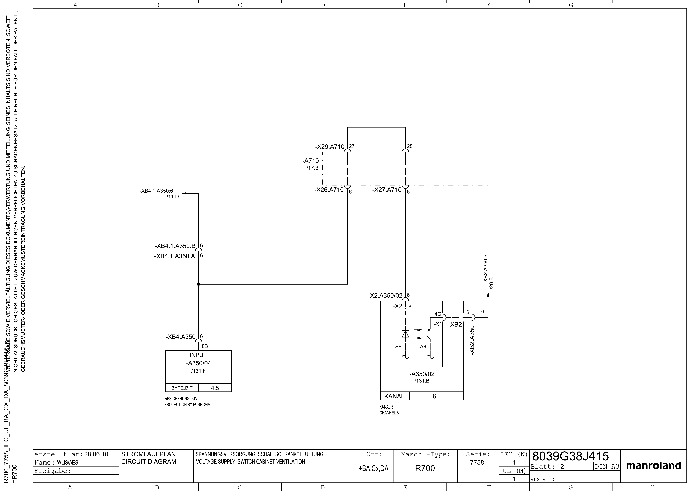

# +BA_Cx_DA — Sheet 12 of 247 — SPANNUNGSVERSORGUNG, SCHALTSCHRANKBELÜFTUNG

**VOLTAGE SUPPLY, SWITCH CABINET VENTILATION**

> Part of the manroland **R700** printing press IEC/UL circuit diagrams.
> Drawing class: **Stromlaufplan / Circuit diagram** (DIN A3).
> Document `+BA_Cx_DA` covers the **Printing units / main switch cabinet** machine section.

## At a glance

| Field | Value |
|---|---|
| Document | `+BA_Cx_DA`  (8039G38J415) |
| Sheet | **12** of 247 |
| Section (DE) | SPANNUNGSVERSORGUNG, SCHALTSCHRANKBELÜFTUNG |
| Section (EN) | VOLTAGE SUPPLY, SWITCH CABINET VENTILATION |
| Section type | POWER_SUPPLY — Voltage supply |
| Machine type | `R700` |
| Series | `7758` |
| Created | 28.06.10 |
| Replaces | — |
| Columns used | B, C, D, E, F |
| Path numbers | — |
| Labels on sheet | 45 |
| Cross-refs out | 5 |
| Cross-refs in | 14 |

**Previous:** [+BA_Cx_DA sheet 11](SHEET_0011.md) · **Next:** [+BA_Cx_DA sheet 13](SHEET_0013.md) · **Document TOC:** [_TOC.md](_TOC.md)  (+BA_Cx_DA) · **Master TOC:** [all sheets](../_MASTER_TOC.md)

## Sheet image (300 DPI, exact vector render)



_Rendered directly from the PDF vector layer at 300 DPI (1-bit), no OCR and no resampling. Use it to confirm anything ambiguous in the text below._

## Cross-references on this sheet

Each entry is a wire leaving this sheet. The printed token is `/sheet.column`; the link resolves to that sheet inside the same document.

| Ref | Target sheet | Col | Path | Destination on target | Target section | From col |
|---|---|---|---|---|---|---|
| `/17.B` | [+BA_Cx_DA sheet 17](SHEET_0017.md) | B | — | — | SPANNUNGSVERSORGUNG, SCHALTSCHRANKBELÜFTUNG | D |
| `/11.D` | [+BA_Cx_DA sheet 11](SHEET_0011.md) | D | — | XB4.1.A350:6 | SPANNUNGSVERSORGUNG, SCHALTSCHRANKBELÜFTUNG | B |
| `/20.B` | [+BA_Cx_DA sheet 20](SHEET_0020.md) | B | — | XB2.A350:6 | BUSVERBINDUNGEN: SICHERHEITSBUS | F |
| `/131.F` | [+BA_Cx_DA sheet 131](SHEET_0131.md) | F | — | — | REFERENZMODUL | B |
| `/131.B` | [+BA_Cx_DA sheet 131](SHEET_0131.md) | B | — | — | REFERENZMODUL | E |

### Incoming references (sheets that point here)

Every other sheet that sends a wire to this one. `Back-ref` is the token printed on *that* sheet; `Path` is its line number.

| From sheet | Cols | Back-ref | Path | Refs | What continues there |
|---|---|---|---|---|---|
| [+BA_Cx_DA#11](SHEET_0011.md) | D | `/11.D` | — | 1 | — |
| [+BA_Cx_DA#17](SHEET_0017.md) | B | `/17.B` | — | 1 | — |
| [+BA_Cx_DA#20](SHEET_0020.md) | B | `/20.B` | — | 1 | XB2.A350:6 |
| [+BA_Cx_DA#131](SHEET_0131.md) | B, F | `/131.B`, `/131.F` | — | 2 | — |
| [+BA_Cx_DA#153](SHEET_0153.md) | F | `/153.F` | — | 2 | — |
| [+BA_Cx_DA#159](SHEET_0159.md) | F, G, H | `/159.F`, `/159.G`, `/159.H` | — | 3 | — |
| [+BA_Cx_DA#176](SHEET_0176.md) | E | `/176.E` | — | 1 | — |
| [+BA_Cx_DA#177](SHEET_0177.md) | E | `/177.E` | — | 1 | — |
| [+BA_Cx_DA#179](SHEET_0179.md) | C | `/179.C` | — | 2 | — |


## Devices on this sheet

| Tag | Class | Class meaning (IEC) | Col | Sub | Terminal | Sign |
|---|---|---|---|---|---|---|
| `A710` | A | Baugruppe / assembly, module, PC board | D | — | — | — |
| `A350/04` | A | Baugruppe / assembly, module, PC board | B | 04 | — | — |
| `S6` | S | Schalter / switch | E | — | — | — |
| `A6` | A | Baugruppe / assembly, module, PC board | E | — | — | — |
| `X1` | X | Klemme / terminal, plug connector | E | — | — | — |
| `X2` | X | Klemme / terminal, plug connector | E | — | — | — |
| `XB2` | XB |  | F | — | — | — |
| `A350/02` | A | Baugruppe / assembly, module, PC board | E | 02 | — | — |
| `X29.A710` | — | cross-device reference | D | — | — | — |
| `X26.A710` | — | cross-device reference | D | — | — | — |
| `X27.A710` | — | cross-device reference | E | — | — | — |
| `XB4.A350` | — | cross-device reference | B | — | — | — |
| `4.5` | — | cross-device reference | C | — | — | — |
| `XB4.1.A350.B` | — | cross-device reference | B | — | — | — |
| `XB4.1.A350.A` | — | cross-device reference | B | — | — | — |
| `XB2.A350` | — | cross-device reference | F | — | — | — |
| `XB4.1.A350:6` | — | cross-device reference | B | — | 6 | — |
| `XB2.A350:6` | — | cross-device reference | F | — | 6 | — |

## Potentials / nets

_No named potentials on this sheet._

## Wire-end annotations (grouped as printed)

A wire that continues elsewhere is annotated with a small cluster: the destination description, the path/line number `#NN`, and the `/sheet.column` cross reference. Each row below is one such cluster exactly as it is grouped on the drawing.

| Col | Y | Path | Cross-ref | Text on the wire |
|---|---|---|---|---|
| D | 246.9 | — | — | `X29.A710 27 28` |
| D | 271.0 | — | — | `A710` |
| D | 284.1 | — | `/17.B` | — |
| D | 320.6 | — | — | `X26.A710 6 X27.A710 6` |
| B | 323.4 | — | `/11.D` | `XB4.1.A350:6` |
| B | 417.0 | — | — | `XB4.1.A350.B 6` |
| B | 434.0 | — | — | `XB4.1.A350.A 6` |
| F | 436.5 | — | `/20.B` | `XB2.A350:6` |
| E | 502.0 | — | — | `X2.A350/02 6` |
| E | 520.5 | — | — | `X2` |
| E | 521.9 | — | — | `6 6` |
| F | 530.4 | — | — | `6` |
| E | 534.7 | — | — | `4C` |
| E | 551.6 | — | — | `X1` |
| F | 551.7 | — | — | `XB2` |
| F | 557.9 | — | — | `XB2.A350` |
| B | 572.9 | — | — | `XB4.A350 6` |
| C | 589.9 | — | — | `8B` |
| E | 590.6 | — | — | `S6 A6` |
| B | 604.4 | — | — | `INPUT` |
| B | 618.3 | — | — | `A350/04` |
| B | 632.0 | — | `/131.F` | — |
| E | 636.7 | — | — | `A350/02` |
| E | 649.0 | — | `/131.B` | — |
| B | 661.1 | — | — | `BYTE.BIT 4.5` |
| E | 674.9 | — | — | `KANAL 6` |
| B | 681.1 | — | — | `PROTECTION BY FUSE: 24V ABSICHERUNG: 24V` |
| E | 695.3 | — | — | `KANAL 6 CHANNEL 6` |


## Reconstructed tables

This sheet carries tabular content (pin map / terminal assignment / index). The grid below was rebuilt from the drawing's own rule lines, so each row is exactly one physical row of the table.

### Table 1 — 2 data rows × 2 columns (at x=283.5, y=487.6)

| XB4.A350 | 6 8B |
|---|---|
| `INPUT` | `A350/04 /131.F` |
| `BYTE.BIT` | `4.5` |


### Table 2 — 4 data rows × 6 columns (at x=595.3, y=218.3)

| 27 6 | X27.A710 | 28 6 |  |  | XB2.A350:6 |
|---|---|---|---|---|---|
|  | `X2.A350/02` | `6` |  |  |  |
|  | `X2 S6` | `6 A6` | `4C X1` | `XB2` | `6 6 XB2.A350` |
|  |  | `A350/02 /131.B` |  |  |  |
|  | `KANAL` |  | `6` |  |  |


## Notes and free text on this sheet

| Text | Col | Y (pt) |
|---|---|---|
| `8B` | C | 589.88 |
| `INPUT` | B | 604.42 |
| `BYTE.BIT` | B | 661.67 |
| `ABSICHERUNG: 24V` | B | 681.12 |
| `PROTECTION BY FUSE: 24V` | B | 691.04 |
| `KANAL 6` | E | 695.27 |
| `CHANNEL 6` | E | 705.21 |
| `4C` | E | 534.66 |
| `KANAL` | E | 674.94 |
| `X2.A350/02` | E | 502.04 |

## Complete label inventory (exact text from the drawing)

Every text object inside the drawing area of this sheet, in DIN reading order (column A→H, then top→bottom). This is the authoritative list: if a string is not here it is not printed on this sheet.

| Col | Y | X | Dir | Type | Text |
|---|---|---|---|---|---|
| B | 323.4 | 239.2 | → | device ref | `XB4.1.A350:6` |
| B | 333.4 | 285.4 | → | cross-reference | `/11.D` |
| B | 417.0 | 265.0 | → | device ref | `XB4.1.A350.B` |
| B | 434.7 | 264.2 | → | device ref | `XB4.1.A350.A` |
| B | 572.9 | 283.7 | → | device ref | `XB4.A350` |
| B | 604.4 | 325.3 | → | text | `INPUT` |
| B | 618.3 | 318.8 | → | device tag | `A350/04` |
| B | 632.0 | 327.8 | → | cross-reference | `/131.F` |
| B | 661.7 | 293.4 | → | text | `BYTE.BIT` |
| B | 681.1 | 282.3 | → | text | `ABSICHERUNG: 24V` |
| B | 691.0 | 281.5 | → | text | `PROTECTION BY FUSE: 24V` |
| C | 417.0 | 342.7 | → | number | `6` |
| C | 434.0 | 342.7 | → | number | `6` |
| C | 572.9 | 342.7 | → | number | `6` |
| C | 589.9 | 345.5 | → | text | `8B` |
| C | 661.1 | 361.7 | → | device ref | `4.5` |
| D | 246.9 | 540.0 | → | device ref | `X29.A710` |
| D | 246.9 | 597.8 | → | number | `27` |
| D | 271.0 | 517.9 | → | device tag | `A710` |
| D | 284.1 | 525.3 | → | cross-reference | `/17.B` |
| D | 320.6 | 538.6 | → | device ref | `X26.A710` |
| D | 324.9 | 597.8 | → | number | `6` |
| E | 246.9 | 697.0 | → | number | `28` |
| E | 320.6 | 637.8 | → | device ref | `X27.A710` |
| E | 324.9 | 697.0 | → | number | `6` |
| E | 502.0 | 630.4 | → | text | `X2.A350/02` |
| E | 502.1 | 697.0 | → | number | `6` |
| E | 520.5 | 672.9 | → | device tag | `X2` |
| E | 521.9 | 699.9 | → | number | `6` |
| E | 534.7 | 744.7 | → | text | `4C` |
| E | 551.6 | 743.5 | → | device tag | `X1` |
| E | 590.6 | 674.1 | → | device tag | `S6` |
| E | 590.6 | 716.6 | → | device tag | `A6` |
| E | 636.7 | 701.4 | → | device tag | `A350/02` |
| E | 649.0 | 710.2 | → | cross-reference | `/131.B` |
| E | 674.9 | 658.2 | → | text | `KANAL` |
| E | 674.9 | 741.3 | → | number | `6` |
| E | 695.3 | 650.0 | → | text | `KANAL 6` |
| E | 705.2 | 650.3 | → | text | `CHANNEL 6` |
| F | 436.5 | 828.0 | ↕ | device ref | `XB2.A350:6` |
| F | 475.4 | 837.9 | ↕ | cross-reference | `/20.B` |
| F | 530.4 | 824.6 | → | number | `6` |
| F | 531.8 | 799.1 | → | number | `6` |
| F | 551.7 | 767.9 | → | device tag | `XB2` |
| F | 557.9 | 803.9 | ↕ | device ref | `XB2.A350` |

## Reading-order text block

The same content as a plain block, grouped by DIN column — convenient to paste or to match against a visual description.

```text
=== Column B ===
 323.4  239.2  devref       XB4.1.A350:6
 333.4  285.4  xref         /11.D
 417.0  265.0  devref       XB4.1.A350.B
 434.7  264.2  devref       XB4.1.A350.A
 572.9  283.7  devref       XB4.A350
 604.4  325.3  text         INPUT
 618.3  318.8  devtag       A350/04
 632.0  327.8  xref         /131.F
 661.7  293.4  text         BYTE.BIT
 681.1  282.3  text         ABSICHERUNG: 24V
 691.0  281.5  text         PROTECTION BY FUSE: 24V
=== Column C ===
 417.0  342.7  numeric      6
 434.0  342.7  numeric      6
 572.9  342.7  numeric      6
 589.9  345.5  text         8B
 661.1  361.7  devref       4.5
=== Column D ===
 246.9  540.0  devref       X29.A710
 246.9  597.8  numeric      27
 271.0  517.9  devtag       A710
 284.1  525.3  xref         /17.B
 320.6  538.6  devref       X26.A710
 324.9  597.8  numeric      6
=== Column E ===
 246.9  697.0  numeric      28
 320.6  637.8  devref       X27.A710
 324.9  697.0  numeric      6
 502.0  630.4  text         X2.A350/02
 502.1  697.0  numeric      6
 520.5  672.9  devtag       X2
 521.9  699.9  numeric      6
 534.7  744.7  text         4C
 551.6  743.5  devtag       X1
 590.6  674.1  devtag       S6
 590.6  716.6  devtag       A6
 636.7  701.4  devtag       A350/02
 649.0  710.2  xref         /131.B
 674.9  658.2  text         KANAL
 674.9  741.3  numeric      6
 695.3  650.0  text         KANAL 6
 705.2  650.3  text         CHANNEL 6
=== Column F ===
 436.5  828.0  devref       XB2.A350:6
 475.4  837.9  xref         /20.B
 530.4  824.6  numeric      6
 531.8  799.1  numeric      6
 551.7  767.9  devtag       XB2
 557.9  803.9  devref       XB2.A350
```

---
_Generated from the PDF vector text layer; no OCR. Source: `R700_7758_IEC_UL_BA_CX_DA_8039G38J415_p`, sheet 12._
