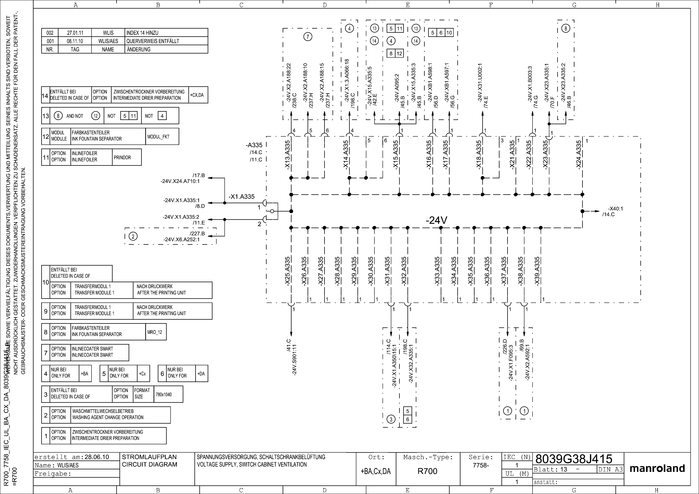

# +BA_Cx_DA — Sheet 13 of 247 — SPANNUNGSVERSORGUNG, SCHALTSCHRANKBELÜFTUNG

**VOLTAGE SUPPLY, SWITCH CABINET VENTILATION**

> Part of the manroland **R700** printing press IEC/UL circuit diagrams.
> Drawing class: **Stromlaufplan / Circuit diagram** (DIN A3).
> Document `+BA_Cx_DA` covers the **Printing units / main switch cabinet** machine section.

## At a glance

| Field | Value |
|---|---|
| Document | `+BA_Cx_DA`  (8039G38J415) |
| Sheet | **13** of 247 |
| Section (DE) | SPANNUNGSVERSORGUNG, SCHALTSCHRANKBELÜFTUNG |
| Section (EN) | VOLTAGE SUPPLY, SWITCH CABINET VENTILATION |
| Section type | POWER_SUPPLY — Voltage supply |
| Machine type | `R700` |
| Series | `7758` |
| Created | 28.06.10 |
| Replaces | — |
| Columns used | A, B, C, D, E, F, G |
| Path numbers | — |
| Labels on sheet | 225 |
| Cross-refs out | 25 |
| Cross-refs in | 55 |

**Previous:** [+BA_Cx_DA sheet 12](SHEET_0012.md) · **Next:** [+BA_Cx_DA sheet 14](SHEET_0014.md) · **Document TOC:** [_TOC.md](_TOC.md)  (+BA_Cx_DA) · **Master TOC:** [all sheets](../_MASTER_TOC.md)

## Sheet image (300 DPI, exact vector render)



_Rendered directly from the PDF vector layer at 300 DPI (1-bit), no OCR and no resampling. Use it to confirm anything ambiguous in the text below._

## Cross-references on this sheet

Each entry is a wire leaving this sheet. The printed token is `/sheet.column`; the link resolves to that sheet inside the same document.

| Ref | Target sheet | Col | Path | Destination on target | Target section | From col |
|---|---|---|---|---|---|---|
| `/198.C` | [+BA_Cx_DA sheet 198](SHEET_0198.md) | C | — | 24V.X1.3.A066:18 | OPTION: WASCHVORRICHTUNG MIT BÜRSTE | D |
| `/56.D` | [+BA_Cx_DA sheet 56](SHEET_0056.md) | D | — | 24V.XB1.A598:1 | MASCHINENBEDIENUNG: SPANNUNGSVERSORGUNG | E |
| `/56.G` | [+BA_Cx_DA sheet 56](SHEET_0056.md) | G | — | 24V.XB1.A597:1 | MASCHINENBEDIENUNG: SPANNUNGSVERSORGUNG | F |
| `/74.E` | [+BA_Cx_DA sheet 74](SHEET_0074.md) | E | — | 24V.X31.U002:1 | FEUCHTWERK | F |
| `/238.C` | [+BA_Cx_DA sheet 238](SHEET_0238.md) | C | — | 24V.X2.A188:22 | OPTION: INLINECOATER SMART | D |
| `/237.H` | [+BA_Cx_DA sheet 237](SHEET_0237.md) | H | — | 24V.X2.A188:10 | OPTION: INLINECOATER SMART | D |
| `/237.H` | [+BA_Cx_DA sheet 237](SHEET_0237.md) | H | — | 24V.X2.A188:15 | OPTION: INLINECOATER SMART | D |
| `/45.B` | [+BA_Cx_DA sheet 45](SHEET_0045.md) | B | — | 24V.X15.A335:3 | SCHUTZEINRICHTUNGEN | E |
| `/70.F` | [+BA_Cx_DA sheet 70](SHEET_0070.md) | F | — | 24V.X23.A335:1 | ÖLUMLAUFSCHMIERUNG | G |
| `/46.B` | [+BA_Cx_DA sheet 46](SHEET_0046.md) | B | — | 24V.X23.A335:2 | SCHUTZEINRICHTUNGEN | G |
| `/74.G` | [+BA_Cx_DA sheet 74](SHEET_0074.md) | G | — | 24V.X1.B003:3 | FEUCHTWERK | G |
| `/42.E` | [+BA_Cx_DA sheet 42](SHEET_0042.md) | E | — | 24V.X15.A335:5 | SCHUTZEINRICHTUNGEN | E |
| `/45.B` | [+BA_Cx_DA sheet 45](SHEET_0045.md) | B | — | 24V.A095:2 | SCHUTZEINRICHTUNGEN | E |
| `/14.C` | [+BA_Cx_DA sheet 14](SHEET_0014.md) | C | — | — | SPANNUNGSVERSORGUNG, SCHALTSCHRANKBELÜFTUNG | C |
| `/11.C` | [+BA_Cx_DA sheet 11](SHEET_0011.md) | C | — | — | SPANNUNGSVERSORGUNG, SCHALTSCHRANKBELÜFTUNG | C |
| `/17.B` | [+BA_Cx_DA sheet 17](SHEET_0017.md) | B | — | 24V.X24.A710:1 | SPANNUNGSVERSORGUNG, SCHALTSCHRANKBELÜFTUNG | B |
| `/8.D` | [+BA_Cx_DA sheet 8](SHEET_0008.md) | D | — | 24V.X1.A335:1 | SPANNUNGSVERSORGUNG, SCHALTSCHRANKBELÜFTUNG | B |
| `/14.C` | [+BA_Cx_DA sheet 14](SHEET_0014.md) | C | — | — | SPANNUNGSVERSORGUNG, SCHALTSCHRANKBELÜFTUNG | G |
| `/11.E` | [+BA_Cx_DA sheet 11](SHEET_0011.md) | E | — | 24V.X1.A335:2 | SPANNUNGSVERSORGUNG, SCHALTSCHRANKBELÜFTUNG | B |
| `/227.B` | [+BA_Cx_DA sheet 227](SHEET_0227.md) | B | — | 24V.X6.A252:1 | OPTION: WASCHMITTELWECHSELBETRIEB | B |
| `/69.B` | [+BA_Cx_DA sheet 69](SHEET_0069.md) | B | — | — | DRUCKLUFT ABSTELLEN | F |
| `/41.C` | [+BA_Cx_DA sheet 41](SHEET_0041.md) | C | — | — | SCHUTZEINRICHTUNGEN | D |
| `/114.C` | [+BA_Cx_DA sheet 114](SHEET_0114.md) | C | — | — | PPL 2 | E |
| `/198.C` | [+BA_Cx_DA sheet 198](SHEET_0198.md) | C | — | — | OPTION: WASCHVORRICHTUNG MIT BÜRSTE | E |
| `/226.D` | [+BA_Cx_DA sheet 226](SHEET_0226.md) | D | — | — | OPTION: ZWISCHENTROCKNER VORBEREITUNG | F |

### Incoming references (sheets that point here)

Every other sheet that sends a wire to this one. `Back-ref` is the token printed on *that* sheet; `Path` is its line number.

| From sheet | Cols | Back-ref | Path | Refs | What continues there |
|---|---|---|---|---|---|
| [+BA_Cx_DA#8](SHEET_0008.md) | D | `/8.D` | — | 1 | — |
| [+BA_Cx_DA#11](SHEET_0011.md) | C, F | `/11.C`, `/11.F` | — | 2 | — |
| [+BA_Cx_DA#14](SHEET_0014.md) | C | `/14.C` | — | 2 | X40:1 |
| [+BA_Cx_DA#17](SHEET_0017.md) | A | `/17.A` | — | 1 | 24V.X24.A710:1 |
| [+BA_Cx_DA#41](SHEET_0041.md) | C | `/41.C` | — | 1 | 24V.S901:11 |
| [+BA_Cx_DA#42](SHEET_0042.md) | E | `/42.E` | — | 1 | 24V.X15.A335:5 A095:10 |
| [+BA_Cx_DA#45](SHEET_0045.md) | B | `/45.B` | — | 2 | 24V.A095:2 |
| [+BA_Cx_DA#46](SHEET_0046.md) | B | `/46.B` | — | 1 | — |
| [+BA_Cx_DA#56](SHEET_0056.md) | C, F | `/56.C`, `/56.F` | — | 2 | 24V.XB1.A597:1; 24V.XB1.A598:1 |
| [+BA_Cx_DA#69](SHEET_0069.md) | A | `/69.A` | — | 1 | 24V.X2.A592:1 |
| [+BA_Cx_DA#70](SHEET_0070.md) | F | `/70.F` | — | 1 | 24V.X23.A335:1 |
| [+BA_Cx_DA#74](SHEET_0074.md) | D, G | `/74.D`, `/74.G` | — | 2 | 24V.X1.B003:3; 24V.X31.U002:1 |
| [+BA_Cx_DA#114](SHEET_0114.md) | C | `/114.C` | — | 1 | 24V.X1.A350\15:1 |
| [+BA_Cx_DA#170](SHEET_0170.md) | B, H | `/170.B`, `/170.H` | — | 6 | — |
| [+BA_Cx_DA#171](SHEET_0171.md) | E | `/171.E` | — | 1 | — |
| [+BA_Cx_DA#172](SHEET_0172.md) | B | `/172.B` | — | 1 | — |
| [+BA_Cx_DA#173](SHEET_0173.md) | B, F | `/173.B`, `/173.F` | — | 3 | — |
| [+BA_Cx_DA#174](SHEET_0174.md) | B, E, G | `/174.B`, `/174.E`, `/174.G` | — | 3 | — |
| [+BA_Cx_DA#175](SHEET_0175.md) | B, F | `/175.B`, `/175.F` | — | 2 | — |
| [+BA_Cx_DA#176](SHEET_0176.md) | A | `/176.A` | — | 1 | — |
| [+BA_Cx_DA#177](SHEET_0177.md) | A | `/177.A` | — | 1 | — |
| [+BA_Cx_DA#178](SHEET_0178.md) | E | `/178.E` | — | 1 | — |
| [+BA_Cx_DA#179](SHEET_0179.md) | A, E, G, H | `/179.A`, `/179.E`, `/179.G`, `/179.H` | — | 4 | — |
| [+BA_Cx_DA#180](SHEET_0180.md) | A, B, E, F, G, H | `/180.A`, `/180.B`, `/180.E`, `/180.F`, `/180.G`, `/180.H` | — | 6 | — |
| [+BA_Cx_DA#181](SHEET_0181.md) | A | `/181.A` | — | 1 | — |
| [+BA_Cx_DA#198](SHEET_0198.md) | C | `/198.C` | — | 2 | 24V.X1.3.A066:18; 24V.X32.A335:1 |
| [+BA_Cx_DA#226](SHEET_0226.md) | C | `/226.C` | — | 1 | 24V.X1.F095:3 |
| [+BA_Cx_DA#227](SHEET_0227.md) | A | `/227.A` | — | 1 | 24V.X6.A252:1 |
| [+BA_Cx_DA#237](SHEET_0237.md) | G, H | `/237.G`, `/237.H` | — | 2 | — |
| [+BA_Cx_DA#238](SHEET_0238.md) | C | `/238.C` | — | 1 | 24V.X2.A188:22 |


## Devices on this sheet

| Tag | Class | Class meaning (IEC) | Col | Sub | Terminal | Sign |
|---|---|---|---|---|---|---|
| `A335` | A | Baugruppe / assembly, module, PC board | C | — | — | — |
| `X40:1` | X | Klemme / terminal, plug connector | G | — | 1 | — |
| `X25.A335` | — | cross-device reference | D | — | — | — |
| `X13.A335` | — | cross-device reference | D | — | — | — |
| `X1.A335` | — | cross-device reference | C | — | — | — |
| `X31.A335` | — | cross-device reference | E | — | — | — |
| `X32.A335` | — | cross-device reference | E | — | — | — |
| `X37.A335` | — | cross-device reference | F | — | — | — |
| `X38.A335` | — | cross-device reference | F | — | — | — |
| `X14.A335` | — | cross-device reference | D | — | — | — |
| `X15.A335` | — | cross-device reference | E | — | — | — |
| `X16.A335` | — | cross-device reference | E | — | — | — |
| `X17.A335` | — | cross-device reference | E | — | — | — |
| `X22.A335` | — | cross-device reference | F | — | — | — |
| `X23.A335` | — | cross-device reference | G | — | — | — |
| `X18.A335` | — | cross-device reference | F | — | — | — |
| `NR.` | — | cross-device reference | A | — | — | — |
| `08.11.10` | — | cross-device reference | A | — | — | — |
| `27.01.11` | — | cross-device reference | A | — | — | — |
| `X26.A335` | — | cross-device reference | D | — | — | — |
| `X29.A335` | — | cross-device reference | D | — | — | — |
| `X34.A335` | — | cross-device reference | F | — | — | — |
| `X35.A335` | — | cross-device reference | F | — | — | — |
| `X36.A335` | — | cross-device reference | F | — | — | — |
| `X21.A335` | — | cross-device reference | F | — | — | — |
| `X24.A335` | — | cross-device reference | G | — | — | — |
| `X27.A335` | — | cross-device reference | D | — | — | — |
| `X33.A335` | — | cross-device reference | E | — | — | — |
| `X39.A335` | — | cross-device reference | G | — | — | — |
| `X28.A335` | — | cross-device reference | D | — | — | — |
| `X30.A335` | — | cross-device reference | E | — | — | — |

## Potentials / nets

| Potential | Count | Columns | Attached devices | Terminals |
|---|---|---|---|---|
| `24V` | 23 | B, D, E, F, G | `3`, `A066`, `A095`, `A188`, `A252`, `A335`, `A350\15`, `A592`, `A597`, `A598`, `A710`, `B003`, `F095`, `S901`, `U002`, `X1`, `X15`, `X2`, `X23`, `X24`, `X31`, `X32`, `X6`, `XB1` | `1`, `10`, `11`, `15`, `18`, `2`, `22`, `3`, `5` |


A potential such as `L24+/4` or `M24+` is a named supply/return rail; every place it appears on this sheet is electrically common.

## Wire-end annotations (grouped as printed)

A wire that continues elsewhere is annotated with a small cluster: the destination description, the path/line number `#NN`, and the `/sheet.column` cross reference. Each row below is one such cluster exactly as it is grouped on the drawing.

| Col | Y | Path | Cross-ref | Text on the wire |
|---|---|---|---|---|
| F | 45.0 | — | — | `4 5 11 13 5 6 10 8` |
| E | 45.7 | — | — | `13` |
| A | 52.7 | — | — | `002 27.01.11 WLIS INDEX 14 HINZU` |
| D | 59.8 | — | — | `7` |
| A | 66.9 | — | — | `001 08.11.10 WLIS/AES QUERVERWEIS ENTFÄLLT` |
| E | 66.9 | — | — | `4` |
| E | 67.2 | — | — | `14` |
| E | 67.5 | — | — | `14` |
| A | 81.0 | — | — | `NR. TAG NAME ÄNDERUNG` |
| E | 87.5 | — | — | `8 12` |
| D | 100.3 | — | `/198.C` | `24V.X1.3.A066:18` |
| E | 106.6 | — | `/56.D` | `24V.XB1.A598:1` |
| F | 106.6 | — | `/56.G` | `24V.XB1.A597:1` |
| F | 107.4 | — | `/74.E` | `24V.X31.U002:1` |
| D | 107.7 | — | `/238.C` | `24V.X2.A188:22` |
| D | 107.7 | — | `/237.H` | `24V.X2.A188:10` |
| D | 107.7 | — | `/237.H` | `24V.X2.A188:15` |
| E | 107.7 | — | `/45.B` | `24V.X15.A335:3` |
| G | 107.7 | — | `/70.F` | `24V.X23.A335:1` |
| G | 107.7 | — | `/46.B` | `24V.X23.A335:2` |
| G | 112.5 | — | `/74.G` | `24V.X1.B003:3` |
| E | 113.5 | — | `/42.E` | `24V.X15.A335:5` |
| E | 125.9 | — | `/45.B` | `24V.A095:2` |
| B | 153.5 | — | — | `14 ENTFÄLLT BEI DELETED IN CASE OF INTERMEDIATE DRIER PREPARATION ZWISCHENTROCKNER VORBEREITUNG +CX,DA` |
| A | 153.5 | — | — | `OPTION OPTION` |
| A | 193.0 | — | — | `13 8 AND NOT 12 NOT 5 11 NOT 4` |
| D | 218.6 | — | — | `4` |
| D | 218.6 | — | — | `5 6` |
| D | 218.6 | — | — | `4` |
| E | 218.6 | — | — | `1` |
| E | 218.6 | — | — | `1` |
| F | 218.6 | — | — | `1` |
| F | 218.6 | — | — | `1` |
| G | 218.6 | — | — | `1` |
| G | 222.8 | — | — | `1` |
| B | 223.1 | — | — | `FARBKASTENTEILER INK FOUNTAIN SEPARATOR MODUL_FKT` |
| A | 223.2 | — | — | `12 MODUL MODULE` |
| E | 235.6 | — | — | `5 6` |
| F | 235.6 | — | — | `3 1` |
| G | 236.3 | — | — | `1` |
| D | 239.0 | — | — | `X13.A335` |
| D | 239.0 | — | — | `X14.A335` |
| E | 239.0 | — | — | `X15.A335` |
| E | 239.0 | — | — | `X16.A335` |
| E | 239.0 | — | — | `X17.A335` |
| F | 239.0 | — | — | `X18.A335` |
| F | 239.0 | — | — | `X21.A335` |
| F | 239.0 | — | — | `X22.A335` |
| G | 239.0 | — | — | `X23.A335` |
| G | 239.0 | — | — | `X24.A335` |
| C | 242.7 | — | — | `A335` |
| C | 255.8 | — | `/14.C`, `/11.C` | — |
| A | 258.6 | — | — | `11 INLINEFOILER INLINEFOILER PRINDOR` |
| A | 258.6 | — | — | `OPTION OPTION` |
| B | 295.1 | — | `/17.B` | `24V.X24.A710:1` |
| C | 330.6 | — | — | `X1.A335` |
| B | 337.6 | — | `/8.D` | `24V.X1.A335:1` |
| C | 348.9 | — | — | `1` |
| G | 351.8 | — | — | `X40:1` |
| G | 361.7 | — | `/14.C` | — |
| B | 365.9 | — | `/11.E` | `24V.X1.A335:2` |
| E | 367.7 | — | — | `24V` |
| C | 377.3 | — | — | `2` |
| B | 394.3 | — | `/227.B` | `24V.X6.A252:1` |
| B | 400.0 | — | — | `2` |
| D | 437.4 | — | — | `X25.A335` |
| D | 437.4 | — | — | `X26.A335` |
| D | 437.4 | — | — | `X27.A335` |
| D | 437.4 | — | — | `X28.A335` |
| D | 437.4 | — | — | `X29.A335` |
| E | 437.4 | — | — | `X30.A335` |
| E | 437.4 | — | — | `X31.A335` |
| E | 437.4 | — | — | `X32.A335` |
| E | 437.4 | — | — | `X33.A335` |
| F | 437.4 | — | — | `X34.A335` |
| F | 437.4 | — | — | `X35.A335` |
| F | 437.4 | — | — | `X36.A335` |
| F | 437.4 | — | — | `X37.A335` |
| F | 437.4 | — | — | `X38.A335` |
| G | 437.4 | — | — | `X39.A335` |
| A | 457.0 | — | — | `10 ENTFÄLLT BEI DELETED IN CASE OF OPTION OPTION` |
| B | 485.3 | — | — | `NACH DRUCKWERK` |
| A | 485.4 | — | — | `TRANSFERMODUL 1 TRANSFER MODULE 1` |
| B | 496.0 | — | — | `AFTER THE PRINTING UNIT` |
| D | 506.3 | — | — | `1 1 1 1 1` |
| F | 506.3 | — | — | `1 1 1 1` |
| G | 506.3 | — | — | `1` |
| A | 520.8 | — | — | `9 OPTION OPTION` |
| A | 520.8 | — | — | `TRANSFERMODUL 1 TRANSFER MODULE 1` |
| B | 520.8 | — | — | `NACH DRUCKWERK` |
| D | 523.3 | — | — | `1` |
| E | 523.3 | — | — | `1` |
| E | 523.3 | — | — | `1` |
| F | 523.3 | — | — | `1` |
| F | 523.3 | — | — | `1` |
| B | 531.4 | — | — | `AFTER THE PRINTING UNIT` |
| A | 556.2 | — | — | `8 OPTION OPTION` |
| A | 556.2 | — | — | `FARBKASTENTEILER INK FOUNTAIN SEPARATOR MRO_12` |
| D | 578.0 | — | `/41.C` | — |
| E | 578.0 | — | `/114.C` | — |
| E | 578.0 | — | `/198.C` | — |
| F | 578.0 | — | `/226.D` | — |
| F | 578.0 | — | `/69.B` | — |
| D | 586.5 | — | — | `24V.S901:11` |
| E | 586.5 | — | — | `24V.X1.A350\15:1` |
| E | 586.5 | — | — | `24V.X32.A335:1` |
| F | 586.5 | — | — | `24V.X2.A592:1` |
| F | 587.9 | — | — | `24V.X1.F095:3` |
| A | 591.6 | — | — | `7 OPTION OPTION` |
| A | 591.6 | — | — | `INLINECOATER SMART INLINECOATER SMART` |
| A | 627.0 | — | — | `4 NUR BEI` |
| A | 627.0 | — | — | `5 NUR BEI` |
| B | 627.0 | — | — | `ONLY FOR +Cx 6 NUR BEI` |
| A | 634.1 | — | — | `ONLY FOR +BA` |
| B | 634.2 | — | — | `ONLY FOR +DA` |
| A | 662.5 | — | — | `ENTFÄLLT BEI DELETED IN CASE OF` |
| B | 662.5 | — | — | `OPTION OPTION` |
| B | 662.5 | — | — | `FORMAT` |
| A | 667.8 | — | — | `3 SIZE 780x1040` |
| E | 696.9 | — | — | `5` |
| F | 697.1 | — | — | `1 1` |
| A | 697.9 | — | — | `2 WASCHMITTELWECHSELBETRIEB WASHING AGENT CHANGE OPERATION` |
| A | 697.9 | — | — | `OPTION OPTION` |
| E | 711.1 | — | — | `6` |
| E | 711.8 | — | — | `3` |
| A | 733.4 | — | — | `1 INTERMEDIATE DRIER PREPARATION ZWISCHENTROCKNER VORBEREITUNG` |
| A | 733.4 | — | — | `OPTION OPTION` |


## Reconstructed tables

This sheet carries tabular content (pin map / terminal assignment / index). The grid below was rebuilt from the drawing's own rule lines, so each row is exactly one physical row of the table.

### Table 1 — 3 data rows × 7 columns (at x=382.7, y=211.2)

| A335 /14.C /11.C | X13.A335 | 4 | 5 | 6 | X14.A335 | 4 |
|---|---|---|---|---|---|---|
| `X1.A335` |  |  |  |  |  |  |
| `1` |  |  |  |  |  |  |
| `2` |  |  |  |  |  |  |


### Table 2 — 1 data rows × 4 columns (at x=722.8, y=211.2)

| X16.A335 | 1 | X17.A335 | 1 |
|---|---|---|---|
|  | `24V` |  |  |


## Notes and free text on this sheet

| Text | Col | Y (pt) |
|---|---|---|
| `TAG` | A | 81.13 |
| `NAME` | A | 81.11 |
| `ÄNDERUNG` | B | 81.17 |
| `WLIS/AES` | A | 66.94 |
| `QUERVERWEIS ENTFÄLLT` | B | 66.98 |
| `WLIS` | A | 52.71 |
| `INDEX 14 HINZU` | B | 52.81 |
| `OPTION` | A | 733.35 |
| `ZWISCHENTROCKNER VORBEREITUNG` | A | 733.38 |
| `INTERMEDIATE DRIER PREPARATION` | A | 744.01 |
| `WASCHMITTELWECHSELBETRIEB` | A | 697.93 |
| `WASHING AGENT CHANGE OPERATION` | A | 708.57 |
| `ENTFÄLLT BEI` | A | 662.48 |
| `DELETED IN CASE OF` | A | 673.13 |
| `OPTION` | B | 662.49 |
| `FORMAT` | B | 662.51 |
| `SIZE` | B | 673.07 |
| `780x1040` | B | 669.67 |
| `NUR BEI` | A | 627.04 |
| `ONLY FOR` | A | 637.72 |
| `+BA` | A | 634.14 |
| `INLINECOATER SMART` | A | 591.65 |
| `ONLY FOR` | B | 637.72 |
| `+Cx` | B | 634.27 |
| `NUR BEI` | B | 627.04 |
| `+DA` | C | 634.17 |
| `TRANSFERMODUL 1` | A | 520.79 |
| `TRANSFER MODULE 1` | A | 531.42 |
| `NACH DRUCKWERK` | B | 520.77 |
| `AFTER THE PRINTING UNIT` | B | 531.42 |
| `FARBKASTENTEILER` | A | 556.2 |
| `INK FOUNTAIN SEPARATOR` | A | 566.84 |
| `MRO_12` | B | 563.33 |
| `INLINEFOILER` | A | 258.57 |
| `PRINDOR` | B | 265.67 |
| `MODUL` | A | 223.18 |
| `MODULE` | A | 233.79 |
| `MODUL_FKT` | B | 230.25 |
| `AND NOT` | A | 194.82 |
| `NOT` | A | 194.76 |
| `NOT` | B | 194.76 |
| `ZWISCHENTROCKNER VORBEREITUNG` | B | 153.56 |
| `INTERMEDIATE DRIER PREPARATION` | B | 164.18 |
| `+CX,DA` | B | 159.22 |

## Complete label inventory (exact text from the drawing)

Every text object inside the drawing area of this sheet, in DIN reading order (column A→H, then top→bottom). This is the authoritative list: if a string is not here it is not printed on this sheet.

| Col | Y | X | Dir | Type | Text |
|---|---|---|---|---|---|
| A | 52.7 | 175.7 | → | text | `WLIS` |
| A | 52.8 | 79.2 | → | number | `002` |
| A | 52.8 | 114.6 | → | device ref | `27.01.11` |
| A | 66.9 | 79.8 | → | number | `001` |
| A | 66.9 | 167.7 | → | text | `WLIS/AES` |
| A | 67.0 | 114.0 | → | device ref | `08.11.10` |
| A | 81.0 | 78.9 | → | device ref | `NR.` |
| A | 81.1 | 120.4 | → | text | `TAG` |
| A | 81.1 | 173.8 | → | text | `NAME` |
| A | 153.5 | 85.3 | → | text | `ENTFÄLLT BEI` |
| A | 153.5 | 158.2 | → | text | `OPTION` |
| A | 158.7 | 70.3 | → | number | `14` |
| A | 164.2 | 85.3 | → | text | `DELETED IN CASE OF` |
| A | 164.2 | 158.2 | → | text | `OPTION` |
| A | 193.0 | 71.7 | → | number | `13` |
| A | 194.5 | 97.2 | → | number | `8` |
| A | 194.8 | 113.4 | → | text | `AND NOT` |
| A | 194.8 | 159.4 | → | number | `12` |
| A | 194.8 | 183.4 | → | text | `NOT` |
| A | 223.1 | 122.5 | → | text | `FARBKASTENTEILER` |
| A | 223.2 | 87.3 | → | text | `MODUL` |
| A | 228.5 | 71.7 | → | number | `12` |
| A | 233.8 | 87.3 | → | text | `MODULE` |
| A | 233.8 | 122.5 | → | text | `INK FOUNTAIN SEPARATOR` |
| A | 258.6 | 87.6 | → | text | `OPTION` |
| A | 258.6 | 122.5 | → | text | `INLINEFOILER` |
| A | 263.9 | 72.4 | → | number | `11` |
| A | 269.2 | 87.6 | → | text | `OPTION` |
| A | 269.2 | 122.5 | → | text | `INLINEFOILER` |
| A | 457.0 | 87.0 | → | text | `ENTFÄLLT BEI` |
| A | 467.6 | 87.0 | → | text | `DELETED IN CASE OF` |
| A | 476.5 | 71.7 | → | number | `10` |
| A | 485.3 | 87.6 | → | text | `OPTION` |
| A | 485.4 | 127.3 | → | text | `TRANSFERMODUL 1` |
| A | 496.0 | 87.6 | → | text | `OPTION` |
| A | 496.0 | 127.3 | → | text | `TRANSFER MODULE 1` |
| A | 520.8 | 87.6 | → | text | `OPTION` |
| A | 520.8 | 127.3 | → | text | `TRANSFERMODUL 1` |
| A | 526.1 | 75.0 | → | number | `9` |
| A | 531.4 | 87.6 | → | text | `OPTION` |
| A | 531.4 | 127.3 | → | text | `TRANSFER MODULE 1` |
| A | 556.2 | 87.6 | → | text | `OPTION` |
| A | 556.2 | 122.5 | → | text | `FARBKASTENTEILER` |
| A | 561.5 | 75.0 | → | number | `8` |
| A | 566.8 | 87.6 | → | text | `OPTION` |
| A | 566.8 | 122.5 | → | text | `INK FOUNTAIN SEPARATOR` |
| A | 591.6 | 87.6 | → | text | `OPTION` |
| A | 591.7 | 122.5 | → | text | `INLINECOATER SMART` |
| A | 597.0 | 75.1 | → | number | `7` |
| A | 602.3 | 87.6 | → | text | `OPTION` |
| A | 602.3 | 122.5 | → | text | `INLINECOATER SMART` |
| A | 627.0 | 87.0 | → | text | `NUR BEI` |
| A | 627.0 | 186.2 | → | text | `NUR BEI` |
| A | 632.4 | 75.1 | → | number | `4` |
| A | 632.4 | 174.2 | → | number | `5` |
| A | 634.1 | 137.9 | → | text | `+BA` |
| A | 637.7 | 87.6 | → | text | `ONLY FOR` |
| A | 662.5 | 87.0 | → | text | `ENTFÄLLT BEI` |
| A | 667.8 | 75.0 | → | number | `3` |
| A | 673.1 | 87.0 | → | text | `DELETED IN CASE OF` |
| A | 697.9 | 87.6 | → | text | `OPTION` |
| A | 697.9 | 123.3 | → | text | `WASCHMITTELWECHSELBETRIEB` |
| A | 703.3 | 75.1 | → | number | `2` |
| A | 708.6 | 87.6 | → | text | `OPTION` |
| A | 708.6 | 123.3 | → | text | `WASHING AGENT CHANGE OPERATION` |
| A | 733.4 | 87.6 | → | text | `OPTION` |
| A | 733.4 | 123.3 | → | text | `ZWISCHENTROCKNER VORBEREITUNG` |
| A | 738.7 | 75.4 | → | number | `1` |
| A | 744.0 | 87.6 | → | text | `OPTION` |
| A | 744.0 | 122.5 | → | text | `INTERMEDIATE DRIER PREPARATION` |
| B | 52.8 | 215.3 | → | text | `INDEX 14 HINZU` |
| B | 67.0 | 215.6 | → | text | `QUERVERWEIS ENTFÄLLT` |
| B | 81.2 | 216.4 | → | text | `ÄNDERUNG` |
| B | 153.6 | 193.9 | → | text | `ZWISCHENTROCKNER VORBEREITUNG` |
| B | 159.2 | 324.0 | → | text | `+CX,DA` |
| B | 164.2 | 193.0 | → | text | `INTERMEDIATE DRIER PREPARATION` |
| B | 193.8 | 210.2 | → | number | `5` |
| B | 193.8 | 222.4 | → | number | `11` |
| B | 193.8 | 274.0 | → | number | `4` |
| B | 194.8 | 247.2 | → | text | `NOT` |
| B | 230.3 | 251.0 | → | text | `MODUL_FKT` |
| B | 265.7 | 194.0 | → | text | `PRINDOR` |
| B | 295.1 | 328.3 | → | cross-reference | `/17.B` |
| B | 305.0 | 273.5 | → | potential | `24V.X24.A710:1` |
| B | 337.6 | 278.4 | → | potential | `24V.X1.A335:1` |
| B | 365.9 | 277.2 | → | potential | `24V.X1.A335:2` |
| B | 375.8 | 328.5 | → | cross-reference | `/11.E` |
| B | 394.3 | 323.4 | → | cross-reference | `/227.B` |
| B | 400.0 | 224.8 | → | number | `2` |
| B | 404.2 | 278.4 | → | potential | `24V.X6.A252:1` |
| B | 485.3 | 233.0 | → | text | `NACH DRUCKWERK` |
| B | 496.0 | 233.9 | → | text | `AFTER THE PRINTING UNIT` |
| B | 520.8 | 233.0 | → | text | `NACH DRUCKWERK` |
| B | 531.4 | 233.9 | → | text | `AFTER THE PRINTING UNIT` |
| B | 563.3 | 251.0 | → | text | `MRO_12` |
| B | 627.0 | 285.4 | → | text | `NUR BEI` |
| B | 632.4 | 273.5 | → | number | `6` |
| B | 634.3 | 237.1 | → | text | `+Cx` |
| B | 637.7 | 186.8 | → | text | `ONLY FOR` |
| B | 637.7 | 286.0 | → | text | `ONLY FOR` |
| B | 662.5 | 193.9 | → | text | `OPTION` |
| B | 662.5 | 228.8 | → | text | `FORMAT` |
| B | 669.7 | 265.5 | → | text | `780x1040` |
| B | 673.1 | 193.9 | → | text | `OPTION` |
| B | 673.1 | 229.3 | → | text | `SIZE` |
| C | 242.7 | 418.7 | → | device tag | `A335` |
| C | 255.8 | 425.8 | → | cross-reference | `/14.C` |
| C | 268.2 | 425.8 | → | cross-reference | `/11.C` |
| C | 330.5 | 389.5 | → | device ref | `X1.A335` |
| C | 347.5 | 332.8 | → | cross-reference | `/8.D` |
| C | 348.9 | 438.2 | → | number | `1` |
| C | 377.3 | 439.1 | → | number | `2` |
| C | 634.2 | 336.3 | → | text | `+DA` |
| D | 45.6 | 593.3 | → | number | `4` |
| D | 59.8 | 522.4 | → | number | `7` |
| D | 100.3 | 587.0 | ↕ | potential | `24V.X1.3.A066:18` |
| D | 107.7 | 487.8 | ↕ | potential | `24V.X2.A188:22` |
| D | 107.7 | 516.2 | ↕ | potential | `24V.X2.A188:10` |
| D | 107.7 | 544.5 | ↕ | potential | `24V.X2.A188:15` |
| D | 158.5 | 497.8 | ↕ | cross-reference | `/238.C` |
| D | 158.5 | 526.1 | ↕ | cross-reference | `/237.H` |
| D | 158.5 | 554.5 | ↕ | cross-reference | `/237.H` |
| D | 158.5 | 597.0 | ↕ | cross-reference | `/198.C` |
| D | 218.6 | 498.6 | → | number | `4` |
| D | 218.6 | 527.0 | → | number | `5` |
| D | 218.6 | 555.3 | → | number | `6` |
| D | 218.6 | 597.8 | → | number | `4` |
| D | 239.0 | 485.0 | ↕ | device ref | `X13.A335` |
| D | 239.0 | 584.2 | ↕ | device ref | `X14.A335` |
| D | 437.4 | 485.0 | ↕ | device ref | `X25.A335` |
| D | 437.4 | 513.4 | ↕ | device ref | `X26.A335` |
| D | 437.4 | 541.7 | ↕ | device ref | `X27.A335` |
| D | 437.4 | 570.1 | ↕ | device ref | `X28.A335` |
| D | 437.4 | 598.4 | ↕ | device ref | `X29.A335` |
| D | 506.3 | 526.4 | → | number | `1` |
| D | 506.3 | 554.7 | → | number | `1` |
| D | 506.3 | 583.1 | → | number | `1` |
| D | 506.3 | 611.4 | → | number | `1` |
| D | 523.3 | 498.0 | → | number | `1` |
| D | 578.0 | 487.8 | ↕ | cross-reference | `/41.C` |
| D | 586.5 | 497.8 | ↕ | potential | `24V.S901:11` |
| E | 45.0 | 663.7 | → | number | `5` |
| E | 45.0 | 675.9 | → | number | `11` |
| E | 45.7 | 634.4 | → | number | `13` |
| E | 46.0 | 705.0 | → | number | `13` |
| E | 52.1 | 734.6 | → | number | `5` |
| E | 52.1 | 748.8 | → | number | `6 10` |
| E | 66.9 | 664.1 | → | number | `4` |
| E | 67.2 | 634.0 | → | number | `14` |
| E | 67.5 | 704.6 | → | number | `14` |
| E | 87.5 | 663.7 | → | number | `8 12` |
| E | 106.6 | 728.8 | ↕ | potential | `24V.XB1.A598:1` |
| E | 106.6 | 757.1 | ↕ | potential | `24V.XB1.A597:1` |
| E | 107.7 | 700.4 | ↕ | potential | `24V.X15.A335:3` |
| E | 113.5 | 625.9 | ↕ | potential | `24V.X15.A335:5` |
| E | 125.9 | 672.1 | ↕ | potential | `24V.A095:2` |
| E | 159.3 | 634.5 | ↕ | cross-reference | `/42.E` |
| E | 163.3 | 738.7 | ↕ | cross-reference | `/56.D` |
| E | 163.6 | 682.0 | ↕ | cross-reference | `/45.B` |
| E | 163.6 | 710.3 | ↕ | cross-reference | `/45.B` |
| E | 218.6 | 682.3 | → | number | `1` |
| E | 218.6 | 739.0 | → | number | `1` |
| E | 235.6 | 626.2 | → | number | `5` |
| E | 235.6 | 654.5 | → | number | `6` |
| E | 239.0 | 669.3 | ↕ | device ref | `X15.A335` |
| E | 239.0 | 726.0 | ↕ | device ref | `X16.A335` |
| E | 239.0 | 754.3 | ↕ | device ref | `X17.A335` |
| E | 367.7 | 725.2 | → | potential | `24V` |
| E | 437.4 | 626.8 | ↕ | device ref | `X30.A335` |
| E | 437.4 | 655.1 | ↕ | device ref | `X31.A335` |
| E | 437.4 | 683.5 | ↕ | device ref | `X32.A335` |
| E | 437.4 | 740.1 | ↕ | device ref | `X33.A335` |
| E | 506.3 | 639.8 | → | number | `1` |
| E | 506.3 | 753.2 | → | number | `1` |
| E | 523.3 | 668.1 | → | number | `1` |
| E | 523.3 | 696.5 | → | number | `1` |
| E | 578.0 | 657.9 | ↕ | cross-reference | `/114.C` |
| E | 578.0 | 686.3 | ↕ | cross-reference | `/198.C` |
| E | 586.5 | 667.8 | ↕ | potential | `24V.X1.A350\15:1` |
| E | 586.5 | 696.2 | ↕ | potential | `24V.X32.A335:1` |
| E | 696.9 | 692.1 | → | number | `5` |
| E | 711.1 | 692.1 | → | number | `6` |
| E | 711.8 | 664.1 | → | number | `3` |
| F | 107.4 | 813.8 | ↕ | potential | `24V.X31.U002:1` |
| F | 112.5 | 898.9 | ↕ | potential | `24V.X1.B003:3` |
| F | 162.7 | 767.0 | ↕ | cross-reference | `/56.G` |
| F | 163.6 | 823.7 | ↕ | cross-reference | `/74.E` |
| F | 218.6 | 767.3 | → | number | `1` |
| F | 218.6 | 824.0 | → | number | `1` |
| F | 235.6 | 852.9 | → | number | `3` |
| F | 235.6 | 880.7 | → | number | `1` |
| F | 239.0 | 811.0 | ↕ | device ref | `X18.A335` |
| F | 239.0 | 867.7 | ↕ | device ref | `X21.A335` |
| F | 239.0 | 896.1 | ↕ | device ref | `X22.A335` |
| F | 437.4 | 768.5 | ↕ | device ref | `X34.A335` |
| F | 437.4 | 796.8 | ↕ | device ref | `X35.A335` |
| F | 437.4 | 825.2 | ↕ | device ref | `X36.A335` |
| F | 437.4 | 853.5 | ↕ | device ref | `X37.A335` |
| F | 437.4 | 881.9 | ↕ | device ref | `X38.A335` |
| F | 506.3 | 781.5 | → | number | `1` |
| F | 506.3 | 809.9 | → | number | `1` |
| F | 506.3 | 838.2 | → | number | `1` |
| F | 523.3 | 866.6 | → | number | `1` |
| F | 523.3 | 894.9 | → | number | `1` |
| F | 578.0 | 856.4 | ↕ | cross-reference | `/226.D` |
| F | 578.0 | 884.7 | ↕ | cross-reference | `/69.B` |
| F | 586.5 | 894.6 | ↕ | potential | `24V.X2.A592:1` |
| F | 587.9 | 866.3 | ↕ | potential | `24V.X1.F095:3` |
| F | 697.1 | 862.8 | → | number | `1` |
| F | 697.1 | 891.2 | → | number | `1` |
| G | 45.6 | 961.8 | → | number | `8` |
| G | 107.7 | 927.2 | ↕ | potential | `24V.X23.A335:1` |
| G | 107.7 | 955.6 | ↕ | potential | `24V.X23.A335:2` |
| G | 162.7 | 908.8 | ↕ | cross-reference | `/74.G` |
| G | 163.6 | 965.4 | ↕ | cross-reference | `/46.B` |
| G | 164.1 | 937.1 | ↕ | cross-reference | `/70.F` |
| G | 218.6 | 909.1 | → | number | `1` |
| G | 222.8 | 937.4 | → | number | `1` |
| G | 236.3 | 997.2 | → | number | `1` |
| G | 239.0 | 924.4 | ↕ | device ref | `X23.A335` |
| G | 239.0 | 981.1 | ↕ | device ref | `X24.A335` |
| G | 351.8 | 1035.8 | → | device tag | `X40:1` |
| G | 361.7 | 1026.1 | → | cross-reference | `/14.C` |
| G | 437.4 | 910.2 | ↕ | device ref | `X39.A335` |
| G | 506.3 | 923.2 | → | number | `1` |

## Reading-order text block

The same content as a plain block, grouped by DIN column — convenient to paste or to match against a visual description.

```text
=== Column A ===
  52.7  175.7  text         WLIS
  52.8   79.2  numeric      002
  52.8  114.6  devref       27.01.11
  66.9   79.8  numeric      001
  66.9  167.7  text         WLIS/AES
  67.0  114.0  devref       08.11.10
  81.0   78.9  devref       NR.
  81.1  120.4  text         TAG
  81.1  173.8  text         NAME
 153.5   85.3  text         ENTFÄLLT BEI
 153.5  158.2  text         OPTION
 158.7   70.3  numeric      14
 164.2   85.3  text         DELETED IN CASE OF
 164.2  158.2  text         OPTION
 193.0   71.7  numeric      13
 194.5   97.2  numeric      8
 194.8  113.4  text         AND NOT
 194.8  159.4  numeric      12
 194.8  183.4  text         NOT
 223.1  122.5  text         FARBKASTENTEILER
 223.2   87.3  text         MODUL
 228.5   71.7  numeric      12
 233.8   87.3  text         MODULE
 233.8  122.5  text         INK FOUNTAIN SEPARATOR
 258.6   87.6  text         OPTION
 258.6  122.5  text         INLINEFOILER
 263.9   72.4  numeric      11
 269.2   87.6  text         OPTION
 269.2  122.5  text         INLINEFOILER
 457.0   87.0  text         ENTFÄLLT BEI
 467.6   87.0  text         DELETED IN CASE OF
 476.5   71.7  numeric      10
 485.3   87.6  text         OPTION
 485.4  127.3  text         TRANSFERMODUL 1
 496.0   87.6  text         OPTION
 496.0  127.3  text         TRANSFER MODULE 1
 520.8   87.6  text         OPTION
 520.8  127.3  text         TRANSFERMODUL 1
 526.1   75.0  numeric      9
 531.4   87.6  text         OPTION
 531.4  127.3  text         TRANSFER MODULE 1
 556.2   87.6  text         OPTION
 556.2  122.5  text         FARBKASTENTEILER
 561.5   75.0  numeric      8
 566.8   87.6  text         OPTION
 566.8  122.5  text         INK FOUNTAIN SEPARATOR
 591.6   87.6  text         OPTION
 591.7  122.5  text         INLINECOATER SMART
 597.0   75.1  numeric      7
 602.3   87.6  text         OPTION
 602.3  122.5  text         INLINECOATER SMART
 627.0   87.0  text         NUR BEI
 627.0  186.2  text         NUR BEI
 632.4   75.1  numeric      4
 632.4  174.2  numeric      5
 634.1  137.9  text         +BA
 637.7   87.6  text         ONLY FOR
 662.5   87.0  text         ENTFÄLLT BEI
 667.8   75.0  numeric      3
 673.1   87.0  text         DELETED IN CASE OF
 697.9   87.6  text         OPTION
 697.9  123.3  text         WASCHMITTELWECHSELBETRIEB
 703.3   75.1  numeric      2
 708.6   87.6  text         OPTION
 708.6  123.3  text         WASHING AGENT CHANGE OPERATION
 733.4   87.6  text         OPTION
 733.4  123.3  text         ZWISCHENTROCKNER VORBEREITUNG
 738.7   75.4  numeric      1
 744.0   87.6  text         OPTION
 744.0  122.5  text         INTERMEDIATE DRIER PREPARATION
=== Column B ===
  52.8  215.3  text         INDEX 14 HINZU
  67.0  215.6  text         QUERVERWEIS ENTFÄLLT
  81.2  216.4  text         ÄNDERUNG
 153.6  193.9  text         ZWISCHENTROCKNER VORBEREITUNG
 159.2  324.0  text         +CX,DA
 164.2  193.0  text         INTERMEDIATE DRIER PREPARATION
 193.8  210.2  numeric      5
 193.8  222.4  numeric      11
 193.8  274.0  numeric      4
 194.8  247.2  text         NOT
 230.3  251.0  text         MODUL_FKT
 265.7  194.0  text         PRINDOR
 295.1  328.3  xref         /17.B
 305.0  273.5  net          24V.X24.A710:1
 337.6  278.4  net          24V.X1.A335:1
 365.9  277.2  net          24V.X1.A335:2
 375.8  328.5  xref         /11.E
 394.3  323.4  xref         /227.B
 400.0  224.8  numeric      2
 404.2  278.4  net          24V.X6.A252:1
 485.3  233.0  text         NACH DRUCKWERK
 496.0  233.9  text         AFTER THE PRINTING UNIT
 520.8  233.0  text         NACH DRUCKWERK
 531.4  233.9  text         AFTER THE PRINTING UNIT
 563.3  251.0  text         MRO_12
 627.0  285.4  text         NUR BEI
 632.4  273.5  numeric      6
 634.3  237.1  text         +Cx
 637.7  186.8  text         ONLY FOR
 637.7  286.0  text         ONLY FOR
 662.5  193.9  text         OPTION
 662.5  228.8  text         FORMAT
 669.7  265.5  text         780x1040
 673.1  193.9  text         OPTION
 673.1  229.3  text         SIZE
=== Column C ===
 242.7  418.7  devtag       A335
 255.8  425.8  xref         /14.C
 268.2  425.8  xref         /11.C
 330.5  389.5  devref       X1.A335
 347.5  332.8  xref         /8.D
 348.9  438.2  numeric      1
 377.3  439.1  numeric      2
 634.2  336.3  text         +DA
=== Column D ===
  45.6  593.3  numeric      4
  59.8  522.4  numeric      7
 100.3  587.0  net          24V.X1.3.A066:18
 107.7  487.8  net          24V.X2.A188:22
 107.7  516.2  net          24V.X2.A188:10
 107.7  544.5  net          24V.X2.A188:15
 158.5  497.8  xref         /238.C
 158.5  526.1  xref         /237.H
 158.5  554.5  xref         /237.H
 158.5  597.0  xref         /198.C
 218.6  498.6  numeric      4
 218.6  527.0  numeric      5
 218.6  555.3  numeric      6
 218.6  597.8  numeric      4
 239.0  485.0  devref       X13.A335
 239.0  584.2  devref       X14.A335
 437.4  485.0  devref       X25.A335
 437.4  513.4  devref       X26.A335
 437.4  541.7  devref       X27.A335
 437.4  570.1  devref       X28.A335
 437.4  598.4  devref       X29.A335
 506.3  526.4  numeric      1
 506.3  554.7  numeric      1
 506.3  583.1  numeric      1
 506.3  611.4  numeric      1
 523.3  498.0  numeric      1
 578.0  487.8  xref         /41.C
 586.5  497.8  net          24V.S901:11
=== Column E ===
  45.0  663.7  numeric      5
  45.0  675.9  numeric      11
  45.7  634.4  numeric      13
  46.0  705.0  numeric      13
  52.1  734.6  numeric      5
  52.1  748.8  numeric      6 10
  66.9  664.1  numeric      4
  67.2  634.0  numeric      14
  67.5  704.6  numeric      14
  87.5  663.7  numeric      8 12
 106.6  728.8  net          24V.XB1.A598:1
 106.6  757.1  net          24V.XB1.A597:1
 107.7  700.4  net          24V.X15.A335:3
 113.5  625.9  net          24V.X15.A335:5
 125.9  672.1  net          24V.A095:2
 159.3  634.5  xref         /42.E
 163.3  738.7  xref         /56.D
 163.6  682.0  xref         /45.B
 163.6  710.3  xref         /45.B
 218.6  682.3  numeric      1
 218.6  739.0  numeric      1
 235.6  626.2  numeric      5
 235.6  654.5  numeric      6
 239.0  669.3  devref       X15.A335
 239.0  726.0  devref       X16.A335
 239.0  754.3  devref       X17.A335
 367.7  725.2  net          24V
 437.4  626.8  devref       X30.A335
 437.4  655.1  devref       X31.A335
 437.4  683.5  devref       X32.A335
 437.4  740.1  devref       X33.A335
 506.3  639.8  numeric      1
 506.3  753.2  numeric      1
 523.3  668.1  numeric      1
 523.3  696.5  numeric      1
 578.0  657.9  xref         /114.C
 578.0  686.3  xref         /198.C
 586.5  667.8  net          24V.X1.A350\15:1
 586.5  696.2  net          24V.X32.A335:1
 696.9  692.1  numeric      5
 711.1  692.1  numeric      6
 711.8  664.1  numeric      3
=== Column F ===
 107.4  813.8  net          24V.X31.U002:1
 112.5  898.9  net          24V.X1.B003:3
 162.7  767.0  xref         /56.G
 163.6  823.7  xref         /74.E
 218.6  767.3  numeric      1
 218.6  824.0  numeric      1
 235.6  852.9  numeric      3
 235.6  880.7  numeric      1
 239.0  811.0  devref       X18.A335
 239.0  867.7  devref       X21.A335
 239.0  896.1  devref       X22.A335
 437.4  768.5  devref       X34.A335
 437.4  796.8  devref       X35.A335
 437.4  825.2  devref       X36.A335
 437.4  853.5  devref       X37.A335
 437.4  881.9  devref       X38.A335
 506.3  781.5  numeric      1
 506.3  809.9  numeric      1
 506.3  838.2  numeric      1
 523.3  866.6  numeric      1
 523.3  894.9  numeric      1
 578.0  856.4  xref         /226.D
 578.0  884.7  xref         /69.B
 586.5  894.6  net          24V.X2.A592:1
 587.9  866.3  net          24V.X1.F095:3
 697.1  862.8  numeric      1
 697.1  891.2  numeric      1
=== Column G ===
  45.6  961.8  numeric      8
 107.7  927.2  net          24V.X23.A335:1
 107.7  955.6  net          24V.X23.A335:2
 162.7  908.8  xref         /74.G
 163.6  965.4  xref         /46.B
 164.1  937.1  xref         /70.F
 218.6  909.1  numeric      1
 222.8  937.4  numeric      1
 236.3  997.2  numeric      1
 239.0  924.4  devref       X23.A335
 239.0  981.1  devref       X24.A335
 351.8 1035.8  devtag       X40:1
 361.7 1026.1  xref         /14.C
 437.4  910.2  devref       X39.A335
 506.3  923.2  numeric      1
```

---
_Generated from the PDF vector text layer; no OCR. Source: `R700_7758_IEC_UL_BA_CX_DA_8039G38J415_p`, sheet 13._
