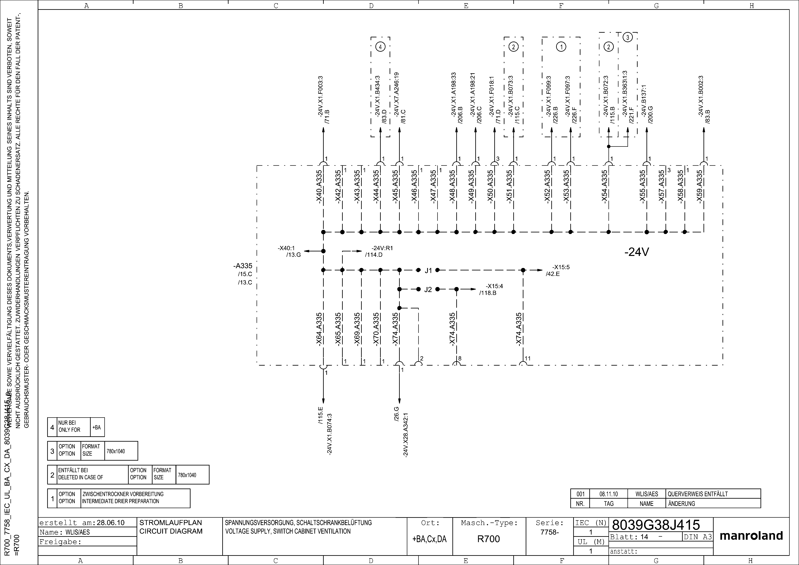

# +BA_Cx_DA — Sheet 14 of 247 — SPANNUNGSVERSORGUNG, SCHALTSCHRANKBELÜFTUNG

**VOLTAGE SUPPLY, SWITCH CABINET VENTILATION**

> Part of the manroland **R700** printing press IEC/UL circuit diagrams.
> Drawing class: **Stromlaufplan / Circuit diagram** (DIN A3).
> Document `+BA_Cx_DA` covers the **Printing units / main switch cabinet** machine section.

## At a glance

| Field | Value |
|---|---|
| Document | `+BA_Cx_DA`  (8039G38J415) |
| Sheet | **14** of 247 |
| Section (DE) | SPANNUNGSVERSORGUNG, SCHALTSCHRANKBELÜFTUNG |
| Section (EN) | VOLTAGE SUPPLY, SWITCH CABINET VENTILATION |
| Section type | POWER_SUPPLY — Voltage supply |
| Machine type | `R700` |
| Series | `7758` |
| Created | 28.06.10 |
| Replaces | — |
| Columns used | A, B, C, D, E, F, G, H |
| Path numbers | — |
| Labels on sheet | 131 |
| Cross-refs out | 21 |
| Cross-refs in | 47 |

**Previous:** [+BA_Cx_DA sheet 13](SHEET_0013.md) · **Next:** [+BA_Cx_DA sheet 15](SHEET_0015.md) · **Document TOC:** [_TOC.md](_TOC.md)  (+BA_Cx_DA) · **Master TOC:** [all sheets](../_MASTER_TOC.md)

## Sheet image (300 DPI, exact vector render)



_Rendered directly from the PDF vector layer at 300 DPI (1-bit), no OCR and no resampling. Use it to confirm anything ambiguous in the text below._

## Cross-references on this sheet

Each entry is a wire leaving this sheet. The printed token is `/sheet.column`; the link resolves to that sheet inside the same document.

| Ref | Target sheet | Col | Path | Destination on target | Target section | From col |
|---|---|---|---|---|---|---|
| `/221.F` | [+BA_Cx_DA sheet 221](SHEET_0221.md) | F | — | 24V.X1.B363\1:3 | OPTION: FORMAT 780x1040 | G |
| `/81.C` | [+BA_Cx_DA sheet 81](SHEET_0081.md) | C | — | 24V.X7.A246:19 | FARBWERK | D |
| `/206.B` | [+BA_Cx_DA sheet 206](SHEET_0206.md) | B | — | 24V.X1.A198:33 | OPTION: AUTOMATISCHE FARBZUFÜHRUNG | E |
| `/206.C` | [+BA_Cx_DA sheet 206](SHEET_0206.md) | C | — | 24V.X1.A198:21 | OPTION: AUTOMATISCHE FARBZUFÜHRUNG | E |
| `/83.D` | [+BA_Cx_DA sheet 83](SHEET_0083.md) | D | — | 24V.X1.B434:3 | FARBWERK | D |
| `/115.C` | [+BA_Cx_DA sheet 115](SHEET_0115.md) | C | — | 24V.X1.B073:3 | PPL 2 | F |
| `/115.B` | [+BA_Cx_DA sheet 115](SHEET_0115.md) | B | — | 24V.X1.B072:3 | PPL 2 | G |
| `/83.B` | [+BA_Cx_DA sheet 83](SHEET_0083.md) | B | — | 24V.X1.B002:3 | FARBWERK | H |
| `/71.B` | [+BA_Cx_DA sheet 71](SHEET_0071.md) | B | — | 24V.X1.F003:3 | ÖLUMLAUFSCHMIERUNG | D |
| `/71.D` | [+BA_Cx_DA sheet 71](SHEET_0071.md) | D | — | 24V.X1.F018:1 | ÖLUMLAUFSCHMIERUNG | E |
| `/226.B` | [+BA_Cx_DA sheet 226](SHEET_0226.md) | B | — | 24V.X1.F099:3 | OPTION: ZWISCHENTROCKNER VORBEREITUNG | F |
| `/226.F` | [+BA_Cx_DA sheet 226](SHEET_0226.md) | F | — | 24V.X1.F097:3 | OPTION: ZWISCHENTROCKNER VORBEREITUNG | F |
| `/200.G` | [+BA_Cx_DA sheet 200](SHEET_0200.md) | G | — | 24V.B137:1 | OPTION: APL | G |
| `/13.G` | [+BA_Cx_DA sheet 13](SHEET_0013.md) | G | — | X40:1 | SPANNUNGSVERSORGUNG, SCHALTSCHRANKBELÜFTUNG | C |
| `/114.D` | [+BA_Cx_DA sheet 114](SHEET_0114.md) | D | — | — | PPL 2 | D |
| `/42.E` | [+BA_Cx_DA sheet 42](SHEET_0042.md) | E | — | — | SCHUTZEINRICHTUNGEN | F |
| `/15.C` | [+BA_Cx_DA sheet 15](SHEET_0015.md) | C | — | — | SPANNUNGSVERSORGUNG, SCHALTSCHRANKBELÜFTUNG | C |
| `/13.C` | [+BA_Cx_DA sheet 13](SHEET_0013.md) | C | — | — | SPANNUNGSVERSORGUNG, SCHALTSCHRANKBELÜFTUNG | C |
| `/118.B` | [+BA_Cx_DA sheet 118](SHEET_0118.md) | B | — | — | RESERVE: SPS STATION (INPUT) | E |
| `/115.E` | [+BA_Cx_DA sheet 115](SHEET_0115.md) | E | — | — | PPL 2 | C |
| `/26.G` | [+BA_Cx_DA sheet 26](SHEET_0026.md) | G | — | — | BUSVERBINDUNGEN: NOT AUS | D |

### Incoming references (sheets that point here)

Every other sheet that sends a wire to this one. `Back-ref` is the token printed on *that* sheet; `Path` is its line number.

| From sheet | Cols | Back-ref | Path | Refs | What continues there |
|---|---|---|---|---|---|
| [+BA_Cx_DA#13](SHEET_0013.md) | C, G | `/13.C`, `/13.G` | — | 2 | — |
| [+BA_Cx_DA#15](SHEET_0015.md) | C | `/15.C` | — | 1 | — |
| [+BA_Cx_DA#26](SHEET_0026.md) | G | `/26.G` | — | 1 | — |
| [+BA_Cx_DA#42](SHEET_0042.md) | E | `/42.E` | — | 1 | X15:5 |
| [+BA_Cx_DA#71](SHEET_0071.md) | B | `/71.B` | — | 2 | 24V.X1.F003:3 24V.X1.F018:1 |
| [+BA_Cx_DA#81](SHEET_0081.md) | C | `/81.C` | — | 1 | 24V.X7.A246:19 |
| [+BA_Cx_DA#83](SHEET_0083.md) | B, C | `/83.B`, `/83.C` | — | 2 | 24V.X1.B002:3; 24V.X1.B434:3 |
| [+BA_Cx_DA#114](SHEET_0114.md) | D | `/114.D` | — | 1 | 24V:R1 |
| [+BA_Cx_DA#115](SHEET_0115.md) | B, C, E | `/115.B`, `/115.C`, `/115.E` | — | 3 | — |
| [+BA_Cx_DA#118](SHEET_0118.md) | B | `/118.B` | — | 1 | X15:4 |
| [+BA_Cx_DA#181](SHEET_0181.md) | A, G, H | `/181.A`, `/181.G`, `/181.H` | — | 4 | — |
| [+BA_Cx_DA#182](SHEET_0182.md) | B, C, E, F, G, H | `/182.B`, `/182.C`, `/182.E`, `/182.F`, `/182.G`, `/182.H` | — | 11 | — |
| [+BA_Cx_DA#183](SHEET_0183.md) | A, B, F, G | `/183.A`, `/183.B`, `/183.F`, `/183.G` | — | 5 | — |
| [+BA_Cx_DA#184](SHEET_0184.md) | A, C, F | `/184.A`, `/184.C`, `/184.F` | — | 6 | — |
| [+BA_Cx_DA#200](SHEET_0200.md) | G | `/200.G` | — | 1 | 24V.B137:1 |
| [+BA_Cx_DA#206](SHEET_0206.md) | A, B | `/206.A`, `/206.B` | — | 2 | 24V.X1.A198:21; 24V.X1.A198:33 |
| [+BA_Cx_DA#221](SHEET_0221.md) | F | `/221.F` | — | 1 | 24V.X1.B363\1:3 |
| [+BA_Cx_DA#226](SHEET_0226.md) | C | `/226.C` | — | 2 | 24V.X1.F099:3 24V.X1.F097:3 |


## Devices on this sheet

| Tag | Class | Class meaning (IEC) | Col | Sub | Terminal | Sign |
|---|---|---|---|---|---|---|
| `A335` | A | Baugruppe / assembly, module, PC board | C | — | — | — |
| `X15:4` | X | Klemme / terminal, plug connector | E | — | 4 | — |
| `X15:5` | X | Klemme / terminal, plug connector | F | — | 5 | — |
| `X40:1` | X | Klemme / terminal, plug connector | C | — | 1 | — |
| `J1` | J |  | E | — | — | — |
| `J2` | J |  | E | — | — | — |
| `X40.A335` | — | cross-device reference | C | — | — | — |
| `X44.A335` | — | cross-device reference | D | — | — | — |
| `X45.A335` | — | cross-device reference | D | — | — | — |
| `X48.A335` | — | cross-device reference | E | — | — | — |
| `X49.A335` | — | cross-device reference | E | — | — | — |
| `X50.A335` | — | cross-device reference | E | — | — | — |
| `X51.A335` | — | cross-device reference | E | — | — | — |
| `X64.A335` | — | cross-device reference | C | — | — | — |
| `X74.A335` | — | cross-device reference | D | — | — | — |
| `X52.A335` | — | cross-device reference | F | — | — | — |
| `X53.A335` | — | cross-device reference | F | — | — | — |
| `X54.A335` | — | cross-device reference | F | — | — | — |
| `X55.A335` | — | cross-device reference | G | — | — | — |
| `X59.A335` | — | cross-device reference | G | — | — | — |
| `NR.` | — | cross-device reference | F | — | — | — |
| `08.11.10` | — | cross-device reference | F | — | — | — |
| `X42.A335` | — | cross-device reference | D | — | — | — |
| `X43.A335` | — | cross-device reference | D | — | — | — |
| `X46.A335` | — | cross-device reference | D | — | — | — |
| `X47.A335` | — | cross-device reference | E | — | — | — |
| `X65.A335` | — | cross-device reference | D | — | — | — |
| `X74.A335` | — | cross-device reference | F | — | — | — |
| `X74.A335` | — | cross-device reference | E | — | — | — |
| `X58.A335` | — | cross-device reference | G | — | — | — |
| `X57.A335` | — | cross-device reference | G | — | — | — |
| `X69.A335` | — | cross-device reference | D | — | — | — |
| `X70.A335` | — | cross-device reference | D | — | — | — |

## Potentials / nets

| Potential | Count | Columns | Attached devices | Terminals |
|---|---|---|---|---|
| `24V` | 16 | C, D, E, F, G | `A198`, `A246`, `A342`, `B002`, `B072`, `B073`, `B074`, `B137`, `B363\1`, `B434`, `F003`, `F018`, `F097`, `F099`, `X1`, `X28`, `X7` | `1`, `19`, `21`, `3`, `33` |


A potential such as `L24+/4` or `M24+` is a named supply/return rail; every place it appears on this sheet is electrically common.

## Wire-end annotations (grouped as printed)

A wire that continues elsewhere is annotated with a small cluster: the destination description, the path/line number `#NN`, and the `/sheet.column` cross reference. Each row below is one such cluster exactly as it is grouped on the drawing.

| Col | Y | Path | Cross-ref | Text on the wire |
|---|---|---|---|---|
| G | 52.7 | — | — | `3` |
| E | 66.4 | — | — | `4 2 1` |
| F | 66.9 | — | — | `2` |
| G | 105.2 | — | `/221.F` | `24V.X1.B363\1:3` |
| D | 107.7 | — | `/81.C` | `24V.X7.A246:19` |
| E | 107.7 | — | `/206.B` | `24V.X1.A198:33` |
| E | 107.7 | — | `/206.C` | `24V.X1.A198:21` |
| D | 112.5 | — | `/83.D` | `24V.X1.B434:3` |
| F | 112.5 | — | `/115.C` | `24V.X1.B073:3` |
| G | 112.5 | — | `/115.B` | `24V.X1.B072:3` |
| H | 112.5 | — | `/83.B` | `24V.X1.B002:3` |
| D | 113.1 | — | `/71.B` | `24V.X1.F003:3` |
| E | 113.1 | — | `/71.D` | `24V.X1.F018:1` |
| F | 113.1 | — | `/226.B` | `24V.X1.F099:3` |
| F | 113.1 | — | `/226.F` | `24V.X1.F097:3` |
| G | 125.9 | — | `/200.G` | `24V.B137:1` |
| D | 232.8 | — | — | `1` |
| D | 232.8 | — | — | `1` |
| D | 232.8 | — | — | `1` |
| E | 232.8 | — | — | `1` |
| E | 232.8 | — | — | `1` |
| E | 232.8 | — | — | `3` |
| F | 232.8 | — | — | `1` |
| F | 232.8 | — | — | `1` |
| F | 232.8 | — | — | `1` |
| G | 232.8 | — | — | `1` |
| G | 232.8 | — | — | `1` |
| H | 232.8 | — | — | `1` |
| D | 249.8 | — | — | `1 1` |
| E | 249.8 | — | — | `1 1` |
| G | 249.8 | — | — | `3 1` |
| C | 253.1 | — | — | `X40.A335` |
| D | 253.1 | — | — | `X42.A335` |
| D | 253.1 | — | — | `X43.A335` |
| D | 253.1 | — | — | `X44.A335` |
| D | 253.1 | — | — | `X45.A335` |
| D | 253.1 | — | — | `X46.A335` |
| E | 253.1 | — | — | `X47.A335` |
| E | 253.1 | — | — | `X48.A335` |
| E | 253.1 | — | — | `X49.A335` |
| E | 253.1 | — | — | `X50.A335` |
| E | 253.1 | — | — | `X51.A335` |
| F | 253.1 | — | — | `X52.A335` |
| F | 253.1 | — | — | `X53.A335` |
| F | 253.1 | — | — | `X54.A335` |
| G | 253.1 | — | — | `X55.A335` |
| G | 253.1 | — | — | `X57.A335` |
| G | 253.1 | — | — | `X58.A335` |
| G | 253.1 | — | — | `X59.A335` |
| C | 366.0 | — | `/13.G` | `X40:1` |
| D | 366.0 | — | — | `24V:R1` |
| G | 367.7 | — | — | `24V` |
| D | 375.9 | — | `/114.D` | — |
| C | 391.5 | — | — | `A335` |
| F | 394.3 | — | — | `X15:5` |
| E | 398.5 | — | — | `J1` |
| F | 404.2 | — | `/42.E` | — |
| C | 404.6 | — | `/15.C`, `/13.C` | — |
| E | 422.6 | — | — | `X15:4` |
| E | 426.9 | — | — | `J2` |
| E | 432.6 | — | `/118.B` | — |
| C | 465.7 | — | — | `X64.A335` |
| D | 465.7 | — | — | `X65.A335` |
| D | 465.7 | — | — | `X69.A335` |
| D | 465.7 | — | — | `X70.A335` |
| D | 465.7 | — | — | `X74.A335` |
| E | 465.7 | — | — | `X74.A335` |
| F | 465.7 | — | — | `X74.A335` |
| E | 530.4 | — | — | `2 8 11` |
| D | 534.7 | — | — | `1 1 1 1` |
| D | 551.7 | — | — | `1` |
| C | 606.0 | — | `/115.E` | — |
| D | 606.0 | — | `/26.G` | — |
| D | 614.8 | — | — | `24V.X28.A342:1` |
| D | 616.2 | — | — | `24V.X1.B074:3` |
| A | 627.0 | — | — | `4 NUR BEI` |
| A | 634.1 | — | — | `ONLY FOR +BA` |
| A | 662.5 | — | — | `3 OPTION OPTION` |
| A | 662.5 | — | — | `FORMAT` |
| A | 669.7 | — | — | `SIZE 780x1040` |
| A | 697.9 | — | — | `ENTFÄLLT BEI DELETED IN CASE OF` |
| B | 697.9 | — | — | `OPTION OPTION` |
| B | 698.0 | — | — | `FORMAT` |
| A | 703.3 | — | — | `2 SIZE 780x1040` |
| G | 733.0 | — | — | `001 08.11.10 WLIS/AES QUERVERWEIS ENTFÄLLT` |
| A | 733.4 | — | — | `1 INTERMEDIATE DRIER PREPARATION ZWISCHENTROCKNER VORBEREITUNG` |
| A | 733.4 | — | — | `OPTION OPTION` |
| G | 747.1 | — | — | `NR. TAG NAME ÄNDERUNG` |


## Reconstructed tables

This sheet carries tabular content (pin map / terminal assignment / index). The grid below was rebuilt from the drawing's own rule lines, so each row is exactly one physical row of the table.

### Table 1 — 2 data rows × 1 columns (at x=822.0, y=345.8)

| C1 |
|---|
| `X15:5` |
| `/42.E` |


## Notes and free text on this sheet

| Text | Col | Y (pt) |
|---|---|---|
| `TAG` | G | 747.27 |
| `NAME` | G | 747.25 |
| `ÄNDERUNG` | G | 747.31 |
| `WLIS/AES` | G | 733.08 |
| `QUERVERWEIS ENTFÄLLT` | G | 733.12 |
| `24V:R1` | D | 365.97 |
| `OPTION` | A | 733.35 |
| `ZWISCHENTROCKNER VORBEREITUNG` | A | 733.38 |
| `INTERMEDIATE DRIER PREPARATION` | A | 744.01 |
| `ENTFÄLLT BEI` | A | 697.91 |
| `DELETED IN CASE OF` | A | 708.57 |
| `OPTION` | B | 697.92 |
| `FORMAT` | B | 697.95 |
| `SIZE` | B | 708.5 |
| `780x1040` | B | 705.1 |
| `FORMAT` | A | 662.51 |
| `SIZE` | A | 673.07 |
| `780x1040` | A | 669.67 |
| `NUR BEI` | A | 627.04 |
| `ONLY FOR` | A | 637.72 |
| `+BA` | A | 634.14 |

## Complete label inventory (exact text from the drawing)

Every text object inside the drawing area of this sheet, in DIN reading order (column A→H, then top→bottom). This is the authoritative list: if a string is not here it is not printed on this sheet.

| Col | Y | X | Dir | Type | Text |
|---|---|---|---|---|---|
| A | 627.0 | 87.0 | → | text | `NUR BEI` |
| A | 632.4 | 75.1 | → | number | `4` |
| A | 634.1 | 137.9 | → | text | `+BA` |
| A | 637.7 | 87.6 | → | text | `ONLY FOR` |
| A | 662.5 | 87.6 | → | text | `OPTION` |
| A | 662.5 | 122.5 | → | text | `FORMAT` |
| A | 667.8 | 75.0 | → | number | `3` |
| A | 669.7 | 159.2 | → | text | `780x1040` |
| A | 673.1 | 87.6 | → | text | `OPTION` |
| A | 673.1 | 123.0 | → | text | `SIZE` |
| A | 697.9 | 87.0 | → | text | `ENTFÄLLT BEI` |
| A | 703.3 | 75.1 | → | number | `2` |
| A | 708.6 | 87.0 | → | text | `DELETED IN CASE OF` |
| A | 733.4 | 87.6 | → | text | `OPTION` |
| A | 733.4 | 123.3 | → | text | `ZWISCHENTROCKNER VORBEREITUNG` |
| A | 738.7 | 75.4 | → | number | `1` |
| A | 744.0 | 87.6 | → | text | `OPTION` |
| A | 744.0 | 122.5 | → | text | `INTERMEDIATE DRIER PREPARATION` |
| B | 697.9 | 193.9 | → | text | `OPTION` |
| B | 697.9 | 228.8 | → | text | `FORMAT` |
| B | 705.1 | 265.5 | → | text | `780x1040` |
| B | 708.5 | 229.3 | → | text | `SIZE` |
| B | 708.6 | 193.9 | → | text | `OPTION` |
| C | 113.1 | 473.7 | ↕ | potential | `24V.X1.F003:3` |
| C | 253.1 | 470.9 | ↕ | device ref | `X40.A335` |
| C | 366.0 | 413.9 | → | device tag | `X40:1` |
| C | 375.9 | 426.9 | → | cross-reference | `/13.G` |
| C | 391.5 | 347.8 | → | device tag | `A335` |
| C | 404.6 | 354.9 | → | cross-reference | `/15.C` |
| C | 417.0 | 354.9 | → | cross-reference | `/13.C` |
| C | 465.7 | 470.9 | ↕ | device ref | `X64.A335` |
| C | 606.0 | 473.6 | ↕ | cross-reference | `/115.E` |
| D | 66.9 | 564.9 | → | number | `4` |
| D | 107.7 | 587.1 | ↕ | potential | `24V.X7.A246:19` |
| D | 112.5 | 558.7 | ↕ | potential | `24V.X1.B434:3` |
| D | 163.3 | 568.6 | ↕ | cross-reference | `/83.D` |
| D | 163.3 | 597.0 | ↕ | cross-reference | `/81.C` |
| D | 163.6 | 483.6 | ↕ | cross-reference | `/71.B` |
| D | 232.8 | 483.9 | → | number | `1` |
| D | 232.8 | 568.9 | → | number | `1` |
| D | 232.8 | 597.3 | → | number | `1` |
| D | 249.8 | 512.2 | → | number | `1` |
| D | 249.8 | 540.6 | → | number | `1` |
| D | 253.1 | 499.2 | ↕ | device ref | `X42.A335` |
| D | 253.1 | 527.5 | ↕ | device ref | `X43.A335` |
| D | 253.1 | 555.9 | ↕ | device ref | `X44.A335` |
| D | 253.1 | 584.2 | ↕ | device ref | `X45.A335` |
| D | 253.1 | 612.6 | ↕ | device ref | `X46.A335` |
| D | 366.0 | 553.9 | → | text | `24V:R1` |
| D | 375.9 | 544.3 | → | cross-reference | `/114.D` |
| D | 465.7 | 499.2 | ↕ | device ref | `X65.A335` |
| D | 465.7 | 527.5 | ↕ | device ref | `X69.A335` |
| D | 465.7 | 555.9 | ↕ | device ref | `X70.A335` |
| D | 465.7 | 584.2 | ↕ | device ref | `X74.A335` |
| D | 534.7 | 512.2 | → | number | `1` |
| D | 534.7 | 540.6 | → | number | `1` |
| D | 534.7 | 568.9 | → | number | `1` |
| D | 547.4 | 597.3 | → | number | `1` |
| D | 551.7 | 483.9 | → | number | `1` |
| D | 606.0 | 587.0 | ↕ | cross-reference | `/26.G` |
| D | 614.8 | 600.5 | ↕ | potential | `24V.X28.A342:1` |
| D | 616.3 | 487.1 | ↕ | potential | `24V.X1.B074:3` |
| E | 107.7 | 672.1 | ↕ | potential | `24V.X1.A198:33` |
| E | 107.7 | 700.4 | ↕ | potential | `24V.X1.A198:21` |
| E | 112.5 | 757.1 | ↕ | potential | `24V.X1.B073:3` |
| E | 113.1 | 728.8 | ↕ | potential | `24V.X1.F018:1` |
| E | 158.5 | 710.4 | ↕ | cross-reference | `/206.C` |
| E | 158.7 | 682.0 | ↕ | cross-reference | `/206.B` |
| E | 163.3 | 738.7 | ↕ | cross-reference | `/71.D` |
| E | 232.8 | 682.3 | → | number | `1` |
| E | 232.8 | 710.6 | → | number | `1` |
| E | 232.8 | 739.6 | → | number | `3` |
| E | 249.8 | 625.6 | → | number | `1` |
| E | 249.8 | 654.0 | → | number | `1` |
| E | 253.1 | 640.9 | ↕ | device ref | `X47.A335` |
| E | 253.1 | 669.3 | ↕ | device ref | `X48.A335` |
| E | 253.1 | 697.6 | ↕ | device ref | `X49.A335` |
| E | 253.1 | 726.0 | ↕ | device ref | `X50.A335` |
| E | 253.1 | 754.3 | ↕ | device ref | `X51.A335` |
| E | 398.5 | 633.0 | → | device tag | `J1` |
| E | 422.7 | 724.0 | → | device tag | `X15:4` |
| E | 426.9 | 632.3 | → | device tag | `J2` |
| E | 432.5 | 714.3 | → | cross-reference | `/118.B` |
| E | 465.7 | 669.3 | ↕ | device ref | `X74.A335` |
| E | 530.4 | 626.2 | → | number | `2` |
| E | 530.4 | 682.9 | → | number | `8` |
| F | 66.4 | 834.5 | → | number | `1` |
| F | 66.9 | 763.4 | → | number | `2` |
| F | 66.9 | 905.1 | → | number | `2` |
| F | 112.5 | 898.9 | ↕ | potential | `24V.X1.B072:3` |
| F | 113.1 | 813.8 | ↕ | potential | `24V.X1.F099:3` |
| F | 113.1 | 842.2 | ↕ | potential | `24V.X1.F097:3` |
| F | 158.5 | 767.1 | ↕ | cross-reference | `/115.C` |
| F | 158.7 | 823.7 | ↕ | cross-reference | `/226.B` |
| F | 159.3 | 852.1 | ↕ | cross-reference | `/226.F` |
| F | 232.8 | 767.3 | → | number | `1` |
| F | 232.8 | 824.0 | → | number | `1` |
| F | 232.8 | 852.4 | → | number | `1` |
| F | 253.1 | 811.0 | ↕ | device ref | `X52.A335` |
| F | 253.1 | 839.4 | ↕ | device ref | `X53.A335` |
| F | 253.1 | 896.1 | ↕ | device ref | `X54.A335` |
| F | 394.3 | 823.2 | → | device tag | `X15:5` |
| F | 404.2 | 813.5 | → | cross-reference | `/42.E` |
| F | 465.7 | 768.5 | ↕ | device ref | `X74.A335` |
| F | 530.4 | 781.5 | → | number | `11` |
| F | 733.0 | 859.4 | → | number | `001` |
| F | 733.1 | 893.5 | → | device ref | `08.11.10` |
| F | 747.1 | 858.4 | → | device ref | `NR.` |
| G | 52.7 | 933.4 | → | number | `3` |
| G | 105.2 | 927.2 | ↕ | potential | `24V.X1.B363\1:3` |
| G | 112.5 | 1040.6 | ↕ | potential | `24V.X1.B002:3` |
| G | 125.9 | 955.6 | ↕ | potential | `24V.B137:1` |
| G | 157.9 | 965.5 | ↕ | cross-reference | `/200.G` |
| G | 158.7 | 908.8 | ↕ | cross-reference | `/115.B` |
| G | 159.3 | 937.1 | ↕ | cross-reference | `/221.F` |
| G | 232.8 | 909.1 | → | number | `1` |
| G | 232.8 | 965.8 | → | number | `1` |
| G | 249.8 | 994.7 | → | number | `3` |
| G | 249.8 | 1022.5 | → | number | `1` |
| G | 253.1 | 952.7 | ↕ | device ref | `X55.A335` |
| G | 253.1 | 981.1 | ↕ | device ref | `X57.A335` |
| G | 253.1 | 1009.4 | ↕ | device ref | `X58.A335` |
| G | 253.1 | 1037.8 | ↕ | device ref | `X59.A335` |
| G | 367.7 | 930.8 | → | potential | `24V` |
| G | 733.1 | 947.3 | → | text | `WLIS/AES` |
| G | 733.1 | 995.1 | → | text | `QUERVERWEIS ENTFÄLLT` |
| G | 747.3 | 900.0 | → | text | `TAG` |
| G | 747.3 | 953.4 | → | text | `NAME` |
| G | 747.3 | 996.0 | → | text | `ÄNDERUNG` |
| H | 163.6 | 1050.5 | ↕ | cross-reference | `/83.B` |
| H | 232.8 | 1050.8 | → | number | `1` |

## Reading-order text block

The same content as a plain block, grouped by DIN column — convenient to paste or to match against a visual description.

```text
=== Column A ===
 627.0   87.0  text         NUR BEI
 632.4   75.1  numeric      4
 634.1  137.9  text         +BA
 637.7   87.6  text         ONLY FOR
 662.5   87.6  text         OPTION
 662.5  122.5  text         FORMAT
 667.8   75.0  numeric      3
 669.7  159.2  text         780x1040
 673.1   87.6  text         OPTION
 673.1  123.0  text         SIZE
 697.9   87.0  text         ENTFÄLLT BEI
 703.3   75.1  numeric      2
 708.6   87.0  text         DELETED IN CASE OF
 733.4   87.6  text         OPTION
 733.4  123.3  text         ZWISCHENTROCKNER VORBEREITUNG
 738.7   75.4  numeric      1
 744.0   87.6  text         OPTION
 744.0  122.5  text         INTERMEDIATE DRIER PREPARATION
=== Column B ===
 697.9  193.9  text         OPTION
 697.9  228.8  text         FORMAT
 705.1  265.5  text         780x1040
 708.5  229.3  text         SIZE
 708.6  193.9  text         OPTION
=== Column C ===
 113.1  473.7  net          24V.X1.F003:3
 253.1  470.9  devref       X40.A335
 366.0  413.9  devtag       X40:1
 375.9  426.9  xref         /13.G
 391.5  347.8  devtag       A335
 404.6  354.9  xref         /15.C
 417.0  354.9  xref         /13.C
 465.7  470.9  devref       X64.A335
 606.0  473.6  xref         /115.E
=== Column D ===
  66.9  564.9  numeric      4
 107.7  587.1  net          24V.X7.A246:19
 112.5  558.7  net          24V.X1.B434:3
 163.3  568.6  xref         /83.D
 163.3  597.0  xref         /81.C
 163.6  483.6  xref         /71.B
 232.8  483.9  numeric      1
 232.8  568.9  numeric      1
 232.8  597.3  numeric      1
 249.8  512.2  numeric      1
 249.8  540.6  numeric      1
 253.1  499.2  devref       X42.A335
 253.1  527.5  devref       X43.A335
 253.1  555.9  devref       X44.A335
 253.1  584.2  devref       X45.A335
 253.1  612.6  devref       X46.A335
 366.0  553.9  text         24V:R1
 375.9  544.3  xref         /114.D
 465.7  499.2  devref       X65.A335
 465.7  527.5  devref       X69.A335
 465.7  555.9  devref       X70.A335
 465.7  584.2  devref       X74.A335
 534.7  512.2  numeric      1
 534.7  540.6  numeric      1
 534.7  568.9  numeric      1
 547.4  597.3  numeric      1
 551.7  483.9  numeric      1
 606.0  587.0  xref         /26.G
 614.8  600.5  net          24V.X28.A342:1
 616.3  487.1  net          24V.X1.B074:3
=== Column E ===
 107.7  672.1  net          24V.X1.A198:33
 107.7  700.4  net          24V.X1.A198:21
 112.5  757.1  net          24V.X1.B073:3
 113.1  728.8  net          24V.X1.F018:1
 158.5  710.4  xref         /206.C
 158.7  682.0  xref         /206.B
 163.3  738.7  xref         /71.D
 232.8  682.3  numeric      1
 232.8  710.6  numeric      1
 232.8  739.6  numeric      3
 249.8  625.6  numeric      1
 249.8  654.0  numeric      1
 253.1  640.9  devref       X47.A335
 253.1  669.3  devref       X48.A335
 253.1  697.6  devref       X49.A335
 253.1  726.0  devref       X50.A335
 253.1  754.3  devref       X51.A335
 398.5  633.0  devtag       J1
 422.7  724.0  devtag       X15:4
 426.9  632.3  devtag       J2
 432.5  714.3  xref         /118.B
 465.7  669.3  devref       X74.A335
 530.4  626.2  numeric      2
 530.4  682.9  numeric      8
=== Column F ===
  66.4  834.5  numeric      1
  66.9  763.4  numeric      2
  66.9  905.1  numeric      2
 112.5  898.9  net          24V.X1.B072:3
 113.1  813.8  net          24V.X1.F099:3
 113.1  842.2  net          24V.X1.F097:3
 158.5  767.1  xref         /115.C
 158.7  823.7  xref         /226.B
 159.3  852.1  xref         /226.F
 232.8  767.3  numeric      1
 232.8  824.0  numeric      1
 232.8  852.4  numeric      1
 253.1  811.0  devref       X52.A335
 253.1  839.4  devref       X53.A335
 253.1  896.1  devref       X54.A335
 394.3  823.2  devtag       X15:5
 404.2  813.5  xref         /42.E
 465.7  768.5  devref       X74.A335
 530.4  781.5  numeric      11
 733.0  859.4  numeric      001
 733.1  893.5  devref       08.11.10
 747.1  858.4  devref       NR.
=== Column G ===
  52.7  933.4  numeric      3
 105.2  927.2  net          24V.X1.B363\1:3
 112.5 1040.6  net          24V.X1.B002:3
 125.9  955.6  net          24V.B137:1
 157.9  965.5  xref         /200.G
 158.7  908.8  xref         /115.B
 159.3  937.1  xref         /221.F
 232.8  909.1  numeric      1
 232.8  965.8  numeric      1
 249.8  994.7  numeric      3
 249.8 1022.5  numeric      1
 253.1  952.7  devref       X55.A335
 253.1  981.1  devref       X57.A335
 253.1 1009.4  devref       X58.A335
 253.1 1037.8  devref       X59.A335
 367.7  930.8  net          24V
 733.1  947.3  text         WLIS/AES
 733.1  995.1  text         QUERVERWEIS ENTFÄLLT
 747.3  900.0  text         TAG
 747.3  953.4  text         NAME
 747.3  996.0  text         ÄNDERUNG
=== Column H ===
 163.6 1050.5  xref         /83.B
 232.8 1050.8  numeric      1
```

---
_Generated from the PDF vector text layer; no OCR. Source: `R700_7758_IEC_UL_BA_CX_DA_8039G38J415_p`, sheet 14._
