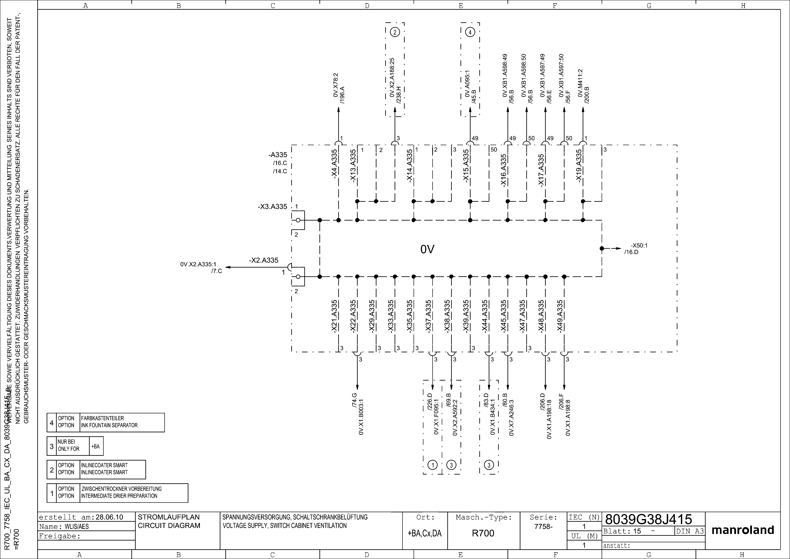

# +BA_Cx_DA — Sheet 15 of 247 — SPANNUNGSVERSORGUNG, SCHALTSCHRANKBELÜFTUNG

**VOLTAGE SUPPLY, SWITCH CABINET VENTILATION**

> Part of the manroland **R700** printing press IEC/UL circuit diagrams.
> Drawing class: **Stromlaufplan / Circuit diagram** (DIN A3).
> Document `+BA_Cx_DA` covers the **Printing units / main switch cabinet** machine section.

## At a glance

| Field | Value |
|---|---|
| Document | `+BA_Cx_DA`  (8039G38J415) |
| Sheet | **15** of 247 |
| Section (DE) | SPANNUNGSVERSORGUNG, SCHALTSCHRANKBELÜFTUNG |
| Section (EN) | VOLTAGE SUPPLY, SWITCH CABINET VENTILATION |
| Section type | POWER_SUPPLY — Voltage supply |
| Machine type | `R700` |
| Series | `7758` |
| Created | 28.06.10 |
| Replaces | — |
| Columns used | A, B, C, D, E, F, G |
| Path numbers | — |
| Labels on sheet | 116 |
| Cross-refs out | 19 |
| Cross-refs in | 47 |

**Previous:** [+BA_Cx_DA sheet 14](SHEET_0014.md) · **Next:** [+BA_Cx_DA sheet 16](SHEET_0016.md) · **Document TOC:** [_TOC.md](_TOC.md)  (+BA_Cx_DA) · **Master TOC:** [all sheets](../_MASTER_TOC.md)

## Sheet image (300 DPI, exact vector render)



_Rendered directly from the PDF vector layer at 300 DPI (1-bit), no OCR and no resampling. Use it to confirm anything ambiguous in the text below._

## Cross-references on this sheet

Each entry is a wire leaving this sheet. The printed token is `/sheet.column`; the link resolves to that sheet inside the same document.

| Ref | Target sheet | Col | Path | Destination on target | Target section | From col |
|---|---|---|---|---|---|---|
| `/56.B` | [+BA_Cx_DA sheet 56](SHEET_0056.md) | B | — | 0V.XB1.A598:49 | MASCHINENBEDIENUNG: SPANNUNGSVERSORGUNG | F |
| `/56.B` | [+BA_Cx_DA sheet 56](SHEET_0056.md) | B | — | 0V.XB1.A598:50 | MASCHINENBEDIENUNG: SPANNUNGSVERSORGUNG | F |
| `/56.E` | [+BA_Cx_DA sheet 56](SHEET_0056.md) | E | — | 0V.XB1.A597:49 | MASCHINENBEDIENUNG: SPANNUNGSVERSORGUNG | F |
| `/56.F` | [+BA_Cx_DA sheet 56](SHEET_0056.md) | F | — | 0V.XB1.A597:50 | MASCHINENBEDIENUNG: SPANNUNGSVERSORGUNG | F |
| `/238.H` | [+BA_Cx_DA sheet 238](SHEET_0238.md) | H | — | 0V.X2.A188:25 | OPTION: INLINECOATER SMART | D |
| `/200.B` | [+BA_Cx_DA sheet 200](SHEET_0200.md) | B | — | 0V.M411:2 | OPTION: APL | F |
| `/45.B` | [+BA_Cx_DA sheet 45](SHEET_0045.md) | B | — | 0V.A095:1 | SCHUTZEINRICHTUNGEN | E |
| `/196.A` | [+BA_Cx_DA sheet 196](SHEET_0196.md) | A | — | 0V.X78:2 | OPTION: WASCHVORRICHTUNG MIT BÜRSTE | D |
| `/16.C` | [+BA_Cx_DA sheet 16](SHEET_0016.md) | C | — | — | SPANNUNGSVERSORGUNG, SCHALTSCHRANKBELÜFTUNG | C |
| `/14.C` | [+BA_Cx_DA sheet 14](SHEET_0014.md) | C | — | — | SPANNUNGSVERSORGUNG, SCHALTSCHRANKBELÜFTUNG | C |
| `/16.D` | [+BA_Cx_DA sheet 16](SHEET_0016.md) | D | — | — | SPANNUNGSVERSORGUNG, SCHALTSCHRANKBELÜFTUNG | G |
| `/7.C` | [+BA_Cx_DA sheet 7](SHEET_0007.md) | C | — | 0V.X2.A335:1 | SPANNUNGSVERSORGUNG, SCHALTSCHRANKBELÜFTUNG | B |
| `/74.G` | [+BA_Cx_DA sheet 74](SHEET_0074.md) | G | — | — | FEUCHTWERK | D |
| `/226.D` | [+BA_Cx_DA sheet 226](SHEET_0226.md) | D | — | — | OPTION: ZWISCHENTROCKNER VORBEREITUNG | E |
| `/69.B` | [+BA_Cx_DA sheet 69](SHEET_0069.md) | B | — | — | DRUCKLUFT ABSTELLEN | E |
| `/83.D` | [+BA_Cx_DA sheet 83](SHEET_0083.md) | D | — | — | FARBWERK | E |
| `/80.B` | [+BA_Cx_DA sheet 80](SHEET_0080.md) | B | — | — | FARBWERK | E |
| `/206.D` | [+BA_Cx_DA sheet 206](SHEET_0206.md) | D | — | — | OPTION: AUTOMATISCHE FARBZUFÜHRUNG | F |
| `/206.F` | [+BA_Cx_DA sheet 206](SHEET_0206.md) | F | — | — | OPTION: AUTOMATISCHE FARBZUFÜHRUNG | F |

### Incoming references (sheets that point here)

Every other sheet that sends a wire to this one. `Back-ref` is the token printed on *that* sheet; `Path` is its line number.

| From sheet | Cols | Back-ref | Path | Refs | What continues there |
|---|---|---|---|---|---|
| [+BA_Cx_DA#7](SHEET_0007.md) | C | `/7.C` | — | 1 | — |
| [+BA_Cx_DA#14](SHEET_0014.md) | C | `/14.C` | — | 1 | — |
| [+BA_Cx_DA#16](SHEET_0016.md) | C | `/16.C` | — | 2 | X50:1 |
| [+BA_Cx_DA#45](SHEET_0045.md) | A | `/45.A` | — | 1 | 0V.A095:1 |
| [+BA_Cx_DA#56](SHEET_0056.md) | B, E | `/56.B`, `/56.E` | — | 4 | 0V.XB1.A597:49; 0V.XB1.A597:50; 0V.XB1.A598:49; 0V.XB1.A598:50 |
| [+BA_Cx_DA#69](SHEET_0069.md) | A | `/69.A` | — | 1 | 0V.X2.A592:2 |
| [+BA_Cx_DA#74](SHEET_0074.md) | G | `/74.G` | — | 1 | 0V.X1.B003:1 |
| [+BA_Cx_DA#80](SHEET_0080.md) | A | `/80.A` | — | 1 | 0V.X7.A246:3 |
| [+BA_Cx_DA#83](SHEET_0083.md) | C | `/83.C` | — | 1 | 0V.X1.B002:1 0V.X1.B434:1 |
| [+BA_Cx_DA#159](SHEET_0159.md) | A | `/159.A` | — | 1 | STROMPFAD PIN 1 2 3 4 |
| [+BA_Cx_DA#170](SHEET_0170.md) | B, H | `/170.B`, `/170.H` | — | 6 | — |
| [+BA_Cx_DA#171](SHEET_0171.md) | F | `/171.F` | — | 2 | — |
| [+BA_Cx_DA#172](SHEET_0172.md) | C | `/172.C` | — | 2 | — |
| [+BA_Cx_DA#173](SHEET_0173.md) | C, H | `/173.C`, `/173.H` | — | 4 | — |
| [+BA_Cx_DA#174](SHEET_0174.md) | B, E | `/174.B`, `/174.E` | — | 2 | — |
| [+BA_Cx_DA#179](SHEET_0179.md) | A | `/179.A` | — | 1 | — |
| [+BA_Cx_DA#180](SHEET_0180.md) | A, E, G, H | `/180.A`, `/180.E`, `/180.G`, `/180.H` | — | 4 | — |
| [+BA_Cx_DA#181](SHEET_0181.md) | A, H | `/181.A`, `/181.H` | — | 2 | — |
| [+BA_Cx_DA#182](SHEET_0182.md) | B, C, E | `/182.B`, `/182.C`, `/182.E` | — | 4 | — |
| [+BA_Cx_DA#196](SHEET_0196.md) | A | `/196.A` | — | 1 | 0V.X78:2 |
| [+BA_Cx_DA#200](SHEET_0200.md) | B | `/200.B` | — | 1 | 0V.M411:2 |
| [+BA_Cx_DA#206](SHEET_0206.md) | E | `/206.E` | — | 2 | 0V.X1.A198:8 0V.X1.A198:18 |
| [+BA_Cx_DA#226](SHEET_0226.md) | C | `/226.C` | — | 1 | 1 0V.X1.F099:1 0V.X1.F095:1 0V.X1.F097:1 |
| [+BA_Cx_DA#238](SHEET_0238.md) | G | `/238.G` | — | 1 | 0V.X2.A188:25 |


## Devices on this sheet

| Tag | Class | Class meaning (IEC) | Col | Sub | Terminal | Sign |
|---|---|---|---|---|---|---|
| `A335` | A | Baugruppe / assembly, module, PC board | C | — | — | — |
| `X50:1` | X | Klemme / terminal, plug connector | G | — | 1 | — |
| `X15.A335` | — | cross-device reference | E | — | — | — |
| `X4.A335` | — | cross-device reference | D | — | — | — |
| `X16.A335` | — | cross-device reference | E | — | — | — |
| `X17.A335` | — | cross-device reference | F | — | — | — |
| `X19.A335` | — | cross-device reference | F | — | — | — |
| `X22.A335` | — | cross-device reference | D | — | — | — |
| `X37.A335` | — | cross-device reference | E | — | — | — |
| `X38.A335` | — | cross-device reference | E | — | — | — |
| `X44.A335` | — | cross-device reference | E | — | — | — |
| `X45.A335` | — | cross-device reference | E | — | — | — |
| `X48.A335` | — | cross-device reference | F | — | — | — |
| `X49.A335` | — | cross-device reference | F | — | — | — |
| `X2.A335` | — | cross-device reference | C | — | — | — |
| `X14.A335` | — | cross-device reference | D | — | — | — |
| `X21.A335` | — | cross-device reference | D | — | — | — |
| `X29.A335` | — | cross-device reference | D | — | — | — |
| `X33.A335` | — | cross-device reference | D | — | — | — |
| `X35.A335` | — | cross-device reference | D | — | — | — |
| `X39.A335` | — | cross-device reference | E | — | — | — |
| `X47.A335` | — | cross-device reference | F | — | — | — |
| `X3.A335` | — | cross-device reference | C | — | — | — |
| `X13.A335` | — | cross-device reference | D | — | — | — |

## Potentials / nets

| Potential | Count | Columns | Attached devices | Terminals |
|---|---|---|---|---|
| `0V` | 17 | B, D, E, F | `A095`, `A188`, `A198`, `A246`, `A335`, `A592`, `A597`, `A598`, `B003`, `B434`, `F095`, `M411`, `X1`, `X2`, `X7`, `X78`, `XB1` | `1`, `18`, `2`, `25`, `3`, `49`, `50`, `8` |


A potential such as `L24+/4` or `M24+` is a named supply/return rail; every place it appears on this sheet is electrically common.

## Wire-end annotations (grouped as printed)

A wire that continues elsewhere is annotated with a small cluster: the destination description, the path/line number `#NN`, and the `/sheet.column` cross reference. Each row below is one such cluster exactly as it is grouped on the drawing.

| Col | Y | Path | Cross-ref | Text on the wire |
|---|---|---|---|---|
| D | 45.6 | — | — | `2` |
| E | 45.6 | — | — | `4` |
| F | 81.1 | — | `/56.B` | `0V.XB1.A598:49` |
| F | 81.1 | — | `/56.B` | `0V.XB1.A598:50` |
| F | 81.1 | — | `/56.E` | `0V.XB1.A597:49` |
| F | 81.1 | — | `/56.F` | `0V.XB1.A597:50` |
| D | 87.0 | — | `/238.H` | `0V.X2.A188:25` |
| F | 104.0 | — | `/200.B` | `0V.M411:2` |
| E | 105.2 | — | `/45.B` | `0V.A095:1` |
| D | 110.0 | — | `/196.A` | `0V.X78:2` |
| D | 204.4 | — | — | `1` |
| D | 204.4 | — | — | `3` |
| E | 204.4 | — | — | `49` |
| F | 204.4 | — | — | `49` |
| F | 204.4 | — | — | `50 49` |
| F | 204.4 | — | — | `50 1` |
| E | 221.4 | — | — | `1 2 3 50` |
| G | 221.4 | — | — | `3` |
| D | 222.1 | — | — | `1 2` |
| D | 224.8 | — | — | `X4.A335` |
| D | 224.8 | — | — | `X13.A335` |
| D | 224.8 | — | — | `X14.A335` |
| E | 224.8 | — | — | `X15.A335` |
| F | 224.8 | — | — | `X19.A335` |
| C | 228.5 | — | — | `A335` |
| E | 231.9 | — | — | `X16.A335` |
| F | 231.9 | — | — | `X17.A335` |
| C | 241.6 | — | `/16.C`, `/14.C` | — |
| C | 306.4 | — | — | `X3.A335 1` |
| C | 349.7 | — | — | `2` |
| G | 366.0 | — | — | `X50:1` |
| E | 367.7 | — | — | `0V` |
| G | 375.9 | — | `/16.D` | — |
| C | 387.2 | — | — | `X2.A335` |
| B | 394.3 | — | `/7.C` | `0V.X2.A335:1` |
| C | 405.6 | — | — | `1` |
| C | 434.7 | — | — | `2` |
| D | 451.6 | — | — | `X21.A335` |
| D | 451.6 | — | — | `X22.A335` |
| D | 451.6 | — | — | `X29.A335` |
| D | 451.6 | — | — | `X33.A335` |
| D | 451.6 | — | — | `X35.A335` |
| E | 451.6 | — | — | `X37.A335` |
| E | 451.6 | — | — | `X38.A335` |
| E | 451.6 | — | — | `X39.A335` |
| E | 451.6 | — | — | `X44.A335` |
| E | 451.6 | — | — | `X45.A335` |
| F | 451.6 | — | — | `X47.A335` |
| F | 451.6 | — | — | `X48.A335` |
| F | 451.6 | — | — | `X49.A335` |
| E | 520.5 | — | — | `3 3 3 3 3 3` |
| D | 537.5 | — | — | `3` |
| E | 537.5 | — | — | `3` |
| E | 537.5 | — | — | `3` |
| E | 537.5 | — | — | `3` |
| F | 537.5 | — | — | `3` |
| F | 537.5 | — | — | `3` |
| F | 537.5 | — | — | `3` |
| D | 591.9 | — | `/74.G` | — |
| E | 592.2 | — | `/226.D` | — |
| E | 592.2 | — | `/69.B` | — |
| E | 592.2 | — | `/83.D` | — |
| E | 592.2 | — | `/80.B` | — |
| F | 592.2 | — | `/206.D` | — |
| F | 592.2 | — | `/206.F` | — |
| D | 600.7 | — | — | `0V.X1.B003:1` |
| E | 600.7 | — | — | `0V.X1.F095:1` |
| E | 600.7 | — | — | `0V.X1.B434:1` |
| E | 601.8 | — | — | `0V.X2.A592:2` |
| F | 602.1 | — | — | `0V.X7.A246:3` |
| F | 602.1 | — | — | `0V.X1.A198:18` |
| F | 602.1 | — | — | `0V.X1.A198:8` |
| A | 627.0 | — | — | `4 OPTION OPTION` |
| A | 627.1 | — | — | `FARBKASTENTEILER INK FOUNTAIN SEPARATOR` |
| A | 662.5 | — | — | `3 NUR BEI` |
| A | 669.6 | — | — | `ONLY FOR +BA` |
| E | 697.1 | — | — | `1 3 3` |
| A | 697.9 | — | — | `2 OPTION OPTION` |
| A | 698.0 | — | — | `INLINECOATER SMART INLINECOATER SMART` |
| A | 733.4 | — | — | `1 INTERMEDIATE DRIER PREPARATION ZWISCHENTROCKNER VORBEREITUNG` |
| A | 733.4 | — | — | `OPTION OPTION` |


## Notes and free text on this sheet

| Text | Col | Y (pt) |
|---|---|---|
| `OPTION` | A | 733.35 |
| `ZWISCHENTROCKNER VORBEREITUNG` | A | 733.38 |
| `INTERMEDIATE DRIER PREPARATION` | A | 744.01 |
| `INLINECOATER SMART` | A | 697.95 |
| `NUR BEI` | A | 662.47 |
| `ONLY FOR` | A | 673.16 |
| `+BA` | A | 669.57 |
| `FARBKASTENTEILER` | A | 627.07 |
| `INK FOUNTAIN SEPARATOR` | A | 637.71 |

## Complete label inventory (exact text from the drawing)

Every text object inside the drawing area of this sheet, in DIN reading order (column A→H, then top→bottom). This is the authoritative list: if a string is not here it is not printed on this sheet.

| Col | Y | X | Dir | Type | Text |
|---|---|---|---|---|---|
| A | 627.1 | 87.6 | → | text | `OPTION` |
| A | 627.1 | 122.5 | → | text | `FARBKASTENTEILER` |
| A | 632.4 | 75.1 | → | number | `4` |
| A | 637.7 | 87.6 | → | text | `OPTION` |
| A | 637.7 | 122.5 | → | text | `INK FOUNTAIN SEPARATOR` |
| A | 662.5 | 87.0 | → | text | `NUR BEI` |
| A | 667.8 | 75.0 | → | number | `3` |
| A | 669.6 | 137.9 | → | text | `+BA` |
| A | 673.2 | 87.6 | → | text | `ONLY FOR` |
| A | 697.9 | 87.6 | → | text | `OPTION` |
| A | 698.0 | 122.5 | → | text | `INLINECOATER SMART` |
| A | 703.3 | 75.1 | → | number | `2` |
| A | 708.6 | 87.6 | → | text | `OPTION` |
| A | 708.6 | 122.5 | → | text | `INLINECOATER SMART` |
| A | 733.4 | 87.6 | → | text | `OPTION` |
| A | 733.4 | 123.3 | → | text | `ZWISCHENTROCKNER VORBEREITUNG` |
| A | 738.7 | 75.4 | → | number | `1` |
| A | 744.0 | 87.6 | → | text | `OPTION` |
| A | 744.0 | 122.5 | → | text | `INTERMEDIATE DRIER PREPARATION` |
| B | 394.3 | 271.8 | → | potential | `0V.X2.A335:1` |
| B | 404.2 | 318.6 | → | cross-reference | `/7.C` |
| C | 228.5 | 404.5 | → | device tag | `A335` |
| C | 241.6 | 411.6 | → | cross-reference | `/16.C` |
| C | 254.0 | 411.6 | → | cross-reference | `/14.C` |
| C | 306.5 | 388.6 | → | device ref | `X3.A335` |
| C | 307.2 | 444.5 | → | number | `1` |
| C | 349.7 | 444.2 | → | number | `2` |
| C | 387.2 | 375.3 | → | device ref | `X2.A335` |
| C | 405.6 | 424.1 | → | number | `1` |
| C | 434.7 | 444.2 | → | number | `2` |
| D | 45.6 | 593.3 | → | number | `2` |
| D | 87.0 | 587.0 | ↕ | potential | `0V.X2.A188:25` |
| D | 110.0 | 502.0 | ↕ | potential | `0V.X78:2` |
| D | 130.1 | 597.0 | ↕ | cross-reference | `/238.H` |
| D | 130.4 | 511.9 | ↕ | cross-reference | `/196.A` |
| D | 204.4 | 512.2 | → | number | `1` |
| D | 204.4 | 597.8 | → | number | `3` |
| D | 222.1 | 543.7 | → | number | `1` |
| D | 222.1 | 571.7 | → | number | `2` |
| D | 224.8 | 499.2 | ↕ | device ref | `X4.A335` |
| D | 224.8 | 527.5 | ↕ | device ref | `X13.A335` |
| D | 224.8 | 612.6 | ↕ | device ref | `X14.A335` |
| D | 451.6 | 499.2 | ↕ | device ref | `X21.A335` |
| D | 451.6 | 527.5 | ↕ | device ref | `X22.A335` |
| D | 451.6 | 555.9 | ↕ | device ref | `X29.A335` |
| D | 451.6 | 584.2 | ↕ | device ref | `X33.A335` |
| D | 451.6 | 612.6 | ↕ | device ref | `X35.A335` |
| D | 520.5 | 512.8 | → | number | `3` |
| D | 520.5 | 569.5 | → | number | `3` |
| D | 520.5 | 597.8 | → | number | `3` |
| D | 537.5 | 541.1 | → | number | `3` |
| D | 591.9 | 530.3 | ↕ | cross-reference | `/74.G` |
| D | 600.7 | 540.3 | ↕ | potential | `0V.X1.B003:1` |
| E | 45.6 | 706.7 | → | number | `4` |
| E | 81.1 | 757.1 | ↕ | potential | `0V.XB1.A598:49` |
| E | 105.2 | 700.4 | ↕ | potential | `0V.A095:1` |
| E | 135.2 | 710.3 | ↕ | cross-reference | `/45.B` |
| E | 204.4 | 711.2 | → | number | `49` |
| E | 221.4 | 625.6 | → | number | `1` |
| E | 221.4 | 654.5 | → | number | `2` |
| E | 221.4 | 682.9 | → | number | `3` |
| E | 221.4 | 739.6 | → | number | `50` |
| E | 224.8 | 697.6 | ↕ | device ref | `X15.A335` |
| E | 231.9 | 754.3 | ↕ | device ref | `X16.A335` |
| E | 367.7 | 633.7 | → | potential | `0V` |
| E | 451.6 | 640.9 | ↕ | device ref | `X37.A335` |
| E | 451.6 | 669.3 | ↕ | device ref | `X38.A335` |
| E | 451.6 | 697.6 | ↕ | device ref | `X39.A335` |
| E | 451.6 | 726.0 | ↕ | device ref | `X44.A335` |
| E | 451.6 | 754.3 | ↕ | device ref | `X45.A335` |
| E | 520.5 | 626.2 | → | number | `3` |
| E | 520.5 | 711.2 | → | number | `3` |
| E | 537.5 | 654.5 | → | number | `3` |
| E | 537.5 | 682.9 | → | number | `3` |
| E | 537.5 | 739.6 | → | number | `3` |
| E | 592.2 | 643.8 | ↕ | cross-reference | `/226.D` |
| E | 592.2 | 672.1 | ↕ | cross-reference | `/69.B` |
| E | 592.2 | 728.8 | ↕ | cross-reference | `/83.D` |
| E | 592.2 | 757.1 | ↕ | cross-reference | `/80.B` |
| E | 600.7 | 653.7 | ↕ | potential | `0V.X1.F095:1` |
| E | 600.7 | 738.7 | ↕ | potential | `0V.X1.B434:1` |
| E | 601.8 | 682.0 | ↕ | potential | `0V.X2.A592:2` |
| E | 697.1 | 650.2 | → | number | `1` |
| E | 697.6 | 678.3 | → | number | `3` |
| E | 697.6 | 735.0 | → | number | `3` |
| F | 81.1 | 785.5 | ↕ | potential | `0V.XB1.A598:50` |
| F | 81.1 | 813.8 | ↕ | potential | `0V.XB1.A597:49` |
| F | 81.1 | 842.2 | ↕ | potential | `0V.XB1.A597:50` |
| F | 104.0 | 870.5 | ↕ | potential | `0V.M411:2` |
| F | 130.4 | 880.4 | ↕ | cross-reference | `/200.B` |
| F | 135.2 | 767.0 | ↕ | cross-reference | `/56.B` |
| F | 135.2 | 795.4 | ↕ | cross-reference | `/56.B` |
| F | 135.2 | 823.7 | ↕ | cross-reference | `/56.E` |
| F | 135.8 | 852.1 | ↕ | cross-reference | `/56.F` |
| F | 204.4 | 767.9 | → | number | `49` |
| F | 204.4 | 796.3 | → | number | `50` |
| F | 204.4 | 824.6 | → | number | `49` |
| F | 204.4 | 852.9 | → | number | `50` |
| F | 204.4 | 880.7 | → | number | `1` |
| F | 224.8 | 867.7 | ↕ | device ref | `X19.A335` |
| F | 231.9 | 811.0 | ↕ | device ref | `X17.A335` |
| F | 451.6 | 782.7 | ↕ | device ref | `X47.A335` |
| F | 451.6 | 811.0 | ↕ | device ref | `X48.A335` |
| F | 451.6 | 839.4 | ↕ | device ref | `X49.A335` |
| F | 520.5 | 796.3 | → | number | `3` |
| F | 537.5 | 767.9 | → | number | `3` |
| F | 537.5 | 824.6 | → | number | `3` |
| F | 537.5 | 852.9 | → | number | `3` |
| F | 592.2 | 813.8 | ↕ | cross-reference | `/206.D` |
| F | 592.2 | 842.2 | ↕ | cross-reference | `/206.F` |
| F | 602.1 | 767.0 | ↕ | potential | `0V.X7.A246:3` |
| F | 602.1 | 823.7 | ↕ | potential | `0V.X1.A198:18` |
| F | 602.1 | 852.1 | ↕ | potential | `0V.X1.A198:8` |
| G | 221.4 | 909.6 | → | number | `3` |
| G | 366.0 | 950.7 | → | device tag | `X50:1` |
| G | 375.9 | 941.1 | → | cross-reference | `/16.D` |

## Reading-order text block

The same content as a plain block, grouped by DIN column — convenient to paste or to match against a visual description.

```text
=== Column A ===
 627.1   87.6  text         OPTION
 627.1  122.5  text         FARBKASTENTEILER
 632.4   75.1  numeric      4
 637.7   87.6  text         OPTION
 637.7  122.5  text         INK FOUNTAIN SEPARATOR
 662.5   87.0  text         NUR BEI
 667.8   75.0  numeric      3
 669.6  137.9  text         +BA
 673.2   87.6  text         ONLY FOR
 697.9   87.6  text         OPTION
 698.0  122.5  text         INLINECOATER SMART
 703.3   75.1  numeric      2
 708.6   87.6  text         OPTION
 708.6  122.5  text         INLINECOATER SMART
 733.4   87.6  text         OPTION
 733.4  123.3  text         ZWISCHENTROCKNER VORBEREITUNG
 738.7   75.4  numeric      1
 744.0   87.6  text         OPTION
 744.0  122.5  text         INTERMEDIATE DRIER PREPARATION
=== Column B ===
 394.3  271.8  net          0V.X2.A335:1
 404.2  318.6  xref         /7.C
=== Column C ===
 228.5  404.5  devtag       A335
 241.6  411.6  xref         /16.C
 254.0  411.6  xref         /14.C
 306.5  388.6  devref       X3.A335
 307.2  444.5  numeric      1
 349.7  444.2  numeric      2
 387.2  375.3  devref       X2.A335
 405.6  424.1  numeric      1
 434.7  444.2  numeric      2
=== Column D ===
  45.6  593.3  numeric      2
  87.0  587.0  net          0V.X2.A188:25
 110.0  502.0  net          0V.X78:2
 130.1  597.0  xref         /238.H
 130.4  511.9  xref         /196.A
 204.4  512.2  numeric      1
 204.4  597.8  numeric      3
 222.1  543.7  numeric      1
 222.1  571.7  numeric      2
 224.8  499.2  devref       X4.A335
 224.8  527.5  devref       X13.A335
 224.8  612.6  devref       X14.A335
 451.6  499.2  devref       X21.A335
 451.6  527.5  devref       X22.A335
 451.6  555.9  devref       X29.A335
 451.6  584.2  devref       X33.A335
 451.6  612.6  devref       X35.A335
 520.5  512.8  numeric      3
 520.5  569.5  numeric      3
 520.5  597.8  numeric      3
 537.5  541.1  numeric      3
 591.9  530.3  xref         /74.G
 600.7  540.3  net          0V.X1.B003:1
=== Column E ===
  45.6  706.7  numeric      4
  81.1  757.1  net          0V.XB1.A598:49
 105.2  700.4  net          0V.A095:1
 135.2  710.3  xref         /45.B
 204.4  711.2  numeric      49
 221.4  625.6  numeric      1
 221.4  654.5  numeric      2
 221.4  682.9  numeric      3
 221.4  739.6  numeric      50
 224.8  697.6  devref       X15.A335
 231.9  754.3  devref       X16.A335
 367.7  633.7  net          0V
 451.6  640.9  devref       X37.A335
 451.6  669.3  devref       X38.A335
 451.6  697.6  devref       X39.A335
 451.6  726.0  devref       X44.A335
 451.6  754.3  devref       X45.A335
 520.5  626.2  numeric      3
 520.5  711.2  numeric      3
 537.5  654.5  numeric      3
 537.5  682.9  numeric      3
 537.5  739.6  numeric      3
 592.2  643.8  xref         /226.D
 592.2  672.1  xref         /69.B
 592.2  728.8  xref         /83.D
 592.2  757.1  xref         /80.B
 600.7  653.7  net          0V.X1.F095:1
 600.7  738.7  net          0V.X1.B434:1
 601.8  682.0  net          0V.X2.A592:2
 697.1  650.2  numeric      1
 697.6  678.3  numeric      3
 697.6  735.0  numeric      3
=== Column F ===
  81.1  785.5  net          0V.XB1.A598:50
  81.1  813.8  net          0V.XB1.A597:49
  81.1  842.2  net          0V.XB1.A597:50
 104.0  870.5  net          0V.M411:2
 130.4  880.4  xref         /200.B
 135.2  767.0  xref         /56.B
 135.2  795.4  xref         /56.B
 135.2  823.7  xref         /56.E
 135.8  852.1  xref         /56.F
 204.4  767.9  numeric      49
 204.4  796.3  numeric      50
 204.4  824.6  numeric      49
 204.4  852.9  numeric      50
 204.4  880.7  numeric      1
 224.8  867.7  devref       X19.A335
 231.9  811.0  devref       X17.A335
 451.6  782.7  devref       X47.A335
 451.6  811.0  devref       X48.A335
 451.6  839.4  devref       X49.A335
 520.5  796.3  numeric      3
 537.5  767.9  numeric      3
 537.5  824.6  numeric      3
 537.5  852.9  numeric      3
 592.2  813.8  xref         /206.D
 592.2  842.2  xref         /206.F
 602.1  767.0  net          0V.X7.A246:3
 602.1  823.7  net          0V.X1.A198:18
 602.1  852.1  net          0V.X1.A198:8
=== Column G ===
 221.4  909.6  numeric      3
 366.0  950.7  devtag       X50:1
 375.9  941.1  xref         /16.D
```

---
_Generated from the PDF vector text layer; no OCR. Source: `R700_7758_IEC_UL_BA_CX_DA_8039G38J415_p`, sheet 15._
