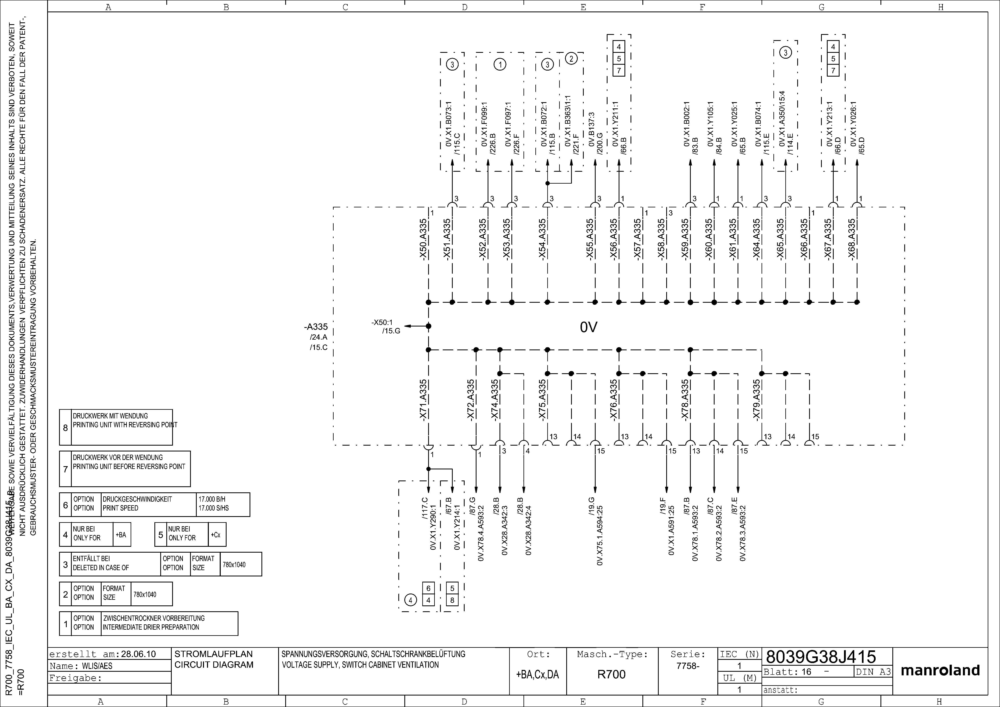

# +BA_Cx_DA — Sheet 16 of 247 — SPANNUNGSVERSORGUNG, SCHALTSCHRANKBELÜFTUNG

**VOLTAGE SUPPLY, SWITCH CABINET VENTILATION**

> Part of the manroland **R700** printing press IEC/UL circuit diagrams.
> Drawing class: **Stromlaufplan / Circuit diagram** (DIN A3).
> Document `+BA_Cx_DA` covers the **Printing units / main switch cabinet** machine section.

## At a glance

| Field | Value |
|---|---|
| Document | `+BA_Cx_DA`  (8039G38J415) |
| Sheet | **16** of 247 |
| Section (DE) | SPANNUNGSVERSORGUNG, SCHALTSCHRANKBELÜFTUNG |
| Section (EN) | VOLTAGE SUPPLY, SWITCH CABINET VENTILATION |
| Section type | POWER_SUPPLY — Voltage supply |
| Machine type | `R700` |
| Series | `7758` |
| Created | 28.06.10 |
| Replaces | — |
| Columns used | A, B, C, D, E, F, G |
| Path numbers | — |
| Labels on sheet | 167 |
| Cross-refs out | 27 |
| Cross-refs in | 60 |

**Previous:** [+BA_Cx_DA sheet 15](SHEET_0015.md) · **Next:** [+BA_Cx_DA sheet 17](SHEET_0017.md) · **Document TOC:** [_TOC.md](_TOC.md)  (+BA_Cx_DA) · **Master TOC:** [all sheets](../_MASTER_TOC.md)

## Sheet image (300 DPI, exact vector render)



_Rendered directly from the PDF vector layer at 300 DPI (1-bit), no OCR and no resampling. Use it to confirm anything ambiguous in the text below._

## Cross-references on this sheet

Each entry is a wire leaving this sheet. The printed token is `/sheet.column`; the link resolves to that sheet inside the same document.

| Ref | Target sheet | Col | Path | Destination on target | Target section | From col |
|---|---|---|---|---|---|---|
| `/114.E` | [+BA_Cx_DA sheet 114](SHEET_0114.md) | E | — | 0V.X1.A350\15:4 | PPL 2 | G |
| `/221.F` | [+BA_Cx_DA sheet 221](SHEET_0221.md) | F | — | 0V.X1.B363\1:1 | OPTION: FORMAT 780x1040 | E |
| `/115.C` | [+BA_Cx_DA sheet 115](SHEET_0115.md) | C | — | 0V.X1.B073:1 | PPL 2 | D |
| `/115.B` | [+BA_Cx_DA sheet 115](SHEET_0115.md) | B | — | 0V.X1.B072:1 | PPL 2 | E |
| `/66.B` | [+BA_Cx_DA sheet 66](SHEET_0066.md) | B | — | 0V.X1.Y211:1 | TRENNBLÄSER | E |
| `/83.B` | [+BA_Cx_DA sheet 83](SHEET_0083.md) | B | — | 0V.X1.B002:1 | FARBWERK | F |
| `/84.B` | [+BA_Cx_DA sheet 84](SHEET_0084.md) | B | — | 0V.X1.Y105:1 | FARBWERK | F |
| `/65.B` | [+BA_Cx_DA sheet 65](SHEET_0065.md) | B | — | 0V.X1.Y025:1 | DRUCKANSTELLUNG | F |
| `/115.E` | [+BA_Cx_DA sheet 115](SHEET_0115.md) | E | — | 0V.X1.B074:1 | PPL 2 | G |
| `/66.D` | [+BA_Cx_DA sheet 66](SHEET_0066.md) | D | — | 0V.X1.Y213:1 | TRENNBLÄSER | G |
| `/65.D` | [+BA_Cx_DA sheet 65](SHEET_0065.md) | D | — | 0V.X1.Y026:1 | DRUCKANSTELLUNG | G |
| `/226.B` | [+BA_Cx_DA sheet 226](SHEET_0226.md) | B | — | 0V.X1.F099:1 | OPTION: ZWISCHENTROCKNER VORBEREITUNG | D |
| `/226.F` | [+BA_Cx_DA sheet 226](SHEET_0226.md) | F | — | 0V.X1.F097:1 | OPTION: ZWISCHENTROCKNER VORBEREITUNG | D |
| `/200.G` | [+BA_Cx_DA sheet 200](SHEET_0200.md) | G | — | 0V.B137:3 | OPTION: APL | E |
| `/15.G` | [+BA_Cx_DA sheet 15](SHEET_0015.md) | G | — | X50:1 | SPANNUNGSVERSORGUNG, SCHALTSCHRANKBELÜFTUNG | C |
| `/24.A` | [+BA_Cx_DA sheet 24](SHEET_0024.md) | A | — | — | BUSVERBINDUNGEN: NOT AUS | C |
| `/15.C` | [+BA_Cx_DA sheet 15](SHEET_0015.md) | C | — | — | SPANNUNGSVERSORGUNG, SCHALTSCHRANKBELÜFTUNG | C |
| `/87.E` | [+BA_Cx_DA sheet 87](SHEET_0087.md) | E | — | — | WASCHVORRICHTUNG | F |
| `/87.G` | [+BA_Cx_DA sheet 87](SHEET_0087.md) | G | — | — | WASCHVORRICHTUNG | D |
| `/19.G` | [+BA_Cx_DA sheet 19](SHEET_0019.md) | G | — | — | SPANNUNGSVERSORGUNG: MAGNETVENTILBLOCK | E |
| `/117.C` | [+BA_Cx_DA sheet 117](SHEET_0117.md) | C | — | — | DRUCKGESCHWINDIGKEIT 17.000 B/H | D |
| `/67.B` | [+BA_Cx_DA sheet 67](SHEET_0067.md) | B | — | — | TRENNBLÄSER / | D |
| `/28.B` | [+BA_Cx_DA sheet 28](SHEET_0028.md) | B | — | — | BUSVERBINDUNGEN: STOP SICHERN | D |
| `/28.B` | [+BA_Cx_DA sheet 28](SHEET_0028.md) | B | — | — | BUSVERBINDUNGEN: STOP SICHERN | D |
| `/19.F` | [+BA_Cx_DA sheet 19](SHEET_0019.md) | F | — | — | SPANNUNGSVERSORGUNG: MAGNETVENTILBLOCK | F |
| `/87.B` | [+BA_Cx_DA sheet 87](SHEET_0087.md) | B | — | — | WASCHVORRICHTUNG | F |
| `/87.C` | [+BA_Cx_DA sheet 87](SHEET_0087.md) | C | — | — | WASCHVORRICHTUNG | F |

### Incoming references (sheets that point here)

Every other sheet that sends a wire to this one. `Back-ref` is the token printed on *that* sheet; `Path` is its line number.

| From sheet | Cols | Back-ref | Path | Refs | What continues there |
|---|---|---|---|---|---|
| [+BA_Cx_DA#15](SHEET_0015.md) | C, G | `/15.C`, `/15.G` | — | 2 | — |
| [+BA_Cx_DA#19](SHEET_0019.md) | F | `/19.F` | — | 2 | 0V.X1.A591:25 0V.X75.1.A594:25 |
| [+BA_Cx_DA#24](SHEET_0024.md) | A | `/24.A` | — | 1 | — |
| [+BA_Cx_DA#28](SHEET_0028.md) | A, B | `/28.A`, `/28.B` | — | 2 | 0V.X28.A342:3; 0V.X28.A342:4 |
| [+BA_Cx_DA#65](SHEET_0065.md) | B | `/65.B` | — | 2 | 0V.X1.Y025:1 0V.X1.Y026:1 |
| [+BA_Cx_DA#66](SHEET_0066.md) | C | `/66.C` | — | 2 | 0V.X1.Y211:1 0V.X1.Y213:1 |
| [+BA_Cx_DA#67](SHEET_0067.md) | B | `/67.B` | — | 1 | 0V.X1.Y214:1 |
| [+BA_Cx_DA#83](SHEET_0083.md) | C | `/83.C` | — | 1 | 0V.X1.B002:1 0V.X1.B434:1 |
| [+BA_Cx_DA#84](SHEET_0084.md) | A | `/84.A` | — | 1 | 0V.X1.Y105:1 |
| [+BA_Cx_DA#87](SHEET_0087.md) | A, C, E, F | `/87.A`, `/87.C`, `/87.E`, `/87.F` | — | 4 | — |
| [+BA_Cx_DA#114](SHEET_0114.md) | D | `/114.D` | — | 1 | 0V.X1.A350\15:4 |
| [+BA_Cx_DA#115](SHEET_0115.md) | A, C, D | `/115.A`, `/115.C`, `/115.D` | — | 3 | — |
| [+BA_Cx_DA#117](SHEET_0117.md) | C | `/117.C` | — | 1 | 0V.X1.Y290:1 |
| [+BA_Cx_DA#182](SHEET_0182.md) | E, F, G, H | `/182.E`, `/182.F`, `/182.G`, `/182.H` | — | 6 | — |
| [+BA_Cx_DA#183](SHEET_0183.md) | A, B, C, F, G, H | `/183.A`, `/183.B`, `/183.C`, `/183.F`, `/183.G`, `/183.H` | — | 11 | — |
| [+BA_Cx_DA#184](SHEET_0184.md) | E, F, G | `/184.E`, `/184.F`, `/184.G` | — | 7 | — |
| [+BA_Cx_DA#185](SHEET_0185.md) | C | `/185.C` | — | 3 | — |
| [+BA_Cx_DA#186](SHEET_0186.md) | B, C | `/186.B`, `/186.C` | — | 6 | — |
| [+BA_Cx_DA#200](SHEET_0200.md) | G | `/200.G` | — | 1 | 0V.B137:3 |
| [+BA_Cx_DA#221](SHEET_0221.md) | F | `/221.F` | — | 1 | 0V.X1.B363\1:1 |
| [+BA_Cx_DA#226](SHEET_0226.md) | C | `/226.C` | — | 2 | 1 0V.X1.F099:1 0V.X1.F095:1 0V.X1.F097:1 |


## Devices on this sheet

| Tag | Class | Class meaning (IEC) | Col | Sub | Terminal | Sign |
|---|---|---|---|---|---|---|
| `A335` | A | Baugruppe / assembly, module, PC board | C | — | — | — |
| `X50:1` | X | Klemme / terminal, plug connector | C | — | 1 | — |
| `X71.A335` | — | cross-device reference | D | — | — | — |
| `X72.A335` | — | cross-device reference | D | — | — | — |
| `X74.A335` | — | cross-device reference | D | — | — | — |
| `X78.A335` | — | cross-device reference | F | — | — | — |
| `X54.A335` | — | cross-device reference | E | — | — | — |
| `X55.A335` | — | cross-device reference | E | — | — | — |
| `X56.A335` | — | cross-device reference | E | — | — | — |
| `X59.A335` | — | cross-device reference | F | — | — | — |
| `X60.A335` | — | cross-device reference | F | — | — | — |
| `X61.A335` | — | cross-device reference | F | — | — | — |
| `X64.A335` | — | cross-device reference | F | — | — | — |
| `X65.A335` | — | cross-device reference | G | — | — | — |
| `X67.A335` | — | cross-device reference | G | — | — | — |
| `X68.A335` | — | cross-device reference | G | — | — | — |
| `X51.A335` | — | cross-device reference | D | — | — | — |
| `X52.A335` | — | cross-device reference | D | — | — | — |
| `X53.A335` | — | cross-device reference | D | — | — | — |
| `X75.A335` | — | cross-device reference | E | — | — | — |
| `X76.A335` | — | cross-device reference | E | — | — | — |
| `X79.A335` | — | cross-device reference | F | — | — | — |
| `X58.A335` | — | cross-device reference | F | — | — | — |
| `X66.A335` | — | cross-device reference | G | — | — | — |
| `X50.A335` | — | cross-device reference | D | — | — | — |
| `X57.A335` | — | cross-device reference | E | — | — | — |

## Potentials / nets

| Potential | Count | Columns | Attached devices | Terminals |
|---|---|---|---|---|
| `0V` | 25 | D, E, F, G | `1`, `2`, `3`, `4`, `A342`, `A350\15`, `A591`, `A593`, `A594`, `B002`, `B072`, `B073`, `B074`, `B137`, `B363\1`, `F097`, `F099`, `X1`, `X28`, `X75`, `X78`, `Y025`, `Y026`, `Y105`, `Y211`, `Y213`, `Y214`, `Y290` | `1`, `2`, `25`, `3`, `4` |


A potential such as `L24+/4` or `M24+` is a named supply/return rail; every place it appears on this sheet is electrically common.

## Wire-end annotations (grouped as printed)

A wire that continues elsewhere is annotated with a small cluster: the destination description, the path/line number `#NN`, and the `/sheet.column` cross reference. Each row below is one such cluster exactly as it is grouped on the drawing.

| Col | Y | Path | Cross-ref | Text on the wire |
|---|---|---|---|---|
| F | 52.1 | — | — | `4 3` |
| G | 52.1 | — | — | `4` |
| E | 66.2 | — | — | `5` |
| G | 66.2 | — | — | `5` |
| E | 66.9 | — | — | `3 2` |
| D | 73.5 | — | — | `3 1` |
| E | 80.4 | — | — | `7` |
| G | 80.4 | — | — | `7` |
| G | 108.0 | — | `/114.E` | `0V.X1.A350\15:4` |
| E | 112.8 | — | `/221.F` | `0V.X1.B363\1:1` |
| D | 120.2 | — | `/115.C` | `0V.X1.B073:1` |
| E | 120.2 | — | `/115.B` | `0V.X1.B072:1` |
| E | 120.2 | — | `/66.B` | `0V.X1.Y211:1` |
| F | 120.2 | — | `/83.B` | `0V.X1.B002:1` |
| F | 120.2 | — | `/84.B` | `0V.X1.Y105:1` |
| F | 120.2 | — | `/65.B` | `0V.X1.Y025:1` |
| G | 120.2 | — | `/115.E` | `0V.X1.B074:1` |
| G | 120.2 | — | `/66.D` | `0V.X1.Y213:1` |
| G | 120.2 | — | `/65.D` | `0V.X1.Y026:1` |
| D | 120.8 | — | `/226.B` | `0V.X1.F099:1` |
| D | 120.8 | — | `/226.F` | `0V.X1.F097:1` |
| E | 133.5 | — | `/200.G` | `0V.B137:3` |
| D | 232.8 | — | — | `3` |
| D | 232.8 | — | — | `3` |
| D | 232.8 | — | — | `3` |
| E | 232.8 | — | — | `3` |
| E | 232.8 | — | — | `3` |
| E | 232.8 | — | — | `1` |
| F | 232.8 | — | — | `3` |
| F | 232.8 | — | — | `1` |
| F | 232.8 | — | — | `1` |
| G | 232.8 | — | — | `3` |
| G | 232.8 | — | — | `3` |
| G | 232.8 | — | — | `1` |
| G | 232.8 | — | — | `1` |
| D | 249.8 | — | — | `1` |
| F | 249.8 | — | — | `1 3 1` |
| D | 260.2 | — | — | `X50.A335` |
| D | 260.2 | — | — | `X51.A335` |
| D | 260.2 | — | — | `X52.A335` |
| D | 260.2 | — | — | `X53.A335` |
| E | 260.2 | — | — | `X54.A335` |
| E | 260.2 | — | — | `X55.A335` |
| E | 260.2 | — | — | `X56.A335` |
| E | 260.2 | — | — | `X57.A335` |
| F | 260.2 | — | — | `X58.A335` |
| F | 260.2 | — | — | `X59.A335` |
| F | 260.2 | — | — | `X60.A335` |
| F | 260.2 | — | — | `X61.A335` |
| F | 260.2 | — | — | `X64.A335` |
| G | 260.2 | — | — | `X65.A335` |
| G | 260.2 | — | — | `X66.A335` |
| G | 260.2 | — | — | `X67.A335` |
| G | 260.2 | — | — | `X68.A335` |
| C | 380.1 | — | `/15.G` | `X50:1` |
| E | 381.9 | — | — | `0V` |
| C | 384.4 | — | — | `A335` |
| C | 397.4 | — | `/24.A`, `/15.C` | — |
| D | 451.6 | — | — | `X71.A335` |
| D | 451.6 | — | — | `X72.A335` |
| D | 451.6 | — | — | `X74.A335` |
| E | 451.6 | — | — | `X75.A335` |
| E | 451.6 | — | — | `X76.A335` |
| F | 451.6 | — | — | `X78.A335` |
| F | 451.6 | — | — | `X79.A335` |
| A | 492.4 | — | — | `8 DRUCKWERK MIT WENDUNG PRINTING UNIT WITH REVERSING POINT` |
| F | 516.2 | — | — | `13 14 13 14 13 14 15` |
| D | 533.2 | — | — | `3` |
| E | 533.2 | — | — | `4 15 15 13` |
| F | 533.2 | — | — | `14 15` |
| D | 537.5 | — | — | `1` |
| D | 537.5 | — | — | `1` |
| A | 542.0 | — | — | `7 DRUCKWERK VOR DER WENDUNG PRINTING UNIT BEFORE REVERSING POINT` |
| A | 591.6 | — | — | `OPTION OPTION` |
| A | 591.6 | — | — | `DRUCKGESCHWINDIGKEIT PRINT SPEED` |
| B | 591.6 | — | — | `17.000 B/H 17.000 S/HS` |
| D | 591.9 | — | `/87.G` | — |
| E | 591.9 | — | `/19.G` | — |
| F | 591.9 | — | `/87.E` | — |
| D | 592.2 | — | `/117.C` | — |
| D | 592.2 | — | `/67.B` | — |
| D | 592.2 | — | `/28.B` | — |
| D | 592.2 | — | `/28.B` | — |
| F | 592.2 | — | `/19.F` | — |
| F | 592.2 | — | `/87.B` | — |
| F | 592.2 | — | `/87.C` | — |
| A | 597.0 | — | — | `6` |
| D | 600.7 | — | — | `0V.X1.Y290:1` |
| D | 600.7 | — | — | `0V.X1.Y214:1` |
| D | 601.8 | — | — | `0V.X78.4.A593:2` |
| F | 601.8 | — | — | `0V.X78.1.A593:2` |
| F | 601.8 | — | — | `0V.X78.2.A593:2` |
| F | 601.8 | — | — | `0V.X78.3.A593:2` |
| D | 602.1 | — | — | `0V.X28.A342:3` |
| E | 602.1 | — | — | `0V.X28.A342:4` |
| E | 602.1 | — | — | `0V.X75.1.A594:25` |
| F | 602.1 | — | — | `0V.X1.A591:25` |
| A | 627.0 | — | — | `NUR BEI` |
| A | 627.0 | — | — | `ONLY FOR +BA 5 NUR BEI` |
| A | 632.4 | — | — | `4` |
| B | 634.3 | — | — | `ONLY FOR +Cx` |
| A | 662.5 | — | — | `ENTFÄLLT BEI DELETED IN CASE OF` |
| B | 662.5 | — | — | `OPTION OPTION` |
| B | 662.5 | — | — | `FORMAT` |
| A | 667.8 | — | — | `3` |
| B | 669.7 | — | — | `SIZE 780x1040` |
| D | 696.9 | — | — | `6` |
| D | 696.9 | — | — | `5` |
| A | 697.9 | — | — | `OPTION OPTION` |
| A | 698.0 | — | — | `FORMAT` |
| A | 703.3 | — | — | `2` |
| A | 705.1 | — | — | `SIZE 780x1040` |
| D | 711.1 | — | — | `4` |
| D | 711.1 | — | — | `8` |
| D | 711.8 | — | — | `4` |
| A | 733.4 | — | — | `1 INTERMEDIATE DRIER PREPARATION ZWISCHENTROCKNER VORBEREITUNG` |
| A | 733.4 | — | — | `OPTION OPTION` |


## Notes and free text on this sheet

| Text | Col | Y (pt) |
|---|---|---|
| `OPTION` | A | 733.35 |
| `ZWISCHENTROCKNER VORBEREITUNG` | A | 733.38 |
| `INTERMEDIATE DRIER PREPARATION` | A | 744.01 |
| `FORMAT` | A | 697.95 |
| `SIZE` | A | 708.5 |
| `780x1040` | A | 705.1 |
| `ENTFÄLLT BEI` | A | 662.48 |
| `DELETED IN CASE OF` | A | 673.13 |
| `OPTION` | B | 662.49 |
| `FORMAT` | B | 662.51 |
| `SIZE` | B | 673.07 |
| `780x1040` | B | 669.67 |
| `NUR BEI` | A | 627.04 |
| `ONLY FOR` | A | 637.72 |
| `+BA` | A | 634.14 |
| `NUR BEI` | B | 627.04 |
| `ONLY FOR` | B | 637.72 |
| `+Cx` | B | 634.27 |
| `DRUCKGESCHWINDIGKEIT` | A | 591.64 |
| `PRINT SPEED` | A | 602.26 |
| `17.000 B/H` | B | 591.62 |
| `17.000 S/HS` | B | 602.26 |
| `DRUCKWERK VOR DER WENDUNG` | A | 542.03 |
| `PRINTING UNIT BEFORE REVERSING POINT` | A | 552.67 |
| `DRUCKWERK MIT WENDUNG` | A | 492.41 |
| `PRINTING UNIT WITH REVERSING POINT` | A | 503.06 |

## Complete label inventory (exact text from the drawing)

Every text object inside the drawing area of this sheet, in DIN reading order (column A→H, then top→bottom). This is the authoritative list: if a string is not here it is not printed on this sheet.

| Col | Y | X | Dir | Type | Text |
|---|---|---|---|---|---|
| A | 492.4 | 87.0 | → | text | `DRUCKWERK MIT WENDUNG` |
| A | 503.1 | 87.0 | → | text | `PRINTING UNIT WITH REVERSING POINT` |
| A | 504.8 | 75.0 | → | number | `8` |
| A | 542.0 | 87.0 | → | text | `DRUCKWERK VOR DER WENDUNG` |
| A | 552.7 | 87.0 | → | text | `PRINTING UNIT BEFORE REVERSING POINT` |
| A | 554.4 | 75.1 | → | number | `7` |
| A | 591.6 | 87.6 | → | text | `OPTION` |
| A | 591.6 | 122.5 | → | text | `DRUCKGESCHWINDIGKEIT` |
| A | 597.0 | 75.1 | → | number | `6` |
| A | 602.3 | 87.6 | → | text | `OPTION` |
| A | 602.3 | 122.5 | → | text | `PRINT SPEED` |
| A | 627.0 | 87.0 | → | text | `NUR BEI` |
| A | 632.4 | 75.1 | → | number | `4` |
| A | 632.4 | 188.4 | → | number | `5` |
| A | 634.1 | 137.9 | → | text | `+BA` |
| A | 637.7 | 87.6 | → | text | `ONLY FOR` |
| A | 662.5 | 87.0 | → | text | `ENTFÄLLT BEI` |
| A | 667.8 | 75.0 | → | number | `3` |
| A | 673.1 | 87.0 | → | text | `DELETED IN CASE OF` |
| A | 697.9 | 87.6 | → | text | `OPTION` |
| A | 697.9 | 122.5 | → | text | `FORMAT` |
| A | 703.3 | 75.1 | → | number | `2` |
| A | 705.1 | 159.2 | → | text | `780x1040` |
| A | 708.5 | 123.0 | → | text | `SIZE` |
| A | 708.6 | 87.6 | → | text | `OPTION` |
| A | 733.4 | 87.6 | → | text | `OPTION` |
| A | 733.4 | 123.3 | → | text | `ZWISCHENTROCKNER VORBEREITUNG` |
| A | 738.7 | 75.4 | → | number | `1` |
| A | 744.0 | 87.6 | → | text | `OPTION` |
| A | 744.0 | 122.5 | → | text | `INTERMEDIATE DRIER PREPARATION` |
| B | 591.6 | 236.6 | → | text | `17.000 B/H` |
| B | 602.3 | 236.6 | → | text | `17.000 S/HS` |
| B | 627.0 | 200.4 | → | text | `NUR BEI` |
| B | 634.3 | 251.3 | → | text | `+Cx` |
| B | 637.7 | 201.0 | → | text | `ONLY FOR` |
| B | 662.5 | 193.9 | → | text | `OPTION` |
| B | 662.5 | 228.8 | → | text | `FORMAT` |
| B | 669.7 | 265.5 | → | text | `780x1040` |
| B | 673.1 | 193.9 | → | text | `OPTION` |
| B | 673.1 | 229.3 | → | text | `SIZE` |
| C | 380.1 | 442.2 | → | device tag | `X50:1` |
| C | 384.4 | 362.0 | → | device tag | `A335` |
| C | 390.0 | 455.2 | → | cross-reference | `/15.G` |
| C | 397.5 | 369.1 | → | cross-reference | `/24.A` |
| C | 409.9 | 369.1 | → | cross-reference | `/15.C` |
| D | 73.5 | 593.5 | → | number | `1` |
| D | 74.0 | 536.6 | → | number | `3` |
| D | 120.2 | 530.3 | ↕ | potential | `0V.X1.B073:1` |
| D | 120.8 | 572.9 | ↕ | potential | `0V.X1.F099:1` |
| D | 120.8 | 601.2 | ↕ | potential | `0V.X1.F097:1` |
| D | 158.5 | 540.3 | ↕ | cross-reference | `/115.C` |
| D | 158.7 | 582.8 | ↕ | cross-reference | `/226.B` |
| D | 159.3 | 611.1 | ↕ | cross-reference | `/226.F` |
| D | 232.8 | 541.1 | → | number | `3` |
| D | 232.8 | 583.7 | → | number | `3` |
| D | 232.8 | 612.0 | → | number | `3` |
| D | 249.8 | 512.2 | → | number | `1` |
| D | 260.2 | 499.2 | ↕ | device ref | `X50.A335` |
| D | 260.2 | 527.5 | ↕ | device ref | `X51.A335` |
| D | 260.2 | 570.1 | ↕ | device ref | `X52.A335` |
| D | 260.2 | 598.4 | ↕ | device ref | `X53.A335` |
| D | 451.6 | 499.2 | ↕ | device ref | `X71.A335` |
| D | 451.6 | 555.9 | ↕ | device ref | `X72.A335` |
| D | 451.6 | 584.2 | ↕ | device ref | `X74.A335` |
| D | 533.2 | 597.8 | → | number | `3` |
| D | 537.5 | 512.2 | → | number | `1` |
| D | 537.5 | 568.9 | → | number | `1` |
| D | 591.9 | 558.7 | ↕ | cross-reference | `/87.G` |
| D | 592.2 | 502.0 | ↕ | cross-reference | `/117.C` |
| D | 592.2 | 530.3 | ↕ | cross-reference | `/67.B` |
| D | 592.2 | 587.0 | ↕ | cross-reference | `/28.B` |
| D | 592.2 | 615.4 | ↕ | cross-reference | `/28.B` |
| D | 600.7 | 511.9 | ↕ | potential | `0V.X1.Y290:1` |
| D | 600.7 | 540.3 | ↕ | potential | `0V.X1.Y214:1` |
| D | 601.8 | 568.6 | ↕ | potential | `0V.X78.4.A593:2` |
| D | 602.1 | 597.0 | ↕ | potential | `0V.X28.A342:3` |
| D | 696.9 | 507.8 | → | number | `6` |
| D | 696.9 | 536.2 | → | number | `5` |
| D | 711.1 | 507.8 | → | number | `4` |
| D | 711.1 | 536.2 | → | number | `8` |
| D | 711.8 | 487.0 | → | number | `4` |
| E | 52.1 | 734.6 | → | number | `4` |
| E | 66.2 | 734.6 | → | number | `5` |
| E | 66.9 | 678.3 | → | number | `2` |
| E | 74.0 | 650.0 | → | number | `3` |
| E | 80.4 | 734.6 | → | number | `7` |
| E | 112.8 | 672.1 | ↕ | potential | `0V.X1.B363\1:1` |
| E | 120.2 | 643.7 | ↕ | potential | `0V.X1.B072:1` |
| E | 120.2 | 728.8 | ↕ | potential | `0V.X1.Y211:1` |
| E | 133.5 | 700.4 | ↕ | potential | `0V.B137:3` |
| E | 157.9 | 710.4 | ↕ | cross-reference | `/200.G` |
| E | 158.7 | 653.6 | ↕ | cross-reference | `/115.B` |
| E | 159.3 | 682.0 | ↕ | cross-reference | `/221.F` |
| E | 163.6 | 738.7 | ↕ | cross-reference | `/66.B` |
| E | 232.8 | 654.5 | → | number | `3` |
| E | 232.8 | 711.2 | → | number | `3` |
| E | 232.8 | 739.0 | → | number | `1` |
| E | 260.2 | 640.9 | ↕ | device ref | `X54.A335` |
| E | 260.2 | 697.6 | ↕ | device ref | `X55.A335` |
| E | 260.2 | 726.0 | ↕ | device ref | `X56.A335` |
| E | 260.2 | 754.3 | ↕ | device ref | `X57.A335` |
| E | 381.9 | 690.4 | → | potential | `0V` |
| E | 451.6 | 640.9 | ↕ | device ref | `X75.A335` |
| E | 451.6 | 726.0 | ↕ | device ref | `X76.A335` |
| E | 516.2 | 654.0 | → | number | `13` |
| E | 516.2 | 682.3 | → | number | `14` |
| E | 516.2 | 739.0 | → | number | `13` |
| E | 533.2 | 626.2 | → | number | `4` |
| E | 533.2 | 710.6 | → | number | `15` |
| E | 591.9 | 700.4 | ↕ | cross-reference | `/19.G` |
| E | 602.1 | 625.3 | ↕ | potential | `0V.X28.A342:4` |
| E | 602.1 | 710.4 | ↕ | potential | `0V.X75.1.A594:25` |
| F | 120.2 | 813.8 | ↕ | potential | `0V.X1.B002:1` |
| F | 120.2 | 842.2 | ↕ | potential | `0V.X1.Y105:1` |
| F | 120.2 | 870.5 | ↕ | potential | `0V.X1.Y025:1` |
| F | 120.2 | 898.8 | ↕ | potential | `0V.X1.B074:1` |
| F | 163.6 | 823.7 | ↕ | cross-reference | `/83.B` |
| F | 163.6 | 852.1 | ↕ | cross-reference | `/84.B` |
| F | 163.6 | 880.4 | ↕ | cross-reference | `/65.B` |
| F | 232.8 | 824.6 | → | number | `3` |
| F | 232.8 | 852.4 | → | number | `1` |
| F | 232.8 | 880.7 | → | number | `1` |
| F | 249.8 | 767.3 | → | number | `1` |
| F | 249.8 | 796.3 | → | number | `3` |
| F | 260.2 | 782.7 | ↕ | device ref | `X58.A335` |
| F | 260.2 | 811.0 | ↕ | device ref | `X59.A335` |
| F | 260.2 | 839.4 | ↕ | device ref | `X60.A335` |
| F | 260.2 | 867.7 | ↕ | device ref | `X61.A335` |
| F | 260.2 | 896.1 | ↕ | device ref | `X64.A335` |
| F | 451.6 | 811.0 | ↕ | device ref | `X78.A335` |
| F | 451.6 | 896.1 | ↕ | device ref | `X79.A335` |
| F | 516.2 | 767.3 | → | number | `14` |
| F | 533.2 | 795.7 | → | number | `15` |
| F | 533.2 | 824.0 | → | number | `13` |
| F | 533.2 | 852.4 | → | number | `14` |
| F | 533.2 | 880.7 | → | number | `15` |
| F | 591.9 | 870.5 | ↕ | cross-reference | `/87.E` |
| F | 592.2 | 785.5 | ↕ | cross-reference | `/19.F` |
| F | 592.2 | 813.8 | ↕ | cross-reference | `/87.B` |
| F | 592.2 | 842.2 | ↕ | cross-reference | `/87.C` |
| F | 601.8 | 823.7 | ↕ | potential | `0V.X78.1.A593:2` |
| F | 601.8 | 852.1 | ↕ | potential | `0V.X78.2.A593:2` |
| F | 601.8 | 880.4 | ↕ | potential | `0V.X78.3.A593:2` |
| F | 602.1 | 795.4 | ↕ | potential | `0V.X1.A591:25` |
| G | 52.1 | 989.7 | → | number | `4` |
| G | 59.8 | 933.4 | → | number | `3` |
| G | 66.2 | 989.7 | → | number | `5` |
| G | 80.4 | 989.7 | → | number | `7` |
| G | 108.0 | 927.2 | ↕ | potential | `0V.X1.A350\15:4` |
| G | 120.2 | 983.9 | ↕ | potential | `0V.X1.Y213:1` |
| G | 120.2 | 1012.2 | ↕ | potential | `0V.X1.Y026:1` |
| G | 158.7 | 908.8 | ↕ | cross-reference | `/115.E` |
| G | 158.7 | 937.1 | ↕ | cross-reference | `/114.E` |
| G | 163.3 | 993.8 | ↕ | cross-reference | `/66.D` |
| G | 163.3 | 1022.2 | ↕ | cross-reference | `/65.D` |
| G | 232.8 | 909.6 | → | number | `3` |
| G | 232.8 | 938.0 | → | number | `3` |
| G | 232.8 | 994.1 | → | number | `1` |
| G | 232.8 | 1022.5 | → | number | `1` |
| G | 249.8 | 965.8 | → | number | `1` |
| G | 260.2 | 924.4 | ↕ | device ref | `X65.A335` |
| G | 260.2 | 952.7 | ↕ | device ref | `X66.A335` |
| G | 260.2 | 981.1 | ↕ | device ref | `X67.A335` |
| G | 260.2 | 1009.4 | ↕ | device ref | `X68.A335` |
| G | 516.2 | 909.1 | → | number | `13` |
| G | 516.2 | 937.4 | → | number | `14` |
| G | 516.2 | 965.8 | → | number | `15` |

## Reading-order text block

The same content as a plain block, grouped by DIN column — convenient to paste or to match against a visual description.

```text
=== Column A ===
 492.4   87.0  text         DRUCKWERK MIT WENDUNG
 503.1   87.0  text         PRINTING UNIT WITH REVERSING POINT
 504.8   75.0  numeric      8
 542.0   87.0  text         DRUCKWERK VOR DER WENDUNG
 552.7   87.0  text         PRINTING UNIT BEFORE REVERSING POINT
 554.4   75.1  numeric      7
 591.6   87.6  text         OPTION
 591.6  122.5  text         DRUCKGESCHWINDIGKEIT
 597.0   75.1  numeric      6
 602.3   87.6  text         OPTION
 602.3  122.5  text         PRINT SPEED
 627.0   87.0  text         NUR BEI
 632.4   75.1  numeric      4
 632.4  188.4  numeric      5
 634.1  137.9  text         +BA
 637.7   87.6  text         ONLY FOR
 662.5   87.0  text         ENTFÄLLT BEI
 667.8   75.0  numeric      3
 673.1   87.0  text         DELETED IN CASE OF
 697.9   87.6  text         OPTION
 697.9  122.5  text         FORMAT
 703.3   75.1  numeric      2
 705.1  159.2  text         780x1040
 708.5  123.0  text         SIZE
 708.6   87.6  text         OPTION
 733.4   87.6  text         OPTION
 733.4  123.3  text         ZWISCHENTROCKNER VORBEREITUNG
 738.7   75.4  numeric      1
 744.0   87.6  text         OPTION
 744.0  122.5  text         INTERMEDIATE DRIER PREPARATION
=== Column B ===
 591.6  236.6  text         17.000 B/H
 602.3  236.6  text         17.000 S/HS
 627.0  200.4  text         NUR BEI
 634.3  251.3  text         +Cx
 637.7  201.0  text         ONLY FOR
 662.5  193.9  text         OPTION
 662.5  228.8  text         FORMAT
 669.7  265.5  text         780x1040
 673.1  193.9  text         OPTION
 673.1  229.3  text         SIZE
=== Column C ===
 380.1  442.2  devtag       X50:1
 384.4  362.0  devtag       A335
 390.0  455.2  xref         /15.G
 397.5  369.1  xref         /24.A
 409.9  369.1  xref         /15.C
=== Column D ===
  73.5  593.5  numeric      1
  74.0  536.6  numeric      3
 120.2  530.3  net          0V.X1.B073:1
 120.8  572.9  net          0V.X1.F099:1
 120.8  601.2  net          0V.X1.F097:1
 158.5  540.3  xref         /115.C
 158.7  582.8  xref         /226.B
 159.3  611.1  xref         /226.F
 232.8  541.1  numeric      3
 232.8  583.7  numeric      3
 232.8  612.0  numeric      3
 249.8  512.2  numeric      1
 260.2  499.2  devref       X50.A335
 260.2  527.5  devref       X51.A335
 260.2  570.1  devref       X52.A335
 260.2  598.4  devref       X53.A335
 451.6  499.2  devref       X71.A335
 451.6  555.9  devref       X72.A335
 451.6  584.2  devref       X74.A335
 533.2  597.8  numeric      3
 537.5  512.2  numeric      1
 537.5  568.9  numeric      1
 591.9  558.7  xref         /87.G
 592.2  502.0  xref         /117.C
 592.2  530.3  xref         /67.B
 592.2  587.0  xref         /28.B
 592.2  615.4  xref         /28.B
 600.7  511.9  net          0V.X1.Y290:1
 600.7  540.3  net          0V.X1.Y214:1
 601.8  568.6  net          0V.X78.4.A593:2
 602.1  597.0  net          0V.X28.A342:3
 696.9  507.8  numeric      6
 696.9  536.2  numeric      5
 711.1  507.8  numeric      4
 711.1  536.2  numeric      8
 711.8  487.0  numeric      4
=== Column E ===
  52.1  734.6  numeric      4
  66.2  734.6  numeric      5
  66.9  678.3  numeric      2
  74.0  650.0  numeric      3
  80.4  734.6  numeric      7
 112.8  672.1  net          0V.X1.B363\1:1
 120.2  643.7  net          0V.X1.B072:1
 120.2  728.8  net          0V.X1.Y211:1
 133.5  700.4  net          0V.B137:3
 157.9  710.4  xref         /200.G
 158.7  653.6  xref         /115.B
 159.3  682.0  xref         /221.F
 163.6  738.7  xref         /66.B
 232.8  654.5  numeric      3
 232.8  711.2  numeric      3
 232.8  739.0  numeric      1
 260.2  640.9  devref       X54.A335
 260.2  697.6  devref       X55.A335
 260.2  726.0  devref       X56.A335
 260.2  754.3  devref       X57.A335
 381.9  690.4  net          0V
 451.6  640.9  devref       X75.A335
 451.6  726.0  devref       X76.A335
 516.2  654.0  numeric      13
 516.2  682.3  numeric      14
 516.2  739.0  numeric      13
 533.2  626.2  numeric      4
 533.2  710.6  numeric      15
 591.9  700.4  xref         /19.G
 602.1  625.3  net          0V.X28.A342:4
 602.1  710.4  net          0V.X75.1.A594:25
=== Column F ===
 120.2  813.8  net          0V.X1.B002:1
 120.2  842.2  net          0V.X1.Y105:1
 120.2  870.5  net          0V.X1.Y025:1
 120.2  898.8  net          0V.X1.B074:1
 163.6  823.7  xref         /83.B
 163.6  852.1  xref         /84.B
 163.6  880.4  xref         /65.B
 232.8  824.6  numeric      3
 232.8  852.4  numeric      1
 232.8  880.7  numeric      1
 249.8  767.3  numeric      1
 249.8  796.3  numeric      3
 260.2  782.7  devref       X58.A335
 260.2  811.0  devref       X59.A335
 260.2  839.4  devref       X60.A335
 260.2  867.7  devref       X61.A335
 260.2  896.1  devref       X64.A335
 451.6  811.0  devref       X78.A335
 451.6  896.1  devref       X79.A335
 516.2  767.3  numeric      14
 533.2  795.7  numeric      15
 533.2  824.0  numeric      13
 533.2  852.4  numeric      14
 533.2  880.7  numeric      15
 591.9  870.5  xref         /87.E
 592.2  785.5  xref         /19.F
 592.2  813.8  xref         /87.B
 592.2  842.2  xref         /87.C
 601.8  823.7  net          0V.X78.1.A593:2
 601.8  852.1  net          0V.X78.2.A593:2
 601.8  880.4  net          0V.X78.3.A593:2
 602.1  795.4  net          0V.X1.A591:25
=== Column G ===
  52.1  989.7  numeric      4
  59.8  933.4  numeric      3
  66.2  989.7  numeric      5
  80.4  989.7  numeric      7
 108.0  927.2  net          0V.X1.A350\15:4
 120.2  983.9  net          0V.X1.Y213:1
 120.2 1012.2  net          0V.X1.Y026:1
 158.7  908.8  xref         /115.E
 158.7  937.1  xref         /114.E
 163.3  993.8  xref         /66.D
 163.3 1022.2  xref         /65.D
 232.8  909.6  numeric      3
 232.8  938.0  numeric      3
 232.8  994.1  numeric      1
 232.8 1022.5  numeric      1
 249.8  965.8  numeric      1
 260.2  924.4  devref       X65.A335
 260.2  952.7  devref       X66.A335
 260.2  981.1  devref       X67.A335
 260.2 1009.4  devref       X68.A335
 516.2  909.1  numeric      13
 516.2  937.4  numeric      14
 516.2  965.8  numeric      15
```

---
_Generated from the PDF vector text layer; no OCR. Source: `R700_7758_IEC_UL_BA_CX_DA_8039G38J415_p`, sheet 16._
