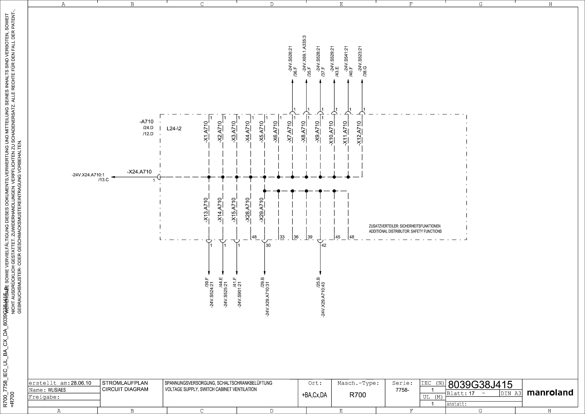

# +BA_Cx_DA — Sheet 17 of 247 — SPANNUNGSVERSORGUNG, SCHALTSCHRANKBELÜFTUNG

**VOLTAGE SUPPLY, SWITCH CABINET VENTILATION**

> Part of the manroland **R700** printing press IEC/UL circuit diagrams.
> Drawing class: **Stromlaufplan / Circuit diagram** (DIN A3).
> Document `+BA_Cx_DA` covers the **Printing units / main switch cabinet** machine section.

## At a glance

| Field | Value |
|---|---|
| Document | `+BA_Cx_DA`  (8039G38J415) |
| Sheet | **17** of 247 |
| Section (DE) | SPANNUNGSVERSORGUNG, SCHALTSCHRANKBELÜFTUNG |
| Section (EN) | VOLTAGE SUPPLY, SWITCH CABINET VENTILATION |
| Section type | POWER_SUPPLY — Voltage supply |
| Machine type | `R700` |
| Series | `7758` |
| Created | 28.06.10 |
| Replaces | — |
| Columns used | A, B, C, D, E, F |
| Path numbers | — |
| Labels on sheet | 75 |
| Cross-refs out | 14 |
| Cross-refs in | 38 |

**Previous:** [+BA_Cx_DA sheet 16](SHEET_0016.md) · **Next:** [+BA_Cx_DA sheet 18](SHEET_0018.md) · **Document TOC:** [_TOC.md](_TOC.md)  (+BA_Cx_DA) · **Master TOC:** [all sheets](../_MASTER_TOC.md)

## Sheet image (300 DPI, exact vector render)



_Rendered directly from the PDF vector layer at 300 DPI (1-bit), no OCR and no resampling. Use it to confirm anything ambiguous in the text below._

## Cross-references on this sheet

Each entry is a wire leaving this sheet. The printed token is `/sheet.column`; the link resolves to that sheet inside the same document.

| Ref | Target sheet | Col | Path | Destination on target | Target section | From col |
|---|---|---|---|---|---|---|
| `/35.F` | [+BA_Cx_DA sheet 35](SHEET_0035.md) | F | — | 24V.X69.1.A335:3 | SCHUTZEINRICHTUNGEN | E |
| `/36.F` | [+BA_Cx_DA sheet 36](SHEET_0036.md) | F | — | 24V.S526:21 | SCHUTZEINRICHTUNGEN | D |
| `/37.F` | [+BA_Cx_DA sheet 37](SHEET_0037.md) | F | — | 24V.S528:21 | SCHUTZEINRICHTUNGEN | E |
| `/43.E` | [+BA_Cx_DA sheet 43](SHEET_0043.md) | E | — | 24V.S529:21 | SCHUTZEINRICHTUNGEN | E |
| `/40.F` | [+BA_Cx_DA sheet 40](SHEET_0040.md) | F | — | 24V.S541:21 | SCHUTZEINRICHTUNGEN | E |
| `/38.G` | [+BA_Cx_DA sheet 38](SHEET_0038.md) | G | — | 24V.S523:21 | SCHUTZEINRICHTUNGEN | E |
| `/24.D` | [+BA_Cx_DA sheet 24](SHEET_0024.md) | D | — | — | BUSVERBINDUNGEN: NOT AUS | B |
| `/12.D` | [+BA_Cx_DA sheet 12](SHEET_0012.md) | D | — | — | SPANNUNGSVERSORGUNG, SCHALTSCHRANKBELÜFTUNG | B |
| `/13.C` | [+BA_Cx_DA sheet 13](SHEET_0013.md) | C | — | 24V.X24.A710:1 | SPANNUNGSVERSORGUNG, SCHALTSCHRANKBELÜFTUNG | A |
| `/44.E` | [+BA_Cx_DA sheet 44](SHEET_0044.md) | E | — | — | SCHUTZEINRICHTUNGEN | C |
| `/39.F` | [+BA_Cx_DA sheet 39](SHEET_0039.md) | F | — | — | SCHUTZEINRICHTUNGEN | C |
| `/41.F` | [+BA_Cx_DA sheet 41](SHEET_0041.md) | F | — | — | SCHUTZEINRICHTUNGEN | C |
| `/29.B` | [+BA_Cx_DA sheet 29](SHEET_0029.md) | B | — | — | BUSVERBINDUNGEN: STOP SICHERN | D |
| `/25.B` | [+BA_Cx_DA sheet 25](SHEET_0025.md) | B | — | — | BUSVERBINDUNGEN: NOT AUS | E |

### Incoming references (sheets that point here)

Every other sheet that sends a wire to this one. `Back-ref` is the token printed on *that* sheet; `Path` is its line number.

| From sheet | Cols | Back-ref | Path | Refs | What continues there |
|---|---|---|---|---|---|
| [+BA_Cx_DA#12](SHEET_0012.md) | D | `/12.D` | — | 1 | — |
| [+BA_Cx_DA#13](SHEET_0013.md) | B | `/13.B` | — | 1 | 24V.X24.A710:1 |
| [+BA_Cx_DA#24](SHEET_0024.md) | D | `/24.D` | — | 1 | — |
| [+BA_Cx_DA#25](SHEET_0025.md) | D | `/25.D` | — | 1 | 24V.X29.A710:43 X29.A710:47 |
| [+BA_Cx_DA#29](SHEET_0029.md) | D | `/29.D` | — | 1 | 24V.X29.A710:31 X29.A710:35 |
| [+BA_Cx_DA#35](SHEET_0035.md) | F | `/35.F` | — | 1 | — |
| [+BA_Cx_DA#36](SHEET_0036.md) | F | `/36.F` | — | 1 | — |
| [+BA_Cx_DA#37](SHEET_0037.md) | E | `/37.E` | — | 1 | — |
| [+BA_Cx_DA#38](SHEET_0038.md) | F | `/38.F` | — | 1 | — |
| [+BA_Cx_DA#39](SHEET_0039.md) | F | `/39.F` | — | 1 | — |
| [+BA_Cx_DA#40](SHEET_0040.md) | F | `/40.F` | — | 1 | — |
| [+BA_Cx_DA#41](SHEET_0041.md) | F | `/41.F` | — | 1 | — |
| [+BA_Cx_DA#43](SHEET_0043.md) | E | `/43.E` | — | 1 | — |
| [+BA_Cx_DA#44](SHEET_0044.md) | E | `/44.E` | — | 1 | — |
| [+BA_Cx_DA#144](SHEET_0144.md) | C | `/144.C` | — | 1 | STROMPFAD PIN 1 2 |
| [+BA_Cx_DA#154](SHEET_0154.md) | B | `/154.B` | — | 1 | — |
| [+BA_Cx_DA#158](SHEET_0158.md) | A | `/158.A` | — | 1 | STROMPFAD PIN 1 2 |
| [+BA_Cx_DA#160](SHEET_0160.md) | A | `/160.A` | — | 1 | — |
| [+BA_Cx_DA#161](SHEET_0161.md) | H | `/161.H` | — | 1 | — |
| [+BA_Cx_DA#162](SHEET_0162.md) | H | `/162.H` | — | 1 | — |
| [+BA_Cx_DA#164](SHEET_0164.md) | C | `/164.C` | — | 1 | — |
| [+BA_Cx_DA#165](SHEET_0165.md) | H | `/165.H` | — | 1 | — |
| [+BA_Cx_DA#166](SHEET_0166.md) | H | `/166.H` | — | 1 | — |
| [+BA_Cx_DA#167](SHEET_0167.md) | E | `/167.E` | — | 1 | — |
| [+BA_Cx_DA#168](SHEET_0168.md) | H | `/168.H` | — | 1 | — |
| [+BA_Cx_DA#169](SHEET_0169.md) | H | `/169.H` | — | 1 | — |
| [+BA_Cx_DA#170](SHEET_0170.md) | C, H | `/170.C`, `/170.H` | — | 2 | — |
| [+BA_Cx_DA#171](SHEET_0171.md) | H | `/171.H` | — | 1 | — |
| [+BA_Cx_DA#175](SHEET_0175.md) | C | `/175.C` | — | 1 | STROMPFAD PIN 1 2 |
| [+BA_Cx_DA#178](SHEET_0178.md) | H | `/178.H` | — | 1 | — |
| [+BA_Cx_DA#179](SHEET_0179.md) | C | `/179.C` | — | 7 | — |


## Devices on this sheet

| Tag | Class | Class meaning (IEC) | Col | Sub | Terminal | Sign |
|---|---|---|---|---|---|---|
| `A710` | A | Baugruppe / assembly, module, PC board | B | — | — | — |
| `X7.A710` | — | cross-device reference | D | — | — | — |
| `X8.A710` | — | cross-device reference | D | — | — | — |
| `X9.A710` | — | cross-device reference | E | — | — | — |
| `X10.A710` | — | cross-device reference | E | — | — | — |
| `X11.A710` | — | cross-device reference | E | — | — | — |
| `X12.A710` | — | cross-device reference | E | — | — | — |
| `X13.A710` | — | cross-device reference | C | — | — | — |
| `X14.A710` | — | cross-device reference | C | — | — | — |
| `X15.A710` | — | cross-device reference | C | — | — | — |
| `X29.A710` | — | cross-device reference | D | — | — | — |
| `X24.A710` | — | cross-device reference | B | — | — | — |
| `X1.A710` | — | cross-device reference | C | — | — | — |
| `X2.A710` | — | cross-device reference | C | — | — | — |
| `X3.A710` | — | cross-device reference | C | — | — | — |
| `X5.A710` | — | cross-device reference | D | — | — | — |
| `X6.A710` | — | cross-device reference | D | — | — | — |
| `X4.A710` | — | cross-device reference | D | — | — | — |
| `X28.A710` | — | cross-device reference | D | — | — | — |

## Potentials / nets

| Potential | Count | Columns | Attached devices | Terminals |
|---|---|---|---|---|
| `24V` | 12 | A, C, D, E | `1`, `A335`, `A710`, `S523`, `S524`, `S525`, `S526`, `S528`, `S529`, `S541`, `S901`, `X24`, `X29`, `X69` | `1`, `21`, `3`, `31`, `43` |


A potential such as `L24+/4` or `M24+` is a named supply/return rail; every place it appears on this sheet is electrically common.

## Wire-end annotations (grouped as printed)

A wire that continues elsewhere is annotated with a small cluster: the destination description, the path/line number `#NN`, and the `/sheet.column` cross reference. Each row below is one such cluster exactly as it is grouped on the drawing.

| Col | Y | Path | Cross-ref | Text on the wire |
|---|---|---|---|---|
| E | 72.0 | — | `/35.F` | `24V.X69.1.A335:3` |
| D | 92.7 | — | `/36.F` | `24V.S526:21` |
| E | 92.7 | — | `/37.F` | `24V.S528:21` |
| E | 92.7 | — | `/43.E` | `24V.S529:21` |
| E | 92.7 | — | `/40.F` | `24V.S541:21` |
| E | 92.7 | — | `/38.G` | `24V.S523:21` |
| D | 218.6 | — | — | `1` |
| E | 218.6 | — | — | `1` |
| E | 218.6 | — | — | `1` |
| E | 218.6 | — | — | `1` |
| E | 218.6 | — | — | `1` |
| E | 218.6 | — | — | `1` |
| D | 235.6 | — | — | `1 1 1 1 1 1 1` |
| E | 235.6 | — | — | `1` |
| E | 235.6 | — | — | `1` |
| B | 242.7 | — | — | `A710` |
| C | 246.1 | — | — | `X1.A710` |
| C | 246.1 | — | — | `X2.A710` |
| C | 246.1 | — | — | `X3.A710` |
| D | 246.1 | — | — | `X28.A710 X4.A710` |
| D | 246.1 | — | — | `X5.A710` |
| D | 246.1 | — | — | `X6.A710` |
| D | 246.1 | — | — | `X7.A710` |
| D | 246.1 | — | — | `X8.A710` |
| E | 246.1 | — | — | `X9.A710` |
| E | 246.1 | — | — | `X10.A710` |
| E | 246.1 | — | — | `X11.A710` |
| E | 246.1 | — | — | `X12.A710` |
| B | 255.8 | — | `/24.D`, `/12.D` | — |
| C | 256.9 | — | — | `L24 \2` |
| B | 344.7 | — | — | `X24.A710` |
| A | 351.8 | — | `/13.C` | `24V.X24.A710:1` |
| B | 363.2 | — | — | `1` |
| C | 401.9 | — | — | `X13.A710` |
| C | 401.9 | — | — | `X14.A710` |
| C | 401.9 | — | — | `X15.A710` |
| D | 401.9 | — | — | `X29.A710` |
| F | 457.0 | — | — | `ZUSATZVERTEILER: SICHERHEITSFUNKTIONEN ADDITIONAL DISTRIBUTOR: SAFETY FUNCTIONS` |
| D | 478.0 | — | — | `48` |
| E | 478.0 | — | — | `33 36 39 45 48` |
| C | 495.0 | — | — | `1` |
| C | 495.0 | — | — | `1` |
| D | 495.0 | — | — | `1` |
| D | 495.0 | — | — | `30` |
| E | 495.0 | — | — | `42` |
| C | 563.5 | — | `/44.E` | — |
| C | 563.8 | — | `/39.F` | — |
| C | 563.8 | — | `/41.F` | — |
| D | 563.8 | — | `/29.B` | — |
| E | 563.8 | — | `/25.B` | — |
| C | 572.3 | — | — | `24V.S524:21` |
| C | 572.3 | — | — | `24V.S525:21` |
| D | 572.3 | — | — | `24V.S901:21` |
| D | 572.3 | — | — | `24V.X29.A710:31` |
| E | 573.7 | — | — | `24V.X29.A710:43` |


## Notes and free text on this sheet

| Text | Col | Y (pt) |
|---|---|---|
| `ZUSATZVERTEILER: SICHERHEITSFUNKTIONEN` | F | 457.01 |
| `ADDITIONAL DISTRIBUTOR: SAFETY FUNCTIONS` | F | 467.64 |
| `L24 \2` | C | 256.85 |

## Complete label inventory (exact text from the drawing)

Every text object inside the drawing area of this sheet, in DIN reading order (column A→H, then top→bottom). This is the authoritative list: if a string is not here it is not printed on this sheet.

| Col | Y | X | Dir | Type | Text |
|---|---|---|---|---|---|
| A | 351.8 | 146.0 | → | potential | `24V.X24.A710:1` |
| B | 242.7 | 284.0 | → | device tag | `A710` |
| B | 255.8 | 291.1 | → | cross-reference | `/24.D` |
| B | 268.2 | 291.1 | → | cross-reference | `/12.D` |
| B | 344.7 | 258.5 | → | device ref | `X24.A710` |
| B | 361.7 | 200.4 | → | cross-reference | `/13.C` |
| B | 363.2 | 311.0 | → | number | `1` |
| C | 235.6 | 427.2 | → | number | `1` |
| C | 235.6 | 455.5 | → | number | `1` |
| C | 246.0 | 414.2 | ↕ | device ref | `X1.A710` |
| C | 246.0 | 442.5 | ↕ | device ref | `X2.A710` |
| C | 246.0 | 470.9 | ↕ | device ref | `X3.A710` |
| C | 256.8 | 339.3 | → | text | `L24 \2` |
| C | 402.0 | 414.2 | ↕ | device ref | `X13.A710` |
| C | 402.0 | 442.5 | ↕ | device ref | `X14.A710` |
| C | 402.0 | 470.9 | ↕ | device ref | `X15.A710` |
| C | 495.0 | 427.2 | → | number | `1` |
| C | 495.0 | 455.5 | → | number | `1` |
| C | 563.5 | 445.3 | ↕ | cross-reference | `/44.E` |
| C | 563.8 | 417.0 | ↕ | cross-reference | `/39.F` |
| C | 563.8 | 473.6 | ↕ | cross-reference | `/41.F` |
| C | 572.3 | 426.9 | ↕ | potential | `24V.S524:21` |
| C | 572.3 | 455.2 | ↕ | potential | `24V.S525:21` |
| D | 72.0 | 615.4 | ↕ | potential | `24V.X69.1.A335:3` |
| D | 92.7 | 587.1 | ↕ | potential | `24V.S526:21` |
| D | 135.8 | 597.0 | ↕ | cross-reference | `/36.F` |
| D | 218.6 | 597.3 | → | number | `1` |
| D | 235.6 | 483.9 | → | number | `1` |
| D | 235.6 | 512.2 | → | number | `1` |
| D | 235.6 | 540.6 | → | number | `1` |
| D | 235.6 | 568.9 | → | number | `1` |
| D | 235.6 | 597.3 | → | number | `1` |
| D | 246.0 | 499.2 | ↕ | device ref | `X4.A710` |
| D | 246.0 | 527.6 | ↕ | device ref | `X5.A710` |
| D | 246.0 | 555.9 | ↕ | device ref | `X6.A710` |
| D | 246.0 | 584.2 | ↕ | device ref | `X7.A710` |
| D | 246.0 | 612.6 | ↕ | device ref | `X8.A710` |
| D | 402.0 | 499.2 | ↕ | device ref | `X28.A710` |
| D | 402.0 | 527.5 | ↕ | device ref | `X29.A710` |
| D | 478.0 | 512.8 | → | number | `48` |
| D | 478.0 | 569.5 | → | number | `33` |
| D | 478.0 | 597.8 | → | number | `36` |
| D | 495.0 | 483.9 | → | number | `1` |
| D | 495.0 | 541.1 | → | number | `30` |
| D | 563.8 | 530.3 | ↕ | cross-reference | `/29.B` |
| D | 572.3 | 483.6 | ↕ | potential | `24V.S901:21` |
| D | 572.3 | 540.3 | ↕ | potential | `24V.X29.A710:31` |
| E | 92.7 | 643.8 | ↕ | potential | `24V.S528:21` |
| E | 92.7 | 672.1 | ↕ | potential | `24V.S529:21` |
| E | 92.7 | 700.4 | ↕ | potential | `24V.S541:21` |
| E | 92.7 | 728.8 | ↕ | potential | `24V.S523:21` |
| E | 134.4 | 738.7 | ↕ | cross-reference | `/38.G` |
| E | 135.2 | 682.0 | ↕ | cross-reference | `/43.E` |
| E | 135.8 | 625.3 | ↕ | cross-reference | `/35.F` |
| E | 135.8 | 653.6 | ↕ | cross-reference | `/37.F` |
| E | 135.8 | 710.3 | ↕ | cross-reference | `/40.F` |
| E | 218.6 | 625.6 | → | number | `1` |
| E | 218.6 | 654.0 | → | number | `1` |
| E | 218.6 | 682.3 | → | number | `1` |
| E | 218.6 | 710.6 | → | number | `1` |
| E | 218.6 | 739.0 | → | number | `1` |
| E | 235.6 | 625.6 | → | number | `1` |
| E | 235.6 | 654.0 | → | number | `1` |
| E | 246.0 | 640.9 | ↕ | device ref | `X9.A710` |
| E | 246.0 | 669.3 | ↕ | device ref | `X10.A710` |
| E | 246.0 | 697.6 | ↕ | device ref | `X11.A710` |
| E | 246.0 | 726.0 | ↕ | device ref | `X12.A710` |
| E | 478.0 | 626.2 | → | number | `39` |
| E | 478.0 | 682.9 | → | number | `45` |
| E | 478.0 | 711.2 | → | number | `48` |
| E | 495.0 | 654.5 | → | number | `42` |
| E | 563.8 | 643.7 | ↕ | cross-reference | `/25.B` |
| E | 573.7 | 653.7 | ↕ | potential | `24V.X29.A710:43` |
| F | 457.0 | 751.2 | → | text | `ZUSATZVERTEILER: SICHERHEITSFUNKTIONEN` |
| F | 467.6 | 751.2 | → | text | `ADDITIONAL DISTRIBUTOR: SAFETY FUNCTIONS` |

## Reading-order text block

The same content as a plain block, grouped by DIN column — convenient to paste or to match against a visual description.

```text
=== Column A ===
 351.8  146.0  net          24V.X24.A710:1
=== Column B ===
 242.7  284.0  devtag       A710
 255.8  291.1  xref         /24.D
 268.2  291.1  xref         /12.D
 344.7  258.5  devref       X24.A710
 361.7  200.4  xref         /13.C
 363.2  311.0  numeric      1
=== Column C ===
 235.6  427.2  numeric      1
 235.6  455.5  numeric      1
 246.0  414.2  devref       X1.A710
 246.0  442.5  devref       X2.A710
 246.0  470.9  devref       X3.A710
 256.8  339.3  text         L24 \2
 402.0  414.2  devref       X13.A710
 402.0  442.5  devref       X14.A710
 402.0  470.9  devref       X15.A710
 495.0  427.2  numeric      1
 495.0  455.5  numeric      1
 563.5  445.3  xref         /44.E
 563.8  417.0  xref         /39.F
 563.8  473.6  xref         /41.F
 572.3  426.9  net          24V.S524:21
 572.3  455.2  net          24V.S525:21
=== Column D ===
  72.0  615.4  net          24V.X69.1.A335:3
  92.7  587.1  net          24V.S526:21
 135.8  597.0  xref         /36.F
 218.6  597.3  numeric      1
 235.6  483.9  numeric      1
 235.6  512.2  numeric      1
 235.6  540.6  numeric      1
 235.6  568.9  numeric      1
 235.6  597.3  numeric      1
 246.0  499.2  devref       X4.A710
 246.0  527.6  devref       X5.A710
 246.0  555.9  devref       X6.A710
 246.0  584.2  devref       X7.A710
 246.0  612.6  devref       X8.A710
 402.0  499.2  devref       X28.A710
 402.0  527.5  devref       X29.A710
 478.0  512.8  numeric      48
 478.0  569.5  numeric      33
 478.0  597.8  numeric      36
 495.0  483.9  numeric      1
 495.0  541.1  numeric      30
 563.8  530.3  xref         /29.B
 572.3  483.6  net          24V.S901:21
 572.3  540.3  net          24V.X29.A710:31
=== Column E ===
  92.7  643.8  net          24V.S528:21
  92.7  672.1  net          24V.S529:21
  92.7  700.4  net          24V.S541:21
  92.7  728.8  net          24V.S523:21
 134.4  738.7  xref         /38.G
 135.2  682.0  xref         /43.E
 135.8  625.3  xref         /35.F
 135.8  653.6  xref         /37.F
 135.8  710.3  xref         /40.F
 218.6  625.6  numeric      1
 218.6  654.0  numeric      1
 218.6  682.3  numeric      1
 218.6  710.6  numeric      1
 218.6  739.0  numeric      1
 235.6  625.6  numeric      1
 235.6  654.0  numeric      1
 246.0  640.9  devref       X9.A710
 246.0  669.3  devref       X10.A710
 246.0  697.6  devref       X11.A710
 246.0  726.0  devref       X12.A710
 478.0  626.2  numeric      39
 478.0  682.9  numeric      45
 478.0  711.2  numeric      48
 495.0  654.5  numeric      42
 563.8  643.7  xref         /25.B
 573.7  653.7  net          24V.X29.A710:43
=== Column F ===
 457.0  751.2  text         ZUSATZVERTEILER: SICHERHEITSFUNKTIONEN
 467.6  751.2  text         ADDITIONAL DISTRIBUTOR: SAFETY FUNCTIONS
```

---
_Generated from the PDF vector text layer; no OCR. Source: `R700_7758_IEC_UL_BA_CX_DA_8039G38J415_p`, sheet 17._
