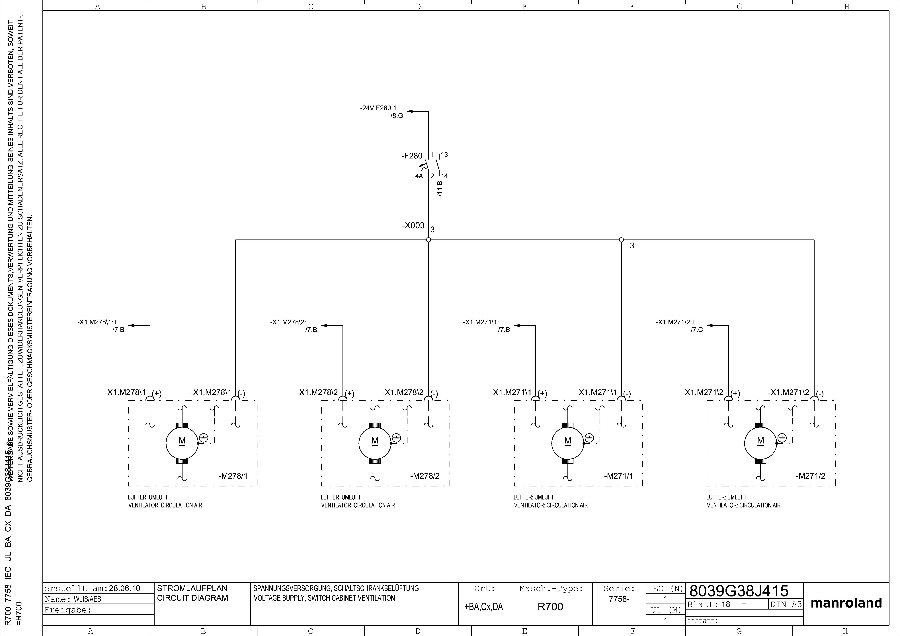

# +BA_Cx_DA — Sheet 18 of 247 — SPANNUNGSVERSORGUNG, SCHALTSCHRANKBELÜFTUNG

**VOLTAGE SUPPLY, SWITCH CABINET VENTILATION**

> Part of the manroland **R700** printing press IEC/UL circuit diagrams.
> Drawing class: **Stromlaufplan / Circuit diagram** (DIN A3).
> Document `+BA_Cx_DA` covers the **Printing units / main switch cabinet** machine section.

## At a glance

| Field | Value |
|---|---|
| Document | `+BA_Cx_DA`  (8039G38J415) |
| Sheet | **18** of 247 |
| Section (DE) | SPANNUNGSVERSORGUNG, SCHALTSCHRANKBELÜFTUNG |
| Section (EN) | VOLTAGE SUPPLY, SWITCH CABINET VENTILATION |
| Section type | POWER_SUPPLY — Voltage supply |
| Machine type | `R700` |
| Series | `7758` |
| Created | 28.06.10 |
| Replaces | — |
| Columns used | A, B, C, D, E, F, G, H |
| Path numbers | — |
| Labels on sheet | 52 |
| Cross-refs out | 6 |
| Cross-refs in | 6 |

**Previous:** [+BA_Cx_DA sheet 17](SHEET_0017.md) · **Next:** [+BA_Cx_DA sheet 19](SHEET_0019.md) · **Document TOC:** [_TOC.md](_TOC.md)  (+BA_Cx_DA) · **Master TOC:** [all sheets](../_MASTER_TOC.md)

## Sheet image (300 DPI, exact vector render)



_Rendered directly from the PDF vector layer at 300 DPI (1-bit), no OCR and no resampling. Use it to confirm anything ambiguous in the text below._

## Cross-references on this sheet

Each entry is a wire leaving this sheet. The printed token is `/sheet.column`; the link resolves to that sheet inside the same document.

| Ref | Target sheet | Col | Path | Destination on target | Target section | From col |
|---|---|---|---|---|---|---|
| `/8.G` | [+BA_Cx_DA sheet 8](SHEET_0008.md) | G | — | 24V.F280:1 | SPANNUNGSVERSORGUNG, SCHALTSCHRANKBELÜFTUNG | D |
| `/11.B` | [+BA_Cx_DA sheet 11](SHEET_0011.md) | B | — | — | SPANNUNGSVERSORGUNG, SCHALTSCHRANKBELÜFTUNG | D |
| `/7.B` | [+BA_Cx_DA sheet 7](SHEET_0007.md) | B | — | X1.M278\1:+ | SPANNUNGSVERSORGUNG, SCHALTSCHRANKBELÜFTUNG | A |
| `/7.B` | [+BA_Cx_DA sheet 7](SHEET_0007.md) | B | — | X1.M278\2:+ | SPANNUNGSVERSORGUNG, SCHALTSCHRANKBELÜFTUNG | C |
| `/7.B` | [+BA_Cx_DA sheet 7](SHEET_0007.md) | B | — | X1.M271\1:+ X1.M271\2:+ | SPANNUNGSVERSORGUNG, SCHALTSCHRANKBELÜFTUNG | F |
| `/7.C` | [+BA_Cx_DA sheet 7](SHEET_0007.md) | C | — | X1.M271\1:+ X1.M271\2:+ | SPANNUNGSVERSORGUNG, SCHALTSCHRANKBELÜFTUNG | F |

### Incoming references (sheets that point here)

Every other sheet that sends a wire to this one. `Back-ref` is the token printed on *that* sheet; `Path` is its line number.

| From sheet | Cols | Back-ref | Path | Refs | What continues there |
|---|---|---|---|---|---|
| [+BA_Cx_DA#7](SHEET_0007.md) | B, C | `/7.B`, `/7.C` | — | 4 | X1.M271\1:+; X1.M271\2:+; X1.M278\1:+; X1.M278\2:+ |
| [+BA_Cx_DA#8](SHEET_0008.md) | G | `/8.G` | — | 1 | — |
| [+BA_Cx_DA#11](SHEET_0011.md) | B | `/11.B` | — | 1 | — |


## Devices on this sheet

| Tag | Class | Class meaning (IEC) | Col | Sub | Terminal | Sign |
|---|---|---|---|---|---|---|
| `M278/1` | M | Motor | B | 1 | — | — |
| `M278/2` | M | Motor | D | 2 | — | — |
| `M271/1` | M | Motor | F | 1 | — | — |
| `X003` | X | Klemme / terminal, plug connector | D | — | — | — |
| `M271/2` | M | Motor | H | 2 | — | — |
| `F280` | F | Schutz / protection device (fuse, circuit breaker) | D | — | — | — |
| `X1.M278\1` | — | cross-device reference | A | — | — | — |
| `X1.M278\1` | — | cross-device reference | B | — | — | — |
| `X1.M278\2` | — | cross-device reference | C | — | — | — |
| `X1.M278\2` | — | cross-device reference | D | — | — | — |
| `X1.M271\1` | — | cross-device reference | E | — | — | — |
| `X1.M271\1` | — | cross-device reference | F | — | — | — |
| `X1.M271\2` | — | cross-device reference | G | — | — | — |
| `X1.M271\2` | — | cross-device reference | G | — | — | — |
| `X1.M278\1:+` | — | cross-device reference | A | — | — | — |
| `X1.M278\2:+` | — | cross-device reference | C | — | — | — |
| `X1.M271\2:+` | — | cross-device reference | F | — | — | — |
| `X1.M271\1:+` | — | cross-device reference | E | — | — | — |

## Potentials / nets

| Potential | Count | Columns | Attached devices | Terminals |
|---|---|---|---|---|
| `24V` | 1 | D | `F280` | `1` |


A potential such as `L24+/4` or `M24+` is a named supply/return rail; every place it appears on this sheet is electrically common.

## Wire-end annotations (grouped as printed)

A wire that continues elsewhere is annotated with a small cluster: the destination description, the path/line number `#NN`, and the `/sheet.column` cross reference. Each row below is one such cluster exactly as it is grouped on the drawing.

| Col | Y | Path | Cross-ref | Text on the wire |
|---|---|---|---|---|
| D | 139.2 | — | `/8.G` | `24V.F280:1` |
| D | 200.9 | — | — | `1` |
| D | 200.9 | — | — | `13` |
| D | 201.6 | — | — | `F280` |
| D | 229.2 | — | — | `4A 2` |
| D | 229.2 | — | — | `14` |
| D | 239.2 | — | `/11.B` | — |
| D | 293.4 | — | — | `X003 3` |
| F | 320.6 | — | — | `3` |
| A | 422.7 | — | `/7.B` | `X1.M278\1:+` |
| C | 422.7 | — | `/7.B` | `X1.M278\2:+` |
| F | 422.7 | — | `/7.B`, `/7.C` | `X1.M271\1:+ X1.M271\2:+` |
| B | 514.8 | — | — | `X1.M278\1 (+) X1.M278\1 ( )` |
| D | 514.8 | — | — | `X1.M278\2 (+) X1.M278\2 ( )` |
| E | 514.8 | — | — | `X1.M271\1 (+) X1.M271\1 ( )` |
| G | 514.8 | — | — | `X1.M271\2 (+) X1.M271\2 ( )` |
| B | 578.4 | — | — | `M` |
| D | 578.4 | — | — | `M` |
| E | 578.4 | — | — | `M` |
| G | 578.4 | — | — | `M` |
| B | 625.4 | — | — | `M278/1` |
| D | 625.4 | — | — | `M278/2` |
| F | 625.4 | — | — | `M271/1` |
| H | 625.4 | — | — | `M271/2` |
| A | 655.4 | — | — | `LÜFTER: UMLUFT` |
| C | 655.4 | — | — | `LÜFTER: UMLUFT` |
| E | 655.4 | — | — | `LÜFTER: UMLUFT` |
| G | 655.4 | — | — | `LÜFTER: UMLUFT` |
| B | 666.1 | — | — | `VENTILATOR: CIRCULATION AIR` |
| C | 666.1 | — | — | `VENTILATOR: CIRCULATION AIR` |
| E | 666.1 | — | — | `VENTILATOR: CIRCULATION AIR` |
| G | 666.1 | — | — | `VENTILATOR: CIRCULATION AIR` |


## Notes and free text on this sheet

| Text | Col | Y (pt) |
|---|---|---|
| `M` | B | 578.35 |
| `LÜFTER: UMLUFT` | A | 655.44 |
| `VENTILATOR: CIRCULATION AIR` | B | 666.07 |
| `M` | D | 578.35 |
| `LÜFTER: UMLUFT` | C | 655.44 |
| `VENTILATOR: CIRCULATION AIR` | C | 666.07 |
| `M` | E | 578.35 |
| `LÜFTER: UMLUFT` | E | 655.44 |
| `VENTILATOR: CIRCULATION AIR` | E | 666.07 |
| `M` | G | 578.35 |
| `LÜFTER: UMLUFT` | G | 655.44 |
| `VENTILATOR: CIRCULATION AIR` | G | 666.07 |
| `4A` | D | 229.43 |

## Complete label inventory (exact text from the drawing)

Every text object inside the drawing area of this sheet, in DIN reading order (column A→H, then top→bottom). This is the authoritative list: if a string is not here it is not printed on this sheet.

| Col | Y | X | Dir | Type | Text |
|---|---|---|---|---|---|
| A | 422.7 | 102.3 | → | device ref | `X1.M278\1:+` |
| A | 432.5 | 148.8 | → | cross-reference | `/7.B` |
| A | 514.8 | 138.6 | → | device ref | `X1.M278\1` |
| A | 655.4 | 169.2 | → | text | `LÜFTER: UMLUFT` |
| B | 514.8 | 252.0 | → | device ref | `X1.M278\1` |
| B | 516.3 | 200.7 | → | other | `(+)` |
| B | 516.4 | 314.1 | → | other | `( )` |
| B | 578.4 | 236.3 | → | text | `M` |
| B | 625.4 | 289.1 | → | device tag | `M278/1` |
| B | 666.1 | 170.1 | → | text | `VENTILATOR: CIRCULATION AIR` |
| C | 422.7 | 357.4 | → | device ref | `X1.M278\2:+` |
| C | 432.5 | 403.9 | → | cross-reference | `/7.B` |
| C | 514.8 | 392.3 | → | device ref | `X1.M278\2` |
| C | 516.3 | 455.8 | → | other | `(+)` |
| C | 655.4 | 424.3 | → | text | `LÜFTER: UMLUFT` |
| C | 666.1 | 425.2 | → | text | `VENTILATOR: CIRCULATION AIR` |
| D | 139.2 | 476.5 | → | potential | `24V.F280:1` |
| D | 149.1 | 516.8 | → | cross-reference | `/8.G` |
| D | 200.9 | 568.9 | → | number | `1` |
| D | 200.9 | 583.1 | → | number | `13` |
| D | 201.6 | 531.2 | → | device tag | `F280` |
| D | 229.2 | 569.5 | → | number | `2` |
| D | 229.2 | 583.1 | → | number | `14` |
| D | 229.4 | 549.6 | → | text | `4A` |
| D | 239.2 | 577.8 | ↕ | cross-reference | `/11.B` |
| D | 293.5 | 531.8 | → | device tag | `X003` |
| D | 299.3 | 569.2 | → | number | `3` |
| D | 514.8 | 505.7 | → | device ref | `X1.M278\2` |
| D | 516.4 | 569.2 | → | other | `( )` |
| D | 578.4 | 491.4 | → | text | `M` |
| D | 625.4 | 542.8 | → | device tag | `M278/2` |
| E | 422.7 | 612.6 | → | device ref | `X1.M271\1:+` |
| E | 432.5 | 659.1 | → | cross-reference | `/7.B` |
| E | 514.8 | 648.9 | → | device ref | `X1.M271\1` |
| E | 516.3 | 710.9 | → | other | `(+)` |
| E | 578.4 | 746.5 | → | text | `M` |
| E | 655.4 | 679.5 | → | text | `LÜFTER: UMLUFT` |
| E | 666.1 | 680.3 | → | text | `VENTILATOR: CIRCULATION AIR` |
| F | 320.6 | 833.2 | → | number | `3` |
| F | 422.7 | 867.7 | → | device ref | `X1.M271\2:+` |
| F | 514.8 | 762.2 | → | device ref | `X1.M271\1` |
| F | 516.4 | 824.3 | → | other | `( )` |
| F | 625.4 | 799.4 | → | device tag | `M271/1` |
| G | 432.6 | 913.9 | → | cross-reference | `/7.C` |
| G | 514.8 | 902.6 | → | device ref | `X1.M271\2` |
| G | 514.8 | 1015.9 | → | device ref | `X1.M271\2` |
| G | 516.3 | 966.0 | → | other | `(+)` |
| G | 578.4 | 1001.6 | → | text | `M` |
| G | 655.4 | 934.6 | → | text | `LÜFTER: UMLUFT` |
| G | 666.1 | 935.4 | → | text | `VENTILATOR: CIRCULATION AIR` |
| H | 516.4 | 1079.4 | → | other | `( )` |
| H | 625.4 | 1053.1 | → | device tag | `M271/2` |

## Reading-order text block

The same content as a plain block, grouped by DIN column — convenient to paste or to match against a visual description.

```text
=== Column A ===
 422.7  102.3  devref       X1.M278\1:+
 432.5  148.8  xref         /7.B
 514.8  138.6  devref       X1.M278\1
 655.4  169.2  text         LÜFTER: UMLUFT
=== Column B ===
 514.8  252.0  devref       X1.M278\1
 516.3  200.7  other        (+)
 516.4  314.1  other        ( )
 578.4  236.3  text         M
 625.4  289.1  devtag       M278/1
 666.1  170.1  text         VENTILATOR: CIRCULATION AIR
=== Column C ===
 422.7  357.4  devref       X1.M278\2:+
 432.5  403.9  xref         /7.B
 514.8  392.3  devref       X1.M278\2
 516.3  455.8  other        (+)
 655.4  424.3  text         LÜFTER: UMLUFT
 666.1  425.2  text         VENTILATOR: CIRCULATION AIR
=== Column D ===
 139.2  476.5  net          24V.F280:1
 149.1  516.8  xref         /8.G
 200.9  568.9  numeric      1
 200.9  583.1  numeric      13
 201.6  531.2  devtag       F280
 229.2  569.5  numeric      2
 229.2  583.1  numeric      14
 229.4  549.6  text         4A
 239.2  577.8  xref         /11.B
 293.5  531.8  devtag       X003
 299.3  569.2  numeric      3
 514.8  505.7  devref       X1.M278\2
 516.4  569.2  other        ( )
 578.4  491.4  text         M
 625.4  542.8  devtag       M278/2
=== Column E ===
 422.7  612.6  devref       X1.M271\1:+
 432.5  659.1  xref         /7.B
 514.8  648.9  devref       X1.M271\1
 516.3  710.9  other        (+)
 578.4  746.5  text         M
 655.4  679.5  text         LÜFTER: UMLUFT
 666.1  680.3  text         VENTILATOR: CIRCULATION AIR
=== Column F ===
 320.6  833.2  numeric      3
 422.7  867.7  devref       X1.M271\2:+
 514.8  762.2  devref       X1.M271\1
 516.4  824.3  other        ( )
 625.4  799.4  devtag       M271/1
=== Column G ===
 432.6  913.9  xref         /7.C
 514.8  902.6  devref       X1.M271\2
 514.8 1015.9  devref       X1.M271\2
 516.3  966.0  other        (+)
 578.4 1001.6  text         M
 655.4  934.6  text         LÜFTER: UMLUFT
 666.1  935.4  text         VENTILATOR: CIRCULATION AIR
=== Column H ===
 516.4 1079.4  other        ( )
 625.4 1053.1  devtag       M271/2
```

---
_Generated from the PDF vector text layer; no OCR. Source: `R700_7758_IEC_UL_BA_CX_DA_8039G38J415_p`, sheet 18._
