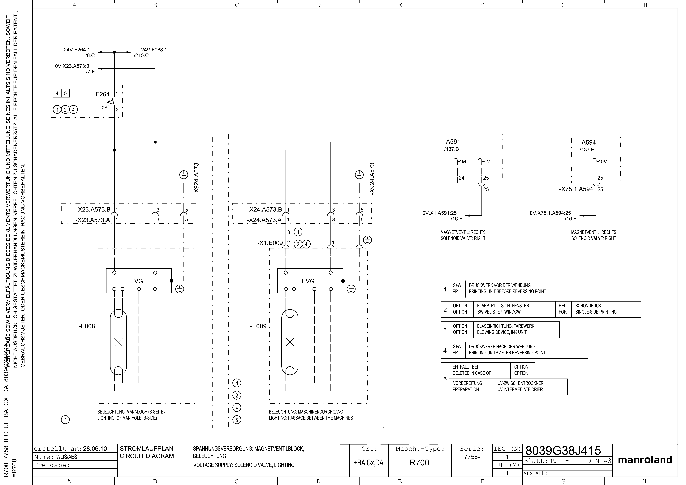

# +BA_Cx_DA — Sheet 19 of 247 — SPANNUNGSVERSORGUNG: MAGNETVENTILBLOCK

**BELEUCHTUNG**

> Part of the manroland **R700** printing press IEC/UL circuit diagrams.
> Drawing class: **Stromlaufplan / Circuit diagram** (DIN A3).
> Document `+BA_Cx_DA` covers the **Printing units / main switch cabinet** machine section.

## At a glance

| Field | Value |
|---|---|
| Document | `+BA_Cx_DA`  (8039G38J415) |
| Sheet | **19** of 247 |
| Section (DE) | SPANNUNGSVERSORGUNG: MAGNETVENTILBLOCK |
| Section (EN) | BELEUCHTUNG |
| Section type | POWER_SUPPLY — Voltage supply |
| Machine type | `R700` |
| Series | `7758` |
| Created | 28.06.10 |
| Replaces | — |
| Columns used | A, B, C, D, E, F, G |
| Path numbers | — |
| Labels on sheet | 107 |
| Cross-refs out | 7 |
| Cross-refs in | 24 |

**Previous:** [+BA_Cx_DA sheet 18](SHEET_0018.md) · **Next:** [+BA_Cx_DA sheet 20](SHEET_0020.md) · **Document TOC:** [_TOC.md](_TOC.md)  (+BA_Cx_DA) · **Master TOC:** [all sheets](../_MASTER_TOC.md)

## Sheet image (300 DPI, exact vector render)



_Rendered directly from the PDF vector layer at 300 DPI (1-bit), no OCR and no resampling. Use it to confirm anything ambiguous in the text below._

## Cross-references on this sheet

Each entry is a wire leaving this sheet. The printed token is `/sheet.column`; the link resolves to that sheet inside the same document.

| Ref | Target sheet | Col | Path | Destination on target | Target section | From col |
|---|---|---|---|---|---|---|
| `/8.C` | [+BA_Cx_DA sheet 8](SHEET_0008.md) | C | — | 24V.F264:1 | SPANNUNGSVERSORGUNG, SCHALTSCHRANKBELÜFTUNG | A |
| `/215.C` | [+BA_Cx_DA sheet 215](SHEET_0215.md) | C | — | — | OPTION: BLASEINRICHTUNG, FARBWERK | B |
| `/7.F` | [+BA_Cx_DA sheet 7](SHEET_0007.md) | F | — | 0V.X23.A573:3 | SPANNUNGSVERSORGUNG, SCHALTSCHRANKBELÜFTUNG | A |
| `/137.B` | [+BA_Cx_DA sheet 137](SHEET_0137.md) | B | — | A591 | REFERENZMODUL | F |
| `/137.F` | [+BA_Cx_DA sheet 137](SHEET_0137.md) | F | — | A594 | REFERENZMODUL | G |
| `/16.E` | [+BA_Cx_DA sheet 16](SHEET_0016.md) | E | — | 0V.X1.A591:25 0V.X75.1.A594:25 | SPANNUNGSVERSORGUNG, SCHALTSCHRANKBELÜFTUNG | F |
| `/16.F` | [+BA_Cx_DA sheet 16](SHEET_0016.md) | F | — | 0V.X1.A591:25 0V.X75.1.A594:25 | SPANNUNGSVERSORGUNG, SCHALTSCHRANKBELÜFTUNG | F |

### Incoming references (sheets that point here)

Every other sheet that sends a wire to this one. `Back-ref` is the token printed on *that* sheet; `Path` is its line number.

| From sheet | Cols | Back-ref | Path | Refs | What continues there |
|---|---|---|---|---|---|
| [+BA_Cx_DA#7](SHEET_0007.md) | F | `/7.F` | — | 1 | 0V.X23.A573:3 |
| [+BA_Cx_DA#8](SHEET_0008.md) | F | `/8.F` | — | 1 | 24V.F263:1 |
| [+BA_Cx_DA#16](SHEET_0016.md) | E, F | `/16.E`, `/16.F` | — | 2 | — |
| [+BA_Cx_DA#137](SHEET_0137.md) | B, F | `/137.B`, `/137.F` | — | 2 | — |
| [+BA_Cx_DA#142](SHEET_0142.md) | B | `/142.B` | — | 1 | — |
| [+BA_Cx_DA#147](SHEET_0147.md) | A | `/147.A` | — | 3 | — |
| [+BA_Cx_DA#174](SHEET_0174.md) | H | `/174.H` | — | 6 | — |
| [+BA_Cx_DA#175](SHEET_0175.md) | C | `/175.C` | — | 6 | — |
| [+BA_Cx_DA#185](SHEET_0185.md) | A | `/185.A` | — | 1 | — |
| [+BA_Cx_DA#215](SHEET_0215.md) | C | `/215.C` | — | 1 | — |


## Devices on this sheet

| Tag | Class | Class meaning (IEC) | Col | Sub | Terminal | Sign |
|---|---|---|---|---|---|---|
| `A594` | A | Baugruppe / assembly, module, PC board | G | — | — | — |
| `A591` | A | Baugruppe / assembly, module, PC board | F | — | — | — |
| `E008` | E | Sonstiges / miscellaneous, lamp | A | — | — | — |
| `E009` | E | Sonstiges / miscellaneous, lamp | C | — | — | — |
| `F264` | F | Schutz / protection device (fuse, circuit breaker) | A | — | — | — |
| `X75.1.A594` | — | cross-device reference | G | — | — | — |
| `X1.E009` | — | cross-device reference | C | — | — | — |
| `X24.A573.B` | — | cross-device reference | C | — | — | — |
| `X24.A573.A` | — | cross-device reference | C | — | — | — |
| `X23.A573.B` | — | cross-device reference | A | — | — | — |
| `X23.A573.A` | — | cross-device reference | A | — | — | — |
| `X924.A573` | — | cross-device reference | E | — | — | — |
| `X924.A573` | — | cross-device reference | C | — | — | — |

## Potentials / nets

| Potential | Count | Columns | Attached devices | Terminals |
|---|---|---|---|---|
| `0V` | 4 | A, E, G | `1`, `A573`, `A591`, `A594`, `X1`, `X23`, `X75` | `25`, `3` |
| `24V` | 2 | A, B | `F068`, `F264` | `1` |


A potential such as `L24+/4` or `M24+` is a named supply/return rail; every place it appears on this sheet is electrically common.

## Wire-end annotations (grouped as printed)

A wire that continues elsewhere is annotated with a small cluster: the destination description, the path/line number `#NN`, and the `/sheet.column` cross reference. Each row below is one such cluster exactly as it is grouped on the drawing.

| Col | Y | Path | Cross-ref | Text on the wire |
|---|---|---|---|---|
| A | 82.5 | — | `/8.C` | `24V.F264:1` |
| B | 82.5 | — | — | `24V.F068:1` |
| B | 92.4 | — | `/215.C` | — |
| A | 110.8 | — | `/7.F` | `0V.X23.A573:3` |
| A | 158.4 | — | — | `4 5` |
| B | 158.4 | — | — | `1` |
| A | 159.0 | — | — | `F264` |
| A | 183.6 | — | — | `2A 2` |
| A | 186.9 | — | — | `1 2 4` |
| F | 241.2 | — | `/137.B` | `A591` |
| G | 242.7 | — | `/137.F` | `A594` |
| G | 276.6 | — | — | `0V` |
| F | 276.8 | — | — | `M M` |
| C | 282.2 | — | — | `X924.A573` |
| E | 282.2 | — | — | `X924.A573` |
| F | 305.1 | — | — | `24 25` |
| G | 305.1 | — | — | `25` |
| G | 323.5 | — | — | `X75.1.A594 25` |
| F | 324.9 | — | — | `25` |
| A | 358.9 | — | — | `X23.A573.B 1` |
| C | 358.9 | — | — | `X24.A573.B 1` |
| B | 360.3 | — | — | `3` |
| B | 360.3 | — | — | `5` |
| D | 360.3 | — | — | `3` |
| E | 360.3 | — | — | `5` |
| F | 365.9 | — | `/16.E`, `/16.F` | `0V.X1.A591:25 0V.X75.1.A594:25` |
| A | 377.3 | — | — | `X23.A573.A 1` |
| B | 377.3 | — | — | `3` |
| B | 377.3 | — | — | `5` |
| C | 377.3 | — | — | `X24.A573.A 1` |
| D | 377.3 | — | — | `3` |
| E | 377.3 | — | — | `5` |
| D | 399.3 | — | — | `3 1` |
| G | 400.3 | — | — | `MAGNETVENTIL: RECHTS SOLENOID VALVE: RIGHT MAGNETVENTIL: RECHTS SOLENOID VALVE: RIGHT` |
| C | 417.0 | — | — | `X1.E009 2` |
| D | 417.0 | — | — | `1` |
| D | 421.2 | — | — | `2 4` |
| C | 483.6 | — | — | `EVG EVG` |
| F | 492.3 | — | — | `PP S+W` |
| F | 492.4 | — | — | `DRUCKWERK VOR DER WENDUNG PRINTING UNIT BEFORE REVERSING POINT` |
| F | 497.8 | — | — | `1` |
| G | 527.7 | — | — | `BEI FOR` |
| F | 527.8 | — | — | `OPTION OPTION` |
| G | 527.9 | — | — | `2 SCHÖNDRUCK SINGLE SIDE PRINTING` |
| F | 527.9 | — | — | `KLAPPTRITT: SICHTFENSTER` |
| F | 538.4 | — | — | `SWIVEL STEP: WINDOW` |
| A | 561.6 | — | — | `E008` |
| C | 561.6 | — | — | `E009` |
| F | 563.3 | — | — | `3 OPTION OPTION BLASEINRICHTUNG, FARBWERK BLOWING DEVICE, INK UNIT` |
| F | 598.6 | — | — | `PP S+W` |
| F | 598.7 | — | — | `DRUCKWERKE NACH DER WENDUNG PRINTING UNITS AFTER REVERSING POINT` |
| F | 604.0 | — | — | `4` |
| F | 634.1 | — | — | `ENTFÄLLT BEI DELETED IN CASE OF` |
| F | 634.1 | — | — | `OPTION OPTION` |
| F | 653.7 | — | — | `5` |
| C | 661.7 | — | — | `1` |
| F | 662.5 | — | — | `PREPARATION VORBEREITUNG` |
| F | 662.5 | — | — | `UV ZWISCHENTROCKNER UV INTERMEDIATE DRIER` |
| C | 683.4 | — | — | `2` |
| C | 704.7 | — | — | `4` |
| B | 712.1 | — | — | `BELEUCHTUNG: MANNLOCH (B SEITE) LIGHTING: OF MAN HOLE (B SIDE)` |
| D | 712.1 | — | — | `BELEUCHTUNG: MASCHINENDURCHGANG LIGHTING: PASSAGE BETWEEN THE MACHINES` |
| B | 725.5 | — | — | `1 5` |


## Reconstructed tables

This sheet carries tabular content (pin map / terminal assignment / index). The grid below was rebuilt from the drawing's own rule lines, so each row is exactly one physical row of the table.

### Table 1 — 0 data rows × 2 columns (at x=198.4, y=119.1) — **1 2**

_none_


## Notes and free text on this sheet

| Text | Col | Y (pt) |
|---|---|---|
| `M` | F | 276.76 |
| `BELEUCHTUNG: MANNLOCH (B SEITE)` | B | 712.14 |
| `LIGHTING: OF MAN HOLE (B SIDE)` | B | 722.76 |
| `BELEUCHTUNG: MASCHINENDURCHGANG` | D | 712.14 |
| `LIGHTING: PASSAGE BETWEEN THE MACHINES` | D | 722.74 |
| `2A` | A | 183.6 |
| `MAGNETVENTIL: RECHTS` | G | 400.31 |
| `SOLENOID VALVE: RIGHT` | G | 410.94 |
| `MAGNETVENTIL: RECHTS` | F | 400.31 |
| `SOLENOID VALVE: RIGHT` | F | 410.94 |
| `EVG` | B | 483.62 |
| `EVG` | D | 483.62 |
| `OPTION` | F | 527.84 |
| `KLAPPTRITT: SICHTFENSTER` | F | 527.86 |
| `SWIVEL STEP: WINDOW` | F | 538.42 |
| `BEI` | G | 527.69 |
| `FOR` | G | 538.47 |
| `SCHÖNDRUCK` | G | 527.91 |
| `SINGLE SIDE PRINTING` | G | 538.5 |
| `BLASEINRICHTUNG, FARBWERK` | F | 563.29 |
| `BLOWING DEVICE, INK UNIT` | F | 573.91 |
| `ENTFÄLLT BEI` | F | 634.13 |
| `DELETED IN CASE OF` | F | 644.79 |
| `VORBEREITUNG` | F | 662.52 |
| `PREPARATION` | F | 673.12 |
| `UV ZWISCHENTROCKNER` | F | 662.51 |
| `UV INTERMEDIATE DRIER` | F | 673.15 |
| `S+W` | F | 492.29 |
| `PP` | F | 502.93 |
| `DRUCKWERK VOR DER WENDUNG` | F | 492.42 |
| `PRINTING UNIT BEFORE REVERSING POINT` | F | 503.07 |
| `DRUCKWERKE NACH DER WENDUNG` | F | 598.72 |
| `PRINTING UNITS AFTER REVERSING POINT` | F | 609.37 |

## Complete label inventory (exact text from the drawing)

Every text object inside the drawing area of this sheet, in DIN reading order (column A→H, then top→bottom). This is the authoritative list: if a string is not here it is not printed on this sheet.

| Col | Y | X | Dir | Type | Text |
|---|---|---|---|---|---|
| A | 82.5 | 108.0 | → | potential | `24V.F264:1` |
| A | 92.4 | 148.5 | → | cross-reference | `/8.C` |
| A | 110.8 | 95.5 | → | potential | `0V.X23.A573:3` |
| A | 120.7 | 149.4 | → | cross-reference | `/7.F` |
| A | 158.4 | 96.8 | → | number | `4` |
| A | 158.4 | 111.0 | → | number | `5` |
| A | 159.0 | 162.7 | → | device tag | `F264` |
| A | 183.6 | 176.9 | → | text | `2A` |
| A | 186.9 | 97.5 | → | number | `1` |
| A | 187.4 | 111.4 | → | number | `2` |
| A | 187.4 | 125.6 | → | number | `4` |
| A | 358.9 | 131.8 | → | device ref | `X23.A573.B` |
| A | 377.3 | 131.0 | → | device ref | `X23.A573.A` |
| A | 561.6 | 136.6 | → | device tag | `E008` |
| A | 725.4 | 111.6 | → | number | `1` |
| B | 82.5 | 242.1 | → | potential | `24V.F068:1` |
| B | 92.4 | 232.4 | → | cross-reference | `/215.C` |
| B | 158.4 | 200.4 | → | number | `1` |
| B | 186.7 | 201.0 | → | number | `2` |
| B | 360.3 | 200.4 | → | number | `1` |
| B | 360.3 | 271.8 | → | number | `3` |
| B | 360.3 | 321.4 | → | number | `5` |
| B | 377.3 | 200.4 | → | number | `1` |
| B | 377.3 | 271.8 | → | number | `3` |
| B | 377.3 | 321.4 | → | number | `5` |
| B | 483.6 | 225.9 | → | text | `EVG` |
| B | 712.1 | 169.2 | → | text | `BELEUCHTUNG: MANNLOCH (B SEITE)` |
| B | 722.8 | 169.2 | → | text | `LIGHTING: OF MAN HOLE (B SIDE)` |
| C | 282.2 | 336.2 | ↕ | device ref | `X924.A573` |
| C | 358.9 | 429.4 | → | device ref | `X24.A573.B` |
| C | 377.3 | 428.6 | → | device ref | `X24.A573.A` |
| C | 417.0 | 446.7 | → | device ref | `X1.E009` |
| C | 561.6 | 434.3 | → | device tag | `E009` |
| C | 661.7 | 409.3 | → | number | `1` |
| C | 683.4 | 409.0 | → | number | `2` |
| C | 704.7 | 409.0 | → | number | `4` |
| C | 726.0 | 409.0 | → | number | `5` |
| D | 360.3 | 498.0 | → | number | `1` |
| D | 360.3 | 576.6 | → | number | `3` |
| D | 377.3 | 498.0 | → | number | `1` |
| D | 377.3 | 576.6 | → | number | `3` |
| D | 399.3 | 498.6 | → | number | `3` |
| D | 399.5 | 515.6 | → | number | `1` |
| D | 417.0 | 498.6 | → | number | `2` |
| D | 417.0 | 576.0 | → | number | `1` |
| D | 421.2 | 515.3 | → | number | `2` |
| D | 421.2 | 529.5 | → | number | `4` |
| D | 483.6 | 523.6 | → | text | `EVG` |
| D | 712.1 | 466.9 | → | text | `BELEUCHTUNG: MASCHINENDURCHGANG` |
| D | 722.7 | 466.9 | → | text | `LIGHTING: PASSAGE BETWEEN THE MACHINES` |
| E | 282.2 | 640.9 | ↕ | device ref | `X924.A573` |
| E | 360.3 | 626.2 | → | number | `5` |
| E | 365.9 | 733.3 | → | potential | `0V.X1.A591:25` |
| E | 377.3 | 626.2 | → | number | `5` |
| F | 241.2 | 770.7 | → | device tag | `A591` |
| F | 255.0 | 771.0 | → | cross-reference | `/137.B` |
| F | 276.8 | 801.6 | → | text | `M` |
| F | 276.8 | 844.2 | → | text | `M` |
| F | 305.0 | 796.3 | → | number | `24` |
| F | 305.0 | 838.8 | → | number | `25` |
| F | 324.9 | 838.8 | → | number | `25` |
| F | 375.9 | 782.4 | → | cross-reference | `/16.F` |
| F | 400.3 | 764.8 | → | text | `MAGNETVENTIL: RECHTS` |
| F | 410.9 | 765.1 | → | text | `SOLENOID VALVE: RIGHT` |
| F | 492.3 | 786.3 | → | text | `S+W` |
| F | 492.4 | 814.1 | → | text | `DRUCKWERK VOR DER WENDUNG` |
| F | 497.8 | 769.9 | → | number | `1` |
| F | 502.9 | 785.8 | → | text | `PP` |
| F | 503.1 | 814.1 | → | text | `PRINTING UNIT BEFORE REVERSING POINT` |
| F | 527.8 | 786.3 | → | text | `OPTION` |
| F | 527.9 | 828.3 | → | text | `KLAPPTRITT: SICHTFENSTER` |
| F | 533.2 | 769.6 | → | number | `2` |
| F | 538.4 | 828.9 | → | text | `SWIVEL STEP: WINDOW` |
| F | 538.5 | 786.3 | → | text | `OPTION` |
| F | 563.3 | 786.3 | → | text | `OPTION` |
| F | 563.3 | 828.3 | → | text | `BLASEINRICHTUNG, FARBWERK` |
| F | 568.6 | 769.5 | → | number | `3` |
| F | 573.9 | 786.3 | → | text | `OPTION` |
| F | 573.9 | 828.3 | → | text | `BLOWING DEVICE, INK UNIT` |
| F | 598.6 | 786.3 | → | text | `S+W` |
| F | 598.7 | 814.1 | → | text | `DRUCKWERKE NACH DER WENDUNG` |
| F | 604.1 | 769.6 | → | number | `4` |
| F | 609.2 | 785.8 | → | text | `PP` |
| F | 609.4 | 814.1 | → | text | `PRINTING UNITS AFTER REVERSING POINT` |
| F | 634.1 | 785.8 | → | text | `ENTFÄLLT BEI` |
| F | 634.1 | 892.6 | → | text | `OPTION` |
| F | 644.8 | 785.8 | → | text | `DELETED IN CASE OF` |
| F | 644.8 | 892.6 | → | text | `OPTION` |
| F | 653.7 | 769.5 | → | number | `5` |
| F | 662.5 | 786.6 | → | text | `VORBEREITUNG` |
| F | 662.5 | 863.7 | → | text | `UV ZWISCHENTROCKNER` |
| F | 673.1 | 785.8 | → | text | `PREPARATION` |
| F | 673.1 | 863.7 | → | text | `UV INTERMEDIATE DRIER` |
| G | 242.7 | 1006.0 | → | device tag | `A594` |
| G | 255.7 | 1006.3 | → | cross-reference | `/137.F` |
| G | 276.6 | 1042.9 | → | potential | `0V` |
| G | 305.0 | 1037.2 | → | number | `25` |
| G | 323.5 | 970.6 | → | device ref | `X75.1.A594` |
| G | 324.9 | 1037.2 | → | number | `25` |
| G | 365.9 | 919.6 | → | potential | `0V.X75.1.A594:25` |
| G | 375.8 | 980.5 | → | cross-reference | `/16.E` |
| G | 400.3 | 991.6 | → | text | `MAGNETVENTIL: RECHTS` |
| G | 410.9 | 991.8 | → | text | `SOLENOID VALVE: RIGHT` |
| G | 527.7 | 970.0 | → | text | `BEI` |
| G | 527.9 | 998.9 | → | text | `SCHÖNDRUCK` |
| G | 538.5 | 970.0 | → | text | `FOR` |
| G | 538.5 | 998.9 | → | text | `SINGLE SIDE PRINTING` |

## Reading-order text block

The same content as a plain block, grouped by DIN column — convenient to paste or to match against a visual description.

```text
=== Column A ===
  82.5  108.0  net          24V.F264:1
  92.4  148.5  xref         /8.C
 110.8   95.5  net          0V.X23.A573:3
 120.7  149.4  xref         /7.F
 158.4   96.8  numeric      4
 158.4  111.0  numeric      5
 159.0  162.7  devtag       F264
 183.6  176.9  text         2A
 186.9   97.5  numeric      1
 187.4  111.4  numeric      2
 187.4  125.6  numeric      4
 358.9  131.8  devref       X23.A573.B
 377.3  131.0  devref       X23.A573.A
 561.6  136.6  devtag       E008
 725.4  111.6  numeric      1
=== Column B ===
  82.5  242.1  net          24V.F068:1
  92.4  232.4  xref         /215.C
 158.4  200.4  numeric      1
 186.7  201.0  numeric      2
 360.3  200.4  numeric      1
 360.3  271.8  numeric      3
 360.3  321.4  numeric      5
 377.3  200.4  numeric      1
 377.3  271.8  numeric      3
 377.3  321.4  numeric      5
 483.6  225.9  text         EVG
 712.1  169.2  text         BELEUCHTUNG: MANNLOCH (B SEITE)
 722.8  169.2  text         LIGHTING: OF MAN HOLE (B SIDE)
=== Column C ===
 282.2  336.2  devref       X924.A573
 358.9  429.4  devref       X24.A573.B
 377.3  428.6  devref       X24.A573.A
 417.0  446.7  devref       X1.E009
 561.6  434.3  devtag       E009
 661.7  409.3  numeric      1
 683.4  409.0  numeric      2
 704.7  409.0  numeric      4
 726.0  409.0  numeric      5
=== Column D ===
 360.3  498.0  numeric      1
 360.3  576.6  numeric      3
 377.3  498.0  numeric      1
 377.3  576.6  numeric      3
 399.3  498.6  numeric      3
 399.5  515.6  numeric      1
 417.0  498.6  numeric      2
 417.0  576.0  numeric      1
 421.2  515.3  numeric      2
 421.2  529.5  numeric      4
 483.6  523.6  text         EVG
 712.1  466.9  text         BELEUCHTUNG: MASCHINENDURCHGANG
 722.7  466.9  text         LIGHTING: PASSAGE BETWEEN THE MACHINES
=== Column E ===
 282.2  640.9  devref       X924.A573
 360.3  626.2  numeric      5
 365.9  733.3  net          0V.X1.A591:25
 377.3  626.2  numeric      5
=== Column F ===
 241.2  770.7  devtag       A591
 255.0  771.0  xref         /137.B
 276.8  801.6  text         M
 276.8  844.2  text         M
 305.0  796.3  numeric      24
 305.0  838.8  numeric      25
 324.9  838.8  numeric      25
 375.9  782.4  xref         /16.F
 400.3  764.8  text         MAGNETVENTIL: RECHTS
 410.9  765.1  text         SOLENOID VALVE: RIGHT
 492.3  786.3  text         S+W
 492.4  814.1  text         DRUCKWERK VOR DER WENDUNG
 497.8  769.9  numeric      1
 502.9  785.8  text         PP
 503.1  814.1  text         PRINTING UNIT BEFORE REVERSING POINT
 527.8  786.3  text         OPTION
 527.9  828.3  text         KLAPPTRITT: SICHTFENSTER
 533.2  769.6  numeric      2
 538.4  828.9  text         SWIVEL STEP: WINDOW
 538.5  786.3  text         OPTION
 563.3  786.3  text         OPTION
 563.3  828.3  text         BLASEINRICHTUNG, FARBWERK
 568.6  769.5  numeric      3
 573.9  786.3  text         OPTION
 573.9  828.3  text         BLOWING DEVICE, INK UNIT
 598.6  786.3  text         S+W
 598.7  814.1  text         DRUCKWERKE NACH DER WENDUNG
 604.1  769.6  numeric      4
 609.2  785.8  text         PP
 609.4  814.1  text         PRINTING UNITS AFTER REVERSING POINT
 634.1  785.8  text         ENTFÄLLT BEI
 634.1  892.6  text         OPTION
 644.8  785.8  text         DELETED IN CASE OF
 644.8  892.6  text         OPTION
 653.7  769.5  numeric      5
 662.5  786.6  text         VORBEREITUNG
 662.5  863.7  text         UV ZWISCHENTROCKNER
 673.1  785.8  text         PREPARATION
 673.1  863.7  text         UV INTERMEDIATE DRIER
=== Column G ===
 242.7 1006.0  devtag       A594
 255.7 1006.3  xref         /137.F
 276.6 1042.9  net          0V
 305.0 1037.2  numeric      25
 323.5  970.6  devref       X75.1.A594
 324.9 1037.2  numeric      25
 365.9  919.6  net          0V.X75.1.A594:25
 375.8  980.5  xref         /16.E
 400.3  991.6  text         MAGNETVENTIL: RECHTS
 410.9  991.8  text         SOLENOID VALVE: RIGHT
 527.7  970.0  text         BEI
 527.9  998.9  text         SCHÖNDRUCK
 538.5  970.0  text         FOR
 538.5  998.9  text         SINGLE SIDE PRINTING
```

---
_Generated from the PDF vector text layer; no OCR. Source: `R700_7758_IEC_UL_BA_CX_DA_8039G38J415_p`, sheet 19._
