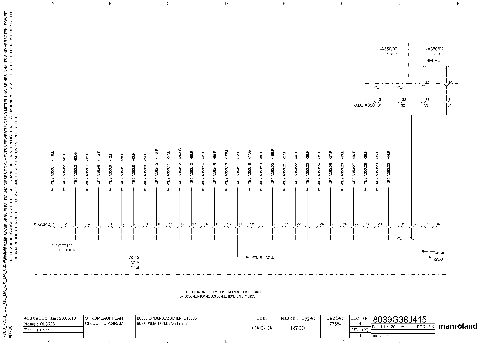

# +BA_Cx_DA — Sheet 20 of 247 — BUSVERBINDUNGEN: SICHERHEITSBUS

**BUS CONNECTIONS: SAFETY BUS**

> Part of the manroland **R700** printing press IEC/UL circuit diagrams.
> Drawing class: **Stromlaufplan / Circuit diagram** (DIN A3).
> Document `+BA_Cx_DA` covers the **Printing units / main switch cabinet** machine section.

## At a glance

| Field | Value |
|---|---|
| Document | `+BA_Cx_DA`  (8039G38J415) |
| Sheet | **20** of 247 |
| Section (DE) | BUSVERBINDUNGEN: SICHERHEITSBUS |
| Section (EN) | BUS CONNECTIONS: SAFETY BUS |
| Section type | CIRCUIT — Circuit diagram |
| Machine type | `R700` |
| Series | `7758` |
| Created | 28.06.10 |
| Replaces | — |
| Columns used | A, B, C, D, E, F, G, H |
| Path numbers | — |
| Labels on sheet | 122 |
| Cross-refs out | 36 |
| Cross-refs in | 74 |

**Previous:** [+BA_Cx_DA sheet 19](SHEET_0019.md) · **Next:** [+BA_Cx_DA sheet 21](SHEET_0021.md) · **Document TOC:** [_TOC.md](_TOC.md)  (+BA_Cx_DA) · **Master TOC:** [all sheets](../_MASTER_TOC.md)

## Sheet image (300 DPI, exact vector render)



_Rendered directly from the PDF vector layer at 300 DPI (1-bit), no OCR and no resampling. Use it to confirm anything ambiguous in the text below._

## Cross-references on this sheet

Each entry is a wire leaving this sheet. The printed token is `/sheet.column`; the link resolves to that sheet inside the same document.

| Ref | Target sheet | Col | Path | Destination on target | Target section | From col |
|---|---|---|---|---|---|---|
| `/131.B` | [+BA_Cx_DA sheet 131](SHEET_0131.md) | B | — | — | REFERENZMODUL | G |
| `/131.B` | [+BA_Cx_DA sheet 131](SHEET_0131.md) | B | — | — | REFERENZMODUL | H |
| `/203.G` | [+BA_Cx_DA sheet 203](SHEET_0203.md) | G | — | XB2.A350:12 | OPTION: | C |
| `/198.H` | [+BA_Cx_DA sheet 198](SHEET_0198.md) | H | — | XB2.A350:16 | OPTION: WASCHVORRICHTUNG MIT BÜRSTE | D |
| `/118.E` | [+BA_Cx_DA sheet 118](SHEET_0118.md) | E | — | XB2.A350:10 | RESERVE: SPS STATION (INPUT) | C |
| `/195.E` | [+BA_Cx_DA sheet 195](SHEET_0195.md) | E | — | XB2.A350:20 | OPTION: WASCHVORRICHTUNG MIT BÜRSTE | E |
| `/77.G` | [+BA_Cx_DA sheet 77](SHEET_0077.md) | G | — | XB2.A350:18 | FARBWERK | D |
| `/57.E` | [+BA_Cx_DA sheet 57](SHEET_0057.md) | E | — | XB2.A350:11 | MASCHINENBEDIENUNG: LAUFKOMMANDOS | C |
| `/58.E` | [+BA_Cx_DA sheet 58](SHEET_0058.md) | E | — | XB2.A350:13 | MASCHINENBEDIENUNG: LAUFKOMMANDOS | C |
| `/59.E` | [+BA_Cx_DA sheet 59](SHEET_0059.md) | E | — | XB2.A350:15 | MASCHINENBEDIENUNG: LAUFKOMMANDOS | D |
| `/86.E` | [+BA_Cx_DA sheet 86](SHEET_0086.md) | E | — | XB2.A350:19 | WASCHVORRICHTUNG | E |
| `/37.E` | [+BA_Cx_DA sheet 37](SHEET_0037.md) | E | — | XB2.A350:25 | SCHUTZEINRICHTUNGEN | F |
| `/43.E` | [+BA_Cx_DA sheet 43](SHEET_0043.md) | E | — | XB2.A350:26 | SCHUTZEINRICHTUNGEN | F |
| `/44.E` | [+BA_Cx_DA sheet 44](SHEET_0044.md) | E | — | XB2.A350:30 | SCHUTZEINRICHTUNGEN | G |
| `/119.E` | [+BA_Cx_DA sheet 119](SHEET_0119.md) | E | — | XB2.A350:1 | RESERVE: SPS STATION (INPUT) | A |
| `/113.E` | [+BA_Cx_DA sheet 113](SHEET_0113.md) | E | — | XB2.A350:5 | PPL 2 | B |
| `/45.F` | [+BA_Cx_DA sheet 45](SHEET_0045.md) | F | — | XB2.A350:14 | SCHUTZEINRICHTUNGEN | D |
| `/73.F` | [+BA_Cx_DA sheet 73](SHEET_0073.md) | F | — | XB2.A350:17 | FEUCHTWERK | D |
| `/27.F` | [+BA_Cx_DA sheet 27](SHEET_0027.md) | F | — | XB2.A350:21 | BUSVERBINDUNGEN: NOT AUS | E |
| `/46.F` | [+BA_Cx_DA sheet 46](SHEET_0046.md) | F | — | XB2.A350:22 | SCHUTZEINRICHTUNGEN | E |
| `/36.F` | [+BA_Cx_DA sheet 36](SHEET_0036.md) | F | — | XB2.A350:23 | SCHUTZEINRICHTUNGEN | E |
| `/35.F` | [+BA_Cx_DA sheet 35](SHEET_0035.md) | F | — | XB2.A350:24 | SCHUTZEINRICHTUNGEN | F |
| `/40.F` | [+BA_Cx_DA sheet 40](SHEET_0040.md) | F | — | XB2.A350:27 | SCHUTZEINRICHTUNGEN | F |
| `/38.F` | [+BA_Cx_DA sheet 38](SHEET_0038.md) | F | — | XB2.A350:28 | SCHUTZEINRICHTUNGEN | F |
| `/39.F` | [+BA_Cx_DA sheet 39](SHEET_0039.md) | F | — | XB2.A350:29 | SCHUTZEINRICHTUNGEN | G |
| `/82.G` | [+BA_Cx_DA sheet 82](SHEET_0082.md) | G | — | XB2.A350:3 | FARBWERK | A |
| `/42.D` | [+BA_Cx_DA sheet 42](SHEET_0042.md) | D | — | XB2.A350:4 | SCHUTZEINRICHTUNGEN | B |
| `/28.H` | [+BA_Cx_DA sheet 28](SHEET_0028.md) | H | — | XB2.A350:7 | BUSVERBINDUNGEN: STOP SICHERN | B |
| `/42.H` | [+BA_Cx_DA sheet 42](SHEET_0042.md) | H | — | XB2.A350:8 | SCHUTZEINRICHTUNGEN | B |
| `/41.F` | [+BA_Cx_DA sheet 41](SHEET_0041.md) | F | — | XB2.A350:2 | SCHUTZEINRICHTUNGEN | A |
| `/12.F` | [+BA_Cx_DA sheet 12](SHEET_0012.md) | F | — | XB2.A350:6 | SPANNUNGSVERSORGUNG, SCHALTSCHRANKBELÜFTUNG | B |
| `/24.F` | [+BA_Cx_DA sheet 24](SHEET_0024.md) | F | — | XB2.A350:9 | BUSVERBINDUNGEN: NOT AUS | C |
| `/21.E` | [+BA_Cx_DA sheet 21](SHEET_0021.md) | E | — | X3:16 | BUSVERBINDUNGEN: SICHERHEITSBUS | E |
| `/23.G` | [+BA_Cx_DA sheet 23](SHEET_0023.md) | G | — | — | BUSVERBINDUNGEN: SICHERHEITSBUS | H |
| `/21.A` | [+BA_Cx_DA sheet 21](SHEET_0021.md) | A | — | — | BUSVERBINDUNGEN: SICHERHEITSBUS | B |
| `/11.B` | [+BA_Cx_DA sheet 11](SHEET_0011.md) | B | — | — | SPANNUNGSVERSORGUNG, SCHALTSCHRANKBELÜFTUNG | B |

### Incoming references (sheets that point here)

Every other sheet that sends a wire to this one. `Back-ref` is the token printed on *that* sheet; `Path` is its line number.

| From sheet | Cols | Back-ref | Path | Refs | What continues there |
|---|---|---|---|---|---|
| [+BA_Cx_DA#11](SHEET_0011.md) | A | `/11.A` | — | 1 | — |
| [+BA_Cx_DA#12](SHEET_0012.md) | F | `/12.F` | — | 1 | XB2.A350:6 |
| [+BA_Cx_DA#21](SHEET_0021.md) | A, D | `/21.A`, `/21.D` | — | 2 | X3:16 |
| [+BA_Cx_DA#23](SHEET_0023.md) | G | `/23.G` | — | 1 | — |
| [+BA_Cx_DA#24](SHEET_0024.md) | F | `/24.F` | — | 1 | XB2.A350:9 |
| [+BA_Cx_DA#27](SHEET_0027.md) | F | `/27.F` | — | 1 | XB2.A350:21 |
| [+BA_Cx_DA#28](SHEET_0028.md) | H | `/28.H` | — | 1 | XB2.A350:7 |
| [+BA_Cx_DA#35](SHEET_0035.md) | F | `/35.F` | — | 1 | XB2.A350:24 |
| [+BA_Cx_DA#36](SHEET_0036.md) | F | `/36.F` | — | 1 | XB2.A350:23 |
| [+BA_Cx_DA#37](SHEET_0037.md) | E | `/37.E` | — | 1 | XB2.A350:25 |
| [+BA_Cx_DA#38](SHEET_0038.md) | F | `/38.F` | — | 1 | XB2.A350:28 |
| [+BA_Cx_DA#39](SHEET_0039.md) | F | `/39.F` | — | 1 | XB2.A350:29 |
| [+BA_Cx_DA#40](SHEET_0040.md) | F | `/40.F` | — | 1 | XB2.A350:27 |
| [+BA_Cx_DA#41](SHEET_0041.md) | F | `/41.F` | — | 1 | XB2.A350:2 |
| [+BA_Cx_DA#42](SHEET_0042.md) | D, H | `/42.D`, `/42.H` | — | 2 | XB2.A350:4; XB2.A350:8 |
| [+BA_Cx_DA#43](SHEET_0043.md) | E | `/43.E` | — | 1 | XB2.A350:26 |
| [+BA_Cx_DA#44](SHEET_0044.md) | E | `/44.E` | — | 1 | XB2.A350:30 |
| [+BA_Cx_DA#45](SHEET_0045.md) | F | `/45.F` | — | 1 | XB2.A350:14 |
| [+BA_Cx_DA#46](SHEET_0046.md) | F | `/46.F` | — | 1 | XB2.A350:22 |
| [+BA_Cx_DA#57](SHEET_0057.md) | E | `/57.E` | — | 1 | XB2.A350:11 |
| [+BA_Cx_DA#58](SHEET_0058.md) | E | `/58.E` | — | 1 | XB2.A350:13 |
| [+BA_Cx_DA#59](SHEET_0059.md) | D | `/59.D` | — | 1 | XB2.A350:15 |
| [+BA_Cx_DA#73](SHEET_0073.md) | F | `/73.F` | — | 1 | XB2.A350:17 |
| [+BA_Cx_DA#77](SHEET_0077.md) | G | `/77.G` | — | 1 | XB2.A350:18 |
| [+BA_Cx_DA#82](SHEET_0082.md) | G | `/82.G` | — | 1 | XB2.A350:3 |
| [+BA_Cx_DA#86](SHEET_0086.md) | E | `/86.E` | — | 1 | XB2.A350:19 |
| [+BA_Cx_DA#113](SHEET_0113.md) | E | `/113.E` | — | 1 | XB2.A350:5 |
| [+BA_Cx_DA#118](SHEET_0118.md) | E | `/118.E` | — | 1 | XB2.A350:10 |
| [+BA_Cx_DA#119](SHEET_0119.md) | E | `/119.E` | — | 1 | XB2.A350:1 |
| [+BA_Cx_DA#131](SHEET_0131.md) | B | `/131.B` | — | 2 | — |
| [+BA_Cx_DA#153](SHEET_0153.md) | G | `/153.G` | — | 4 | — |
| [+BA_Cx_DA#161](SHEET_0161.md) | C, D | `/161.C`, `/161.D` | — | 34 | — |
| [+BA_Cx_DA#195](SHEET_0195.md) | E | `/195.E` | — | 1 | XB2.A350:20 |
| [+BA_Cx_DA#198](SHEET_0198.md) | H | `/198.H` | — | 1 | XB2.A350:16 |
| [+BA_Cx_DA#203](SHEET_0203.md) | G | `/203.G` | — | 1 | XB2.A350:12 |


## Devices on this sheet

| Tag | Class | Class meaning (IEC) | Col | Sub | Terminal | Sign |
|---|---|---|---|---|---|---|
| `A342` | A | Baugruppe / assembly, module, PC board | B | — | — | — |
| `A350/02` | A | Baugruppe / assembly, module, PC board | H | 02 | — | — |
| `A350/02` | A | Baugruppe / assembly, module, PC board | G | 02 | — | — |
| `X3:16` | X | Klemme / terminal, plug connector | E | — | 16 | — |
| `X2:40` | X | Klemme / terminal, plug connector | H | — | 40 | — |
| `X5.A342` | — | cross-device reference | A | — | — | — |
| `XB2.A350` | — | cross-device reference | F | — | — | — |
| `XB2.A350:9` | — | cross-device reference | C | — | 9 | — |
| `XB2.A350:8` | — | cross-device reference | B | — | 8 | — |
| `XB2.A350:7` | — | cross-device reference | B | — | 7 | — |
| `XB2.A350:6` | — | cross-device reference | B | — | 6 | — |
| `XB2.A350:5` | — | cross-device reference | B | — | 5 | — |
| `XB2.A350:10` | — | cross-device reference | C | — | 10 | — |
| `XB2.A350:15` | — | cross-device reference | D | — | 15 | — |
| `XB2.A350:14` | — | cross-device reference | D | — | 14 | — |
| `XB2.A350:13` | — | cross-device reference | C | — | 13 | — |
| `XB2.A350:12` | — | cross-device reference | C | — | 12 | — |
| `XB2.A350:11` | — | cross-device reference | C | — | 11 | — |
| `XB2.A350:4` | — | cross-device reference | B | — | 4 | — |
| `XB2.A350:3` | — | cross-device reference | A | — | 3 | — |
| `XB2.A350:2` | — | cross-device reference | A | — | 2 | — |
| `XB2.A350:1` | — | cross-device reference | A | — | 1 | — |
| `XB2.A350:16` | — | cross-device reference | D | — | 16 | — |
| `XB2.A350:30` | — | cross-device reference | G | — | 30 | — |
| `XB2.A350:29` | — | cross-device reference | G | — | 29 | — |
| `XB2.A350:28` | — | cross-device reference | F | — | 28 | — |
| `XB2.A350:27` | — | cross-device reference | F | — | 27 | — |
| `XB2.A350:26` | — | cross-device reference | F | — | 26 | — |
| `XB2.A350:20` | — | cross-device reference | E | — | 20 | — |
| `XB2.A350:19` | — | cross-device reference | E | — | 19 | — |
| `XB2.A350:18` | — | cross-device reference | D | — | 18 | — |
| `XB2.A350:17` | — | cross-device reference | D | — | 17 | — |
| `XB2.A350:21` | — | cross-device reference | E | — | 21 | — |
| `XB2.A350:25` | — | cross-device reference | F | — | 25 | — |
| `XB2.A350:24` | — | cross-device reference | F | — | 24 | — |
| `XB2.A350:23` | — | cross-device reference | E | — | 23 | — |
| `XB2.A350:22` | — | cross-device reference | E | — | 22 | — |

## Potentials / nets

_No named potentials on this sheet._

## Wire-end annotations (grouped as printed)

A wire that continues elsewhere is annotated with a small cluster: the destination description, the path/line number `#NN`, and the `/sheet.column` cross reference. Each row below is one such cluster exactly as it is grouped on the drawing.

| Col | Y | Path | Cross-ref | Text on the wire |
|---|---|---|---|---|
| G | 115.1 | — | — | `A350/02` |
| H | 115.1 | — | — | `A350/02` |
| G | 128.2 | — | `/131.B` | — |
| H | 128.2 | — | `/131.B` | — |
| H | 143.4 | — | — | `SELECT` |
| H | 198.7 | — | — | `1A 1C` |
| G | 239.8 | — | — | `31 32` |
| H | 239.8 | — | — | `33 34` |
| G | 252.6 | — | — | `XB2.A350 31 32` |
| H | 254.0 | — | — | `33 34` |
| C | 362.7 | — | `/203.G` | `XB2.A350:12` |
| D | 363.3 | — | `/198.H` | `XB2.A350:16` |
| C | 363.6 | — | `/118.E` | `XB2.A350:10` |
| E | 363.6 | — | `/195.E` | `XB2.A350:20` |
| D | 367.5 | — | `/77.G` | `XB2.A350:18` |
| C | 368.4 | — | `/57.E` | `XB2.A350:11` |
| C | 368.4 | — | `/58.E` | `XB2.A350:13` |
| D | 368.4 | — | `/59.E` | `XB2.A350:15` |
| E | 368.4 | — | `/86.E` | `XB2.A350:19` |
| F | 368.4 | — | `/37.E` | `XB2.A350:25` |
| F | 368.4 | — | `/43.E` | `XB2.A350:26` |
| G | 368.4 | — | `/44.E` | `XB2.A350:30` |
| A | 368.5 | — | `/119.E` | `XB2.A350:1` |
| B | 368.5 | — | `/113.E` | `XB2.A350:5` |
| D | 368.9 | — | `/45.F` | `XB2.A350:14` |
| D | 368.9 | — | `/73.F` | `XB2.A350:17` |
| E | 368.9 | — | `/27.F` | `XB2.A350:21` |
| E | 368.9 | — | `/46.F` | `XB2.A350:22` |
| E | 368.9 | — | `/36.F` | `XB2.A350:23` |
| F | 368.9 | — | `/35.F` | `XB2.A350:24` |
| F | 368.9 | — | `/40.F` | `XB2.A350:27` |
| F | 368.9 | — | `/38.F` | `XB2.A350:28` |
| G | 368.9 | — | `/39.F` | `XB2.A350:29` |
| A | 372.5 | — | `/82.G` | `XB2.A350:3` |
| B | 373.0 | — | `/42.D` | `XB2.A350:4` |
| B | 373.0 | — | `/28.H` | `XB2.A350:7` |
| B | 373.0 | — | `/42.H` | `XB2.A350:8` |
| A | 373.9 | — | `/41.F` | `XB2.A350:2` |
| B | 373.9 | — | `/12.F` | `XB2.A350:6` |
| C | 373.9 | — | `/24.F` | `XB2.A350:9` |
| D | 544.6 | — | — | `X5.A342 1 2 3 4 5 6 7 8 9 10 11 12 13 14 15 16 17 18 19 20 21 22 23 24 25 26 27 28 29 30 31 32 33 34` |
| A | 598.7 | — | — | `BUS VERTEILER BUS DISTRIBUTOR` |
| H | 615.4 | — | — | `X2:40` |
| B | 625.3 | — | — | `A342` |
| E | 626.0 | — | `/21.E` | `X3:16` |
| H | 631.0 | — | `/23.G` | — |
| B | 638.4 | — | `/21.A`, `/11.B` | — |
| D | 712.1 | — | — | `OPTOKOPPLER KARTE: BUSVERBINDUNGEN: SICHERHEITSKREIS OPTOCOUPLER BOARD: BUS CONNECTIONS: SAFETY CIRCUIT` |


## Reconstructed tables

This sheet carries tabular content (pin map / terminal assignment / index). The grid below was rebuilt from the drawing's own rule lines, so each row is exactly one physical row of the table.

### Table 1 — 2 data rows × 31 columns (at x=127.6, y=104.9) — **A350/02 /131.B**

|  |  |  |  |  |  |  |  |  |  |  |  |  |  |  |  |  |  |  |  |  |  |  |  |  |  |  |  | 31 |  | 32 |
|---|---|---|---|---|---|---|---|---|---|---|---|---|---|---|---|---|---|---|---|---|---|---|---|---|---|---|---|---|---|---|
|  |  |  |  |  |  |  |  |  |  |  |  |  |  |  |  |  |  |  |  |  |  |  |  |  |  | `XB2.A350` |  | `31` |  | `32` |
| `/119.E XB2.A350:1 1` | `/41.F XB2.A350:2 2` | `/82.G XB2.A350:3 3` | `/42.D XB2.A350:4 4` | `/113.E XB2.A350:5 5` | `/12.F XB2.A350:6 6` | `/28.H XB2.A350:7 7` | `/42.H XB2.A350:8 8` | `/24.F XB2.A350:9 9` | `/118.E XB2.A350:10 10` | `/57.E XB2.A350:11 11` | `/203.G XB2.A350:12 12` | `/58.E XB2.A350:13 13` | `/45.F XB2.A350:14 14` | `/59.E XB2.A350:15 15` | `/198.H XB2.A350:16 16` | `/73.F XB2.A350:17 17` | `/77.G XB2.A350:18 18` | `/86.E XB2.A350:19 19` | `/195.E XB2.A350:20 20` | `/27.F XB2.A350:21 21` | `/46.F XB2.A350:22 22` | `/36.F XB2.A350:23 23` | `/35.F XB2.A350:24 24` | `/37.E XB2.A350:25 25` | `/43.E XB2.A350:26 26` | `/40.F XB2.A350:27 27` | `/38.F XB2.A350:28 28` | `/39.F XB2.A350:29 29` | `/44.E XB2.A350:30 30` | `31` |


### Table 2 — 3 data rows × 4 columns (at x=1006.3, y=104.9)

|  | SELECT 1A | A350/02 /131.B | 1C |
|---|---|---|---|
|  | `33` |  | `34` |
|  | `33` |  | `34` |
| `32` | `33` | `34` |  |


## Notes and free text on this sheet

| Text | Col | Y (pt) |
|---|---|---|
| `BUS VERTEILER` | A | 598.72 |
| `BUS DISTRIBUTOR` | A | 609.36 |
| `SELECT` | H | 143.45 |
| `1A` | G | 198.69 |
| `1C` | H | 198.76 |
| `OPTOKOPPLER KARTE: BUSVERBINDUNGEN: SICHERHEITSKREIS` | D | 712.12 |
| `OPTOCOUPLER BOARD: BUS CONNECTIONS: SAFETY CIRCUIT` | D | 722.76 |

## Complete label inventory (exact text from the drawing)

Every text object inside the drawing area of this sheet, in DIN reading order (column A→H, then top→bottom). This is the authoritative list: if a string is not here it is not printed on this sheet.

| Col | Y | X | Dir | Type | Text |
|---|---|---|---|---|---|
| A | 368.5 | 124.3 | ↕ | cross-reference | `/119.E` |
| A | 372.5 | 181.0 | ↕ | cross-reference | `/82.G` |
| A | 373.9 | 152.6 | ↕ | cross-reference | `/41.F` |
| A | 403.9 | 124.3 | ↕ | device ref | `XB2.A350:1` |
| A | 403.9 | 152.6 | ↕ | device ref | `XB2.A350:2` |
| A | 403.9 | 181.0 | ↕ | device ref | `XB2.A350:3` |
| A | 544.6 | 78.2 | → | device ref | `X5.A342` |
| A | 544.6 | 129.5 | → | number | `1` |
| A | 544.6 | 158.5 | → | number | `2` |
| A | 544.6 | 186.8 | → | number | `3` |
| A | 598.7 | 126.7 | → | text | `BUS VERTEILER` |
| A | 609.4 | 126.7 | → | text | `BUS DISTRIBUTOR` |
| B | 368.5 | 237.7 | ↕ | cross-reference | `/113.E` |
| B | 373.0 | 209.3 | ↕ | cross-reference | `/42.D` |
| B | 373.0 | 294.4 | ↕ | cross-reference | `/28.H` |
| B | 373.0 | 322.7 | ↕ | cross-reference | `/42.H` |
| B | 373.9 | 266.0 | ↕ | cross-reference | `/12.F` |
| B | 403.9 | 209.3 | ↕ | device ref | `XB2.A350:4` |
| B | 403.9 | 237.7 | ↕ | device ref | `XB2.A350:5` |
| B | 403.9 | 266.0 | ↕ | device ref | `XB2.A350:6` |
| B | 403.9 | 294.4 | ↕ | device ref | `XB2.A350:7` |
| B | 403.9 | 322.7 | ↕ | device ref | `XB2.A350:8` |
| B | 544.6 | 215.1 | → | number | `4` |
| B | 544.6 | 243.5 | → | number | `5` |
| B | 544.6 | 271.8 | → | number | `6` |
| B | 544.6 | 300.2 | → | number | `7` |
| B | 544.6 | 328.5 | → | number | `8` |
| B | 625.3 | 312.4 | → | device tag | `A342` |
| B | 638.4 | 319.5 | → | cross-reference | `/21.A` |
| B | 650.8 | 319.7 | → | cross-reference | `/11.B` |
| C | 362.7 | 436.1 | ↕ | cross-reference | `/203.G` |
| C | 363.5 | 379.4 | ↕ | cross-reference | `/118.E` |
| C | 368.4 | 407.7 | ↕ | cross-reference | `/57.E` |
| C | 368.4 | 464.4 | ↕ | cross-reference | `/58.E` |
| C | 373.9 | 351.0 | ↕ | cross-reference | `/24.F` |
| C | 399.1 | 379.4 | ↕ | device ref | `XB2.A350:10` |
| C | 399.1 | 407.8 | ↕ | device ref | `XB2.A350:11` |
| C | 399.1 | 436.1 | ↕ | device ref | `XB2.A350:12` |
| C | 399.1 | 464.5 | ↕ | device ref | `XB2.A350:13` |
| C | 403.9 | 351.1 | ↕ | device ref | `XB2.A350:9` |
| C | 544.6 | 356.9 | → | number | `9` |
| C | 544.6 | 384.7 | → | number | `10` |
| C | 544.6 | 413.0 | → | number | `11` |
| C | 544.6 | 441.4 | → | number | `12` |
| C | 544.6 | 469.7 | → | number | `13` |
| D | 363.3 | 549.5 | ↕ | cross-reference | `/198.H` |
| D | 367.5 | 606.2 | ↕ | cross-reference | `/77.G` |
| D | 368.4 | 521.1 | ↕ | cross-reference | `/59.E` |
| D | 368.9 | 492.8 | ↕ | cross-reference | `/45.F` |
| D | 368.9 | 577.8 | ↕ | cross-reference | `/73.F` |
| D | 399.1 | 492.8 | ↕ | device ref | `XB2.A350:14` |
| D | 399.1 | 521.1 | ↕ | device ref | `XB2.A350:15` |
| D | 399.1 | 549.5 | ↕ | device ref | `XB2.A350:16` |
| D | 399.1 | 577.8 | ↕ | device ref | `XB2.A350:17` |
| D | 399.1 | 606.2 | ↕ | device ref | `XB2.A350:18` |
| D | 544.6 | 498.0 | → | number | `14` |
| D | 544.6 | 526.4 | → | number | `15` |
| D | 544.6 | 554.7 | → | number | `16` |
| D | 544.6 | 583.1 | → | number | `17` |
| D | 544.6 | 611.4 | → | number | `18` |
| D | 712.1 | 439.1 | → | text | `OPTOKOPPLER KARTE: BUSVERBINDUNGEN: SICHERHEITSKREIS` |
| D | 722.8 | 439.1 | → | text | `OPTOCOUPLER BOARD: BUS CONNECTIONS: SAFETY CIRCUIT` |
| E | 363.5 | 662.9 | ↕ | cross-reference | `/195.E` |
| E | 368.4 | 634.5 | ↕ | cross-reference | `/86.E` |
| E | 368.9 | 691.2 | ↕ | cross-reference | `/27.F` |
| E | 368.9 | 719.6 | ↕ | cross-reference | `/46.F` |
| E | 368.9 | 747.9 | ↕ | cross-reference | `/36.F` |
| E | 399.1 | 634.5 | ↕ | device ref | `XB2.A350:19` |
| E | 399.1 | 662.9 | ↕ | device ref | `XB2.A350:20` |
| E | 399.1 | 691.2 | ↕ | device ref | `XB2.A350:21` |
| E | 399.1 | 719.6 | ↕ | device ref | `XB2.A350:22` |
| E | 399.1 | 747.9 | ↕ | device ref | `XB2.A350:23` |
| E | 544.6 | 639.8 | → | number | `19` |
| E | 544.6 | 668.7 | → | number | `20` |
| E | 544.6 | 697.0 | → | number | `21` |
| E | 544.6 | 725.4 | → | number | `22` |
| E | 544.6 | 753.7 | → | number | `23` |
| E | 626.0 | 614.8 | → | device tag | `X3:16` |
| E | 626.0 | 649.8 | → | cross-reference | `/21.E` |
| F | 252.6 | 864.9 | → | device ref | `XB2.A350` |
| F | 368.4 | 804.6 | ↕ | cross-reference | `/37.E` |
| F | 368.4 | 832.9 | ↕ | cross-reference | `/43.E` |
| F | 368.9 | 776.2 | ↕ | cross-reference | `/35.F` |
| F | 368.9 | 861.3 | ↕ | cross-reference | `/40.F` |
| F | 368.9 | 889.6 | ↕ | cross-reference | `/38.F` |
| F | 399.1 | 776.3 | ↕ | device ref | `XB2.A350:24` |
| F | 399.1 | 804.6 | ↕ | device ref | `XB2.A350:25` |
| F | 399.1 | 833.0 | ↕ | device ref | `XB2.A350:26` |
| F | 399.1 | 861.3 | ↕ | device ref | `XB2.A350:27` |
| F | 399.1 | 889.6 | ↕ | device ref | `XB2.A350:28` |
| F | 544.6 | 782.1 | → | number | `24` |
| F | 544.6 | 810.4 | → | number | `25` |
| F | 544.6 | 838.8 | → | number | `26` |
| F | 544.6 | 867.1 | → | number | `27` |
| F | 544.6 | 895.5 | → | number | `28` |
| G | 115.1 | 928.3 | → | device tag | `A350/02` |
| G | 128.2 | 945.6 | → | cross-reference | `/131.B` |
| G | 198.7 | 1039.5 | → | text | `1A` |
| G | 239.9 | 926.6 | → | number | `31` |
| G | 239.9 | 983.3 | → | number | `32` |
| G | 239.9 | 1040.0 | → | number | `33` |
| G | 254.0 | 923.8 | → | number | `31` |
| G | 254.0 | 980.5 | → | number | `32` |
| G | 254.0 | 1037.2 | → | number | `33` |
| G | 368.4 | 946.3 | ↕ | cross-reference | `/44.E` |
| G | 368.9 | 918.0 | ↕ | cross-reference | `/39.F` |
| G | 399.1 | 918.0 | ↕ | device ref | `XB2.A350:29` |
| G | 399.1 | 946.3 | ↕ | device ref | `XB2.A350:30` |
| G | 544.6 | 923.8 | → | number | `29` |
| G | 544.6 | 952.2 | → | number | `30` |
| G | 544.6 | 980.5 | → | number | `31` |
| G | 544.6 | 1008.9 | → | number | `32` |
| G | 544.6 | 1037.2 | → | number | `33` |
| H | 115.1 | 1041.6 | → | device tag | `A350/02` |
| H | 128.2 | 1050.4 | → | cross-reference | `/131.B` |
| H | 143.4 | 1042.2 | → | text | `SELECT` |
| H | 198.8 | 1096.2 | → | text | `1C` |
| H | 239.9 | 1096.7 | → | number | `34` |
| H | 254.0 | 1093.9 | → | number | `34` |
| H | 544.6 | 1065.5 | → | number | `34` |
| H | 615.4 | 1062.7 | → | device tag | `X2:40` |
| H | 631.0 | 1061.6 | → | cross-reference | `/23.G` |

## Reading-order text block

The same content as a plain block, grouped by DIN column — convenient to paste or to match against a visual description.

```text
=== Column A ===
 368.5  124.3  xref         /119.E
 372.5  181.0  xref         /82.G
 373.9  152.6  xref         /41.F
 403.9  124.3  devref       XB2.A350:1
 403.9  152.6  devref       XB2.A350:2
 403.9  181.0  devref       XB2.A350:3
 544.6   78.2  devref       X5.A342
 544.6  129.5  numeric      1
 544.6  158.5  numeric      2
 544.6  186.8  numeric      3
 598.7  126.7  text         BUS VERTEILER
 609.4  126.7  text         BUS DISTRIBUTOR
=== Column B ===
 368.5  237.7  xref         /113.E
 373.0  209.3  xref         /42.D
 373.0  294.4  xref         /28.H
 373.0  322.7  xref         /42.H
 373.9  266.0  xref         /12.F
 403.9  209.3  devref       XB2.A350:4
 403.9  237.7  devref       XB2.A350:5
 403.9  266.0  devref       XB2.A350:6
 403.9  294.4  devref       XB2.A350:7
 403.9  322.7  devref       XB2.A350:8
 544.6  215.1  numeric      4
 544.6  243.5  numeric      5
 544.6  271.8  numeric      6
 544.6  300.2  numeric      7
 544.6  328.5  numeric      8
 625.3  312.4  devtag       A342
 638.4  319.5  xref         /21.A
 650.8  319.7  xref         /11.B
=== Column C ===
 362.7  436.1  xref         /203.G
 363.5  379.4  xref         /118.E
 368.4  407.7  xref         /57.E
 368.4  464.4  xref         /58.E
 373.9  351.0  xref         /24.F
 399.1  379.4  devref       XB2.A350:10
 399.1  407.8  devref       XB2.A350:11
 399.1  436.1  devref       XB2.A350:12
 399.1  464.5  devref       XB2.A350:13
 403.9  351.1  devref       XB2.A350:9
 544.6  356.9  numeric      9
 544.6  384.7  numeric      10
 544.6  413.0  numeric      11
 544.6  441.4  numeric      12
 544.6  469.7  numeric      13
=== Column D ===
 363.3  549.5  xref         /198.H
 367.5  606.2  xref         /77.G
 368.4  521.1  xref         /59.E
 368.9  492.8  xref         /45.F
 368.9  577.8  xref         /73.F
 399.1  492.8  devref       XB2.A350:14
 399.1  521.1  devref       XB2.A350:15
 399.1  549.5  devref       XB2.A350:16
 399.1  577.8  devref       XB2.A350:17
 399.1  606.2  devref       XB2.A350:18
 544.6  498.0  numeric      14
 544.6  526.4  numeric      15
 544.6  554.7  numeric      16
 544.6  583.1  numeric      17
 544.6  611.4  numeric      18
 712.1  439.1  text         OPTOKOPPLER KARTE: BUSVERBINDUNGEN: SICHERHEITSKREIS
 722.8  439.1  text         OPTOCOUPLER BOARD: BUS CONNECTIONS: SAFETY CIRCUIT
=== Column E ===
 363.5  662.9  xref         /195.E
 368.4  634.5  xref         /86.E
 368.9  691.2  xref         /27.F
 368.9  719.6  xref         /46.F
 368.9  747.9  xref         /36.F
 399.1  634.5  devref       XB2.A350:19
 399.1  662.9  devref       XB2.A350:20
 399.1  691.2  devref       XB2.A350:21
 399.1  719.6  devref       XB2.A350:22
 399.1  747.9  devref       XB2.A350:23
 544.6  639.8  numeric      19
 544.6  668.7  numeric      20
 544.6  697.0  numeric      21
 544.6  725.4  numeric      22
 544.6  753.7  numeric      23
 626.0  614.8  devtag       X3:16
 626.0  649.8  xref         /21.E
=== Column F ===
 252.6  864.9  devref       XB2.A350
 368.4  804.6  xref         /37.E
 368.4  832.9  xref         /43.E
 368.9  776.2  xref         /35.F
 368.9  861.3  xref         /40.F
 368.9  889.6  xref         /38.F
 399.1  776.3  devref       XB2.A350:24
 399.1  804.6  devref       XB2.A350:25
 399.1  833.0  devref       XB2.A350:26
 399.1  861.3  devref       XB2.A350:27
 399.1  889.6  devref       XB2.A350:28
 544.6  782.1  numeric      24
 544.6  810.4  numeric      25
 544.6  838.8  numeric      26
 544.6  867.1  numeric      27
 544.6  895.5  numeric      28
=== Column G ===
 115.1  928.3  devtag       A350/02
 128.2  945.6  xref         /131.B
 198.7 1039.5  text         1A
 239.9  926.6  numeric      31
 239.9  983.3  numeric      32
 239.9 1040.0  numeric      33
 254.0  923.8  numeric      31
 254.0  980.5  numeric      32
 254.0 1037.2  numeric      33
 368.4  946.3  xref         /44.E
 368.9  918.0  xref         /39.F
 399.1  918.0  devref       XB2.A350:29
 399.1  946.3  devref       XB2.A350:30
 544.6  923.8  numeric      29
 544.6  952.2  numeric      30
 544.6  980.5  numeric      31
 544.6 1008.9  numeric      32
 544.6 1037.2  numeric      33
=== Column H ===
 115.1 1041.6  devtag       A350/02
 128.2 1050.4  xref         /131.B
 143.4 1042.2  text         SELECT
 198.8 1096.2  text         1C
 239.9 1096.7  numeric      34
 254.0 1093.9  numeric      34
 544.6 1065.5  numeric      34
 615.4 1062.7  devtag       X2:40
 631.0 1061.6  xref         /23.G
```

---
_Generated from the PDF vector text layer; no OCR. Source: `R700_7758_IEC_UL_BA_CX_DA_8039G38J415_p`, sheet 20._
