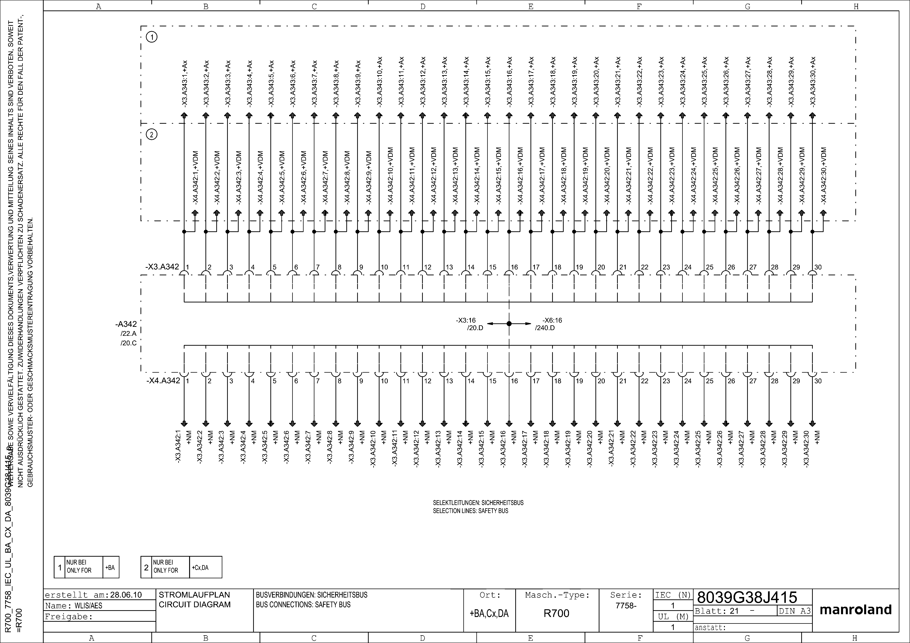

# +BA_Cx_DA — Sheet 21 of 247 — BUSVERBINDUNGEN: SICHERHEITSBUS

**BUS CONNECTIONS: SAFETY BUS**

> Part of the manroland **R700** printing press IEC/UL circuit diagrams.
> Drawing class: **Stromlaufplan / Circuit diagram** (DIN A3).
> Document `+BA_Cx_DA` covers the **Printing units / main switch cabinet** machine section.

## At a glance

| Field | Value |
|---|---|
| Document | `+BA_Cx_DA`  (8039G38J415) |
| Sheet | **21** of 247 |
| Section (DE) | BUSVERBINDUNGEN: SICHERHEITSBUS |
| Section (EN) | BUS CONNECTIONS: SAFETY BUS |
| Section type | CIRCUIT — Circuit diagram |
| Machine type | `R700` |
| Series | `7758` |
| Created | 28.06.10 |
| Replaces | — |
| Columns used | A, B, C, D, E, F, G, H |
| Path numbers | — |
| Labels on sheet | 201 |
| Cross-refs out | 4 |
| Cross-refs in | 64 |

**Previous:** [+BA_Cx_DA sheet 20](SHEET_0020.md) · **Next:** [+BA_Cx_DA sheet 22](SHEET_0022.md) · **Document TOC:** [_TOC.md](_TOC.md)  (+BA_Cx_DA) · **Master TOC:** [all sheets](../_MASTER_TOC.md)

## Sheet image (300 DPI, exact vector render)



_Rendered directly from the PDF vector layer at 300 DPI (1-bit), no OCR and no resampling. Use it to confirm anything ambiguous in the text below._

## Cross-references on this sheet

Each entry is a wire leaving this sheet. The printed token is `/sheet.column`; the link resolves to that sheet inside the same document.

| Ref | Target sheet | Col | Path | Destination on target | Target section | From col |
|---|---|---|---|---|---|---|
| `/20.D` | [+BA_Cx_DA sheet 20](SHEET_0020.md) | D | — | X3:16 | BUSVERBINDUNGEN: SICHERHEITSBUS | D |
| `/240.D` | [+BA_Cx_DA sheet 240](SHEET_0240.md) | D | — | — | OPTION: WASCHVORRICHTUNG MIT TUCH | E |
| `/22.A` | [+BA_Cx_DA sheet 22](SHEET_0022.md) | A | — | — | BUSVERBINDUNGEN: SICHERHEITSBUS | A |
| `/20.C` | [+BA_Cx_DA sheet 20](SHEET_0020.md) | C | — | — | BUSVERBINDUNGEN: SICHERHEITSBUS | A |

### Incoming references (sheets that point here)

Every other sheet that sends a wire to this one. `Back-ref` is the token printed on *that* sheet; `Path` is its line number.

| From sheet | Cols | Back-ref | Path | Refs | What continues there |
|---|---|---|---|---|---|
| [+BA_Cx_DA#20](SHEET_0020.md) | B, E | `/20.B`, `/20.E` | — | 2 | X3:16 |
| [+BA_Cx_DA#22](SHEET_0022.md) | A | `/22.A` | — | 1 | — |
| [+BA_Cx_DA#157](SHEET_0157.md) | A, B | `/157.A`, `/157.B` | — | 30 | — |
| [+BA_Cx_DA#159](SHEET_0159.md) | C, D | `/159.C`, `/159.D` | — | 30 | — |
| [+BA_Cx_DA#240](SHEET_0240.md) | F | `/240.F` | — | 1 | X6:16 X6:33 |


## Devices on this sheet

| Tag | Class | Class meaning (IEC) | Col | Sub | Terminal | Sign |
|---|---|---|---|---|---|---|
| `A342` | A | Baugruppe / assembly, module, PC board | A | — | — | — |
| `X3:16` | X | Klemme / terminal, plug connector | D | — | 16 | — |
| `X6:16` | X | Klemme / terminal, plug connector | E | — | 16 | — |
| `X3.A342` | — | cross-device reference | B | — | — | — |
| `X4.A342` | — | cross-device reference | B | — | — | — |
| `X3.A342:1` | — | cross-device reference | B | — | 1 | — |
| `X3.A342:2` | — | cross-device reference | B | — | 2 | — |
| `X3.A342:3` | — | cross-device reference | B | — | 3 | — |
| `X3.A342:4` | — | cross-device reference | B | — | 4 | — |
| `X3.A342:5` | — | cross-device reference | C | — | 5 | — |
| `X3.A342:6` | — | cross-device reference | C | — | 6 | — |
| `X3.A342:7` | — | cross-device reference | C | — | 7 | — |
| `X3.A342:8` | — | cross-device reference | C | — | 8 | — |
| `X3.A342:9` | — | cross-device reference | C | — | 9 | — |
| `X3.A342:10` | — | cross-device reference | D | — | 10 | — |
| `X3.A342:11` | — | cross-device reference | D | — | 11 | — |
| `X3.A342:12` | — | cross-device reference | D | — | 12 | — |
| `X3.A342:13` | — | cross-device reference | D | — | 13 | — |
| `X3.A342:14` | — | cross-device reference | D | — | 14 | — |
| `X3.A342:15` | — | cross-device reference | E | — | 15 | — |
| `X3.A342:16` | — | cross-device reference | E | — | 16 | — |
| `X3.A342:17` | — | cross-device reference | E | — | 17 | — |
| `X3.A342:18` | — | cross-device reference | E | — | 18 | — |
| `X3.A342:19` | — | cross-device reference | E | — | 19 | — |
| `X3.A342:20` | — | cross-device reference | F | — | 20 | — |
| `X3.A342:21` | — | cross-device reference | F | — | 21 | — |
| `X3.A342:22` | — | cross-device reference | F | — | 22 | — |
| `X3.A342:23` | — | cross-device reference | F | — | 23 | — |
| `X3.A342:24` | — | cross-device reference | F | — | 24 | — |
| `X3.A342:25` | — | cross-device reference | G | — | 25 | — |
| `X3.A342:26` | — | cross-device reference | G | — | 26 | — |
| `X3.A342:27` | — | cross-device reference | G | — | 27 | — |
| `X3.A342:28` | — | cross-device reference | G | — | 28 | — |
| `X3.A342:29` | — | cross-device reference | G | — | 29 | — |
| `X3.A342:30` | — | cross-device reference | H | — | 30 | — |

## Potentials / nets

_No named potentials on this sheet._

## Wire-end annotations (grouped as printed)

A wire that continues elsewhere is annotated with a small cluster: the destination description, the path/line number `#NN`, and the `/sheet.column` cross reference. Each row below is one such cluster exactly as it is grouped on the drawing.

| Col | Y | Path | Cross-ref | Text on the wire |
|---|---|---|---|---|
| A | 45.1 | — | — | `1` |
| D | 74.3 | — | — | `X3.A343:10,+Ax` |
| D | 74.3 | — | — | `X3.A343:11,+Ax` |
| D | 74.3 | — | — | `X3.A343:12,+Ax` |
| D | 74.3 | — | — | `X3.A343:13,+Ax` |
| D | 74.3 | — | — | `X3.A343:14,+Ax` |
| E | 74.3 | — | — | `X3.A343:15,+Ax` |
| E | 74.3 | — | — | `X3.A343:16,+Ax` |
| E | 74.3 | — | — | `X3.A343:17,+Ax` |
| E | 74.3 | — | — | `X3.A343:18,+Ax` |
| E | 74.3 | — | — | `X3.A343:19,+Ax` |
| F | 74.3 | — | — | `X3.A343:20,+Ax` |
| F | 74.3 | — | — | `X3.A343:21,+Ax` |
| F | 74.3 | — | — | `X3.A343:22,+Ax` |
| F | 74.3 | — | — | `X3.A343:23,+Ax` |
| F | 74.3 | — | — | `X3.A343:24,+Ax` |
| G | 74.3 | — | — | `X3.A343:25,+Ax` |
| G | 74.3 | — | — | `X3.A343:26,+Ax` |
| G | 74.3 | — | — | `X3.A343:27,+Ax` |
| G | 74.3 | — | — | `X3.A343:28,+Ax` |
| G | 74.3 | — | — | `X3.A343:29,+Ax` |
| H | 74.3 | — | — | `X3.A343:30,+Ax` |
| B | 79.1 | — | — | `X3.A343:1,+Ax` |
| B | 79.1 | — | — | `X3.A343:2,+Ax` |
| B | 79.1 | — | — | `X3.A343:3,+Ax` |
| B | 79.1 | — | — | `X3.A343:4,+Ax` |
| C | 79.1 | — | — | `X3.A343:5,+Ax` |
| C | 79.1 | — | — | `X3.A343:6,+Ax` |
| C | 79.1 | — | — | `X3.A343:7,+Ax` |
| C | 79.1 | — | — | `X3.A343:8,+Ax` |
| C | 79.1 | — | — | `X3.A343:9,+Ax` |
| A | 173.2 | — | — | `2` |
| D | 192.5 | — | — | `X4.A342:10,+VDM` |
| D | 192.5 | — | — | `X4.A342:11,+VDM` |
| D | 192.5 | — | — | `X4.A342:12,+VDM` |
| D | 192.5 | — | — | `X4.A342:13,+VDM` |
| E | 192.5 | — | — | `X4.A342:14,+VDM` |
| E | 192.5 | — | — | `X4.A342:15,+VDM` |
| E | 192.5 | — | — | `X4.A342:16,+VDM` |
| E | 192.5 | — | — | `X4.A342:17,+VDM` |
| E | 192.5 | — | — | `X4.A342:18,+VDM` |
| F | 192.5 | — | — | `X4.A342:19,+VDM` |
| F | 192.5 | — | — | `X4.A342:20,+VDM` |
| F | 192.5 | — | — | `X4.A342:21,+VDM` |
| F | 192.5 | — | — | `X4.A342:22,+VDM` |
| F | 192.5 | — | — | `X4.A342:23,+VDM` |
| G | 192.5 | — | — | `X4.A342:24,+VDM` |
| G | 192.5 | — | — | `X4.A342:25,+VDM` |
| G | 192.5 | — | — | `X4.A342:26,+VDM` |
| G | 192.5 | — | — | `X4.A342:27,+VDM` |
| G | 192.5 | — | — | `X4.A342:28,+VDM` |
| H | 192.5 | — | — | `X4.A342:29,+VDM` |
| H | 192.5 | — | — | `X4.A342:30,+VDM` |
| B | 197.3 | — | — | `X4.A342:1,+VDM` |
| B | 197.3 | — | — | `X4.A342:2,+VDM` |
| B | 197.3 | — | — | `X4.A342:3,+VDM` |
| C | 197.3 | — | — | `X4.A342:4,+VDM` |
| C | 197.3 | — | — | `X4.A342:5,+VDM` |
| C | 197.3 | — | — | `X4.A342:6,+VDM` |
| C | 197.3 | — | — | `X4.A342:7,+VDM` |
| C | 197.3 | — | — | `X4.A342:8,+VDM` |
| D | 197.3 | — | — | `X4.A342:9,+VDM` |
| E | 344.7 | — | — | `X3.A342 1 2 3 4 5 6 7 8 9 10 11 12 13 14 15 16 17 18 19 20 21 22 23 24 25 26 27 28 29 30` |
| D | 415.6 | — | `/20.D` | `X3:16` |
| E | 415.6 | — | — | `X6:16` |
| A | 419.8 | — | — | `A342` |
| E | 425.5 | — | `/240.D` | — |
| A | 432.9 | — | `/22.A`, `/20.C` | — |
| E | 493.5 | — | — | `X4.A342 1 2 3 4 5 6 7 8 9 10 11 12 13 14 15 16 17 18 19 20 21 22 23 24 25 26 27 28 29 30` |
| B | 562.4 | — | — | `X3.A342:1` |
| D | 562.4 | — | — | `X3.A342:11` |
| F | 562.4 | — | — | `X3.A342:21` |
| B | 563.5 | — | — | `+NM` |
| B | 563.5 | — | — | `X3.A342:2` |
| B | 563.5 | — | — | `+NM` |
| B | 563.5 | — | — | `+NM` |
| B | 563.5 | — | — | `+NM` |
| C | 563.5 | — | — | `+NM` |
| C | 563.5 | — | — | `+NM` |
| C | 563.5 | — | — | `+NM` |
| C | 563.5 | — | — | `+NM` |
| C | 563.5 | — | — | `+NM` |
| D | 563.5 | — | — | `+NM` |
| D | 563.5 | — | — | `+NM` |
| D | 563.5 | — | — | `X3.A342:12` |
| D | 563.5 | — | — | `+NM` |
| D | 563.5 | — | — | `+NM` |
| D | 563.5 | — | — | `+NM` |
| E | 563.5 | — | — | `+NM` |
| E | 563.5 | — | — | `+NM` |
| E | 563.5 | — | — | `+NM` |
| E | 563.5 | — | — | `+NM` |
| E | 563.5 | — | — | `+NM` |
| F | 563.5 | — | — | `+NM` |
| F | 563.5 | — | — | `+NM` |
| F | 563.5 | — | — | `X3.A342:22` |
| F | 563.5 | — | — | `+NM` |
| F | 563.5 | — | — | `+NM` |
| F | 563.5 | — | — | `+NM` |
| G | 563.5 | — | — | `+NM` |
| G | 563.5 | — | — | `+NM` |
| G | 563.5 | — | — | `+NM` |
| G | 563.5 | — | — | `+NM` |
| G | 563.5 | — | — | `+NM` |
| H | 563.5 | — | — | `+NM` |
| B | 563.8 | — | — | `X3.A342:3` |
| B | 563.8 | — | — | `X3.A342:4` |
| C | 563.8 | — | — | `X3.A342:5` |
| C | 563.8 | — | — | `X3.A342:6` |
| C | 563.8 | — | — | `X3.A342:7` |
| C | 563.8 | — | — | `X3.A342:8` |
| C | 563.8 | — | — | `X3.A342:9` |
| D | 563.8 | — | — | `X3.A342:10` |
| D | 563.8 | — | — | `X3.A342:13` |
| D | 563.8 | — | — | `X3.A342:14` |
| E | 563.8 | — | — | `X3.A342:15` |
| E | 563.8 | — | — | `X3.A342:16` |
| E | 563.8 | — | — | `X3.A342:17` |
| E | 563.8 | — | — | `X3.A342:18` |
| E | 563.8 | — | — | `X3.A342:19` |
| F | 563.8 | — | — | `X3.A342:20` |
| F | 563.8 | — | — | `X3.A342:23` |
| F | 563.8 | — | — | `X3.A342:24` |
| G | 563.8 | — | — | `X3.A342:25` |
| G | 563.8 | — | — | `X3.A342:26` |
| G | 563.8 | — | — | `X3.A342:27` |
| G | 563.8 | — | — | `X3.A342:28` |
| G | 563.8 | — | — | `X3.A342:29` |
| H | 563.8 | — | — | `X3.A342:30` |
| E | 655.4 | — | — | `SELEKTLEITUNGEN: SICHERHEITSBUS SELECTION LINES: SAFETY BUS` |
| A | 733.3 | — | — | `1 NUR BEI` |
| A | 733.3 | — | — | `ONLY FOR +BA 2 NUR BEI` |
| B | 740.5 | — | — | `ONLY FOR +Cx,DA` |


## Reconstructed tables

This sheet carries tabular content (pin map / terminal assignment / index). The grid below was rebuilt from the drawing's own rule lines, so each row is exactly one physical row of the table.

### Table 1 — 1 data rows × 29 columns (at x=240.9, y=161.6)

| X4.A342:1,+VDM 1 | X4.A342:2,+VDM 2 | X4.A342:3,+VDM 3 | X4.A342:4,+VDM 4 | X4.A342:5,+VDM 5 | X4.A342:6,+VDM 6 | X4.A342:7,+VDM 7 | X4.A342:8,+VDM 8 | X4.A342:9,+VDM 9 | X4.A342:10,+VDM 10 | X4.A342:11,+VDM 11 | X4.A342:12,+VDM 12 | X4.A342:13,+VDM 13 | X4.A342:14,+VDM 14 | X4.A342:15,+VDM 15 | X4.A342:16,+VDM 16 | X4.A342:17,+VDM 17 | X4.A342:18,+VDM 18 | X4.A342:19,+VDM 19 | X4.A342:20,+VDM 20 | X4.A342:21,+VDM 21 | X4.A342:22,+VDM 22 | X4.A342:23,+VDM 23 | X4.A342:24,+VDM 24 | X4.A342:25,+VDM 25 | X4.A342:26,+VDM 26 | X4.A342:27,+VDM 27 | X4.A342:28,+VDM 28 | X4.A342:29,+VDM 29 |
|---|---|---|---|---|---|---|---|---|---|---|---|---|---|---|---|---|---|---|---|---|---|---|---|---|---|---|---|---|
|  |  |  |  |  |  |  |  |  |  |  |  |  | `X3:16 /20.D` |  |  | `X6:16 /240.D` |  |  |  |  |  |  |  |  |  |  |  |  |


## Notes and free text on this sheet

| Text | Col | Y (pt) |
|---|---|---|
| `+NM` | B | 563.53 |
| `+NM` | C | 563.53 |
| `+NM` | D | 563.53 |
| `+NM` | E | 563.53 |
| `+NM` | F | 563.53 |
| `+NM` | G | 563.53 |
| `+NM` | H | 563.53 |
| `X4.A342:1,+VDM` | B | 197.29 |
| `X4.A342:2,+VDM` | B | 197.29 |
| `X4.A342:3,+VDM` | B | 197.29 |
| `X4.A342:4,+VDM` | C | 197.29 |
| `X4.A342:5,+VDM` | C | 197.29 |
| `X4.A342:6,+VDM` | C | 197.29 |
| `X4.A342:7,+VDM` | C | 197.29 |
| `X4.A342:8,+VDM` | C | 197.29 |
| `X4.A342:9,+VDM` | D | 197.29 |
| `X4.A342:10,+VDM` | D | 192.47 |
| `X4.A342:11,+VDM` | D | 192.47 |
| `X4.A342:12,+VDM` | D | 192.47 |
| `X4.A342:13,+VDM` | D | 192.47 |
| `X4.A342:14,+VDM` | E | 192.47 |
| `X4.A342:15,+VDM` | E | 192.47 |
| `X4.A342:16,+VDM` | E | 192.47 |
| `X4.A342:17,+VDM` | E | 192.47 |
| `X4.A342:18,+VDM` | E | 192.47 |
| `X4.A342:19,+VDM` | F | 192.47 |
| `X4.A342:20,+VDM` | F | 192.47 |
| `X4.A342:21,+VDM` | F | 192.47 |
| `X4.A342:22,+VDM` | F | 192.47 |
| `X4.A342:23,+VDM` | F | 192.47 |
| `X4.A342:24,+VDM` | G | 192.47 |
| `X4.A342:25,+VDM` | G | 192.47 |
| `X4.A342:26,+VDM` | G | 192.47 |
| `X4.A342:27,+VDM` | G | 192.47 |
| `X4.A342:28,+VDM` | G | 192.47 |
| `X4.A342:29,+VDM` | H | 192.47 |
| `X4.A342:30,+VDM` | H | 192.47 |
| `X3.A343:1,+Ax` | B | 79.09 |
| `X3.A343:2,+Ax` | B | 79.09 |
| `X3.A343:3,+Ax` | B | 79.09 |
| `X3.A343:4,+Ax` | B | 79.09 |
| `X3.A343:5,+Ax` | C | 79.09 |
| `X3.A343:6,+Ax` | C | 79.09 |
| `X3.A343:7,+Ax` | C | 79.09 |
| `X3.A343:8,+Ax` | C | 79.09 |
| `X3.A343:9,+Ax` | C | 79.09 |
| `X3.A343:10,+Ax` | D | 74.27 |
| `X3.A343:11,+Ax` | D | 74.27 |
| `X3.A343:12,+Ax` | D | 74.27 |
| `X3.A343:13,+Ax` | D | 74.27 |
| `X3.A343:14,+Ax` | D | 74.27 |
| `X3.A343:15,+Ax` | E | 74.27 |
| `X3.A343:16,+Ax` | E | 74.27 |
| `X3.A343:17,+Ax` | E | 74.27 |
| `X3.A343:18,+Ax` | E | 74.27 |
| `X3.A343:19,+Ax` | E | 74.27 |
| `X3.A343:20,+Ax` | F | 74.27 |
| `X3.A343:21,+Ax` | F | 74.27 |
| `X3.A343:22,+Ax` | F | 74.27 |
| `X3.A343:23,+Ax` | F | 74.27 |
| `X3.A343:24,+Ax` | F | 74.27 |
| `X3.A343:25,+Ax` | G | 74.27 |
| `X3.A343:26,+Ax` | G | 74.27 |
| `X3.A343:27,+Ax` | G | 74.27 |
| `X3.A343:28,+Ax` | G | 74.27 |
| `X3.A343:29,+Ax` | G | 74.27 |
| `X3.A343:30,+Ax` | H | 74.27 |
| `NUR BEI` | A | 733.33 |
| `ONLY FOR` | A | 744.02 |
| `+BA` | A | 740.44 |
| `NUR BEI` | B | 733.33 |
| `ONLY FOR` | B | 744.02 |
| `+Cx,DA` | B | 740.52 |
| `SELEKTLEITUNGEN: SICHERHEITSBUS` | E | 655.43 |
| `SELECTION LINES: SAFETY BUS` | D | 666.05 |

## Complete label inventory (exact text from the drawing)

Every text object inside the drawing area of this sheet, in DIN reading order (column A→H, then top→bottom). This is the authoritative list: if a string is not here it is not printed on this sheet.

| Col | Y | X | Dir | Type | Text |
|---|---|---|---|---|---|
| A | 45.1 | 196.7 | → | number | `1` |
| A | 173.2 | 196.4 | → | number | `2` |
| A | 419.8 | 150.8 | → | device tag | `A342` |
| A | 432.9 | 157.9 | → | cross-reference | `/22.A` |
| A | 445.3 | 157.9 | → | cross-reference | `/20.C` |
| A | 733.3 | 87.0 | → | text | `NUR BEI` |
| A | 738.7 | 75.4 | → | number | `1` |
| A | 738.7 | 188.5 | → | number | `2` |
| A | 740.4 | 137.9 | → | text | `+BA` |
| A | 744.0 | 87.6 | → | text | `ONLY FOR` |
| B | 79.1 | 237.7 | ↕ | text | `X3.A343:1,+Ax` |
| B | 79.1 | 266.0 | ↕ | text | `X3.A343:2,+Ax` |
| B | 79.1 | 294.4 | ↕ | text | `X3.A343:3,+Ax` |
| B | 79.1 | 322.7 | ↕ | text | `X3.A343:4,+Ax` |
| B | 197.3 | 251.9 | ↕ | text | `X4.A342:1,+VDM` |
| B | 197.3 | 280.2 | ↕ | text | `X4.A342:2,+VDM` |
| B | 197.3 | 308.6 | ↕ | text | `X4.A342:3,+VDM` |
| B | 344.7 | 190.2 | → | device ref | `X3.A342` |
| B | 346.2 | 242.9 | → | number | `1` |
| B | 346.2 | 271.8 | → | number | `2` |
| B | 346.2 | 300.2 | → | number | `3` |
| B | 346.2 | 328.5 | → | number | `4` |
| B | 493.5 | 191.6 | → | device ref | `X4.A342` |
| B | 495.0 | 242.9 | → | number | `1` |
| B | 495.0 | 271.8 | → | number | `2` |
| B | 495.0 | 300.2 | → | number | `3` |
| B | 495.0 | 328.5 | → | number | `4` |
| B | 562.4 | 229.2 | ↕ | device ref | `X3.A342:1` |
| B | 563.5 | 243.4 | ↕ | text | `+NM` |
| B | 563.5 | 257.5 | ↕ | device ref | `X3.A342:2` |
| B | 563.5 | 271.8 | ↕ | text | `+NM` |
| B | 563.5 | 300.1 | ↕ | text | `+NM` |
| B | 563.5 | 328.5 | ↕ | text | `+NM` |
| B | 563.8 | 285.9 | ↕ | device ref | `X3.A342:3` |
| B | 563.8 | 314.2 | ↕ | device ref | `X3.A342:4` |
| B | 733.3 | 200.4 | → | text | `NUR BEI` |
| B | 740.5 | 251.3 | → | text | `+Cx,DA` |
| B | 744.0 | 201.0 | → | text | `ONLY FOR` |
| C | 79.1 | 351.1 | ↕ | text | `X3.A343:5,+Ax` |
| C | 79.1 | 379.4 | ↕ | text | `X3.A343:6,+Ax` |
| C | 79.1 | 407.8 | ↕ | text | `X3.A343:7,+Ax` |
| C | 79.1 | 436.1 | ↕ | text | `X3.A343:8,+Ax` |
| C | 79.1 | 464.5 | ↕ | text | `X3.A343:9,+Ax` |
| C | 197.3 | 336.9 | ↕ | text | `X4.A342:4,+VDM` |
| C | 197.3 | 365.2 | ↕ | text | `X4.A342:5,+VDM` |
| C | 197.3 | 393.6 | ↕ | text | `X4.A342:6,+VDM` |
| C | 197.3 | 421.9 | ↕ | text | `X4.A342:7,+VDM` |
| C | 197.3 | 450.3 | ↕ | text | `X4.A342:8,+VDM` |
| C | 346.2 | 356.9 | → | number | `5` |
| C | 346.2 | 385.2 | → | number | `6` |
| C | 346.2 | 413.6 | → | number | `7` |
| C | 346.2 | 441.9 | → | number | `8` |
| C | 346.2 | 470.3 | → | number | `9` |
| C | 495.0 | 356.9 | → | number | `5` |
| C | 495.0 | 385.2 | → | number | `6` |
| C | 495.0 | 413.6 | → | number | `7` |
| C | 495.0 | 441.9 | → | number | `8` |
| C | 495.0 | 470.3 | → | number | `9` |
| C | 563.5 | 356.8 | ↕ | text | `+NM` |
| C | 563.5 | 385.1 | ↕ | text | `+NM` |
| C | 563.5 | 413.5 | ↕ | text | `+NM` |
| C | 563.5 | 441.8 | ↕ | text | `+NM` |
| C | 563.5 | 470.2 | ↕ | text | `+NM` |
| C | 563.8 | 342.6 | ↕ | device ref | `X3.A342:5` |
| C | 563.8 | 370.9 | ↕ | device ref | `X3.A342:6` |
| C | 563.8 | 399.3 | ↕ | device ref | `X3.A342:7` |
| C | 563.8 | 427.6 | ↕ | device ref | `X3.A342:8` |
| C | 563.8 | 455.9 | ↕ | device ref | `X3.A342:9` |
| D | 74.3 | 492.8 | ↕ | text | `X3.A343:10,+Ax` |
| D | 74.3 | 521.2 | ↕ | text | `X3.A343:11,+Ax` |
| D | 74.3 | 549.5 | ↕ | text | `X3.A343:12,+Ax` |
| D | 74.3 | 577.9 | ↕ | text | `X3.A343:13,+Ax` |
| D | 74.3 | 606.2 | ↕ | text | `X3.A343:14,+Ax` |
| D | 192.5 | 507.0 | ↕ | text | `X4.A342:10,+VDM` |
| D | 192.5 | 535.3 | ↕ | text | `X4.A342:11,+VDM` |
| D | 192.5 | 563.7 | ↕ | text | `X4.A342:12,+VDM` |
| D | 192.5 | 592.0 | ↕ | text | `X4.A342:13,+VDM` |
| D | 197.3 | 478.6 | ↕ | text | `X4.A342:9,+VDM` |
| D | 346.2 | 498.0 | → | number | `10` |
| D | 346.2 | 526.4 | → | number | `11` |
| D | 346.2 | 554.7 | → | number | `12` |
| D | 346.2 | 583.1 | → | number | `13` |
| D | 346.2 | 611.4 | → | number | `14` |
| D | 415.6 | 596.7 | → | device tag | `X3:16` |
| D | 425.5 | 611.4 | → | cross-reference | `/20.D` |
| D | 495.0 | 498.0 | → | number | `10` |
| D | 495.0 | 526.4 | → | number | `11` |
| D | 495.0 | 554.7 | → | number | `12` |
| D | 495.0 | 583.1 | → | number | `13` |
| D | 495.0 | 611.4 | → | number | `14` |
| D | 562.4 | 512.6 | ↕ | device ref | `X3.A342:11` |
| D | 563.5 | 498.5 | ↕ | text | `+NM` |
| D | 563.5 | 526.9 | ↕ | text | `+NM` |
| D | 563.5 | 541.0 | ↕ | device ref | `X3.A342:12` |
| D | 563.5 | 555.2 | ↕ | text | `+NM` |
| D | 563.5 | 583.6 | ↕ | text | `+NM` |
| D | 563.5 | 611.9 | ↕ | text | `+NM` |
| D | 563.8 | 484.3 | ↕ | device ref | `X3.A342:10` |
| D | 563.8 | 569.3 | ↕ | device ref | `X3.A342:13` |
| D | 563.8 | 597.7 | ↕ | device ref | `X3.A342:14` |
| D | 666.0 | 566.6 | → | text | `SELECTION LINES: SAFETY BUS` |
| E | 74.3 | 634.5 | ↕ | text | `X3.A343:15,+Ax` |
| E | 74.3 | 662.9 | ↕ | text | `X3.A343:16,+Ax` |
| E | 74.3 | 691.2 | ↕ | text | `X3.A343:17,+Ax` |
| E | 74.3 | 719.6 | ↕ | text | `X3.A343:18,+Ax` |
| E | 74.3 | 747.9 | ↕ | text | `X3.A343:19,+Ax` |
| E | 192.5 | 620.4 | ↕ | text | `X4.A342:14,+VDM` |
| E | 192.5 | 648.7 | ↕ | text | `X4.A342:15,+VDM` |
| E | 192.5 | 677.1 | ↕ | text | `X4.A342:16,+VDM` |
| E | 192.5 | 705.4 | ↕ | text | `X4.A342:17,+VDM` |
| E | 192.5 | 733.8 | ↕ | text | `X4.A342:18,+VDM` |
| E | 346.2 | 639.8 | → | number | `15` |
| E | 346.2 | 668.1 | → | number | `16` |
| E | 346.2 | 696.5 | → | number | `17` |
| E | 346.2 | 724.8 | → | number | `18` |
| E | 346.2 | 753.2 | → | number | `19` |
| E | 415.6 | 709.8 | → | device tag | `X6:16` |
| E | 425.5 | 700.2 | → | cross-reference | `/240.D` |
| E | 495.0 | 639.8 | → | number | `15` |
| E | 495.0 | 668.1 | → | number | `16` |
| E | 495.0 | 696.5 | → | number | `17` |
| E | 495.0 | 724.8 | → | number | `18` |
| E | 495.0 | 753.2 | → | number | `19` |
| E | 563.5 | 640.3 | ↕ | text | `+NM` |
| E | 563.5 | 668.6 | ↕ | text | `+NM` |
| E | 563.5 | 697.0 | ↕ | text | `+NM` |
| E | 563.5 | 725.3 | ↕ | text | `+NM` |
| E | 563.5 | 753.7 | ↕ | text | `+NM` |
| E | 563.8 | 626.0 | ↕ | device ref | `X3.A342:15` |
| E | 563.8 | 654.4 | ↕ | device ref | `X3.A342:16` |
| E | 563.8 | 682.7 | ↕ | device ref | `X3.A342:17` |
| E | 563.8 | 711.1 | ↕ | device ref | `X3.A342:18` |
| E | 563.8 | 739.4 | ↕ | device ref | `X3.A342:19` |
| E | 655.4 | 566.6 | → | text | `SELEKTLEITUNGEN: SICHERHEITSBUS` |
| F | 74.3 | 776.3 | ↕ | text | `X3.A343:20,+Ax` |
| F | 74.3 | 804.6 | ↕ | text | `X3.A343:21,+Ax` |
| F | 74.3 | 833.0 | ↕ | text | `X3.A343:22,+Ax` |
| F | 74.3 | 861.3 | ↕ | text | `X3.A343:23,+Ax` |
| F | 74.3 | 889.7 | ↕ | text | `X3.A343:24,+Ax` |
| F | 192.5 | 762.1 | ↕ | text | `X4.A342:19,+VDM` |
| F | 192.5 | 790.4 | ↕ | text | `X4.A342:20,+VDM` |
| F | 192.5 | 818.8 | ↕ | text | `X4.A342:21,+VDM` |
| F | 192.5 | 847.1 | ↕ | text | `X4.A342:22,+VDM` |
| F | 192.5 | 875.5 | ↕ | text | `X4.A342:23,+VDM` |
| F | 346.2 | 782.1 | → | number | `20` |
| F | 346.2 | 810.4 | → | number | `21` |
| F | 346.2 | 838.8 | → | number | `22` |
| F | 346.2 | 867.1 | → | number | `23` |
| F | 346.2 | 895.5 | → | number | `24` |
| F | 495.0 | 782.1 | → | number | `20` |
| F | 495.0 | 810.4 | → | number | `21` |
| F | 495.0 | 838.8 | → | number | `22` |
| F | 495.0 | 867.1 | → | number | `23` |
| F | 495.0 | 895.5 | → | number | `24` |
| F | 562.4 | 796.1 | ↕ | device ref | `X3.A342:21` |
| F | 563.5 | 782.0 | ↕ | text | `+NM` |
| F | 563.5 | 810.3 | ↕ | text | `+NM` |
| F | 563.5 | 824.5 | ↕ | device ref | `X3.A342:22` |
| F | 563.5 | 838.7 | ↕ | text | `+NM` |
| F | 563.5 | 867.0 | ↕ | text | `+NM` |
| F | 563.5 | 895.4 | ↕ | text | `+NM` |
| F | 563.8 | 767.8 | ↕ | device ref | `X3.A342:20` |
| F | 563.8 | 852.8 | ↕ | device ref | `X3.A342:23` |
| F | 563.8 | 881.2 | ↕ | device ref | `X3.A342:24` |
| G | 74.3 | 918.0 | ↕ | text | `X3.A343:25,+Ax` |
| G | 74.3 | 946.4 | ↕ | text | `X3.A343:26,+Ax` |
| G | 74.3 | 974.7 | ↕ | text | `X3.A343:27,+Ax` |
| G | 74.3 | 1003.1 | ↕ | text | `X3.A343:28,+Ax` |
| G | 74.3 | 1031.4 | ↕ | text | `X3.A343:29,+Ax` |
| G | 192.5 | 903.8 | ↕ | text | `X4.A342:24,+VDM` |
| G | 192.5 | 932.2 | ↕ | text | `X4.A342:25,+VDM` |
| G | 192.5 | 960.5 | ↕ | text | `X4.A342:26,+VDM` |
| G | 192.5 | 988.9 | ↕ | text | `X4.A342:27,+VDM` |
| G | 192.5 | 1017.2 | ↕ | text | `X4.A342:28,+VDM` |
| G | 346.2 | 923.8 | → | number | `25` |
| G | 346.2 | 952.2 | → | number | `26` |
| G | 346.2 | 980.5 | → | number | `27` |
| G | 346.2 | 1008.9 | → | number | `28` |
| G | 346.2 | 1037.2 | → | number | `29` |
| G | 495.0 | 923.8 | → | number | `25` |
| G | 495.0 | 952.2 | → | number | `26` |
| G | 495.0 | 980.5 | → | number | `27` |
| G | 495.0 | 1008.9 | → | number | `28` |
| G | 495.0 | 1037.2 | → | number | `29` |
| G | 563.5 | 923.7 | ↕ | text | `+NM` |
| G | 563.5 | 952.1 | ↕ | text | `+NM` |
| G | 563.5 | 980.4 | ↕ | text | `+NM` |
| G | 563.5 | 1008.8 | ↕ | text | `+NM` |
| G | 563.5 | 1037.1 | ↕ | text | `+NM` |
| G | 563.8 | 909.5 | ↕ | device ref | `X3.A342:25` |
| G | 563.8 | 937.8 | ↕ | device ref | `X3.A342:26` |
| G | 563.8 | 966.2 | ↕ | device ref | `X3.A342:27` |
| G | 563.8 | 994.5 | ↕ | device ref | `X3.A342:28` |
| G | 563.8 | 1022.9 | ↕ | device ref | `X3.A342:29` |
| H | 74.3 | 1059.7 | ↕ | text | `X3.A343:30,+Ax` |
| H | 192.5 | 1045.6 | ↕ | text | `X4.A342:29,+VDM` |
| H | 192.5 | 1073.9 | ↕ | text | `X4.A342:30,+VDM` |
| H | 346.2 | 1065.5 | → | number | `30` |
| H | 495.0 | 1065.5 | → | number | `30` |
| H | 563.5 | 1065.5 | ↕ | text | `+NM` |
| H | 563.8 | 1051.2 | ↕ | device ref | `X3.A342:30` |

## Reading-order text block

The same content as a plain block, grouped by DIN column — convenient to paste or to match against a visual description.

```text
=== Column A ===
  45.1  196.7  numeric      1
 173.2  196.4  numeric      2
 419.8  150.8  devtag       A342
 432.9  157.9  xref         /22.A
 445.3  157.9  xref         /20.C
 733.3   87.0  text         NUR BEI
 738.7   75.4  numeric      1
 738.7  188.5  numeric      2
 740.4  137.9  text         +BA
 744.0   87.6  text         ONLY FOR
=== Column B ===
  79.1  237.7  text         X3.A343:1,+Ax
  79.1  266.0  text         X3.A343:2,+Ax
  79.1  294.4  text         X3.A343:3,+Ax
  79.1  322.7  text         X3.A343:4,+Ax
 197.3  251.9  text         X4.A342:1,+VDM
 197.3  280.2  text         X4.A342:2,+VDM
 197.3  308.6  text         X4.A342:3,+VDM
 344.7  190.2  devref       X3.A342
 346.2  242.9  numeric      1
 346.2  271.8  numeric      2
 346.2  300.2  numeric      3
 346.2  328.5  numeric      4
 493.5  191.6  devref       X4.A342
 495.0  242.9  numeric      1
 495.0  271.8  numeric      2
 495.0  300.2  numeric      3
 495.0  328.5  numeric      4
 562.4  229.2  devref       X3.A342:1
 563.5  243.4  text         +NM
 563.5  257.5  devref       X3.A342:2
 563.5  271.8  text         +NM
 563.5  300.1  text         +NM
 563.5  328.5  text         +NM
 563.8  285.9  devref       X3.A342:3
 563.8  314.2  devref       X3.A342:4
 733.3  200.4  text         NUR BEI
 740.5  251.3  text         +Cx,DA
 744.0  201.0  text         ONLY FOR
=== Column C ===
  79.1  351.1  text         X3.A343:5,+Ax
  79.1  379.4  text         X3.A343:6,+Ax
  79.1  407.8  text         X3.A343:7,+Ax
  79.1  436.1  text         X3.A343:8,+Ax
  79.1  464.5  text         X3.A343:9,+Ax
 197.3  336.9  text         X4.A342:4,+VDM
 197.3  365.2  text         X4.A342:5,+VDM
 197.3  393.6  text         X4.A342:6,+VDM
 197.3  421.9  text         X4.A342:7,+VDM
 197.3  450.3  text         X4.A342:8,+VDM
 346.2  356.9  numeric      5
 346.2  385.2  numeric      6
 346.2  413.6  numeric      7
 346.2  441.9  numeric      8
 346.2  470.3  numeric      9
 495.0  356.9  numeric      5
 495.0  385.2  numeric      6
 495.0  413.6  numeric      7
 495.0  441.9  numeric      8
 495.0  470.3  numeric      9
 563.5  356.8  text         +NM
 563.5  385.1  text         +NM
 563.5  413.5  text         +NM
 563.5  441.8  text         +NM
 563.5  470.2  text         +NM
 563.8  342.6  devref       X3.A342:5
 563.8  370.9  devref       X3.A342:6
 563.8  399.3  devref       X3.A342:7
 563.8  427.6  devref       X3.A342:8
 563.8  455.9  devref       X3.A342:9
=== Column D ===
  74.3  492.8  text         X3.A343:10,+Ax
  74.3  521.2  text         X3.A343:11,+Ax
  74.3  549.5  text         X3.A343:12,+Ax
  74.3  577.9  text         X3.A343:13,+Ax
  74.3  606.2  text         X3.A343:14,+Ax
 192.5  507.0  text         X4.A342:10,+VDM
 192.5  535.3  text         X4.A342:11,+VDM
 192.5  563.7  text         X4.A342:12,+VDM
 192.5  592.0  text         X4.A342:13,+VDM
 197.3  478.6  text         X4.A342:9,+VDM
 346.2  498.0  numeric      10
 346.2  526.4  numeric      11
 346.2  554.7  numeric      12
 346.2  583.1  numeric      13
 346.2  611.4  numeric      14
 415.6  596.7  devtag       X3:16
 425.5  611.4  xref         /20.D
 495.0  498.0  numeric      10
 495.0  526.4  numeric      11
 495.0  554.7  numeric      12
 495.0  583.1  numeric      13
 495.0  611.4  numeric      14
 562.4  512.6  devref       X3.A342:11
 563.5  498.5  text         +NM
 563.5  526.9  text         +NM
 563.5  541.0  devref       X3.A342:12
 563.5  555.2  text         +NM
 563.5  583.6  text         +NM
 563.5  611.9  text         +NM
 563.8  484.3  devref       X3.A342:10
 563.8  569.3  devref       X3.A342:13
 563.8  597.7  devref       X3.A342:14
 666.0  566.6  text         SELECTION LINES: SAFETY BUS
=== Column E ===
  74.3  634.5  text         X3.A343:15,+Ax
  74.3  662.9  text         X3.A343:16,+Ax
  74.3  691.2  text         X3.A343:17,+Ax
  74.3  719.6  text         X3.A343:18,+Ax
  74.3  747.9  text         X3.A343:19,+Ax
 192.5  620.4  text         X4.A342:14,+VDM
 192.5  648.7  text         X4.A342:15,+VDM
 192.5  677.1  text         X4.A342:16,+VDM
 192.5  705.4  text         X4.A342:17,+VDM
 192.5  733.8  text         X4.A342:18,+VDM
 346.2  639.8  numeric      15
 346.2  668.1  numeric      16
 346.2  696.5  numeric      17
 346.2  724.8  numeric      18
 346.2  753.2  numeric      19
 415.6  709.8  devtag       X6:16
 425.5  700.2  xref         /240.D
 495.0  639.8  numeric      15
 495.0  668.1  numeric      16
 495.0  696.5  numeric      17
 495.0  724.8  numeric      18
 495.0  753.2  numeric      19
 563.5  640.3  text         +NM
 563.5  668.6  text         +NM
 563.5  697.0  text         +NM
 563.5  725.3  text         +NM
 563.5  753.7  text         +NM
 563.8  626.0  devref       X3.A342:15
 563.8  654.4  devref       X3.A342:16
 563.8  682.7  devref       X3.A342:17
 563.8  711.1  devref       X3.A342:18
 563.8  739.4  devref       X3.A342:19
 655.4  566.6  text         SELEKTLEITUNGEN: SICHERHEITSBUS
=== Column F ===
  74.3  776.3  text         X3.A343:20,+Ax
  74.3  804.6  text         X3.A343:21,+Ax
  74.3  833.0  text         X3.A343:22,+Ax
  74.3  861.3  text         X3.A343:23,+Ax
  74.3  889.7  text         X3.A343:24,+Ax
 192.5  762.1  text         X4.A342:19,+VDM
 192.5  790.4  text         X4.A342:20,+VDM
 192.5  818.8  text         X4.A342:21,+VDM
 192.5  847.1  text         X4.A342:22,+VDM
 192.5  875.5  text         X4.A342:23,+VDM
 346.2  782.1  numeric      20
 346.2  810.4  numeric      21
 346.2  838.8  numeric      22
 346.2  867.1  numeric      23
 346.2  895.5  numeric      24
 495.0  782.1  numeric      20
 495.0  810.4  numeric      21
 495.0  838.8  numeric      22
 495.0  867.1  numeric      23
 495.0  895.5  numeric      24
 562.4  796.1  devref       X3.A342:21
 563.5  782.0  text         +NM
 563.5  810.3  text         +NM
 563.5  824.5  devref       X3.A342:22
 563.5  838.7  text         +NM
 563.5  867.0  text         +NM
 563.5  895.4  text         +NM
 563.8  767.8  devref       X3.A342:20
 563.8  852.8  devref       X3.A342:23
 563.8  881.2  devref       X3.A342:24
=== Column G ===
  74.3  918.0  text         X3.A343:25,+Ax
  74.3  946.4  text         X3.A343:26,+Ax
  74.3  974.7  text         X3.A343:27,+Ax
  74.3 1003.1  text         X3.A343:28,+Ax
  74.3 1031.4  text         X3.A343:29,+Ax
 192.5  903.8  text         X4.A342:24,+VDM
 192.5  932.2  text         X4.A342:25,+VDM
 192.5  960.5  text         X4.A342:26,+VDM
 192.5  988.9  text         X4.A342:27,+VDM
 192.5 1017.2  text         X4.A342:28,+VDM
 346.2  923.8  numeric      25
 346.2  952.2  numeric      26
 346.2  980.5  numeric      27
 346.2 1008.9  numeric      28
 346.2 1037.2  numeric      29
 495.0  923.8  numeric      25
 495.0  952.2  numeric      26
 495.0  980.5  numeric      27
 495.0 1008.9  numeric      28
 495.0 1037.2  numeric      29
 563.5  923.7  text         +NM
 563.5  952.1  text         +NM
 563.5  980.4  text         +NM
 563.5 1008.8  text         +NM
 563.5 1037.1  text         +NM
 563.8  909.5  devref       X3.A342:25
 563.8  937.8  devref       X3.A342:26
 563.8  966.2  devref       X3.A342:27
 563.8  994.5  devref       X3.A342:28
 563.8 1022.9  devref       X3.A342:29
=== Column H ===
  74.3 1059.7  text         X3.A343:30,+Ax
 192.5 1045.6  text         X4.A342:29,+VDM
 192.5 1073.9  text         X4.A342:30,+VDM
 346.2 1065.5  numeric      30
 495.0 1065.5  numeric      30
 563.5 1065.5  text         +NM
 563.8 1051.2  devref       X3.A342:30
```

---
_Generated from the PDF vector text layer; no OCR. Source: `R700_7758_IEC_UL_BA_CX_DA_8039G38J415_p`, sheet 21._
