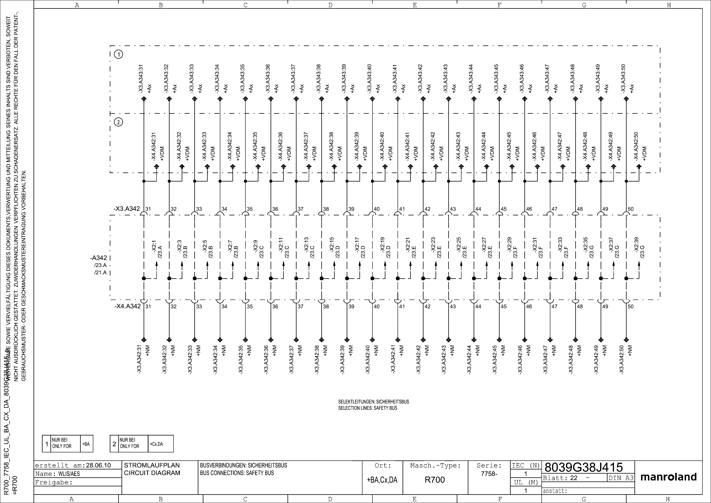

# +BA_Cx_DA — Sheet 22 of 247 — BUSVERBINDUNGEN: SICHERHEITSBUS

**BUS CONNECTIONS: SAFETY BUS**

> Part of the manroland **R700** printing press IEC/UL circuit diagrams.
> Drawing class: **Stromlaufplan / Circuit diagram** (DIN A3).
> Document `+BA_Cx_DA` covers the **Printing units / main switch cabinet** machine section.

## At a glance

| Field | Value |
|---|---|
| Document | `+BA_Cx_DA`  (8039G38J415) |
| Sheet | **22** of 247 |
| Section (DE) | BUSVERBINDUNGEN: SICHERHEITSBUS |
| Section (EN) | BUS CONNECTIONS: SAFETY BUS |
| Section type | CIRCUIT — Circuit diagram |
| Machine type | `R700` |
| Series | `7758` |
| Created | 28.06.10 |
| Replaces | — |
| Columns used | A, B, C, D, E, F, G, H |
| Path numbers | — |
| Labels on sheet | 217 |
| Cross-refs out | 22 |
| Cross-refs in | 62 |

**Previous:** [+BA_Cx_DA sheet 21](SHEET_0021.md) · **Next:** [+BA_Cx_DA sheet 23](SHEET_0023.md) · **Document TOC:** [_TOC.md](_TOC.md)  (+BA_Cx_DA) · **Master TOC:** [all sheets](../_MASTER_TOC.md)

## Sheet image (300 DPI, exact vector render)



_Rendered directly from the PDF vector layer at 300 DPI (1-bit), no OCR and no resampling. Use it to confirm anything ambiguous in the text below._

## Cross-references on this sheet

Each entry is a wire leaving this sheet. The printed token is `/sheet.column`; the link resolves to that sheet inside the same document.

| Ref | Target sheet | Col | Path | Destination on target | Target section | From col |
|---|---|---|---|---|---|---|
| `/23.C` | [+BA_Cx_DA sheet 23](SHEET_0023.md) | C | — | X2:11 | BUSVERBINDUNGEN: SICHERHEITSBUS | C |
| `/23.C` | [+BA_Cx_DA sheet 23](SHEET_0023.md) | C | — | X2:13 | BUSVERBINDUNGEN: SICHERHEITSBUS | D |
| `/23.D` | [+BA_Cx_DA sheet 23](SHEET_0023.md) | D | — | X2:15 | BUSVERBINDUNGEN: SICHERHEITSBUS | D |
| `/23.D` | [+BA_Cx_DA sheet 23](SHEET_0023.md) | D | — | X2:17 | BUSVERBINDUNGEN: SICHERHEITSBUS | D |
| `/23.D` | [+BA_Cx_DA sheet 23](SHEET_0023.md) | D | — | X2:19 | BUSVERBINDUNGEN: SICHERHEITSBUS | E |
| `/23.E` | [+BA_Cx_DA sheet 23](SHEET_0023.md) | E | — | X2:21 | BUSVERBINDUNGEN: SICHERHEITSBUS | E |
| `/23.E` | [+BA_Cx_DA sheet 23](SHEET_0023.md) | E | — | X2:23 | BUSVERBINDUNGEN: SICHERHEITSBUS | E |
| `/23.E` | [+BA_Cx_DA sheet 23](SHEET_0023.md) | E | — | X2:25 | BUSVERBINDUNGEN: SICHERHEITSBUS | F |
| `/23.E` | [+BA_Cx_DA sheet 23](SHEET_0023.md) | E | — | X2:27 | BUSVERBINDUNGEN: SICHERHEITSBUS | F |
| `/23.F` | [+BA_Cx_DA sheet 23](SHEET_0023.md) | F | — | X2:29 | BUSVERBINDUNGEN: SICHERHEITSBUS | F |
| `/23.F` | [+BA_Cx_DA sheet 23](SHEET_0023.md) | F | — | X2:31 | BUSVERBINDUNGEN: SICHERHEITSBUS | F |
| `/23.F` | [+BA_Cx_DA sheet 23](SHEET_0023.md) | F | — | X2:33 | BUSVERBINDUNGEN: SICHERHEITSBUS | G |
| `/23.G` | [+BA_Cx_DA sheet 23](SHEET_0023.md) | G | — | X2:35 | BUSVERBINDUNGEN: SICHERHEITSBUS | G |
| `/23.G` | [+BA_Cx_DA sheet 23](SHEET_0023.md) | G | — | X2:37 | BUSVERBINDUNGEN: SICHERHEITSBUS | G |
| `/23.G` | [+BA_Cx_DA sheet 23](SHEET_0023.md) | G | — | X2:39 | BUSVERBINDUNGEN: SICHERHEITSBUS | H |
| `/23.A` | [+BA_Cx_DA sheet 23](SHEET_0023.md) | A | — | X2:1 | BUSVERBINDUNGEN: SICHERHEITSBUS | B |
| `/23.B` | [+BA_Cx_DA sheet 23](SHEET_0023.md) | B | — | X2:3 | BUSVERBINDUNGEN: SICHERHEITSBUS | B |
| `/23.B` | [+BA_Cx_DA sheet 23](SHEET_0023.md) | B | — | X2:5 | BUSVERBINDUNGEN: SICHERHEITSBUS | C |
| `/23.B` | [+BA_Cx_DA sheet 23](SHEET_0023.md) | B | — | X2:7 | BUSVERBINDUNGEN: SICHERHEITSBUS | C |
| `/23.C` | [+BA_Cx_DA sheet 23](SHEET_0023.md) | C | — | X2:9 | BUSVERBINDUNGEN: SICHERHEITSBUS | C |
| `/23.A` | [+BA_Cx_DA sheet 23](SHEET_0023.md) | A | — | — | BUSVERBINDUNGEN: SICHERHEITSBUS | A |
| `/21.A` | [+BA_Cx_DA sheet 21](SHEET_0021.md) | A | — | — | BUSVERBINDUNGEN: SICHERHEITSBUS | A |

### Incoming references (sheets that point here)

Every other sheet that sends a wire to this one. `Back-ref` is the token printed on *that* sheet; `Path` is its line number.

| From sheet | Cols | Back-ref | Path | Refs | What continues there |
|---|---|---|---|---|---|
| [+BA_Cx_DA#21](SHEET_0021.md) | A | `/21.A` | — | 1 | — |
| [+BA_Cx_DA#23](SHEET_0023.md) | A, B, C, D, E, F, G | `/23.A`, `/23.B`, `/23.C`, `/23.D`, `/23.E`, `/23.F`, `/23.G` | — | 21 | X2:1; X2:11; X2:13; X2:15; X2:17; X2:19; X2:21; X2:23; X2:25; X2:27; X2:29; X2:3; X2:31; X2:33; X2:35; X2:37; X2:39; X2:5; X2:7; X2:9 |
| [+BA_Cx_DA#157](SHEET_0157.md) | B | `/157.B` | — | 20 | — |
| [+BA_Cx_DA#159](SHEET_0159.md) | D | `/159.D` | — | 20 | — |


## Devices on this sheet

| Tag | Class | Class meaning (IEC) | Col | Sub | Terminal | Sign |
|---|---|---|---|---|---|---|
| `A342` | A | Baugruppe / assembly, module, PC board | A | — | — | — |
| `X2:13` | X | Klemme / terminal, plug connector | D | — | 13 | — |
| `X2:11` | X | Klemme / terminal, plug connector | C | — | 11 | — |
| `X2:9` | X | Klemme / terminal, plug connector | C | — | 9 | — |
| `X2:7` | X | Klemme / terminal, plug connector | C | — | 7 | — |
| `X2:5` | X | Klemme / terminal, plug connector | C | — | 5 | — |
| `X2:15` | X | Klemme / terminal, plug connector | D | — | 15 | — |
| `X2:25` | X | Klemme / terminal, plug connector | F | — | 25 | — |
| `X2:23` | X | Klemme / terminal, plug connector | E | — | 23 | — |
| `X2:21` | X | Klemme / terminal, plug connector | E | — | 21 | — |
| `X2:19` | X | Klemme / terminal, plug connector | E | — | 19 | — |
| `X2:17` | X | Klemme / terminal, plug connector | D | — | 17 | — |
| `X2:3` | X | Klemme / terminal, plug connector | B | — | 3 | — |
| `X2:1` | X | Klemme / terminal, plug connector | B | — | 1 | — |
| `X2:27` | X | Klemme / terminal, plug connector | F | — | 27 | — |
| `X2:37` | X | Klemme / terminal, plug connector | G | — | 37 | — |
| `X2:35` | X | Klemme / terminal, plug connector | G | — | 35 | — |
| `X2:33` | X | Klemme / terminal, plug connector | G | — | 33 | — |
| `X2:31` | X | Klemme / terminal, plug connector | F | — | 31 | — |
| `X2:29` | X | Klemme / terminal, plug connector | F | — | 29 | — |
| `X2:39` | X | Klemme / terminal, plug connector | H | — | 39 | — |
| `X3.A342` | — | cross-device reference | B | — | — | — |
| `X4.A342` | — | cross-device reference | B | — | — | — |
| `X4.A342:31` | — | cross-device reference | B | — | 31 | — |
| `X4.A342:32` | — | cross-device reference | B | — | 32 | — |
| `X4.A342:33` | — | cross-device reference | C | — | 33 | — |
| `X4.A342:34` | — | cross-device reference | C | — | 34 | — |
| `X4.A342:35` | — | cross-device reference | C | — | 35 | — |
| `X4.A342:36` | — | cross-device reference | C | — | 36 | — |
| `X4.A342:37` | — | cross-device reference | D | — | 37 | — |
| `X4.A342:38` | — | cross-device reference | D | — | 38 | — |
| `X4.A342:39` | — | cross-device reference | D | — | 39 | — |
| `X4.A342:40` | — | cross-device reference | E | — | 40 | — |
| `X4.A342:41` | — | cross-device reference | E | — | 41 | — |
| `X4.A342:42` | — | cross-device reference | E | — | 42 | — |
| `X4.A342:43` | — | cross-device reference | F | — | 43 | — |
| `X4.A342:44` | — | cross-device reference | F | — | 44 | — |
| `X4.A342:45` | — | cross-device reference | F | — | 45 | — |
| `X4.A342:46` | — | cross-device reference | F | — | 46 | — |
| `X4.A342:47` | — | cross-device reference | G | — | 47 | — |
| `X4.A342:48` | — | cross-device reference | G | — | 48 | — |
| `X4.A342:49` | — | cross-device reference | G | — | 49 | — |
| `X4.A342:50` | — | cross-device reference | H | — | 50 | — |
| `X3.A343:31` | — | cross-device reference | B | — | 31 | — |
| `X3.A343:32` | — | cross-device reference | B | — | 32 | — |
| `X3.A343:33` | — | cross-device reference | B | — | 33 | — |
| `X3.A343:34` | — | cross-device reference | C | — | 34 | — |
| `X3.A343:35` | — | cross-device reference | C | — | 35 | — |
| `X3.A343:36` | — | cross-device reference | C | — | 36 | — |
| `X3.A343:37` | — | cross-device reference | D | — | 37 | — |
| `X3.A343:38` | — | cross-device reference | D | — | 38 | — |
| `X3.A343:39` | — | cross-device reference | D | — | 39 | — |
| `X3.A343:40` | — | cross-device reference | D | — | 40 | — |
| `X3.A343:41` | — | cross-device reference | E | — | 41 | — |
| `X3.A343:42` | — | cross-device reference | E | — | 42 | — |
| `X3.A343:43` | — | cross-device reference | E | — | 43 | — |
| `X3.A343:44` | — | cross-device reference | F | — | 44 | — |
| `X3.A343:45` | — | cross-device reference | F | — | 45 | — |
| `X3.A343:46` | — | cross-device reference | F | — | 46 | — |
| `X3.A343:47` | — | cross-device reference | G | — | 47 | — |
| `X3.A343:48` | — | cross-device reference | G | — | 48 | — |
| `X3.A343:49` | — | cross-device reference | G | — | 49 | — |
| `X3.A343:50` | — | cross-device reference | G | — | 50 | — |
| `X3.A342:31` | — | cross-device reference | B | — | 31 | — |
| `X3.A342:32` | — | cross-device reference | B | — | 32 | — |
| `X3.A342:33` | — | cross-device reference | B | — | 33 | — |
| `X3.A342:34` | — | cross-device reference | C | — | 34 | — |
| `X3.A342:35` | — | cross-device reference | C | — | 35 | — |
| `X3.A342:36` | — | cross-device reference | C | — | 36 | — |
| `X3.A342:37` | — | cross-device reference | D | — | 37 | — |
| `X3.A342:38` | — | cross-device reference | D | — | 38 | — |
| `X3.A342:39` | — | cross-device reference | D | — | 39 | — |
| `X3.A342:40` | — | cross-device reference | D | — | 40 | — |
| `X3.A342:41` | — | cross-device reference | E | — | 41 | — |
| `X3.A342:42` | — | cross-device reference | E | — | 42 | — |
| `X3.A342:43` | — | cross-device reference | E | — | 43 | — |
| `X3.A342:44` | — | cross-device reference | F | — | 44 | — |
| `X3.A342:45` | — | cross-device reference | F | — | 45 | — |
| `X3.A342:46` | — | cross-device reference | F | — | 46 | — |
| `X3.A342:47` | — | cross-device reference | G | — | 47 | — |
| `X3.A342:48` | — | cross-device reference | G | — | 48 | — |
| `X3.A342:49` | — | cross-device reference | G | — | 49 | — |
| `X3.A342:50` | — | cross-device reference | G | — | 50 | — |

## Potentials / nets

_No named potentials on this sheet._

## Wire-end annotations (grouped as printed)

A wire that continues elsewhere is annotated with a small cluster: the destination description, the path/line number `#NN`, and the `/sheet.column` cross reference. Each row below is one such cluster exactly as it is grouped on the drawing.

| Col | Y | Path | Cross-ref | Text on the wire |
|---|---|---|---|---|
| A | 87.7 | — | — | `1` |
| B | 107.4 | — | — | `X3.A343:31` |
| B | 107.4 | — | — | `X3.A343:32` |
| B | 107.4 | — | — | `X3.A343:33` |
| C | 107.4 | — | — | `X3.A343:34` |
| C | 107.4 | — | — | `X3.A343:35` |
| C | 107.4 | — | — | `X3.A343:36` |
| D | 107.4 | — | — | `X3.A343:37` |
| D | 107.4 | — | — | `X3.A343:38` |
| D | 107.4 | — | — | `X3.A343:39` |
| D | 107.4 | — | — | `X3.A343:40` |
| E | 107.4 | — | — | `X3.A343:41` |
| E | 107.4 | — | — | `X3.A343:42` |
| E | 107.4 | — | — | `X3.A343:43` |
| F | 107.4 | — | — | `X3.A343:44` |
| F | 107.4 | — | — | `X3.A343:45` |
| F | 107.4 | — | — | `X3.A343:46` |
| G | 107.4 | — | — | `X3.A343:47` |
| G | 107.4 | — | — | `X3.A343:48` |
| G | 107.4 | — | — | `X3.A343:49` |
| G | 107.4 | — | — | `X3.A343:50` |
| B | 141.2 | — | — | `+Ax` |
| B | 141.2 | — | — | `+Ax` |
| B | 141.2 | — | — | `+Ax` |
| C | 141.2 | — | — | `+Ax` |
| C | 141.2 | — | — | `+Ax` |
| C | 141.2 | — | — | `+Ax` |
| D | 141.2 | — | — | `+Ax` |
| D | 141.2 | — | — | `+Ax` |
| D | 141.2 | — | — | `+Ax` |
| E | 141.2 | — | — | `+Ax` |
| E | 141.2 | — | — | `+Ax` |
| E | 141.2 | — | — | `+Ax` |
| E | 141.2 | — | — | `+Ax` |
| F | 141.2 | — | — | `+Ax` |
| F | 141.2 | — | — | `+Ax` |
| F | 141.2 | — | — | `+Ax` |
| G | 141.2 | — | — | `+Ax` |
| G | 141.2 | — | — | `+Ax` |
| G | 141.2 | — | — | `+Ax` |
| H | 141.2 | — | — | `+Ax` |
| A | 201.6 | — | — | `2` |
| B | 220.8 | — | — | `X4.A342:31` |
| B | 220.8 | — | — | `X4.A342:32` |
| C | 220.8 | — | — | `X4.A342:33` |
| C | 220.8 | — | — | `X4.A342:34` |
| C | 220.8 | — | — | `X4.A342:35` |
| C | 220.8 | — | — | `X4.A342:36` |
| D | 220.8 | — | — | `X4.A342:37` |
| D | 220.8 | — | — | `X4.A342:38` |
| D | 220.8 | — | — | `X4.A342:39` |
| E | 220.8 | — | — | `X4.A342:40` |
| E | 220.8 | — | — | `X4.A342:41` |
| E | 220.8 | — | — | `X4.A342:42` |
| F | 220.8 | — | — | `X4.A342:43` |
| F | 220.8 | — | — | `X4.A342:44` |
| F | 220.8 | — | — | `X4.A342:45` |
| F | 220.8 | — | — | `X4.A342:46` |
| G | 220.8 | — | — | `X4.A342:47` |
| G | 220.8 | — | — | `X4.A342:48` |
| G | 220.8 | — | — | `X4.A342:49` |
| H | 220.8 | — | — | `X4.A342:50` |
| B | 245.2 | — | — | `+VDM` |
| B | 245.2 | — | — | `+VDM` |
| C | 245.2 | — | — | `+VDM` |
| C | 245.2 | — | — | `+VDM` |
| C | 245.2 | — | — | `+VDM` |
| D | 245.2 | — | — | `+VDM` |
| D | 245.2 | — | — | `+VDM` |
| D | 245.2 | — | — | `+VDM` |
| D | 245.2 | — | — | `+VDM` |
| E | 245.2 | — | — | `+VDM` |
| E | 245.2 | — | — | `+VDM` |
| E | 245.2 | — | — | `+VDM` |
| F | 245.2 | — | — | `+VDM` |
| F | 245.2 | — | — | `+VDM` |
| F | 245.2 | — | — | `+VDM` |
| G | 245.2 | — | — | `+VDM` |
| G | 245.2 | — | — | `+VDM` |
| G | 245.2 | — | — | `+VDM` |
| G | 245.2 | — | — | `+VDM` |
| H | 245.2 | — | — | `+VDM` |
| E | 344.7 | — | — | `X3.A342 31 32 33 34 35 36 37 38 39 40 41 42 43 44 45 46 47 48 49 50` |
| C | 396.9 | — | `/23.C` | `X2:11` |
| D | 396.9 | — | `/23.C` | `X2:13` |
| D | 396.9 | — | `/23.D` | `X2:15` |
| D | 396.9 | — | `/23.D` | `X2:17` |
| E | 396.9 | — | `/23.D` | `X2:19` |
| E | 396.9 | — | `/23.E` | `X2:21` |
| E | 396.9 | — | `/23.E` | `X2:23` |
| F | 396.9 | — | `/23.E` | `X2:25` |
| F | 396.9 | — | `/23.E` | `X2:27` |
| F | 396.9 | — | `/23.F` | `X2:29` |
| F | 396.9 | — | `/23.F` | `X2:31` |
| G | 396.9 | — | `/23.F` | `X2:33` |
| G | 396.9 | — | `/23.G` | `X2:35` |
| G | 396.9 | — | `/23.G` | `X2:37` |
| H | 396.9 | — | `/23.G` | `X2:39` |
| B | 401.7 | — | `/23.A` | `X2:1` |
| B | 401.7 | — | `/23.B` | `X2:3` |
| C | 401.7 | — | `/23.B` | `X2:5` |
| C | 401.7 | — | `/23.B` | `X2:7` |
| C | 401.7 | — | `/23.C` | `X2:9` |
| A | 426.9 | — | — | `A342` |
| A | 440.0 | — | `/23.A`, `/21.A` | — |
| E | 507.7 | — | — | `X4.A342 31 32 33 34 35 36 37 38 39 40 41 42 43 44 45 46 47 48 49 50` |
| B | 576.6 | — | — | `X3.A342:31` |
| E | 576.6 | — | — | `X3.A342:41` |
| B | 577.7 | — | — | `+NM` |
| B | 577.7 | — | — | `X3.A342:32` |
| B | 577.7 | — | — | `+NM` |
| B | 577.7 | — | — | `+NM` |
| C | 577.7 | — | — | `+NM` |
| C | 577.7 | — | — | `+NM` |
| C | 577.7 | — | — | `+NM` |
| D | 577.7 | — | — | `+NM` |
| D | 577.7 | — | — | `+NM` |
| D | 577.7 | — | — | `+NM` |
| E | 577.7 | — | — | `+NM` |
| E | 577.7 | — | — | `+NM` |
| E | 577.7 | — | — | `X3.A342:42` |
| E | 577.7 | — | — | `+NM` |
| E | 577.7 | — | — | `+NM` |
| F | 577.7 | — | — | `+NM` |
| F | 577.7 | — | — | `+NM` |
| F | 577.7 | — | — | `+NM` |
| G | 577.7 | — | — | `+NM` |
| G | 577.7 | — | — | `+NM` |
| G | 577.7 | — | — | `+NM` |
| H | 577.7 | — | — | `+NM` |
| B | 578.0 | — | — | `X3.A342:33` |
| C | 578.0 | — | — | `X3.A342:34` |
| C | 578.0 | — | — | `X3.A342:35` |
| C | 578.0 | — | — | `X3.A342:36` |
| D | 578.0 | — | — | `X3.A342:37` |
| D | 578.0 | — | — | `X3.A342:38` |
| D | 578.0 | — | — | `X3.A342:39` |
| D | 578.0 | — | — | `X3.A342:40` |
| E | 578.0 | — | — | `X3.A342:43` |
| F | 578.0 | — | — | `X3.A342:44` |
| F | 578.0 | — | — | `X3.A342:45` |
| F | 578.0 | — | — | `X3.A342:46` |
| G | 578.0 | — | — | `X3.A342:47` |
| G | 578.0 | — | — | `X3.A342:48` |
| G | 578.0 | — | — | `X3.A342:49` |
| G | 578.0 | — | — | `X3.A342:50` |
| E | 669.6 | — | — | `SELEKTLEITUNGEN: SICHERHEITSBUS SELECTION LINES: SAFETY BUS` |
| A | 733.3 | — | — | `1 NUR BEI` |
| A | 733.3 | — | — | `ONLY FOR +BA 2 NUR BEI` |
| B | 740.5 | — | — | `ONLY FOR +Cx,DA` |


## Notes and free text on this sheet

| Text | Col | Y (pt) |
|---|---|---|
| `+VDM` | B | 245.2 |
| `+VDM` | C | 245.2 |
| `+VDM` | D | 245.2 |
| `+VDM` | E | 245.2 |
| `+VDM` | F | 245.2 |
| `+VDM` | G | 245.2 |
| `+VDM` | H | 245.2 |
| `+Ax` | B | 141.17 |
| `+Ax` | C | 141.17 |
| `+Ax` | D | 141.17 |
| `+Ax` | E | 141.17 |
| `+Ax` | F | 141.17 |
| `+Ax` | G | 141.17 |
| `+Ax` | H | 141.17 |
| `+NM` | B | 577.7 |
| `+NM` | C | 577.7 |
| `+NM` | D | 577.7 |
| `+NM` | E | 577.7 |
| `+NM` | F | 577.7 |
| `+NM` | G | 577.7 |
| `+NM` | H | 577.7 |
| `NUR BEI` | A | 733.33 |
| `ONLY FOR` | A | 744.02 |
| `+BA` | A | 740.44 |
| `NUR BEI` | B | 733.33 |
| `ONLY FOR` | B | 744.02 |
| `+Cx,DA` | B | 740.52 |
| `SELEKTLEITUNGEN: SICHERHEITSBUS` | E | 669.6 |
| `SELECTION LINES: SAFETY BUS` | D | 680.22 |

## Complete label inventory (exact text from the drawing)

Every text object inside the drawing area of this sheet, in DIN reading order (column A→H, then top→bottom). This is the authoritative list: if a string is not here it is not printed on this sheet.

| Col | Y | X | Dir | Type | Text |
|---|---|---|---|---|---|
| A | 87.7 | 196.7 | → | number | `1` |
| A | 201.6 | 196.4 | → | number | `2` |
| A | 426.9 | 150.8 | → | device tag | `A342` |
| A | 440.0 | 157.9 | → | cross-reference | `/23.A` |
| A | 452.4 | 157.9 | → | cross-reference | `/21.A` |
| A | 733.3 | 87.0 | → | text | `NUR BEI` |
| A | 738.7 | 75.4 | → | number | `1` |
| A | 738.7 | 188.5 | → | number | `2` |
| A | 740.4 | 137.9 | → | text | `+BA` |
| A | 744.0 | 87.6 | → | text | `ONLY FOR` |
| B | 107.4 | 232.0 | ↕ | device ref | `X3.A343:31` |
| B | 107.4 | 274.5 | ↕ | device ref | `X3.A343:32` |
| B | 107.4 | 317.1 | ↕ | device ref | `X3.A343:33` |
| B | 141.2 | 246.3 | ↕ | text | `+Ax` |
| B | 141.2 | 288.8 | ↕ | text | `+Ax` |
| B | 141.2 | 331.3 | ↕ | text | `+Ax` |
| B | 220.8 | 253.3 | ↕ | device ref | `X4.A342:31` |
| B | 220.8 | 295.8 | ↕ | device ref | `X4.A342:32` |
| B | 245.2 | 267.5 | ↕ | text | `+VDM` |
| B | 245.2 | 310.0 | ↕ | text | `+VDM` |
| B | 344.7 | 190.2 | → | device ref | `X3.A342` |
| B | 346.2 | 243.5 | → | number | `31` |
| B | 346.2 | 286.0 | → | number | `32` |
| B | 346.2 | 328.5 | → | number | `33` |
| B | 401.7 | 254.0 | ↕ | device tag | `X2:1` |
| B | 401.7 | 296.5 | ↕ | device tag | `X2:3` |
| B | 411.6 | 263.9 | ↕ | cross-reference | `/23.A` |
| B | 411.6 | 306.4 | ↕ | cross-reference | `/23.B` |
| B | 507.7 | 191.6 | → | device ref | `X4.A342` |
| B | 509.1 | 243.5 | → | number | `31` |
| B | 509.1 | 286.0 | → | number | `32` |
| B | 509.1 | 328.5 | → | number | `33` |
| B | 576.6 | 229.2 | ↕ | device ref | `X3.A342:31` |
| B | 577.7 | 243.4 | ↕ | text | `+NM` |
| B | 577.7 | 271.7 | ↕ | device ref | `X3.A342:32` |
| B | 577.7 | 285.9 | ↕ | text | `+NM` |
| B | 577.7 | 328.5 | ↕ | text | `+NM` |
| B | 578.0 | 314.2 | ↕ | device ref | `X3.A342:33` |
| B | 733.3 | 200.4 | → | text | `NUR BEI` |
| B | 740.5 | 251.3 | → | text | `+Cx,DA` |
| B | 744.0 | 201.0 | → | text | `ONLY FOR` |
| C | 107.4 | 359.6 | ↕ | device ref | `X3.A343:34` |
| C | 107.4 | 402.1 | ↕ | device ref | `X3.A343:35` |
| C | 107.4 | 444.6 | ↕ | device ref | `X3.A343:36` |
| C | 141.2 | 373.8 | ↕ | text | `+Ax` |
| C | 141.2 | 416.3 | ↕ | text | `+Ax` |
| C | 141.2 | 458.9 | ↕ | text | `+Ax` |
| C | 220.8 | 338.3 | ↕ | device ref | `X4.A342:33` |
| C | 220.8 | 380.8 | ↕ | device ref | `X4.A342:34` |
| C | 220.8 | 423.4 | ↕ | device ref | `X4.A342:35` |
| C | 220.8 | 465.9 | ↕ | device ref | `X4.A342:36` |
| C | 245.2 | 352.5 | ↕ | text | `+VDM` |
| C | 245.2 | 395.0 | ↕ | text | `+VDM` |
| C | 245.2 | 437.6 | ↕ | text | `+VDM` |
| C | 346.2 | 371.1 | → | number | `34` |
| C | 346.2 | 413.6 | → | number | `35` |
| C | 346.2 | 456.1 | → | number | `36` |
| C | 396.9 | 466.6 | ↕ | device tag | `X2:11` |
| C | 401.7 | 339.0 | ↕ | device tag | `X2:5` |
| C | 401.7 | 381.5 | ↕ | device tag | `X2:7` |
| C | 401.7 | 424.1 | ↕ | device tag | `X2:9` |
| C | 411.3 | 434.0 | ↕ | cross-reference | `/23.C` |
| C | 411.3 | 476.5 | ↕ | cross-reference | `/23.C` |
| C | 411.6 | 348.9 | ↕ | cross-reference | `/23.B` |
| C | 411.6 | 391.4 | ↕ | cross-reference | `/23.B` |
| C | 509.1 | 371.1 | → | number | `34` |
| C | 509.1 | 413.6 | → | number | `35` |
| C | 509.1 | 456.1 | → | number | `36` |
| C | 577.7 | 371.0 | ↕ | text | `+NM` |
| C | 577.7 | 413.5 | ↕ | text | `+NM` |
| C | 577.7 | 456.0 | ↕ | text | `+NM` |
| C | 578.0 | 356.7 | ↕ | device ref | `X3.A342:34` |
| C | 578.0 | 399.3 | ↕ | device ref | `X3.A342:35` |
| C | 578.0 | 441.8 | ↕ | device ref | `X3.A342:36` |
| D | 107.4 | 487.1 | ↕ | device ref | `X3.A343:37` |
| D | 107.4 | 529.7 | ↕ | device ref | `X3.A343:38` |
| D | 107.4 | 572.2 | ↕ | device ref | `X3.A343:39` |
| D | 107.4 | 614.7 | ↕ | device ref | `X3.A343:40` |
| D | 141.2 | 501.4 | ↕ | text | `+Ax` |
| D | 141.2 | 543.9 | ↕ | text | `+Ax` |
| D | 141.2 | 586.4 | ↕ | text | `+Ax` |
| D | 220.8 | 508.4 | ↕ | device ref | `X4.A342:37` |
| D | 220.8 | 550.9 | ↕ | device ref | `X4.A342:38` |
| D | 220.8 | 593.4 | ↕ | device ref | `X4.A342:39` |
| D | 245.2 | 480.1 | ↕ | text | `+VDM` |
| D | 245.2 | 522.6 | ↕ | text | `+VDM` |
| D | 245.2 | 565.1 | ↕ | text | `+VDM` |
| D | 245.2 | 607.6 | ↕ | text | `+VDM` |
| D | 346.2 | 498.6 | → | number | `37` |
| D | 346.2 | 541.1 | → | number | `38` |
| D | 346.2 | 583.7 | → | number | `39` |
| D | 396.9 | 509.1 | ↕ | device tag | `X2:13` |
| D | 396.9 | 551.6 | ↕ | device tag | `X2:15` |
| D | 396.9 | 594.1 | ↕ | device tag | `X2:17` |
| D | 411.3 | 519.0 | ↕ | cross-reference | `/23.C` |
| D | 411.3 | 561.5 | ↕ | cross-reference | `/23.D` |
| D | 411.3 | 604.1 | ↕ | cross-reference | `/23.D` |
| D | 509.1 | 498.6 | → | number | `37` |
| D | 509.1 | 541.1 | → | number | `38` |
| D | 509.1 | 583.7 | → | number | `39` |
| D | 577.7 | 498.5 | ↕ | text | `+NM` |
| D | 577.7 | 541.1 | ↕ | text | `+NM` |
| D | 577.7 | 583.6 | ↕ | text | `+NM` |
| D | 578.0 | 484.3 | ↕ | device ref | `X3.A342:37` |
| D | 578.0 | 526.8 | ↕ | device ref | `X3.A342:38` |
| D | 578.0 | 569.3 | ↕ | device ref | `X3.A342:39` |
| D | 578.0 | 611.9 | ↕ | device ref | `X3.A342:40` |
| D | 680.2 | 566.6 | → | text | `SELECTION LINES: SAFETY BUS` |
| E | 107.4 | 657.2 | ↕ | device ref | `X3.A343:41` |
| E | 107.4 | 699.7 | ↕ | device ref | `X3.A343:42` |
| E | 107.4 | 742.3 | ↕ | device ref | `X3.A343:43` |
| E | 141.2 | 628.9 | ↕ | text | `+Ax` |
| E | 141.2 | 671.5 | ↕ | text | `+Ax` |
| E | 141.2 | 714.0 | ↕ | text | `+Ax` |
| E | 141.2 | 756.5 | ↕ | text | `+Ax` |
| E | 220.8 | 636.0 | ↕ | device ref | `X4.A342:40` |
| E | 220.8 | 678.5 | ↕ | device ref | `X4.A342:41` |
| E | 220.8 | 721.0 | ↕ | device ref | `X4.A342:42` |
| E | 245.2 | 650.2 | ↕ | text | `+VDM` |
| E | 245.2 | 692.7 | ↕ | text | `+VDM` |
| E | 245.2 | 735.2 | ↕ | text | `+VDM` |
| E | 346.2 | 626.2 | → | number | `40` |
| E | 346.2 | 668.7 | → | number | `41` |
| E | 346.2 | 711.2 | → | number | `42` |
| E | 346.2 | 753.7 | → | number | `43` |
| E | 396.9 | 636.7 | ↕ | device tag | `X2:19` |
| E | 396.9 | 679.2 | ↕ | device tag | `X2:21` |
| E | 396.9 | 721.7 | ↕ | device tag | `X2:23` |
| E | 411.3 | 646.6 | ↕ | cross-reference | `/23.D` |
| E | 411.6 | 689.1 | ↕ | cross-reference | `/23.E` |
| E | 411.6 | 731.6 | ↕ | cross-reference | `/23.E` |
| E | 509.1 | 626.2 | → | number | `40` |
| E | 509.1 | 668.7 | → | number | `41` |
| E | 509.1 | 711.2 | → | number | `42` |
| E | 509.1 | 753.7 | → | number | `43` |
| E | 576.6 | 654.4 | ↕ | device ref | `X3.A342:41` |
| E | 577.7 | 626.1 | ↕ | text | `+NM` |
| E | 577.7 | 668.6 | ↕ | text | `+NM` |
| E | 577.7 | 696.9 | ↕ | device ref | `X3.A342:42` |
| E | 577.7 | 711.1 | ↕ | text | `+NM` |
| E | 577.7 | 753.7 | ↕ | text | `+NM` |
| E | 578.0 | 739.4 | ↕ | device ref | `X3.A342:43` |
| E | 669.6 | 566.6 | → | text | `SELEKTLEITUNGEN: SICHERHEITSBUS` |
| F | 107.4 | 784.8 | ↕ | device ref | `X3.A343:44` |
| F | 107.4 | 827.3 | ↕ | device ref | `X3.A343:45` |
| F | 107.4 | 869.8 | ↕ | device ref | `X3.A343:46` |
| F | 141.2 | 799.0 | ↕ | text | `+Ax` |
| F | 141.2 | 841.5 | ↕ | text | `+Ax` |
| F | 141.2 | 884.1 | ↕ | text | `+Ax` |
| F | 220.8 | 763.5 | ↕ | device ref | `X4.A342:43` |
| F | 220.8 | 806.0 | ↕ | device ref | `X4.A342:44` |
| F | 220.8 | 848.6 | ↕ | device ref | `X4.A342:45` |
| F | 220.8 | 891.1 | ↕ | device ref | `X4.A342:46` |
| F | 245.2 | 777.7 | ↕ | text | `+VDM` |
| F | 245.2 | 820.2 | ↕ | text | `+VDM` |
| F | 245.2 | 862.8 | ↕ | text | `+VDM` |
| F | 346.2 | 796.3 | → | number | `44` |
| F | 346.2 | 838.8 | → | number | `45` |
| F | 346.2 | 881.3 | → | number | `46` |
| F | 396.9 | 764.2 | ↕ | device tag | `X2:25` |
| F | 396.9 | 806.7 | ↕ | device tag | `X2:27` |
| F | 396.9 | 849.3 | ↕ | device tag | `X2:29` |
| F | 396.9 | 891.8 | ↕ | device tag | `X2:31` |
| F | 411.6 | 774.1 | ↕ | cross-reference | `/23.E` |
| F | 411.6 | 816.6 | ↕ | cross-reference | `/23.E` |
| F | 412.2 | 859.2 | ↕ | cross-reference | `/23.F` |
| F | 412.2 | 901.7 | ↕ | cross-reference | `/23.F` |
| F | 509.1 | 796.3 | → | number | `44` |
| F | 509.1 | 838.8 | → | number | `45` |
| F | 509.1 | 881.3 | → | number | `46` |
| F | 577.7 | 796.2 | ↕ | text | `+NM` |
| F | 577.7 | 838.7 | ↕ | text | `+NM` |
| F | 577.7 | 881.2 | ↕ | text | `+NM` |
| F | 578.0 | 781.9 | ↕ | device ref | `X3.A342:44` |
| F | 578.0 | 824.5 | ↕ | device ref | `X3.A342:45` |
| F | 578.0 | 867.0 | ↕ | device ref | `X3.A342:46` |
| G | 107.4 | 912.3 | ↕ | device ref | `X3.A343:47` |
| G | 107.4 | 954.9 | ↕ | device ref | `X3.A343:48` |
| G | 107.4 | 997.4 | ↕ | device ref | `X3.A343:49` |
| G | 107.4 | 1039.9 | ↕ | device ref | `X3.A343:50` |
| G | 141.2 | 926.6 | ↕ | text | `+Ax` |
| G | 141.2 | 969.1 | ↕ | text | `+Ax` |
| G | 141.2 | 1011.6 | ↕ | text | `+Ax` |
| G | 220.8 | 933.6 | ↕ | device ref | `X4.A342:47` |
| G | 220.8 | 976.1 | ↕ | device ref | `X4.A342:48` |
| G | 220.8 | 1018.6 | ↕ | device ref | `X4.A342:49` |
| G | 245.2 | 905.3 | ↕ | text | `+VDM` |
| G | 245.2 | 947.8 | ↕ | text | `+VDM` |
| G | 245.2 | 990.3 | ↕ | text | `+VDM` |
| G | 245.2 | 1032.8 | ↕ | text | `+VDM` |
| G | 346.2 | 923.8 | → | number | `47` |
| G | 346.2 | 966.3 | → | number | `48` |
| G | 346.2 | 1008.9 | → | number | `49` |
| G | 396.9 | 934.3 | ↕ | device tag | `X2:33` |
| G | 396.9 | 976.8 | ↕ | device tag | `X2:35` |
| G | 396.9 | 1019.3 | ↕ | device tag | `X2:37` |
| G | 410.7 | 986.7 | ↕ | cross-reference | `/23.G` |
| G | 410.7 | 1029.2 | ↕ | cross-reference | `/23.G` |
| G | 412.2 | 944.2 | ↕ | cross-reference | `/23.F` |
| G | 509.1 | 923.8 | → | number | `47` |
| G | 509.1 | 966.3 | → | number | `48` |
| G | 509.1 | 1008.9 | → | number | `49` |
| G | 577.7 | 923.7 | ↕ | text | `+NM` |
| G | 577.7 | 966.3 | ↕ | text | `+NM` |
| G | 577.7 | 1008.8 | ↕ | text | `+NM` |
| G | 578.0 | 909.5 | ↕ | device ref | `X3.A342:47` |
| G | 578.0 | 952.0 | ↕ | device ref | `X3.A342:48` |
| G | 578.0 | 994.5 | ↕ | device ref | `X3.A342:49` |
| G | 578.0 | 1037.1 | ↕ | device ref | `X3.A342:50` |
| H | 141.2 | 1054.1 | ↕ | text | `+Ax` |
| H | 220.8 | 1061.2 | ↕ | device ref | `X4.A342:50` |
| H | 245.2 | 1075.4 | ↕ | text | `+VDM` |
| H | 346.2 | 1051.4 | → | number | `50` |
| H | 396.9 | 1061.9 | ↕ | device tag | `X2:39` |
| H | 410.7 | 1071.8 | ↕ | cross-reference | `/23.G` |
| H | 509.1 | 1051.4 | → | number | `50` |
| H | 577.7 | 1051.3 | ↕ | text | `+NM` |

## Reading-order text block

The same content as a plain block, grouped by DIN column — convenient to paste or to match against a visual description.

```text
=== Column A ===
  87.7  196.7  numeric      1
 201.6  196.4  numeric      2
 426.9  150.8  devtag       A342
 440.0  157.9  xref         /23.A
 452.4  157.9  xref         /21.A
 733.3   87.0  text         NUR BEI
 738.7   75.4  numeric      1
 738.7  188.5  numeric      2
 740.4  137.9  text         +BA
 744.0   87.6  text         ONLY FOR
=== Column B ===
 107.4  232.0  devref       X3.A343:31
 107.4  274.5  devref       X3.A343:32
 107.4  317.1  devref       X3.A343:33
 141.2  246.3  text         +Ax
 141.2  288.8  text         +Ax
 141.2  331.3  text         +Ax
 220.8  253.3  devref       X4.A342:31
 220.8  295.8  devref       X4.A342:32
 245.2  267.5  text         +VDM
 245.2  310.0  text         +VDM
 344.7  190.2  devref       X3.A342
 346.2  243.5  numeric      31
 346.2  286.0  numeric      32
 346.2  328.5  numeric      33
 401.7  254.0  devtag       X2:1
 401.7  296.5  devtag       X2:3
 411.6  263.9  xref         /23.A
 411.6  306.4  xref         /23.B
 507.7  191.6  devref       X4.A342
 509.1  243.5  numeric      31
 509.1  286.0  numeric      32
 509.1  328.5  numeric      33
 576.6  229.2  devref       X3.A342:31
 577.7  243.4  text         +NM
 577.7  271.7  devref       X3.A342:32
 577.7  285.9  text         +NM
 577.7  328.5  text         +NM
 578.0  314.2  devref       X3.A342:33
 733.3  200.4  text         NUR BEI
 740.5  251.3  text         +Cx,DA
 744.0  201.0  text         ONLY FOR
=== Column C ===
 107.4  359.6  devref       X3.A343:34
 107.4  402.1  devref       X3.A343:35
 107.4  444.6  devref       X3.A343:36
 141.2  373.8  text         +Ax
 141.2  416.3  text         +Ax
 141.2  458.9  text         +Ax
 220.8  338.3  devref       X4.A342:33
 220.8  380.8  devref       X4.A342:34
 220.8  423.4  devref       X4.A342:35
 220.8  465.9  devref       X4.A342:36
 245.2  352.5  text         +VDM
 245.2  395.0  text         +VDM
 245.2  437.6  text         +VDM
 346.2  371.1  numeric      34
 346.2  413.6  numeric      35
 346.2  456.1  numeric      36
 396.9  466.6  devtag       X2:11
 401.7  339.0  devtag       X2:5
 401.7  381.5  devtag       X2:7
 401.7  424.1  devtag       X2:9
 411.3  434.0  xref         /23.C
 411.3  476.5  xref         /23.C
 411.6  348.9  xref         /23.B
 411.6  391.4  xref         /23.B
 509.1  371.1  numeric      34
 509.1  413.6  numeric      35
 509.1  456.1  numeric      36
 577.7  371.0  text         +NM
 577.7  413.5  text         +NM
 577.7  456.0  text         +NM
 578.0  356.7  devref       X3.A342:34
 578.0  399.3  devref       X3.A342:35
 578.0  441.8  devref       X3.A342:36
=== Column D ===
 107.4  487.1  devref       X3.A343:37
 107.4  529.7  devref       X3.A343:38
 107.4  572.2  devref       X3.A343:39
 107.4  614.7  devref       X3.A343:40
 141.2  501.4  text         +Ax
 141.2  543.9  text         +Ax
 141.2  586.4  text         +Ax
 220.8  508.4  devref       X4.A342:37
 220.8  550.9  devref       X4.A342:38
 220.8  593.4  devref       X4.A342:39
 245.2  480.1  text         +VDM
 245.2  522.6  text         +VDM
 245.2  565.1  text         +VDM
 245.2  607.6  text         +VDM
 346.2  498.6  numeric      37
 346.2  541.1  numeric      38
 346.2  583.7  numeric      39
 396.9  509.1  devtag       X2:13
 396.9  551.6  devtag       X2:15
 396.9  594.1  devtag       X2:17
 411.3  519.0  xref         /23.C
 411.3  561.5  xref         /23.D
 411.3  604.1  xref         /23.D
 509.1  498.6  numeric      37
 509.1  541.1  numeric      38
 509.1  583.7  numeric      39
 577.7  498.5  text         +NM
 577.7  541.1  text         +NM
 577.7  583.6  text         +NM
 578.0  484.3  devref       X3.A342:37
 578.0  526.8  devref       X3.A342:38
 578.0  569.3  devref       X3.A342:39
 578.0  611.9  devref       X3.A342:40
 680.2  566.6  text         SELECTION LINES: SAFETY BUS
=== Column E ===
 107.4  657.2  devref       X3.A343:41
 107.4  699.7  devref       X3.A343:42
 107.4  742.3  devref       X3.A343:43
 141.2  628.9  text         +Ax
 141.2  671.5  text         +Ax
 141.2  714.0  text         +Ax
 141.2  756.5  text         +Ax
 220.8  636.0  devref       X4.A342:40
 220.8  678.5  devref       X4.A342:41
 220.8  721.0  devref       X4.A342:42
 245.2  650.2  text         +VDM
 245.2  692.7  text         +VDM
 245.2  735.2  text         +VDM
 346.2  626.2  numeric      40
 346.2  668.7  numeric      41
 346.2  711.2  numeric      42
 346.2  753.7  numeric      43
 396.9  636.7  devtag       X2:19
 396.9  679.2  devtag       X2:21
 396.9  721.7  devtag       X2:23
 411.3  646.6  xref         /23.D
 411.6  689.1  xref         /23.E
 411.6  731.6  xref         /23.E
 509.1  626.2  numeric      40
 509.1  668.7  numeric      41
 509.1  711.2  numeric      42
 509.1  753.7  numeric      43
 576.6  654.4  devref       X3.A342:41
 577.7  626.1  text         +NM
 577.7  668.6  text         +NM
 577.7  696.9  devref       X3.A342:42
 577.7  711.1  text         +NM
 577.7  753.7  text         +NM
 578.0  739.4  devref       X3.A342:43
 669.6  566.6  text         SELEKTLEITUNGEN: SICHERHEITSBUS
=== Column F ===
 107.4  784.8  devref       X3.A343:44
 107.4  827.3  devref       X3.A343:45
 107.4  869.8  devref       X3.A343:46
 141.2  799.0  text         +Ax
 141.2  841.5  text         +Ax
 141.2  884.1  text         +Ax
 220.8  763.5  devref       X4.A342:43
 220.8  806.0  devref       X4.A342:44
 220.8  848.6  devref       X4.A342:45
 220.8  891.1  devref       X4.A342:46
 245.2  777.7  text         +VDM
 245.2  820.2  text         +VDM
 245.2  862.8  text         +VDM
 346.2  796.3  numeric      44
 346.2  838.8  numeric      45
 346.2  881.3  numeric      46
 396.9  764.2  devtag       X2:25
 396.9  806.7  devtag       X2:27
 396.9  849.3  devtag       X2:29
 396.9  891.8  devtag       X2:31
 411.6  774.1  xref         /23.E
 411.6  816.6  xref         /23.E
 412.2  859.2  xref         /23.F
 412.2  901.7  xref         /23.F
 509.1  796.3  numeric      44
 509.1  838.8  numeric      45
 509.1  881.3  numeric      46
 577.7  796.2  text         +NM
 577.7  838.7  text         +NM
 577.7  881.2  text         +NM
 578.0  781.9  devref       X3.A342:44
 578.0  824.5  devref       X3.A342:45
 578.0  867.0  devref       X3.A342:46
=== Column G ===
 107.4  912.3  devref       X3.A343:47
 107.4  954.9  devref       X3.A343:48
 107.4  997.4  devref       X3.A343:49
 107.4 1039.9  devref       X3.A343:50
 141.2  926.6  text         +Ax
 141.2  969.1  text         +Ax
 141.2 1011.6  text         +Ax
 220.8  933.6  devref       X4.A342:47
 220.8  976.1  devref       X4.A342:48
 220.8 1018.6  devref       X4.A342:49
 245.2  905.3  text         +VDM
 245.2  947.8  text         +VDM
 245.2  990.3  text         +VDM
 245.2 1032.8  text         +VDM
 346.2  923.8  numeric      47
 346.2  966.3  numeric      48
 346.2 1008.9  numeric      49
 396.9  934.3  devtag       X2:33
 396.9  976.8  devtag       X2:35
 396.9 1019.3  devtag       X2:37
 410.7  986.7  xref         /23.G
 410.7 1029.2  xref         /23.G
 412.2  944.2  xref         /23.F
 509.1  923.8  numeric      47
 509.1  966.3  numeric      48
 509.1 1008.9  numeric      49
 577.7  923.7  text         +NM
 577.7  966.3  text         +NM
 577.7 1008.8  text         +NM
 578.0  909.5  devref       X3.A342:47
 578.0  952.0  devref       X3.A342:48
 578.0  994.5  devref       X3.A342:49
 578.0 1037.1  devref       X3.A342:50
=== Column H ===
 141.2 1054.1  text         +Ax
 220.8 1061.2  devref       X4.A342:50
 245.2 1075.4  text         +VDM
 346.2 1051.4  numeric      50
 396.9 1061.9  devtag       X2:39
 410.7 1071.8  xref         /23.G
 509.1 1051.4  numeric      50
 577.7 1051.3  text         +NM
```

---
_Generated from the PDF vector text layer; no OCR. Source: `R700_7758_IEC_UL_BA_CX_DA_8039G38J415_p`, sheet 22._
