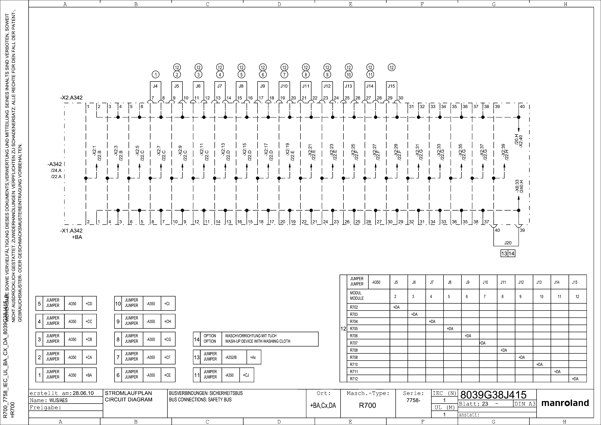

# +BA_Cx_DA — Sheet 23 of 247 — BUSVERBINDUNGEN: SICHERHEITSBUS

**BUS CONNECTIONS: SAFETY BUS**

> Part of the manroland **R700** printing press IEC/UL circuit diagrams.
> Drawing class: **Stromlaufplan / Circuit diagram** (DIN A3).
> Document `+BA_Cx_DA` covers the **Printing units / main switch cabinet** machine section.

## At a glance

| Field | Value |
|---|---|
| Document | `+BA_Cx_DA`  (8039G38J415) |
| Sheet | **23** of 247 |
| Section (DE) | BUSVERBINDUNGEN: SICHERHEITSBUS |
| Section (EN) | BUS CONNECTIONS: SAFETY BUS |
| Section type | CIRCUIT — Circuit diagram |
| Machine type | `R700` |
| Series | `7758` |
| Created | 28.06.10 |
| Replaces | — |
| Columns used | A, B, C, D, E, F, G, H |
| Path numbers | — |
| Labels on sheet | 283 |
| Cross-refs out | 24 |
| Cross-refs in | 104 |

**Previous:** [+BA_Cx_DA sheet 22](SHEET_0022.md) · **Next:** [+BA_Cx_DA sheet 24](SHEET_0024.md) · **Document TOC:** [_TOC.md](_TOC.md)  (+BA_Cx_DA) · **Master TOC:** [all sheets](../_MASTER_TOC.md)

## Sheet image (300 DPI, exact vector render)



_Rendered directly from the PDF vector layer at 300 DPI (1-bit), no OCR and no resampling. Use it to confirm anything ambiguous in the text below._

## Cross-references on this sheet

Each entry is a wire leaving this sheet. The printed token is `/sheet.column`; the link resolves to that sheet inside the same document.

| Ref | Target sheet | Col | Path | Destination on target | Target section | From col |
|---|---|---|---|---|---|---|
| `/20.H` | [+BA_Cx_DA sheet 20](SHEET_0020.md) | H | — | — | BUSVERBINDUNGEN: SICHERHEITSBUS | G |
| `/240.H` | [+BA_Cx_DA sheet 240](SHEET_0240.md) | H | — | X2:40 X6:33 | OPTION: WASCHVORRICHTUNG MIT TUCH | G |
| `/22.C` | [+BA_Cx_DA sheet 22](SHEET_0022.md) | C | — | X2:11 | BUSVERBINDUNGEN: SICHERHEITSBUS | C |
| `/22.D` | [+BA_Cx_DA sheet 22](SHEET_0022.md) | D | — | X2:13 | BUSVERBINDUNGEN: SICHERHEITSBUS | C |
| `/22.D` | [+BA_Cx_DA sheet 22](SHEET_0022.md) | D | — | X2:15 | BUSVERBINDUNGEN: SICHERHEITSBUS | D |
| `/22.D` | [+BA_Cx_DA sheet 22](SHEET_0022.md) | D | — | X2:17 | BUSVERBINDUNGEN: SICHERHEITSBUS | D |
| `/22.E` | [+BA_Cx_DA sheet 22](SHEET_0022.md) | E | — | X2:19 | BUSVERBINDUNGEN: SICHERHEITSBUS | D |
| `/22.E` | [+BA_Cx_DA sheet 22](SHEET_0022.md) | E | — | X2:21 | BUSVERBINDUNGEN: SICHERHEITSBUS | D |
| `/22.E` | [+BA_Cx_DA sheet 22](SHEET_0022.md) | E | — | X2:23 | BUSVERBINDUNGEN: SICHERHEITSBUS | E |
| `/22.F` | [+BA_Cx_DA sheet 22](SHEET_0022.md) | F | — | X2:25 | BUSVERBINDUNGEN: SICHERHEITSBUS | E |
| `/22.F` | [+BA_Cx_DA sheet 22](SHEET_0022.md) | F | — | X2:27 | BUSVERBINDUNGEN: SICHERHEITSBUS | E |
| `/22.F` | [+BA_Cx_DA sheet 22](SHEET_0022.md) | F | — | X2:29 | BUSVERBINDUNGEN: SICHERHEITSBUS | F |
| `/22.G` | [+BA_Cx_DA sheet 22](SHEET_0022.md) | G | — | X2:31 | BUSVERBINDUNGEN: SICHERHEITSBUS | F |
| `/22.G` | [+BA_Cx_DA sheet 22](SHEET_0022.md) | G | — | X2:33 | BUSVERBINDUNGEN: SICHERHEITSBUS | F |
| `/22.G` | [+BA_Cx_DA sheet 22](SHEET_0022.md) | G | — | X2:35 | BUSVERBINDUNGEN: SICHERHEITSBUS | G |
| `/22.G` | [+BA_Cx_DA sheet 22](SHEET_0022.md) | G | — | X2:37 | BUSVERBINDUNGEN: SICHERHEITSBUS | G |
| `/22.H` | [+BA_Cx_DA sheet 22](SHEET_0022.md) | H | — | X2:39 | BUSVERBINDUNGEN: SICHERHEITSBUS | G |
| `/22.B` | [+BA_Cx_DA sheet 22](SHEET_0022.md) | B | — | X2:1 | BUSVERBINDUNGEN: SICHERHEITSBUS | A |
| `/22.B` | [+BA_Cx_DA sheet 22](SHEET_0022.md) | B | — | X2:3 | BUSVERBINDUNGEN: SICHERHEITSBUS | B |
| `/22.C` | [+BA_Cx_DA sheet 22](SHEET_0022.md) | C | — | X2:5 | BUSVERBINDUNGEN: SICHERHEITSBUS | B |
| `/22.C` | [+BA_Cx_DA sheet 22](SHEET_0022.md) | C | — | X2:7 | BUSVERBINDUNGEN: SICHERHEITSBUS | B |
| `/22.C` | [+BA_Cx_DA sheet 22](SHEET_0022.md) | C | — | X2:9 | BUSVERBINDUNGEN: SICHERHEITSBUS | C |
| `/24.A` | [+BA_Cx_DA sheet 24](SHEET_0024.md) | A | — | — | BUSVERBINDUNGEN: NOT AUS | A |
| `/22.A` | [+BA_Cx_DA sheet 22](SHEET_0022.md) | A | — | — | BUSVERBINDUNGEN: SICHERHEITSBUS | A |

### Incoming references (sheets that point here)

Every other sheet that sends a wire to this one. `Back-ref` is the token printed on *that* sheet; `Path` is its line number.

| From sheet | Cols | Back-ref | Path | Refs | What continues there |
|---|---|---|---|---|---|
| [+BA_Cx_DA#20](SHEET_0020.md) | H | `/20.H` | — | 1 | — |
| [+BA_Cx_DA#22](SHEET_0022.md) | A, B, C, D, E, F, G, H | `/22.A`, `/22.B`, `/22.C`, `/22.D`, `/22.E`, `/22.F`, `/22.G`, `/22.H` | — | 21 | X2:1; X2:11; X2:13; X2:15; X2:17; X2:19; X2:21; X2:23; X2:25; X2:27; X2:29; X2:3; X2:31; X2:33; X2:35; X2:37; X2:39; X2:5; X2:7; X2:9 |
| [+BA_Cx_DA#24](SHEET_0024.md) | A | `/24.A` | — | 1 | — |
| [+BA_Cx_DA#141](SHEET_0141.md) | E, F | `/141.E`, `/141.F` | — | 40 | — |
| [+BA_Cx_DA#153](SHEET_0153.md) | C, D | `/153.C`, `/153.D` | — | 40 | — |
| [+BA_Cx_DA#240](SHEET_0240.md) | F | `/240.F` | — | 1 | X6:16 X6:33 |


## Devices on this sheet

| Tag | Class | Class meaning (IEC) | Col | Sub | Terminal | Sign |
|---|---|---|---|---|---|---|
| `A342` | A | Baugruppe / assembly, module, PC board | A | — | — | — |
| `X2:13` | X | Klemme / terminal, plug connector | C | — | 13 | — |
| `X2:11` | X | Klemme / terminal, plug connector | C | — | 11 | — |
| `X2:9` | X | Klemme / terminal, plug connector | C | — | 9 | — |
| `X2:7` | X | Klemme / terminal, plug connector | B | — | 7 | — |
| `X2:15` | X | Klemme / terminal, plug connector | D | — | 15 | — |
| `X2:17` | X | Klemme / terminal, plug connector | D | — | 17 | — |
| `X2:25` | X | Klemme / terminal, plug connector | E | — | 25 | — |
| `X2:23` | X | Klemme / terminal, plug connector | E | — | 23 | — |
| `X2:21` | X | Klemme / terminal, plug connector | D | — | 21 | — |
| `X2:19` | X | Klemme / terminal, plug connector | D | — | 19 | — |
| `X2:5` | X | Klemme / terminal, plug connector | B | — | 5 | — |
| `X2:3` | X | Klemme / terminal, plug connector | B | — | 3 | — |
| `X2:1` | X | Klemme / terminal, plug connector | A | — | 1 | — |
| `X2:27` | X | Klemme / terminal, plug connector | E | — | 27 | — |
| `X2:29` | X | Klemme / terminal, plug connector | F | — | 29 | — |
| `X2:37` | X | Klemme / terminal, plug connector | G | — | 37 | — |
| `X2:35` | X | Klemme / terminal, plug connector | G | — | 35 | — |
| `X2:33` | X | Klemme / terminal, plug connector | F | — | 33 | — |
| `X2:31` | X | Klemme / terminal, plug connector | F | — | 31 | — |
| `X2:39` | X | Klemme / terminal, plug connector | G | — | 39 | — |
| `X2:40` | X | Klemme / terminal, plug connector | G | — | 40 | — |
| `X6:33` | X | Klemme / terminal, plug connector | G | — | 33 | — |
| `J5` | J |  | C | — | — | — |
| `J6` | J |  | C | — | — | — |
| `J7` | J |  | C | — | — | — |
| `J8` | J |  | C | — | — | — |
| `J9` | J |  | D | — | — | — |
| `J10` | J |  | D | — | — | — |
| `J11` | J |  | D | — | — | — |
| `J12` | J |  | E | — | — | — |
| `J13` | J |  | E | — | — | — |
| `J14` | J |  | E | — | — | — |
| `J4` | J |  | B | — | — | — |
| `J15` | J |  | F | — | — | — |
| `J20` | J |  | G | — | — | — |
| `A350` | A | Baugruppe / assembly, module, PC board | A | — | — | — |
| `A350` | A | Baugruppe / assembly, module, PC board | A | — | — | — |
| `A350` | A | Baugruppe / assembly, module, PC board | A | — | — | — |
| `A350` | A | Baugruppe / assembly, module, PC board | A | — | — | — |
| `A350` | A | Baugruppe / assembly, module, PC board | A | — | — | — |
| `A350` | A | Baugruppe / assembly, module, PC board | B | — | — | — |
| `A350` | A | Baugruppe / assembly, module, PC board | B | — | — | — |
| `A350` | A | Baugruppe / assembly, module, PC board | B | — | — | — |
| `A350` | A | Baugruppe / assembly, module, PC board | B | — | — | — |
| `A350` | A | Baugruppe / assembly, module, PC board | B | — | — | — |
| `A350` | A | Baugruppe / assembly, module, PC board | C | — | — | — |
| `A350` | A | Baugruppe / assembly, module, PC board | E | — | — | — |
| `R703` | R | Widerstand / resistor | E | — | — | — |
| `R704` | R | Widerstand / resistor | E | — | — | — |
| `R705` | R | Widerstand / resistor | E | — | — | — |
| `R706` | R | Widerstand / resistor | E | — | — | — |
| `R707` | R | Widerstand / resistor | E | — | — | — |
| `R708` | R | Widerstand / resistor | E | — | — | — |
| `R708` | R | Widerstand / resistor | E | — | — | — |
| `R710` | R | Widerstand / resistor | E | — | — | — |
| `R711` | R | Widerstand / resistor | E | — | — | — |
| `R712` | R | Widerstand / resistor | E | — | — | — |
| `J5` | J |  | F | — | — | — |
| `J6` | J |  | F | — | — | — |
| `J7` | J |  | F | — | — | — |
| `J8` | J |  | F | — | — | — |
| `J9` | J |  | G | — | — | — |
| `J10` | J |  | G | — | — | — |
| `J11` | J |  | G | — | — | — |
| `J12` | J |  | G | — | — | — |
| `J13` | J |  | H | — | — | — |
| `J14` | J |  | H | — | — | — |
| `J15` | J |  | H | — | — | — |
| `R702` | R | Widerstand / resistor | E | — | — | — |
| `X2.A342` | — | cross-device reference | A | — | — | — |
| `X2.A342` | — | cross-device reference | A | — | — | — |
| `X1.A342` | — | cross-device reference | A | — | — | — |

## Potentials / nets

_No named potentials on this sheet._

## Wire-end annotations (grouped as printed)

A wire that continues elsewhere is annotated with a small cluster: the destination description, the path/line number `#NN`, and the `/sheet.column` cross reference. Each row below is one such cluster exactly as it is grouped on the drawing.

| Col | Y | Path | Cross-ref | Text on the wire |
|---|---|---|---|---|
| D | 130.7 | — | — | `12 12 12 12 12 12 12 12 12 12 12` |
| D | 144.3 | — | — | `1 2 3 4 5 6 7 8 9 10` |
| E | 144.7 | — | — | `11` |
| D | 166.8 | — | — | `J4 J13 J14` |
| D | 166.8 | — | — | `J5 J6 J7 J8 J9 J10 J11 J12` |
| F | 166.8 | — | — | `J15` |
| A | 188.8 | — | — | `X2.A342 X2.A342` |
| D | 190.2 | — | — | `7 8 9 10 11 12 13 14 15 16 17 18 19 20 21 22 23 24 25 26 27 28 29 30` |
| D | 207.2 | — | — | `1 2 3 4 5 6 31 32 33 34 35 36 37 38 39 40` |
| G | 265.6 | — | `/20.H` | — |
| G | 267.6 | — | `/240.H` | `X6:33 X2:40` |
| C | 283.5 | — | `/22.C` | `X2:11` |
| C | 283.5 | — | `/22.D` | `X2:13` |
| D | 283.5 | — | `/22.D` | `X2:15` |
| D | 283.5 | — | `/22.D` | `X2:17` |
| D | 283.5 | — | `/22.E` | `X2:19` |
| D | 284.9 | — | `/22.E` | `X2:21` |
| E | 284.9 | — | `/22.E` | `X2:23` |
| E | 284.9 | — | `/22.F` | `X2:25` |
| E | 284.9 | — | `/22.F` | `X2:27` |
| F | 284.9 | — | `/22.F` | `X2:29` |
| F | 284.9 | — | `/22.G` | `X2:31` |
| F | 284.9 | — | `/22.G` | `X2:33` |
| G | 284.9 | — | `/22.G` | `X2:35` |
| G | 284.9 | — | `/22.G` | `X2:37` |
| G | 284.9 | — | `/22.H` | `X2:39` |
| A | 288.3 | — | `/22.B` | `X2:1` |
| B | 288.3 | — | `/22.B` | `X2:3` |
| B | 288.3 | — | `/22.C` | `X2:5` |
| B | 288.3 | — | `/22.C` | `X2:7` |
| C | 288.3 | — | `/22.C` | `X2:9` |
| A | 320.6 | — | — | `A342` |
| A | 333.7 | — | `/24.A`, `/22.A` | — |
| D | 435.4 | — | — | `2 1 4 3 6 5 8 7 10 9 12 11 14 13 16 15 18 17 20 19 22 21 24 23 26 25 28 27 30 29 32 31 34 33 36 35 38 37` |
| A | 452.4 | — | — | `X1.A342` |
| G | 452.4 | — | — | `40 39` |
| A | 465.1 | — | — | `+BA` |
| G | 477.2 | — | — | `J20` |
| G | 497.8 | — | — | `13 14` |
| G | 497.8 | — | — | `13 14` |
| E | 549.1 | — | — | `JUMPER JUMPER` |
| G | 556.1 | — | — | `J5 J6 J7 J8 J9 J10 J11 J12 J13 J14 J15` |
| E | 556.2 | — | — | `A350` |
| E | 577.5 | — | — | `MODUL MODULE` |
| G | 584.3 | — | — | `2 3 4 5 6 7 8 9 10 11 12` |
| A | 591.7 | — | — | `5 JUMPER JUMPER A350 +CD` |
| B | 591.7 | — | — | `10 JUMPER JUMPER A350 +CI` |
| E | 605.8 | — | — | `R702 +DA` |
| E | 620.0 | — | — | `R703` |
| F | 620.0 | — | — | `+DA` |
| A | 627.1 | — | — | `4 JUMPER JUMPER A350 +CC` |
| B | 627.1 | — | — | `9 JUMPER JUMPER A350 +CH` |
| E | 634.2 | — | — | `R704` |
| F | 634.2 | — | — | `+DA` |
| E | 646.6 | — | — | `12` |
| E | 648.3 | — | — | `R705` |
| F | 648.4 | — | — | `+DA` |
| A | 662.5 | — | — | `3 JUMPER JUMPER A350 +CB` |
| B | 662.5 | — | — | `8 JUMPER JUMPER A350 +CG` |
| C | 662.5 | — | — | `14 OPTION OPTION WASCHVORRICHTUNG MIT TUCH WASH UP DEVICE WITH WASHING CLOTH` |
| E | 662.5 | — | — | `R706` |
| G | 662.5 | — | — | `+DA` |
| E | 676.7 | — | — | `R707` |
| G | 676.7 | — | — | `+DA` |
| E | 690.9 | — | — | `R708` |
| G | 690.9 | — | — | `+DA` |
| A | 698.0 | — | — | `2 JUMPER JUMPER A350 +CA` |
| B | 698.0 | — | — | `7 JUMPER JUMPER A350 +CF` |
| C | 698.0 | — | — | `13 JUMPER JUMPER A352/B +Ax` |
| E | 705.0 | — | — | `R708` |
| G | 705.0 | — | — | `+DA` |
| E | 719.2 | — | — | `R710` |
| H | 719.2 | — | — | `+DA` |
| E | 733.3 | — | — | `R711` |
| A | 733.4 | — | — | `1 JUMPER JUMPER A350 +BA` |
| B | 733.4 | — | — | `6 JUMPER JUMPER A350 +CE` |
| C | 733.4 | — | — | `11 JUMPER JUMPER A350 +CJ` |
| H | 733.4 | — | — | `+DA` |
| E | 747.5 | — | — | `R712` |
| H | 747.6 | — | — | `+DA` |


## Reconstructed tables

This sheet carries tabular content (pin map / terminal assignment / index). The grid below was rebuilt from the drawing's own rule lines, so each row is exactly one physical row of the table.

### Table 1 — 1 data rows × 32 columns (at x=170.1, y=232.4)

| X2:1 /22.B | X2:3 /22.B | X2:5 /22.C | X2:7 | /22.C | X2:9 | /22.C | X2:11 | /22.C | X2:13 | /22.D | X2:15 | /22.D | X2:17 | /22.D | X2:19 | /22.E | X2:21 | /22.E | X2:23 | /22.E | X2:25 | /22.F | X2:27 | /22.F | X2:29 | /22.F | X2:31 /22.G | X2:33 /22.G | X2:35 /22.G | X2:37 /22.G | /20.H X2:39 /22.H X6:33 |
|---|---|---|---|---|---|---|---|---|---|---|---|---|---|---|---|---|---|---|---|---|---|---|---|---|---|---|---|---|---|---|---|
| `2 1` | `4 3` | `6 5` | `8` | `7` | `10` | `9` | `12` | `11` | `14` | `13` | `16` | `15` | `18` | `17` | `20` | `19` | `22` | `21` | `24` | `23` | `26` | `25` | `28` | `27` | `30` | `29` | `32 31` | `34 33` | `36 35` | `38 37` | `40 J20` |


## Notes and free text on this sheet

| Text | Col | Y (pt) |
|---|---|---|
| `+BA` | A | 465.11 |
| `JUMPER` | A | 733.39 |
| `+CA` | A | 705.04 |
| `+CB` | A | 669.59 |
| `+CC` | A | 634.19 |
| `+CD` | A | 598.75 |
| `JUMPER` | B | 733.39 |
| `+CE` | B | 740.43 |
| `+CF` | B | 705.03 |
| `+CG` | B | 669.59 |
| `+CH` | B | 634.15 |
| `+CI` | B | 598.66 |
| `JUMPER` | C | 733.39 |
| `+CJ` | D | 740.4 |
| `A352/B` | C | 705.03 |
| `+Ax` | D | 705.1 |
| `OPTION` | C | 662.49 |
| `WASCHVORRICHTUNG MIT TUCH` | D | 662.52 |
| `WASH UP DEVICE WITH WASHING CLOTH` | D | 673.11 |
| `JUMPER` | E | 549.14 |
| `MODUL` | E | 577.51 |
| `MODULE` | E | 588.12 |
| `+DA` | H | 747.56 |
| `+DA` | G | 705.04 |
| `+DA` | F | 648.35 |

## Complete label inventory (exact text from the drawing)

Every text object inside the drawing area of this sheet, in DIN reading order (column A→H, then top→bottom). This is the authoritative list: if a string is not here it is not printed on this sheet.

| Col | Y | X | Dir | Type | Text |
|---|---|---|---|---|---|
| A | 188.8 | 119.3 | → | device ref | `X2.A342` |
| A | 188.8 | 119.3 | → | device ref | `X2.A342` |
| A | 207.3 | 172.1 | → | number | `1` |
| A | 207.3 | 193.9 | → | number | `2` |
| A | 288.3 | 183.1 | ↕ | device tag | `X2:1` |
| A | 298.2 | 193.0 | ↕ | cross-reference | `/22.B` |
| A | 320.6 | 94.1 | → | device tag | `A342` |
| A | 333.7 | 101.2 | → | cross-reference | `/24.A` |
| A | 346.1 | 101.2 | → | cross-reference | `/22.A` |
| A | 435.4 | 172.6 | → | number | `2` |
| A | 435.4 | 193.3 | → | number | `1` |
| A | 452.4 | 119.3 | → | device ref | `X1.A342` |
| A | 465.1 | 142.3 | → | text | `+BA` |
| A | 591.7 | 91.8 | → | text | `JUMPER` |
| A | 597.0 | 75.0 | → | number | `5` |
| A | 598.7 | 134.4 | → | device tag | `A350` |
| A | 598.8 | 169.8 | → | text | `+CD` |
| A | 602.3 | 91.8 | → | text | `JUMPER` |
| A | 627.1 | 91.8 | → | text | `JUMPER` |
| A | 632.4 | 75.1 | → | number | `4` |
| A | 634.2 | 134.4 | → | device tag | `A350` |
| A | 634.2 | 169.8 | → | text | `+CC` |
| A | 637.7 | 91.8 | → | text | `JUMPER` |
| A | 662.5 | 91.8 | → | text | `JUMPER` |
| A | 667.8 | 75.0 | → | number | `3` |
| A | 669.6 | 134.4 | → | device tag | `A350` |
| A | 669.6 | 169.8 | → | text | `+CB` |
| A | 673.2 | 91.8 | → | text | `JUMPER` |
| A | 698.0 | 91.8 | → | text | `JUMPER` |
| A | 703.3 | 75.1 | → | number | `2` |
| A | 705.0 | 134.4 | → | device tag | `A350` |
| A | 705.0 | 169.8 | → | text | `+CA` |
| A | 708.6 | 91.8 | → | text | `JUMPER` |
| A | 733.4 | 91.8 | → | text | `JUMPER` |
| A | 738.7 | 75.4 | → | number | `1` |
| A | 740.4 | 169.8 | → | text | `+BA` |
| A | 740.5 | 134.4 | → | device tag | `A350` |
| A | 744.0 | 91.8 | → | text | `JUMPER` |
| B | 144.3 | 306.5 | → | number | `1` |
| B | 166.8 | 302.9 | → | device tag | `J4` |
| B | 190.2 | 300.2 | → | number | `7` |
| B | 190.2 | 321.4 | → | number | `8` |
| B | 207.3 | 215.1 | → | number | `3` |
| B | 207.3 | 236.4 | → | number | `4` |
| B | 207.3 | 257.7 | → | number | `5` |
| B | 207.3 | 278.9 | → | number | `6` |
| B | 288.3 | 225.6 | ↕ | device tag | `X2:3` |
| B | 288.3 | 268.2 | ↕ | device tag | `X2:5` |
| B | 288.3 | 310.7 | ↕ | device tag | `X2:7` |
| B | 297.9 | 278.1 | ↕ | cross-reference | `/22.C` |
| B | 297.9 | 320.6 | ↕ | cross-reference | `/22.C` |
| B | 298.2 | 235.5 | ↕ | cross-reference | `/22.B` |
| B | 435.4 | 215.1 | → | number | `4` |
| B | 435.4 | 236.4 | → | number | `3` |
| B | 435.4 | 257.7 | → | number | `6` |
| B | 435.4 | 278.9 | → | number | `5` |
| B | 435.4 | 300.2 | → | number | `8` |
| B | 435.4 | 321.4 | → | number | `7` |
| B | 591.7 | 247.7 | → | text | `JUMPER` |
| B | 597.0 | 227.6 | → | number | `10` |
| B | 598.7 | 290.3 | → | device tag | `A350` |
| B | 598.7 | 325.7 | → | text | `+CI` |
| B | 602.3 | 247.7 | → | text | `JUMPER` |
| B | 627.1 | 247.7 | → | text | `JUMPER` |
| B | 632.4 | 230.9 | → | number | `9` |
| B | 634.1 | 325.7 | → | text | `+CH` |
| B | 634.2 | 290.3 | → | device tag | `A350` |
| B | 637.7 | 247.7 | → | text | `JUMPER` |
| B | 662.5 | 247.7 | → | text | `JUMPER` |
| B | 667.8 | 230.9 | → | number | `8` |
| B | 669.6 | 290.3 | → | device tag | `A350` |
| B | 669.6 | 325.7 | → | text | `+CG` |
| B | 673.2 | 247.7 | → | text | `JUMPER` |
| B | 698.0 | 247.7 | → | text | `JUMPER` |
| B | 703.3 | 231.0 | → | number | `7` |
| B | 705.0 | 290.3 | → | device tag | `A350` |
| B | 705.0 | 325.7 | → | text | `+CF` |
| B | 708.6 | 247.7 | → | text | `JUMPER` |
| B | 733.4 | 247.7 | → | text | `JUMPER` |
| B | 738.7 | 231.0 | → | number | `6` |
| B | 740.4 | 325.7 | → | text | `+CE` |
| B | 740.5 | 290.3 | → | device tag | `A350` |
| B | 744.0 | 247.7 | → | text | `JUMPER` |
| C | 130.7 | 346.5 | → | number | `12` |
| C | 130.7 | 389.0 | → | number | `12` |
| C | 130.7 | 431.6 | → | number | `12` |
| C | 130.7 | 474.1 | → | number | `12` |
| C | 144.9 | 348.8 | → | number | `2` |
| C | 144.9 | 391.3 | → | number | `3` |
| C | 144.9 | 433.8 | → | number | `4` |
| C | 144.9 | 476.4 | → | number | `5` |
| C | 166.8 | 345.4 | → | device tag | `J5` |
| C | 166.8 | 387.9 | → | device tag | `J6` |
| C | 166.8 | 430.4 | → | device tag | `J7` |
| C | 166.8 | 473.0 | → | device tag | `J8` |
| C | 190.2 | 342.7 | → | number | `9` |
| C | 190.2 | 363.4 | → | number | `10` |
| C | 190.2 | 384.7 | → | number | `11` |
| C | 190.2 | 405.9 | → | number | `12` |
| C | 190.2 | 427.2 | → | number | `13` |
| C | 190.2 | 448.4 | → | number | `14` |
| C | 190.2 | 469.7 | → | number | `15` |
| C | 283.5 | 395.7 | ↕ | device tag | `X2:11` |
| C | 283.5 | 438.2 | ↕ | device tag | `X2:13` |
| C | 288.3 | 353.2 | ↕ | device tag | `X2:9` |
| C | 297.9 | 363.1 | ↕ | cross-reference | `/22.C` |
| C | 297.9 | 405.6 | ↕ | cross-reference | `/22.C` |
| C | 297.9 | 448.2 | ↕ | cross-reference | `/22.D` |
| C | 435.4 | 342.1 | → | number | `10` |
| C | 435.4 | 364.0 | → | number | `9` |
| C | 435.4 | 384.7 | → | number | `12` |
| C | 435.4 | 405.9 | → | number | `11` |
| C | 435.4 | 427.2 | → | number | `14` |
| C | 435.4 | 448.4 | → | number | `13` |
| C | 435.4 | 469.7 | → | number | `16` |
| C | 662.5 | 403.7 | → | text | `OPTION` |
| C | 667.8 | 383.5 | → | number | `14` |
| C | 673.1 | 403.7 | → | text | `OPTION` |
| C | 698.0 | 403.7 | → | text | `JUMPER` |
| C | 703.3 | 383.5 | → | number | `13` |
| C | 705.0 | 446.2 | → | text | `A352/B` |
| C | 708.6 | 403.7 | → | text | `JUMPER` |
| C | 733.4 | 403.7 | → | text | `JUMPER` |
| C | 738.7 | 384.2 | → | number | `11` |
| C | 740.5 | 446.2 | → | device tag | `A350` |
| C | 744.0 | 403.7 | → | text | `JUMPER` |
| D | 130.7 | 516.6 | → | number | `12` |
| D | 130.7 | 559.1 | → | number | `12` |
| D | 130.7 | 601.6 | → | number | `12` |
| D | 144.9 | 518.9 | → | number | `6` |
| D | 144.9 | 561.4 | → | number | `7` |
| D | 144.9 | 603.9 | → | number | `8` |
| D | 166.8 | 515.5 | → | device tag | `J9` |
| D | 166.8 | 555.6 | → | device tag | `J10` |
| D | 166.8 | 598.8 | → | device tag | `J11` |
| D | 190.2 | 491.0 | → | number | `16` |
| D | 190.2 | 512.2 | → | number | `17` |
| D | 190.2 | 533.5 | → | number | `18` |
| D | 190.2 | 554.7 | → | number | `19` |
| D | 190.2 | 576.6 | → | number | `20` |
| D | 190.2 | 597.8 | → | number | `21` |
| D | 283.5 | 480.8 | ↕ | device tag | `X2:15` |
| D | 283.5 | 523.3 | ↕ | device tag | `X2:17` |
| D | 283.5 | 565.8 | ↕ | device tag | `X2:19` |
| D | 284.9 | 610.6 | ↕ | device tag | `X2:21` |
| D | 296.8 | 617.4 | ↕ | cross-reference | `/22.E` |
| D | 297.9 | 490.7 | ↕ | cross-reference | `/22.D` |
| D | 297.9 | 533.2 | ↕ | cross-reference | `/22.D` |
| D | 298.2 | 575.7 | ↕ | cross-reference | `/22.E` |
| D | 435.4 | 491.0 | → | number | `15` |
| D | 435.4 | 512.2 | → | number | `18` |
| D | 435.4 | 533.5 | → | number | `17` |
| D | 435.4 | 555.3 | → | number | `20` |
| D | 435.4 | 576.0 | → | number | `19` |
| D | 435.4 | 597.8 | → | number | `22` |
| D | 662.5 | 446.5 | → | text | `WASCHVORRICHTUNG MIT TUCH` |
| D | 673.1 | 446.5 | → | text | `WASH UP DEVICE WITH WASHING CLOTH` |
| D | 705.1 | 495.8 | → | text | `+Ax` |
| D | 740.4 | 481.6 | → | text | `+CJ` |
| E | 130.7 | 644.2 | → | number | `12` |
| E | 130.7 | 686.7 | → | number | `12` |
| E | 130.7 | 729.2 | → | number | `12` |
| E | 144.7 | 729.8 | → | number | `11` |
| E | 144.9 | 646.4 | → | number | `9` |
| E | 144.9 | 686.7 | → | number | `10` |
| E | 166.8 | 640.8 | → | device tag | `J12` |
| E | 166.8 | 683.1 | → | device tag | `J13` |
| E | 166.8 | 725.7 | → | device tag | `J14` |
| E | 190.2 | 619.1 | → | number | `22` |
| E | 190.2 | 640.3 | → | number | `23` |
| E | 190.2 | 661.6 | → | number | `24` |
| E | 190.2 | 682.9 | → | number | `25` |
| E | 190.2 | 704.1 | → | number | `26` |
| E | 190.2 | 725.4 | → | number | `27` |
| E | 190.2 | 746.6 | → | number | `28` |
| E | 284.9 | 653.1 | ↕ | device tag | `X2:23` |
| E | 284.9 | 695.6 | ↕ | device tag | `X2:25` |
| E | 284.9 | 738.1 | ↕ | device tag | `X2:27` |
| E | 296.8 | 659.9 | ↕ | cross-reference | `/22.E` |
| E | 297.4 | 702.4 | ↕ | cross-reference | `/22.F` |
| E | 297.4 | 744.9 | ↕ | cross-reference | `/22.F` |
| E | 435.4 | 619.1 | → | number | `21` |
| E | 435.4 | 640.3 | → | number | `24` |
| E | 435.4 | 661.6 | → | number | `23` |
| E | 435.4 | 682.9 | → | number | `26` |
| E | 435.4 | 704.1 | → | number | `25` |
| E | 435.4 | 725.4 | → | number | `28` |
| E | 435.4 | 746.6 | → | number | `27` |
| E | 549.1 | 694.2 | → | text | `JUMPER` |
| E | 556.2 | 736.7 | → | device tag | `A350` |
| E | 559.8 | 694.2 | → | text | `JUMPER` |
| E | 577.5 | 693.9 | → | text | `MODUL` |
| E | 588.1 | 693.9 | → | text | `MODULE` |
| E | 605.8 | 693.6 | → | device tag | `R702` |
| E | 620.0 | 693.6 | → | device tag | `R703` |
| E | 634.2 | 693.6 | → | device tag | `R704` |
| E | 646.6 | 674.1 | → | number | `12` |
| E | 648.3 | 693.6 | → | device tag | `R705` |
| E | 662.5 | 693.6 | → | device tag | `R706` |
| E | 676.7 | 693.6 | → | device tag | `R707` |
| E | 690.9 | 693.6 | → | device tag | `R708` |
| E | 705.0 | 693.6 | → | device tag | `R708` |
| E | 719.2 | 693.6 | → | device tag | `R710` |
| E | 733.3 | 693.6 | → | device tag | `R711` |
| E | 747.5 | 693.6 | → | device tag | `R712` |
| F | 130.7 | 771.7 | → | number | `12` |
| F | 166.8 | 768.2 | → | device tag | `J15` |
| F | 190.2 | 767.9 | → | number | `29` |
| F | 190.2 | 789.2 | → | number | `30` |
| F | 207.3 | 810.4 | → | number | `31` |
| F | 207.3 | 831.7 | → | number | `32` |
| F | 207.3 | 852.9 | → | number | `33` |
| F | 207.3 | 874.2 | → | number | `34` |
| F | 207.3 | 895.5 | → | number | `35` |
| F | 284.9 | 780.7 | ↕ | device tag | `X2:29` |
| F | 284.9 | 823.2 | ↕ | device tag | `X2:31` |
| F | 284.9 | 865.7 | ↕ | device tag | `X2:33` |
| F | 295.9 | 830.0 | ↕ | cross-reference | `/22.G` |
| F | 295.9 | 872.5 | ↕ | cross-reference | `/22.G` |
| F | 297.4 | 787.4 | ↕ | cross-reference | `/22.F` |
| F | 435.4 | 767.9 | → | number | `30` |
| F | 435.4 | 789.2 | → | number | `29` |
| F | 435.4 | 810.4 | → | number | `32` |
| F | 435.4 | 831.7 | → | number | `31` |
| F | 435.4 | 852.9 | → | number | `34` |
| F | 435.4 | 874.2 | → | number | `33` |
| F | 435.4 | 895.5 | → | number | `36` |
| F | 556.2 | 779.5 | → | device tag | `J5` |
| F | 556.2 | 815.0 | → | device tag | `J6` |
| F | 556.2 | 850.4 | → | device tag | `J7` |
| F | 556.2 | 885.8 | → | device tag | `J8` |
| F | 584.5 | 779.5 | → | number | `2` |
| F | 584.5 | 815.0 | → | number | `3` |
| F | 584.5 | 850.4 | → | number | `4` |
| F | 584.5 | 885.8 | → | number | `5` |
| F | 605.8 | 779.2 | → | text | `+DA` |
| F | 620.0 | 814.7 | → | text | `+DA` |
| F | 634.2 | 850.1 | → | text | `+DA` |
| F | 648.3 | 885.5 | → | text | `+DA` |
| G | 207.3 | 916.7 | → | number | `36` |
| G | 207.3 | 938.0 | → | number | `37` |
| G | 207.3 | 959.2 | → | number | `38` |
| G | 207.3 | 980.5 | → | number | `39` |
| G | 207.3 | 1030.1 | → | number | `40` |
| G | 265.6 | 1019.3 | ↕ | cross-reference | `/20.H` |
| G | 267.6 | 1027.8 | ↕ | device tag | `X2:40` |
| G | 284.9 | 908.2 | ↕ | device tag | `X2:35` |
| G | 284.9 | 950.7 | ↕ | device tag | `X2:37` |
| G | 284.9 | 993.3 | ↕ | device tag | `X2:39` |
| G | 295.9 | 915.0 | ↕ | cross-reference | `/22.G` |
| G | 295.9 | 957.5 | ↕ | cross-reference | `/22.G` |
| G | 296.5 | 1000.1 | ↕ | cross-reference | `/22.H` |
| G | 355.8 | 1020.8 | ↕ | device tag | `X6:33` |
| G | 356.9 | 1029.3 | ↕ | cross-reference | `/240.H` |
| G | 435.4 | 916.7 | → | number | `35` |
| G | 435.4 | 938.0 | → | number | `38` |
| G | 435.4 | 959.2 | → | number | `37` |
| G | 452.5 | 980.5 | → | number | `40` |
| G | 452.5 | 1030.1 | → | number | `39` |
| G | 477.2 | 999.2 | → | device tag | `J20` |
| G | 497.8 | 993.0 | → | number | `13 14` |
| G | 497.8 | 993.0 | → | number | `13 14` |
| G | 556.1 | 991.8 | → | device tag | `J11` |
| G | 556.2 | 921.3 | → | device tag | `J9` |
| G | 556.2 | 956.4 | → | device tag | `J10` |
| G | 556.2 | 1027.3 | → | device tag | `J12` |
| G | 584.5 | 921.3 | → | number | `6` |
| G | 584.5 | 956.7 | → | number | `7` |
| G | 584.5 | 992.1 | → | number | `8` |
| G | 584.5 | 1027.6 | → | number | `9` |
| G | 662.5 | 921.0 | → | text | `+DA` |
| G | 676.7 | 949.3 | → | text | `+DA` |
| G | 690.9 | 991.8 | → | text | `+DA` |
| G | 705.0 | 1027.3 | → | text | `+DA` |
| H | 556.2 | 1062.7 | → | device tag | `J13` |
| H | 556.2 | 1098.1 | → | device tag | `J14` |
| H | 556.2 | 1133.6 | → | device tag | `J15` |
| H | 584.3 | 1104.7 | → | number | `11` |
| H | 584.4 | 1140.1 | → | number | `12` |
| H | 584.5 | 1069.2 | → | number | `10` |
| H | 719.2 | 1062.7 | → | text | `+DA` |
| H | 733.4 | 1098.1 | → | text | `+DA` |
| H | 747.6 | 1133.6 | → | text | `+DA` |

## Reading-order text block

The same content as a plain block, grouped by DIN column — convenient to paste or to match against a visual description.

```text
=== Column A ===
 188.8  119.3  devref       X2.A342
 188.8  119.3  devref       X2.A342
 207.3  172.1  numeric      1
 207.3  193.9  numeric      2
 288.3  183.1  devtag       X2:1
 298.2  193.0  xref         /22.B
 320.6   94.1  devtag       A342
 333.7  101.2  xref         /24.A
 346.1  101.2  xref         /22.A
 435.4  172.6  numeric      2
 435.4  193.3  numeric      1
 452.4  119.3  devref       X1.A342
 465.1  142.3  text         +BA
 591.7   91.8  text         JUMPER
 597.0   75.0  numeric      5
 598.7  134.4  devtag       A350
 598.8  169.8  text         +CD
 602.3   91.8  text         JUMPER
 627.1   91.8  text         JUMPER
 632.4   75.1  numeric      4
 634.2  134.4  devtag       A350
 634.2  169.8  text         +CC
 637.7   91.8  text         JUMPER
 662.5   91.8  text         JUMPER
 667.8   75.0  numeric      3
 669.6  134.4  devtag       A350
 669.6  169.8  text         +CB
 673.2   91.8  text         JUMPER
 698.0   91.8  text         JUMPER
 703.3   75.1  numeric      2
 705.0  134.4  devtag       A350
 705.0  169.8  text         +CA
 708.6   91.8  text         JUMPER
 733.4   91.8  text         JUMPER
 738.7   75.4  numeric      1
 740.4  169.8  text         +BA
 740.5  134.4  devtag       A350
 744.0   91.8  text         JUMPER
=== Column B ===
 144.3  306.5  numeric      1
 166.8  302.9  devtag       J4
 190.2  300.2  numeric      7
 190.2  321.4  numeric      8
 207.3  215.1  numeric      3
 207.3  236.4  numeric      4
 207.3  257.7  numeric      5
 207.3  278.9  numeric      6
 288.3  225.6  devtag       X2:3
 288.3  268.2  devtag       X2:5
 288.3  310.7  devtag       X2:7
 297.9  278.1  xref         /22.C
 297.9  320.6  xref         /22.C
 298.2  235.5  xref         /22.B
 435.4  215.1  numeric      4
 435.4  236.4  numeric      3
 435.4  257.7  numeric      6
 435.4  278.9  numeric      5
 435.4  300.2  numeric      8
 435.4  321.4  numeric      7
 591.7  247.7  text         JUMPER
 597.0  227.6  numeric      10
 598.7  290.3  devtag       A350
 598.7  325.7  text         +CI
 602.3  247.7  text         JUMPER
 627.1  247.7  text         JUMPER
 632.4  230.9  numeric      9
 634.1  325.7  text         +CH
 634.2  290.3  devtag       A350
 637.7  247.7  text         JUMPER
 662.5  247.7  text         JUMPER
 667.8  230.9  numeric      8
 669.6  290.3  devtag       A350
 669.6  325.7  text         +CG
 673.2  247.7  text         JUMPER
 698.0  247.7  text         JUMPER
 703.3  231.0  numeric      7
 705.0  290.3  devtag       A350
 705.0  325.7  text         +CF
 708.6  247.7  text         JUMPER
 733.4  247.7  text         JUMPER
 738.7  231.0  numeric      6
 740.4  325.7  text         +CE
 740.5  290.3  devtag       A350
 744.0  247.7  text         JUMPER
=== Column C ===
 130.7  346.5  numeric      12
 130.7  389.0  numeric      12
 130.7  431.6  numeric      12
 130.7  474.1  numeric      12
 144.9  348.8  numeric      2
 144.9  391.3  numeric      3
 144.9  433.8  numeric      4
 144.9  476.4  numeric      5
 166.8  345.4  devtag       J5
 166.8  387.9  devtag       J6
 166.8  430.4  devtag       J7
 166.8  473.0  devtag       J8
 190.2  342.7  numeric      9
 190.2  363.4  numeric      10
 190.2  384.7  numeric      11
 190.2  405.9  numeric      12
 190.2  427.2  numeric      13
 190.2  448.4  numeric      14
 190.2  469.7  numeric      15
 283.5  395.7  devtag       X2:11
 283.5  438.2  devtag       X2:13
 288.3  353.2  devtag       X2:9
 297.9  363.1  xref         /22.C
 297.9  405.6  xref         /22.C
 297.9  448.2  xref         /22.D
 435.4  342.1  numeric      10
 435.4  364.0  numeric      9
 435.4  384.7  numeric      12
 435.4  405.9  numeric      11
 435.4  427.2  numeric      14
 435.4  448.4  numeric      13
 435.4  469.7  numeric      16
 662.5  403.7  text         OPTION
 667.8  383.5  numeric      14
 673.1  403.7  text         OPTION
 698.0  403.7  text         JUMPER
 703.3  383.5  numeric      13
 705.0  446.2  text         A352/B
 708.6  403.7  text         JUMPER
 733.4  403.7  text         JUMPER
 738.7  384.2  numeric      11
 740.5  446.2  devtag       A350
 744.0  403.7  text         JUMPER
=== Column D ===
 130.7  516.6  numeric      12
 130.7  559.1  numeric      12
 130.7  601.6  numeric      12
 144.9  518.9  numeric      6
 144.9  561.4  numeric      7
 144.9  603.9  numeric      8
 166.8  515.5  devtag       J9
 166.8  555.6  devtag       J10
 166.8  598.8  devtag       J11
 190.2  491.0  numeric      16
 190.2  512.2  numeric      17
 190.2  533.5  numeric      18
 190.2  554.7  numeric      19
 190.2  576.6  numeric      20
 190.2  597.8  numeric      21
 283.5  480.8  devtag       X2:15
 283.5  523.3  devtag       X2:17
 283.5  565.8  devtag       X2:19
 284.9  610.6  devtag       X2:21
 296.8  617.4  xref         /22.E
 297.9  490.7  xref         /22.D
 297.9  533.2  xref         /22.D
 298.2  575.7  xref         /22.E
 435.4  491.0  numeric      15
 435.4  512.2  numeric      18
 435.4  533.5  numeric      17
 435.4  555.3  numeric      20
 435.4  576.0  numeric      19
 435.4  597.8  numeric      22
 662.5  446.5  text         WASCHVORRICHTUNG MIT TUCH
 673.1  446.5  text         WASH UP DEVICE WITH WASHING CLOTH
 705.1  495.8  text         +Ax
 740.4  481.6  text         +CJ
=== Column E ===
 130.7  644.2  numeric      12
 130.7  686.7  numeric      12
 130.7  729.2  numeric      12
 144.7  729.8  numeric      11
 144.9  646.4  numeric      9
 144.9  686.7  numeric      10
 166.8  640.8  devtag       J12
 166.8  683.1  devtag       J13
 166.8  725.7  devtag       J14
 190.2  619.1  numeric      22
 190.2  640.3  numeric      23
 190.2  661.6  numeric      24
 190.2  682.9  numeric      25
 190.2  704.1  numeric      26
 190.2  725.4  numeric      27
 190.2  746.6  numeric      28
 284.9  653.1  devtag       X2:23
 284.9  695.6  devtag       X2:25
 284.9  738.1  devtag       X2:27
 296.8  659.9  xref         /22.E
 297.4  702.4  xref         /22.F
 297.4  744.9  xref         /22.F
 435.4  619.1  numeric      21
 435.4  640.3  numeric      24
 435.4  661.6  numeric      23
 435.4  682.9  numeric      26
 435.4  704.1  numeric      25
 435.4  725.4  numeric      28
 435.4  746.6  numeric      27
 549.1  694.2  text         JUMPER
 556.2  736.7  devtag       A350
 559.8  694.2  text         JUMPER
 577.5  693.9  text         MODUL
 588.1  693.9  text         MODULE
 605.8  693.6  devtag       R702
 620.0  693.6  devtag       R703
 634.2  693.6  devtag       R704
 646.6  674.1  numeric      12
 648.3  693.6  devtag       R705
 662.5  693.6  devtag       R706
 676.7  693.6  devtag       R707
 690.9  693.6  devtag       R708
 705.0  693.6  devtag       R708
 719.2  693.6  devtag       R710
 733.3  693.6  devtag       R711
 747.5  693.6  devtag       R712
=== Column F ===
 130.7  771.7  numeric      12
 166.8  768.2  devtag       J15
 190.2  767.9  numeric      29
 190.2  789.2  numeric      30
 207.3  810.4  numeric      31
 207.3  831.7  numeric      32
 207.3  852.9  numeric      33
 207.3  874.2  numeric      34
 207.3  895.5  numeric      35
 284.9  780.7  devtag       X2:29
 284.9  823.2  devtag       X2:31
 284.9  865.7  devtag       X2:33
 295.9  830.0  xref         /22.G
 295.9  872.5  xref         /22.G
 297.4  787.4  xref         /22.F
 435.4  767.9  numeric      30
 435.4  789.2  numeric      29
 435.4  810.4  numeric      32
 435.4  831.7  numeric      31
 435.4  852.9  numeric      34
 435.4  874.2  numeric      33
 435.4  895.5  numeric      36
 556.2  779.5  devtag       J5
 556.2  815.0  devtag       J6
 556.2  850.4  devtag       J7
 556.2  885.8  devtag       J8
 584.5  779.5  numeric      2
 584.5  815.0  numeric      3
 584.5  850.4  numeric      4
 584.5  885.8  numeric      5
 605.8  779.2  text         +DA
 620.0  814.7  text         +DA
 634.2  850.1  text         +DA
 648.3  885.5  text         +DA
=== Column G ===
 207.3  916.7  numeric      36
 207.3  938.0  numeric      37
 207.3  959.2  numeric      38
 207.3  980.5  numeric      39
 207.3 1030.1  numeric      40
 265.6 1019.3  xref         /20.H
 267.6 1027.8  devtag       X2:40
 284.9  908.2  devtag       X2:35
 284.9  950.7  devtag       X2:37
 284.9  993.3  devtag       X2:39
 295.9  915.0  xref         /22.G
 295.9  957.5  xref         /22.G
 296.5 1000.1  xref         /22.H
 355.8 1020.8  devtag       X6:33
 356.9 1029.3  xref         /240.H
 435.4  916.7  numeric      35
 435.4  938.0  numeric      38
 435.4  959.2  numeric      37
 452.5  980.5  numeric      40
 452.5 1030.1  numeric      39
 477.2  999.2  devtag       J20
 497.8  993.0  numeric      13 14
 497.8  993.0  numeric      13 14
 556.1  991.8  devtag       J11
 556.2  921.3  devtag       J9
 556.2  956.4  devtag       J10
 556.2 1027.3  devtag       J12
 584.5  921.3  numeric      6
 584.5  956.7  numeric      7
 584.5  992.1  numeric      8
 584.5 1027.6  numeric      9
 662.5  921.0  text         +DA
 676.7  949.3  text         +DA
 690.9  991.8  text         +DA
 705.0 1027.3  text         +DA
=== Column H ===
 556.2 1062.7  devtag       J13
 556.2 1098.1  devtag       J14
 556.2 1133.6  devtag       J15
 584.3 1104.7  numeric      11
 584.4 1140.1  numeric      12
 584.5 1069.2  numeric      10
 719.2 1062.7  text         +DA
 733.4 1098.1  text         +DA
 747.6 1133.6  text         +DA
```

---
_Generated from the PDF vector text layer; no OCR. Source: `R700_7758_IEC_UL_BA_CX_DA_8039G38J415_p`, sheet 23._
