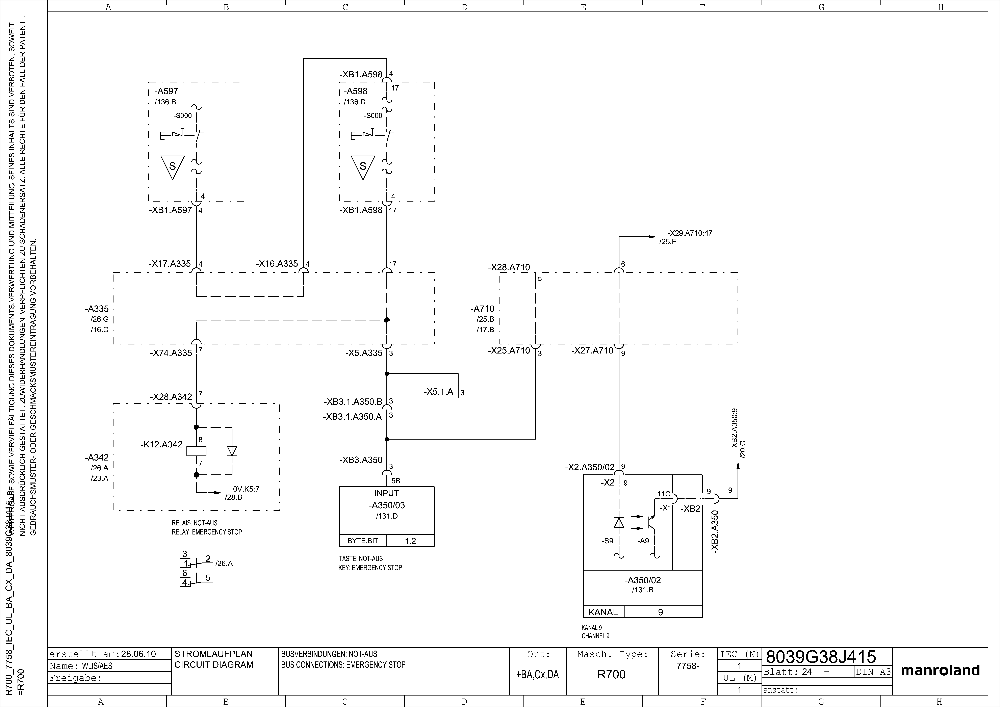

# +BA_Cx_DA — Sheet 24 of 247 — BUSVERBINDUNGEN: NOT AUS

**BUS CONNECTIONS: EMERGENCY STOP**

> Part of the manroland **R700** printing press IEC/UL circuit diagrams.
> Drawing class: **Stromlaufplan / Circuit diagram** (DIN A3).
> Document `+BA_Cx_DA` covers the **Printing units / main switch cabinet** machine section.

## At a glance

| Field | Value |
|---|---|
| Document | `+BA_Cx_DA`  (8039G38J415) |
| Sheet | **24** of 247 |
| Section (DE) | BUSVERBINDUNGEN: NOT AUS |
| Section (EN) | BUS CONNECTIONS: EMERGENCY STOP |
| Section type | CIRCUIT — Circuit diagram |
| Machine type | `R700` |
| Series | `7758` |
| Created | 28.06.10 |
| Replaces | — |
| Columns used | A, B, C, D, E, F |
| Path numbers | — |
| Labels on sheet | 96 |
| Cross-refs out | 14 |
| Cross-refs in | 33 |

**Previous:** [+BA_Cx_DA sheet 23](SHEET_0023.md) · **Next:** [+BA_Cx_DA sheet 25](SHEET_0025.md) · **Document TOC:** [_TOC.md](_TOC.md)  (+BA_Cx_DA) · **Master TOC:** [all sheets](../_MASTER_TOC.md)

## Sheet image (300 DPI, exact vector render)



_Rendered directly from the PDF vector layer at 300 DPI (1-bit), no OCR and no resampling. Use it to confirm anything ambiguous in the text below._

## Cross-references on this sheet

Each entry is a wire leaving this sheet. The printed token is `/sheet.column`; the link resolves to that sheet inside the same document.

| Ref | Target sheet | Col | Path | Destination on target | Target section | From col |
|---|---|---|---|---|---|---|
| `/136.B` | [+BA_Cx_DA sheet 136](SHEET_0136.md) | B | — | A597 | REFERENZMODUL | A |
| `/136.D` | [+BA_Cx_DA sheet 136](SHEET_0136.md) | D | — | A598 | REFERENZMODUL | C |
| `/25.F` | [+BA_Cx_DA sheet 25](SHEET_0025.md) | F | — | — | BUSVERBINDUNGEN: NOT AUS | F |
| `/25.B` | [+BA_Cx_DA sheet 25](SHEET_0025.md) | B | — | — | BUSVERBINDUNGEN: NOT AUS | D |
| `/17.B` | [+BA_Cx_DA sheet 17](SHEET_0017.md) | B | — | — | SPANNUNGSVERSORGUNG, SCHALTSCHRANKBELÜFTUNG | D |
| `/26.G` | [+BA_Cx_DA sheet 26](SHEET_0026.md) | G | — | — | BUSVERBINDUNGEN: NOT AUS | A |
| `/16.C` | [+BA_Cx_DA sheet 16](SHEET_0016.md) | C | — | — | SPANNUNGSVERSORGUNG, SCHALTSCHRANKBELÜFTUNG | A |
| `/20.C` | [+BA_Cx_DA sheet 20](SHEET_0020.md) | C | — | XB2.A350:9 | BUSVERBINDUNGEN: SICHERHEITSBUS | F |
| `/26.A` | [+BA_Cx_DA sheet 26](SHEET_0026.md) | A | — | — | BUSVERBINDUNGEN: NOT AUS | A |
| `/23.A` | [+BA_Cx_DA sheet 23](SHEET_0023.md) | A | — | — | BUSVERBINDUNGEN: SICHERHEITSBUS | A |
| `/28.B` | [+BA_Cx_DA sheet 28](SHEET_0028.md) | B | — | — | BUSVERBINDUNGEN: STOP SICHERN | B |
| `/131.D` | [+BA_Cx_DA sheet 131](SHEET_0131.md) | D | — | — | REFERENZMODUL | C |
| `/26.A` | [+BA_Cx_DA sheet 26](SHEET_0026.md) | A | — | — | BUSVERBINDUNGEN: NOT AUS | B |
| `/131.B` | [+BA_Cx_DA sheet 131](SHEET_0131.md) | B | — | — | REFERENZMODUL | F |

### Incoming references (sheets that point here)

Every other sheet that sends a wire to this one. `Back-ref` is the token printed on *that* sheet; `Path` is its line number.

| From sheet | Cols | Back-ref | Path | Refs | What continues there |
|---|---|---|---|---|---|
| [+BA_Cx_DA#16](SHEET_0016.md) | C | `/16.C` | — | 1 | — |
| [+BA_Cx_DA#17](SHEET_0017.md) | B | `/17.B` | — | 1 | — |
| [+BA_Cx_DA#20](SHEET_0020.md) | C | `/20.C` | — | 1 | XB2.A350:9 |
| [+BA_Cx_DA#23](SHEET_0023.md) | A | `/23.A` | — | 1 | — |
| [+BA_Cx_DA#25](SHEET_0025.md) | A, D | `/25.A`, `/25.D` | — | 2 | 24V.X29.A710:43 X29.A710:47 |
| [+BA_Cx_DA#26](SHEET_0026.md) | A, G | `/26.A`, `/26.G` | — | 3 | — |
| [+BA_Cx_DA#28](SHEET_0028.md) | A | `/28.A` | — | 1 | 0V.K5:7 |
| [+BA_Cx_DA#131](SHEET_0131.md) | B, D | `/131.B`, `/131.D` | — | 2 | — |
| [+BA_Cx_DA#136](SHEET_0136.md) | B, D | `/136.B`, `/136.D` | — | 2 | — |
| [+BA_Cx_DA#143](SHEET_0143.md) | B, D | `/143.B`, `/143.D` | — | 3 | — |
| [+BA_Cx_DA#153](SHEET_0153.md) | F | `/153.F` | — | 2 | — |
| [+BA_Cx_DA#157](SHEET_0157.md) | C, D, F | `/157.C`, `/157.D`, `/157.F` | — | 3 | — |
| [+BA_Cx_DA#160](SHEET_0160.md) | C | `/160.C` | — | 1 | — |
| [+BA_Cx_DA#161](SHEET_0161.md) | A | `/161.A` | — | 1 | — |
| [+BA_Cx_DA#172](SHEET_0172.md) | B | `/172.B` | — | 2 | — |
| [+BA_Cx_DA#173](SHEET_0173.md) | B | `/173.B` | — | 1 | — |
| [+BA_Cx_DA#175](SHEET_0175.md) | H | `/175.H` | — | 1 | — |
| [+BA_Cx_DA#177](SHEET_0177.md) | E | `/177.E` | — | 1 | — |
| [+BA_Cx_DA#178](SHEET_0178.md) | F, G | `/178.F`, `/178.G` | — | 3 | — |
| [+BA_Cx_DA#184](SHEET_0184.md) | F | `/184.F` | — | 1 | — |


## Devices on this sheet

| Tag | Class | Class meaning (IEC) | Col | Sub | Terminal | Sign |
|---|---|---|---|---|---|---|
| `S000` | S | Schalter / switch | B | — | — | — |
| `A597` | A | Baugruppe / assembly, module, PC board | A | — | — | — |
| `S000` | S | Schalter / switch | C | — | — | — |
| `A598` | A | Baugruppe / assembly, module, PC board | C | — | — | — |
| `A342` | A | Baugruppe / assembly, module, PC board | A | — | — | — |
| `A335` | A | Baugruppe / assembly, module, PC board | A | — | — | — |
| `A350/03` | A | Baugruppe / assembly, module, PC board | C | 03 | — | — |
| `A710` | A | Baugruppe / assembly, module, PC board | D | — | — | — |
| `S9` | S | Schalter / switch | E | — | — | — |
| `A9` | A | Baugruppe / assembly, module, PC board | F | — | — | — |
| `X1` | X | Klemme / terminal, plug connector | F | — | — | — |
| `X2` | X | Klemme / terminal, plug connector | E | — | — | — |
| `XB2` | XB |  | F | — | — | — |
| `A350/02` | A | Baugruppe / assembly, module, PC board | F | 02 | — | — |
| `XB1.A597` | — | cross-device reference | B | — | — | — |
| `XB1.A598` | — | cross-device reference | C | — | — | — |
| `XB1.A598` | — | cross-device reference | C | — | — | — |
| `X74.A335` | — | cross-device reference | B | — | — | — |
| `X17.A335` | — | cross-device reference | B | — | — | — |
| `X5.A335` | — | cross-device reference | C | — | — | — |
| `X16.A335` | — | cross-device reference | B | — | — | — |
| `X28.A342` | — | cross-device reference | B | — | — | — |
| `K12.A342` | — | cross-device reference | A | — | — | — |
| `XB3.1.A350.B` | — | cross-device reference | C | — | — | — |
| `XB3.1.A350.A` | — | cross-device reference | C | — | — | — |
| `1.2` | — | cross-device reference | D | — | — | — |
| `XB3.A350` | — | cross-device reference | C | — | — | — |
| `X25.A710` | — | cross-device reference | D | — | — | — |
| `X27.A710` | — | cross-device reference | E | — | — | — |
| `XB2.A350` | — | cross-device reference | F | — | — | — |
| `X5.1.A` | — | cross-device reference | D | — | — | — |
| `X29.A710:47` | — | cross-device reference | F | — | 47 | — |
| `XB2.A350:9` | — | cross-device reference | F | — | 9 | — |
| `X28.A710` | — | cross-device reference | D | — | — | — |

## Potentials / nets

| Potential | Count | Columns | Attached devices | Terminals |
|---|---|---|---|---|
| `0V` | 1 | B | `K5` | `7` |


A potential such as `L24+/4` or `M24+` is a named supply/return rail; every place it appears on this sheet is electrically common.

## Wire-end annotations (grouped as printed)

A wire that continues elsewhere is annotated with a small cluster: the destination description, the path/line number `#NN`, and the `/sheet.column` cross reference. Each row below is one such cluster exactly as it is grouped on the drawing.

| Col | Y | Path | Cross-ref | Text on the wire |
|---|---|---|---|---|
| C | 83.9 | — | — | `XB1.A598 4` |
| C | 101.0 | — | — | `17` |
| A | 103.8 | — | `/136.B` | `A597` |
| C | 103.8 | — | `/136.D` | `A598` |
| B | 134.0 | — | — | `S000` |
| C | 134.0 | — | — | `S000` |
| B | 192.4 | — | — | `S S` |
| B | 229.9 | — | — | `4` |
| C | 229.9 | — | — | `4` |
| B | 245.5 | — | — | `XB1.A597 4` |
| C | 245.5 | — | — | `XB1.A598 17` |
| F | 273.8 | — | — | `X29.A710:47` |
| F | 283.7 | — | `/25.F` | — |
| B | 309.3 | — | — | `X17.A335 4` |
| C | 309.3 | — | — | `X16.A335 4 17` |
| E | 310.7 | — | — | `6` |
| D | 313.5 | — | — | `X28.A710` |
| E | 327.7 | — | — | `5` |
| A | 363.1 | — | — | `A335` |
| D | 363.1 | — | — | `A710` |
| A | 376.2 | — | `/26.G`, `/16.C` | — |
| D | 376.2 | — | `/25.B`, `/17.B` | — |
| B | 412.8 | — | — | `X74.A335 7` |
| D | 412.8 | — | — | `X25.A710 3` |
| E | 412.8 | — | — | `X27.A710 9` |
| C | 415.6 | — | — | `X5.A335 3` |
| D | 461.7 | — | — | `X5.1.A 3` |
| B | 465.2 | — | — | `X28.A342 7` |
| C | 473.7 | — | — | `XB3.1.A350.B 3` |
| F | 486.1 | — | `/20.C` | `XB2.A350:9` |
| C | 490.7 | — | — | `XB3.1.A350.A 3` |
| B | 519.8 | — | — | `8` |
| A | 524.7 | — | — | `K12.A342` |
| A | 540.3 | — | — | `A342` |
| C | 543.1 | — | — | `XB3.A350 3` |
| B | 548.1 | — | — | `7` |
| E | 551.6 | — | — | `X2.A350/02 9` |
| A | 553.4 | — | `/26.A`, `/23.A` | — |
| C | 568.6 | — | — | `5B` |
| E | 570.1 | — | — | `X2` |
| F | 571.5 | — | — | `9 9` |
| B | 578.5 | — | — | `0V.K5:7` |
| F | 580.0 | — | — | `9` |
| C | 583.2 | — | — | `INPUT` |
| F | 584.3 | — | — | `11C` |
| B | 588.4 | — | `/28.B` | — |
| C | 597.0 | — | — | `A350/03` |
| F | 601.2 | — | — | `X1` |
| F | 601.3 | — | — | `XB2` |
| F | 607.5 | — | — | `XB2.A350` |
| C | 610.8 | — | `/131.D` | — |
| B | 620.0 | — | — | `RELAIS: NOT AUS RELAY: EMERGENCY STOP` |
| C | 639.8 | — | — | `BYTE.BIT 1.2` |
| E | 640.2 | — | — | `S9 A9` |
| B | 655.1 | — | — | `3 6 4 1` |
| B | 660.7 | — | — | `2` |
| C | 662.5 | — | — | `KEY: EMERGENCY STOP TASTE: NOT AUS` |
| B | 667.1 | — | `/26.A` | — |
| B | 683.4 | — | — | `5` |
| F | 686.3 | — | — | `A350/02` |
| F | 698.6 | — | `/131.B` | — |
| E | 724.5 | — | — | `KANAL 9` |
| E | 744.9 | — | — | `KANAL 9 CHANNEL 9` |


## Reconstructed tables

This sheet carries tabular content (pin map / terminal assignment / index). The grid below was rebuilt from the drawing's own rule lines, so each row is exactly one physical row of the table.

### Table 1 — 8 data rows × 7 columns (at x=177.2, y=69.4)

|  |  |  |  |  | XB1.A598 | 4 |
|---|---|---|---|---|---|---|
| `A597 /136.B S000 S` | `4` |  |  |  | `A598 /136.D S000 S` | `17 4` |
| `XB1.A597 X17.A335` | `4 4` |  | `X16.A335` | `4` | `XB1.A598` | `17 17` |
| `X74.A335` | `7` |  |  |  | `X5.A335` | `3` |
| `X28.A342` | `7` |  |  |  | `XB3.1.A350.B XB3.1.A350.A` | `3 3` |
| `K12.A342` | `8 7` |  |  |  | `XB3.A350` | `3` |
|  |  |  |  |  |  | `5B` |
| `RELAIS: RELAY:` | `NOT AUS EMERGENCY` | `/28.B STOP` | `0V.K5:7` |  | `INPUT` | `A350/03 /131.D` |
|  |  |  |  |  | `BYTE.BIT` | `1.2` |


### Table 2 — 3 data rows × 5 columns (at x=694.5, y=523.0)

| X2.A350/02 | 9 |  |  |  |
|---|---|---|---|---|
| `X2 S9` | `9 A9` | `11C X1` | `XB2` | `9 9 XB2.A350` |
|  | `A350/02 /131.B` |  |  |  |
| `KANAL` |  | `9` |  |  |


## Notes and free text on this sheet

| Text | Col | Y (pt) |
|---|---|---|
| `RELAIS: NOT AUS` | B | 619.98 |
| `RELAY: EMERGENCY STOP` | B | 630.62 |
| `5B` | C | 568.62 |
| `INPUT` | C | 583.16 |
| `BYTE.BIT` | C | 640.41 |
| `TASTE: NOT AUS` | C | 662.5 |
| `KEY: EMERGENCY STOP` | C | 673.14 |
| `KANAL 9` | E | 744.88 |
| `CHANNEL 9` | E | 754.82 |
| `11C` | F | 584.27 |
| `KANAL` | E | 724.55 |
| `X2.A350/02` | E | 551.65 |
| `S` | B | 192.43 |
| `S` | C | 192.43 |

## Complete label inventory (exact text from the drawing)

Every text object inside the drawing area of this sheet, in DIN reading order (column A→H, then top→bottom). This is the authoritative list: if a string is not here it is not printed on this sheet.

| Col | Y | X | Dir | Type | Text |
|---|---|---|---|---|---|
| A | 103.8 | 184.0 | → | device tag | `A597` |
| A | 117.5 | 184.3 | → | cross-reference | `/136.B` |
| A | 363.1 | 101.2 | → | device tag | `A335` |
| A | 376.2 | 108.0 | → | cross-reference | `/26.G` |
| A | 388.6 | 108.3 | → | cross-reference | `/16.C` |
| A | 524.7 | 167.2 | → | device ref | `K12.A342` |
| A | 540.3 | 101.2 | → | device tag | `A342` |
| A | 553.4 | 108.3 | → | cross-reference | `/26.A` |
| A | 565.8 | 108.3 | → | cross-reference | `/23.A` |
| B | 134.0 | 206.6 | → | device tag | `S000` |
| B | 192.4 | 201.4 | → | text | `S` |
| B | 229.9 | 239.2 | → | number | `4` |
| B | 245.5 | 177.4 | → | device ref | `XB1.A597` |
| B | 246.9 | 236.4 | → | number | `4` |
| B | 309.3 | 177.2 | → | device ref | `X17.A335` |
| B | 309.3 | 304.7 | → | device ref | `X16.A335` |
| B | 310.7 | 236.4 | → | number | `4` |
| B | 412.8 | 236.4 | → | number | `7` |
| B | 415.6 | 178.6 | → | device ref | `X74.A335` |
| B | 465.2 | 236.4 | → | number | `7` |
| B | 468.0 | 178.6 | → | device ref | `X28.A342` |
| B | 519.8 | 236.4 | → | number | `8` |
| B | 548.1 | 236.4 | → | number | `7` |
| B | 578.5 | 277.5 | → | potential | `0V.K5:7` |
| B | 588.4 | 267.9 | → | cross-reference | `/28.B` |
| B | 620.0 | 204.7 | → | text | `RELAIS: NOT AUS` |
| B | 630.6 | 204.7 | → | text | `RELAY: EMERGENCY STOP` |
| B | 655.1 | 217.1 | → | number | `3` |
| B | 660.7 | 244.9 | → | number | `2` |
| B | 666.4 | 218.6 | → | number | `1` |
| B | 667.1 | 256.5 | → | cross-reference | `/26.A` |
| B | 677.8 | 217.1 | → | number | `6` |
| B | 683.4 | 244.6 | → | number | `5` |
| B | 689.1 | 217.1 | → | number | `4` |
| C | 83.9 | 404.2 | → | device ref | `XB1.A598` |
| C | 83.9 | 463.2 | → | number | `4` |
| C | 101.0 | 465.4 | → | number | `17` |
| C | 103.8 | 409.3 | → | device tag | `A598` |
| C | 117.6 | 409.6 | → | cross-reference | `/136.D` |
| C | 134.0 | 433.4 | → | device tag | `S000` |
| C | 192.4 | 428.2 | → | text | `S` |
| C | 229.9 | 466.0 | → | number | `4` |
| C | 245.5 | 404.2 | → | device ref | `XB1.A598` |
| C | 246.9 | 462.6 | → | number | `17` |
| C | 310.7 | 364.0 | → | number | `4` |
| C | 310.7 | 462.6 | → | number | `17` |
| C | 415.6 | 411.3 | → | device ref | `X5.A335` |
| C | 417.0 | 463.2 | → | number | `3` |
| C | 473.7 | 385.5 | → | device ref | `XB3.1.A350.B` |
| C | 473.7 | 463.2 | → | number | `3` |
| C | 490.7 | 463.2 | → | number | `3` |
| C | 491.4 | 384.7 | → | device ref | `XB3.1.A350.A` |
| C | 543.1 | 404.2 | → | device ref | `XB3.A350` |
| C | 551.7 | 463.2 | → | number | `3` |
| C | 568.6 | 466.0 | → | text | `5B` |
| C | 583.2 | 445.7 | → | text | `INPUT` |
| C | 597.0 | 439.2 | → | device tag | `A350/03` |
| C | 610.8 | 447.9 | → | cross-reference | `/131.D` |
| C | 640.4 | 413.9 | → | text | `BYTE.BIT` |
| C | 662.5 | 403.7 | → | text | `TASTE: NOT AUS` |
| C | 673.1 | 403.1 | → | text | `KEY: EMERGENCY STOP` |
| D | 313.5 | 581.1 | → | device ref | `X28.A710` |
| D | 363.1 | 560.4 | → | device tag | `A710` |
| D | 376.2 | 567.8 | → | cross-reference | `/25.B` |
| D | 388.6 | 567.8 | → | cross-reference | `/17.B` |
| D | 412.7 | 581.1 | → | device ref | `X25.A710` |
| D | 461.7 | 504.6 | → | device ref | `X5.1.A` |
| D | 463.8 | 548.2 | → | number | `3` |
| D | 639.8 | 481.9 | → | device ref | `1.2` |
| E | 310.7 | 739.6 | → | number | `6` |
| E | 327.7 | 640.3 | → | number | `5` |
| E | 412.7 | 680.3 | → | device ref | `X27.A710` |
| E | 417.0 | 640.3 | → | number | `3` |
| E | 417.0 | 739.6 | → | number | `9` |
| E | 551.6 | 672.9 | → | text | `X2.A350/02` |
| E | 551.7 | 739.6 | → | number | `9` |
| E | 570.1 | 715.5 | → | device tag | `X2` |
| E | 571.5 | 742.4 | → | number | `9` |
| E | 640.2 | 716.6 | → | device tag | `S9` |
| E | 724.6 | 700.7 | → | text | `KANAL` |
| E | 744.9 | 692.5 | → | text | `KANAL 9` |
| E | 754.8 | 692.8 | → | text | `CHANNEL 9` |
| F | 273.8 | 794.8 | → | device ref | `X29.A710:47` |
| F | 283.7 | 785.2 | → | cross-reference | `/25.F` |
| F | 486.1 | 870.5 | ↕ | device ref | `XB2.A350:9` |
| F | 524.7 | 880.4 | ↕ | cross-reference | `/20.C` |
| F | 580.0 | 867.1 | → | number | `9` |
| F | 581.4 | 841.6 | → | number | `9` |
| F | 584.3 | 782.4 | → | text | `11C` |
| F | 601.2 | 786.0 | → | device tag | `X1` |
| F | 601.3 | 810.4 | → | device tag | `XB2` |
| F | 607.5 | 846.4 | ↕ | device ref | `XB2.A350` |
| F | 640.2 | 759.1 | → | device tag | `A9` |
| F | 686.3 | 744.0 | → | device tag | `A350/02` |
| F | 698.6 | 752.7 | → | cross-reference | `/131.B` |
| F | 724.5 | 783.6 | → | number | `9` |

## Reading-order text block

The same content as a plain block, grouped by DIN column — convenient to paste or to match against a visual description.

```text
=== Column A ===
 103.8  184.0  devtag       A597
 117.5  184.3  xref         /136.B
 363.1  101.2  devtag       A335
 376.2  108.0  xref         /26.G
 388.6  108.3  xref         /16.C
 524.7  167.2  devref       K12.A342
 540.3  101.2  devtag       A342
 553.4  108.3  xref         /26.A
 565.8  108.3  xref         /23.A
=== Column B ===
 134.0  206.6  devtag       S000
 192.4  201.4  text         S
 229.9  239.2  numeric      4
 245.5  177.4  devref       XB1.A597
 246.9  236.4  numeric      4
 309.3  177.2  devref       X17.A335
 309.3  304.7  devref       X16.A335
 310.7  236.4  numeric      4
 412.8  236.4  numeric      7
 415.6  178.6  devref       X74.A335
 465.2  236.4  numeric      7
 468.0  178.6  devref       X28.A342
 519.8  236.4  numeric      8
 548.1  236.4  numeric      7
 578.5  277.5  net          0V.K5:7
 588.4  267.9  xref         /28.B
 620.0  204.7  text         RELAIS: NOT AUS
 630.6  204.7  text         RELAY: EMERGENCY STOP
 655.1  217.1  numeric      3
 660.7  244.9  numeric      2
 666.4  218.6  numeric      1
 667.1  256.5  xref         /26.A
 677.8  217.1  numeric      6
 683.4  244.6  numeric      5
 689.1  217.1  numeric      4
=== Column C ===
  83.9  404.2  devref       XB1.A598
  83.9  463.2  numeric      4
 101.0  465.4  numeric      17
 103.8  409.3  devtag       A598
 117.6  409.6  xref         /136.D
 134.0  433.4  devtag       S000
 192.4  428.2  text         S
 229.9  466.0  numeric      4
 245.5  404.2  devref       XB1.A598
 246.9  462.6  numeric      17
 310.7  364.0  numeric      4
 310.7  462.6  numeric      17
 415.6  411.3  devref       X5.A335
 417.0  463.2  numeric      3
 473.7  385.5  devref       XB3.1.A350.B
 473.7  463.2  numeric      3
 490.7  463.2  numeric      3
 491.4  384.7  devref       XB3.1.A350.A
 543.1  404.2  devref       XB3.A350
 551.7  463.2  numeric      3
 568.6  466.0  text         5B
 583.2  445.7  text         INPUT
 597.0  439.2  devtag       A350/03
 610.8  447.9  xref         /131.D
 640.4  413.9  text         BYTE.BIT
 662.5  403.7  text         TASTE: NOT AUS
 673.1  403.1  text         KEY: EMERGENCY STOP
=== Column D ===
 313.5  581.1  devref       X28.A710
 363.1  560.4  devtag       A710
 376.2  567.8  xref         /25.B
 388.6  567.8  xref         /17.B
 412.7  581.1  devref       X25.A710
 461.7  504.6  devref       X5.1.A
 463.8  548.2  numeric      3
 639.8  481.9  devref       1.2
=== Column E ===
 310.7  739.6  numeric      6
 327.7  640.3  numeric      5
 412.7  680.3  devref       X27.A710
 417.0  640.3  numeric      3
 417.0  739.6  numeric      9
 551.6  672.9  text         X2.A350/02
 551.7  739.6  numeric      9
 570.1  715.5  devtag       X2
 571.5  742.4  numeric      9
 640.2  716.6  devtag       S9
 724.6  700.7  text         KANAL
 744.9  692.5  text         KANAL 9
 754.8  692.8  text         CHANNEL 9
=== Column F ===
 273.8  794.8  devref       X29.A710:47
 283.7  785.2  xref         /25.F
 486.1  870.5  devref       XB2.A350:9
 524.7  880.4  xref         /20.C
 580.0  867.1  numeric      9
 581.4  841.6  numeric      9
 584.3  782.4  text         11C
 601.2  786.0  devtag       X1
 601.3  810.4  devtag       XB2
 607.5  846.4  devref       XB2.A350
 640.2  759.1  devtag       A9
 686.3  744.0  devtag       A350/02
 698.6  752.7  xref         /131.B
 724.5  783.6  numeric      9
```

---
_Generated from the PDF vector text layer; no OCR. Source: `R700_7758_IEC_UL_BA_CX_DA_8039G38J415_p`, sheet 24._
