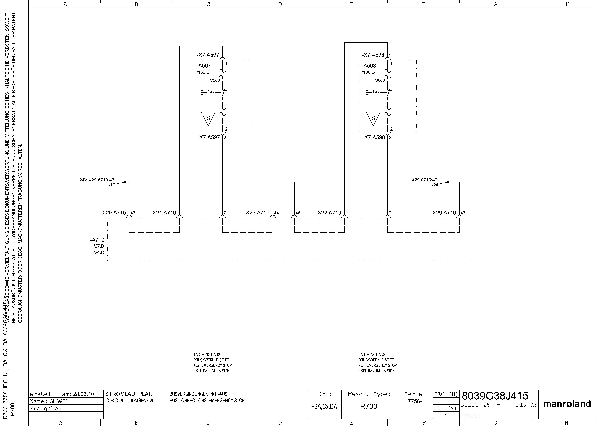

# +BA_Cx_DA — Sheet 25 of 247 — BUSVERBINDUNGEN: NOT AUS

**BUS CONNECTIONS: EMERGENCY STOP**

> Part of the manroland **R700** printing press IEC/UL circuit diagrams.
> Drawing class: **Stromlaufplan / Circuit diagram** (DIN A3).
> Document `+BA_Cx_DA` covers the **Printing units / main switch cabinet** machine section.

## At a glance

| Field | Value |
|---|---|
| Document | `+BA_Cx_DA`  (8039G38J415) |
| Sheet | **25** of 247 |
| Section (DE) | BUSVERBINDUNGEN: NOT AUS |
| Section (EN) | BUS CONNECTIONS: EMERGENCY STOP |
| Section type | CIRCUIT — Circuit diagram |
| Machine type | `R700` |
| Series | `7758` |
| Created | 28.06.10 |
| Replaces | — |
| Columns used | A, B, C, D, E, F, G |
| Path numbers | — |
| Labels on sheet | 48 |
| Cross-refs out | 6 |
| Cross-refs in | 18 |

**Previous:** [+BA_Cx_DA sheet 24](SHEET_0024.md) · **Next:** [+BA_Cx_DA sheet 26](SHEET_0026.md) · **Document TOC:** [_TOC.md](_TOC.md)  (+BA_Cx_DA) · **Master TOC:** [all sheets](../_MASTER_TOC.md)

## Sheet image (300 DPI, exact vector render)



_Rendered directly from the PDF vector layer at 300 DPI (1-bit), no OCR and no resampling. Use it to confirm anything ambiguous in the text below._

## Cross-references on this sheet

Each entry is a wire leaving this sheet. The printed token is `/sheet.column`; the link resolves to that sheet inside the same document.

| Ref | Target sheet | Col | Path | Destination on target | Target section | From col |
|---|---|---|---|---|---|---|
| `/136.B` | [+BA_Cx_DA sheet 136](SHEET_0136.md) | B | — | A597 | REFERENZMODUL | C |
| `/136.D` | [+BA_Cx_DA sheet 136](SHEET_0136.md) | D | — | A598 | REFERENZMODUL | E |
| `/17.E` | [+BA_Cx_DA sheet 17](SHEET_0017.md) | E | — | 24V.X29.A710:43 X29.A710:47 | SPANNUNGSVERSORGUNG, SCHALTSCHRANKBELÜFTUNG | D |
| `/24.F` | [+BA_Cx_DA sheet 24](SHEET_0024.md) | F | — | 24V.X29.A710:43 X29.A710:47 | BUSVERBINDUNGEN: NOT AUS | D |
| `/27.D` | [+BA_Cx_DA sheet 27](SHEET_0027.md) | D | — | — | BUSVERBINDUNGEN: NOT AUS | A |
| `/24.D` | [+BA_Cx_DA sheet 24](SHEET_0024.md) | D | — | — | BUSVERBINDUNGEN: NOT AUS | A |

### Incoming references (sheets that point here)

Every other sheet that sends a wire to this one. `Back-ref` is the token printed on *that* sheet; `Path` is its line number.

| From sheet | Cols | Back-ref | Path | Refs | What continues there |
|---|---|---|---|---|---|
| [+BA_Cx_DA#17](SHEET_0017.md) | E | `/17.E` | — | 1 | — |
| [+BA_Cx_DA#24](SHEET_0024.md) | D, F | `/24.D`, `/24.F` | — | 2 | — |
| [+BA_Cx_DA#27](SHEET_0027.md) | D | `/27.D` | — | 1 | — |
| [+BA_Cx_DA#136](SHEET_0136.md) | B, D | `/136.B`, `/136.D` | — | 2 | — |
| [+BA_Cx_DA#164](SHEET_0164.md) | C | `/164.C` | — | 4 | — |
| [+BA_Cx_DA#174](SHEET_0174.md) | B, F | `/174.B`, `/174.F` | — | 4 | — |
| [+BA_Cx_DA#179](SHEET_0179.md) | C | `/179.C` | — | 4 | — |


## Devices on this sheet

| Tag | Class | Class meaning (IEC) | Col | Sub | Terminal | Sign |
|---|---|---|---|---|---|---|
| `A710` | A | Baugruppe / assembly, module, PC board | A | — | — | — |
| `S000` | S | Schalter / switch | C | — | — | — |
| `A597` | A | Baugruppe / assembly, module, PC board | C | — | — | — |
| `S000` | S | Schalter / switch | E | — | — | — |
| `A598` | A | Baugruppe / assembly, module, PC board | E | — | — | — |
| `X21.A710` | — | cross-device reference | B | — | — | — |
| `X7.A597` | — | cross-device reference | C | — | — | — |
| `X7.A597` | — | cross-device reference | C | — | — | — |
| `X29.A710` | — | cross-device reference | B | — | — | — |
| `X22.A710` | — | cross-device reference | E | — | — | — |
| `X7.A598` | — | cross-device reference | E | — | — | — |
| `X7.A598` | — | cross-device reference | E | — | — | — |
| `X29.A710` | — | cross-device reference | D | — | — | — |
| `X29.A710` | — | cross-device reference | F | — | — | — |
| `X29.A710:47` | — | cross-device reference | F | — | 47 | — |

## Potentials / nets

| Potential | Count | Columns | Attached devices | Terminals |
|---|---|---|---|---|
| `24V` | 1 | A | `A710`, `X29` | `43` |


A potential such as `L24+/4` or `M24+` is a named supply/return rail; every place it appears on this sheet is electrically common.

## Wire-end annotations (grouped as printed)

A wire that continues elsewhere is annotated with a small cluster: the destination description, the path/line number `#NN`, and the `/sheet.column` cross reference. Each row below is one such cluster exactly as it is grouped on the drawing.

| Col | Y | Path | Cross-ref | Text on the wire |
|---|---|---|---|---|
| C | 103.8 | — | — | `X7.A597 1` |
| E | 103.8 | — | — | `X7.A598 1` |
| C | 122.2 | — | — | `1` |
| F | 122.2 | — | — | `1` |
| C | 125.0 | — | `/136.B` | `A597` |
| E | 125.0 | — | `/136.D` | `A598` |
| C | 155.2 | — | — | `S000` |
| E | 155.2 | — | — | `S000` |
| D | 227.9 | — | — | `S S` |
| C | 251.2 | — | — | `2` |
| F | 251.2 | — | — | `2` |
| C | 266.8 | — | — | `X7.A597 2` |
| E | 266.8 | — | — | `X7.A598 2` |
| D | 351.8 | — | `/17.E`, `/24.F` | `24V.X29.A710:43 X29.A710:47` |
| D | 415.6 | — | — | `X29.A710 43 X22.A710 1 2` |
| C | 415.6 | — | — | `X21.A710 1 2` |
| E | 415.6 | — | — | `X29.A710 44 46 X29.A710 47` |
| A | 469.4 | — | — | `A710` |
| A | 482.5 | — | `/27.D`, `/24.D` | — |
| C | 697.9 | — | — | `DRUCKWERK: B SEITE KEY: EMERGENCY STOP PRINTING UNIT: B SIDE TASTE: NOT AUS` |
| E | 697.9 | — | — | `DRUCKWERK: A SEITE KEY: EMERGENCY STOP PRINTING UNIT: A SIDE TASTE: NOT AUS` |


## Reconstructed tables

This sheet carries tabular content (pin map / terminal assignment / index). The grid below was rebuilt from the drawing's own rule lines, so each row is exactly one physical row of the table.

### Table 1 — 3 data rows × 11 columns (at x=255.1, y=83.6)

|  |  | X7.A597 | 1 |  |  |  |  | X7.A598 | 1 |  |
|---|---|---|---|---|---|---|---|---|---|---|
|  |  | `A597 /136.B S000 S` | `1 2` |  |  |  |  | `A598 /136.D S000 S` | `1 2` |  |
|  |  | `X7.A597` | `2` |  |  |  |  | `X7.A598` | `2` | `X29.A710:47` |
| `X21.A710 43` | `1` |  | `2` | `X29.A710` | `44` | `X22.A710 46` | `1` |  | `2` | `/24.F X29.A710` |


## Notes and free text on this sheet

| Text | Col | Y (pt) |
|---|---|---|
| `S` | C | 227.86 |
| `S` | E | 227.86 |
| `TASTE: NOT AUS` | E | 697.93 |
| `DRUCKWERK: A SEITE` | E | 708.55 |
| `KEY: EMERGENCY STOP` | E | 719.2 |
| `PRINTING UNIT: A SIDE` | E | 729.83 |
| `TASTE: NOT AUS` | C | 697.93 |
| `DRUCKWERK: B SEITE` | C | 708.55 |
| `KEY: EMERGENCY STOP` | C | 719.2 |
| `PRINTING UNIT: B SIDE` | C | 729.83 |

## Complete label inventory (exact text from the drawing)

Every text object inside the drawing area of this sheet, in DIN reading order (column A→H, then top→bottom). This is the authoritative list: if a string is not here it is not printed on this sheet.

| Col | Y | X | Dir | Type | Text |
|---|---|---|---|---|---|
| A | 351.8 | 153.9 | → | potential | `24V.X29.A710:43` |
| A | 469.4 | 177.7 | → | device tag | `A710` |
| A | 482.5 | 184.8 | → | cross-reference | `/27.D` |
| A | 494.9 | 184.8 | → | cross-reference | `/24.D` |
| B | 361.7 | 215.1 | → | cross-reference | `/17.E` |
| B | 415.6 | 198.4 | → | device ref | `X29.A710` |
| B | 415.6 | 297.6 | → | device ref | `X21.A710` |
| B | 417.0 | 257.7 | → | number | `43` |
| C | 103.8 | 388.6 | → | device ref | `X7.A597` |
| C | 105.2 | 441.4 | → | number | `1` |
| C | 122.2 | 444.2 | → | number | `1` |
| C | 125.0 | 388.1 | → | device tag | `A597` |
| C | 138.8 | 388.3 | → | cross-reference | `/136.B` |
| C | 155.2 | 412.2 | → | device tag | `S000` |
| C | 227.9 | 406.9 | → | text | `S` |
| C | 251.2 | 444.8 | → | number | `2` |
| C | 266.8 | 390.0 | → | device ref | `X7.A597` |
| C | 268.2 | 441.9 | → | number | `2` |
| C | 417.0 | 356.3 | → | number | `1` |
| C | 417.0 | 441.9 | → | number | `2` |
| C | 697.9 | 382.4 | → | text | `TASTE: NOT AUS` |
| C | 708.5 | 381.8 | → | text | `DRUCKWERK: B SEITE` |
| C | 719.2 | 381.8 | → | text | `KEY: EMERGENCY STOP` |
| C | 729.8 | 381.8 | → | text | `PRINTING UNIT: B SIDE` |
| D | 415.6 | 481.9 | → | device ref | `X29.A710` |
| D | 417.0 | 541.1 | → | number | `44` |
| D | 417.0 | 583.7 | → | number | `46` |
| E | 103.8 | 714.6 | → | device ref | `X7.A598` |
| E | 125.0 | 714.0 | → | device tag | `A598` |
| E | 138.8 | 714.3 | → | cross-reference | `/136.D` |
| E | 155.2 | 738.1 | → | device tag | `S000` |
| E | 227.9 | 732.9 | → | text | `S` |
| E | 266.8 | 716.0 | → | device ref | `X7.A598` |
| E | 415.6 | 623.6 | → | device ref | `X22.A710` |
| E | 417.0 | 682.3 | → | number | `1` |
| E | 697.9 | 708.4 | → | text | `TASTE: NOT AUS` |
| E | 708.5 | 707.8 | → | text | `DRUCKWERK: A SEITE` |
| E | 719.2 | 707.8 | → | text | `KEY: EMERGENCY STOP` |
| E | 729.8 | 707.8 | → | text | `PRINTING UNIT: A SIDE` |
| F | 105.2 | 767.3 | → | number | `1` |
| F | 122.2 | 770.2 | → | number | `1` |
| F | 251.2 | 770.7 | → | number | `2` |
| F | 268.2 | 767.9 | → | number | `2` |
| F | 351.8 | 809.9 | → | device ref | `X29.A710:47` |
| F | 361.7 | 853.2 | → | cross-reference | `/24.F` |
| F | 415.6 | 850.4 | → | device ref | `X29.A710` |
| F | 417.0 | 767.9 | → | number | `2` |
| G | 417.0 | 909.6 | → | number | `47` |

## Reading-order text block

The same content as a plain block, grouped by DIN column — convenient to paste or to match against a visual description.

```text
=== Column A ===
 351.8  153.9  net          24V.X29.A710:43
 469.4  177.7  devtag       A710
 482.5  184.8  xref         /27.D
 494.9  184.8  xref         /24.D
=== Column B ===
 361.7  215.1  xref         /17.E
 415.6  198.4  devref       X29.A710
 415.6  297.6  devref       X21.A710
 417.0  257.7  numeric      43
=== Column C ===
 103.8  388.6  devref       X7.A597
 105.2  441.4  numeric      1
 122.2  444.2  numeric      1
 125.0  388.1  devtag       A597
 138.8  388.3  xref         /136.B
 155.2  412.2  devtag       S000
 227.9  406.9  text         S
 251.2  444.8  numeric      2
 266.8  390.0  devref       X7.A597
 268.2  441.9  numeric      2
 417.0  356.3  numeric      1
 417.0  441.9  numeric      2
 697.9  382.4  text         TASTE: NOT AUS
 708.5  381.8  text         DRUCKWERK: B SEITE
 719.2  381.8  text         KEY: EMERGENCY STOP
 729.8  381.8  text         PRINTING UNIT: B SIDE
=== Column D ===
 415.6  481.9  devref       X29.A710
 417.0  541.1  numeric      44
 417.0  583.7  numeric      46
=== Column E ===
 103.8  714.6  devref       X7.A598
 125.0  714.0  devtag       A598
 138.8  714.3  xref         /136.D
 155.2  738.1  devtag       S000
 227.9  732.9  text         S
 266.8  716.0  devref       X7.A598
 415.6  623.6  devref       X22.A710
 417.0  682.3  numeric      1
 697.9  708.4  text         TASTE: NOT AUS
 708.5  707.8  text         DRUCKWERK: A SEITE
 719.2  707.8  text         KEY: EMERGENCY STOP
 729.8  707.8  text         PRINTING UNIT: A SIDE
=== Column F ===
 105.2  767.3  numeric      1
 122.2  770.2  numeric      1
 251.2  770.7  numeric      2
 268.2  767.9  numeric      2
 351.8  809.9  devref       X29.A710:47
 361.7  853.2  xref         /24.F
 415.6  850.4  devref       X29.A710
 417.0  767.9  numeric      2
=== Column G ===
 417.0  909.6  numeric      47
```

---
_Generated from the PDF vector text layer; no OCR. Source: `R700_7758_IEC_UL_BA_CX_DA_8039G38J415_p`, sheet 25._
