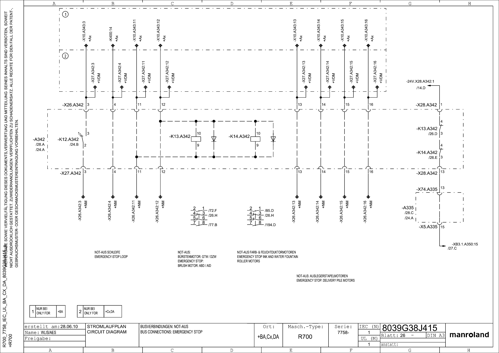

# +BA_Cx_DA — Sheet 26 of 247 — BUSVERBINDUNGEN: NOT AUS

**BUS CONNECTIONS: EMERGENCY STOP**

> Part of the manroland **R700** printing press IEC/UL circuit diagrams.
> Drawing class: **Stromlaufplan / Circuit diagram** (DIN A3).
> Document `+BA_Cx_DA` covers the **Printing units / main switch cabinet** machine section.

## At a glance

| Field | Value |
|---|---|
| Document | `+BA_Cx_DA`  (8039G38J415) |
| Sheet | **26** of 247 |
| Section (DE) | BUSVERBINDUNGEN: NOT AUS |
| Section (EN) | BUS CONNECTIONS: EMERGENCY STOP |
| Section type | CIRCUIT — Circuit diagram |
| Machine type | `R700` |
| Series | `7758` |
| Created | 28.06.10 |
| Replaces | — |
| Columns used | A, B, C, D, E, F, G, H |
| Path numbers | — |
| Labels on sheet | 146 |
| Cross-refs out | 15 |
| Cross-refs in | 35 |

**Previous:** [+BA_Cx_DA sheet 25](SHEET_0025.md) · **Next:** [+BA_Cx_DA sheet 27](SHEET_0027.md) · **Document TOC:** [_TOC.md](_TOC.md)  (+BA_Cx_DA) · **Master TOC:** [all sheets](../_MASTER_TOC.md)

## Sheet image (300 DPI, exact vector render)



_Rendered directly from the PDF vector layer at 300 DPI (1-bit), no OCR and no resampling. Use it to confirm anything ambiguous in the text below._

## Cross-references on this sheet

Each entry is a wire leaving this sheet. The printed token is `/sheet.column`; the link resolves to that sheet inside the same document.

| Ref | Target sheet | Col | Path | Destination on target | Target section | From col |
|---|---|---|---|---|---|---|
| `/14.D` | [+BA_Cx_DA sheet 14](SHEET_0014.md) | D | — | — | SPANNUNGSVERSORGUNG, SCHALTSCHRANKBELÜFTUNG | G |
| `/26.D` | [+BA_Cx_DA sheet 26](SHEET_0026.md) | D | — | — | BUSVERBINDUNGEN: NOT AUS | G |
| `/28.A` | [+BA_Cx_DA sheet 28](SHEET_0028.md) | A | — | — | BUSVERBINDUNGEN: STOP SICHERN | A |
| `/24.A` | [+BA_Cx_DA sheet 24](SHEET_0024.md) | A | — | — | BUSVERBINDUNGEN: NOT AUS | A |
| `/24.B` | [+BA_Cx_DA sheet 24](SHEET_0024.md) | B | — | — | BUSVERBINDUNGEN: NOT AUS | A |
| `/26.E` | [+BA_Cx_DA sheet 26](SHEET_0026.md) | E | — | — | BUSVERBINDUNGEN: NOT AUS | G |
| `/72.F` | [+BA_Cx_DA sheet 72](SHEET_0072.md) | F | — | — | FEUCHTWERK | D |
| `/26.H` | [+BA_Cx_DA sheet 26](SHEET_0026.md) | H | — | — | BUSVERBINDUNGEN: NOT AUS | D |
| `/85.D` | [+BA_Cx_DA sheet 85](SHEET_0085.md) | D | — | — | WASCHVORRICHTUNG | E |
| `/26.H` | [+BA_Cx_DA sheet 26](SHEET_0026.md) | H | — | — | BUSVERBINDUNGEN: NOT AUS | E |
| `/28.C` | [+BA_Cx_DA sheet 28](SHEET_0028.md) | C | — | — | BUSVERBINDUNGEN: STOP SICHERN | G |
| `/24.A` | [+BA_Cx_DA sheet 24](SHEET_0024.md) | A | — | — | BUSVERBINDUNGEN: NOT AUS | G |
| `/77.B` | [+BA_Cx_DA sheet 77](SHEET_0077.md) | B | — | — | FARBWERK | D |
| `/194.D` | [+BA_Cx_DA sheet 194](SHEET_0194.md) | D | — | — | OPTION: WASCHVORRICHTUNG MIT BÜRSTE | E |
| `/27.C` | [+BA_Cx_DA sheet 27](SHEET_0027.md) | C | — | — | BUSVERBINDUNGEN: NOT AUS | H |

### Incoming references (sheets that point here)

Every other sheet that sends a wire to this one. `Back-ref` is the token printed on *that* sheet; `Path` is its line number.

| From sheet | Cols | Back-ref | Path | Refs | What continues there |
|---|---|---|---|---|---|
| [+BA_Cx_DA#14](SHEET_0014.md) | D | `/14.D` | — | 1 | — |
| [+BA_Cx_DA#24](SHEET_0024.md) | A, B | `/24.A`, `/24.B` | — | 3 | — |
| [+BA_Cx_DA#26](SHEET_0026.md) | D, E, G | `/26.D`, `/26.E`, `/26.G` | — | 4 | — |
| [+BA_Cx_DA#27](SHEET_0027.md) | B | `/27.B` | — | 1 | XB3.1.A350:15 |
| [+BA_Cx_DA#28](SHEET_0028.md) | A, C | `/28.A`, `/28.C` | — | 2 | — |
| [+BA_Cx_DA#72](SHEET_0072.md) | F | `/72.F` | — | 1 | A342 |
| [+BA_Cx_DA#77](SHEET_0077.md) | B | `/77.B` | — | 1 | — |
| [+BA_Cx_DA#85](SHEET_0085.md) | D | `/85.D` | — | 1 | — |
| [+BA_Cx_DA#161](SHEET_0161.md) | A | `/161.A` | — | 1 | — |
| [+BA_Cx_DA#176](SHEET_0176.md) | B | `/176.B` | — | 8 | — |
| [+BA_Cx_DA#177](SHEET_0177.md) | B | `/177.B` | — | 8 | — |
| [+BA_Cx_DA#178](SHEET_0178.md) | F | `/178.F` | — | 2 | — |
| [+BA_Cx_DA#184](SHEET_0184.md) | F | `/184.F` | — | 1 | — |
| [+BA_Cx_DA#194](SHEET_0194.md) | C | `/194.C` | — | 1 | A342 |


## Devices on this sheet

| Tag | Class | Class meaning (IEC) | Col | Sub | Terminal | Sign |
|---|---|---|---|---|---|---|
| `A335` | A | Baugruppe / assembly, module, PC board | G | — | — | — |
| `K400:14` | K | Relais / relay, contactor | B | — | 14 | — |
| `A342` | A | Baugruppe / assembly, module, PC board | A | — | — | — |
| `X10.A343:13` | — | cross-device reference | E | — | 13 | — |
| `X10.A343:14` | — | cross-device reference | E | — | 14 | — |
| `X10.A343:15` | — | cross-device reference | F | — | 15 | — |
| `X10.A343:16` | — | cross-device reference | F | — | 16 | — |
| `X27.A342:13` | — | cross-device reference | E | — | 13 | — |
| `X27.A342:14` | — | cross-device reference | F | — | 14 | — |
| `X27.A342:15` | — | cross-device reference | F | — | 15 | — |
| `X27.A342:16` | — | cross-device reference | F | — | 16 | — |
| `X26.A342:13` | — | cross-device reference | E | — | 13 | — |
| `X26.A342:14` | — | cross-device reference | E | — | 14 | — |
| `X26.A342:15` | — | cross-device reference | F | — | 15 | — |
| `X26.A342:16` | — | cross-device reference | F | — | 16 | — |
| `X28.A342` | — | cross-device reference | G | — | — | — |
| `K13.A342` | — | cross-device reference | G | — | — | — |
| `K14.A342` | — | cross-device reference | G | — | — | — |
| `X28.A342` | — | cross-device reference | G | — | — | — |
| `X74.A335` | — | cross-device reference | G | — | — | — |
| `X5.A335` | — | cross-device reference | G | — | — | — |
| `X10.A343:11` | — | cross-device reference | B | — | 11 | — |
| `X10.A343:12` | — | cross-device reference | C | — | 12 | — |
| `X27.A342:4` | — | cross-device reference | B | — | 4 | — |
| `X27.A342:11` | — | cross-device reference | C | — | 11 | — |
| `X27.A342:12` | — | cross-device reference | C | — | 12 | — |
| `X10.A343:3` | — | cross-device reference | B | — | 3 | — |
| `X27.A342:3` | — | cross-device reference | B | — | 3 | — |
| `X26.A342` | — | cross-device reference | A | — | — | — |
| `K13.A342` | — | cross-device reference | C | — | — | — |
| `K14.A342` | — | cross-device reference | D | — | — | — |
| `K12.A342` | — | cross-device reference | A | — | — | — |
| `X27.A342` | — | cross-device reference | A | — | — | — |
| `X26.A342:3` | — | cross-device reference | A | — | 3 | — |
| `X26.A342:4` | — | cross-device reference | B | — | 4 | — |
| `X26.A342:11` | — | cross-device reference | B | — | 11 | — |
| `X26.A342:12` | — | cross-device reference | C | — | 12 | — |
| `XB3.1.A350:15` | — | cross-device reference | H | — | 15 | — |

## Potentials / nets

| Potential | Count | Columns | Attached devices | Terminals |
|---|---|---|---|---|
| `24V` | 1 | G | `A342`, `X28` | `1` |


A potential such as `L24+/4` or `M24+` is a named supply/return rail; every place it appears on this sheet is electrically common.

## Wire-end annotations (grouped as printed)

A wire that continues elsewhere is annotated with a small cluster: the destination description, the path/line number `#NN`, and the `/sheet.column` cross reference. Each row below is one such cluster exactly as it is grouped on the drawing.

| Col | Y | Path | Cross-ref | Text on the wire |
|---|---|---|---|---|
| A | 31.0 | — | — | `1` |
| B | 45.9 | — | — | `X10.A343:11` |
| C | 45.9 | — | — | `X10.A343:12` |
| E | 45.9 | — | — | `X10.A343:13` |
| E | 45.9 | — | — | `X10.A343:14` |
| F | 45.9 | — | — | `X10.A343:15` |
| F | 45.9 | — | — | `X10.A343:16` |
| B | 50.7 | — | — | `X10.A343:3` |
| B | 64.1 | — | — | `K400:14` |
| B | 84.5 | — | — | `+Ax` |
| B | 84.5 | — | — | `+Ax` |
| B | 84.5 | — | — | `+Ax` |
| C | 84.5 | — | — | `+Ax` |
| E | 84.5 | — | — | `+Ax` |
| F | 84.5 | — | — | `+Ax` |
| F | 84.5 | — | — | `+Ax` |
| F | 84.5 | — | — | `+Ax` |
| A | 130.7 | — | — | `2` |
| C | 145.1 | — | — | `X27.A342:11` |
| C | 145.1 | — | — | `X27.A342:12` |
| E | 145.1 | — | — | `X27.A342:13` |
| F | 145.1 | — | — | `X27.A342:14` |
| F | 145.1 | — | — | `X27.A342:15` |
| F | 145.1 | — | — | `X27.A342:16` |
| B | 149.9 | — | — | `X27.A342:3` |
| B | 149.9 | — | — | `X27.A342:4` |
| B | 174.3 | — | — | `+VDM` |
| B | 174.3 | — | — | `+VDM` |
| C | 174.3 | — | — | `+VDM` |
| C | 174.3 | — | — | `+VDM` |
| E | 174.3 | — | — | `+VDM` |
| F | 174.3 | — | — | `+VDM` |
| F | 174.3 | — | — | `+VDM` |
| G | 174.3 | — | — | `+VDM` |
| G | 190.2 | — | — | `24V.X28.A342:1` |
| G | 205.8 | — | `/14.D` | — |
| B | 245.5 | — | — | `X26.A342 3 4 11 12` |
| F | 245.5 | — | — | `13 14 15 16` |
| G | 245.5 | — | — | `X28.A342 1` |
| H | 285.9 | — | — | `4` |
| G | 302.2 | — | — | `K13.A342 3` |
| A | 314.3 | — | — | `K12.A342 3` |
| A | 314.3 | — | — | `1` |
| C | 314.3 | — | — | `10` |
| D | 314.3 | — | — | `10` |
| G | 315.3 | — | `/26.D` | — |
| C | 320.6 | — | — | `K13.A342` |
| D | 320.6 | — | — | `K14.A342` |
| A | 327.7 | — | — | `A342` |
| A | 340.8 | — | `/28.A`, `/24.A` | — |
| A | 340.8 | — | `/24.B` | — |
| B | 342.6 | — | — | `2` |
| C | 342.6 | — | — | `9` |
| D | 342.6 | — | — | `9` |
| H | 342.6 | — | — | `4` |
| G | 358.9 | — | — | `K14.A342 3` |
| G | 371.9 | — | `/26.E` | — |
| B | 405.7 | — | — | `X27.A342 3 4 11 12` |
| F | 405.7 | — | — | `13 14 15 16` |
| G | 405.7 | — | — | `X28.A342 13` |
| G | 443.9 | — | — | `X74.A335 13` |
| B | 477.4 | — | — | `X26.A342:11` |
| B | 478.5 | — | — | `+NM` |
| B | 478.5 | — | — | `+NM` |
| B | 478.5 | — | — | `+NM` |
| C | 478.5 | — | — | `X26.A342:12` |
| C | 478.5 | — | — | `+NM` |
| E | 478.5 | — | — | `+NM` |
| F | 478.5 | — | — | `+NM` |
| F | 478.5 | — | — | `+NM` |
| F | 478.5 | — | — | `+NM` |
| A | 478.8 | — | — | `X26.A342:3` |
| B | 478.8 | — | — | `X26.A342:4` |
| E | 478.8 | — | — | `X26.A342:13` |
| E | 478.8 | — | — | `X26.A342:14` |
| F | 478.8 | — | — | `X26.A342:15` |
| F | 478.8 | — | — | `X26.A342:16` |
| G | 490.7 | — | — | `A335` |
| C | 492.1 | — | — | `2 4 5 7 1 3 8 6` |
| D | 492.1 | — | — | `2 4 5 7 1 3 8 6` |
| D | 498.4 | — | `/72.F`, `/26.H` | — |
| E | 498.5 | — | `/85.D`, `/26.H` | — |
| G | 503.8 | — | `/28.C`, `/24.A` | — |
| D | 532.5 | — | `/77.B` | — |
| E | 532.5 | — | `/194.D` | — |
| G | 536.1 | — | — | `X5.A335 15` |
| H | 578.5 | — | — | `XB3.1.A350:15` |
| H | 588.5 | — | `/27.C` | — |
| B | 598.7 | — | — | `NOT AUS SCHLEIFE EMERGENCY STOP LOOP` |
| C | 598.7 | — | — | `NOT AUS: BÜRSTENMOTOR: GTW / DZW EMERGENCY STOP: BRUSH MOTOR: ABD / AID` |
| E | 598.8 | — | — | `NOT AUS FARB & FEUCHTDUKTORMOTOREN EMERGENCY STOP INK AND WATER FOUNTAIN ROLLER MOTORS` |
| F | 655.4 | — | — | `NOT AUS: AUSLEGERSTAPELMOTOREN EMERGENCY STOP: DELIVERY PILE MOTORS` |
| A | 733.3 | — | — | `1 NUR BEI` |
| A | 733.3 | — | — | `ONLY FOR +BA 2 NUR BEI` |
| B | 740.5 | — | — | `ONLY FOR +Cx,DA` |


## Reconstructed tables

This sheet carries tabular content (pin map / terminal assignment / index). The grid below was rebuilt from the drawing's own rule lines, so each row is exactly one physical row of the table.

### Table 1 — 1 data rows × 6 columns (at x=198.4, y=119.1)

|  | X27.A342:3 +VDM 3 | X27.A342:4 +VDM 4 | X27.A342:11 +VDM 11 | X27.A342:12 +VDM 12 |  |
|---|---|---|---|---|---|
| `2` | `3` |  |  | `K13.A342` | `10 9` |


## Notes and free text on this sheet

| Text | Col | Y (pt) |
|---|---|---|
| `+Ax` | E | 84.47 |
| `+Ax` | F | 84.47 |
| `+VDM` | E | 174.33 |
| `+VDM` | F | 174.33 |
| `+VDM` | G | 174.33 |
| `+NM` | E | 478.49 |
| `+NM` | F | 478.49 |
| `+Ax` | B | 84.47 |
| `+Ax` | C | 84.47 |
| `+VDM` | B | 174.33 |
| `+VDM` | C | 174.33 |
| `NOT AUS:` | C | 598.71 |
| `BÜRSTENMOTOR: GTW / DZW` | C | 609.34 |
| `EMERGENCY STOP:` | C | 619.99 |
| `BRUSH MOTOR: ABD / AID` | C | 630.63 |
| `NOT AUS FARB & FEUCHTDUKTORMOTOREN` | E | 598.75 |
| `EMERGENCY STOP INK AND WATER FOUNTAIN` | E | 609.36 |
| `ROLLER MOTORS` | D | 620.01 |
| `+NM` | B | 478.49 |
| `+NM` | C | 478.49 |
| `NUR BEI` | A | 733.33 |
| `ONLY FOR` | A | 744.02 |
| `+BA` | A | 740.44 |
| `NUR BEI` | B | 733.33 |
| `ONLY FOR` | B | 744.02 |
| `+Cx,DA` | B | 740.52 |
| `NOT AUS: AUSLEGERSTAPELMOTOREN` | F | 655.43 |
| `EMERGENCY STOP: DELIVERY PILE MOTORS` | F | 666.06 |
| `NOT AUS SCHLEIFE` | B | 598.73 |
| `EMERGENCY STOP LOOP` | B | 609.37 |

## Complete label inventory (exact text from the drawing)

Every text object inside the drawing area of this sheet, in DIN reading order (column A→H, then top→bottom). This is the authoritative list: if a string is not here it is not printed on this sheet.

| Col | Y | X | Dir | Type | Text |
|---|---|---|---|---|---|
| A | 31.0 | 154.1 | → | number | `1` |
| A | 130.7 | 153.9 | → | number | `2` |
| A | 245.5 | 148.8 | → | device ref | `X26.A342` |
| A | 314.3 | 185.4 | → | number | `1` |
| A | 327.7 | 78.5 | → | device tag | `A342` |
| A | 327.7 | 137.5 | → | device ref | `K12.A342` |
| A | 340.8 | 85.6 | → | cross-reference | `/28.A` |
| A | 340.8 | 166.7 | → | cross-reference | `/24.B` |
| A | 353.2 | 85.6 | → | cross-reference | `/24.A` |
| A | 408.5 | 143.1 | → | device ref | `X27.A342` |
| A | 478.8 | 186.7 | ↕ | device ref | `X26.A342:3` |
| A | 733.3 | 87.0 | → | text | `NUR BEI` |
| A | 738.7 | 75.4 | → | number | `1` |
| A | 738.7 | 188.5 | → | number | `2` |
| A | 740.4 | 137.9 | → | text | `+BA` |
| A | 744.0 | 87.6 | → | text | `ONLY FOR` |
| B | 45.9 | 317.1 | ↕ | device ref | `X10.A343:11` |
| B | 50.7 | 196.6 | ↕ | device ref | `X10.A343:3` |
| B | 64.1 | 260.4 | ↕ | device tag | `K400:14` |
| B | 84.5 | 210.8 | ↕ | text | `+Ax` |
| B | 84.5 | 274.6 | ↕ | text | `+Ax` |
| B | 84.5 | 331.3 | ↕ | text | `+Ax` |
| B | 150.0 | 217.8 | ↕ | device ref | `X27.A342:3` |
| B | 150.0 | 281.6 | ↕ | device ref | `X27.A342:4` |
| B | 174.3 | 232.0 | ↕ | text | `+VDM` |
| B | 174.3 | 295.8 | ↕ | text | `+VDM` |
| B | 245.5 | 208.1 | → | number | `3` |
| B | 245.5 | 271.8 | → | number | `4` |
| B | 245.5 | 328.0 | → | number | `11` |
| B | 314.3 | 208.1 | → | number | `3` |
| B | 342.6 | 201.0 | → | number | `2` |
| B | 405.7 | 201.0 | → | number | `3` |
| B | 405.7 | 271.8 | → | number | `4` |
| B | 405.7 | 328.0 | → | number | `11` |
| B | 477.4 | 314.2 | ↕ | device ref | `X26.A342:11` |
| B | 478.5 | 200.9 | ↕ | text | `+NM` |
| B | 478.5 | 271.8 | ↕ | text | `+NM` |
| B | 478.5 | 328.5 | ↕ | text | `+NM` |
| B | 478.8 | 257.5 | ↕ | device ref | `X26.A342:4` |
| B | 598.7 | 225.9 | → | text | `NOT AUS SCHLEIFE` |
| B | 609.4 | 225.9 | → | text | `EMERGENCY STOP LOOP` |
| B | 733.3 | 200.4 | → | text | `NUR BEI` |
| B | 740.5 | 251.3 | → | text | `+Cx,DA` |
| B | 744.0 | 201.0 | → | text | `ONLY FOR` |
| C | 45.9 | 373.8 | ↕ | device ref | `X10.A343:12` |
| C | 84.5 | 388.0 | ↕ | text | `+Ax` |
| C | 145.1 | 338.3 | ↕ | device ref | `X27.A342:11` |
| C | 145.1 | 395.0 | ↕ | device ref | `X27.A342:12` |
| C | 174.3 | 352.5 | ↕ | text | `+VDM` |
| C | 174.3 | 409.2 | ↕ | text | `+VDM` |
| C | 245.5 | 384.7 | → | number | `12` |
| C | 314.3 | 469.7 | → | number | `10` |
| C | 320.6 | 403.9 | → | device ref | `K13.A342` |
| C | 342.6 | 470.3 | → | number | `9` |
| C | 405.7 | 384.7 | → | number | `12` |
| C | 478.5 | 370.9 | ↕ | device ref | `X26.A342:12` |
| C | 478.5 | 385.1 | ↕ | text | `+NM` |
| C | 492.1 | 460.9 | → | number | `2` |
| C | 503.4 | 460.9 | → | number | `4` |
| C | 514.8 | 460.9 | → | number | `5` |
| C | 526.1 | 460.9 | → | number | `7` |
| C | 598.7 | 424.3 | → | text | `NOT AUS:` |
| C | 609.3 | 424.3 | → | text | `BÜRSTENMOTOR: GTW / DZW` |
| C | 620.0 | 424.3 | → | text | `EMERGENCY STOP:` |
| C | 630.6 | 424.3 | → | text | `BRUSH MOTOR: ABD / AID` |
| D | 314.3 | 611.4 | → | number | `10` |
| D | 320.6 | 545.7 | → | device ref | `K14.A342` |
| D | 342.6 | 612.0 | → | number | `9` |
| D | 492.1 | 482.2 | → | number | `1` |
| D | 492.1 | 595.6 | → | number | `2` |
| D | 492.1 | 616.8 | → | number | `1` |
| D | 498.4 | 497.5 | → | cross-reference | `/72.F` |
| D | 503.4 | 482.7 | → | number | `3` |
| D | 503.4 | 595.6 | → | number | `4` |
| D | 503.4 | 617.4 | → | number | `3` |
| D | 509.8 | 497.5 | → | cross-reference | `/26.H` |
| D | 514.8 | 483.0 | → | number | `6` |
| D | 514.8 | 595.6 | → | number | `5` |
| D | 514.8 | 617.7 | → | number | `6` |
| D | 526.1 | 482.7 | → | number | `8` |
| D | 526.1 | 595.6 | → | number | `7` |
| D | 526.1 | 617.4 | → | number | `8` |
| D | 532.5 | 497.5 | → | cross-reference | `/77.B` |
| D | 620.0 | 566.1 | → | text | `ROLLER MOTORS` |
| E | 45.9 | 699.7 | ↕ | device ref | `X10.A343:13` |
| E | 45.9 | 756.4 | ↕ | device ref | `X10.A343:14` |
| E | 84.5 | 714.0 | ↕ | text | `+Ax` |
| E | 145.1 | 721.0 | ↕ | device ref | `X27.A342:13` |
| E | 174.3 | 735.2 | ↕ | text | `+VDM` |
| E | 245.5 | 710.6 | → | number | `13` |
| E | 405.7 | 710.6 | → | number | `13` |
| E | 478.5 | 711.1 | ↕ | text | `+NM` |
| E | 478.8 | 696.9 | ↕ | device ref | `X26.A342:13` |
| E | 478.8 | 753.6 | ↕ | device ref | `X26.A342:14` |
| E | 498.5 | 632.1 | → | cross-reference | `/85.D` |
| E | 509.8 | 632.1 | → | cross-reference | `/26.H` |
| E | 532.5 | 632.1 | → | cross-reference | `/194.D` |
| E | 598.7 | 566.1 | → | text | `NOT AUS FARB & FEUCHTDUKTORMOTOREN` |
| E | 609.4 | 566.1 | → | text | `EMERGENCY STOP INK AND WATER FOUNTAIN` |
| F | 45.9 | 813.1 | ↕ | device ref | `X10.A343:15` |
| F | 45.9 | 869.8 | ↕ | device ref | `X10.A343:16` |
| F | 84.5 | 770.7 | ↕ | text | `+Ax` |
| F | 84.5 | 827.4 | ↕ | text | `+Ax` |
| F | 84.5 | 884.1 | ↕ | text | `+Ax` |
| F | 145.1 | 777.7 | ↕ | device ref | `X27.A342:14` |
| F | 145.1 | 834.4 | ↕ | device ref | `X27.A342:15` |
| F | 145.1 | 891.1 | ↕ | device ref | `X27.A342:16` |
| F | 174.3 | 791.9 | ↕ | text | `+VDM` |
| F | 174.3 | 848.6 | ↕ | text | `+VDM` |
| F | 245.5 | 767.3 | → | number | `14` |
| F | 245.5 | 824.0 | → | number | `15` |
| F | 245.5 | 880.7 | → | number | `16` |
| F | 405.7 | 767.3 | → | number | `14` |
| F | 405.7 | 824.0 | → | number | `15` |
| F | 405.7 | 880.7 | → | number | `16` |
| F | 478.5 | 767.8 | ↕ | text | `+NM` |
| F | 478.5 | 824.5 | ↕ | text | `+NM` |
| F | 478.5 | 881.2 | ↕ | text | `+NM` |
| F | 478.8 | 810.3 | ↕ | device ref | `X26.A342:15` |
| F | 478.8 | 867.0 | ↕ | device ref | `X26.A342:16` |
| F | 655.4 | 707.8 | → | text | `NOT AUS: AUSLEGERSTAPELMOTOREN` |
| F | 666.1 | 707.8 | → | text | `EMERGENCY STOP: DELIVERY PILE MOTORS` |
| G | 174.3 | 905.3 | ↕ | text | `+VDM` |
| G | 190.2 | 969.4 | → | potential | `24V.X28.A342:1` |
| G | 205.8 | 994.1 | → | cross-reference | `/14.D` |
| G | 245.5 | 992.1 | → | device ref | `X28.A342` |
| G | 302.2 | 993.5 | → | device ref | `K13.A342` |
| G | 315.3 | 1022.5 | → | cross-reference | `/26.D` |
| G | 358.9 | 993.5 | → | device ref | `K14.A342` |
| G | 371.9 | 1023.0 | → | cross-reference | `/26.E` |
| G | 408.5 | 993.5 | → | device ref | `X28.A342` |
| G | 446.8 | 993.5 | → | device ref | `X74.A335` |
| G | 490.7 | 958.7 | → | device tag | `A335` |
| G | 503.8 | 965.8 | → | cross-reference | `/28.C` |
| G | 516.2 | 965.8 | → | cross-reference | `/24.A` |
| G | 536.1 | 999.5 | → | device ref | `X5.A335` |
| H | 245.5 | 1050.8 | → | number | `1` |
| H | 285.9 | 1051.4 | → | number | `4` |
| H | 314.3 | 1051.4 | → | number | `3` |
| H | 342.6 | 1051.4 | → | number | `4` |
| H | 371.0 | 1051.4 | → | number | `3` |
| H | 405.7 | 1050.8 | → | number | `13` |
| H | 443.9 | 1050.8 | → | number | `13` |
| H | 537.5 | 1050.8 | → | number | `15` |
| H | 578.5 | 1078.3 | → | device ref | `XB3.1.A350:15` |
| H | 588.5 | 1068.7 | → | cross-reference | `/27.C` |

## Reading-order text block

The same content as a plain block, grouped by DIN column — convenient to paste or to match against a visual description.

```text
=== Column A ===
  31.0  154.1  numeric      1
 130.7  153.9  numeric      2
 245.5  148.8  devref       X26.A342
 314.3  185.4  numeric      1
 327.7   78.5  devtag       A342
 327.7  137.5  devref       K12.A342
 340.8   85.6  xref         /28.A
 340.8  166.7  xref         /24.B
 353.2   85.6  xref         /24.A
 408.5  143.1  devref       X27.A342
 478.8  186.7  devref       X26.A342:3
 733.3   87.0  text         NUR BEI
 738.7   75.4  numeric      1
 738.7  188.5  numeric      2
 740.4  137.9  text         +BA
 744.0   87.6  text         ONLY FOR
=== Column B ===
  45.9  317.1  devref       X10.A343:11
  50.7  196.6  devref       X10.A343:3
  64.1  260.4  devtag       K400:14
  84.5  210.8  text         +Ax
  84.5  274.6  text         +Ax
  84.5  331.3  text         +Ax
 150.0  217.8  devref       X27.A342:3
 150.0  281.6  devref       X27.A342:4
 174.3  232.0  text         +VDM
 174.3  295.8  text         +VDM
 245.5  208.1  numeric      3
 245.5  271.8  numeric      4
 245.5  328.0  numeric      11
 314.3  208.1  numeric      3
 342.6  201.0  numeric      2
 405.7  201.0  numeric      3
 405.7  271.8  numeric      4
 405.7  328.0  numeric      11
 477.4  314.2  devref       X26.A342:11
 478.5  200.9  text         +NM
 478.5  271.8  text         +NM
 478.5  328.5  text         +NM
 478.8  257.5  devref       X26.A342:4
 598.7  225.9  text         NOT AUS SCHLEIFE
 609.4  225.9  text         EMERGENCY STOP LOOP
 733.3  200.4  text         NUR BEI
 740.5  251.3  text         +Cx,DA
 744.0  201.0  text         ONLY FOR
=== Column C ===
  45.9  373.8  devref       X10.A343:12
  84.5  388.0  text         +Ax
 145.1  338.3  devref       X27.A342:11
 145.1  395.0  devref       X27.A342:12
 174.3  352.5  text         +VDM
 174.3  409.2  text         +VDM
 245.5  384.7  numeric      12
 314.3  469.7  numeric      10
 320.6  403.9  devref       K13.A342
 342.6  470.3  numeric      9
 405.7  384.7  numeric      12
 478.5  370.9  devref       X26.A342:12
 478.5  385.1  text         +NM
 492.1  460.9  numeric      2
 503.4  460.9  numeric      4
 514.8  460.9  numeric      5
 526.1  460.9  numeric      7
 598.7  424.3  text         NOT AUS:
 609.3  424.3  text         BÜRSTENMOTOR: GTW / DZW
 620.0  424.3  text         EMERGENCY STOP:
 630.6  424.3  text         BRUSH MOTOR: ABD / AID
=== Column D ===
 314.3  611.4  numeric      10
 320.6  545.7  devref       K14.A342
 342.6  612.0  numeric      9
 492.1  482.2  numeric      1
 492.1  595.6  numeric      2
 492.1  616.8  numeric      1
 498.4  497.5  xref         /72.F
 503.4  482.7  numeric      3
 503.4  595.6  numeric      4
 503.4  617.4  numeric      3
 509.8  497.5  xref         /26.H
 514.8  483.0  numeric      6
 514.8  595.6  numeric      5
 514.8  617.7  numeric      6
 526.1  482.7  numeric      8
 526.1  595.6  numeric      7
 526.1  617.4  numeric      8
 532.5  497.5  xref         /77.B
 620.0  566.1  text         ROLLER MOTORS
=== Column E ===
  45.9  699.7  devref       X10.A343:13
  45.9  756.4  devref       X10.A343:14
  84.5  714.0  text         +Ax
 145.1  721.0  devref       X27.A342:13
 174.3  735.2  text         +VDM
 245.5  710.6  numeric      13
 405.7  710.6  numeric      13
 478.5  711.1  text         +NM
 478.8  696.9  devref       X26.A342:13
 478.8  753.6  devref       X26.A342:14
 498.5  632.1  xref         /85.D
 509.8  632.1  xref         /26.H
 532.5  632.1  xref         /194.D
 598.7  566.1  text         NOT AUS FARB & FEUCHTDUKTORMOTOREN
 609.4  566.1  text         EMERGENCY STOP INK AND WATER FOUNTAIN
=== Column F ===
  45.9  813.1  devref       X10.A343:15
  45.9  869.8  devref       X10.A343:16
  84.5  770.7  text         +Ax
  84.5  827.4  text         +Ax
  84.5  884.1  text         +Ax
 145.1  777.7  devref       X27.A342:14
 145.1  834.4  devref       X27.A342:15
 145.1  891.1  devref       X27.A342:16
 174.3  791.9  text         +VDM
 174.3  848.6  text         +VDM
 245.5  767.3  numeric      14
 245.5  824.0  numeric      15
 245.5  880.7  numeric      16
 405.7  767.3  numeric      14
 405.7  824.0  numeric      15
 405.7  880.7  numeric      16
 478.5  767.8  text         +NM
 478.5  824.5  text         +NM
 478.5  881.2  text         +NM
 478.8  810.3  devref       X26.A342:15
 478.8  867.0  devref       X26.A342:16
 655.4  707.8  text         NOT AUS: AUSLEGERSTAPELMOTOREN
 666.1  707.8  text         EMERGENCY STOP: DELIVERY PILE MOTORS
=== Column G ===
 174.3  905.3  text         +VDM
 190.2  969.4  net          24V.X28.A342:1
 205.8  994.1  xref         /14.D
 245.5  992.1  devref       X28.A342
 302.2  993.5  devref       K13.A342
 315.3 1022.5  xref         /26.D
 358.9  993.5  devref       K14.A342
 371.9 1023.0  xref         /26.E
 408.5  993.5  devref       X28.A342
 446.8  993.5  devref       X74.A335
 490.7  958.7  devtag       A335
 503.8  965.8  xref         /28.C
 516.2  965.8  xref         /24.A
 536.1  999.5  devref       X5.A335
=== Column H ===
 245.5 1050.8  numeric      1
 285.9 1051.4  numeric      4
 314.3 1051.4  numeric      3
 342.6 1051.4  numeric      4
 371.0 1051.4  numeric      3
 405.7 1050.8  numeric      13
 443.9 1050.8  numeric      13
 537.5 1050.8  numeric      15
 578.5 1078.3  devref       XB3.1.A350:15
 588.5 1068.7  xref         /27.C
```

---
_Generated from the PDF vector text layer; no OCR. Source: `R700_7758_IEC_UL_BA_CX_DA_8039G38J415_p`, sheet 26._
