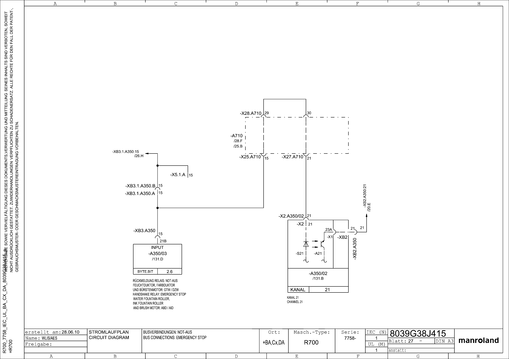

# +BA_Cx_DA — Sheet 27 of 247 — BUSVERBINDUNGEN: NOT AUS

**BUS CONNECTIONS: EMERGENCY STOP**

> Part of the manroland **R700** printing press IEC/UL circuit diagrams.
> Drawing class: **Stromlaufplan / Circuit diagram** (DIN A3).
> Document `+BA_Cx_DA` covers the **Printing units / main switch cabinet** machine section.

## At a glance

| Field | Value |
|---|---|
| Document | `+BA_Cx_DA`  (8039G38J415) |
| Sheet | **27** of 247 |
| Section (DE) | BUSVERBINDUNGEN: NOT AUS |
| Section (EN) | BUS CONNECTIONS: EMERGENCY STOP |
| Section type | CIRCUIT — Circuit diagram |
| Machine type | `R700` |
| Series | `7758` |
| Created | 28.06.10 |
| Replaces | — |
| Columns used | B, C, D, E, F |
| Path numbers | — |
| Labels on sheet | 53 |
| Cross-refs out | 6 |
| Cross-refs in | 16 |

**Previous:** [+BA_Cx_DA sheet 26](SHEET_0026.md) · **Next:** [+BA_Cx_DA sheet 28](SHEET_0028.md) · **Document TOC:** [_TOC.md](_TOC.md)  (+BA_Cx_DA) · **Master TOC:** [all sheets](../_MASTER_TOC.md)

## Sheet image (300 DPI, exact vector render)



_Rendered directly from the PDF vector layer at 300 DPI (1-bit), no OCR and no resampling. Use it to confirm anything ambiguous in the text below._

## Cross-references on this sheet

Each entry is a wire leaving this sheet. The printed token is `/sheet.column`; the link resolves to that sheet inside the same document.

| Ref | Target sheet | Col | Path | Destination on target | Target section | From col |
|---|---|---|---|---|---|---|
| `/28.F` | [+BA_Cx_DA sheet 28](SHEET_0028.md) | F | — | — | BUSVERBINDUNGEN: STOP SICHERN | D |
| `/25.B` | [+BA_Cx_DA sheet 25](SHEET_0025.md) | B | — | — | BUSVERBINDUNGEN: NOT AUS | D |
| `/26.H` | [+BA_Cx_DA sheet 26](SHEET_0026.md) | H | — | XB3.1.A350:15 | BUSVERBINDUNGEN: NOT AUS | B |
| `/20.E` | [+BA_Cx_DA sheet 20](SHEET_0020.md) | E | — | XB2.A350:21 | BUSVERBINDUNGEN: SICHERHEITSBUS | F |
| `/131.D` | [+BA_Cx_DA sheet 131](SHEET_0131.md) | D | — | — | REFERENZMODUL | C |
| `/131.B` | [+BA_Cx_DA sheet 131](SHEET_0131.md) | B | — | — | REFERENZMODUL | E |

### Incoming references (sheets that point here)

Every other sheet that sends a wire to this one. `Back-ref` is the token printed on *that* sheet; `Path` is its line number.

| From sheet | Cols | Back-ref | Path | Refs | What continues there |
|---|---|---|---|---|---|
| [+BA_Cx_DA#20](SHEET_0020.md) | E | `/20.E` | — | 1 | XB2.A350:21 |
| [+BA_Cx_DA#25](SHEET_0025.md) | A | `/25.A` | — | 1 | — |
| [+BA_Cx_DA#26](SHEET_0026.md) | H | `/26.H` | — | 1 | — |
| [+BA_Cx_DA#28](SHEET_0028.md) | F | `/28.F` | — | 1 | — |
| [+BA_Cx_DA#131](SHEET_0131.md) | B, D | `/131.B`, `/131.D` | — | 2 | — |
| [+BA_Cx_DA#153](SHEET_0153.md) | G | `/153.G` | — | 2 | — |
| [+BA_Cx_DA#157](SHEET_0157.md) | C, D, F | `/157.C`, `/157.D`, `/157.F` | — | 3 | — |
| [+BA_Cx_DA#160](SHEET_0160.md) | C | `/160.C` | — | 1 | — |
| [+BA_Cx_DA#175](SHEET_0175.md) | H | `/175.H` | — | 1 | — |
| [+BA_Cx_DA#177](SHEET_0177.md) | F | `/177.F` | — | 1 | — |
| [+BA_Cx_DA#178](SHEET_0178.md) | H | `/178.H` | — | 2 | — |


## Devices on this sheet

| Tag | Class | Class meaning (IEC) | Col | Sub | Terminal | Sign |
|---|---|---|---|---|---|---|
| `A710` | A | Baugruppe / assembly, module, PC board | D | — | — | — |
| `S21` | S | Schalter / switch | E | — | — | — |
| `A21` | A | Baugruppe / assembly, module, PC board | E | — | — | — |
| `X1` | X | Klemme / terminal, plug connector | F | — | — | — |
| `X2` | X | Klemme / terminal, plug connector | E | — | — | — |
| `XB2` | XB |  | F | — | — | — |
| `A350/02` | A | Baugruppe / assembly, module, PC board | E | 02 | — | — |
| `A350/03` | A | Baugruppe / assembly, module, PC board | C | 03 | — | — |
| `X25.A710` | — | cross-device reference | D | — | — | — |
| `X28.A710` | — | cross-device reference | D | — | — | — |
| `X27.A710` | — | cross-device reference | E | — | — | — |
| `XB2.A350` | — | cross-device reference | F | — | — | — |
| `XB3.1.A350.B` | — | cross-device reference | B | — | — | — |
| `XB3.1.A350.A` | — | cross-device reference | B | — | — | — |
| `2.6` | — | cross-device reference | C | — | — | — |
| `XB3.A350` | — | cross-device reference | B | — | — | — |
| `X5.1.A` | — | cross-device reference | C | — | — | — |
| `XB3.1.A350:15` | — | cross-device reference | B | — | 15 | — |
| `XB2.A350:21` | — | cross-device reference | F | — | 21 | — |

## Potentials / nets

_No named potentials on this sheet._

## Wire-end annotations (grouped as printed)

A wire that continues elsewhere is annotated with a small cluster: the destination description, the path/line number `#NN`, and the `/sheet.column` cross reference. Each row below is one such cluster exactly as it is grouped on the drawing.

| Col | Y | Path | Cross-ref | Text on the wire |
|---|---|---|---|---|
| D | 261.1 | — | — | `X28.A710 29` |
| E | 261.1 | — | — | `30` |
| D | 313.5 | — | — | `A710` |
| D | 326.6 | — | `/28.F`, `/25.B` | — |
| B | 351.8 | — | `/26.H` | `XB3.1.A350:15` |
| D | 363.1 | — | — | `X25.A710 15` |
| E | 363.1 | — | — | `X27.A710 21` |
| C | 405.0 | — | — | `X5.1.A 15` |
| B | 431.2 | — | — | `XB3.1.A350.B 15` |
| F | 431.7 | — | `/20.E` | `XB2.A350:21` |
| B | 448.2 | — | — | `XB3.1.A350.A 15` |
| E | 502.0 | — | — | `X2.A350/02 21` |
| E | 520.5 | — | — | `X2` |
| F | 521.9 | — | — | `21 21` |
| F | 530.4 | — | — | `21` |
| F | 534.6 | — | — | `23A` |
| C | 536.1 | — | — | `XB3.A350 15` |
| F | 551.6 | — | — | `X1` |
| F | 551.7 | — | — | `XB2` |
| F | 557.9 | — | — | `XB2.A350` |
| C | 561.5 | — | — | `21B` |
| C | 576.1 | — | — | `INPUT` |
| C | 589.9 | — | — | `A350/03` |
| E | 590.6 | — | — | `S21 A21` |
| C | 603.7 | — | `/131.D` | — |
| C | 632.7 | — | — | `BYTE.BIT 2.6` |
| E | 636.7 | — | — | `A350/02` |
| E | 649.0 | — | `/131.B` | — |
| C | 655.4 | — | — | `RÜCKMELDUNG RELAIS: NOT AUS FEUCHTDUKTOR, FARBDUKTOR UND BÜRSTENMOTOR: GTW / DZW HANDSHAKE RELAY: EMERGENCY STOP` |
| E | 674.9 | — | — | `KANAL 21` |
| E | 695.2 | — | — | `KANAL 21 CHANNEL 21` |
| C | 698.0 | — | — | `INK FOUNTAIN ROLLER WATER FOUNTAIN ROLLER,` |
| C | 719.2 | — | — | `AND BRUSH MOTOR: ABD / AID` |


## Reconstructed tables

This sheet carries tabular content (pin map / terminal assignment / index). The grid below was rebuilt from the drawing's own rule lines, so each row is exactly one physical row of the table.

### Table 1 — 3 data rows × 2 columns (at x=311.8, y=388.3)

| XB3.1.A350.B XB3.1.A350.A | X5.1.A 15 15 |
|---|---|
| `XB3.A350` | `15 21B` |
| `INPUT` | `A350/03 /131.D` |
| `BYTE.BIT` | `2.6` |


### Table 2 — 4 data rows × 6 columns (at x=616.5, y=232.4)

| 29 15 | X27.A710 | 30 21 |  |  | XB2.A350:21 |
|---|---|---|---|---|---|
|  | `X2.A350/02` | `21` |  |  |  |
|  | `X2 S21` | `21 A21` | `23A X1` | `XB2` | `21 21 XB2.A350` |
|  |  | `A350/02 /131.B` |  |  |  |
|  | `KANAL` |  | `21` |  |  |


## Notes and free text on this sheet

| Text | Col | Y (pt) |
|---|---|---|
| `KANAL 21` | E | 695.24 |
| `CHANNEL 21` | E | 705.19 |
| `23A` | F | 534.62 |
| `KANAL` | E | 674.94 |
| `X2.A350/02` | E | 502.04 |
| `21B` | C | 561.55 |
| `INPUT` | C | 576.07 |
| `BYTE.BIT` | B | 633.32 |
| `RÜCKMELDUNG RELAIS: NOT AUS` | C | 655.44 |
| `FEUCHTDUKTOR, FARBDUKTOR` | C | 666.07 |
| `UND BÜRSTENMOTOR: GTW / DZW` | C | 676.67 |
| `HANDSHAKE RELAY: EMERGENCY STOP` | C | 687.33 |
| `WATER FOUNTAIN ROLLER,` | C | 697.95 |
| `INK FOUNTAIN ROLLER` | C | 708.6 |
| `AND BRUSH MOTOR: ABD / AID` | C | 719.23 |

## Complete label inventory (exact text from the drawing)

Every text object inside the drawing area of this sheet, in DIN reading order (column A→H, then top→bottom). This is the authoritative list: if a string is not here it is not printed on this sheet.

| Col | Y | X | Dir | Type | Text |
|---|---|---|---|---|---|
| B | 351.8 | 262.8 | → | device ref | `XB3.1.A350:15` |
| B | 361.7 | 314.4 | → | cross-reference | `/26.H` |
| B | 431.2 | 293.4 | → | device ref | `XB3.1.A350.B` |
| B | 448.9 | 292.5 | → | device ref | `XB3.1.A350.A` |
| B | 536.1 | 312.1 | → | device ref | `XB3.A350` |
| B | 633.3 | 321.7 | → | text | `BYTE.BIT` |
| C | 405.0 | 398.3 | → | device ref | `X5.1.A` |
| C | 407.1 | 441.4 | → | number | `15` |
| C | 431.2 | 370.5 | → | number | `15` |
| C | 448.2 | 370.5 | → | number | `15` |
| C | 544.6 | 370.5 | → | number | `15` |
| C | 561.5 | 373.9 | → | text | `21B` |
| C | 576.1 | 353.6 | → | text | `INPUT` |
| C | 589.9 | 347.1 | → | device tag | `A350/03` |
| C | 603.7 | 355.7 | → | cross-reference | `/131.D` |
| C | 632.7 | 390.0 | → | device ref | `2.6` |
| C | 655.4 | 311.0 | → | text | `RÜCKMELDUNG RELAIS: NOT AUS` |
| C | 666.1 | 311.0 | → | text | `FEUCHTDUKTOR, FARBDUKTOR` |
| C | 676.7 | 311.0 | → | text | `UND BÜRSTENMOTOR: GTW / DZW` |
| C | 687.3 | 311.0 | → | text | `HANDSHAKE RELAY: EMERGENCY STOP` |
| C | 697.9 | 311.8 | → | text | `WATER FOUNTAIN ROLLER,` |
| C | 708.6 | 311.0 | → | text | `INK FOUNTAIN ROLLER` |
| C | 719.2 | 311.8 | → | text | `AND BRUSH MOTOR: ABD / AID` |
| D | 261.1 | 561.3 | → | device ref | `X28.A710` |
| D | 313.5 | 539.1 | → | device tag | `A710` |
| D | 326.6 | 547.1 | → | cross-reference | `/28.F` |
| D | 339.0 | 546.5 | → | cross-reference | `/25.B` |
| D | 363.1 | 559.8 | → | device ref | `X25.A710` |
| D | 367.4 | 618.5 | → | number | `15` |
| E | 261.1 | 619.1 | → | number | `29` |
| E | 261.1 | 718.3 | → | number | `30` |
| E | 363.1 | 659.1 | → | device ref | `X27.A710` |
| E | 367.4 | 718.3 | → | number | `21` |
| E | 502.0 | 651.7 | → | text | `X2.A350/02` |
| E | 502.1 | 718.3 | → | number | `21` |
| E | 520.5 | 694.2 | → | device tag | `X2` |
| E | 521.9 | 721.1 | → | number | `21` |
| E | 590.6 | 691.9 | → | device tag | `S21` |
| E | 590.6 | 734.5 | → | device tag | `A21` |
| E | 636.7 | 722.7 | → | device tag | `A350/02` |
| E | 649.0 | 731.5 | → | cross-reference | `/131.B` |
| E | 674.9 | 679.5 | → | text | `KANAL` |
| E | 695.2 | 671.2 | → | text | `KANAL 21` |
| E | 705.2 | 671.5 | → | text | `CHANNEL 21` |
| F | 431.7 | 849.3 | ↕ | device ref | `XB2.A350:21` |
| F | 475.4 | 859.1 | ↕ | cross-reference | `/20.E` |
| F | 530.4 | 842.5 | → | number | `21` |
| F | 531.8 | 820.3 | → | number | `21` |
| F | 534.6 | 761.1 | → | text | `23A` |
| F | 551.6 | 764.8 | → | device tag | `X1` |
| F | 551.7 | 789.2 | → | device tag | `XB2` |
| F | 557.9 | 825.2 | ↕ | device ref | `XB2.A350` |
| F | 674.9 | 760.3 | → | number | `21` |

## Reading-order text block

The same content as a plain block, grouped by DIN column — convenient to paste or to match against a visual description.

```text
=== Column B ===
 351.8  262.8  devref       XB3.1.A350:15
 361.7  314.4  xref         /26.H
 431.2  293.4  devref       XB3.1.A350.B
 448.9  292.5  devref       XB3.1.A350.A
 536.1  312.1  devref       XB3.A350
 633.3  321.7  text         BYTE.BIT
=== Column C ===
 405.0  398.3  devref       X5.1.A
 407.1  441.4  numeric      15
 431.2  370.5  numeric      15
 448.2  370.5  numeric      15
 544.6  370.5  numeric      15
 561.5  373.9  text         21B
 576.1  353.6  text         INPUT
 589.9  347.1  devtag       A350/03
 603.7  355.7  xref         /131.D
 632.7  390.0  devref       2.6
 655.4  311.0  text         RÜCKMELDUNG RELAIS: NOT AUS
 666.1  311.0  text         FEUCHTDUKTOR, FARBDUKTOR
 676.7  311.0  text         UND BÜRSTENMOTOR: GTW / DZW
 687.3  311.0  text         HANDSHAKE RELAY: EMERGENCY STOP
 697.9  311.8  text         WATER FOUNTAIN ROLLER,
 708.6  311.0  text         INK FOUNTAIN ROLLER
 719.2  311.8  text         AND BRUSH MOTOR: ABD / AID
=== Column D ===
 261.1  561.3  devref       X28.A710
 313.5  539.1  devtag       A710
 326.6  547.1  xref         /28.F
 339.0  546.5  xref         /25.B
 363.1  559.8  devref       X25.A710
 367.4  618.5  numeric      15
=== Column E ===
 261.1  619.1  numeric      29
 261.1  718.3  numeric      30
 363.1  659.1  devref       X27.A710
 367.4  718.3  numeric      21
 502.0  651.7  text         X2.A350/02
 502.1  718.3  numeric      21
 520.5  694.2  devtag       X2
 521.9  721.1  numeric      21
 590.6  691.9  devtag       S21
 590.6  734.5  devtag       A21
 636.7  722.7  devtag       A350/02
 649.0  731.5  xref         /131.B
 674.9  679.5  text         KANAL
 695.2  671.2  text         KANAL 21
 705.2  671.5  text         CHANNEL 21
=== Column F ===
 431.7  849.3  devref       XB2.A350:21
 475.4  859.1  xref         /20.E
 530.4  842.5  numeric      21
 531.8  820.3  numeric      21
 534.6  761.1  text         23A
 551.6  764.8  devtag       X1
 551.7  789.2  devtag       XB2
 557.9  825.2  devref       XB2.A350
 674.9  760.3  numeric      21
```

---
_Generated from the PDF vector text layer; no OCR. Source: `R700_7758_IEC_UL_BA_CX_DA_8039G38J415_p`, sheet 27._
