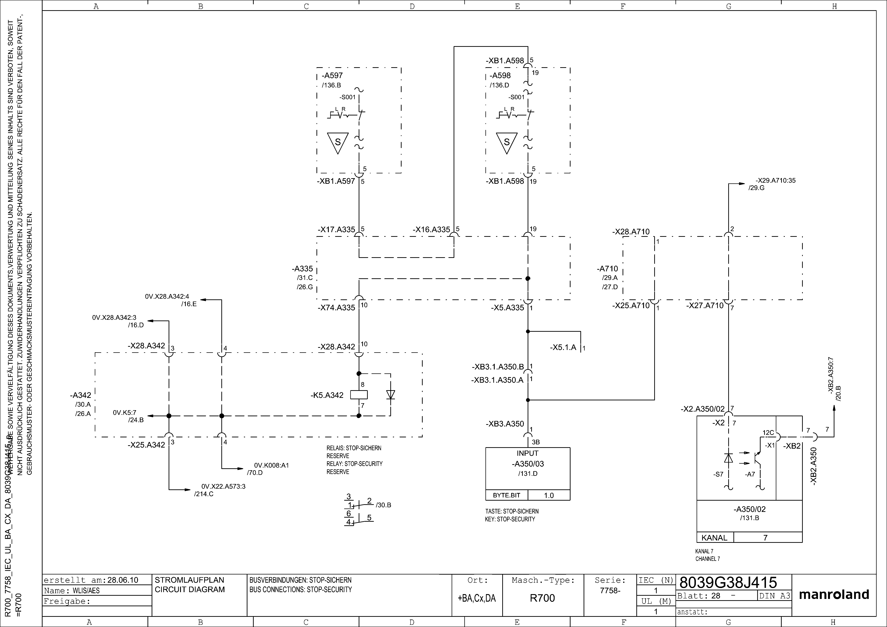

# +BA_Cx_DA — Sheet 28 of 247 — BUSVERBINDUNGEN: STOP SICHERN

**BUS CONNECTIONS: STOP SECURITY**

> Part of the manroland **R700** printing press IEC/UL circuit diagrams.
> Drawing class: **Stromlaufplan / Circuit diagram** (DIN A3).
> Document `+BA_Cx_DA` covers the **Printing units / main switch cabinet** machine section.

## At a glance

| Field | Value |
|---|---|
| Document | `+BA_Cx_DA`  (8039G38J415) |
| Sheet | **28** of 247 |
| Section (DE) | BUSVERBINDUNGEN: STOP SICHERN |
| Section (EN) | BUS CONNECTIONS: STOP SECURITY |
| Section type | CIRCUIT — Circuit diagram |
| Machine type | `R700` |
| Series | `7758` |
| Created | 28.06.10 |
| Replaces | — |
| Columns used | A, B, C, D, E, F, G, H |
| Path numbers | — |
| Labels on sheet | 114 |
| Cross-refs out | 18 |
| Cross-refs in | 41 |

**Previous:** [+BA_Cx_DA sheet 27](SHEET_0027.md) · **Next:** [+BA_Cx_DA sheet 29](SHEET_0029.md) · **Document TOC:** [_TOC.md](_TOC.md)  (+BA_Cx_DA) · **Master TOC:** [all sheets](../_MASTER_TOC.md)

## Sheet image (300 DPI, exact vector render)



_Rendered directly from the PDF vector layer at 300 DPI (1-bit), no OCR and no resampling. Use it to confirm anything ambiguous in the text below._

## Cross-references on this sheet

Each entry is a wire leaving this sheet. The printed token is `/sheet.column`; the link resolves to that sheet inside the same document.

| Ref | Target sheet | Col | Path | Destination on target | Target section | From col |
|---|---|---|---|---|---|---|
| `/136.B` | [+BA_Cx_DA sheet 136](SHEET_0136.md) | B | — | A597 | REFERENZMODUL | C |
| `/136.D` | [+BA_Cx_DA sheet 136](SHEET_0136.md) | D | — | A598 | REFERENZMODUL | E |
| `/29.G` | [+BA_Cx_DA sheet 29](SHEET_0029.md) | G | — | — | BUSVERBINDUNGEN: STOP SICHERN | G |
| `/29.A` | [+BA_Cx_DA sheet 29](SHEET_0029.md) | A | — | — | BUSVERBINDUNGEN: STOP SICHERN | F |
| `/27.D` | [+BA_Cx_DA sheet 27](SHEET_0027.md) | D | — | — | BUSVERBINDUNGEN: NOT AUS | F |
| `/31.C` | [+BA_Cx_DA sheet 31](SHEET_0031.md) | C | — | — | BUSVERBINDUNGEN: SIGNALSCHLEIFE | C |
| `/26.G` | [+BA_Cx_DA sheet 26](SHEET_0026.md) | G | — | — | BUSVERBINDUNGEN: NOT AUS | C |
| `/16.E` | [+BA_Cx_DA sheet 16](SHEET_0016.md) | E | — | 0V.X28.A342:4 | SPANNUNGSVERSORGUNG, SCHALTSCHRANKBELÜFTUNG | B |
| `/16.D` | [+BA_Cx_DA sheet 16](SHEET_0016.md) | D | — | 0V.X28.A342:3 | SPANNUNGSVERSORGUNG, SCHALTSCHRANKBELÜFTUNG | A |
| `/20.B` | [+BA_Cx_DA sheet 20](SHEET_0020.md) | B | — | XB2.A350:7 | BUSVERBINDUNGEN: SICHERHEITSBUS | H |
| `/30.A` | [+BA_Cx_DA sheet 30](SHEET_0030.md) | A | — | — | BUSVERBINDUNGEN: STOP SICHERN | A |
| `/26.A` | [+BA_Cx_DA sheet 26](SHEET_0026.md) | A | — | — | BUSVERBINDUNGEN: NOT AUS | A |
| `/24.B` | [+BA_Cx_DA sheet 24](SHEET_0024.md) | B | — | 0V.K5:7 | BUSVERBINDUNGEN: NOT AUS | A |
| `/70.D` | [+BA_Cx_DA sheet 70](SHEET_0070.md) | D | — | — | ÖLUMLAUFSCHMIERUNG | C |
| `/131.D` | [+BA_Cx_DA sheet 131](SHEET_0131.md) | D | — | — | REFERENZMODUL | E |
| `/214.C` | [+BA_Cx_DA sheet 214](SHEET_0214.md) | C | — | — | OPTION: FWW SPEZIALREINIGER | B |
| `/30.B` | [+BA_Cx_DA sheet 30](SHEET_0030.md) | B | — | — | BUSVERBINDUNGEN: STOP SICHERN | D |
| `/131.B` | [+BA_Cx_DA sheet 131](SHEET_0131.md) | B | — | — | REFERENZMODUL | G |

### Incoming references (sheets that point here)

Every other sheet that sends a wire to this one. `Back-ref` is the token printed on *that* sheet; `Path` is its line number.

| From sheet | Cols | Back-ref | Path | Refs | What continues there |
|---|---|---|---|---|---|
| [+BA_Cx_DA#16](SHEET_0016.md) | D | `/16.D` | — | 2 | — |
| [+BA_Cx_DA#20](SHEET_0020.md) | B | `/20.B` | — | 1 | XB2.A350:7 |
| [+BA_Cx_DA#24](SHEET_0024.md) | B | `/24.B` | — | 1 | — |
| [+BA_Cx_DA#26](SHEET_0026.md) | A, G | `/26.A`, `/26.G` | — | 2 | — |
| [+BA_Cx_DA#27](SHEET_0027.md) | D | `/27.D` | — | 1 | — |
| [+BA_Cx_DA#29](SHEET_0029.md) | A, D | `/29.A`, `/29.D` | — | 2 | 24V.X29.A710:31 X29.A710:35 |
| [+BA_Cx_DA#30](SHEET_0030.md) | A, B | `/30.A`, `/30.B` | — | 2 | — |
| [+BA_Cx_DA#31](SHEET_0031.md) | C | `/31.C` | — | 1 | — |
| [+BA_Cx_DA#70](SHEET_0070.md) | D | `/70.D` | — | 1 | 0V.K008:A1 0V.K270:A1 |
| [+BA_Cx_DA#131](SHEET_0131.md) | B, D | `/131.B`, `/131.D` | — | 2 | — |
| [+BA_Cx_DA#136](SHEET_0136.md) | B, D | `/136.B`, `/136.D` | — | 2 | — |
| [+BA_Cx_DA#143](SHEET_0143.md) | B, D | `/143.B`, `/143.D` | — | 3 | — |
| [+BA_Cx_DA#153](SHEET_0153.md) | F | `/153.F` | — | 2 | — |
| [+BA_Cx_DA#157](SHEET_0157.md) | C, D, F | `/157.C`, `/157.D`, `/157.F` | — | 3 | — |
| [+BA_Cx_DA#160](SHEET_0160.md) | C | `/160.C` | — | 1 | — |
| [+BA_Cx_DA#161](SHEET_0161.md) | A | `/161.A` | — | 1 | — |
| [+BA_Cx_DA#172](SHEET_0172.md) | B | `/172.B` | — | 2 | — |
| [+BA_Cx_DA#173](SHEET_0173.md) | B | `/173.B` | — | 1 | — |
| [+BA_Cx_DA#175](SHEET_0175.md) | F, H | `/175.F`, `/175.H` | — | 3 | — |
| [+BA_Cx_DA#177](SHEET_0177.md) | E | `/177.E` | — | 1 | — |
| [+BA_Cx_DA#178](SHEET_0178.md) | F, G | `/178.F`, `/178.G` | — | 5 | — |
| [+BA_Cx_DA#184](SHEET_0184.md) | F | `/184.F` | — | 1 | — |
| [+BA_Cx_DA#214](SHEET_0214.md) | C | `/214.C` | — | 1 | 0V.X22.A573:3 |


## Devices on this sheet

| Tag | Class | Class meaning (IEC) | Col | Sub | Terminal | Sign |
|---|---|---|---|---|---|---|
| `S001` | S | Schalter / switch | E | — | — | — |
| `A598` | A | Baugruppe / assembly, module, PC board | E | — | — | — |
| `S001` | S | Schalter / switch | C | — | — | — |
| `A597` | A | Baugruppe / assembly, module, PC board | C | — | — | — |
| `A342` | A | Baugruppe / assembly, module, PC board | A | — | — | — |
| `A335` | A | Baugruppe / assembly, module, PC board | C | — | — | — |
| `A350/03` | A | Baugruppe / assembly, module, PC board | E | 03 | — | — |
| `A710` | A | Baugruppe / assembly, module, PC board | F | — | — | — |
| `S7` | S | Schalter / switch | G | — | — | — |
| `A7` | A | Baugruppe / assembly, module, PC board | G | — | — | — |
| `X1` | X | Klemme / terminal, plug connector | G | — | — | — |
| `X2` | X | Klemme / terminal, plug connector | G | — | — | — |
| `XB2` | XB |  | H | — | — | — |
| `A350/02` | A | Baugruppe / assembly, module, PC board | G | 02 | — | — |
| `XB1.A598` | — | cross-device reference | E | — | — | — |
| `X28.A342` | — | cross-device reference | C | — | — | — |
| `XB1.A597` | — | cross-device reference | C | — | — | — |
| `X28.A342` | — | cross-device reference | A | — | — | — |
| `XB1.A598` | — | cross-device reference | E | — | — | — |
| `X5.A335` | — | cross-device reference | E | — | — | — |
| `X74.A335` | — | cross-device reference | C | — | — | — |
| `X17.A335` | — | cross-device reference | C | — | — | — |
| `X16.A335` | — | cross-device reference | D | — | — | — |
| `K5.A342` | — | cross-device reference | C | — | — | — |
| `X25.A342` | — | cross-device reference | A | — | — | — |
| `1.0` | — | cross-device reference | E | — | — | — |
| `XB3.A350` | — | cross-device reference | E | — | — | — |
| `X25.A710` | — | cross-device reference | F | — | — | — |
| `X27.A710` | — | cross-device reference | G | — | — | — |
| `XB2.A350` | — | cross-device reference | H | — | — | — |
| `XB3.1.A350.B` | — | cross-device reference | E | — | — | — |
| `XB3.1.A350.A` | — | cross-device reference | E | — | — | — |
| `X5.1.A` | — | cross-device reference | E | — | — | — |
| `X29.A710:35` | — | cross-device reference | G | — | 35 | — |
| `XB2.A350:7` | — | cross-device reference | H | — | 7 | — |
| `X28.A710` | — | cross-device reference | F | — | — | — |

## Potentials / nets

| Potential | Count | Columns | Attached devices | Terminals |
|---|---|---|---|---|
| `0V` | 5 | A, B, C | `A342`, `A573`, `K008`, `K5`, `X22`, `X28` | `3`, `4`, `7`, `A1` |


A potential such as `L24+/4` or `M24+` is a named supply/return rail; every place it appears on this sheet is electrically common.

## Wire-end annotations (grouped as printed)

A wire that continues elsewhere is annotated with a small cluster: the destination description, the path/line number `#NN`, and the `/sheet.column` cross reference. Each row below is one such cluster exactly as it is grouped on the drawing.

| Col | Y | Path | Cross-ref | Text on the wire |
|---|---|---|---|---|
| E | 76.8 | — | — | `XB1.A598 5` |
| E | 93.9 | — | — | `19` |
| C | 96.7 | — | `/136.B` | `A597` |
| E | 96.7 | — | `/136.D` | `A598` |
| C | 126.9 | — | — | `S001` |
| E | 126.9 | — | — | `S001` |
| D | 143.3 | — | — | `L R L R` |
| D | 185.3 | — | — | `S S` |
| D | 222.8 | — | — | `5` |
| E | 222.8 | — | — | `5` |
| C | 238.4 | — | — | `XB1.A597 5` |
| E | 238.4 | — | — | `XB1.A598 19` |
| G | 238.4 | — | — | `X29.A710:35` |
| G | 248.3 | — | `/29.G` | — |
| D | 303.6 | — | — | `X17.A335 5 X16.A335 5 19` |
| G | 303.6 | — | — | `2` |
| F | 306.4 | — | — | `X28.A710` |
| F | 320.6 | — | — | `1` |
| C | 356.1 | — | — | `A335` |
| F | 356.1 | — | — | `A710` |
| C | 369.1 | — | `/31.C`, `/26.G` | — |
| F | 369.1 | — | `/29.A`, `/27.D` | — |
| B | 394.3 | — | `/16.E` | `0V.X28.A342:4` |
| D | 405.7 | — | — | `X74.A335 10 X5.A335 1` |
| F | 405.7 | — | — | `X25.A710 1` |
| G | 405.7 | — | — | `X27.A710 7` |
| A | 422.6 | — | `/16.D` | `0V.X28.A342:3` |
| C | 458.1 | — | — | `X28.A342 10` |
| B | 459.5 | — | — | `X28.A342 3 4` |
| E | 461.7 | — | — | `X5.1.A 1` |
| H | 479.1 | — | `/20.B` | `XB2.A350:7` |
| E | 487.9 | — | — | `XB3.1.A350.B 1` |
| E | 504.9 | — | — | `XB3.1.A350.A 1` |
| D | 512.7 | — | — | `8` |
| A | 526.1 | — | — | `A342` |
| C | 526.1 | — | — | `K5.A342 7` |
| A | 539.2 | — | `/30.A`, `/26.A` | — |
| G | 544.6 | — | — | `X2.A350/02 7` |
| A | 550.2 | — | `/24.B` | `0V.K5:7` |
| G | 563.0 | — | — | `X2` |
| E | 564.4 | — | — | `XB3.A350 1` |
| G | 564.4 | — | — | `7 7` |
| H | 572.9 | — | — | `7` |
| G | 577.2 | — | — | `12C` |
| C | 589.9 | — | — | `X25.A342 3 4 3B` |
| G | 594.1 | — | — | `X1` |
| H | 594.2 | — | — | `XB2` |
| C | 598.7 | — | — | `RELAIS: STOP SICHERN RESERVE RELAY: STOP SECURITY RESERVE` |
| H | 600.4 | — | — | `XB2.A350` |
| E | 604.4 | — | — | `INPUT` |
| E | 618.3 | — | — | `A350/03` |
| C | 621.0 | — | — | `0V.K008:A1` |
| C | 631.0 | — | `/70.D` | — |
| E | 632.1 | — | `/131.D` | — |
| G | 633.1 | — | — | `S7 A7` |
| B | 649.4 | — | — | `0V.X22.A573:3` |
| B | 659.4 | — | `/214.C` | — |
| E | 661.1 | — | — | `BYTE.BIT 1.0` |
| C | 662.2 | — | — | `3 6 4 1` |
| D | 667.8 | — | — | `2` |
| D | 674.2 | — | `/30.B` | — |
| G | 679.2 | — | — | `A350/02` |
| E | 683.8 | — | — | `KEY: STOP SECURITY TASTE: STOP SICHERN` |
| D | 690.5 | — | — | `5` |
| G | 691.6 | — | `/131.B` | — |
| G | 717.4 | — | — | `KANAL 7` |
| G | 737.8 | — | — | `KANAL 7 CHANNEL 7` |


## Reconstructed tables

This sheet carries tabular content (pin map / terminal assignment / index). The grid below was rebuilt from the drawing's own rule lines, so each row is exactly one physical row of the table.

### Table 1 — 7 data rows × 2 columns (at x=425.2, y=62.4)

| A597 /136.B S001 L R S | 5 |
|---|---|
| `XB1.A597 X17.A335` | `5 5` |
| `X74.A335` | `10` |
| `X28.A342` | `10` |
| `K5.A342` | `8` |
|  | `7` |
| `RELAIS: RESERVE RELAY: RESERVE` | `STOP SICHERN STOP SECURITY` |
| `3` |  |


### Table 2 — 8 data rows × 4 columns (at x=538.6, y=62.4)

|  |  | XB1.A598 | 5 |
|---|---|---|---|
|  |  | `A598 /136.D S001 L R S` | `19 5` |
| `X16.A335` | `5` | `XB1.A598` | `19 19` |
|  |  | `X5.A335` | `1` |
|  |  | `XB3.1.A350.B` | `X5.1.A 1` |
|  |  | `XB3.1.A350.A` | `1` |
|  |  | `XB3.A350` | `1 3B` |
|  |  | `INPUT` | `A350/03 /131.D` |
|  |  | `BYTE.BIT` | `1.0` |


### Table 3 — 3 data rows × 5 columns (at x=935.4, y=537.2)

| X2.A350/02 | 7 |  |  |  |
|---|---|---|---|---|
| `X2 S7` | `7 A7` | `12C X1` | `XB2` | `7 7 XB2.A350` |
|  | `A350/02 /131.B` |  |  |  |
| `KANAL` |  | `7` |  |  |


## Notes and free text on this sheet

| Text | Col | Y (pt) |
|---|---|---|
| `RELAIS: STOP SICHERN` | C | 598.72 |
| `RESERVE` | C | 609.33 |
| `RELAY: STOP SECURITY` | C | 619.99 |
| `3B` | E | 589.88 |
| `INPUT` | E | 604.42 |
| `BYTE.BIT` | E | 661.67 |
| `TASTE: STOP SICHERN` | E | 683.76 |
| `KEY: STOP SECURITY` | E | 694.39 |
| `KANAL 7` | G | 737.79 |
| `CHANNEL 7` | G | 747.73 |
| `12C` | G | 577.18 |
| `KANAL` | G | 717.46 |
| `X2.A350/02` | G | 544.56 |
| `L R` | E | 143.33 |
| `L R` | C | 143.33 |
| `S` | E | 185.34 |
| `S` | C | 185.34 |

## Complete label inventory (exact text from the drawing)

Every text object inside the drawing area of this sheet, in DIN reading order (column A→H, then top→bottom). This is the authoritative list: if a string is not here it is not printed on this sheet.

| Col | Y | X | Dir | Type | Text |
|---|---|---|---|---|---|
| A | 422.6 | 123.9 | → | potential | `0V.X28.A342:3` |
| A | 432.6 | 172.1 | → | cross-reference | `/16.D` |
| A | 459.5 | 171.5 | → | device ref | `X28.A342` |
| A | 526.1 | 94.1 | → | device tag | `A342` |
| A | 539.2 | 101.2 | → | cross-reference | `/30.A` |
| A | 550.2 | 151.7 | → | potential | `0V.K5:7` |
| A | 551.6 | 101.2 | → | cross-reference | `/26.A` |
| A | 560.1 | 172.3 | → | cross-reference | `/24.B` |
| A | 592.7 | 171.5 | → | device ref | `X25.A342` |
| B | 394.3 | 194.7 | → | potential | `0V.X28.A342:4` |
| B | 404.2 | 243.5 | → | cross-reference | `/16.E` |
| B | 463.8 | 229.3 | → | number | `3` |
| B | 463.8 | 300.2 | → | number | `4` |
| B | 589.9 | 229.3 | → | number | `3` |
| B | 589.9 | 300.2 | → | number | `4` |
| B | 649.4 | 270.4 | → | potential | `0V.X22.A573:3` |
| B | 659.3 | 260.8 | → | cross-reference | `/214.C` |
| C | 96.7 | 432.0 | → | device tag | `A597` |
| C | 110.5 | 432.3 | → | cross-reference | `/136.B` |
| C | 126.9 | 455.8 | → | device tag | `S001` |
| C | 143.3 | 450.0 | → | text | `L R` |
| C | 185.3 | 449.4 | → | text | `S` |
| C | 238.4 | 425.5 | → | device ref | `XB1.A597` |
| C | 303.6 | 426.6 | → | device ref | `X17.A335` |
| C | 356.1 | 391.7 | → | device tag | `A335` |
| C | 369.1 | 398.8 | → | cross-reference | `/31.C` |
| C | 381.5 | 398.6 | → | cross-reference | `/26.G` |
| C | 408.5 | 426.6 | → | device ref | `X74.A335` |
| C | 460.9 | 426.6 | → | device ref | `X28.A342` |
| C | 526.1 | 417.0 | → | device ref | `K5.A342` |
| C | 598.7 | 438.5 | → | text | `RELAIS: STOP SICHERN` |
| C | 609.3 | 438.5 | → | text | `RESERVE` |
| C | 620.0 | 438.5 | → | text | `RELAY: STOP SECURITY` |
| C | 621.1 | 341.3 | → | potential | `0V.K008:A1` |
| C | 630.6 | 438.5 | → | text | `RESERVE` |
| C | 631.0 | 331.7 | → | cross-reference | `/70.D` |
| C | 662.2 | 465.2 | → | number | `3` |
| C | 673.5 | 466.6 | → | number | `1` |
| C | 684.8 | 465.2 | → | number | `6` |
| C | 696.2 | 465.2 | → | number | `4` |
| D | 222.8 | 487.3 | → | number | `5` |
| D | 239.9 | 484.4 | → | number | `5` |
| D | 303.6 | 484.4 | → | number | `5` |
| D | 303.6 | 554.2 | → | device ref | `X16.A335` |
| D | 303.6 | 612.0 | → | number | `5` |
| D | 405.7 | 483.9 | → | number | `10` |
| D | 458.1 | 483.9 | → | number | `10` |
| D | 512.7 | 484.4 | → | number | `8` |
| D | 541.0 | 484.4 | → | number | `7` |
| D | 667.8 | 492.9 | → | number | `2` |
| D | 674.2 | 504.6 | → | cross-reference | `/30.B` |
| D | 690.5 | 492.7 | → | number | `5` |
| E | 76.8 | 652.3 | → | device ref | `XB1.A598` |
| E | 76.9 | 711.2 | → | number | `5` |
| E | 93.9 | 713.5 | → | number | `19` |
| E | 96.7 | 657.4 | → | device tag | `A598` |
| E | 110.5 | 657.6 | → | cross-reference | `/136.D` |
| E | 126.9 | 682.6 | → | device tag | `S001` |
| E | 143.3 | 676.8 | → | text | `L R` |
| E | 185.3 | 676.2 | → | text | `S` |
| E | 222.8 | 714.0 | → | number | `5` |
| E | 238.4 | 652.3 | → | device ref | `XB1.A598` |
| E | 239.9 | 710.6 | → | number | `19` |
| E | 303.6 | 710.6 | → | number | `19` |
| E | 408.5 | 659.3 | → | device ref | `X5.A335` |
| E | 409.9 | 710.6 | → | number | `1` |
| E | 461.7 | 738.4 | → | device ref | `X5.1.A` |
| E | 487.9 | 633.5 | → | device ref | `XB3.1.A350.B` |
| E | 487.9 | 710.6 | → | number | `1` |
| E | 504.9 | 710.6 | → | number | `1` |
| E | 505.6 | 632.7 | → | device ref | `XB3.1.A350.A` |
| E | 564.4 | 652.3 | → | device ref | `XB3.A350` |
| E | 572.9 | 710.6 | → | number | `1` |
| E | 589.9 | 714.0 | → | text | `3B` |
| E | 604.4 | 693.8 | → | text | `INPUT` |
| E | 618.3 | 687.3 | → | device tag | `A350/03` |
| E | 632.1 | 695.9 | → | cross-reference | `/131.D` |
| E | 661.1 | 729.9 | → | device ref | `1.0` |
| E | 661.7 | 661.9 | → | text | `BYTE.BIT` |
| E | 683.8 | 651.7 | → | text | `TASTE: STOP SICHERN` |
| E | 694.4 | 651.1 | → | text | `KEY: STOP SECURITY` |
| F | 306.4 | 822.0 | → | device ref | `X28.A710` |
| F | 320.6 | 880.7 | → | number | `1` |
| F | 356.1 | 801.4 | → | device tag | `A710` |
| F | 369.1 | 808.4 | → | cross-reference | `/29.A` |
| F | 381.5 | 808.4 | → | cross-reference | `/27.D` |
| F | 405.7 | 822.0 | → | device ref | `X25.A710` |
| F | 409.9 | 880.7 | → | number | `1` |
| F | 463.8 | 781.5 | → | number | `1` |
| G | 238.4 | 1014.5 | → | device ref | `X29.A710:35` |
| G | 248.3 | 1004.9 | → | cross-reference | `/29.G` |
| G | 303.6 | 980.5 | → | number | `2` |
| G | 405.7 | 921.3 | → | device ref | `X27.A710` |
| G | 409.9 | 980.5 | → | number | `7` |
| G | 544.6 | 913.9 | → | text | `X2.A350/02` |
| G | 544.6 | 980.5 | → | number | `7` |
| G | 563.0 | 956.4 | → | device tag | `X2` |
| G | 564.4 | 983.3 | → | number | `7` |
| G | 577.2 | 1023.3 | → | text | `12C` |
| G | 594.2 | 1027.0 | → | device tag | `X1` |
| G | 633.1 | 957.5 | → | device tag | `S7` |
| G | 633.1 | 1000.1 | → | device tag | `A7` |
| G | 679.2 | 984.9 | → | device tag | `A350/02` |
| G | 691.6 | 993.7 | → | cross-reference | `/131.B` |
| G | 717.4 | 1024.7 | → | number | `7` |
| G | 717.5 | 941.7 | → | text | `KANAL` |
| G | 737.8 | 933.4 | → | text | `KANAL 7` |
| G | 747.7 | 933.7 | → | text | `CHANNEL 7` |
| H | 479.1 | 1111.5 | ↕ | device ref | `XB2.A350:7` |
| H | 517.9 | 1121.4 | ↕ | cross-reference | `/20.B` |
| H | 572.9 | 1108.1 | → | number | `7` |
| H | 574.3 | 1082.6 | → | number | `7` |
| H | 594.2 | 1051.4 | → | device tag | `XB2` |
| H | 600.4 | 1087.4 | ↕ | device ref | `XB2.A350` |

## Reading-order text block

The same content as a plain block, grouped by DIN column — convenient to paste or to match against a visual description.

```text
=== Column A ===
 422.6  123.9  net          0V.X28.A342:3
 432.6  172.1  xref         /16.D
 459.5  171.5  devref       X28.A342
 526.1   94.1  devtag       A342
 539.2  101.2  xref         /30.A
 550.2  151.7  net          0V.K5:7
 551.6  101.2  xref         /26.A
 560.1  172.3  xref         /24.B
 592.7  171.5  devref       X25.A342
=== Column B ===
 394.3  194.7  net          0V.X28.A342:4
 404.2  243.5  xref         /16.E
 463.8  229.3  numeric      3
 463.8  300.2  numeric      4
 589.9  229.3  numeric      3
 589.9  300.2  numeric      4
 649.4  270.4  net          0V.X22.A573:3
 659.3  260.8  xref         /214.C
=== Column C ===
  96.7  432.0  devtag       A597
 110.5  432.3  xref         /136.B
 126.9  455.8  devtag       S001
 143.3  450.0  text         L R
 185.3  449.4  text         S
 238.4  425.5  devref       XB1.A597
 303.6  426.6  devref       X17.A335
 356.1  391.7  devtag       A335
 369.1  398.8  xref         /31.C
 381.5  398.6  xref         /26.G
 408.5  426.6  devref       X74.A335
 460.9  426.6  devref       X28.A342
 526.1  417.0  devref       K5.A342
 598.7  438.5  text         RELAIS: STOP SICHERN
 609.3  438.5  text         RESERVE
 620.0  438.5  text         RELAY: STOP SECURITY
 621.1  341.3  net          0V.K008:A1
 630.6  438.5  text         RESERVE
 631.0  331.7  xref         /70.D
 662.2  465.2  numeric      3
 673.5  466.6  numeric      1
 684.8  465.2  numeric      6
 696.2  465.2  numeric      4
=== Column D ===
 222.8  487.3  numeric      5
 239.9  484.4  numeric      5
 303.6  484.4  numeric      5
 303.6  554.2  devref       X16.A335
 303.6  612.0  numeric      5
 405.7  483.9  numeric      10
 458.1  483.9  numeric      10
 512.7  484.4  numeric      8
 541.0  484.4  numeric      7
 667.8  492.9  numeric      2
 674.2  504.6  xref         /30.B
 690.5  492.7  numeric      5
=== Column E ===
  76.8  652.3  devref       XB1.A598
  76.9  711.2  numeric      5
  93.9  713.5  numeric      19
  96.7  657.4  devtag       A598
 110.5  657.6  xref         /136.D
 126.9  682.6  devtag       S001
 143.3  676.8  text         L R
 185.3  676.2  text         S
 222.8  714.0  numeric      5
 238.4  652.3  devref       XB1.A598
 239.9  710.6  numeric      19
 303.6  710.6  numeric      19
 408.5  659.3  devref       X5.A335
 409.9  710.6  numeric      1
 461.7  738.4  devref       X5.1.A
 487.9  633.5  devref       XB3.1.A350.B
 487.9  710.6  numeric      1
 504.9  710.6  numeric      1
 505.6  632.7  devref       XB3.1.A350.A
 564.4  652.3  devref       XB3.A350
 572.9  710.6  numeric      1
 589.9  714.0  text         3B
 604.4  693.8  text         INPUT
 618.3  687.3  devtag       A350/03
 632.1  695.9  xref         /131.D
 661.1  729.9  devref       1.0
 661.7  661.9  text         BYTE.BIT
 683.8  651.7  text         TASTE: STOP SICHERN
 694.4  651.1  text         KEY: STOP SECURITY
=== Column F ===
 306.4  822.0  devref       X28.A710
 320.6  880.7  numeric      1
 356.1  801.4  devtag       A710
 369.1  808.4  xref         /29.A
 381.5  808.4  xref         /27.D
 405.7  822.0  devref       X25.A710
 409.9  880.7  numeric      1
 463.8  781.5  numeric      1
=== Column G ===
 238.4 1014.5  devref       X29.A710:35
 248.3 1004.9  xref         /29.G
 303.6  980.5  numeric      2
 405.7  921.3  devref       X27.A710
 409.9  980.5  numeric      7
 544.6  913.9  text         X2.A350/02
 544.6  980.5  numeric      7
 563.0  956.4  devtag       X2
 564.4  983.3  numeric      7
 577.2 1023.3  text         12C
 594.2 1027.0  devtag       X1
 633.1  957.5  devtag       S7
 633.1 1000.1  devtag       A7
 679.2  984.9  devtag       A350/02
 691.6  993.7  xref         /131.B
 717.4 1024.7  numeric      7
 717.5  941.7  text         KANAL
 737.8  933.4  text         KANAL 7
 747.7  933.7  text         CHANNEL 7
=== Column H ===
 479.1 1111.5  devref       XB2.A350:7
 517.9 1121.4  xref         /20.B
 572.9 1108.1  numeric      7
 574.3 1082.6  numeric      7
 594.2 1051.4  devtag       XB2
 600.4 1087.4  devref       XB2.A350
```

---
_Generated from the PDF vector text layer; no OCR. Source: `R700_7758_IEC_UL_BA_CX_DA_8039G38J415_p`, sheet 28._
