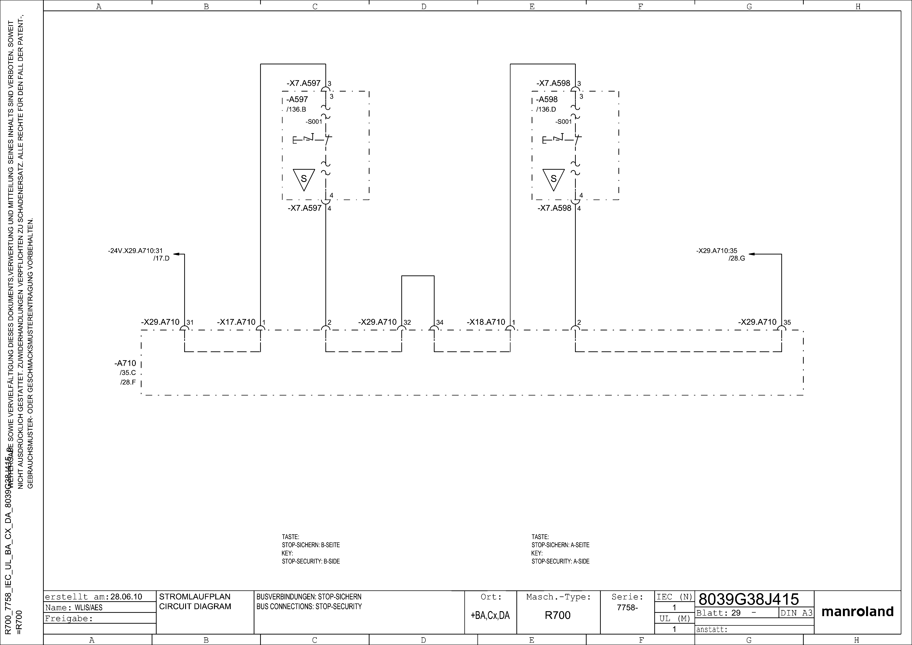

# +BA_Cx_DA — Sheet 29 of 247 — BUSVERBINDUNGEN: STOP SICHERN

**BUS CONNECTIONS: STOP SECURITY**

> Part of the manroland **R700** printing press IEC/UL circuit diagrams.
> Drawing class: **Stromlaufplan / Circuit diagram** (DIN A3).
> Document `+BA_Cx_DA` covers the **Printing units / main switch cabinet** machine section.

## At a glance

| Field | Value |
|---|---|
| Document | `+BA_Cx_DA`  (8039G38J415) |
| Sheet | **29** of 247 |
| Section (DE) | BUSVERBINDUNGEN: STOP SICHERN |
| Section (EN) | BUS CONNECTIONS: STOP SECURITY |
| Section type | CIRCUIT — Circuit diagram |
| Machine type | `R700` |
| Series | `7758` |
| Created | 28.06.10 |
| Replaces | — |
| Columns used | A, B, C, D, E, G |
| Path numbers | — |
| Labels on sheet | 48 |
| Cross-refs out | 6 |
| Cross-refs in | 18 |

**Previous:** [+BA_Cx_DA sheet 28](SHEET_0028.md) · **Next:** [+BA_Cx_DA sheet 30](SHEET_0030.md) · **Document TOC:** [_TOC.md](_TOC.md)  (+BA_Cx_DA) · **Master TOC:** [all sheets](../_MASTER_TOC.md)

## Sheet image (300 DPI, exact vector render)



_Rendered directly from the PDF vector layer at 300 DPI (1-bit), no OCR and no resampling. Use it to confirm anything ambiguous in the text below._

## Cross-references on this sheet

Each entry is a wire leaving this sheet. The printed token is `/sheet.column`; the link resolves to that sheet inside the same document.

| Ref | Target sheet | Col | Path | Destination on target | Target section | From col |
|---|---|---|---|---|---|---|
| `/136.B` | [+BA_Cx_DA sheet 136](SHEET_0136.md) | B | — | A597 | REFERENZMODUL | C |
| `/136.D` | [+BA_Cx_DA sheet 136](SHEET_0136.md) | D | — | A598 | REFERENZMODUL | E |
| `/28.G` | [+BA_Cx_DA sheet 28](SHEET_0028.md) | G | — | 24V.X29.A710:31 X29.A710:35 | BUSVERBINDUNGEN: STOP SICHERN | D |
| `/17.D` | [+BA_Cx_DA sheet 17](SHEET_0017.md) | D | — | 24V.X29.A710:31 X29.A710:35 | SPANNUNGSVERSORGUNG, SCHALTSCHRANKBELÜFTUNG | D |
| `/35.C` | [+BA_Cx_DA sheet 35](SHEET_0035.md) | C | — | — | SCHUTZEINRICHTUNGEN | A |
| `/28.F` | [+BA_Cx_DA sheet 28](SHEET_0028.md) | F | — | — | BUSVERBINDUNGEN: STOP SICHERN | A |

### Incoming references (sheets that point here)

Every other sheet that sends a wire to this one. `Back-ref` is the token printed on *that* sheet; `Path` is its line number.

| From sheet | Cols | Back-ref | Path | Refs | What continues there |
|---|---|---|---|---|---|
| [+BA_Cx_DA#17](SHEET_0017.md) | D | `/17.D` | — | 1 | — |
| [+BA_Cx_DA#28](SHEET_0028.md) | F, G | `/28.F`, `/28.G` | — | 2 | — |
| [+BA_Cx_DA#35](SHEET_0035.md) | C | `/35.C` | — | 1 | — |
| [+BA_Cx_DA#136](SHEET_0136.md) | B, D | `/136.B`, `/136.D` | — | 2 | — |
| [+BA_Cx_DA#164](SHEET_0164.md) | C | `/164.C` | — | 4 | — |
| [+BA_Cx_DA#173](SHEET_0173.md) | D, G | `/173.D`, `/173.G` | — | 4 | — |
| [+BA_Cx_DA#179](SHEET_0179.md) | C | `/179.C` | — | 4 | — |


## Devices on this sheet

| Tag | Class | Class meaning (IEC) | Col | Sub | Terminal | Sign |
|---|---|---|---|---|---|---|
| `A710` | A | Baugruppe / assembly, module, PC board | A | — | — | — |
| `S001` | S | Schalter / switch | C | — | — | — |
| `A597` | A | Baugruppe / assembly, module, PC board | C | — | — | — |
| `S001` | S | Schalter / switch | E | — | — | — |
| `A598` | A | Baugruppe / assembly, module, PC board | E | — | — | — |
| `X29.A710` | — | cross-device reference | B | — | — | — |
| `X17.A710` | — | cross-device reference | B | — | — | — |
| `X29.A710` | — | cross-device reference | D | — | — | — |
| `X7.A597` | — | cross-device reference | C | — | — | — |
| `X7.A597` | — | cross-device reference | C | — | — | — |
| `X18.A710` | — | cross-device reference | E | — | — | — |
| `X7.A598` | — | cross-device reference | E | — | — | — |
| `X7.A598` | — | cross-device reference | E | — | — | — |
| `X29.A710` | — | cross-device reference | G | — | — | — |
| `X29.A710:35` | — | cross-device reference | G | — | 35 | — |

## Potentials / nets

| Potential | Count | Columns | Attached devices | Terminals |
|---|---|---|---|---|
| `24V` | 1 | A | `A710`, `X29` | `31` |


A potential such as `L24+/4` or `M24+` is a named supply/return rail; every place it appears on this sheet is electrically common.

## Wire-end annotations (grouped as printed)

A wire that continues elsewhere is annotated with a small cluster: the destination description, the path/line number `#NN`, and the `/sheet.column` cross reference. Each row below is one such cluster exactly as it is grouped on the drawing.

| Col | Y | Path | Cross-ref | Text on the wire |
|---|---|---|---|---|
| C | 103.8 | — | — | `X7.A597 3` |
| E | 103.8 | — | — | `X7.A598 3` |
| C | 122.2 | — | — | `3` |
| E | 122.2 | — | — | `3` |
| C | 125.0 | — | `/136.B` | `A597` |
| E | 125.0 | — | `/136.D` | `A598` |
| C | 155.2 | — | — | `S001` |
| E | 155.2 | — | — | `S001` |
| D | 227.9 | — | — | `S S` |
| C | 251.2 | — | — | `4` |
| E | 251.2 | — | — | `4` |
| C | 266.8 | — | — | `X7.A597 4` |
| E | 266.8 | — | — | `X7.A598 4` |
| D | 323.4 | — | `/28.G`, `/17.D` | `24V.X29.A710:31 X29.A710:35` |
| B | 415.6 | — | — | `X29.A710 31` |
| C | 415.6 | — | — | `X17.A710 1 2 X29.A710 32` |
| E | 415.6 | — | — | `34 X18.A710 1 2` |
| G | 415.6 | — | — | `X29.A710 35` |
| A | 469.4 | — | — | `A710` |
| A | 482.5 | — | `/35.C` | — |
| A | 494.9 | — | `/28.F` | — |
| C | 697.9 | — | — | `KEY: TASTE: STOP SICHERN: B SEITE` |
| E | 697.9 | — | — | `KEY: TASTE: STOP SICHERN: A SEITE` |
| C | 729.8 | — | — | `STOP SECURITY: B SIDE` |
| E | 729.8 | — | — | `STOP SECURITY: A SIDE` |


## Reconstructed tables

This sheet carries tabular content (pin map / terminal assignment / index). The grid below was rebuilt from the drawing's own rule lines, so each row is exactly one physical row of the table.

### Table 1 — 3 data rows × 10 columns (at x=240.9, y=83.6)

|  |  | X7.A597 | 3 |  |  |  |  | X7.A598 | 3 |
|---|---|---|---|---|---|---|---|---|---|
|  |  | `A597 /136.B S001 S` | `3 4` |  |  |  |  | `A598 /136.D S001 S` | `3 4` |
|  |  | `X7.A597` | `4` |  |  |  |  | `X7.A598` | `4` |
| `X17.A710 31` | `1` |  | `2` | `X29.A710` | `32` | `X18.A710 34` | `1` |  | `2` |


## Notes and free text on this sheet

| Text | Col | Y (pt) |
|---|---|---|
| `S` | C | 227.86 |
| `S` | E | 227.86 |
| `TASTE:` | E | 697.88 |
| `STOP SICHERN: A SEITE` | E | 708.57 |
| `KEY:` | E | 719.08 |
| `STOP SECURITY: A SIDE` | E | 729.84 |
| `TASTE:` | C | 697.88 |
| `STOP SICHERN: B SEITE` | C | 708.57 |
| `KEY:` | C | 719.08 |
| `STOP SECURITY: B SIDE` | C | 729.84 |

## Complete label inventory (exact text from the drawing)

Every text object inside the drawing area of this sheet, in DIN reading order (column A→H, then top→bottom). This is the authoritative list: if a string is not here it is not printed on this sheet.

| Col | Y | X | Dir | Type | Text |
|---|---|---|---|---|---|
| A | 323.4 | 141.2 | → | potential | `24V.X29.A710:31` |
| A | 469.4 | 149.4 | → | device tag | `A710` |
| A | 482.5 | 156.5 | → | cross-reference | `/35.C` |
| A | 494.9 | 157.3 | → | cross-reference | `/28.F` |
| B | 333.4 | 200.4 | → | cross-reference | `/17.D` |
| B | 415.6 | 184.3 | → | device ref | `X29.A710` |
| B | 415.6 | 283.5 | → | device ref | `X17.A710` |
| B | 417.0 | 243.5 | → | number | `31` |
| C | 103.8 | 374.5 | → | device ref | `X7.A597` |
| C | 105.2 | 427.7 | → | number | `3` |
| C | 122.2 | 430.6 | → | number | `3` |
| C | 125.0 | 373.9 | → | device tag | `A597` |
| C | 138.8 | 374.2 | → | cross-reference | `/136.B` |
| C | 155.2 | 399.1 | → | device tag | `S001` |
| C | 227.9 | 392.7 | → | text | `S` |
| C | 251.2 | 430.6 | → | number | `4` |
| C | 266.8 | 375.9 | → | device ref | `X7.A597` |
| C | 268.2 | 427.7 | → | number | `4` |
| C | 417.0 | 342.1 | → | number | `1` |
| C | 417.0 | 427.7 | → | number | `2` |
| C | 697.9 | 368.2 | → | text | `TASTE:` |
| C | 708.6 | 368.2 | → | text | `STOP SICHERN: B SEITE` |
| C | 719.1 | 367.7 | → | text | `KEY:` |
| C | 729.8 | 368.2 | → | text | `STOP SECURITY: B SIDE` |
| D | 415.6 | 467.7 | → | device ref | `X29.A710` |
| D | 417.0 | 527.0 | → | number | `32` |
| D | 417.0 | 569.5 | → | number | `34` |
| E | 103.8 | 700.4 | → | device ref | `X7.A598` |
| E | 105.2 | 753.7 | → | number | `3` |
| E | 122.2 | 756.6 | → | number | `3` |
| E | 125.0 | 699.9 | → | device tag | `A598` |
| E | 138.8 | 700.2 | → | cross-reference | `/136.D` |
| E | 155.2 | 725.1 | → | device tag | `S001` |
| E | 227.9 | 718.7 | → | text | `S` |
| E | 251.2 | 756.6 | → | number | `4` |
| E | 266.8 | 701.9 | → | device ref | `X7.A598` |
| E | 268.2 | 753.7 | → | number | `4` |
| E | 415.6 | 609.4 | → | device ref | `X18.A710` |
| E | 417.0 | 668.1 | → | number | `1` |
| E | 417.0 | 753.7 | → | number | `2` |
| E | 697.9 | 694.2 | → | text | `TASTE:` |
| E | 708.6 | 694.2 | → | text | `STOP SICHERN: A SEITE` |
| E | 719.1 | 693.6 | → | text | `KEY:` |
| E | 729.8 | 694.2 | → | text | `STOP SECURITY: A SIDE` |
| G | 323.4 | 909.1 | → | device ref | `X29.A710:35` |
| G | 333.3 | 951.3 | → | cross-reference | `/28.G` |
| G | 415.6 | 963.8 | → | device ref | `X29.A710` |
| G | 417.0 | 1023.0 | → | number | `35` |

## Reading-order text block

The same content as a plain block, grouped by DIN column — convenient to paste or to match against a visual description.

```text
=== Column A ===
 323.4  141.2  net          24V.X29.A710:31
 469.4  149.4  devtag       A710
 482.5  156.5  xref         /35.C
 494.9  157.3  xref         /28.F
=== Column B ===
 333.4  200.4  xref         /17.D
 415.6  184.3  devref       X29.A710
 415.6  283.5  devref       X17.A710
 417.0  243.5  numeric      31
=== Column C ===
 103.8  374.5  devref       X7.A597
 105.2  427.7  numeric      3
 122.2  430.6  numeric      3
 125.0  373.9  devtag       A597
 138.8  374.2  xref         /136.B
 155.2  399.1  devtag       S001
 227.9  392.7  text         S
 251.2  430.6  numeric      4
 266.8  375.9  devref       X7.A597
 268.2  427.7  numeric      4
 417.0  342.1  numeric      1
 417.0  427.7  numeric      2
 697.9  368.2  text         TASTE:
 708.6  368.2  text         STOP SICHERN: B SEITE
 719.1  367.7  text         KEY:
 729.8  368.2  text         STOP SECURITY: B SIDE
=== Column D ===
 415.6  467.7  devref       X29.A710
 417.0  527.0  numeric      32
 417.0  569.5  numeric      34
=== Column E ===
 103.8  700.4  devref       X7.A598
 105.2  753.7  numeric      3
 122.2  756.6  numeric      3
 125.0  699.9  devtag       A598
 138.8  700.2  xref         /136.D
 155.2  725.1  devtag       S001
 227.9  718.7  text         S
 251.2  756.6  numeric      4
 266.8  701.9  devref       X7.A598
 268.2  753.7  numeric      4
 415.6  609.4  devref       X18.A710
 417.0  668.1  numeric      1
 417.0  753.7  numeric      2
 697.9  694.2  text         TASTE:
 708.6  694.2  text         STOP SICHERN: A SEITE
 719.1  693.6  text         KEY:
 729.8  694.2  text         STOP SECURITY: A SIDE
=== Column G ===
 323.4  909.1  devref       X29.A710:35
 333.3  951.3  xref         /28.G
 415.6  963.8  devref       X29.A710
 417.0 1023.0  numeric      35
```

---
_Generated from the PDF vector text layer; no OCR. Source: `R700_7758_IEC_UL_BA_CX_DA_8039G38J415_p`, sheet 29._
