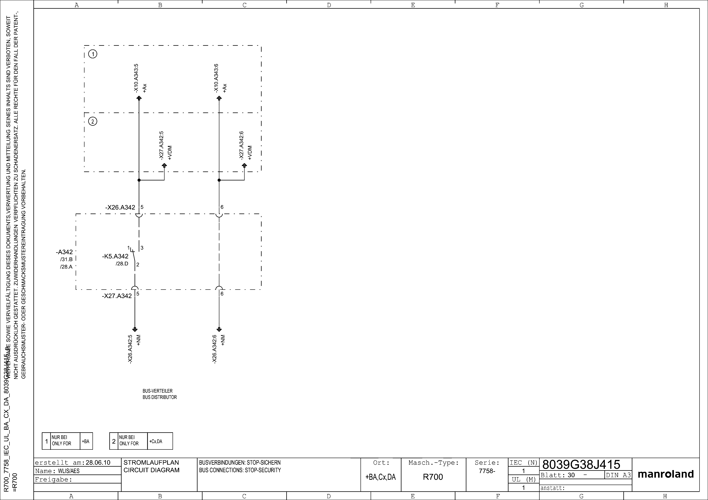

# +BA_Cx_DA — Sheet 30 of 247 — BUSVERBINDUNGEN: STOP SICHERN

**BUS CONNECTIONS: STOP SECURITY**

> Part of the manroland **R700** printing press IEC/UL circuit diagrams.
> Drawing class: **Stromlaufplan / Circuit diagram** (DIN A3).
> Document `+BA_Cx_DA` covers the **Printing units / main switch cabinet** machine section.

## At a glance

| Field | Value |
|---|---|
| Document | `+BA_Cx_DA`  (8039G38J415) |
| Sheet | **30** of 247 |
| Section (DE) | BUSVERBINDUNGEN: STOP SICHERN |
| Section (EN) | BUS CONNECTIONS: STOP SECURITY |
| Section type | CIRCUIT — Circuit diagram |
| Machine type | `R700` |
| Series | `7758` |
| Created | 28.06.10 |
| Replaces | — |
| Columns used | A, B, C |
| Path numbers | — |
| Labels on sheet | 38 |
| Cross-refs out | 3 |
| Cross-refs in | 7 |

**Previous:** [+BA_Cx_DA sheet 29](SHEET_0029.md) · **Next:** [+BA_Cx_DA sheet 31](SHEET_0031.md) · **Document TOC:** [_TOC.md](_TOC.md)  (+BA_Cx_DA) · **Master TOC:** [all sheets](../_MASTER_TOC.md)

## Sheet image (300 DPI, exact vector render)



_Rendered directly from the PDF vector layer at 300 DPI (1-bit), no OCR and no resampling. Use it to confirm anything ambiguous in the text below._

## Cross-references on this sheet

Each entry is a wire leaving this sheet. The printed token is `/sheet.column`; the link resolves to that sheet inside the same document.

| Ref | Target sheet | Col | Path | Destination on target | Target section | From col |
|---|---|---|---|---|---|---|
| `/31.B` | [+BA_Cx_DA sheet 31](SHEET_0031.md) | B | — | — | BUSVERBINDUNGEN: SIGNALSCHLEIFE | A |
| `/28.A` | [+BA_Cx_DA sheet 28](SHEET_0028.md) | A | — | — | BUSVERBINDUNGEN: STOP SICHERN | A |
| `/28.D` | [+BA_Cx_DA sheet 28](SHEET_0028.md) | D | — | — | BUSVERBINDUNGEN: STOP SICHERN | B |

### Incoming references (sheets that point here)

Every other sheet that sends a wire to this one. `Back-ref` is the token printed on *that* sheet; `Path` is its line number.

| From sheet | Cols | Back-ref | Path | Refs | What continues there |
|---|---|---|---|---|---|
| [+BA_Cx_DA#28](SHEET_0028.md) | A, D | `/28.A`, `/28.D` | — | 2 | — |
| [+BA_Cx_DA#31](SHEET_0031.md) | B | `/31.B` | — | 1 | — |
| [+BA_Cx_DA#176](SHEET_0176.md) | B | `/176.B` | — | 2 | — |
| [+BA_Cx_DA#177](SHEET_0177.md) | B | `/177.B` | — | 2 | — |


## Devices on this sheet

| Tag | Class | Class meaning (IEC) | Col | Sub | Terminal | Sign |
|---|---|---|---|---|---|---|
| `A342` | A | Baugruppe / assembly, module, PC board | A | — | — | — |
| `X27.A342:6` | — | cross-device reference | C | — | 6 | — |
| `X27.A342:5` | — | cross-device reference | B | — | 5 | — |
| `X10.A343:6` | — | cross-device reference | C | — | 6 | — |
| `X10.A343:5` | — | cross-device reference | B | — | 5 | — |
| `X26.A342` | — | cross-device reference | B | — | — | — |
| `X27.A342` | — | cross-device reference | A | — | — | — |
| `X26.A342:5` | — | cross-device reference | B | — | 5 | — |
| `X26.A342:6` | — | cross-device reference | C | — | 6 | — |
| `K5.A342` | — | cross-device reference | A | — | — | — |

## Potentials / nets

_No named potentials on this sheet._

## Wire-end annotations (grouped as printed)

A wire that continues elsewhere is annotated with a small cluster: the destination description, the path/line number `#NN`, and the `/sheet.column` cross reference. Each row below is one such cluster exactly as it is grouped on the drawing.

| Col | Y | Path | Cross-ref | Text on the wire |
|---|---|---|---|---|
| A | 87.7 | — | — | `1` |
| B | 107.4 | — | — | `X10.A343:5` |
| C | 107.4 | — | — | `X10.A343:6` |
| B | 141.2 | — | — | `+Ax` |
| C | 141.2 | — | — | `+Ax` |
| A | 201.6 | — | — | `2` |
| B | 220.8 | — | — | `X27.A342:5` |
| C | 220.8 | — | — | `X27.A342:6` |
| B | 245.2 | — | — | `+VDM` |
| C | 245.2 | — | — | `+VDM` |
| B | 344.7 | — | — | `X26.A342 5` |
| C | 344.7 | — | — | `6` |
| B | 413.5 | — | — | `K5.A342 3` |
| B | 413.5 | — | — | `1` |
| A | 419.8 | — | — | `A342` |
| A | 432.9 | — | `/31.B`, `/28.A` | — |
| B | 440.0 | — | `/28.D` | — |
| B | 441.8 | — | — | `2` |
| B | 490.7 | — | — | `X27.A342 5 6` |
| B | 563.5 | — | — | `+NM` |
| C | 563.5 | — | — | `+NM` |
| B | 563.8 | — | — | `X26.A342:5` |
| C | 563.8 | — | — | `X26.A342:6` |
| B | 655.4 | — | — | `BUS VERTEILER BUS DISTRIBUTOR` |
| A | 733.3 | — | — | `1 NUR BEI` |
| A | 733.3 | — | — | `ONLY FOR +BA 2 NUR BEI` |
| B | 740.5 | — | — | `ONLY FOR +Cx,DA` |


## Notes and free text on this sheet

| Text | Col | Y (pt) |
|---|---|---|
| `+VDM` | C | 245.2 |
| `+VDM` | B | 245.2 |
| `+Ax` | C | 141.17 |
| `+Ax` | B | 141.17 |
| `BUS VERTEILER` | B | 655.42 |
| `BUS DISTRIBUTOR` | B | 666.05 |
| `+NM` | B | 563.53 |
| `+NM` | C | 563.53 |
| `NUR BEI` | A | 733.33 |
| `ONLY FOR` | A | 744.02 |
| `+BA` | A | 740.44 |
| `NUR BEI` | B | 733.33 |
| `ONLY FOR` | B | 744.02 |
| `+Cx,DA` | B | 740.52 |

## Complete label inventory (exact text from the drawing)

Every text object inside the drawing area of this sheet, in DIN reading order (column A→H, then top→bottom). This is the authoritative list: if a string is not here it is not printed on this sheet.

| Col | Y | X | Dir | Type | Text |
|---|---|---|---|---|---|
| A | 87.7 | 154.1 | → | number | `1` |
| A | 201.6 | 153.9 | → | number | `2` |
| A | 419.8 | 94.1 | → | device tag | `A342` |
| A | 426.9 | 171.8 | → | device ref | `K5.A342` |
| A | 432.9 | 101.5 | → | cross-reference | `/31.B` |
| A | 445.3 | 101.2 | → | cross-reference | `/28.A` |
| A | 493.5 | 171.5 | → | device ref | `X27.A342` |
| A | 733.3 | 87.0 | → | text | `NUR BEI` |
| A | 738.7 | 75.4 | → | number | `1` |
| A | 738.7 | 188.5 | → | number | `2` |
| A | 740.4 | 137.9 | → | text | `+BA` |
| A | 744.0 | 87.6 | → | text | `ONLY FOR` |
| B | 107.4 | 224.9 | ↕ | device ref | `X10.A343:5` |
| B | 141.2 | 239.2 | ↕ | text | `+Ax` |
| B | 220.8 | 267.4 | ↕ | device ref | `X27.A342:5` |
| B | 245.2 | 281.7 | ↕ | text | `+VDM` |
| B | 344.7 | 177.2 | → | device ref | `X26.A342` |
| B | 344.7 | 236.4 | → | number | `5` |
| B | 413.5 | 213.7 | → | number | `1` |
| B | 413.5 | 236.4 | → | number | `3` |
| B | 440.0 | 194.7 | → | cross-reference | `/28.D` |
| B | 441.8 | 229.3 | → | number | `2` |
| B | 490.7 | 229.3 | → | number | `5` |
| B | 563.5 | 229.2 | ↕ | text | `+NM` |
| B | 563.8 | 215.0 | ↕ | device ref | `X26.A342:5` |
| B | 655.4 | 240.1 | → | text | `BUS VERTEILER` |
| B | 666.1 | 240.1 | → | text | `BUS DISTRIBUTOR` |
| B | 733.3 | 200.4 | → | text | `NUR BEI` |
| B | 740.5 | 251.3 | → | text | `+Cx,DA` |
| B | 744.0 | 201.0 | → | text | `ONLY FOR` |
| C | 107.4 | 359.6 | ↕ | device ref | `X10.A343:6` |
| C | 141.2 | 373.8 | ↕ | text | `+Ax` |
| C | 220.8 | 402.1 | ↕ | device ref | `X27.A342:6` |
| C | 245.2 | 416.3 | ↕ | text | `+VDM` |
| C | 344.7 | 371.1 | → | number | `6` |
| C | 490.7 | 371.1 | → | number | `6` |
| C | 563.5 | 371.0 | ↕ | text | `+NM` |
| C | 563.8 | 356.7 | ↕ | device ref | `X26.A342:6` |

## Reading-order text block

The same content as a plain block, grouped by DIN column — convenient to paste or to match against a visual description.

```text
=== Column A ===
  87.7  154.1  numeric      1
 201.6  153.9  numeric      2
 419.8   94.1  devtag       A342
 426.9  171.8  devref       K5.A342
 432.9  101.5  xref         /31.B
 445.3  101.2  xref         /28.A
 493.5  171.5  devref       X27.A342
 733.3   87.0  text         NUR BEI
 738.7   75.4  numeric      1
 738.7  188.5  numeric      2
 740.4  137.9  text         +BA
 744.0   87.6  text         ONLY FOR
=== Column B ===
 107.4  224.9  devref       X10.A343:5
 141.2  239.2  text         +Ax
 220.8  267.4  devref       X27.A342:5
 245.2  281.7  text         +VDM
 344.7  177.2  devref       X26.A342
 344.7  236.4  numeric      5
 413.5  213.7  numeric      1
 413.5  236.4  numeric      3
 440.0  194.7  xref         /28.D
 441.8  229.3  numeric      2
 490.7  229.3  numeric      5
 563.5  229.2  text         +NM
 563.8  215.0  devref       X26.A342:5
 655.4  240.1  text         BUS VERTEILER
 666.1  240.1  text         BUS DISTRIBUTOR
 733.3  200.4  text         NUR BEI
 740.5  251.3  text         +Cx,DA
 744.0  201.0  text         ONLY FOR
=== Column C ===
 107.4  359.6  devref       X10.A343:6
 141.2  373.8  text         +Ax
 220.8  402.1  devref       X27.A342:6
 245.2  416.3  text         +VDM
 344.7  371.1  numeric      6
 490.7  371.1  numeric      6
 563.5  371.0  text         +NM
 563.8  356.7  devref       X26.A342:6
```

---
_Generated from the PDF vector text layer; no OCR. Source: `R700_7758_IEC_UL_BA_CX_DA_8039G38J415_p`, sheet 30._
