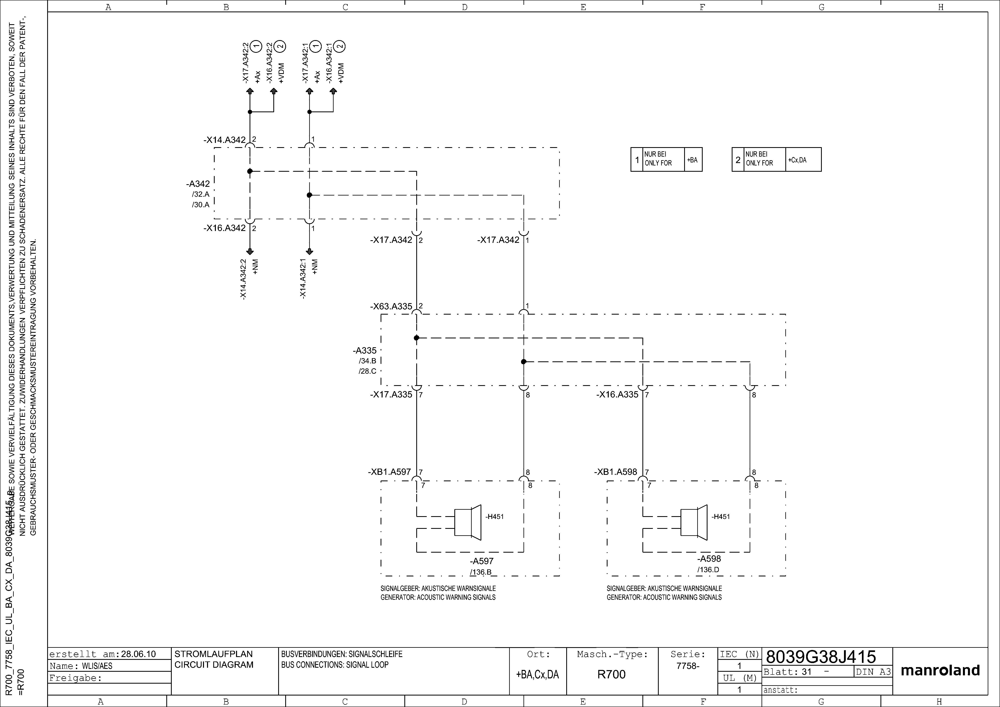

# +BA_Cx_DA — Sheet 31 of 247 — BUSVERBINDUNGEN: SIGNALSCHLEIFE

**BUS CONNECTIONS: SIGNAL LOOP**

> Part of the manroland **R700** printing press IEC/UL circuit diagrams.
> Drawing class: **Stromlaufplan / Circuit diagram** (DIN A3).
> Document `+BA_Cx_DA` covers the **Printing units / main switch cabinet** machine section.

## At a glance

| Field | Value |
|---|---|
| Document | `+BA_Cx_DA`  (8039G38J415) |
| Sheet | **31** of 247 |
| Section (DE) | BUSVERBINDUNGEN: SIGNALSCHLEIFE |
| Section (EN) | BUS CONNECTIONS: SIGNAL LOOP |
| Section type | CIRCUIT — Circuit diagram |
| Machine type | `R700` |
| Series | `7758` |
| Created | 28.06.10 |
| Replaces | — |
| Columns used | B, C, D, E, F, G |
| Path numbers | — |
| Labels on sheet | 69 |
| Cross-refs out | 6 |
| Cross-refs in | 22 |

**Previous:** [+BA_Cx_DA sheet 30](SHEET_0030.md) · **Next:** [+BA_Cx_DA sheet 32](SHEET_0032.md) · **Document TOC:** [_TOC.md](_TOC.md)  (+BA_Cx_DA) · **Master TOC:** [all sheets](../_MASTER_TOC.md)

## Sheet image (300 DPI, exact vector render)



_Rendered directly from the PDF vector layer at 300 DPI (1-bit), no OCR and no resampling. Use it to confirm anything ambiguous in the text below._

## Cross-references on this sheet

Each entry is a wire leaving this sheet. The printed token is `/sheet.column`; the link resolves to that sheet inside the same document.

| Ref | Target sheet | Col | Path | Destination on target | Target section | From col |
|---|---|---|---|---|---|---|
| `/32.A` | [+BA_Cx_DA sheet 32](SHEET_0032.md) | A | — | — | BUSVERBINDUNGEN: 20 mA SCHLEIFE, BUSFUNKTIONEN | B |
| `/30.A` | [+BA_Cx_DA sheet 30](SHEET_0030.md) | A | — | — | BUSVERBINDUNGEN: STOP SICHERN | B |
| `/34.B` | [+BA_Cx_DA sheet 34](SHEET_0034.md) | B | — | — | BUSVERBINDUNGEN: RESERVE SIGNALE | C |
| `/28.C` | [+BA_Cx_DA sheet 28](SHEET_0028.md) | C | — | — | BUSVERBINDUNGEN: STOP SICHERN | C |
| `/136.D` | [+BA_Cx_DA sheet 136](SHEET_0136.md) | D | — | A598 | REFERENZMODUL | F |
| `/136.B` | [+BA_Cx_DA sheet 136](SHEET_0136.md) | B | — | A597 | REFERENZMODUL | D |

### Incoming references (sheets that point here)

Every other sheet that sends a wire to this one. `Back-ref` is the token printed on *that* sheet; `Path` is its line number.

| From sheet | Cols | Back-ref | Path | Refs | What continues there |
|---|---|---|---|---|---|
| [+BA_Cx_DA#28](SHEET_0028.md) | C | `/28.C` | — | 1 | — |
| [+BA_Cx_DA#30](SHEET_0030.md) | A | `/30.A` | — | 1 | — |
| [+BA_Cx_DA#32](SHEET_0032.md) | A | `/32.A` | — | 1 | — |
| [+BA_Cx_DA#34](SHEET_0034.md) | B | `/34.B` | — | 1 | — |
| [+BA_Cx_DA#136](SHEET_0136.md) | B, D | `/136.B`, `/136.D` | — | 2 | — |
| [+BA_Cx_DA#143](SHEET_0143.md) | B, D | `/143.B`, `/143.D` | — | 4 | — |
| [+BA_Cx_DA#171](SHEET_0171.md) | A | `/171.A` | — | 2 | — |
| [+BA_Cx_DA#172](SHEET_0172.md) | B, D | `/172.B`, `/172.D` | — | 4 | — |
| [+BA_Cx_DA#173](SHEET_0173.md) | B, D | `/173.B`, `/173.D` | — | 4 | — |
| [+BA_Cx_DA#183](SHEET_0183.md) | F | `/183.F` | — | 2 | — |


## Devices on this sheet

| Tag | Class | Class meaning (IEC) | Col | Sub | Terminal | Sign |
|---|---|---|---|---|---|---|
| `A598` | A | Baugruppe / assembly, module, PC board | F | — | — | — |
| `A342` | A | Baugruppe / assembly, module, PC board | B | — | — | — |
| `A597` | A | Baugruppe / assembly, module, PC board | D | — | — | — |
| `A335` | A | Baugruppe / assembly, module, PC board | C | — | — | — |
| `XB1.A598` | — | cross-device reference | E | — | — | — |
| `X17.A342` | — | cross-device reference | C | — | — | — |
| `X17.A342` | — | cross-device reference | D | — | — | — |
| `X16.A342` | — | cross-device reference | B | — | — | — |
| `X14.A342:2` | — | cross-device reference | B | — | 2 | — |
| `X14.A342:1` | — | cross-device reference | C | — | 1 | — |
| `X14.A342` | — | cross-device reference | B | — | — | — |
| `X17.A342:2` | — | cross-device reference | B | — | 2 | — |
| `X16.A342:2` | — | cross-device reference | B | — | 2 | — |
| `X17.A342:1` | — | cross-device reference | C | — | 1 | — |
| `X16.A342:1` | — | cross-device reference | C | — | 1 | — |
| `XB1.A597` | — | cross-device reference | C | — | — | — |
| `X16.A335` | — | cross-device reference | E | — | — | — |
| `X17.A335` | — | cross-device reference | C | — | — | — |
| `X63.A335` | — | cross-device reference | C | — | — | — |

## Potentials / nets

| Potential | Count | Columns | Attached devices | Terminals |
|---|---|---|---|---|
| `H451` | 2 | D, F | — | — |


A potential such as `L24+/4` or `M24+` is a named supply/return rail; every place it appears on this sheet is electrically common.

## Wire-end annotations (grouped as printed)

A wire that continues elsewhere is annotated with a small cluster: the destination description, the path/line number `#NN`, and the `/sheet.column` cross reference. Each row below is one such cluster exactly as it is grouped on the drawing.

| Col | Y | Path | Cross-ref | Text on the wire |
|---|---|---|---|---|
| B | 50.7 | — | — | `X17.A342:2` |
| B | 50.7 | — | — | `X16.A342:2` |
| C | 50.7 | — | — | `X17.A342:1` |
| C | 50.7 | — | — | `X16.A342:1` |
| B | 52.4 | — | — | `1` |
| C | 52.4 | — | — | `1` |
| B | 53.3 | — | — | `2` |
| C | 53.3 | — | — | `2` |
| B | 75.1 | — | — | `+VDM` |
| C | 75.1 | — | — | `+VDM` |
| B | 84.5 | — | — | `+Ax` |
| C | 84.5 | — | — | `+Ax` |
| B | 161.9 | — | — | `X14.A342 2` |
| C | 161.9 | — | — | `1` |
| F | 180.6 | — | — | `1 NUR BEI` |
| F | 180.6 | — | — | `ONLY FOR +BA 2 NUR BEI` |
| G | 187.8 | — | — | `ONLY FOR +Cx,DA` |
| B | 214.3 | — | — | `A342` |
| B | 227.4 | — | `/32.A`, `/30.A` | — |
| B | 266.8 | — | — | `X16.A342 2` |
| C | 268.2 | — | — | `1` |
| D | 280.9 | — | — | `X17.A342 2 X17.A342 1` |
| C | 307.3 | — | — | `X14.A342:1` |
| B | 308.4 | — | — | `X14.A342:2` |
| B | 308.4 | — | — | `+NM` |
| C | 308.4 | — | — | `+NM` |
| D | 360.3 | — | — | `X63.A335 2 1` |
| C | 412.7 | — | — | `A335` |
| C | 425.8 | — | `/34.B`, `/28.C` | — |
| E | 465.2 | — | — | `X17.A335 7 8 X16.A335 7 8` |
| D | 557.3 | — | — | `XB1.A597 7 8` |
| F | 557.3 | — | — | `XB1.A598 7 8` |
| D | 574.3 | — | — | `7 8` |
| F | 574.3 | — | — | `7 8` |
| D | 611.6 | — | — | `H451` |
| F | 611.6 | — | — | `H451` |
| F | 660.8 | — | `/136.D` | `A598` |
| D | 663.6 | — | `/136.B` | `A597` |
| D | 697.9 | — | — | `SIGNALGEBER: AKUSTISCHE WARNSIGNALE GENERATOR: ACOUSTIC WARNING SIGNALS` |
| F | 697.9 | — | — | `SIGNALGEBER: AKUSTISCHE WARNSIGNALE GENERATOR: ACOUSTIC WARNING SIGNALS` |


## Reconstructed tables

This sheet carries tabular content (pin map / terminal assignment / index). The grid below was rebuilt from the drawing's own rule lines, so each row is exactly one physical row of the table.

### Table 1 — 2 data rows × 1 columns (at x=496.1, y=204.1)

| C1 |
|---|
| `2 2` |
| `7 7 7` |


### Table 2 — 2 data rows × 1 columns (at x=572.6, y=204.1)

| C1 |
|---|
| `X17.A342` |
| `H451` |


## Notes and free text on this sheet

| Text | Col | Y (pt) |
|---|---|---|
| `SIGNALGEBER: AKUSTISCHE WARNSIGNALE` | F | 697.93 |
| `GENERATOR: ACOUSTIC WARNING SIGNALS` | F | 708.57 |
| `+NM` | B | 308.41 |
| `+NM` | C | 308.41 |
| `+Ax` | B | 84.47 |
| `+VDM` | B | 75.12 |
| `+Ax` | C | 84.47 |
| `+VDM` | C | 75.12 |
| `SIGNALGEBER: AKUSTISCHE WARNSIGNALE` | D | 697.93 |
| `GENERATOR: ACOUSTIC WARNING SIGNALS` | D | 708.57 |
| `NUR BEI` | F | 180.58 |
| `ONLY FOR` | F | 191.27 |
| `+BA` | F | 187.68 |
| `+Cx,DA` | G | 187.76 |

## Complete label inventory (exact text from the drawing)

Every text object inside the drawing area of this sheet, in DIN reading order (column A→H, then top→bottom). This is the authoritative list: if a string is not here it is not printed on this sheet.

| Col | Y | X | Dir | Type | Text |
|---|---|---|---|---|---|
| B | 50.7 | 288.7 | ↕ | device ref | `X17.A342:2` |
| B | 50.7 | 317.1 | ↕ | device ref | `X16.A342:2` |
| B | 52.4 | 301.7 | ↕ | number | `1` |
| B | 53.3 | 330.5 | ↕ | number | `2` |
| B | 75.1 | 331.3 | ↕ | text | `+VDM` |
| B | 84.5 | 303.0 | ↕ | text | `+Ax` |
| B | 161.9 | 242.4 | → | device ref | `X14.A342` |
| B | 161.9 | 300.2 | → | number | `2` |
| B | 214.3 | 221.7 | → | device tag | `A342` |
| B | 227.4 | 228.8 | → | cross-reference | `/32.A` |
| B | 239.8 | 228.8 | → | cross-reference | `/30.A` |
| B | 266.8 | 242.4 | → | device ref | `X16.A342` |
| B | 268.2 | 300.2 | → | number | `2` |
| B | 308.4 | 285.9 | ↕ | device ref | `X14.A342:2` |
| B | 308.4 | 300.1 | ↕ | text | `+NM` |
| C | 50.7 | 359.6 | ↕ | device ref | `X17.A342:1` |
| C | 50.7 | 387.9 | ↕ | device ref | `X16.A342:1` |
| C | 52.4 | 372.5 | ↕ | number | `1` |
| C | 53.3 | 401.4 | ↕ | number | `2` |
| C | 75.1 | 402.1 | ↕ | text | `+VDM` |
| C | 84.5 | 373.8 | ↕ | text | `+Ax` |
| C | 161.9 | 370.5 | → | number | `1` |
| C | 268.2 | 370.5 | → | number | `1` |
| C | 280.9 | 440.8 | → | device ref | `X17.A342` |
| C | 307.3 | 356.7 | ↕ | device ref | `X14.A342:1` |
| C | 308.4 | 371.0 | ↕ | text | `+NM` |
| C | 360.3 | 440.8 | → | device ref | `X63.A335` |
| C | 412.7 | 420.1 | → | device tag | `A335` |
| C | 425.8 | 427.5 | → | cross-reference | `/34.B` |
| C | 438.2 | 427.2 | → | cross-reference | `/28.C` |
| C | 465.2 | 440.8 | → | device ref | `X17.A335` |
| C | 557.3 | 438.2 | → | device ref | `XB1.A597` |
| D | 280.9 | 568.3 | → | device ref | `X17.A342` |
| D | 282.4 | 498.6 | → | number | `2` |
| D | 360.3 | 498.6 | → | number | `2` |
| D | 466.6 | 498.6 | → | number | `7` |
| D | 558.7 | 498.6 | → | number | `7` |
| D | 574.3 | 501.4 | → | number | `7` |
| D | 611.6 | 578.0 | → | potential | `H451` |
| D | 663.6 | 559.6 | → | device tag | `A597` |
| D | 677.4 | 559.8 | → | cross-reference | `/136.B` |
| D | 697.9 | 453.3 | → | text | `SIGNALGEBER: AKUSTISCHE WARNSIGNALE` |
| D | 708.6 | 453.3 | → | text | `GENERATOR: ACOUSTIC WARNING SIGNALS` |
| E | 185.9 | 755.7 | → | number | `1` |
| E | 282.4 | 625.6 | → | number | `1` |
| E | 360.3 | 625.6 | → | number | `1` |
| E | 465.2 | 710.1 | → | device ref | `X16.A335` |
| E | 466.6 | 626.2 | → | number | `8` |
| E | 557.3 | 707.5 | → | device ref | `XB1.A598` |
| E | 558.7 | 626.2 | → | number | `8` |
| E | 574.3 | 629.0 | → | number | `8` |
| F | 180.6 | 767.3 | → | text | `NUR BEI` |
| F | 180.6 | 887.8 | → | text | `NUR BEI` |
| F | 185.9 | 875.9 | → | number | `2` |
| F | 187.7 | 818.2 | → | text | `+BA` |
| F | 191.3 | 767.9 | → | text | `ONLY FOR` |
| F | 191.3 | 888.4 | → | text | `ONLY FOR` |
| F | 466.6 | 767.9 | → | number | `7` |
| F | 466.6 | 895.5 | → | number | `8` |
| F | 558.7 | 767.9 | → | number | `7` |
| F | 558.7 | 895.5 | → | number | `8` |
| F | 574.3 | 770.7 | → | number | `7` |
| F | 574.3 | 898.3 | → | number | `8` |
| F | 611.6 | 847.3 | → | potential | `H451` |
| F | 660.8 | 830.3 | → | device tag | `A598` |
| F | 674.6 | 830.6 | → | cross-reference | `/136.D` |
| F | 697.9 | 722.6 | → | text | `SIGNALGEBER: AKUSTISCHE WARNSIGNALE` |
| F | 708.6 | 722.6 | → | text | `GENERATOR: ACOUSTIC WARNING SIGNALS` |
| G | 187.8 | 938.7 | → | text | `+Cx,DA` |

## Reading-order text block

The same content as a plain block, grouped by DIN column — convenient to paste or to match against a visual description.

```text
=== Column B ===
  50.7  288.7  devref       X17.A342:2
  50.7  317.1  devref       X16.A342:2
  52.4  301.7  numeric      1
  53.3  330.5  numeric      2
  75.1  331.3  text         +VDM
  84.5  303.0  text         +Ax
 161.9  242.4  devref       X14.A342
 161.9  300.2  numeric      2
 214.3  221.7  devtag       A342
 227.4  228.8  xref         /32.A
 239.8  228.8  xref         /30.A
 266.8  242.4  devref       X16.A342
 268.2  300.2  numeric      2
 308.4  285.9  devref       X14.A342:2
 308.4  300.1  text         +NM
=== Column C ===
  50.7  359.6  devref       X17.A342:1
  50.7  387.9  devref       X16.A342:1
  52.4  372.5  numeric      1
  53.3  401.4  numeric      2
  75.1  402.1  text         +VDM
  84.5  373.8  text         +Ax
 161.9  370.5  numeric      1
 268.2  370.5  numeric      1
 280.9  440.8  devref       X17.A342
 307.3  356.7  devref       X14.A342:1
 308.4  371.0  text         +NM
 360.3  440.8  devref       X63.A335
 412.7  420.1  devtag       A335
 425.8  427.5  xref         /34.B
 438.2  427.2  xref         /28.C
 465.2  440.8  devref       X17.A335
 557.3  438.2  devref       XB1.A597
=== Column D ===
 280.9  568.3  devref       X17.A342
 282.4  498.6  numeric      2
 360.3  498.6  numeric      2
 466.6  498.6  numeric      7
 558.7  498.6  numeric      7
 574.3  501.4  numeric      7
 611.6  578.0  net          H451
 663.6  559.6  devtag       A597
 677.4  559.8  xref         /136.B
 697.9  453.3  text         SIGNALGEBER: AKUSTISCHE WARNSIGNALE
 708.6  453.3  text         GENERATOR: ACOUSTIC WARNING SIGNALS
=== Column E ===
 185.9  755.7  numeric      1
 282.4  625.6  numeric      1
 360.3  625.6  numeric      1
 465.2  710.1  devref       X16.A335
 466.6  626.2  numeric      8
 557.3  707.5  devref       XB1.A598
 558.7  626.2  numeric      8
 574.3  629.0  numeric      8
=== Column F ===
 180.6  767.3  text         NUR BEI
 180.6  887.8  text         NUR BEI
 185.9  875.9  numeric      2
 187.7  818.2  text         +BA
 191.3  767.9  text         ONLY FOR
 191.3  888.4  text         ONLY FOR
 466.6  767.9  numeric      7
 466.6  895.5  numeric      8
 558.7  767.9  numeric      7
 558.7  895.5  numeric      8
 574.3  770.7  numeric      7
 574.3  898.3  numeric      8
 611.6  847.3  net          H451
 660.8  830.3  devtag       A598
 674.6  830.6  xref         /136.D
 697.9  722.6  text         SIGNALGEBER: AKUSTISCHE WARNSIGNALE
 708.6  722.6  text         GENERATOR: ACOUSTIC WARNING SIGNALS
=== Column G ===
 187.8  938.7  text         +Cx,DA
```

---
_Generated from the PDF vector text layer; no OCR. Source: `R700_7758_IEC_UL_BA_CX_DA_8039G38J415_p`, sheet 31._
