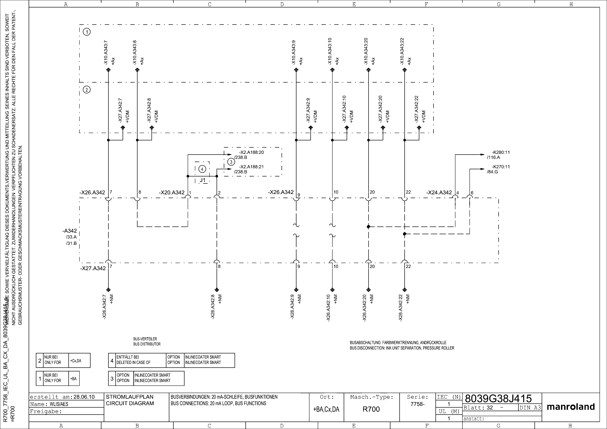

# +BA_Cx_DA — Sheet 32 of 247 — BUSVERBINDUNGEN: 20 mA SCHLEIFE, BUSFUNKTIONEN

**BUS CONNECTIONS: 20 mA LOOP, BUS FUNCTIONS**

> Part of the manroland **R700** printing press IEC/UL circuit diagrams.
> Drawing class: **Stromlaufplan / Circuit diagram** (DIN A3).
> Document `+BA_Cx_DA` covers the **Printing units / main switch cabinet** machine section.

## At a glance

| Field | Value |
|---|---|
| Document | `+BA_Cx_DA`  (8039G38J415) |
| Sheet | **32** of 247 |
| Section (DE) | BUSVERBINDUNGEN: 20 mA SCHLEIFE, BUSFUNKTIONEN |
| Section (EN) | BUS CONNECTIONS: 20 mA LOOP, BUS FUNCTIONS |
| Section type | CIRCUIT — Circuit diagram |
| Machine type | `R700` |
| Series | `7758` |
| Created | 28.06.10 |
| Replaces | — |
| Columns used | A, B, C, D, E, F, G |
| Path numbers | — |
| Labels on sheet | 97 |
| Cross-refs out | 6 |
| Cross-refs in | 22 |

**Previous:** [+BA_Cx_DA sheet 31](SHEET_0031.md) · **Next:** [+BA_Cx_DA sheet 33](SHEET_0033.md) · **Document TOC:** [_TOC.md](_TOC.md)  (+BA_Cx_DA) · **Master TOC:** [all sheets](../_MASTER_TOC.md)

## Sheet image (300 DPI, exact vector render)



_Rendered directly from the PDF vector layer at 300 DPI (1-bit), no OCR and no resampling. Use it to confirm anything ambiguous in the text below._

## Cross-references on this sheet

Each entry is a wire leaving this sheet. The printed token is `/sheet.column`; the link resolves to that sheet inside the same document.

| Ref | Target sheet | Col | Path | Destination on target | Target section | From col |
|---|---|---|---|---|---|---|
| `/238.B` | [+BA_Cx_DA sheet 238](SHEET_0238.md) | B | — | — | OPTION: INLINECOATER SMART | C |
| `/116.A` | [+BA_Cx_DA sheet 116](SHEET_0116.md) | A | — | — | PPL 2 | G |
| `/238.B` | [+BA_Cx_DA sheet 238](SHEET_0238.md) | B | — | K270:11 | OPTION: INLINECOATER SMART | E |
| `/84.G` | [+BA_Cx_DA sheet 84](SHEET_0084.md) | G | — | — | FARBWERK | G |
| `/33.A` | [+BA_Cx_DA sheet 33](SHEET_0033.md) | A | — | — | BUSVERBINDUNGEN: RESERVE SIGNALE | A |
| `/31.B` | [+BA_Cx_DA sheet 31](SHEET_0031.md) | B | — | — | BUSVERBINDUNGEN: SIGNALSCHLEIFE | A |

### Incoming references (sheets that point here)

Every other sheet that sends a wire to this one. `Back-ref` is the token printed on *that* sheet; `Path` is its line number.

| From sheet | Cols | Back-ref | Path | Refs | What continues there |
|---|---|---|---|---|---|
| [+BA_Cx_DA#31](SHEET_0031.md) | B | `/31.B` | — | 1 | — |
| [+BA_Cx_DA#33](SHEET_0033.md) | A | `/33.A` | — | 1 | — |
| [+BA_Cx_DA#84](SHEET_0084.md) | F | `/84.F` | — | 1 | K270:11 |
| [+BA_Cx_DA#116](SHEET_0116.md) | A | `/116.A` | — | 1 | K280:11 |
| [+BA_Cx_DA#174](SHEET_0174.md) | B | `/174.B` | — | 2 | — |
| [+BA_Cx_DA#175](SHEET_0175.md) | B | `/175.B` | — | 2 | — |
| [+BA_Cx_DA#176](SHEET_0176.md) | B | `/176.B` | — | 6 | — |
| [+BA_Cx_DA#177](SHEET_0177.md) | B | `/177.B` | — | 6 | — |
| [+BA_Cx_DA#238](SHEET_0238.md) | B | `/238.B` | — | 2 | X2.A188:20 X2.A188:21 |


## Devices on this sheet

| Tag | Class | Class meaning (IEC) | Col | Sub | Terminal | Sign |
|---|---|---|---|---|---|---|
| `A342` | A | Baugruppe / assembly, module, PC board | A | — | — | — |
| `K280:11` | K | Relais / relay, contactor | G | — | 11 | — |
| `K270:11` | K | Relais / relay, contactor | G | — | 11 | — |
| `J1` | J |  | C | — | — | — |
| `X26.A342` | — | cross-device reference | A | — | — | — |
| `X27.A342` | — | cross-device reference | A | — | — | — |
| `X27.A342:7` | — | cross-device reference | B | — | 7 | — |
| `X27.A342:8` | — | cross-device reference | B | — | 8 | — |
| `X10.A343:8` | — | cross-device reference | B | — | 8 | — |
| `X10.A343:7` | — | cross-device reference | B | — | 7 | — |
| `X26.A342:7` | — | cross-device reference | B | — | 7 | — |
| `X20.A342` | — | cross-device reference | B | — | — | — |
| `X26.A342:8` | — | cross-device reference | C | — | 8 | — |
| `X26.A342` | — | cross-device reference | D | — | — | — |
| `X27.A342:9` | — | cross-device reference | D | — | 9 | — |
| `X10.A343:9` | — | cross-device reference | D | — | 9 | — |
| `X26.A342:9` | — | cross-device reference | D | — | 9 | — |
| `X27.A342:10` | — | cross-device reference | E | — | 10 | — |
| `X10.A343:10` | — | cross-device reference | E | — | 10 | — |
| `X26.A342:10` | — | cross-device reference | E | — | 10 | — |
| `X27.A342:20` | — | cross-device reference | E | — | 20 | — |
| `X10.A343:20` | — | cross-device reference | E | — | 20 | — |
| `X26.A342:20` | — | cross-device reference | E | — | 20 | — |
| `X24.A342` | — | cross-device reference | F | — | — | — |
| `X27.A342:22` | — | cross-device reference | F | — | 22 | — |
| `X10.A343:22` | — | cross-device reference | F | — | 22 | — |
| `X26.A342:22` | — | cross-device reference | F | — | 22 | — |
| `X2.A188:21` | — | cross-device reference | D | — | 21 | — |
| `X2.A188:20` | — | cross-device reference | D | — | 20 | — |

## Potentials / nets

_No named potentials on this sheet._

## Wire-end annotations (grouped as printed)

A wire that continues elsewhere is annotated with a small cluster: the destination description, the path/line number `#NN`, and the `/sheet.column` cross reference. Each row below is one such cluster exactly as it is grouped on the drawing.

| Col | Y | Path | Cross-ref | Text on the wire |
|---|---|---|---|---|
| A | 59.3 | — | — | `1` |
| E | 74.3 | — | — | `X10.A343:10` |
| E | 74.3 | — | — | `X10.A343:20` |
| F | 74.3 | — | — | `X10.A343:22` |
| B | 79.1 | — | — | `X10.A343:7` |
| B | 79.1 | — | — | `X10.A343:8` |
| D | 79.1 | — | — | `X10.A343:9` |
| B | 112.8 | — | — | `+Ax` |
| B | 112.8 | — | — | `+Ax` |
| D | 112.8 | — | — | `+Ax` |
| E | 112.8 | — | — | `+Ax` |
| E | 112.8 | — | — | `+Ax` |
| F | 112.8 | — | — | `+Ax` |
| A | 173.2 | — | — | `2` |
| E | 187.7 | — | — | `X27.A342:10` |
| E | 187.7 | — | — | `X27.A342:20` |
| F | 187.7 | — | — | `X27.A342:22` |
| B | 192.5 | — | — | `X27.A342:7` |
| B | 192.5 | — | — | `X27.A342:8` |
| D | 192.5 | — | — | `X27.A342:9` |
| B | 216.8 | — | — | `+VDM` |
| B | 216.8 | — | — | `+VDM` |
| D | 216.8 | — | — | `+VDM` |
| E | 216.8 | — | — | `+VDM` |
| E | 216.8 | — | — | `+VDM` |
| F | 216.8 | — | — | `+VDM` |
| D | 295.1 | — | — | `X2.A188:20` |
| G | 295.1 | — | — | `K280:11` |
| C | 305.0 | — | `/238.B` | — |
| G | 305.0 | — | `/116.A` | — |
| C | 314.9 | — | — | `3` |
| E | 323.4 | — | `/238.B` | `K270:11` |
| D | 323.4 | — | — | `X2.A188:21` |
| C | 329.1 | — | — | `4` |
| G | 333.3 | — | `/84.G` | — |
| C | 348.9 | — | — | `J1` |
| D | 372.4 | — | — | `X26.A342 9` |
| B | 373.1 | — | — | `X26.A342 7 8` |
| C | 373.1 | — | — | `X20.A342 1` |
| E | 373.1 | — | — | `10` |
| E | 373.1 | — | — | `20` |
| F | 373.1 | — | — | `22 X24.A342 4` |
| C | 374.5 | — | — | `2` |
| G | 374.5 | — | — | `6` |
| A | 448.2 | — | — | `A342` |
| A | 461.2 | — | `/33.A`, `/31.B` | — |
| A | 519.1 | — | — | `X27.A342 7` |
| C | 519.1 | — | — | `8` |
| D | 519.1 | — | — | `9` |
| E | 519.1 | — | — | `10` |
| E | 519.1 | — | — | `20` |
| F | 519.1 | — | — | `22` |
| B | 577.7 | — | — | `+NM` |
| C | 577.7 | — | — | `+NM` |
| D | 577.7 | — | — | `+NM` |
| E | 577.7 | — | — | `+NM` |
| E | 577.7 | — | — | `+NM` |
| F | 577.7 | — | — | `X26.A342:22` |
| F | 577.7 | — | — | `+NM` |
| B | 578.0 | — | — | `X26.A342:7` |
| C | 578.0 | — | — | `X26.A342:8` |
| D | 578.0 | — | — | `X26.A342:9` |
| E | 578.0 | — | — | `X26.A342:10` |
| E | 578.0 | — | — | `X26.A342:20` |
| B | 662.7 | — | — | `BUS VERTEILER BUS DISTRIBUTOR` |
| F | 669.6 | — | — | `BUSABSCHALTUNG: FARBWERKTRENNUNG, ANDRÜCKROLLE BUS DISCONNECTION: INK UNIT SEPARATION, PRESSURE ROLLER` |
| A | 697.9 | — | — | `2 NUR BEI` |
| B | 697.9 | — | — | `4 ENTFÄLLT BEI DELETED IN CASE OF` |
| C | 697.9 | — | — | `OPTION OPTION` |
| C | 698.0 | — | — | `INLINECOATER SMART INLINECOATER SMART` |
| A | 705.1 | — | — | `ONLY FOR +Cx,DA` |
| A | 733.3 | — | — | `1 NUR BEI` |
| B | 733.4 | — | — | `3 OPTION OPTION` |
| B | 733.4 | — | — | `INLINECOATER SMART INLINECOATER SMART` |
| A | 740.4 | — | — | `ONLY FOR +BA` |


## Reconstructed tables

This sheet carries tabular content (pin map / terminal assignment / index). The grid below was rebuilt from the drawing's own rule lines, so each row is exactly one physical row of the table.

### Table 1 — 2 data rows × 3 columns (at x=212.6, y=161.6)

| X27.A342:7 +VDM | X27.A342:8 +VDM |  |
|---|---|---|
|  |  | `4` |
| `7` | `X20.A342 8` | `J1 1` |


### Table 2 — 1 data rows × 5 columns (at x=581.1, y=161.6)

| X27.A342:9 +VDM | X27.A342:10 +VDM | X27.A342:20 +VDM | X27.A342:22 +VDM |  |
|---|---|---|---|---|
| `9` | `10` | `20` | `X24.A342 22` | `4` |


## Notes and free text on this sheet

| Text | Col | Y (pt) |
|---|---|---|
| `+VDM` | B | 216.85 |
| `+Ax` | B | 112.82 |
| `+NM` | B | 577.7 |
| `+NM` | C | 577.7 |
| `BUS VERTEILER` | B | 662.68 |
| `BUS DISTRIBUTOR` | B | 672.61 |
| `+VDM` | D | 216.85 |
| `+Ax` | D | 112.82 |
| `+NM` | D | 577.7 |
| `+VDM` | E | 216.85 |
| `+Ax` | E | 112.82 |
| `+NM` | E | 577.7 |
| `+VDM` | F | 216.85 |
| `+Ax` | F | 112.82 |
| `+NM` | F | 577.7 |
| `NUR BEI` | A | 733.33 |
| `ONLY FOR` | A | 744.02 |
| `+BA` | A | 740.44 |
| `+Cx,DA` | A | 705.08 |
| `OPTION` | B | 733.35 |
| `INLINECOATER SMART` | B | 733.38 |
| `ENTFÄLLT BEI` | B | 697.91 |
| `DELETED IN CASE OF` | B | 708.57 |
| `OPTION` | C | 697.92 |
| `INLINECOATER SMART` | C | 697.95 |
| `BUSABSCHALTUNG: FARBWERKTRENNUNG, ANDRÜCKROLLE` | F | 669.61 |
| `BUS DISCONNECTION: INK UNIT SEPARATION, PRESSURE ROLLER` | F | 680.24 |

## Complete label inventory (exact text from the drawing)

Every text object inside the drawing area of this sheet, in DIN reading order (column A→H, then top→bottom). This is the authoritative list: if a string is not here it is not printed on this sheet.

| Col | Y | X | Dir | Type | Text |
|---|---|---|---|---|---|
| A | 59.3 | 168.3 | → | number | `1` |
| A | 173.2 | 168.1 | → | number | `2` |
| A | 373.1 | 155.9 | → | device ref | `X26.A342` |
| A | 448.2 | 122.5 | → | device tag | `A342` |
| A | 461.2 | 129.5 | → | cross-reference | `/33.A` |
| A | 473.6 | 129.8 | → | cross-reference | `/31.B` |
| A | 521.9 | 157.3 | → | device ref | `X27.A342` |
| A | 697.9 | 87.0 | → | text | `NUR BEI` |
| A | 703.3 | 75.1 | → | number | `2` |
| A | 705.1 | 137.9 | → | text | `+Cx,DA` |
| A | 708.6 | 87.6 | → | text | `ONLY FOR` |
| A | 733.3 | 87.0 | → | text | `NUR BEI` |
| A | 738.7 | 75.4 | → | number | `1` |
| A | 740.4 | 137.9 | → | text | `+BA` |
| A | 744.0 | 87.6 | → | text | `ONLY FOR` |
| B | 79.1 | 203.7 | ↕ | device ref | `X10.A343:7` |
| B | 79.1 | 260.4 | ↕ | device ref | `X10.A343:8` |
| B | 112.8 | 217.9 | ↕ | text | `+Ax` |
| B | 112.8 | 274.6 | ↕ | text | `+Ax` |
| B | 192.5 | 232.0 | ↕ | device ref | `X27.A342:7` |
| B | 192.5 | 288.7 | ↕ | device ref | `X27.A342:8` |
| B | 216.9 | 246.2 | ↕ | text | `+VDM` |
| B | 216.9 | 302.9 | ↕ | text | `+VDM` |
| B | 373.1 | 215.1 | → | number | `7` |
| B | 373.1 | 271.8 | → | number | `8` |
| B | 373.1 | 311.8 | → | device ref | `X20.A342` |
| B | 519.1 | 215.1 | → | number | `7` |
| B | 577.7 | 215.1 | ↕ | text | `+NM` |
| B | 578.0 | 200.8 | ↕ | device ref | `X26.A342:7` |
| B | 662.7 | 261.6 | → | text | `BUS VERTEILER` |
| B | 672.6 | 261.6 | → | text | `BUS DISTRIBUTOR` |
| B | 697.9 | 228.8 | → | text | `ENTFÄLLT BEI` |
| B | 703.3 | 216.9 | → | number | `4` |
| B | 708.6 | 228.8 | → | text | `DELETED IN CASE OF` |
| B | 733.4 | 229.3 | → | text | `OPTION` |
| B | 733.4 | 264.2 | → | text | `INLINECOATER SMART` |
| B | 738.7 | 216.7 | → | number | `3` |
| B | 744.0 | 229.3 | → | text | `OPTION` |
| B | 744.0 | 264.2 | → | text | `INLINECOATER SMART` |
| C | 305.0 | 459.2 | → | cross-reference | `/238.B` |
| C | 314.9 | 451.5 | → | number | `3` |
| C | 329.1 | 394.9 | → | number | `4` |
| C | 333.3 | 459.2 | → | cross-reference | `/238.B` |
| C | 348.9 | 392.0 | → | device tag | `J1` |
| C | 374.5 | 370.5 | → | number | `1` |
| C | 374.5 | 427.7 | → | number | `2` |
| C | 519.1 | 427.7 | → | number | `8` |
| C | 577.7 | 427.7 | ↕ | text | `+NM` |
| C | 578.0 | 413.4 | ↕ | device ref | `X26.A342:8` |
| C | 697.9 | 328.5 | → | text | `OPTION` |
| C | 698.0 | 363.4 | → | text | `INLINECOATER SMART` |
| C | 708.6 | 328.5 | → | text | `OPTION` |
| C | 708.6 | 363.4 | → | text | `INLINECOATER SMART` |
| D | 79.1 | 572.2 | ↕ | device ref | `X10.A343:9` |
| D | 112.8 | 586.4 | ↕ | text | `+Ax` |
| D | 192.5 | 600.5 | ↕ | device ref | `X27.A342:9` |
| D | 216.9 | 614.7 | ↕ | text | `+VDM` |
| D | 295.1 | 468.9 | → | device ref | `X2.A188:20` |
| D | 323.4 | 468.9 | → | device ref | `X2.A188:21` |
| D | 372.4 | 525.8 | → | device ref | `X26.A342` |
| D | 378.7 | 583.7 | → | number | `9` |
| D | 519.1 | 583.7 | → | number | `9` |
| D | 577.7 | 583.6 | ↕ | text | `+NM` |
| D | 578.0 | 569.3 | ↕ | device ref | `X26.A342:9` |
| E | 74.3 | 643.0 | ↕ | device ref | `X10.A343:10` |
| E | 74.3 | 713.9 | ↕ | device ref | `X10.A343:20` |
| E | 112.8 | 657.3 | ↕ | text | `+Ax` |
| E | 112.8 | 728.2 | ↕ | text | `+Ax` |
| E | 187.7 | 671.4 | ↕ | device ref | `X27.A342:10` |
| E | 187.7 | 742.3 | ↕ | device ref | `X27.A342:20` |
| E | 216.9 | 685.6 | ↕ | text | `+VDM` |
| E | 216.9 | 756.5 | ↕ | text | `+VDM` |
| E | 373.1 | 654.0 | → | number | `10` |
| E | 373.1 | 725.4 | → | number | `20` |
| E | 519.1 | 654.0 | → | number | `10` |
| E | 519.1 | 725.4 | → | number | `20` |
| E | 577.7 | 654.4 | ↕ | text | `+NM` |
| E | 577.7 | 725.3 | ↕ | text | `+NM` |
| E | 578.0 | 640.2 | ↕ | device ref | `X26.A342:10` |
| E | 578.0 | 711.1 | ↕ | device ref | `X26.A342:20` |
| F | 74.3 | 784.8 | ↕ | device ref | `X10.A343:22` |
| F | 112.8 | 799.0 | ↕ | text | `+Ax` |
| F | 187.7 | 813.1 | ↕ | device ref | `X27.A342:22` |
| F | 216.9 | 827.3 | ↕ | text | `+VDM` |
| F | 373.1 | 796.3 | → | number | `22` |
| F | 373.1 | 836.2 | → | device ref | `X24.A342` |
| F | 374.5 | 895.5 | → | number | `4` |
| F | 519.1 | 796.3 | → | number | `22` |
| F | 577.7 | 781.9 | ↕ | device ref | `X26.A342:22` |
| F | 577.7 | 796.2 | ↕ | text | `+NM` |
| F | 669.6 | 686.6 | → | text | `BUSABSCHALTUNG: FARBWERKTRENNUNG, ANDRÜCKROLLE` |
| F | 680.2 | 686.6 | → | text | `BUS DISCONNECTION: INK UNIT SEPARATION, PRESSURE ROLLER` |
| G | 295.1 | 964.9 | → | device tag | `K280:11` |
| G | 305.0 | 955.3 | → | cross-reference | `/116.A` |
| G | 323.4 | 964.9 | → | device tag | `K270:11` |
| G | 333.3 | 955.3 | → | cross-reference | `/84.G` |
| G | 374.5 | 923.8 | → | number | `6` |

## Reading-order text block

The same content as a plain block, grouped by DIN column — convenient to paste or to match against a visual description.

```text
=== Column A ===
  59.3  168.3  numeric      1
 173.2  168.1  numeric      2
 373.1  155.9  devref       X26.A342
 448.2  122.5  devtag       A342
 461.2  129.5  xref         /33.A
 473.6  129.8  xref         /31.B
 521.9  157.3  devref       X27.A342
 697.9   87.0  text         NUR BEI
 703.3   75.1  numeric      2
 705.1  137.9  text         +Cx,DA
 708.6   87.6  text         ONLY FOR
 733.3   87.0  text         NUR BEI
 738.7   75.4  numeric      1
 740.4  137.9  text         +BA
 744.0   87.6  text         ONLY FOR
=== Column B ===
  79.1  203.7  devref       X10.A343:7
  79.1  260.4  devref       X10.A343:8
 112.8  217.9  text         +Ax
 112.8  274.6  text         +Ax
 192.5  232.0  devref       X27.A342:7
 192.5  288.7  devref       X27.A342:8
 216.9  246.2  text         +VDM
 216.9  302.9  text         +VDM
 373.1  215.1  numeric      7
 373.1  271.8  numeric      8
 373.1  311.8  devref       X20.A342
 519.1  215.1  numeric      7
 577.7  215.1  text         +NM
 578.0  200.8  devref       X26.A342:7
 662.7  261.6  text         BUS VERTEILER
 672.6  261.6  text         BUS DISTRIBUTOR
 697.9  228.8  text         ENTFÄLLT BEI
 703.3  216.9  numeric      4
 708.6  228.8  text         DELETED IN CASE OF
 733.4  229.3  text         OPTION
 733.4  264.2  text         INLINECOATER SMART
 738.7  216.7  numeric      3
 744.0  229.3  text         OPTION
 744.0  264.2  text         INLINECOATER SMART
=== Column C ===
 305.0  459.2  xref         /238.B
 314.9  451.5  numeric      3
 329.1  394.9  numeric      4
 333.3  459.2  xref         /238.B
 348.9  392.0  devtag       J1
 374.5  370.5  numeric      1
 374.5  427.7  numeric      2
 519.1  427.7  numeric      8
 577.7  427.7  text         +NM
 578.0  413.4  devref       X26.A342:8
 697.9  328.5  text         OPTION
 698.0  363.4  text         INLINECOATER SMART
 708.6  328.5  text         OPTION
 708.6  363.4  text         INLINECOATER SMART
=== Column D ===
  79.1  572.2  devref       X10.A343:9
 112.8  586.4  text         +Ax
 192.5  600.5  devref       X27.A342:9
 216.9  614.7  text         +VDM
 295.1  468.9  devref       X2.A188:20
 323.4  468.9  devref       X2.A188:21
 372.4  525.8  devref       X26.A342
 378.7  583.7  numeric      9
 519.1  583.7  numeric      9
 577.7  583.6  text         +NM
 578.0  569.3  devref       X26.A342:9
=== Column E ===
  74.3  643.0  devref       X10.A343:10
  74.3  713.9  devref       X10.A343:20
 112.8  657.3  text         +Ax
 112.8  728.2  text         +Ax
 187.7  671.4  devref       X27.A342:10
 187.7  742.3  devref       X27.A342:20
 216.9  685.6  text         +VDM
 216.9  756.5  text         +VDM
 373.1  654.0  numeric      10
 373.1  725.4  numeric      20
 519.1  654.0  numeric      10
 519.1  725.4  numeric      20
 577.7  654.4  text         +NM
 577.7  725.3  text         +NM
 578.0  640.2  devref       X26.A342:10
 578.0  711.1  devref       X26.A342:20
=== Column F ===
  74.3  784.8  devref       X10.A343:22
 112.8  799.0  text         +Ax
 187.7  813.1  devref       X27.A342:22
 216.9  827.3  text         +VDM
 373.1  796.3  numeric      22
 373.1  836.2  devref       X24.A342
 374.5  895.5  numeric      4
 519.1  796.3  numeric      22
 577.7  781.9  devref       X26.A342:22
 577.7  796.2  text         +NM
 669.6  686.6  text         BUSABSCHALTUNG: FARBWERKTRENNUNG, ANDRÜCKROLLE
 680.2  686.6  text         BUS DISCONNECTION: INK UNIT SEPARATION, PRESSURE ROLLER
=== Column G ===
 295.1  964.9  devtag       K280:11
 305.0  955.3  xref         /116.A
 323.4  964.9  devtag       K270:11
 333.3  955.3  xref         /84.G
 374.5  923.8  numeric      6
```

---
_Generated from the PDF vector text layer; no OCR. Source: `R700_7758_IEC_UL_BA_CX_DA_8039G38J415_p`, sheet 32._
