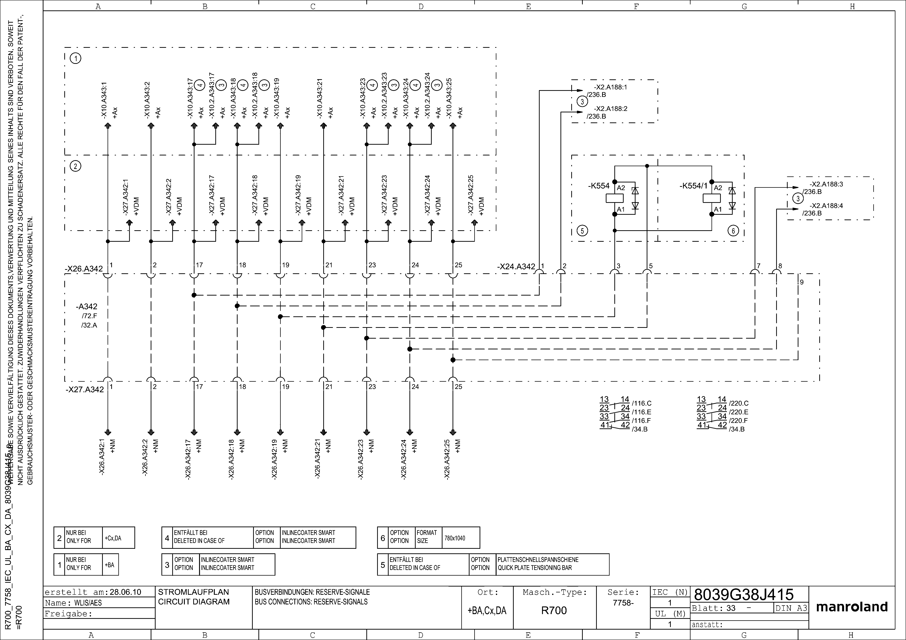

# +BA_Cx_DA — Sheet 33 of 247 — BUSVERBINDUNGEN: RESERVE SIGNALE

**BUS CONNECTIONS: RESERVE SIGNALS**

> Part of the manroland **R700** printing press IEC/UL circuit diagrams.
> Drawing class: **Stromlaufplan / Circuit diagram** (DIN A3).
> Document `+BA_Cx_DA` covers the **Printing units / main switch cabinet** machine section.

## At a glance

| Field | Value |
|---|---|
| Document | `+BA_Cx_DA`  (8039G38J415) |
| Sheet | **33** of 247 |
| Section (DE) | BUSVERBINDUNGEN: RESERVE SIGNALE |
| Section (EN) | BUS CONNECTIONS: RESERVE SIGNALS |
| Section type | CIRCUIT — Circuit diagram |
| Machine type | `R700` |
| Series | `7758` |
| Created | 28.06.10 |
| Replaces | — |
| Columns used | A, B, C, D, E, F, G, H |
| Path numbers | — |
| Labels on sheet | 178 |
| Cross-refs out | 14 |
| Cross-refs in | 39 |

**Previous:** [+BA_Cx_DA sheet 32](SHEET_0032.md) · **Next:** [+BA_Cx_DA sheet 34](SHEET_0034.md) · **Document TOC:** [_TOC.md](_TOC.md)  (+BA_Cx_DA) · **Master TOC:** [all sheets](../_MASTER_TOC.md)

## Sheet image (300 DPI, exact vector render)



_Rendered directly from the PDF vector layer at 300 DPI (1-bit), no OCR and no resampling. Use it to confirm anything ambiguous in the text below._

## Cross-references on this sheet

Each entry is a wire leaving this sheet. The printed token is `/sheet.column`; the link resolves to that sheet inside the same document.

| Ref | Target sheet | Col | Path | Destination on target | Target section | From col |
|---|---|---|---|---|---|---|
| `/236.B` | [+BA_Cx_DA sheet 236](SHEET_0236.md) | B | — | — | OPTION: INLINECOATER SMART | F |
| `/236.B` | [+BA_Cx_DA sheet 236](SHEET_0236.md) | B | — | — | OPTION: INLINECOATER SMART | F |
| `/236.B` | [+BA_Cx_DA sheet 236](SHEET_0236.md) | B | — | — | OPTION: INLINECOATER SMART | H |
| `/236.B` | [+BA_Cx_DA sheet 236](SHEET_0236.md) | B | — | — | OPTION: INLINECOATER SMART | H |
| `/72.F` | [+BA_Cx_DA sheet 72](SHEET_0072.md) | F | — | — | FEUCHTWERK | A |
| `/32.A` | [+BA_Cx_DA sheet 32](SHEET_0032.md) | A | — | — | BUSVERBINDUNGEN: 20 mA SCHLEIFE, BUSFUNKTIONEN | A |
| `/116.C` | [+BA_Cx_DA sheet 116](SHEET_0116.md) | C | — | — | PPL 2 | F |
| `/116.E` | [+BA_Cx_DA sheet 116](SHEET_0116.md) | E | — | — | PPL 2 | F |
| `/116.F` | [+BA_Cx_DA sheet 116](SHEET_0116.md) | F | — | — | PPL 2 | F |
| `/34.B` | [+BA_Cx_DA sheet 34](SHEET_0034.md) | B | — | — | BUSVERBINDUNGEN: RESERVE SIGNALE | F |
| `/220.C` | [+BA_Cx_DA sheet 220](SHEET_0220.md) | C | — | — | OPTION: FORMAT 780x1040 | G |
| `/220.E` | [+BA_Cx_DA sheet 220](SHEET_0220.md) | E | — | — | OPTION: FORMAT 780x1040 | G |
| `/220.F` | [+BA_Cx_DA sheet 220](SHEET_0220.md) | F | — | — | OPTION: FORMAT 780x1040 | G |
| `/34.B` | [+BA_Cx_DA sheet 34](SHEET_0034.md) | B | — | — | BUSVERBINDUNGEN: RESERVE SIGNALE | G |

### Incoming references (sheets that point here)

Every other sheet that sends a wire to this one. `Back-ref` is the token printed on *that* sheet; `Path` is its line number.

| From sheet | Cols | Back-ref | Path | Refs | What continues there |
|---|---|---|---|---|---|
| [+BA_Cx_DA#32](SHEET_0032.md) | A | `/32.A` | — | 1 | — |
| [+BA_Cx_DA#34](SHEET_0034.md) | B | `/34.B` | — | 2 | — |
| [+BA_Cx_DA#72](SHEET_0072.md) | F | `/72.F` | — | 1 | — |
| [+BA_Cx_DA#116](SHEET_0116.md) | C, E, F | `/116.C`, `/116.E`, `/116.F` | — | 3 | — |
| [+BA_Cx_DA#175](SHEET_0175.md) | B | `/175.B` | — | 7 | — |
| [+BA_Cx_DA#176](SHEET_0176.md) | B | `/176.B` | — | 9 | — |
| [+BA_Cx_DA#177](SHEET_0177.md) | B | `/177.B` | — | 9 | — |
| [+BA_Cx_DA#220](SHEET_0220.md) | C, D, F | `/220.C`, `/220.D`, `/220.F` | — | 3 | — |
| [+BA_Cx_DA#236](SHEET_0236.md) | A | `/236.A` | — | 4 | X2.A188:1; X2.A188:2; X2.A188:3; X2.A188:4 |


## Devices on this sheet

| Tag | Class | Class meaning (IEC) | Col | Sub | Terminal | Sign |
|---|---|---|---|---|---|---|
| `A342` | A | Baugruppe / assembly, module, PC board | A | — | — | — |
| `A2` | A | Baugruppe / assembly, module, PC board | F | — | — | — |
| `A1` | A | Baugruppe / assembly, module, PC board | F | — | — | — |
| `K554` | K | Relais / relay, contactor | F | — | — | — |
| `A2` | A | Baugruppe / assembly, module, PC board | G | — | — | — |
| `A1` | A | Baugruppe / assembly, module, PC board | G | — | — | — |
| `K554/1` | K | Relais / relay, contactor | G | 1 | — | — |
| `X26.A342:1` | — | cross-device reference | A | — | 1 | — |
| `X26.A342:2` | — | cross-device reference | A | — | 2 | — |
| `X26.A342:19` | — | cross-device reference | C | — | 19 | — |
| `X26.A342:18` | — | cross-device reference | B | — | 18 | — |
| `X26.A342:17` | — | cross-device reference | B | — | 17 | — |
| `X26.A342:21` | — | cross-device reference | C | — | 21 | — |
| `X26.A342:23` | — | cross-device reference | C | — | 23 | — |
| `X26.A342:25` | — | cross-device reference | D | — | 25 | — |
| `X26.A342:24` | — | cross-device reference | D | — | 24 | — |
| `X10.A343:1` | — | cross-device reference | A | — | 1 | — |
| `X10.A343:2` | — | cross-device reference | A | — | 2 | — |
| `X10.A343:17` | — | cross-device reference | B | — | 17 | — |
| `X10.A343:18` | — | cross-device reference | B | — | 18 | — |
| `X10.A343:19` | — | cross-device reference | C | — | 19 | — |
| `X10.A343:21` | — | cross-device reference | C | — | 21 | — |
| `X10.A343:23` | — | cross-device reference | C | — | 23 | — |
| `X10.A343:24` | — | cross-device reference | D | — | 24 | — |
| `X10.A343:25` | — | cross-device reference | D | — | 25 | — |
| `X10.2.A343:17` | — | cross-device reference | B | — | 17 | — |
| `X10.2.A343:18` | — | cross-device reference | B | — | 18 | — |
| `X10.2.A343:23` | — | cross-device reference | D | — | 23 | — |
| `X10.2.A343:24` | — | cross-device reference | D | — | 24 | — |
| `X27.A342:1` | — | cross-device reference | A | — | 1 | — |
| `X27.A342:2` | — | cross-device reference | B | — | 2 | — |
| `X27.A342:17` | — | cross-device reference | B | — | 17 | — |
| `X27.A342:18` | — | cross-device reference | B | — | 18 | — |
| `X27.A342:19` | — | cross-device reference | C | — | 19 | — |
| `X27.A342:21` | — | cross-device reference | C | — | 21 | — |
| `X27.A342:23` | — | cross-device reference | D | — | 23 | — |
| `X27.A342:24` | — | cross-device reference | D | — | 24 | — |
| `X27.A342:25` | — | cross-device reference | D | — | 25 | — |
| `X27.A342` | — | cross-device reference | A | — | — | — |
| `X26.A342` | — | cross-device reference | A | — | — | — |
| `X24.A342` | — | cross-device reference | E | — | — | — |
| `X2.A188:4` | — | cross-device reference | H | — | 4 | — |
| `X2.A188:3` | — | cross-device reference | H | — | 3 | — |
| `X2.A188:2` | — | cross-device reference | F | — | 2 | — |
| `X2.A188:1` | — | cross-device reference | F | — | 1 | — |

## Potentials / nets

_No named potentials on this sheet._

## Wire-end annotations (grouped as printed)

A wire that continues elsewhere is annotated with a small cluster: the destination description, the path/line number `#NN`, and the `/sheet.column` cross reference. Each row below is one such cluster exactly as it is grouped on the drawing.

| Col | Y | Path | Cross-ref | Text on the wire |
|---|---|---|---|---|
| A | 73.5 | — | — | `1` |
| B | 95.2 | — | — | `X10.2.A343:17` |
| B | 95.2 | — | — | `X10.2.A343:18` |
| D | 95.2 | — | — | `X10.2.A343:23` |
| D | 95.2 | — | — | `X10.2.A343:24` |
| B | 102.6 | — | — | `X10.A343:17` |
| B | 102.6 | — | — | `X10.A343:18` |
| C | 102.6 | — | — | `X10.A343:19` |
| C | 102.6 | — | — | `X10.A343:21` |
| C | 102.6 | — | — | `X10.A343:23` |
| D | 102.6 | — | — | `X10.A343:24` |
| D | 102.6 | — | — | `X10.A343:25` |
| A | 107.4 | — | — | `X10.A343:1` |
| A | 107.4 | — | — | `X10.A343:2` |
| B | 110.0 | — | — | `4` |
| B | 110.0 | — | — | `3` |
| B | 110.0 | — | — | `4` |
| C | 110.0 | — | — | `3` |
| D | 110.0 | — | — | `4` |
| D | 110.0 | — | — | `3` |
| D | 110.0 | — | — | `4` |
| D | 110.0 | — | — | `3` |
| F | 110.8 | — | — | `X2.A188:1` |
| F | 120.7 | — | `/236.B` | — |
| F | 130.7 | — | — | `3` |
| F | 139.2 | — | — | `X2.A188:2` |
| A | 141.2 | — | — | `+Ax` |
| B | 141.2 | — | — | `+Ax` |
| B | 141.2 | — | — | `+Ax` |
| B | 141.2 | — | — | `+Ax` |
| B | 141.2 | — | — | `+Ax` |
| C | 141.2 | — | — | `+Ax` |
| C | 141.2 | — | — | `+Ax` |
| C | 141.2 | — | — | `+Ax` |
| D | 141.2 | — | — | `+Ax` |
| D | 141.2 | — | — | `+Ax` |
| D | 141.2 | — | — | `+Ax` |
| D | 141.2 | — | — | `+Ax` |
| D | 141.2 | — | — | `+Ax` |
| F | 149.1 | — | `/236.B` | — |
| A | 215.7 | — | — | `2` |
| B | 230.2 | — | — | `X27.A342:17` |
| B | 230.2 | — | — | `X27.A342:18` |
| C | 230.2 | — | — | `X27.A342:19` |
| C | 230.2 | — | — | `X27.A342:21` |
| D | 230.2 | — | — | `X27.A342:23` |
| D | 230.2 | — | — | `X27.A342:24` |
| D | 230.2 | — | — | `X27.A342:25` |
| A | 235.0 | — | — | `X27.A342:1` |
| B | 235.0 | — | — | `X27.A342:2` |
| H | 238.4 | — | — | `X2.A188:3` |
| F | 239.8 | — | — | `K554` |
| G | 239.8 | — | — | `K554/1` |
| F | 243.3 | — | — | `A2` |
| G | 243.3 | — | — | `A2` |
| H | 248.3 | — | `/236.B` | — |
| G | 258.2 | — | — | `3` |
| A | 259.4 | — | — | `+VDM` |
| B | 259.4 | — | — | `+VDM` |
| B | 259.4 | — | — | `+VDM` |
| C | 259.4 | — | — | `+VDM` |
| C | 259.4 | — | — | `+VDM` |
| C | 259.4 | — | — | `+VDM` |
| D | 259.4 | — | — | `+VDM` |
| D | 259.4 | — | — | `+VDM` |
| E | 259.4 | — | — | `+VDM` |
| H | 266.7 | — | — | `X2.A188:4` |
| F | 271.7 | — | — | `A1` |
| G | 271.7 | — | — | `A1` |
| H | 276.6 | — | `/236.B` | — |
| F | 300.8 | — | — | `5 6` |
| C | 344.7 | — | — | `X26.A342 1 2 17 18 19 21 23 24 25` |
| E | 346.1 | — | — | `X24.A342 1 2 3` |
| G | 346.1 | — | — | `5 7 8` |
| H | 367.4 | — | — | `9` |
| A | 398.6 | — | — | `A342` |
| A | 411.6 | — | `/72.F`, `/32.A` | — |
| C | 504.9 | — | — | `X27.A342 1 2 17 18 19 21 23 24 25` |
| F | 520.4 | — | — | `13 14` |
| G | 520.4 | — | — | `13 14` |
| F | 526.8 | — | `/116.C`, `/116.E`, `/116.F`, `/34.B` | — |
| G | 526.8 | — | `/220.C`, `/220.E`, `/220.F`, `/34.B` | — |
| F | 531.8 | — | — | `23 33 34 24` |
| G | 531.8 | — | — | `23 33 34 24` |
| F | 554.4 | — | — | `41 42` |
| G | 554.4 | — | — | `41 42` |
| A | 576.6 | — | — | `X26.A342:1` |
| C | 576.6 | — | — | `X26.A342:21` |
| A | 577.7 | — | — | `+NM` |
| A | 577.7 | — | — | `X26.A342:2` |
| B | 577.7 | — | — | `+NM` |
| B | 577.7 | — | — | `+NM` |
| B | 577.7 | — | — | `+NM` |
| C | 577.7 | — | — | `+NM` |
| C | 577.7 | — | — | `+NM` |
| D | 577.7 | — | — | `+NM` |
| D | 577.7 | — | — | `+NM` |
| D | 577.7 | — | — | `+NM` |
| B | 578.0 | — | — | `X26.A342:17` |
| B | 578.0 | — | — | `X26.A342:18` |
| C | 578.0 | — | — | `X26.A342:19` |
| C | 578.0 | — | — | `X26.A342:23` |
| D | 578.0 | — | — | `X26.A342:24` |
| D | 578.0 | — | — | `X26.A342:25` |
| A | 697.9 | — | — | `2 NUR BEI` |
| B | 697.9 | — | — | `4 ENTFÄLLT BEI DELETED IN CASE OF` |
| C | 697.9 | — | — | `OPTION OPTION` |
| D | 697.9 | — | — | `6 OPTION OPTION` |
| C | 698.0 | — | — | `INLINECOATER SMART INLINECOATER SMART` |
| D | 698.0 | — | — | `FORMAT` |
| A | 705.1 | — | — | `ONLY FOR +Cx,DA` |
| D | 705.1 | — | — | `SIZE 780x1040` |
| A | 733.3 | — | — | `1 NUR BEI` |
| B | 733.4 | — | — | `3 INLINECOATER SMART INLINECOATER SMART` |
| B | 733.4 | — | — | `OPTION OPTION` |
| D | 733.4 | — | — | `5 ENTFÄLLT BEI DELETED IN CASE OF` |
| E | 733.4 | — | — | `OPTION OPTION` |
| E | 733.4 | — | — | `PLATTENSCHNELLSPANNSCHIENE` |
| A | 740.4 | — | — | `ONLY FOR +BA` |
| E | 744.0 | — | — | `QUICK PLATE TENSIONING BAR` |


## Reconstructed tables

This sheet carries tabular content (pin map / terminal assignment / index). The grid below was rebuilt from the drawing's own rule lines, so each row is exactly one physical row of the table.

### Table 1 — 0 data rows × 3 columns (at x=708.7, y=119.1) — **/236.B 3 X2.A188:2 /236.B K554 A2 A1**

_none_


### Table 2 — 0 data rows × 6 columns (at x=850.4, y=119.1) — **K554/1 A2 A1**

_none_


## Notes and free text on this sheet

| Text | Col | Y (pt) |
|---|---|---|
| `+NM` | A | 577.7 |
| `+NM` | B | 577.7 |
| `+NM` | C | 577.7 |
| `+NM` | D | 577.7 |
| `+Ax` | A | 141.17 |
| `+Ax` | B | 141.17 |
| `+Ax` | C | 141.17 |
| `+Ax` | D | 141.17 |
| `+VDM` | A | 259.37 |
| `+VDM` | B | 259.37 |
| `+VDM` | C | 259.37 |
| `+VDM` | D | 259.37 |
| `+VDM` | E | 259.37 |
| `NUR BEI` | A | 733.33 |
| `ONLY FOR` | A | 744.02 |
| `+BA` | A | 740.44 |
| `+Cx,DA` | A | 705.08 |
| `OPTION` | B | 733.35 |
| `INLINECOATER SMART` | B | 733.38 |
| `ENTFÄLLT BEI` | B | 697.91 |
| `DELETED IN CASE OF` | B | 708.57 |
| `OPTION` | C | 697.92 |
| `INLINECOATER SMART` | C | 697.95 |
| `ENTFÄLLT BEI` | D | 733.35 |
| `DELETED IN CASE OF` | D | 744 |
| `OPTION` | E | 733.35 |
| `PLATTENSCHNELLSPANNSCHIENE` | E | 733.39 |
| `QUICK PLATE TENSIONING BAR` | E | 744.01 |
| `OPTION` | D | 697.92 |
| `FORMAT` | D | 697.95 |
| `SIZE` | D | 708.5 |
| `780x1040` | D | 705.1 |

## Complete label inventory (exact text from the drawing)

Every text object inside the drawing area of this sheet, in DIN reading order (column A→H, then top→bottom). This is the authoritative list: if a string is not here it is not printed on this sheet.

| Col | Y | X | Dir | Type | Text |
|---|---|---|---|---|---|
| A | 73.5 | 97.5 | → | number | `1` |
| A | 107.4 | 132.8 | ↕ | device ref | `X10.A343:1` |
| A | 107.4 | 189.5 | ↕ | device ref | `X10.A343:2` |
| A | 141.2 | 147.1 | ↕ | text | `+Ax` |
| A | 215.7 | 97.2 | → | number | `2` |
| A | 235.0 | 161.2 | ↕ | device ref | `X27.A342:1` |
| A | 259.4 | 175.4 | ↕ | text | `+VDM` |
| A | 344.7 | 143.7 | → | number | `1` |
| A | 349.0 | 85.0 | → | device ref | `X26.A342` |
| A | 398.6 | 99.8 | → | device tag | `A342` |
| A | 411.6 | 107.7 | → | cross-reference | `/72.F` |
| A | 424.0 | 106.9 | → | cross-reference | `/32.A` |
| A | 504.9 | 143.7 | → | number | `1` |
| A | 507.7 | 86.5 | → | device ref | `X27.A342` |
| A | 576.6 | 130.0 | ↕ | device ref | `X26.A342:1` |
| A | 577.7 | 144.2 | ↕ | text | `+NM` |
| A | 577.7 | 186.7 | ↕ | device ref | `X26.A342:2` |
| A | 697.9 | 87.0 | → | text | `NUR BEI` |
| A | 703.3 | 75.1 | → | number | `2` |
| A | 705.1 | 137.9 | → | text | `+Cx,DA` |
| A | 708.6 | 87.6 | → | text | `ONLY FOR` |
| A | 733.3 | 87.0 | → | text | `NUR BEI` |
| A | 738.7 | 75.4 | → | number | `1` |
| A | 740.4 | 137.9 | → | text | `+BA` |
| A | 744.0 | 87.6 | → | text | `ONLY FOR` |
| B | 95.2 | 274.5 | ↕ | device ref | `X10.2.A343:17` |
| B | 95.2 | 331.2 | ↕ | device ref | `X10.2.A343:18` |
| B | 102.6 | 246.2 | ↕ | device ref | `X10.A343:17` |
| B | 102.6 | 302.9 | ↕ | device ref | `X10.A343:18` |
| B | 110.0 | 259.7 | ↕ | number | `4` |
| B | 110.0 | 288.0 | ↕ | number | `3` |
| B | 110.0 | 316.4 | ↕ | number | `4` |
| B | 141.2 | 203.7 | ↕ | text | `+Ax` |
| B | 141.2 | 260.4 | ↕ | text | `+Ax` |
| B | 141.2 | 288.8 | ↕ | text | `+Ax` |
| B | 141.2 | 317.1 | ↕ | text | `+Ax` |
| B | 230.2 | 274.5 | ↕ | device ref | `X27.A342:17` |
| B | 230.2 | 331.2 | ↕ | device ref | `X27.A342:18` |
| B | 235.0 | 217.8 | ↕ | device ref | `X27.A342:2` |
| B | 259.4 | 232.0 | ↕ | text | `+VDM` |
| B | 259.4 | 288.7 | ↕ | text | `+VDM` |
| B | 344.7 | 201.0 | → | number | `2` |
| B | 344.7 | 257.1 | → | number | `17` |
| B | 344.7 | 313.8 | → | number | `18` |
| B | 504.9 | 201.0 | → | number | `2` |
| B | 504.9 | 257.1 | → | number | `17` |
| B | 504.9 | 313.8 | → | number | `18` |
| B | 577.7 | 200.9 | ↕ | text | `+NM` |
| B | 577.7 | 257.6 | ↕ | text | `+NM` |
| B | 577.7 | 314.3 | ↕ | text | `+NM` |
| B | 578.0 | 243.4 | ↕ | device ref | `X26.A342:17` |
| B | 578.0 | 300.1 | ↕ | device ref | `X26.A342:18` |
| B | 697.9 | 228.8 | → | text | `ENTFÄLLT BEI` |
| B | 703.3 | 216.9 | → | number | `4` |
| B | 708.6 | 228.8 | → | text | `DELETED IN CASE OF` |
| B | 733.4 | 229.3 | → | text | `OPTION` |
| B | 733.4 | 264.2 | → | text | `INLINECOATER SMART` |
| B | 738.7 | 216.7 | → | number | `3` |
| B | 744.0 | 229.3 | → | text | `OPTION` |
| B | 744.0 | 264.2 | → | text | `INLINECOATER SMART` |
| C | 102.6 | 359.6 | ↕ | device ref | `X10.A343:19` |
| C | 102.6 | 416.3 | ↕ | device ref | `X10.A343:21` |
| C | 102.6 | 473.0 | ↕ | device ref | `X10.A343:23` |
| C | 110.0 | 344.7 | ↕ | number | `3` |
| C | 141.2 | 345.5 | ↕ | text | `+Ax` |
| C | 141.2 | 373.8 | ↕ | text | `+Ax` |
| C | 141.2 | 430.5 | ↕ | text | `+Ax` |
| C | 230.2 | 387.9 | ↕ | device ref | `X27.A342:19` |
| C | 230.2 | 444.6 | ↕ | device ref | `X27.A342:21` |
| C | 259.4 | 345.4 | ↕ | text | `+VDM` |
| C | 259.4 | 402.1 | ↕ | text | `+VDM` |
| C | 259.4 | 458.8 | ↕ | text | `+VDM` |
| C | 344.7 | 370.5 | → | number | `19` |
| C | 344.7 | 427.7 | → | number | `21` |
| C | 504.9 | 370.5 | → | number | `19` |
| C | 504.9 | 427.7 | → | number | `21` |
| C | 576.6 | 413.4 | ↕ | device ref | `X26.A342:21` |
| C | 577.7 | 371.0 | ↕ | text | `+NM` |
| C | 577.7 | 427.7 | ↕ | text | `+NM` |
| C | 578.0 | 356.7 | ↕ | device ref | `X26.A342:19` |
| C | 578.0 | 470.1 | ↕ | device ref | `X26.A342:23` |
| C | 697.9 | 335.6 | → | text | `OPTION` |
| C | 698.0 | 370.5 | → | text | `INLINECOATER SMART` |
| C | 708.6 | 335.6 | → | text | `OPTION` |
| C | 708.6 | 370.5 | → | text | `INLINECOATER SMART` |
| D | 95.2 | 501.3 | ↕ | device ref | `X10.2.A343:23` |
| D | 95.2 | 558.0 | ↕ | device ref | `X10.2.A343:24` |
| D | 102.6 | 529.7 | ↕ | device ref | `X10.A343:24` |
| D | 102.6 | 586.4 | ↕ | device ref | `X10.A343:25` |
| D | 110.0 | 486.4 | ↕ | number | `4` |
| D | 110.0 | 514.8 | ↕ | number | `3` |
| D | 110.0 | 543.1 | ↕ | number | `4` |
| D | 110.0 | 571.5 | ↕ | number | `3` |
| D | 141.2 | 487.2 | ↕ | text | `+Ax` |
| D | 141.2 | 515.6 | ↕ | text | `+Ax` |
| D | 141.2 | 543.9 | ↕ | text | `+Ax` |
| D | 141.2 | 572.2 | ↕ | text | `+Ax` |
| D | 141.2 | 600.6 | ↕ | text | `+Ax` |
| D | 230.2 | 501.3 | ↕ | device ref | `X27.A342:23` |
| D | 230.2 | 558.0 | ↕ | device ref | `X27.A342:24` |
| D | 230.2 | 614.7 | ↕ | device ref | `X27.A342:25` |
| D | 259.4 | 515.5 | ↕ | text | `+VDM` |
| D | 259.4 | 572.2 | ↕ | text | `+VDM` |
| D | 344.7 | 484.4 | → | number | `23` |
| D | 344.7 | 541.1 | → | number | `24` |
| D | 344.7 | 597.8 | → | number | `25` |
| D | 504.9 | 484.4 | → | number | `23` |
| D | 504.9 | 541.1 | → | number | `24` |
| D | 504.9 | 597.8 | → | number | `25` |
| D | 577.7 | 484.4 | ↕ | text | `+NM` |
| D | 577.7 | 541.1 | ↕ | text | `+NM` |
| D | 577.7 | 597.7 | ↕ | text | `+NM` |
| D | 578.0 | 526.8 | ↕ | device ref | `X26.A342:24` |
| D | 578.0 | 583.5 | ↕ | device ref | `X26.A342:25` |
| D | 697.9 | 512.8 | → | text | `OPTION` |
| D | 697.9 | 547.7 | → | text | `FORMAT` |
| D | 703.3 | 500.3 | → | number | `6` |
| D | 705.1 | 584.4 | → | text | `780x1040` |
| D | 708.5 | 548.2 | → | text | `SIZE` |
| D | 708.6 | 512.8 | → | text | `OPTION` |
| D | 733.3 | 512.2 | → | text | `ENTFÄLLT BEI` |
| D | 738.7 | 500.2 | → | number | `5` |
| D | 744.0 | 512.2 | → | text | `DELETED IN CASE OF` |
| E | 259.4 | 628.9 | ↕ | text | `+VDM` |
| E | 346.1 | 653.4 | → | device ref | `X24.A342` |
| E | 346.2 | 710.6 | → | number | `1` |
| E | 346.2 | 739.6 | → | number | `2` |
| E | 733.4 | 619.1 | → | text | `OPTION` |
| E | 733.4 | 654.0 | → | text | `PLATTENSCHNELLSPANNSCHIENE` |
| E | 744.0 | 619.1 | → | text | `OPTION` |
| E | 744.0 | 654.5 | → | text | `QUICK PLATE TENSIONING BAR` |
| F | 110.8 | 780.7 | → | device ref | `X2.A188:1` |
| F | 120.7 | 771.0 | → | cross-reference | `/236.B` |
| F | 130.7 | 763.4 | → | number | `3` |
| F | 139.2 | 780.7 | → | device ref | `X2.A188:2` |
| F | 149.1 | 771.0 | → | cross-reference | `/236.B` |
| F | 239.8 | 773.0 | → | device tag | `K554` |
| F | 243.3 | 810.7 | → | device tag | `A2` |
| F | 271.7 | 810.7 | → | device tag | `A1` |
| F | 300.8 | 763.4 | → | number | `5` |
| F | 346.2 | 810.4 | → | number | `3` |
| F | 346.2 | 852.9 | → | number | `5` |
| F | 520.4 | 788.0 | → | number | `13` |
| F | 520.4 | 815.2 | → | number | `14` |
| F | 526.8 | 830.6 | → | cross-reference | `/116.C` |
| F | 531.8 | 788.0 | → | number | `23` |
| F | 531.8 | 816.1 | → | number | `24` |
| F | 538.1 | 830.6 | → | cross-reference | `/116.E` |
| F | 543.1 | 788.0 | → | number | `33` |
| F | 543.1 | 815.8 | → | number | `34` |
| F | 549.5 | 830.6 | → | cross-reference | `/116.F` |
| F | 554.4 | 789.4 | → | number | `41` |
| F | 554.4 | 816.1 | → | number | `42` |
| F | 560.8 | 830.6 | → | cross-reference | `/34.B` |
| G | 239.8 | 893.2 | → | device tag | `K554/1` |
| G | 243.3 | 938.3 | → | device tag | `A2` |
| G | 258.2 | 1046.8 | → | number | `3` |
| G | 271.7 | 938.3 | → | device tag | `A1` |
| G | 300.8 | 961.8 | → | number | `6` |
| G | 346.2 | 994.7 | → | number | `7` |
| G | 346.2 | 1023.0 | → | number | `8` |
| G | 520.4 | 915.6 | → | number | `13` |
| G | 520.4 | 942.8 | → | number | `14` |
| G | 526.8 | 958.1 | → | cross-reference | `/220.C` |
| G | 531.8 | 915.6 | → | number | `23` |
| G | 531.8 | 943.7 | → | number | `24` |
| G | 538.1 | 958.1 | → | cross-reference | `/220.E` |
| G | 543.1 | 915.6 | → | number | `33` |
| G | 543.1 | 943.4 | → | number | `34` |
| G | 549.5 | 958.1 | → | cross-reference | `/220.F` |
| G | 554.4 | 917.0 | → | number | `41` |
| G | 554.4 | 943.7 | → | number | `42` |
| G | 560.8 | 958.1 | → | cross-reference | `/34.B` |
| H | 238.4 | 1064.1 | → | device ref | `X2.A188:3` |
| H | 248.3 | 1054.5 | → | cross-reference | `/236.B` |
| H | 266.7 | 1064.1 | → | device ref | `X2.A188:4` |
| H | 276.6 | 1054.5 | → | cross-reference | `/236.B` |
| H | 367.4 | 1051.4 | → | number | `9` |

## Reading-order text block

The same content as a plain block, grouped by DIN column — convenient to paste or to match against a visual description.

```text
=== Column A ===
  73.5   97.5  numeric      1
 107.4  132.8  devref       X10.A343:1
 107.4  189.5  devref       X10.A343:2
 141.2  147.1  text         +Ax
 215.7   97.2  numeric      2
 235.0  161.2  devref       X27.A342:1
 259.4  175.4  text         +VDM
 344.7  143.7  numeric      1
 349.0   85.0  devref       X26.A342
 398.6   99.8  devtag       A342
 411.6  107.7  xref         /72.F
 424.0  106.9  xref         /32.A
 504.9  143.7  numeric      1
 507.7   86.5  devref       X27.A342
 576.6  130.0  devref       X26.A342:1
 577.7  144.2  text         +NM
 577.7  186.7  devref       X26.A342:2
 697.9   87.0  text         NUR BEI
 703.3   75.1  numeric      2
 705.1  137.9  text         +Cx,DA
 708.6   87.6  text         ONLY FOR
 733.3   87.0  text         NUR BEI
 738.7   75.4  numeric      1
 740.4  137.9  text         +BA
 744.0   87.6  text         ONLY FOR
=== Column B ===
  95.2  274.5  devref       X10.2.A343:17
  95.2  331.2  devref       X10.2.A343:18
 102.6  246.2  devref       X10.A343:17
 102.6  302.9  devref       X10.A343:18
 110.0  259.7  numeric      4
 110.0  288.0  numeric      3
 110.0  316.4  numeric      4
 141.2  203.7  text         +Ax
 141.2  260.4  text         +Ax
 141.2  288.8  text         +Ax
 141.2  317.1  text         +Ax
 230.2  274.5  devref       X27.A342:17
 230.2  331.2  devref       X27.A342:18
 235.0  217.8  devref       X27.A342:2
 259.4  232.0  text         +VDM
 259.4  288.7  text         +VDM
 344.7  201.0  numeric      2
 344.7  257.1  numeric      17
 344.7  313.8  numeric      18
 504.9  201.0  numeric      2
 504.9  257.1  numeric      17
 504.9  313.8  numeric      18
 577.7  200.9  text         +NM
 577.7  257.6  text         +NM
 577.7  314.3  text         +NM
 578.0  243.4  devref       X26.A342:17
 578.0  300.1  devref       X26.A342:18
 697.9  228.8  text         ENTFÄLLT BEI
 703.3  216.9  numeric      4
 708.6  228.8  text         DELETED IN CASE OF
 733.4  229.3  text         OPTION
 733.4  264.2  text         INLINECOATER SMART
 738.7  216.7  numeric      3
 744.0  229.3  text         OPTION
 744.0  264.2  text         INLINECOATER SMART
=== Column C ===
 102.6  359.6  devref       X10.A343:19
 102.6  416.3  devref       X10.A343:21
 102.6  473.0  devref       X10.A343:23
 110.0  344.7  numeric      3
 141.2  345.5  text         +Ax
 141.2  373.8  text         +Ax
 141.2  430.5  text         +Ax
 230.2  387.9  devref       X27.A342:19
 230.2  444.6  devref       X27.A342:21
 259.4  345.4  text         +VDM
 259.4  402.1  text         +VDM
 259.4  458.8  text         +VDM
 344.7  370.5  numeric      19
 344.7  427.7  numeric      21
 504.9  370.5  numeric      19
 504.9  427.7  numeric      21
 576.6  413.4  devref       X26.A342:21
 577.7  371.0  text         +NM
 577.7  427.7  text         +NM
 578.0  356.7  devref       X26.A342:19
 578.0  470.1  devref       X26.A342:23
 697.9  335.6  text         OPTION
 698.0  370.5  text         INLINECOATER SMART
 708.6  335.6  text         OPTION
 708.6  370.5  text         INLINECOATER SMART
=== Column D ===
  95.2  501.3  devref       X10.2.A343:23
  95.2  558.0  devref       X10.2.A343:24
 102.6  529.7  devref       X10.A343:24
 102.6  586.4  devref       X10.A343:25
 110.0  486.4  numeric      4
 110.0  514.8  numeric      3
 110.0  543.1  numeric      4
 110.0  571.5  numeric      3
 141.2  487.2  text         +Ax
 141.2  515.6  text         +Ax
 141.2  543.9  text         +Ax
 141.2  572.2  text         +Ax
 141.2  600.6  text         +Ax
 230.2  501.3  devref       X27.A342:23
 230.2  558.0  devref       X27.A342:24
 230.2  614.7  devref       X27.A342:25
 259.4  515.5  text         +VDM
 259.4  572.2  text         +VDM
 344.7  484.4  numeric      23
 344.7  541.1  numeric      24
 344.7  597.8  numeric      25
 504.9  484.4  numeric      23
 504.9  541.1  numeric      24
 504.9  597.8  numeric      25
 577.7  484.4  text         +NM
 577.7  541.1  text         +NM
 577.7  597.7  text         +NM
 578.0  526.8  devref       X26.A342:24
 578.0  583.5  devref       X26.A342:25
 697.9  512.8  text         OPTION
 697.9  547.7  text         FORMAT
 703.3  500.3  numeric      6
 705.1  584.4  text         780x1040
 708.5  548.2  text         SIZE
 708.6  512.8  text         OPTION
 733.3  512.2  text         ENTFÄLLT BEI
 738.7  500.2  numeric      5
 744.0  512.2  text         DELETED IN CASE OF
=== Column E ===
 259.4  628.9  text         +VDM
 346.1  653.4  devref       X24.A342
 346.2  710.6  numeric      1
 346.2  739.6  numeric      2
 733.4  619.1  text         OPTION
 733.4  654.0  text         PLATTENSCHNELLSPANNSCHIENE
 744.0  619.1  text         OPTION
 744.0  654.5  text         QUICK PLATE TENSIONING BAR
=== Column F ===
 110.8  780.7  devref       X2.A188:1
 120.7  771.0  xref         /236.B
 130.7  763.4  numeric      3
 139.2  780.7  devref       X2.A188:2
 149.1  771.0  xref         /236.B
 239.8  773.0  devtag       K554
 243.3  810.7  devtag       A2
 271.7  810.7  devtag       A1
 300.8  763.4  numeric      5
 346.2  810.4  numeric      3
 346.2  852.9  numeric      5
 520.4  788.0  numeric      13
 520.4  815.2  numeric      14
 526.8  830.6  xref         /116.C
 531.8  788.0  numeric      23
 531.8  816.1  numeric      24
 538.1  830.6  xref         /116.E
 543.1  788.0  numeric      33
 543.1  815.8  numeric      34
 549.5  830.6  xref         /116.F
 554.4  789.4  numeric      41
 554.4  816.1  numeric      42
 560.8  830.6  xref         /34.B
=== Column G ===
 239.8  893.2  devtag       K554/1
 243.3  938.3  devtag       A2
 258.2 1046.8  numeric      3
 271.7  938.3  devtag       A1
 300.8  961.8  numeric      6
 346.2  994.7  numeric      7
 346.2 1023.0  numeric      8
 520.4  915.6  numeric      13
 520.4  942.8  numeric      14
 526.8  958.1  xref         /220.C
 531.8  915.6  numeric      23
 531.8  943.7  numeric      24
 538.1  958.1  xref         /220.E
 543.1  915.6  numeric      33
 543.1  943.4  numeric      34
 549.5  958.1  xref         /220.F
 554.4  917.0  numeric      41
 554.4  943.7  numeric      42
 560.8  958.1  xref         /34.B
=== Column H ===
 238.4 1064.1  devref       X2.A188:3
 248.3 1054.5  xref         /236.B
 266.7 1064.1  devref       X2.A188:4
 276.6 1054.5  xref         /236.B
 367.4 1051.4  numeric      9
```

---
_Generated from the PDF vector text layer; no OCR. Source: `R700_7758_IEC_UL_BA_CX_DA_8039G38J415_p`, sheet 33._
