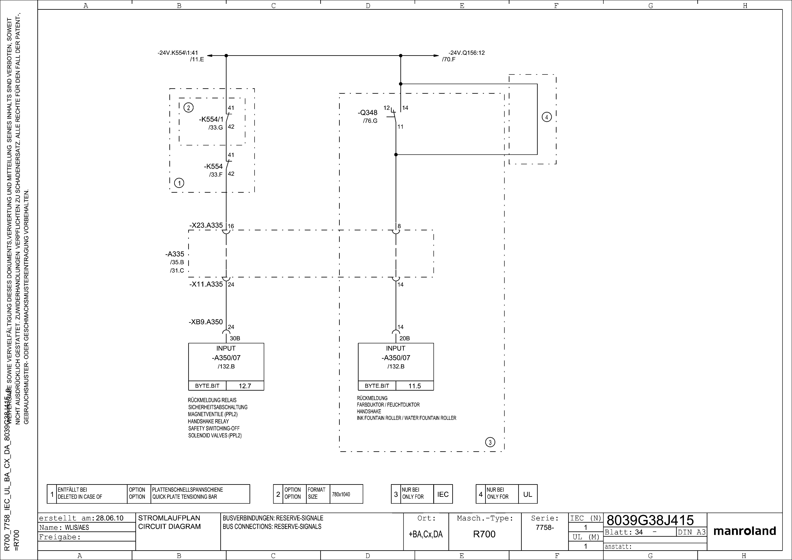

# +BA_Cx_DA — Sheet 34 of 247 — BUSVERBINDUNGEN: RESERVE SIGNALE

**BUS CONNECTIONS: RESERVE SIGNALS**

> Part of the manroland **R700** printing press IEC/UL circuit diagrams.
> Drawing class: **Stromlaufplan / Circuit diagram** (DIN A3).
> Document `+BA_Cx_DA` covers the **Printing units / main switch cabinet** machine section.

## At a glance

| Field | Value |
|---|---|
| Document | `+BA_Cx_DA`  (8039G38J415) |
| Sheet | **34** of 247 |
| Section (DE) | BUSVERBINDUNGEN: RESERVE SIGNALE |
| Section (EN) | BUS CONNECTIONS: RESERVE SIGNALS |
| Section type | CIRCUIT — Circuit diagram |
| Machine type | `R700` |
| Series | `7758` |
| Created | 28.06.10 |
| Replaces | — |
| Columns used | A, B, C, D, E, F |
| Path numbers | — |
| Labels on sheet | 76 |
| Cross-refs out | 9 |
| Cross-refs in | 15 |

**Previous:** [+BA_Cx_DA sheet 33](SHEET_0033.md) · **Next:** [+BA_Cx_DA sheet 35](SHEET_0035.md) · **Document TOC:** [_TOC.md](_TOC.md)  (+BA_Cx_DA) · **Master TOC:** [all sheets](../_MASTER_TOC.md)

## Sheet image (300 DPI, exact vector render)



_Rendered directly from the PDF vector layer at 300 DPI (1-bit), no OCR and no resampling. Use it to confirm anything ambiguous in the text below._

## Cross-references on this sheet

Each entry is a wire leaving this sheet. The printed token is `/sheet.column`; the link resolves to that sheet inside the same document.

| Ref | Target sheet | Col | Path | Destination on target | Target section | From col |
|---|---|---|---|---|---|---|
| `/11.E` | [+BA_Cx_DA sheet 11](SHEET_0011.md) | E | — | 24V.K554\1:41 | SPANNUNGSVERSORGUNG, SCHALTSCHRANKBELÜFTUNG | B |
| `/70.F` | [+BA_Cx_DA sheet 70](SHEET_0070.md) | F | — | — | ÖLUMLAUFSCHMIERUNG | E |
| `/76.G` | [+BA_Cx_DA sheet 76](SHEET_0076.md) | G | — | — | FARBWERK | D |
| `/33.G` | [+BA_Cx_DA sheet 33](SHEET_0033.md) | G | — | — | BUSVERBINDUNGEN: RESERVE SIGNALE | B |
| `/33.F` | [+BA_Cx_DA sheet 33](SHEET_0033.md) | F | — | — | BUSVERBINDUNGEN: RESERVE SIGNALE | B |
| `/35.B` | [+BA_Cx_DA sheet 35](SHEET_0035.md) | B | — | — | SCHUTZEINRICHTUNGEN | B |
| `/31.C` | [+BA_Cx_DA sheet 31](SHEET_0031.md) | C | — | — | BUSVERBINDUNGEN: SIGNALSCHLEIFE | B |
| `/132.B` | [+BA_Cx_DA sheet 132](SHEET_0132.md) | B | — | — | REFERENZMODUL | B |
| `/132.B` | [+BA_Cx_DA sheet 132](SHEET_0132.md) | B | — | — | REFERENZMODUL | D |

### Incoming references (sheets that point here)

Every other sheet that sends a wire to this one. `Back-ref` is the token printed on *that* sheet; `Path` is its line number.

| From sheet | Cols | Back-ref | Path | Refs | What continues there |
|---|---|---|---|---|---|
| [+BA_Cx_DA#11](SHEET_0011.md) | F | `/11.F` | — | 1 | — |
| [+BA_Cx_DA#31](SHEET_0031.md) | C | `/31.C` | — | 1 | — |
| [+BA_Cx_DA#33](SHEET_0033.md) | F, G | `/33.F`, `/33.G` | — | 2 | — |
| [+BA_Cx_DA#35](SHEET_0035.md) | B | `/35.B` | — | 1 | — |
| [+BA_Cx_DA#70](SHEET_0070.md) | F | `/70.F` | — | 1 | 24V.Q156:12 |
| [+BA_Cx_DA#76](SHEET_0076.md) | G | `/76.G` | — | 1 | — |
| [+BA_Cx_DA#132](SHEET_0132.md) | B | `/132.B` | — | 2 | — |
| [+BA_Cx_DA#166](SHEET_0166.md) | G | `/166.G` | — | 2 | — |
| [+BA_Cx_DA#168](SHEET_0168.md) | G | `/168.G` | — | 2 | — |
| [+BA_Cx_DA#174](SHEET_0174.md) | G | `/174.G` | — | 2 | — |


## Devices on this sheet

| Tag | Class | Class meaning (IEC) | Col | Sub | Terminal | Sign |
|---|---|---|---|---|---|---|
| `K554` | K | Relais / relay, contactor | B | — | — | — |
| `K554/1` | K | Relais / relay, contactor | B | 1 | — | — |
| `A335` | A | Baugruppe / assembly, module, PC board | B | — | — | — |
| `A350/07` | A | Baugruppe / assembly, module, PC board | B | 07 | — | — |
| `A350/07` | A | Baugruppe / assembly, module, PC board | D | 07 | — | — |
| `Q348` | Q | Leistungsschalter / power switching device | D | — | — | — |
| `X23.A335` | — | cross-device reference | B | — | — | — |
| `X11.A335` | — | cross-device reference | B | — | — | — |
| `12.7` | — | cross-device reference | C | — | — | — |
| `XB9.A350` | — | cross-device reference | B | — | — | — |
| `11.5` | — | cross-device reference | D | — | — | — |

## Potentials / nets

| Potential | Count | Columns | Attached devices | Terminals |
|---|---|---|---|---|
| `24V` | 2 | B, E | `K554\1`, `Q156` | `12`, `41` |


A potential such as `L24+/4` or `M24+` is a named supply/return rail; every place it appears on this sheet is electrically common.

## Wire-end annotations (grouped as printed)

A wire that continues elsewhere is annotated with a small cluster: the destination description, the path/line number `#NN`, and the `/sheet.column` cross reference. Each row below is one such cluster exactly as it is grouped on the drawing.

| Col | Y | Path | Cross-ref | Text on the wire |
|---|---|---|---|---|
| B | 75.4 | — | `/11.E` | `24V.K554\1:41` |
| E | 75.4 | — | — | `24V.Q156:12` |
| E | 85.3 | — | `/70.F` | — |
| C | 158.4 | — | — | `41` |
| D | 158.4 | — | — | `Q348 14` |
| D | 158.4 | — | — | `12` |
| B | 159.0 | — | — | `2` |
| F | 173.2 | — | — | `4` |
| B | 174.6 | — | — | `K554/1 42` |
| D | 177.8 | — | `/76.G` | — |
| D | 186.7 | — | — | `11` |
| B | 187.7 | — | `/33.G` | — |
| C | 229.2 | — | — | `41` |
| B | 245.5 | — | — | `K554 42` |
| B | 258.6 | — | `/33.F` | — |
| B | 271.9 | — | — | `1` |
| B | 334.1 | — | — | `X23.A335 16` |
| D | 336.2 | — | — | `8` |
| B | 377.3 | — | — | `A335` |
| B | 390.4 | — | `/35.B`, `/31.C` | — |
| B | 422.7 | — | — | `X11.A335 24` |
| D | 424.1 | — | — | `14` |
| B | 479.4 | — | — | `XB9.A350 24` |
| D | 487.9 | — | — | `14` |
| C | 504.9 | — | — | `30B` |
| D | 504.9 | — | — | `20B` |
| B | 519.4 | — | — | `INPUT` |
| D | 519.4 | — | — | `INPUT` |
| B | 533.2 | — | — | `A350/07` |
| D | 533.2 | — | — | `A350/07` |
| B | 547.0 | — | `/132.B` | — |
| D | 547.0 | — | `/132.B` | — |
| B | 576.1 | — | — | `BYTE.BIT 12.7` |
| D | 576.1 | — | — | `BYTE.BIT 11.5` |
| D | 596.0 | — | — | `RÜCKMELDUNG FARBDUKTOR / FEUCHTDUKTOR HANDSHAKE INK FOUNTAIN ROLLER / WATER FOUNTAIN ROLLER` |
| B | 598.8 | — | — | `RÜCKMELDUNG RELAIS` |
| B | 609.4 | — | — | `HANDSHAKE RELAY MAGNETVENTILE (PPL2) SICHERHEITSABSCHALTUNG` |
| B | 641.2 | — | — | `SAFETY SWITCHING OFF SOLENOID VALVES (PPL2)` |
| E | 662.2 | — | — | `3` |
| D | 733.3 | — | — | `3 NUR BEI` |
| E | 733.3 | — | — | `ONLY FOR IEC 4 NUR BEI` |
| A | 733.4 | — | — | `1 ENTFÄLLT BEI DELETED IN CASE OF` |
| B | 733.4 | — | — | `OPTION OPTION` |
| B | 733.4 | — | — | `PLATTENSCHNELLSPANNSCHIENE` |
| C | 733.4 | — | — | `QUICK PLATE TENSIONING BAR 2 OPTION OPTION` |
| C | 733.4 | — | — | `FORMAT` |
| F | 738.7 | — | — | `ONLY FOR UL` |
| D | 740.5 | — | — | `SIZE 780x1040` |


## Reconstructed tables

This sheet carries tabular content (pin map / terminal assignment / index). The grid below was rebuilt from the drawing's own rule lines, so each row is exactly one physical row of the table.

### Table 1 — 2 data rows × 2 columns (at x=283.5, y=83.6)

| /11.E K554/1 /33.G K554 /33.F X23.A335 X11.A335 XB9.A350 | 41 42 41 42 16 24 24 30B |
|---|---|
| `INPUT` | `A350/07 /132.B` |
| `BYTE.BIT` | `12.7` |


### Table 2 — 3 data rows × 3 columns (at x=538.6, y=83.6)

| 12 Q348 /76.G | 11 | 14 |
|---|---|---|
|  | `8 14 14` | `20B` |
| `INPUT` | `A350/07 /132.B` |  |
| `BYTE.BIT` |  | `11.5` |


## Notes and free text on this sheet

| Text | Col | Y (pt) |
|---|---|---|
| `30B` | C | 504.85 |
| `INPUT` | B | 519.38 |
| `BYTE.BIT` | B | 576.63 |
| `RÜCKMELDUNG RELAIS` | B | 598.75 |
| `SICHERHEITSABSCHALTUNG` | B | 609.38 |
| `MAGNETVENTILE (PPL2)` | B | 620 |
| `HANDSHAKE RELAY` | B | 630.63 |
| `SAFETY SWITCHING OFF` | B | 641.24 |
| `SOLENOID VALVES (PPL2)` | B | 651.89 |
| `20B` | D | 504.85 |
| `INPUT` | D | 519.38 |
| `BYTE.BIT` | D | 576.63 |
| `RÜCKMELDUNG` | D | 596.05 |
| `FARBDUKTOR / FEUCHTDUKTOR` | D | 605.98 |
| `HANDSHAKE` | D | 615.95 |
| `INK FOUNTAIN ROLLER / WATER FOUNTAIN ROLLER` | D | 625.88 |
| `ENTFÄLLT BEI` | A | 733.35 |
| `DELETED IN CASE OF` | A | 744 |
| `OPTION` | B | 733.35 |
| `PLATTENSCHNELLSPANNSCHIENE` | B | 733.39 |
| `QUICK PLATE TENSIONING BAR` | B | 744.01 |
| `OPTION` | C | 733.35 |
| `FORMAT` | C | 733.38 |
| `SIZE` | C | 743.93 |
| `780x1040` | D | 740.53 |
| `NUR BEI` | D | 733.33 |
| `ONLY FOR` | D | 744.02 |
| `IEC` | E | 738.83 |
| `NUR BEI` | E | 733.33 |
| `ONLY FOR` | E | 744.02 |
| `UL` | F | 738.72 |

## Complete label inventory (exact text from the drawing)

Every text object inside the drawing area of this sheet, in DIN reading order (column A→H, then top→bottom). This is the authoritative list: if a string is not here it is not printed on this sheet.

| Col | Y | X | Dir | Type | Text |
|---|---|---|---|---|---|
| A | 733.3 | 87.0 | → | text | `ENTFÄLLT BEI` |
| A | 738.7 | 75.4 | → | number | `1` |
| A | 744.0 | 87.0 | → | text | `DELETED IN CASE OF` |
| B | 75.4 | 237.0 | → | potential | `24V.K554\1:41` |
| B | 85.3 | 286.0 | → | cross-reference | `/11.E` |
| B | 159.0 | 281.5 | → | number | `2` |
| B | 174.6 | 299.3 | → | device tag | `K554/1` |
| B | 187.7 | 313.5 | → | cross-reference | `/33.G` |
| B | 245.5 | 306.7 | → | device tag | `K554` |
| B | 258.6 | 314.6 | → | cross-reference | `/33.F` |
| B | 271.9 | 267.5 | → | number | `1` |
| B | 334.1 | 284.9 | → | device ref | `X23.A335` |
| B | 377.3 | 248.6 | → | device tag | `A335` |
| B | 390.4 | 256.0 | → | cross-reference | `/35.B` |
| B | 402.8 | 255.7 | → | cross-reference | `/31.C` |
| B | 422.7 | 284.9 | → | device ref | `X11.A335` |
| B | 479.4 | 283.7 | → | device ref | `XB9.A350` |
| B | 519.4 | 325.3 | → | text | `INPUT` |
| B | 533.2 | 318.8 | → | device tag | `A350/07` |
| B | 547.0 | 327.5 | → | cross-reference | `/132.B` |
| B | 576.6 | 293.4 | → | text | `BYTE.BIT` |
| B | 598.7 | 282.6 | → | text | `RÜCKMELDUNG RELAIS` |
| B | 609.4 | 283.2 | → | text | `SICHERHEITSABSCHALTUNG` |
| B | 620.0 | 282.9 | → | text | `MAGNETVENTILE (PPL2)` |
| B | 630.6 | 282.6 | → | text | `HANDSHAKE RELAY` |
| B | 641.2 | 283.2 | → | text | `SAFETY SWITCHING OFF` |
| B | 651.9 | 283.2 | → | text | `SOLENOID VALVES (PPL2)` |
| B | 733.4 | 193.9 | → | text | `OPTION` |
| B | 733.4 | 228.8 | → | text | `PLATTENSCHNELLSPANNSCHIENE` |
| B | 744.0 | 193.9 | → | text | `OPTION` |
| B | 744.0 | 229.3 | → | text | `QUICK PLATE TENSIONING BAR` |
| C | 158.4 | 342.7 | → | number | `41` |
| C | 186.7 | 342.7 | → | number | `42` |
| C | 229.2 | 342.7 | → | number | `41` |
| C | 257.6 | 342.7 | → | number | `42` |
| C | 336.2 | 342.1 | → | number | `16` |
| C | 424.1 | 342.7 | → | number | `24` |
| C | 487.9 | 342.7 | → | number | `24` |
| C | 504.9 | 345.5 | → | text | `30B` |
| C | 576.1 | 358.7 | → | device ref | `12.7` |
| C | 733.4 | 427.7 | → | text | `OPTION` |
| C | 733.4 | 462.6 | → | text | `FORMAT` |
| C | 738.7 | 415.3 | → | number | `2` |
| C | 743.9 | 463.2 | → | text | `SIZE` |
| C | 744.0 | 427.7 | → | text | `OPTION` |
| D | 158.4 | 576.3 | → | number | `12` |
| D | 158.4 | 604.3 | → | number | `14` |
| D | 164.7 | 538.0 | → | device tag | `Q348` |
| D | 177.8 | 546.0 | → | cross-reference | `/76.G` |
| D | 186.7 | 597.3 | → | number | `11` |
| D | 336.2 | 597.8 | → | number | `8` |
| D | 424.1 | 597.3 | → | number | `14` |
| D | 487.9 | 597.3 | → | number | `14` |
| D | 504.9 | 600.7 | → | text | `20B` |
| D | 519.4 | 580.4 | → | text | `INPUT` |
| D | 533.2 | 573.9 | → | device tag | `A350/07` |
| D | 547.0 | 582.7 | → | cross-reference | `/132.B` |
| D | 576.1 | 613.8 | → | device ref | `11.5` |
| D | 576.6 | 548.5 | → | text | `BYTE.BIT` |
| D | 596.1 | 536.6 | → | text | `RÜCKMELDUNG` |
| D | 606.0 | 536.6 | → | text | `FARBDUKTOR / FEUCHTDUKTOR` |
| D | 615.9 | 536.6 | → | text | `HANDSHAKE` |
| D | 625.9 | 536.6 | → | text | `INK FOUNTAIN ROLLER / WATER FOUNTAIN ROLLER` |
| D | 733.3 | 604.3 | → | text | `NUR BEI` |
| D | 738.7 | 592.3 | → | number | `3` |
| D | 740.5 | 499.3 | → | text | `780x1040` |
| D | 744.0 | 604.9 | → | text | `ONLY FOR` |
| E | 75.4 | 674.4 | → | potential | `24V.Q156:12` |
| E | 85.3 | 664.7 | → | cross-reference | `/70.F` |
| E | 662.2 | 735.0 | → | number | `3` |
| E | 733.3 | 731.9 | → | text | `NUR BEI` |
| E | 738.7 | 720.0 | → | number | `4` |
| E | 738.8 | 657.4 | → | text | `IEC` |
| E | 744.0 | 732.5 | → | text | `ONLY FOR` |
| F | 173.2 | 820.1 | → | number | `4` |
| F | 738.7 | 786.6 | → | text | `UL` |

## Reading-order text block

The same content as a plain block, grouped by DIN column — convenient to paste or to match against a visual description.

```text
=== Column A ===
 733.3   87.0  text         ENTFÄLLT BEI
 738.7   75.4  numeric      1
 744.0   87.0  text         DELETED IN CASE OF
=== Column B ===
  75.4  237.0  net          24V.K554\1:41
  85.3  286.0  xref         /11.E
 159.0  281.5  numeric      2
 174.6  299.3  devtag       K554/1
 187.7  313.5  xref         /33.G
 245.5  306.7  devtag       K554
 258.6  314.6  xref         /33.F
 271.9  267.5  numeric      1
 334.1  284.9  devref       X23.A335
 377.3  248.6  devtag       A335
 390.4  256.0  xref         /35.B
 402.8  255.7  xref         /31.C
 422.7  284.9  devref       X11.A335
 479.4  283.7  devref       XB9.A350
 519.4  325.3  text         INPUT
 533.2  318.8  devtag       A350/07
 547.0  327.5  xref         /132.B
 576.6  293.4  text         BYTE.BIT
 598.7  282.6  text         RÜCKMELDUNG RELAIS
 609.4  283.2  text         SICHERHEITSABSCHALTUNG
 620.0  282.9  text         MAGNETVENTILE (PPL2)
 630.6  282.6  text         HANDSHAKE RELAY
 641.2  283.2  text         SAFETY SWITCHING OFF
 651.9  283.2  text         SOLENOID VALVES (PPL2)
 733.4  193.9  text         OPTION
 733.4  228.8  text         PLATTENSCHNELLSPANNSCHIENE
 744.0  193.9  text         OPTION
 744.0  229.3  text         QUICK PLATE TENSIONING BAR
=== Column C ===
 158.4  342.7  numeric      41
 186.7  342.7  numeric      42
 229.2  342.7  numeric      41
 257.6  342.7  numeric      42
 336.2  342.1  numeric      16
 424.1  342.7  numeric      24
 487.9  342.7  numeric      24
 504.9  345.5  text         30B
 576.1  358.7  devref       12.7
 733.4  427.7  text         OPTION
 733.4  462.6  text         FORMAT
 738.7  415.3  numeric      2
 743.9  463.2  text         SIZE
 744.0  427.7  text         OPTION
=== Column D ===
 158.4  576.3  numeric      12
 158.4  604.3  numeric      14
 164.7  538.0  devtag       Q348
 177.8  546.0  xref         /76.G
 186.7  597.3  numeric      11
 336.2  597.8  numeric      8
 424.1  597.3  numeric      14
 487.9  597.3  numeric      14
 504.9  600.7  text         20B
 519.4  580.4  text         INPUT
 533.2  573.9  devtag       A350/07
 547.0  582.7  xref         /132.B
 576.1  613.8  devref       11.5
 576.6  548.5  text         BYTE.BIT
 596.1  536.6  text         RÜCKMELDUNG
 606.0  536.6  text         FARBDUKTOR / FEUCHTDUKTOR
 615.9  536.6  text         HANDSHAKE
 625.9  536.6  text         INK FOUNTAIN ROLLER / WATER FOUNTAIN ROLLER
 733.3  604.3  text         NUR BEI
 738.7  592.3  numeric      3
 740.5  499.3  text         780x1040
 744.0  604.9  text         ONLY FOR
=== Column E ===
  75.4  674.4  net          24V.Q156:12
  85.3  664.7  xref         /70.F
 662.2  735.0  numeric      3
 733.3  731.9  text         NUR BEI
 738.7  720.0  numeric      4
 738.8  657.4  text         IEC
 744.0  732.5  text         ONLY FOR
=== Column F ===
 173.2  820.1  numeric      4
 738.7  786.6  text         UL
```

---
_Generated from the PDF vector text layer; no OCR. Source: `R700_7758_IEC_UL_BA_CX_DA_8039G38J415_p`, sheet 34._
