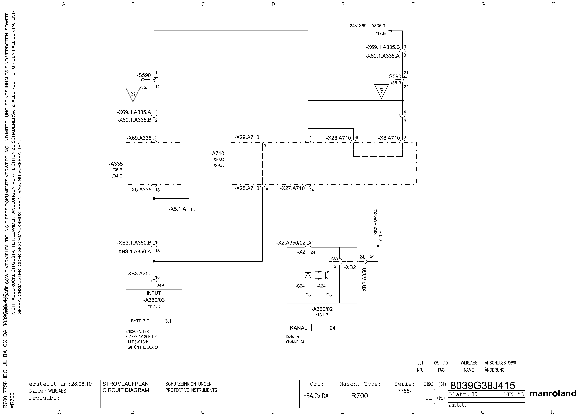

# +BA_Cx_DA — Sheet 35 of 247 — SCHUTZEINRICHTUNGEN

**PROTECTIVE INSTRUMENTS**

> Part of the manroland **R700** printing press IEC/UL circuit diagrams.
> Drawing class: **Stromlaufplan / Circuit diagram** (DIN A3).
> Document `+BA_Cx_DA` covers the **Printing units / main switch cabinet** machine section.

## At a glance

| Field | Value |
|---|---|
| Document | `+BA_Cx_DA`  (8039G38J415) |
| Sheet | **35** of 247 |
| Section (DE) | SCHUTZEINRICHTUNGEN |
| Section (EN) | PROTECTIVE INSTRUMENTS |
| Section type | CIRCUIT — Circuit diagram |
| Machine type | `R700` |
| Series | `7758` |
| Created | 28.06.10 |
| Replaces | — |
| Columns used | B, C, D, E, F, G |
| Path numbers | — |
| Labels on sheet | 89 |
| Cross-refs out | 10 |
| Cross-refs in | 30 |

**Previous:** [+BA_Cx_DA sheet 34](SHEET_0034.md) · **Next:** [+BA_Cx_DA sheet 36](SHEET_0036.md) · **Document TOC:** [_TOC.md](_TOC.md)  (+BA_Cx_DA) · **Master TOC:** [all sheets](../_MASTER_TOC.md)

## Sheet image (300 DPI, exact vector render)



_Rendered directly from the PDF vector layer at 300 DPI (1-bit), no OCR and no resampling. Use it to confirm anything ambiguous in the text below._

## Cross-references on this sheet

Each entry is a wire leaving this sheet. The printed token is `/sheet.column`; the link resolves to that sheet inside the same document.

| Ref | Target sheet | Col | Path | Destination on target | Target section | From col |
|---|---|---|---|---|---|---|
| `/17.E` | [+BA_Cx_DA sheet 17](SHEET_0017.md) | E | — | — | SPANNUNGSVERSORGUNG, SCHALTSCHRANKBELÜFTUNG | F |
| `/35.B` | [+BA_Cx_DA sheet 35](SHEET_0035.md) | B | — | — | SCHUTZEINRICHTUNGEN | F |
| `/35.F` | [+BA_Cx_DA sheet 35](SHEET_0035.md) | F | — | — | SCHUTZEINRICHTUNGEN | B |
| `/36.C` | [+BA_Cx_DA sheet 36](SHEET_0036.md) | C | — | — | SCHUTZEINRICHTUNGEN | C |
| `/29.A` | [+BA_Cx_DA sheet 29](SHEET_0029.md) | A | — | — | BUSVERBINDUNGEN: STOP SICHERN | C |
| `/36.B` | [+BA_Cx_DA sheet 36](SHEET_0036.md) | B | — | — | SCHUTZEINRICHTUNGEN | B |
| `/34.B` | [+BA_Cx_DA sheet 34](SHEET_0034.md) | B | — | — | BUSVERBINDUNGEN: RESERVE SIGNALE | B |
| `/20.F` | [+BA_Cx_DA sheet 20](SHEET_0020.md) | F | — | XB2.A350:24 | BUSVERBINDUNGEN: SICHERHEITSBUS | F |
| `/131.D` | [+BA_Cx_DA sheet 131](SHEET_0131.md) | D | — | — | REFERENZMODUL | B |
| `/131.B` | [+BA_Cx_DA sheet 131](SHEET_0131.md) | B | — | — | REFERENZMODUL | E |

### Incoming references (sheets that point here)

Every other sheet that sends a wire to this one. `Back-ref` is the token printed on *that* sheet; `Path` is its line number.

| From sheet | Cols | Back-ref | Path | Refs | What continues there |
|---|---|---|---|---|---|
| [+BA_Cx_DA#17](SHEET_0017.md) | E | `/17.E` | — | 1 | 24V.X69.1.A335:3 |
| [+BA_Cx_DA#20](SHEET_0020.md) | F | `/20.F` | — | 1 | XB2.A350:24 |
| [+BA_Cx_DA#29](SHEET_0029.md) | A | `/29.A` | — | 1 | — |
| [+BA_Cx_DA#34](SHEET_0034.md) | B | `/34.B` | — | 1 | — |
| [+BA_Cx_DA#35](SHEET_0035.md) | B, F | `/35.B`, `/35.F` | — | 2 | — |
| [+BA_Cx_DA#36](SHEET_0036.md) | A, C | `/36.A`, `/36.C` | — | 2 | — |
| [+BA_Cx_DA#131](SHEET_0131.md) | B, D | `/131.B`, `/131.D` | — | 2 | — |
| [+BA_Cx_DA#153](SHEET_0153.md) | G | `/153.G` | — | 2 | — |
| [+BA_Cx_DA#157](SHEET_0157.md) | C, D, F | `/157.C`, `/157.D`, `/157.F` | — | 3 | — |
| [+BA_Cx_DA#160](SHEET_0160.md) | C | `/160.C` | — | 1 | — |
| [+BA_Cx_DA#161](SHEET_0161.md) | A | `/161.A` | — | 1 | — |
| [+BA_Cx_DA#165](SHEET_0165.md) | H | `/165.H` | — | 1 | — |
| [+BA_Cx_DA#175](SHEET_0175.md) | H | `/175.H` | — | 1 | — |
| [+BA_Cx_DA#177](SHEET_0177.md) | F | `/177.F` | — | 1 | — |
| [+BA_Cx_DA#178](SHEET_0178.md) | H | `/178.H` | — | 1 | — |
| [+BA_Cx_DA#179](SHEET_0179.md) | B | `/179.B` | — | 2 | — |
| [+BA_Cx_DA#184](SHEET_0184.md) | A | `/184.A` | — | 7 | — |


## Devices on this sheet

| Tag | Class | Class meaning (IEC) | Col | Sub | Terminal | Sign |
|---|---|---|---|---|---|---|
| `S590` | S | Schalter / switch | B | — | — | — |
| `A350/03` | A | Baugruppe / assembly, module, PC board | B | 03 | — | — |
| `A710` | A | Baugruppe / assembly, module, PC board | C | — | — | — |
| `S24` | S | Schalter / switch | D | — | — | — |
| `A24` | A | Baugruppe / assembly, module, PC board | E | — | — | — |
| `X1` | X | Klemme / terminal, plug connector | E | — | — | — |
| `X2` | X | Klemme / terminal, plug connector | D | — | — | — |
| `XB2` | XB |  | E | — | — | — |
| `A350/02` | A | Baugruppe / assembly, module, PC board | E | 02 | — | — |
| `S590` | S | Schalter / switch | F | — | — | — |
| `A335` | A | Baugruppe / assembly, module, PC board | B | — | — | — |
| `X5.A335` | — | cross-device reference | B | — | — | — |
| `X5.1.A` | — | cross-device reference | C | — | — | — |
| `X69.1.A335.A` | — | cross-device reference | B | — | — | — |
| `X69.1.A335.B` | — | cross-device reference | B | — | — | — |
| `3.1` | — | cross-device reference | C | — | — | — |
| `XB3.A350` | — | cross-device reference | B | — | — | — |
| `XB3.1.A350.B` | — | cross-device reference | B | — | — | — |
| `XB3.1.A350.A` | — | cross-device reference | B | — | — | — |
| `X27.A710` | — | cross-device reference | D | — | — | — |
| `X25.A710` | — | cross-device reference | D | — | — | — |
| `XB2.A350` | — | cross-device reference | E | — | — | — |
| `X28.A710` | — | cross-device reference | E | — | — | — |
| `X8.A710` | — | cross-device reference | F | — | — | — |
| `X69.1.A335.B` | — | cross-device reference | F | — | — | — |
| `X69.1.A335.A` | — | cross-device reference | F | — | — | — |
| `X69.A335` | — | cross-device reference | B | — | — | — |
| `NR.` | — | cross-device reference | F | — | — | — |
| `05.11.10` | — | cross-device reference | F | — | — | — |
| `XB2.A350:24` | — | cross-device reference | E | — | 24 | — |
| `X29.A710` | — | cross-device reference | D | — | — | — |

## Potentials / nets

| Potential | Count | Columns | Attached devices | Terminals |
|---|---|---|---|---|
| `24V` | 1 | E | `1`, `A335`, `X69` | `3` |


A potential such as `L24+/4` or `M24+` is a named supply/return rail; every place it appears on this sheet is electrically common.

## Wire-end annotations (grouped as printed)

A wire that continues elsewhere is annotated with a small cluster: the destination description, the path/line number `#NN`, and the `/sheet.column` cross reference. Each row below is one such cluster exactly as it is grouped on the drawing.

| Col | Y | Path | Cross-ref | Text on the wire |
|---|---|---|---|---|
| E | 48.5 | — | — | `24V.X69.1.A335:3` |
| F | 64.0 | — | `/17.E` | — |
| F | 91.0 | — | — | `X69.1.A335.B 3` |
| F | 108.0 | — | — | `X69.1.A335.A 3` |
| B | 144.2 | — | — | `11` |
| F | 144.2 | — | — | `21` |
| B | 147.7 | — | — | `S590` |
| F | 150.5 | — | — | `S590` |
| F | 164.3 | — | `/35.B` | — |
| B | 172.5 | — | — | `12` |
| F | 172.5 | — | — | `22` |
| B | 173.2 | — | `/35.F` | — |
| F | 178.2 | — | — | `S` |
| B | 185.3 | — | — | `S` |
| B | 222.8 | — | — | `X69.1.A335.A 2` |
| F | 222.8 | — | — | `4` |
| B | 238.4 | — | — | `X69.1.A335.B 2` |
| F | 239.8 | — | — | `4` |
| D | 273.9 | — | — | `X29.A710` |
| B | 275.3 | — | — | `X69.A335 2` |
| E | 275.3 | — | — | `4` |
| E | 275.3 | — | — | `X28.A710 40 X8.A710 2` |
| D | 292.3 | — | — | `A710 3` |
| C | 319.5 | — | `/36.C`, `/29.A` | — |
| B | 327.7 | — | — | `A335` |
| B | 340.8 | — | `/36.B`, `/34.B` | — |
| D | 377.3 | — | — | `X25.A710 18 X27.A710 24` |
| B | 380.1 | — | — | `X5.A335 18` |
| C | 419.1 | — | — | `X5.1.A 18` |
| F | 424.6 | — | `/20.F` | `XB2.A350:24` |
| B | 487.9 | — | — | `XB3.1.A350.B 18` |
| D | 487.9 | — | — | `X2.A350/02 24` |
| B | 504.9 | — | — | `XB3.1.A350.A 18` |
| D | 506.3 | — | — | `X2` |
| E | 507.7 | — | — | `24 24` |
| E | 516.2 | — | — | `24` |
| E | 520.4 | — | — | `22A` |
| E | 537.5 | — | — | `X1` |
| E | 537.5 | — | — | `XB2` |
| E | 543.7 | — | — | `XB2.A350` |
| B | 550.2 | — | — | `XB3.A350 18` |
| B | 575.7 | — | — | `24B` |
| E | 576.4 | — | — | `S24 A24` |
| B | 590.2 | — | — | `INPUT` |
| B | 604.1 | — | — | `A350/03` |
| B | 617.9 | — | `/131.D` | — |
| E | 622.5 | — | — | `A350/02` |
| E | 634.9 | — | `/131.B` | — |
| B | 646.9 | — | — | `BYTE.BIT 3.1` |
| E | 660.7 | — | — | `KANAL 24` |
| B | 669.6 | — | — | `ENDSCHALTER: KLAPPE AM SCHUTZ LIMIT SWITCH: FLAP ON THE GUARD` |
| D | 681.1 | — | — | `KANAL 24 CHANNEL 24` |
| G | 733.0 | — | — | `001 05.11.10 WLIS/AES ANSCHLUSS S590` |
| G | 747.1 | — | — | `NR. TAG NAME ÄNDERUNG` |


## Reconstructed tables

This sheet carries tabular content (pin map / terminal assignment / index). The grid below was rebuilt from the drawing's own rule lines, so each row is exactly one physical row of the table.

### Table 1 — 4 data rows × 2 columns (at x=255.1, y=62.4)

| S590 /35.F S X69.1.A335.A X69.1.A335.B X69.A335 X5.A335 | 11 12 2 2 2 18 |
|---|---|
| `XB3.1.A350.B XB3.1.A350.A` | `X5.1.A 18 18` |
| `XB3.A350` | `18 24B` |
| `INPUT` | `A350/03 /131.D` |
| `BYTE.BIT` | `3.1` |


### Table 2 — 5 data rows × 7 columns (at x=531.5, y=62.4) — **/17.E X69.1.A335.B X69.1.A335.A S590 /35.B S**

| 3 |  | 4 | X28.A710 |  | 40 | X8.A710 |
|---|---|---|---|---|---|---|
| `18` | `X27.A710 X2.A350/02` | `24 24` |  |  | `XB2.A350:24` | `/20.F` |
|  | `X2` | `24` | `22A` |  | `24 24` |  |
|  | `S24` | `A24` | `X1` | `XB2` | `XB2.A350` |  |
|  |  | `A350/02 /131.B` |  |  |  |  |
|  | `KANAL` |  | `24` |  |  |  |


## Notes and free text on this sheet

| Text | Col | Y (pt) |
|---|---|---|
| `24B` | B | 575.72 |
| `INPUT` | B | 590.24 |
| `BYTE.BIT` | B | 647.49 |
| `ENDSCHALTER:` | B | 669.59 |
| `KLAPPE AM SCHUTZ` | B | 680.23 |
| `LIMIT SWITCH:` | B | 690.81 |
| `FLAP ON THE GUARD` | B | 701.5 |
| `KANAL 24` | D | 681.1 |
| `CHANNEL 24` | D | 691.04 |
| `22A` | E | 520.44 |
| `KANAL` | D | 660.77 |
| `X2.A350/02` | D | 487.87 |
| `TAG` | F | 747.27 |
| `NAME` | G | 747.25 |
| `ÄNDERUNG` | G | 747.31 |
| `WLIS/AES` | G | 733.08 |
| `ANSCHLUSS S590` | G | 733.15 |
| `S` | B | 185.34 |
| `S` | F | 178.25 |

## Complete label inventory (exact text from the drawing)

Every text object inside the drawing area of this sheet, in DIN reading order (column A→H, then top→bottom). This is the authoritative list: if a string is not here it is not printed on this sheet.

| Col | Y | X | Dir | Type | Text |
|---|---|---|---|---|---|
| B | 144.2 | 313.8 | → | number | `11` |
| B | 147.7 | 276.9 | → | device tag | `S590` |
| B | 172.5 | 313.8 | → | number | `12` |
| B | 173.2 | 283.5 | → | cross-reference | `/35.F` |
| B | 185.3 | 265.2 | → | text | `S` |
| B | 222.8 | 237.0 | → | device ref | `X69.1.A335.A` |
| B | 222.8 | 314.4 | → | number | `2` |
| B | 238.4 | 237.8 | → | device ref | `X69.1.A335.B` |
| B | 239.9 | 314.4 | → | number | `2` |
| B | 275.3 | 256.5 | → | device ref | `X69.A335` |
| B | 275.3 | 314.4 | → | number | `2` |
| B | 327.7 | 220.3 | → | device tag | `A335` |
| B | 340.8 | 227.6 | → | cross-reference | `/36.B` |
| B | 353.2 | 227.6 | → | cross-reference | `/34.B` |
| B | 380.2 | 262.5 | → | device ref | `X5.A335` |
| B | 381.6 | 313.8 | → | number | `18` |
| B | 487.9 | 236.7 | → | device ref | `XB3.1.A350.B` |
| B | 487.9 | 313.8 | → | number | `18` |
| B | 504.9 | 313.8 | → | number | `18` |
| B | 505.6 | 235.8 | → | device ref | `XB3.1.A350.A` |
| B | 550.2 | 255.4 | → | device ref | `XB3.A350` |
| B | 558.7 | 313.8 | → | number | `18` |
| B | 575.7 | 317.2 | → | text | `24B` |
| B | 590.2 | 296.9 | → | text | `INPUT` |
| B | 604.1 | 290.4 | → | device tag | `A350/03` |
| B | 617.9 | 299.1 | → | cross-reference | `/131.D` |
| B | 647.5 | 265.0 | → | text | `BYTE.BIT` |
| B | 669.6 | 254.3 | → | text | `ENDSCHALTER:` |
| B | 680.2 | 254.3 | → | text | `KLAPPE AM SCHUTZ` |
| B | 690.8 | 254.3 | → | text | `LIMIT SWITCH:` |
| B | 701.5 | 254.3 | → | text | `FLAP ON THE GUARD` |
| C | 306.4 | 425.8 | → | device tag | `A710` |
| C | 319.5 | 432.9 | → | cross-reference | `/36.C` |
| C | 331.9 | 432.9 | → | cross-reference | `/29.A` |
| C | 419.2 | 341.6 | → | device ref | `X5.1.A` |
| C | 421.3 | 384.7 | → | number | `18` |
| C | 646.9 | 334.2 | → | device ref | `3.1` |
| D | 273.8 | 474.8 | → | device ref | `X29.A710` |
| D | 292.3 | 534.0 | → | number | `3` |
| D | 377.3 | 474.8 | → | device ref | `X25.A710` |
| D | 377.3 | 566.9 | → | device ref | `X27.A710` |
| D | 381.6 | 533.5 | → | number | `18` |
| D | 487.9 | 559.6 | → | text | `X2.A350/02` |
| D | 506.3 | 602.1 | → | device tag | `X2` |
| D | 576.4 | 598.4 | → | device tag | `S24` |
| D | 660.8 | 587.3 | → | text | `KANAL` |
| D | 681.1 | 579.1 | → | text | `KANAL 24` |
| D | 691.0 | 579.4 | → | text | `CHANNEL 24` |
| E | 48.5 | 705.5 | → | potential | `24V.X69.1.A335:3` |
| E | 275.3 | 626.2 | → | number | `4` |
| E | 275.3 | 660.5 | → | device ref | `X28.A710` |
| E | 275.3 | 718.3 | → | number | `40` |
| E | 381.6 | 626.2 | → | number | `24` |
| E | 424.6 | 757.1 | ↕ | device ref | `XB2.A350:24` |
| E | 487.9 | 626.2 | → | number | `24` |
| E | 507.7 | 629.0 | → | number | `24` |
| E | 516.2 | 748.9 | → | number | `24` |
| E | 517.6 | 728.2 | → | number | `24` |
| E | 520.4 | 669.0 | → | text | `22A` |
| E | 537.5 | 672.7 | → | device tag | `X1` |
| E | 537.5 | 697.0 | → | device tag | `XB2` |
| E | 543.7 | 733.1 | ↕ | device ref | `XB2.A350` |
| E | 576.4 | 640.9 | → | device tag | `A24` |
| E | 622.5 | 630.6 | → | device tag | `A350/02` |
| E | 634.9 | 639.4 | → | cross-reference | `/131.B` |
| E | 660.7 | 667.4 | → | number | `24` |
| F | 64.0 | 760.8 | → | cross-reference | `/17.E` |
| F | 91.0 | 741.0 | → | device ref | `X69.1.A335.B` |
| F | 91.0 | 817.5 | → | number | `3` |
| F | 108.0 | 817.5 | → | number | `3` |
| F | 108.7 | 740.1 | → | device ref | `X69.1.A335.A` |
| F | 144.2 | 817.5 | → | number | `21` |
| F | 150.5 | 784.3 | → | device tag | `S590` |
| F | 164.3 | 791.7 | → | cross-reference | `/35.B` |
| F | 172.5 | 817.5 | → | number | `22` |
| F | 178.3 | 768.3 | → | text | `S` |
| F | 222.8 | 817.5 | → | number | `4` |
| F | 239.9 | 817.5 | → | number | `4` |
| F | 275.3 | 765.6 | → | device ref | `X8.A710` |
| F | 275.3 | 817.5 | → | number | `2` |
| F | 468.9 | 767.0 | ↕ | cross-reference | `/20.F` |
| F | 733.0 | 845.2 | → | number | `001` |
| F | 733.1 | 879.3 | → | device ref | `05.11.10` |
| F | 747.1 | 844.2 | → | device ref | `NR.` |
| F | 747.3 | 885.8 | → | text | `TAG` |
| G | 733.1 | 933.1 | → | text | `WLIS/AES` |
| G | 733.1 | 981.8 | → | text | `ANSCHLUSS S590` |
| G | 747.3 | 939.2 | → | text | `NAME` |
| G | 747.3 | 981.8 | → | text | `ÄNDERUNG` |

## Reading-order text block

The same content as a plain block, grouped by DIN column — convenient to paste or to match against a visual description.

```text
=== Column B ===
 144.2  313.8  numeric      11
 147.7  276.9  devtag       S590
 172.5  313.8  numeric      12
 173.2  283.5  xref         /35.F
 185.3  265.2  text         S
 222.8  237.0  devref       X69.1.A335.A
 222.8  314.4  numeric      2
 238.4  237.8  devref       X69.1.A335.B
 239.9  314.4  numeric      2
 275.3  256.5  devref       X69.A335
 275.3  314.4  numeric      2
 327.7  220.3  devtag       A335
 340.8  227.6  xref         /36.B
 353.2  227.6  xref         /34.B
 380.2  262.5  devref       X5.A335
 381.6  313.8  numeric      18
 487.9  236.7  devref       XB3.1.A350.B
 487.9  313.8  numeric      18
 504.9  313.8  numeric      18
 505.6  235.8  devref       XB3.1.A350.A
 550.2  255.4  devref       XB3.A350
 558.7  313.8  numeric      18
 575.7  317.2  text         24B
 590.2  296.9  text         INPUT
 604.1  290.4  devtag       A350/03
 617.9  299.1  xref         /131.D
 647.5  265.0  text         BYTE.BIT
 669.6  254.3  text         ENDSCHALTER:
 680.2  254.3  text         KLAPPE AM SCHUTZ
 690.8  254.3  text         LIMIT SWITCH:
 701.5  254.3  text         FLAP ON THE GUARD
=== Column C ===
 306.4  425.8  devtag       A710
 319.5  432.9  xref         /36.C
 331.9  432.9  xref         /29.A
 419.2  341.6  devref       X5.1.A
 421.3  384.7  numeric      18
 646.9  334.2  devref       3.1
=== Column D ===
 273.8  474.8  devref       X29.A710
 292.3  534.0  numeric      3
 377.3  474.8  devref       X25.A710
 377.3  566.9  devref       X27.A710
 381.6  533.5  numeric      18
 487.9  559.6  text         X2.A350/02
 506.3  602.1  devtag       X2
 576.4  598.4  devtag       S24
 660.8  587.3  text         KANAL
 681.1  579.1  text         KANAL 24
 691.0  579.4  text         CHANNEL 24
=== Column E ===
  48.5  705.5  net          24V.X69.1.A335:3
 275.3  626.2  numeric      4
 275.3  660.5  devref       X28.A710
 275.3  718.3  numeric      40
 381.6  626.2  numeric      24
 424.6  757.1  devref       XB2.A350:24
 487.9  626.2  numeric      24
 507.7  629.0  numeric      24
 516.2  748.9  numeric      24
 517.6  728.2  numeric      24
 520.4  669.0  text         22A
 537.5  672.7  devtag       X1
 537.5  697.0  devtag       XB2
 543.7  733.1  devref       XB2.A350
 576.4  640.9  devtag       A24
 622.5  630.6  devtag       A350/02
 634.9  639.4  xref         /131.B
 660.7  667.4  numeric      24
=== Column F ===
  64.0  760.8  xref         /17.E
  91.0  741.0  devref       X69.1.A335.B
  91.0  817.5  numeric      3
 108.0  817.5  numeric      3
 108.7  740.1  devref       X69.1.A335.A
 144.2  817.5  numeric      21
 150.5  784.3  devtag       S590
 164.3  791.7  xref         /35.B
 172.5  817.5  numeric      22
 178.3  768.3  text         S
 222.8  817.5  numeric      4
 239.9  817.5  numeric      4
 275.3  765.6  devref       X8.A710
 275.3  817.5  numeric      2
 468.9  767.0  xref         /20.F
 733.0  845.2  numeric      001
 733.1  879.3  devref       05.11.10
 747.1  844.2  devref       NR.
 747.3  885.8  text         TAG
=== Column G ===
 733.1  933.1  text         WLIS/AES
 733.1  981.8  text         ANSCHLUSS S590
 747.3  939.2  text         NAME
 747.3  981.8  text         ÄNDERUNG
```

---
_Generated from the PDF vector text layer; no OCR. Source: `R700_7758_IEC_UL_BA_CX_DA_8039G38J415_p`, sheet 35._
