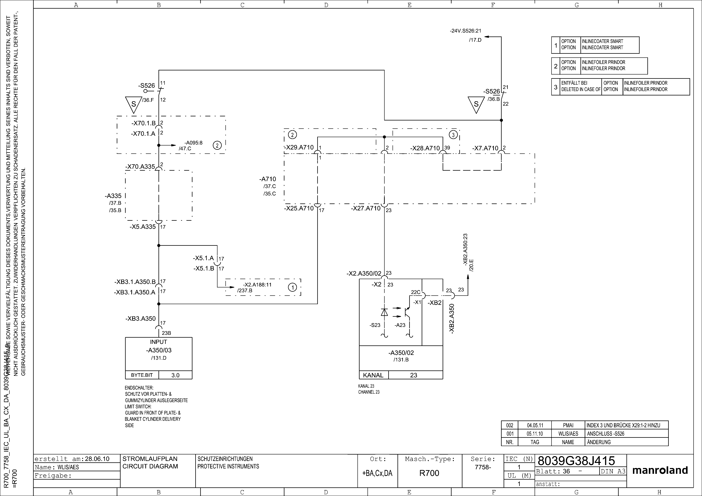

# +BA_Cx_DA — Sheet 36 of 247 — SCHUTZEINRICHTUNGEN

**PROTECTIVE INSTRUMENTS**

> Part of the manroland **R700** printing press IEC/UL circuit diagrams.
> Drawing class: **Stromlaufplan / Circuit diagram** (DIN A3).
> Document `+BA_Cx_DA` covers the **Printing units / main switch cabinet** machine section.

## At a glance

| Field | Value |
|---|---|
| Document | `+BA_Cx_DA`  (8039G38J415) |
| Sheet | **36** of 247 |
| Section (DE) | SCHUTZEINRICHTUNGEN |
| Section (EN) | PROTECTIVE INSTRUMENTS |
| Section type | CIRCUIT — Circuit diagram |
| Machine type | `R700` |
| Series | `7758` |
| Created | 28.06.10 |
| Replaces | — |
| Columns used | A, B, C, D, E, F, G, H |
| Path numbers | — |
| Labels on sheet | 118 |
| Cross-refs out | 12 |
| Cross-refs in | 29 |

**Previous:** [+BA_Cx_DA sheet 35](SHEET_0035.md) · **Next:** [+BA_Cx_DA sheet 37](SHEET_0037.md) · **Document TOC:** [_TOC.md](_TOC.md)  (+BA_Cx_DA) · **Master TOC:** [all sheets](../_MASTER_TOC.md)

## Sheet image (300 DPI, exact vector render)



_Rendered directly from the PDF vector layer at 300 DPI (1-bit), no OCR and no resampling. Use it to confirm anything ambiguous in the text below._

## Cross-references on this sheet

Each entry is a wire leaving this sheet. The printed token is `/sheet.column`; the link resolves to that sheet inside the same document.

| Ref | Target sheet | Col | Path | Destination on target | Target section | From col |
|---|---|---|---|---|---|---|
| `/17.D` | [+BA_Cx_DA sheet 17](SHEET_0017.md) | D | — | — | SPANNUNGSVERSORGUNG, SCHALTSCHRANKBELÜFTUNG | F |
| `/36.B` | [+BA_Cx_DA sheet 36](SHEET_0036.md) | B | — | — | SCHUTZEINRICHTUNGEN | F |
| `/36.F` | [+BA_Cx_DA sheet 36](SHEET_0036.md) | F | — | — | SCHUTZEINRICHTUNGEN | B |
| `/47.C` | [+BA_Cx_DA sheet 47](SHEET_0047.md) | C | — | — | SCHUTZEINRICHTUNGEN | B |
| `/37.C` | [+BA_Cx_DA sheet 37](SHEET_0037.md) | C | — | — | SCHUTZEINRICHTUNGEN | C |
| `/35.C` | [+BA_Cx_DA sheet 35](SHEET_0035.md) | C | — | — | SCHUTZEINRICHTUNGEN | C |
| `/37.B` | [+BA_Cx_DA sheet 37](SHEET_0037.md) | B | — | — | SCHUTZEINRICHTUNGEN | A |
| `/35.B` | [+BA_Cx_DA sheet 35](SHEET_0035.md) | B | — | — | SCHUTZEINRICHTUNGEN | A |
| `/20.E` | [+BA_Cx_DA sheet 20](SHEET_0020.md) | E | — | XB2.A350:23 | BUSVERBINDUNGEN: SICHERHEITSBUS | F |
| `/237.B` | [+BA_Cx_DA sheet 237](SHEET_0237.md) | B | — | — | OPTION: INLINECOATER SMART | C |
| `/131.D` | [+BA_Cx_DA sheet 131](SHEET_0131.md) | D | — | — | REFERENZMODUL | B |
| `/131.B` | [+BA_Cx_DA sheet 131](SHEET_0131.md) | B | — | — | REFERENZMODUL | E |

### Incoming references (sheets that point here)

Every other sheet that sends a wire to this one. `Back-ref` is the token printed on *that* sheet; `Path` is its line number.

| From sheet | Cols | Back-ref | Path | Refs | What continues there |
|---|---|---|---|---|---|
| [+BA_Cx_DA#17](SHEET_0017.md) | D | `/17.D` | — | 1 | 24V.S526:21 |
| [+BA_Cx_DA#20](SHEET_0020.md) | E | `/20.E` | — | 1 | XB2.A350:23 |
| [+BA_Cx_DA#35](SHEET_0035.md) | B, C | `/35.B`, `/35.C` | — | 2 | — |
| [+BA_Cx_DA#36](SHEET_0036.md) | B, F | `/36.B`, `/36.F` | — | 2 | — |
| [+BA_Cx_DA#37](SHEET_0037.md) | B, C | `/37.B`, `/37.C` | — | 2 | — |
| [+BA_Cx_DA#47](SHEET_0047.md) | D | `/47.D` | — | 1 | A095:8 A095:10 |
| [+BA_Cx_DA#131](SHEET_0131.md) | B, D | `/131.B`, `/131.D` | — | 2 | — |
| [+BA_Cx_DA#153](SHEET_0153.md) | G | `/153.G` | — | 2 | — |
| [+BA_Cx_DA#157](SHEET_0157.md) | C, D, F | `/157.C`, `/157.D`, `/157.F` | — | 3 | — |
| [+BA_Cx_DA#160](SHEET_0160.md) | C, E | `/160.C`, `/160.E` | — | 2 | — |
| [+BA_Cx_DA#161](SHEET_0161.md) | A | `/161.A` | — | 1 | — |
| [+BA_Cx_DA#164](SHEET_0164.md) | C | `/164.C` | — | 1 | — |
| [+BA_Cx_DA#175](SHEET_0175.md) | H | `/175.H` | — | 1 | — |
| [+BA_Cx_DA#177](SHEET_0177.md) | F | `/177.F` | — | 1 | — |
| [+BA_Cx_DA#178](SHEET_0178.md) | H | `/178.H` | — | 1 | — |
| [+BA_Cx_DA#179](SHEET_0179.md) | B | `/179.B` | — | 2 | — |
| [+BA_Cx_DA#184](SHEET_0184.md) | B, C | `/184.B`, `/184.C` | — | 3 | — |
| [+BA_Cx_DA#237](SHEET_0237.md) | A | `/237.A` | — | 1 | X2.A188:11 |


## Devices on this sheet

| Tag | Class | Class meaning (IEC) | Col | Sub | Terminal | Sign |
|---|---|---|---|---|---|---|
| `A350/03` | A | Baugruppe / assembly, module, PC board | B | 03 | — | — |
| `S526` | S | Schalter / switch | B | — | — | — |
| `A335` | A | Baugruppe / assembly, module, PC board | A | — | — | — |
| `S23` | S | Schalter / switch | E | — | — | — |
| `A23` | A | Baugruppe / assembly, module, PC board | E | — | — | — |
| `X1` | X | Klemme / terminal, plug connector | E | — | — | — |
| `X2` | X | Klemme / terminal, plug connector | E | — | — | — |
| `XB2` | XB |  | E | — | — | — |
| `A350/02` | A | Baugruppe / assembly, module, PC board | E | 02 | — | — |
| `A710` | A | Baugruppe / assembly, module, PC board | C | — | — | — |
| `S526` | S | Schalter / switch | F | — | — | — |
| `A095:8` | A | Baugruppe / assembly, module, PC board | B | — | 8 | — |
| `3.0` | — | cross-device reference | B | — | — | — |
| `XB3.A350` | — | cross-device reference | B | — | — | — |
| `XB3.1.A350.B` | — | cross-device reference | B | — | — | — |
| `XB3.1.A350.A` | — | cross-device reference | B | — | — | — |
| `X70.1.A` | — | cross-device reference | B | — | — | — |
| `X70.1.B` | — | cross-device reference | B | — | — | — |
| `X5.A335` | — | cross-device reference | B | — | — | — |
| `X70.A335` | — | cross-device reference | B | — | — | — |
| `X5.1.A` | — | cross-device reference | C | — | — | — |
| `X5.1.B` | — | cross-device reference | C | — | — | — |
| `X27.A710` | — | cross-device reference | D | — | — | — |
| `XB2.A350` | — | cross-device reference | F | — | — | — |
| `X25.A710` | — | cross-device reference | D | — | — | — |
| `X28.A710` | — | cross-device reference | E | — | — | — |
| `X7.A710` | — | cross-device reference | F | — | — | — |
| `NR.` | — | cross-device reference | F | — | — | — |
| `05.11.10` | — | cross-device reference | F | — | — | — |
| `X2.A188:11` | — | cross-device reference | C | — | 11 | — |
| `XB2.A350:23` | — | cross-device reference | F | — | 23 | — |
| `04.05.11` | — | cross-device reference | G | — | — | — |
| `X29.A710` | — | cross-device reference | D | — | — | — |

## Potentials / nets

| Potential | Count | Columns | Attached devices | Terminals |
|---|---|---|---|---|
| `24V` | 1 | F | `S526` | `21` |


A potential such as `L24+/4` or `M24+` is a named supply/return rail; every place it appears on this sheet is electrically common.

## Wire-end annotations (grouped as printed)

A wire that continues elsewhere is annotated with a small cluster: the destination description, the path/line number `#NN`, and the `/sheet.column` cross reference. Each row below is one such cluster exactly as it is grouped on the drawing.

| Col | Y | Path | Cross-ref | Text on the wire |
|---|---|---|---|---|
| F | 48.5 | — | — | `24V.S526:21` |
| F | 64.1 | — | `/17.D` | — |
| G | 67.2 | — | — | `1 OPTION OPTION` |
| G | 67.2 | — | — | `INLINECOATER SMART INLINECOATER SMART` |
| G | 102.6 | — | — | `2 OPTION OPTION` |
| G | 102.7 | — | — | `INLINEFOILER PRINDOR INLINEFOILER PRINDOR` |
| B | 137.1 | — | — | `11` |
| G | 138.1 | — | — | `3 OPTION OPTION` |
| G | 138.1 | — | — | `ENTFÄLLT BEI DELETED IN CASE OF INLINEFOILER PRINDOR INLINEFOILER PRINDOR` |
| B | 140.6 | — | — | `S526` |
| F | 144.2 | — | — | `21` |
| F | 150.5 | — | — | `S526` |
| F | 164.3 | — | `/36.B` | — |
| B | 165.4 | — | — | `12` |
| B | 166.1 | — | `/36.F` | — |
| B | 171.2 | — | — | `S` |
| F | 171.2 | — | — | `S` |
| F | 172.5 | — | — | `22` |
| B | 204.4 | — | — | `X70.1.B 2` |
| B | 221.4 | — | — | `X70.1.A 2` |
| E | 225.9 | — | — | `2 3` |
| B | 238.4 | — | — | `A095:8` |
| C | 244.1 | — | — | `2 X29.A710` |
| D | 246.9 | — | — | `1` |
| E | 246.9 | — | — | `2` |
| F | 246.9 | — | — | `X28.A710 39 X7.A710 2` |
| B | 248.3 | — | `/47.C` | — |
| D | 263.9 | — | — | `1` |
| B | 275.3 | — | — | `X70.A335 2` |
| C | 299.4 | — | — | `A710` |
| C | 312.4 | — | `/37.C`, `/35.C` | — |
| A | 327.7 | — | — | `A335` |
| A | 340.8 | — | `/37.B`, `/35.B` | — |
| D | 349.0 | — | — | `X25.A710 17` |
| E | 349.0 | — | — | `X27.A710 23` |
| B | 380.1 | — | — | `X5.A335 17` |
| F | 396.3 | — | `/20.E` | `XB2.A350:23` |
| C | 433.3 | — | — | `X5.1.A 17` |
| C | 451.0 | — | — | `X5.1.B 17` |
| E | 459.5 | — | — | `X2.A350/02 23` |
| B | 473.7 | — | — | `XB3.1.A350.B 17` |
| E | 478.0 | — | — | `X2` |
| C | 479.3 | — | — | `X2.A188:11` |
| E | 479.4 | — | — | `23 23` |
| D | 484.5 | — | — | `1` |
| F | 487.9 | — | — | `23` |
| C | 489.2 | — | `/237.B` | — |
| B | 490.7 | — | — | `XB3.1.A350.A 17` |
| E | 492.1 | — | — | `22C` |
| E | 509.1 | — | — | `X1` |
| E | 509.1 | — | — | `XB2` |
| F | 515.3 | — | — | `XB2.A350` |
| B | 536.1 | — | — | `XB3.A350 17` |
| E | 548.1 | — | — | `S23 A23` |
| B | 561.5 | — | — | `23B` |
| B | 576.1 | — | — | `INPUT` |
| B | 589.9 | — | — | `A350/03` |
| E | 594.2 | — | — | `A350/02` |
| B | 603.7 | — | `/131.D` | — |
| E | 606.5 | — | `/131.B` | — |
| E | 632.4 | — | — | `KANAL 23` |
| B | 632.7 | — | — | `BYTE.BIT 3.0` |
| E | 652.8 | — | — | `KANAL 23 CHANNEL 23` |
| B | 655.4 | — | — | `ENDSCHALTER:` |
| B | 666.1 | — | — | `LIMIT SWITCH: SCHUTZ VOR PLATTEN & GUMMIZYLINDER AUSLEGERSEITE` |
| B | 698.0 | — | — | `BLANKET CYLINDER DELIVERY GUARD IN FRONT OF PLATE &` |
| G | 718.9 | — | — | `002 04.05.11 PMAI INDEX 3 UND BRÜCKE X29:1 2 HINZU` |
| B | 719.2 | — | — | `SIDE` |
| G | 733.0 | — | — | `001 05.11.10 WLIS/AES ANSCHLUSS S526` |
| G | 747.1 | — | — | `NR. TAG NAME ÄNDERUNG` |


## Reconstructed tables

This sheet carries tabular content (pin map / terminal assignment / index). The grid below was rebuilt from the drawing's own rule lines, so each row is exactly one physical row of the table.

### Table 1 — 4 data rows × 3 columns (at x=212.6, y=119.1)

| S526 /36.F S X70.1.B X70.1.A X70.A335 X5.A335 | 11 12 2 2 /47.C 2 17 | A095:8 |
|---|---|---|
| `XB3.1.A350.B XB3.1.A350.A` | `17 17` | `X5.1.A X5.1.B` |
| `XB3.A350` | `17 23B` |  |
| `INPUT` | `A350/03 /131.D` |  |
| `BYTE.BIT` | `3.0` |  |


### Table 2 — 5 data rows × 7 columns (at x=538.6, y=119.1) — **S526 /36.B S 3**

| 1 1 |  | 2 |  | X28.A710 | 39 | X7.A710 |
|---|---|---|---|---|---|---|
| `17` | `X27.A710 X2.A350/02` | `23 23` |  |  | `XB2.A350:23` | `/20.E` |
|  | `X2` | `23` | `22C X1` | `XB2` | `23 23` |  |
|  | `S23` | `A23` |  |  | `XB2.A350` |  |
|  |  | `A350/02 /131.B` |  |  |  |  |
|  | `KANAL` |  | `23` |  |  |  |


## Notes and free text on this sheet

| Text | Col | Y (pt) |
|---|---|---|
| `23B` | B | 561.55 |
| `INPUT` | B | 576.07 |
| `BYTE.BIT` | B | 633.32 |
| `ENDSCHALTER:` | B | 655.42 |
| `SCHUTZ VOR PLATTEN &` | B | 666.07 |
| `GUMMIZYLINDER AUSLEGERSEITE` | B | 676.7 |
| `LIMIT SWITCH:` | B | 687.27 |
| `GUARD IN FRONT OF PLATE &` | B | 697.96 |
| `BLANKET CYLINDER DELIVERY` | B | 708.59 |
| `SIDE` | B | 719.17 |
| `KANAL 23` | D | 652.75 |
| `CHANNEL 23` | E | 662.7 |
| `22C` | E | 492.14 |
| `KANAL` | E | 632.42 |
| `X2.A350/02` | D | 459.52 |
| `TAG` | G | 747.27 |
| `NAME` | G | 747.25 |
| `ÄNDERUNG` | G | 747.31 |
| `WLIS/AES` | G | 733.08 |
| `ANSCHLUSS S526` | G | 733.15 |
| `PMAI` | G | 718.9 |
| `INDEX 3 UND BRÜCKE X29:1 2 HINZU` | H | 718.96 |
| `OPTION` | G | 67.21 |
| `INLINECOATER SMART` | G | 67.24 |
| `INLINEFOILER PRINDOR` | G | 102.68 |
| `S` | B | 171.17 |
| `S` | F | 171.17 |
| `INLINEFOILER PRINDOR` | H | 138.11 |
| `ENTFÄLLT BEI` | G | 138.07 |
| `DELETED IN CASE OF` | G | 148.72 |

## Complete label inventory (exact text from the drawing)

Every text object inside the drawing area of this sheet, in DIN reading order (column A→H, then top→bottom). This is the authoritative list: if a string is not here it is not printed on this sheet.

| Col | Y | X | Dir | Type | Text |
|---|---|---|---|---|---|
| A | 327.7 | 177.7 | → | device tag | `A335` |
| A | 340.8 | 185.1 | → | cross-reference | `/37.B` |
| A | 353.2 | 185.1 | → | cross-reference | `/35.B` |
| B | 137.1 | 271.3 | → | number | `11` |
| B | 140.6 | 234.4 | → | device tag | `S526` |
| B | 165.4 | 271.3 | → | number | `12` |
| B | 166.1 | 240.9 | → | cross-reference | `/36.F` |
| B | 171.2 | 222.7 | → | text | `S` |
| B | 204.4 | 223.1 | → | device ref | `X70.1.B` |
| B | 204.4 | 271.8 | → | number | `2` |
| B | 221.4 | 271.8 | → | number | `2` |
| B | 222.1 | 222.2 | → | device ref | `X70.1.A` |
| B | 238.4 | 312.9 | → | device tag | `A095:8` |
| B | 248.3 | 303.3 | → | cross-reference | `/47.C` |
| B | 275.3 | 271.8 | → | number | `2` |
| B | 278.1 | 212.6 | → | device ref | `X70.A335` |
| B | 380.2 | 220.0 | → | device ref | `X5.A335` |
| B | 381.6 | 271.3 | → | number | `17` |
| B | 473.7 | 194.2 | → | device ref | `XB3.1.A350.B` |
| B | 473.7 | 271.3 | → | number | `17` |
| B | 490.7 | 271.3 | → | number | `17` |
| B | 491.4 | 193.3 | → | device ref | `XB3.1.A350.A` |
| B | 536.1 | 212.9 | → | device ref | `XB3.A350` |
| B | 544.6 | 271.3 | → | number | `17` |
| B | 561.5 | 274.7 | → | text | `23B` |
| B | 576.1 | 254.4 | → | text | `INPUT` |
| B | 589.9 | 247.9 | → | device tag | `A350/03` |
| B | 603.7 | 256.5 | → | cross-reference | `/131.D` |
| B | 632.7 | 290.8 | → | device ref | `3.0` |
| B | 633.3 | 222.5 | → | text | `BYTE.BIT` |
| B | 655.4 | 211.7 | → | text | `ENDSCHALTER:` |
| B | 666.1 | 212.3 | → | text | `SCHUTZ VOR PLATTEN &` |
| B | 676.7 | 212.3 | → | text | `GUMMIZYLINDER AUSLEGERSEITE` |
| B | 687.3 | 211.7 | → | text | `LIMIT SWITCH:` |
| B | 698.0 | 212.3 | → | text | `GUARD IN FRONT OF PLATE &` |
| B | 708.6 | 211.7 | → | text | `BLANKET CYLINDER DELIVERY` |
| B | 719.2 | 212.3 | → | text | `SIDE` |
| C | 244.1 | 366.5 | → | number | `2` |
| C | 299.4 | 439.9 | → | device tag | `A710` |
| C | 312.4 | 447.0 | → | cross-reference | `/37.C` |
| C | 324.8 | 447.0 | → | cross-reference | `/35.C` |
| C | 433.3 | 327.4 | → | device ref | `X5.1.A` |
| C | 435.4 | 370.5 | → | number | `17` |
| C | 451.0 | 328.3 | → | device ref | `X5.1.B` |
| C | 452.5 | 370.5 | → | number | `17` |
| C | 479.3 | 412.2 | → | device ref | `X2.A188:11` |
| C | 489.2 | 402.5 | → | cross-reference | `/237.B` |
| D | 225.9 | 494.1 | → | number | `2` |
| D | 245.5 | 481.9 | → | device ref | `X29.A710` |
| D | 246.9 | 540.6 | → | number | `1` |
| D | 263.9 | 540.6 | → | number | `1` |
| D | 349.0 | 481.9 | → | device ref | `X25.A710` |
| D | 349.0 | 595.3 | → | device ref | `X27.A710` |
| D | 353.2 | 540.6 | → | number | `17` |
| D | 459.5 | 587.9 | → | text | `X2.A350/02` |
| D | 484.5 | 494.3 | → | number | `1` |
| D | 652.8 | 607.5 | → | text | `KANAL 23` |
| E | 246.9 | 654.5 | → | number | `2` |
| E | 246.9 | 695.9 | → | device ref | `X28.A710` |
| E | 246.9 | 753.7 | → | number | `39` |
| E | 353.2 | 654.5 | → | number | `23` |
| E | 459.5 | 654.5 | → | number | `23` |
| E | 478.0 | 630.4 | → | device tag | `X2` |
| E | 479.4 | 657.4 | → | number | `23` |
| E | 489.3 | 756.6 | → | number | `23` |
| E | 492.1 | 697.3 | → | text | `22C` |
| E | 509.1 | 701.0 | → | device tag | `X1` |
| E | 509.1 | 725.4 | → | device tag | `XB2` |
| E | 548.1 | 626.7 | → | device tag | `S23` |
| E | 548.1 | 669.3 | → | device tag | `A23` |
| E | 594.2 | 658.9 | → | device tag | `A350/02` |
| E | 606.5 | 667.7 | → | cross-reference | `/131.B` |
| E | 632.4 | 615.7 | → | text | `KANAL` |
| E | 632.4 | 695.8 | → | number | `23` |
| E | 662.7 | 607.7 | → | text | `CHANNEL 23` |
| F | 48.5 | 763.1 | → | potential | `24V.S526:21` |
| F | 64.1 | 795.7 | → | cross-reference | `/17.D` |
| F | 144.2 | 852.9 | → | number | `21` |
| F | 150.5 | 819.8 | → | device tag | `S526` |
| F | 164.3 | 827.1 | → | cross-reference | `/36.B` |
| F | 171.2 | 803.8 | → | text | `S` |
| F | 172.5 | 852.9 | → | number | `22` |
| F | 225.9 | 766.9 | → | number | `3` |
| F | 246.9 | 801.1 | → | device ref | `X7.A710` |
| F | 246.9 | 852.9 | → | number | `2` |
| F | 396.3 | 785.5 | ↕ | device ref | `XB2.A350:23` |
| F | 439.9 | 795.4 | ↕ | cross-reference | `/20.E` |
| F | 487.9 | 777.3 | → | number | `23` |
| F | 515.3 | 761.4 | ↕ | device ref | `XB2.A350` |
| F | 719.0 | 858.7 | → | number | `002` |
| F | 733.0 | 859.4 | → | number | `001` |
| F | 733.1 | 893.5 | → | device ref | `05.11.10` |
| F | 747.1 | 858.4 | → | device ref | `NR.` |
| G | 67.2 | 952.2 | → | text | `OPTION` |
| G | 67.2 | 987.0 | → | text | `INLINECOATER SMART` |
| G | 72.6 | 940.0 | → | number | `1` |
| G | 77.8 | 952.2 | → | text | `OPTION` |
| G | 77.9 | 987.0 | → | text | `INLINECOATER SMART` |
| G | 102.6 | 952.2 | → | text | `OPTION` |
| G | 102.7 | 987.0 | → | text | `INLINEFOILER PRINDOR` |
| G | 108.0 | 939.7 | → | number | `2` |
| G | 113.3 | 952.2 | → | text | `OPTION` |
| G | 113.3 | 987.0 | → | text | `INLINEFOILER PRINDOR` |
| G | 138.1 | 952.3 | → | text | `ENTFÄLLT BEI` |
| G | 138.1 | 1023.7 | → | text | `OPTION` |
| G | 143.4 | 939.5 | → | number | `3` |
| G | 148.7 | 952.3 | → | text | `DELETED IN CASE OF` |
| G | 148.7 | 1023.7 | → | text | `OPTION` |
| G | 718.9 | 894.1 | → | device ref | `04.05.11` |
| G | 718.9 | 955.1 | → | text | `PMAI` |
| G | 733.1 | 947.3 | → | text | `WLIS/AES` |
| G | 733.1 | 996.0 | → | text | `ANSCHLUSS S526` |
| G | 747.3 | 900.0 | → | text | `TAG` |
| G | 747.3 | 953.4 | → | text | `NAME` |
| G | 747.3 | 996.0 | → | text | `ÄNDERUNG` |
| H | 138.1 | 1058.6 | → | text | `INLINEFOILER PRINDOR` |
| H | 148.7 | 1058.6 | → | text | `INLINEFOILER PRINDOR` |
| H | 719.0 | 994.8 | → | text | `INDEX 3 UND BRÜCKE X29:1 2 HINZU` |

## Reading-order text block

The same content as a plain block, grouped by DIN column — convenient to paste or to match against a visual description.

```text
=== Column A ===
 327.7  177.7  devtag       A335
 340.8  185.1  xref         /37.B
 353.2  185.1  xref         /35.B
=== Column B ===
 137.1  271.3  numeric      11
 140.6  234.4  devtag       S526
 165.4  271.3  numeric      12
 166.1  240.9  xref         /36.F
 171.2  222.7  text         S
 204.4  223.1  devref       X70.1.B
 204.4  271.8  numeric      2
 221.4  271.8  numeric      2
 222.1  222.2  devref       X70.1.A
 238.4  312.9  devtag       A095:8
 248.3  303.3  xref         /47.C
 275.3  271.8  numeric      2
 278.1  212.6  devref       X70.A335
 380.2  220.0  devref       X5.A335
 381.6  271.3  numeric      17
 473.7  194.2  devref       XB3.1.A350.B
 473.7  271.3  numeric      17
 490.7  271.3  numeric      17
 491.4  193.3  devref       XB3.1.A350.A
 536.1  212.9  devref       XB3.A350
 544.6  271.3  numeric      17
 561.5  274.7  text         23B
 576.1  254.4  text         INPUT
 589.9  247.9  devtag       A350/03
 603.7  256.5  xref         /131.D
 632.7  290.8  devref       3.0
 633.3  222.5  text         BYTE.BIT
 655.4  211.7  text         ENDSCHALTER:
 666.1  212.3  text         SCHUTZ VOR PLATTEN &
 676.7  212.3  text         GUMMIZYLINDER AUSLEGERSEITE
 687.3  211.7  text         LIMIT SWITCH:
 698.0  212.3  text         GUARD IN FRONT OF PLATE &
 708.6  211.7  text         BLANKET CYLINDER DELIVERY
 719.2  212.3  text         SIDE
=== Column C ===
 244.1  366.5  numeric      2
 299.4  439.9  devtag       A710
 312.4  447.0  xref         /37.C
 324.8  447.0  xref         /35.C
 433.3  327.4  devref       X5.1.A
 435.4  370.5  numeric      17
 451.0  328.3  devref       X5.1.B
 452.5  370.5  numeric      17
 479.3  412.2  devref       X2.A188:11
 489.2  402.5  xref         /237.B
=== Column D ===
 225.9  494.1  numeric      2
 245.5  481.9  devref       X29.A710
 246.9  540.6  numeric      1
 263.9  540.6  numeric      1
 349.0  481.9  devref       X25.A710
 349.0  595.3  devref       X27.A710
 353.2  540.6  numeric      17
 459.5  587.9  text         X2.A350/02
 484.5  494.3  numeric      1
 652.8  607.5  text         KANAL 23
=== Column E ===
 246.9  654.5  numeric      2
 246.9  695.9  devref       X28.A710
 246.9  753.7  numeric      39
 353.2  654.5  numeric      23
 459.5  654.5  numeric      23
 478.0  630.4  devtag       X2
 479.4  657.4  numeric      23
 489.3  756.6  numeric      23
 492.1  697.3  text         22C
 509.1  701.0  devtag       X1
 509.1  725.4  devtag       XB2
 548.1  626.7  devtag       S23
 548.1  669.3  devtag       A23
 594.2  658.9  devtag       A350/02
 606.5  667.7  xref         /131.B
 632.4  615.7  text         KANAL
 632.4  695.8  numeric      23
 662.7  607.7  text         CHANNEL 23
=== Column F ===
  48.5  763.1  net          24V.S526:21
  64.1  795.7  xref         /17.D
 144.2  852.9  numeric      21
 150.5  819.8  devtag       S526
 164.3  827.1  xref         /36.B
 171.2  803.8  text         S
 172.5  852.9  numeric      22
 225.9  766.9  numeric      3
 246.9  801.1  devref       X7.A710
 246.9  852.9  numeric      2
 396.3  785.5  devref       XB2.A350:23
 439.9  795.4  xref         /20.E
 487.9  777.3  numeric      23
 515.3  761.4  devref       XB2.A350
 719.0  858.7  numeric      002
 733.0  859.4  numeric      001
 733.1  893.5  devref       05.11.10
 747.1  858.4  devref       NR.
=== Column G ===
  67.2  952.2  text         OPTION
  67.2  987.0  text         INLINECOATER SMART
  72.6  940.0  numeric      1
  77.8  952.2  text         OPTION
  77.9  987.0  text         INLINECOATER SMART
 102.6  952.2  text         OPTION
 102.7  987.0  text         INLINEFOILER PRINDOR
 108.0  939.7  numeric      2
 113.3  952.2  text         OPTION
 113.3  987.0  text         INLINEFOILER PRINDOR
 138.1  952.3  text         ENTFÄLLT BEI
 138.1 1023.7  text         OPTION
 143.4  939.5  numeric      3
 148.7  952.3  text         DELETED IN CASE OF
 148.7 1023.7  text         OPTION
 718.9  894.1  devref       04.05.11
 718.9  955.1  text         PMAI
 733.1  947.3  text         WLIS/AES
 733.1  996.0  text         ANSCHLUSS S526
 747.3  900.0  text         TAG
 747.3  953.4  text         NAME
 747.3  996.0  text         ÄNDERUNG
=== Column H ===
 138.1 1058.6  text         INLINEFOILER PRINDOR
 148.7 1058.6  text         INLINEFOILER PRINDOR
 719.0  994.8  text         INDEX 3 UND BRÜCKE X29:1 2 HINZU
```

---
_Generated from the PDF vector text layer; no OCR. Source: `R700_7758_IEC_UL_BA_CX_DA_8039G38J415_p`, sheet 36._
