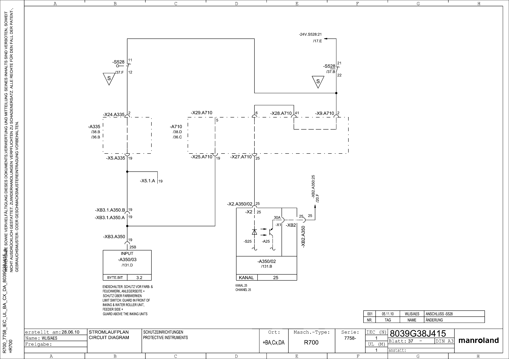

# +BA_Cx_DA — Sheet 37 of 247 — SCHUTZEINRICHTUNGEN

**PROTECTIVE INSTRUMENTS**

> Part of the manroland **R700** printing press IEC/UL circuit diagrams.
> Drawing class: **Stromlaufplan / Circuit diagram** (DIN A3).
> Document `+BA_Cx_DA` covers the **Printing units / main switch cabinet** machine section.

## At a glance

| Field | Value |
|---|---|
| Document | `+BA_Cx_DA`  (8039G38J415) |
| Sheet | **37** of 247 |
| Section (DE) | SCHUTZEINRICHTUNGEN |
| Section (EN) | PROTECTIVE INSTRUMENTS |
| Section type | CIRCUIT — Circuit diagram |
| Machine type | `R700` |
| Series | `7758` |
| Created | 28.06.10 |
| Replaces | — |
| Columns used | B, C, D, E, F, G |
| Path numbers | — |
| Labels on sheet | 82 |
| Cross-refs out | 10 |
| Cross-refs in | 24 |

**Previous:** [+BA_Cx_DA sheet 36](SHEET_0036.md) · **Next:** [+BA_Cx_DA sheet 38](SHEET_0038.md) · **Document TOC:** [_TOC.md](_TOC.md)  (+BA_Cx_DA) · **Master TOC:** [all sheets](../_MASTER_TOC.md)

## Sheet image (300 DPI, exact vector render)



_Rendered directly from the PDF vector layer at 300 DPI (1-bit), no OCR and no resampling. Use it to confirm anything ambiguous in the text below._

## Cross-references on this sheet

Each entry is a wire leaving this sheet. The printed token is `/sheet.column`; the link resolves to that sheet inside the same document.

| Ref | Target sheet | Col | Path | Destination on target | Target section | From col |
|---|---|---|---|---|---|---|
| `/17.E` | [+BA_Cx_DA sheet 17](SHEET_0017.md) | E | — | — | SPANNUNGSVERSORGUNG, SCHALTSCHRANKBELÜFTUNG | E |
| `/37.B` | [+BA_Cx_DA sheet 37](SHEET_0037.md) | B | — | — | SCHUTZEINRICHTUNGEN | D |
| `/37.F` | [+BA_Cx_DA sheet 37](SHEET_0037.md) | F | — | — | SCHUTZEINRICHTUNGEN | D |
| `/38.B` | [+BA_Cx_DA sheet 38](SHEET_0038.md) | B | — | — | SCHUTZEINRICHTUNGEN | B |
| `/36.B` | [+BA_Cx_DA sheet 36](SHEET_0036.md) | B | — | — | SCHUTZEINRICHTUNGEN | B |
| `/38.D` | [+BA_Cx_DA sheet 38](SHEET_0038.md) | D | — | — | SCHUTZEINRICHTUNGEN | C |
| `/36.C` | [+BA_Cx_DA sheet 36](SHEET_0036.md) | C | — | — | SCHUTZEINRICHTUNGEN | C |
| `/20.F` | [+BA_Cx_DA sheet 20](SHEET_0020.md) | F | — | XB2.A350:25 | BUSVERBINDUNGEN: SICHERHEITSBUS | E |
| `/131.D` | [+BA_Cx_DA sheet 131](SHEET_0131.md) | D | — | — | REFERENZMODUL | B |
| `/131.B` | [+BA_Cx_DA sheet 131](SHEET_0131.md) | B | — | — | REFERENZMODUL | E |

### Incoming references (sheets that point here)

Every other sheet that sends a wire to this one. `Back-ref` is the token printed on *that* sheet; `Path` is its line number.

| From sheet | Cols | Back-ref | Path | Refs | What continues there |
|---|---|---|---|---|---|
| [+BA_Cx_DA#17](SHEET_0017.md) | E | `/17.E` | — | 1 | 24V.S528:21 |
| [+BA_Cx_DA#20](SHEET_0020.md) | F | `/20.F` | — | 1 | XB2.A350:25 |
| [+BA_Cx_DA#36](SHEET_0036.md) | A, C | `/36.A`, `/36.C` | — | 2 | — |
| [+BA_Cx_DA#37](SHEET_0037.md) | D | `/37.D` | — | 2 | — |
| [+BA_Cx_DA#38](SHEET_0038.md) | B, D | `/38.B`, `/38.D` | — | 2 | — |
| [+BA_Cx_DA#131](SHEET_0131.md) | B, D | `/131.B`, `/131.D` | — | 2 | — |
| [+BA_Cx_DA#153](SHEET_0153.md) | G | `/153.G` | — | 2 | — |
| [+BA_Cx_DA#157](SHEET_0157.md) | C, D, F | `/157.C`, `/157.D`, `/157.F` | — | 3 | — |
| [+BA_Cx_DA#160](SHEET_0160.md) | C | `/160.C` | — | 1 | — |
| [+BA_Cx_DA#161](SHEET_0161.md) | A | `/161.A` | — | 1 | — |
| [+BA_Cx_DA#166](SHEET_0166.md) | H | `/166.H` | — | 1 | — |
| [+BA_Cx_DA#175](SHEET_0175.md) | B, H | `/175.B`, `/175.H` | — | 2 | — |
| [+BA_Cx_DA#177](SHEET_0177.md) | F | `/177.F` | — | 1 | — |
| [+BA_Cx_DA#178](SHEET_0178.md) | H | `/178.H` | — | 1 | — |
| [+BA_Cx_DA#179](SHEET_0179.md) | B | `/179.B` | — | 2 | — |


## Devices on this sheet

| Tag | Class | Class meaning (IEC) | Col | Sub | Terminal | Sign |
|---|---|---|---|---|---|---|
| `A350/03` | A | Baugruppe / assembly, module, PC board | B | 03 | — | — |
| `A335` | A | Baugruppe / assembly, module, PC board | B | — | — | — |
| `A710` | A | Baugruppe / assembly, module, PC board | C | — | — | — |
| `S25` | S | Schalter / switch | D | — | — | — |
| `A25` | A | Baugruppe / assembly, module, PC board | D | — | — | — |
| `X1` | X | Klemme / terminal, plug connector | E | — | — | — |
| `X2` | X | Klemme / terminal, plug connector | D | — | — | — |
| `XB2` | XB |  | E | — | — | — |
| `A350/02` | A | Baugruppe / assembly, module, PC board | E | 02 | — | — |
| `S528` | S | Schalter / switch | F | — | — | — |
| `S528` | S | Schalter / switch | B | — | — | — |
| `3.2` | — | cross-device reference | B | — | — | — |
| `XB3.A350` | — | cross-device reference | B | — | — | — |
| `X5.A335` | — | cross-device reference | B | — | — | — |
| `X24.A335` | — | cross-device reference | B | — | — | — |
| `XB3.1.A350.B` | — | cross-device reference | B | — | — | — |
| `XB3.1.A350.A` | — | cross-device reference | B | — | — | — |
| `X27.A710` | — | cross-device reference | D | — | — | — |
| `X25.A710` | — | cross-device reference | C | — | — | — |
| `XB2.A350` | — | cross-device reference | E | — | — | — |
| `X28.A710` | — | cross-device reference | E | — | — | — |
| `X9.A710` | — | cross-device reference | E | — | — | — |
| `X5.1.A` | — | cross-device reference | C | — | — | — |
| `NR.` | — | cross-device reference | F | — | — | — |
| `05.11.10` | — | cross-device reference | F | — | — | — |
| `XB2.A350:25` | — | cross-device reference | E | — | 25 | — |
| `X29.A710` | — | cross-device reference | C | — | — | — |

## Potentials / nets

| Potential | Count | Columns | Attached devices | Terminals |
|---|---|---|---|---|
| `24V` | 1 | E | `S528` | `21` |


A potential such as `L24+/4` or `M24+` is a named supply/return rail; every place it appears on this sheet is electrically common.

## Wire-end annotations (grouped as printed)

A wire that continues elsewhere is annotated with a small cluster: the destination description, the path/line number `#NN`, and the `/sheet.column` cross reference. Each row below is one such cluster exactly as it is grouped on the drawing.

| Col | Y | Path | Cross-ref | Text on the wire |
|---|---|---|---|---|
| E | 76.8 | — | — | `24V.S528:21` |
| E | 92.4 | — | `/17.E` | — |
| B | 137.1 | — | — | `11` |
| B | 140.6 | — | — | `S528` |
| F | 144.2 | — | — | `21` |
| F | 150.5 | — | — | `S528` |
| D | 164.3 | — | `/37.B`, `/37.F` | — |
| B | 165.4 | — | — | `12` |
| F | 172.5 | — | — | `22` |
| D | 178.2 | — | — | `S S` |
| C | 259.7 | — | — | `X29.A710` |
| B | 261.1 | — | — | `X24.A335 2` |
| D | 261.1 | — | — | `6` |
| E | 261.1 | — | — | `X28.A710 41 X9.A710 2` |
| C | 278.1 | — | — | `A710 5` |
| B | 292.3 | — | — | `A335` |
| B | 305.3 | — | `/38.B`, `/36.B` | — |
| C | 305.4 | — | `/38.D`, `/36.C` | — |
| D | 363.1 | — | — | `X25.A710 19 X27.A710 25` |
| B | 366.0 | — | — | `X5.A335 19` |
| E | 410.5 | — | `/20.F` | `XB2.A350:25` |
| C | 419.1 | — | — | `X5.1.A 19` |
| D | 473.7 | — | — | `X2.A350/02 25` |
| B | 487.9 | — | — | `XB3.1.A350.B 19` |
| D | 492.1 | — | — | `X2` |
| E | 493.6 | — | — | `25 25` |
| E | 502.1 | — | — | `25` |
| B | 504.9 | — | — | `XB3.1.A350.A 19` |
| E | 506.3 | — | — | `30A` |
| E | 523.3 | — | — | `X1` |
| E | 523.3 | — | — | `XB2` |
| E | 529.5 | — | — | `XB2.A350` |
| B | 550.2 | — | — | `XB3.A350 19` |
| D | 562.3 | — | — | `S25 A25` |
| B | 575.7 | — | — | `25B` |
| B | 590.2 | — | — | `INPUT` |
| B | 604.1 | — | — | `A350/03` |
| E | 608.3 | — | — | `A350/02` |
| B | 617.9 | — | `/131.D` | — |
| E | 620.7 | — | `/131.B` | — |
| D | 646.6 | — | — | `KANAL 25` |
| B | 646.9 | — | — | `BYTE.BIT 3.2` |
| D | 666.9 | — | — | `KANAL 25 CHANNEL 25` |
| B | 669.6 | — | — | `ENDSCHALTER: SCHUTZ VOR FARB & FEUCHWERK, ANLEGERSEITE +` |
| B | 690.9 | — | — | `LIMIT SWITCH: GUARD IN FRONT OF INKING & WATER ROLLER UNIT, FEEDER SIDE + SCHUTZ ÜBER FARBWERKEN` |
| G | 733.0 | — | — | `001 05.11.10 WLIS/AES ANSCHLUSS S528` |
| B | 733.4 | — | — | `GUARD ABOVE THE INKING UNITS` |
| G | 747.1 | — | — | `NR. TAG NAME ÄNDERUNG` |


## Reconstructed tables

This sheet carries tabular content (pin map / terminal assignment / index). The grid below was rebuilt from the drawing's own rule lines, so each row is exactly one physical row of the table.

### Table 1 — 4 data rows × 2 columns (at x=240.9, y=90.7)

| S528 /37.F S X24.A335 X5.A335 | 11 12 2 19 |
|---|---|
| `XB3.1.A350.B XB3.1.A350.A` | `X5.1.A 19 19` |
| `XB3.A350` | `19 25B` |
| `INPUT` | `A350/03 /131.D` |
| `BYTE.BIT` | `3.2` |


### Table 2 — 5 data rows × 7 columns (at x=503.1, y=90.7) — **/17.E S528 /37.B S**

| 5 |  | 6 | X28.A710 |  | 41 | X9.A710 |
|---|---|---|---|---|---|---|
| `19` | `X27.A710 X2.A350/02` | `25 25` |  |  | `XB2.A350:25` | `/20.F` |
|  | `X2` | `25` | `30A X1` | `XB2` | `25 25` |  |
|  | `S25` | `A25` |  |  | `XB2.A350` |  |
|  |  | `A350/02 /131.B` |  |  |  |  |
|  | `KANAL` |  | `25` |  |  |  |


## Notes and free text on this sheet

| Text | Col | Y (pt) |
|---|---|---|
| `25B` | B | 575.72 |
| `INPUT` | B | 590.24 |
| `BYTE.BIT` | B | 647.49 |
| `ENDSCHALTER: SCHUTZ VOR FARB &` | B | 669.61 |
| `FEUCHWERK, ANLEGERSEITE +` | B | 680.21 |
| `SCHUTZ ÜBER FARBWERKEN` | B | 690.85 |
| `LIMIT SWITCH: GUARD IN FRONT OF` | B | 701.49 |
| `INKING & WATER ROLLER UNIT,` | B | 712.11 |
| `FEEDER SIDE +` | B | 722.74 |
| `GUARD ABOVE THE INKING UNITS` | B | 733.4 |
| `KANAL 25` | D | 666.93 |
| `CHANNEL 25` | D | 676.87 |
| `30A` | E | 506.27 |
| `KANAL` | D | 646.6 |
| `X2.A350/02` | D | 473.7 |
| `TAG` | G | 747.27 |
| `NAME` | G | 747.25 |
| `ÄNDERUNG` | G | 747.31 |
| `WLIS/AES` | G | 733.08 |
| `ANSCHLUSS S528` | G | 733.15 |
| `S` | E | 185.34 |
| `S` | B | 178.25 |

## Complete label inventory (exact text from the drawing)

Every text object inside the drawing area of this sheet, in DIN reading order (column A→H, then top→bottom). This is the authoritative list: if a string is not here it is not printed on this sheet.

| Col | Y | X | Dir | Type | Text |
|---|---|---|---|---|---|
| B | 137.1 | 299.6 | → | number | `11` |
| B | 140.6 | 262.8 | → | device tag | `S528` |
| B | 165.4 | 299.6 | → | number | `12` |
| B | 166.1 | 269.3 | → | cross-reference | `/37.F` |
| B | 178.3 | 251.0 | → | text | `S` |
| B | 261.1 | 300.2 | → | number | `2` |
| B | 263.9 | 240.9 | → | device ref | `X24.A335` |
| B | 292.3 | 206.1 | → | device tag | `A335` |
| B | 305.3 | 213.4 | → | cross-reference | `/38.B` |
| B | 317.7 | 213.4 | → | cross-reference | `/36.B` |
| B | 366.0 | 248.3 | → | device ref | `X5.A335` |
| B | 367.4 | 299.6 | → | number | `19` |
| B | 487.9 | 222.5 | → | device ref | `XB3.1.A350.B` |
| B | 487.9 | 299.6 | → | number | `19` |
| B | 504.9 | 299.6 | → | number | `19` |
| B | 505.6 | 221.7 | → | device ref | `XB3.1.A350.A` |
| B | 550.2 | 241.2 | → | device ref | `XB3.A350` |
| B | 558.7 | 299.6 | → | number | `19` |
| B | 575.7 | 303.0 | → | text | `25B` |
| B | 590.2 | 282.8 | → | text | `INPUT` |
| B | 604.1 | 276.2 | → | device tag | `A350/03` |
| B | 617.9 | 284.9 | → | cross-reference | `/131.D` |
| B | 646.9 | 319.2 | → | device ref | `3.2` |
| B | 647.5 | 250.9 | → | text | `BYTE.BIT` |
| B | 669.6 | 240.1 | → | text | `ENDSCHALTER: SCHUTZ VOR FARB &` |
| B | 680.2 | 240.1 | → | text | `FEUCHWERK, ANLEGERSEITE +` |
| B | 690.9 | 240.7 | → | text | `SCHUTZ ÜBER FARBWERKEN` |
| B | 701.5 | 240.1 | → | text | `LIMIT SWITCH: GUARD IN FRONT OF` |
| B | 712.1 | 240.1 | → | text | `INKING & WATER ROLLER UNIT,` |
| B | 722.7 | 240.1 | → | text | `FEEDER SIDE +` |
| B | 733.4 | 240.7 | → | text | `GUARD ABOVE THE INKING UNITS` |
| C | 259.7 | 446.5 | → | device ref | `X29.A710` |
| C | 292.3 | 397.4 | → | device tag | `A710` |
| C | 305.4 | 404.5 | → | cross-reference | `/38.D` |
| C | 317.8 | 404.5 | → | cross-reference | `/36.C` |
| C | 363.1 | 446.5 | → | device ref | `X25.A710` |
| C | 419.2 | 327.4 | → | device ref | `X5.1.A` |
| C | 421.3 | 370.5 | → | number | `19` |
| D | 261.1 | 597.8 | → | number | `6` |
| D | 278.1 | 505.7 | → | number | `5` |
| D | 363.1 | 538.6 | → | device ref | `X27.A710` |
| D | 367.4 | 505.1 | → | number | `19` |
| D | 367.4 | 597.8 | → | number | `25` |
| D | 473.7 | 531.2 | → | text | `X2.A350/02` |
| D | 473.7 | 597.8 | → | number | `25` |
| D | 492.1 | 573.7 | → | device tag | `X2` |
| D | 493.6 | 600.7 | → | number | `25` |
| D | 562.3 | 570.0 | → | device tag | `S25` |
| D | 562.3 | 612.6 | → | device tag | `A25` |
| D | 646.6 | 559.0 | → | text | `KANAL` |
| D | 666.9 | 550.8 | → | text | `KANAL 25` |
| D | 676.9 | 551.1 | → | text | `CHANNEL 25` |
| E | 76.8 | 699.3 | → | potential | `24V.S528:21` |
| E | 92.4 | 732.5 | → | cross-reference | `/17.E` |
| E | 185.3 | 740.0 | → | text | `S` |
| E | 261.1 | 632.1 | → | device ref | `X28.A710` |
| E | 261.1 | 690.0 | → | number | `41` |
| E | 261.1 | 737.3 | → | device ref | `X9.A710` |
| E | 410.5 | 728.8 | ↕ | device ref | `XB2.A350:25` |
| E | 454.7 | 738.7 | ↕ | cross-reference | `/20.F` |
| E | 502.1 | 720.6 | → | number | `25` |
| E | 503.5 | 699.9 | → | number | `25` |
| E | 506.3 | 640.6 | → | text | `30A` |
| E | 523.3 | 644.3 | → | device tag | `X1` |
| E | 523.3 | 668.7 | → | device tag | `XB2` |
| E | 529.5 | 704.7 | ↕ | device ref | `XB2.A350` |
| E | 608.3 | 602.2 | → | device tag | `A350/02` |
| E | 620.7 | 611.0 | → | cross-reference | `/131.B` |
| E | 646.6 | 639.1 | → | number | `25` |
| F | 144.2 | 789.2 | → | number | `21` |
| F | 150.5 | 756.0 | → | device tag | `S528` |
| F | 164.3 | 763.4 | → | cross-reference | `/37.B` |
| F | 172.5 | 789.2 | → | number | `22` |
| F | 261.1 | 789.2 | → | number | `2` |
| F | 733.0 | 859.4 | → | number | `001` |
| F | 733.1 | 893.5 | → | device ref | `05.11.10` |
| F | 747.1 | 858.4 | → | device ref | `NR.` |
| G | 733.1 | 947.3 | → | text | `WLIS/AES` |
| G | 733.1 | 996.0 | → | text | `ANSCHLUSS S528` |
| G | 747.3 | 900.0 | → | text | `TAG` |
| G | 747.3 | 953.4 | → | text | `NAME` |
| G | 747.3 | 996.0 | → | text | `ÄNDERUNG` |

## Reading-order text block

The same content as a plain block, grouped by DIN column — convenient to paste or to match against a visual description.

```text
=== Column B ===
 137.1  299.6  numeric      11
 140.6  262.8  devtag       S528
 165.4  299.6  numeric      12
 166.1  269.3  xref         /37.F
 178.3  251.0  text         S
 261.1  300.2  numeric      2
 263.9  240.9  devref       X24.A335
 292.3  206.1  devtag       A335
 305.3  213.4  xref         /38.B
 317.7  213.4  xref         /36.B
 366.0  248.3  devref       X5.A335
 367.4  299.6  numeric      19
 487.9  222.5  devref       XB3.1.A350.B
 487.9  299.6  numeric      19
 504.9  299.6  numeric      19
 505.6  221.7  devref       XB3.1.A350.A
 550.2  241.2  devref       XB3.A350
 558.7  299.6  numeric      19
 575.7  303.0  text         25B
 590.2  282.8  text         INPUT
 604.1  276.2  devtag       A350/03
 617.9  284.9  xref         /131.D
 646.9  319.2  devref       3.2
 647.5  250.9  text         BYTE.BIT
 669.6  240.1  text         ENDSCHALTER: SCHUTZ VOR FARB &
 680.2  240.1  text         FEUCHWERK, ANLEGERSEITE +
 690.9  240.7  text         SCHUTZ ÜBER FARBWERKEN
 701.5  240.1  text         LIMIT SWITCH: GUARD IN FRONT OF
 712.1  240.1  text         INKING & WATER ROLLER UNIT,
 722.7  240.1  text         FEEDER SIDE +
 733.4  240.7  text         GUARD ABOVE THE INKING UNITS
=== Column C ===
 259.7  446.5  devref       X29.A710
 292.3  397.4  devtag       A710
 305.4  404.5  xref         /38.D
 317.8  404.5  xref         /36.C
 363.1  446.5  devref       X25.A710
 419.2  327.4  devref       X5.1.A
 421.3  370.5  numeric      19
=== Column D ===
 261.1  597.8  numeric      6
 278.1  505.7  numeric      5
 363.1  538.6  devref       X27.A710
 367.4  505.1  numeric      19
 367.4  597.8  numeric      25
 473.7  531.2  text         X2.A350/02
 473.7  597.8  numeric      25
 492.1  573.7  devtag       X2
 493.6  600.7  numeric      25
 562.3  570.0  devtag       S25
 562.3  612.6  devtag       A25
 646.6  559.0  text         KANAL
 666.9  550.8  text         KANAL 25
 676.9  551.1  text         CHANNEL 25
=== Column E ===
  76.8  699.3  net          24V.S528:21
  92.4  732.5  xref         /17.E
 185.3  740.0  text         S
 261.1  632.1  devref       X28.A710
 261.1  690.0  numeric      41
 261.1  737.3  devref       X9.A710
 410.5  728.8  devref       XB2.A350:25
 454.7  738.7  xref         /20.F
 502.1  720.6  numeric      25
 503.5  699.9  numeric      25
 506.3  640.6  text         30A
 523.3  644.3  devtag       X1
 523.3  668.7  devtag       XB2
 529.5  704.7  devref       XB2.A350
 608.3  602.2  devtag       A350/02
 620.7  611.0  xref         /131.B
 646.6  639.1  numeric      25
=== Column F ===
 144.2  789.2  numeric      21
 150.5  756.0  devtag       S528
 164.3  763.4  xref         /37.B
 172.5  789.2  numeric      22
 261.1  789.2  numeric      2
 733.0  859.4  numeric      001
 733.1  893.5  devref       05.11.10
 747.1  858.4  devref       NR.
=== Column G ===
 733.1  947.3  text         WLIS/AES
 733.1  996.0  text         ANSCHLUSS S528
 747.3  900.0  text         TAG
 747.3  953.4  text         NAME
 747.3  996.0  text         ÄNDERUNG
```

---
_Generated from the PDF vector text layer; no OCR. Source: `R700_7758_IEC_UL_BA_CX_DA_8039G38J415_p`, sheet 37._
