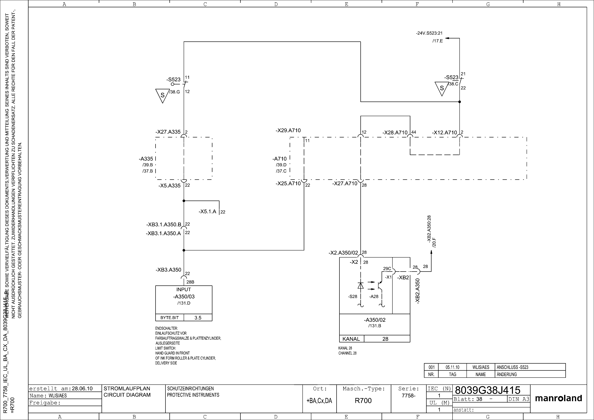

# +BA_Cx_DA — Sheet 38 of 247 — SCHUTZEINRICHTUNGEN

**PROTECTIVE INSTRUMENTS**

> Part of the manroland **R700** printing press IEC/UL circuit diagrams.
> Drawing class: **Stromlaufplan / Circuit diagram** (DIN A3).
> Document `+BA_Cx_DA` covers the **Printing units / main switch cabinet** machine section.

## At a glance

| Field | Value |
|---|---|
| Document | `+BA_Cx_DA`  (8039G38J415) |
| Sheet | **38** of 247 |
| Section (DE) | SCHUTZEINRICHTUNGEN |
| Section (EN) | PROTECTIVE INSTRUMENTS |
| Section type | CIRCUIT — Circuit diagram |
| Machine type | `R700` |
| Series | `7758` |
| Created | 28.06.10 |
| Replaces | — |
| Columns used | B, C, D, E, F, G |
| Path numbers | — |
| Labels on sheet | 83 |
| Cross-refs out | 10 |
| Cross-refs in | 24 |

**Previous:** [+BA_Cx_DA sheet 37](SHEET_0037.md) · **Next:** [+BA_Cx_DA sheet 39](SHEET_0039.md) · **Document TOC:** [_TOC.md](_TOC.md)  (+BA_Cx_DA) · **Master TOC:** [all sheets](../_MASTER_TOC.md)

## Sheet image (300 DPI, exact vector render)



_Rendered directly from the PDF vector layer at 300 DPI (1-bit), no OCR and no resampling. Use it to confirm anything ambiguous in the text below._

## Cross-references on this sheet

Each entry is a wire leaving this sheet. The printed token is `/sheet.column`; the link resolves to that sheet inside the same document.

| Ref | Target sheet | Col | Path | Destination on target | Target section | From col |
|---|---|---|---|---|---|---|
| `/17.E` | [+BA_Cx_DA sheet 17](SHEET_0017.md) | E | — | — | SPANNUNGSVERSORGUNG, SCHALTSCHRANKBELÜFTUNG | F |
| `/38.C` | [+BA_Cx_DA sheet 38](SHEET_0038.md) | C | — | — | SCHUTZEINRICHTUNGEN | G |
| `/38.G` | [+BA_Cx_DA sheet 38](SHEET_0038.md) | G | — | — | SCHUTZEINRICHTUNGEN | C |
| `/39.B` | [+BA_Cx_DA sheet 39](SHEET_0039.md) | B | — | — | SCHUTZEINRICHTUNGEN | B |
| `/37.B` | [+BA_Cx_DA sheet 37](SHEET_0037.md) | B | — | — | SCHUTZEINRICHTUNGEN | B |
| `/39.D` | [+BA_Cx_DA sheet 39](SHEET_0039.md) | D | — | — | SCHUTZEINRICHTUNGEN | D |
| `/37.C` | [+BA_Cx_DA sheet 37](SHEET_0037.md) | C | — | — | SCHUTZEINRICHTUNGEN | D |
| `/20.F` | [+BA_Cx_DA sheet 20](SHEET_0020.md) | F | — | XB2.A350:28 | BUSVERBINDUNGEN: SICHERHEITSBUS | F |
| `/131.D` | [+BA_Cx_DA sheet 131](SHEET_0131.md) | D | — | — | REFERENZMODUL | C |
| `/131.B` | [+BA_Cx_DA sheet 131](SHEET_0131.md) | B | — | — | REFERENZMODUL | E |

### Incoming references (sheets that point here)

Every other sheet that sends a wire to this one. `Back-ref` is the token printed on *that* sheet; `Path` is its line number.

| From sheet | Cols | Back-ref | Path | Refs | What continues there |
|---|---|---|---|---|---|
| [+BA_Cx_DA#17](SHEET_0017.md) | E | `/17.E` | — | 1 | 24V.S523:21 |
| [+BA_Cx_DA#20](SHEET_0020.md) | F | `/20.F` | — | 1 | XB2.A350:28 |
| [+BA_Cx_DA#37](SHEET_0037.md) | B, C | `/37.B`, `/37.C` | — | 2 | — |
| [+BA_Cx_DA#38](SHEET_0038.md) | C, G | `/38.C`, `/38.G` | — | 2 | — |
| [+BA_Cx_DA#39](SHEET_0039.md) | B, D | `/39.B`, `/39.D` | — | 2 | — |
| [+BA_Cx_DA#131](SHEET_0131.md) | B, D | `/131.B`, `/131.D` | — | 2 | — |
| [+BA_Cx_DA#153](SHEET_0153.md) | G | `/153.G` | — | 2 | — |
| [+BA_Cx_DA#157](SHEET_0157.md) | C, D, F | `/157.C`, `/157.D`, `/157.F` | — | 3 | — |
| [+BA_Cx_DA#160](SHEET_0160.md) | C | `/160.C` | — | 1 | — |
| [+BA_Cx_DA#161](SHEET_0161.md) | A | `/161.A` | — | 1 | — |
| [+BA_Cx_DA#169](SHEET_0169.md) | H | `/169.H` | — | 1 | — |
| [+BA_Cx_DA#175](SHEET_0175.md) | H | `/175.H` | — | 1 | — |
| [+BA_Cx_DA#177](SHEET_0177.md) | A, F | `/177.A`, `/177.F` | — | 2 | — |
| [+BA_Cx_DA#178](SHEET_0178.md) | H | `/178.H` | — | 1 | — |
| [+BA_Cx_DA#179](SHEET_0179.md) | B | `/179.B` | — | 2 | — |


## Devices on this sheet

| Tag | Class | Class meaning (IEC) | Col | Sub | Terminal | Sign |
|---|---|---|---|---|---|---|
| `A710` | A | Baugruppe / assembly, module, PC board | D | — | — | — |
| `S523` | S | Schalter / switch | C | — | — | — |
| `A335` | A | Baugruppe / assembly, module, PC board | B | — | — | — |
| `A350/03` | A | Baugruppe / assembly, module, PC board | C | 03 | — | — |
| `S28` | S | Schalter / switch | E | — | — | — |
| `A28` | A | Baugruppe / assembly, module, PC board | E | — | — | — |
| `X1` | X | Klemme / terminal, plug connector | F | — | — | — |
| `X2` | X | Klemme / terminal, plug connector | E | — | — | — |
| `XB2` | XB |  | F | — | — | — |
| `A350/02` | A | Baugruppe / assembly, module, PC board | E | 02 | — | — |
| `S523` | S | Schalter / switch | F | — | — | — |
| `X25.A710` | — | cross-device reference | D | — | — | — |
| `X27.A335` | — | cross-device reference | B | — | — | — |
| `X5.A335` | — | cross-device reference | B | — | — | — |
| `3.5` | — | cross-device reference | C | — | — | — |
| `XB3.A350` | — | cross-device reference | B | — | — | — |
| `X27.A710` | — | cross-device reference | E | — | — | — |
| `XB2.A350` | — | cross-device reference | F | — | — | — |
| `X28.A710` | — | cross-device reference | F | — | — | — |
| `X12.A710` | — | cross-device reference | F | — | — | — |
| `XB3.1.A350.B` | — | cross-device reference | B | — | — | — |
| `XB3.1.A350.A` | — | cross-device reference | B | — | — | — |
| `X5.1.A` | — | cross-device reference | C | — | — | — |
| `NR.` | — | cross-device reference | F | — | — | — |
| `05.11.10` | — | cross-device reference | F | — | — | — |
| `XB2.A350:28` | — | cross-device reference | F | — | 28 | — |
| `X29.A710` | — | cross-device reference | D | — | — | — |

## Potentials / nets

| Potential | Count | Columns | Attached devices | Terminals |
|---|---|---|---|---|
| `24V` | 1 | F | `S523` | `21` |


A potential such as `L24+/4` or `M24+` is a named supply/return rail; every place it appears on this sheet is electrically common.

## Wire-end annotations (grouped as printed)

A wire that continues elsewhere is annotated with a small cluster: the destination description, the path/line number `#NN`, and the `/sheet.column` cross reference. Each row below is one such cluster exactly as it is grouped on the drawing.

| Col | Y | Path | Cross-ref | Text on the wire |
|---|---|---|---|---|
| F | 62.6 | — | — | `24V.S523:21` |
| F | 78.2 | — | `/17.E` | — |
| G | 144.2 | — | — | `21` |
| F | 150.5 | — | — | `S523` |
| C | 151.3 | — | — | `11` |
| C | 154.8 | — | — | `S523` |
| G | 164.3 | — | `/38.C` | — |
| F | 171.2 | — | — | `S` |
| G | 172.5 | — | — | `22` |
| C | 179.6 | — | — | `12` |
| C | 180.3 | — | `/38.G` | — |
| B | 185.3 | — | — | `S` |
| D | 256.8 | — | — | `X29.A710` |
| C | 259.7 | — | — | `X27.A335 2` |
| F | 261.1 | — | — | `12 X28.A710 44 X12.A710 2` |
| D | 278.1 | — | — | `11` |
| B | 313.5 | — | — | `A335` |
| D | 313.5 | — | — | `A710` |
| B | 326.6 | — | `/39.B`, `/37.B` | — |
| D | 326.6 | — | `/39.D`, `/37.C` | — |
| D | 363.1 | — | — | `X25.A710 22` |
| E | 363.1 | — | — | `X27.A710 28` |
| C | 367.4 | — | — | `X5.A335 22` |
| C | 419.1 | — | — | `X5.1.A 22` |
| F | 431.7 | — | `/20.F` | `XB2.A350:28` |
| B | 445.4 | — | — | `XB3.1.A350.B 22` |
| B | 462.4 | — | — | `XB3.1.A350.A 22` |
| E | 502.0 | — | — | `X2.A350/02 28` |
| E | 520.5 | — | — | `X2` |
| F | 521.9 | — | — | `28 28` |
| F | 530.4 | — | — | `28` |
| F | 534.7 | — | — | `29C` |
| C | 536.1 | — | — | `XB3.A350 22` |
| F | 551.6 | — | — | `X1` |
| F | 551.7 | — | — | `XB2` |
| F | 557.9 | — | — | `XB2.A350` |
| C | 561.5 | — | — | `28B` |
| C | 576.1 | — | — | `INPUT` |
| C | 589.9 | — | — | `A350/03` |
| E | 590.6 | — | — | `S28 A28` |
| C | 603.7 | — | `/131.D` | — |
| C | 632.7 | — | — | `BYTE.BIT 3.5` |
| E | 636.7 | — | — | `A350/02` |
| E | 649.0 | — | `/131.B` | — |
| C | 655.6 | — | — | `ENDSCHALTER: EINLAUFSCHUTZ VOR FARBAUFTRAGSWALZE & PLATTENZYLINDER,` |
| E | 674.9 | — | — | `KANAL 28` |
| C | 685.4 | — | — | `LIMIT SWITCH: HAND GUARD IN FRONT DELIVERY SIDE OF INK FORM ROLLER & PLATE CYLINDER, AUSLEGERSEITE` |
| E | 695.3 | — | — | `KANAL 28 CHANNEL 28` |
| G | 733.0 | — | — | `001 05.11.10 WLIS/AES ANSCHLUSS S523` |
| G | 747.1 | — | — | `NR. TAG NAME ÄNDERUNG` |


## Reconstructed tables

This sheet carries tabular content (pin map / terminal assignment / index). The grid below was rebuilt from the drawing's own rule lines, so each row is exactly one physical row of the table.

### Table 1 — 4 data rows × 2 columns (at x=311.8, y=83.6)

| S523 /38.G S X27.A335 X5.A335 | 11 12 2 22 |
|---|---|
| `XB3.1.A350.B XB3.1.A350.A` | `X5.1.A 22 22` |
| `XB3.A350` | `22 28B` |
| `INPUT` | `A350/03 /131.D` |
| `BYTE.BIT` | `3.5` |


### Table 2 — 5 data rows × 7 columns (at x=609.4, y=83.6) — **S523 /38.C S**

| 11 |  | 12 |  | X28.A710 | 44 | X12.A710 |
|---|---|---|---|---|---|---|
| `22` | `X27.A710` | `28` |  |  | `XB2.A350:28` | `/20.F` |
|  | `X2.A350/02` | `28` |  |  |  |  |
|  | `X2 S28` | `28 A28` | `29C X1` | `XB2` | `28 28 XB2.A350` |  |
|  |  | `A350/02 /131.B` |  |  |  |  |
|  | `KANAL` |  | `28` |  |  |  |


## Notes and free text on this sheet

| Text | Col | Y (pt) |
|---|---|---|
| `28B` | C | 561.55 |
| `INPUT` | C | 576.07 |
| `BYTE.BIT` | B | 633.32 |
| `ENDSCHALTER:` | B | 655.56 |
| `EINLAUFSCHUTZ VOR` | C | 665.52 |
| `FARBAUFTRAGSWALZE & PLATTENZYLINDER,` | C | 675.46 |
| `AUSLEGERSEITE` | B | 685.44 |
| `LIMIT SWITCH:` | B | 695.34 |
| `HAND GUARD IN FRONT` | C | 705.3 |
| `OF INK FORM ROLLER & PLATE CYLINDER,` | C | 715.27 |
| `DELIVERY SIDE` | B | 725.24 |
| `KANAL 28` | E | 695.27 |
| `CHANNEL 28` | E | 705.22 |
| `29C` | F | 534.66 |
| `KANAL` | E | 674.94 |
| `X2.A350/02` | E | 502.04 |
| `TAG` | G | 747.27 |
| `NAME` | G | 747.25 |
| `ÄNDERUNG` | G | 747.31 |
| `WLIS/AES` | G | 733.08 |
| `ANSCHLUSS S523` | G | 733.15 |
| `S` | B | 185.34 |
| `S` | F | 171.17 |

## Complete label inventory (exact text from the drawing)

Every text object inside the drawing area of this sheet, in DIN reading order (column A→H, then top→bottom). This is the authoritative list: if a string is not here it is not printed on this sheet.

| Col | Y | X | Dir | Type | Text |
|---|---|---|---|---|---|
| B | 185.3 | 321.9 | → | text | `S` |
| B | 259.7 | 311.8 | → | device ref | `X27.A335` |
| B | 313.5 | 278.4 | → | device tag | `A335` |
| B | 326.6 | 285.7 | → | cross-reference | `/39.B` |
| B | 339.0 | 285.7 | → | cross-reference | `/37.B` |
| B | 367.4 | 317.8 | → | device ref | `X5.A335` |
| B | 445.4 | 293.4 | → | device ref | `XB3.1.A350.B` |
| B | 463.1 | 292.5 | → | device ref | `XB3.1.A350.A` |
| B | 536.1 | 312.1 | → | device ref | `XB3.A350` |
| B | 633.3 | 321.7 | → | text | `BYTE.BIT` |
| B | 655.6 | 311.2 | → | text | `ENDSCHALTER:` |
| B | 685.4 | 312.1 | → | text | `AUSLEGERSEITE` |
| B | 695.3 | 311.2 | → | text | `LIMIT SWITCH:` |
| B | 725.2 | 311.2 | → | text | `DELIVERY SIDE` |
| C | 151.3 | 370.5 | → | number | `11` |
| C | 154.8 | 333.6 | → | device tag | `S523` |
| C | 179.6 | 370.5 | → | number | `12` |
| C | 180.3 | 339.0 | → | cross-reference | `/38.G` |
| C | 261.1 | 371.1 | → | number | `2` |
| C | 367.4 | 371.1 | → | number | `22` |
| C | 419.2 | 398.3 | → | device ref | `X5.1.A` |
| C | 421.3 | 441.9 | → | number | `22` |
| C | 445.4 | 371.1 | → | number | `22` |
| C | 462.4 | 371.1 | → | number | `22` |
| C | 544.6 | 371.1 | → | number | `22` |
| C | 561.5 | 373.9 | → | text | `28B` |
| C | 576.1 | 353.6 | → | text | `INPUT` |
| C | 589.9 | 347.1 | → | device tag | `A350/03` |
| C | 603.7 | 355.7 | → | cross-reference | `/131.D` |
| C | 632.7 | 390.0 | → | device ref | `3.5` |
| C | 665.5 | 311.2 | → | text | `EINLAUFSCHUTZ VOR` |
| C | 675.5 | 311.2 | → | text | `FARBAUFTRAGSWALZE & PLATTENZYLINDER,` |
| C | 705.3 | 311.2 | → | text | `HAND GUARD IN FRONT` |
| C | 715.3 | 311.5 | → | text | `OF INK FORM ROLLER & PLATE CYLINDER,` |
| D | 256.8 | 552.8 | → | device ref | `X29.A710` |
| D | 278.1 | 611.4 | → | number | `11` |
| D | 313.5 | 546.2 | → | device tag | `A710` |
| D | 326.6 | 553.3 | → | cross-reference | `/39.D` |
| D | 339.0 | 553.3 | → | cross-reference | `/37.C` |
| D | 363.1 | 552.8 | → | device ref | `X25.A710` |
| D | 367.4 | 612.0 | → | number | `22` |
| E | 261.1 | 724.8 | → | number | `12` |
| E | 363.1 | 666.1 | → | device ref | `X27.A710` |
| E | 367.4 | 725.4 | → | number | `28` |
| E | 502.0 | 658.8 | → | text | `X2.A350/02` |
| E | 502.1 | 725.4 | → | number | `28` |
| E | 520.5 | 701.3 | → | device tag | `X2` |
| E | 521.9 | 728.2 | → | number | `28` |
| E | 590.6 | 697.6 | → | device tag | `S28` |
| E | 590.6 | 740.1 | → | device tag | `A28` |
| E | 636.7 | 729.8 | → | device tag | `A350/02` |
| E | 649.0 | 738.6 | → | cross-reference | `/131.B` |
| E | 674.9 | 686.6 | → | text | `KANAL` |
| E | 695.3 | 678.3 | → | text | `KANAL 28` |
| E | 705.2 | 678.6 | → | text | `CHANNEL 28` |
| F | 62.6 | 834.0 | → | potential | `24V.S523:21` |
| F | 78.2 | 867.1 | → | cross-reference | `/17.E` |
| F | 150.5 | 890.6 | → | device tag | `S523` |
| F | 171.2 | 881.7 | → | text | `S` |
| F | 261.1 | 766.8 | → | device ref | `X28.A710` |
| F | 261.1 | 824.6 | → | number | `44` |
| F | 261.1 | 866.0 | → | device ref | `X12.A710` |
| F | 431.7 | 856.3 | ↕ | device ref | `XB2.A350:28` |
| F | 475.9 | 866.2 | ↕ | cross-reference | `/20.F` |
| F | 530.4 | 848.1 | → | number | `28` |
| F | 531.8 | 827.4 | → | number | `28` |
| F | 534.7 | 768.2 | → | text | `29C` |
| F | 551.6 | 771.9 | → | device tag | `X1` |
| F | 551.7 | 796.3 | → | device tag | `XB2` |
| F | 557.9 | 832.3 | ↕ | device ref | `XB2.A350` |
| F | 674.9 | 766.6 | → | number | `28` |
| F | 733.0 | 859.4 | → | number | `001` |
| F | 733.1 | 893.5 | → | device ref | `05.11.10` |
| F | 747.1 | 858.4 | → | device ref | `NR.` |
| G | 144.2 | 923.8 | → | number | `21` |
| G | 164.3 | 897.7 | → | cross-reference | `/38.C` |
| G | 172.5 | 923.8 | → | number | `22` |
| G | 261.1 | 923.8 | → | number | `2` |
| G | 733.1 | 947.3 | → | text | `WLIS/AES` |
| G | 733.1 | 996.0 | → | text | `ANSCHLUSS S523` |
| G | 747.3 | 900.0 | → | text | `TAG` |
| G | 747.3 | 953.4 | → | text | `NAME` |
| G | 747.3 | 996.0 | → | text | `ÄNDERUNG` |

## Reading-order text block

The same content as a plain block, grouped by DIN column — convenient to paste or to match against a visual description.

```text
=== Column B ===
 185.3  321.9  text         S
 259.7  311.8  devref       X27.A335
 313.5  278.4  devtag       A335
 326.6  285.7  xref         /39.B
 339.0  285.7  xref         /37.B
 367.4  317.8  devref       X5.A335
 445.4  293.4  devref       XB3.1.A350.B
 463.1  292.5  devref       XB3.1.A350.A
 536.1  312.1  devref       XB3.A350
 633.3  321.7  text         BYTE.BIT
 655.6  311.2  text         ENDSCHALTER:
 685.4  312.1  text         AUSLEGERSEITE
 695.3  311.2  text         LIMIT SWITCH:
 725.2  311.2  text         DELIVERY SIDE
=== Column C ===
 151.3  370.5  numeric      11
 154.8  333.6  devtag       S523
 179.6  370.5  numeric      12
 180.3  339.0  xref         /38.G
 261.1  371.1  numeric      2
 367.4  371.1  numeric      22
 419.2  398.3  devref       X5.1.A
 421.3  441.9  numeric      22
 445.4  371.1  numeric      22
 462.4  371.1  numeric      22
 544.6  371.1  numeric      22
 561.5  373.9  text         28B
 576.1  353.6  text         INPUT
 589.9  347.1  devtag       A350/03
 603.7  355.7  xref         /131.D
 632.7  390.0  devref       3.5
 665.5  311.2  text         EINLAUFSCHUTZ VOR
 675.5  311.2  text         FARBAUFTRAGSWALZE & PLATTENZYLINDER,
 705.3  311.2  text         HAND GUARD IN FRONT
 715.3  311.5  text         OF INK FORM ROLLER & PLATE CYLINDER,
=== Column D ===
 256.8  552.8  devref       X29.A710
 278.1  611.4  numeric      11
 313.5  546.2  devtag       A710
 326.6  553.3  xref         /39.D
 339.0  553.3  xref         /37.C
 363.1  552.8  devref       X25.A710
 367.4  612.0  numeric      22
=== Column E ===
 261.1  724.8  numeric      12
 363.1  666.1  devref       X27.A710
 367.4  725.4  numeric      28
 502.0  658.8  text         X2.A350/02
 502.1  725.4  numeric      28
 520.5  701.3  devtag       X2
 521.9  728.2  numeric      28
 590.6  697.6  devtag       S28
 590.6  740.1  devtag       A28
 636.7  729.8  devtag       A350/02
 649.0  738.6  xref         /131.B
 674.9  686.6  text         KANAL
 695.3  678.3  text         KANAL 28
 705.2  678.6  text         CHANNEL 28
=== Column F ===
  62.6  834.0  net          24V.S523:21
  78.2  867.1  xref         /17.E
 150.5  890.6  devtag       S523
 171.2  881.7  text         S
 261.1  766.8  devref       X28.A710
 261.1  824.6  numeric      44
 261.1  866.0  devref       X12.A710
 431.7  856.3  devref       XB2.A350:28
 475.9  866.2  xref         /20.F
 530.4  848.1  numeric      28
 531.8  827.4  numeric      28
 534.7  768.2  text         29C
 551.6  771.9  devtag       X1
 551.7  796.3  devtag       XB2
 557.9  832.3  devref       XB2.A350
 674.9  766.6  numeric      28
 733.0  859.4  numeric      001
 733.1  893.5  devref       05.11.10
 747.1  858.4  devref       NR.
=== Column G ===
 144.2  923.8  numeric      21
 164.3  897.7  xref         /38.C
 172.5  923.8  numeric      22
 261.1  923.8  numeric      2
 733.1  947.3  text         WLIS/AES
 733.1  996.0  text         ANSCHLUSS S523
 747.3  900.0  text         TAG
 747.3  953.4  text         NAME
 747.3  996.0  text         ÄNDERUNG
```

---
_Generated from the PDF vector text layer; no OCR. Source: `R700_7758_IEC_UL_BA_CX_DA_8039G38J415_p`, sheet 38._
