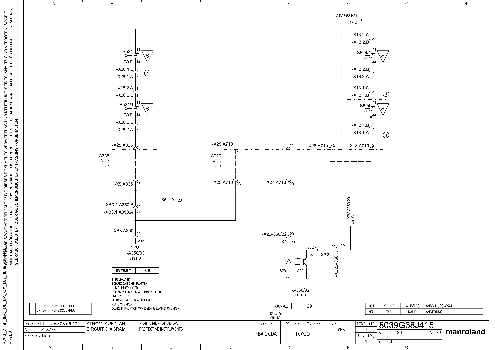

# +BA_Cx_DA — Sheet 39 of 247 — SCHUTZEINRICHTUNGEN

**PROTECTIVE INSTRUMENTS**

> Part of the manroland **R700** printing press IEC/UL circuit diagrams.
> Drawing class: **Stromlaufplan / Circuit diagram** (DIN A3).
> Document `+BA_Cx_DA` covers the **Printing units / main switch cabinet** machine section.

## At a glance

| Field | Value |
|---|---|
| Document | `+BA_Cx_DA`  (8039G38J415) |
| Sheet | **39** of 247 |
| Section (DE) | SCHUTZEINRICHTUNGEN |
| Section (EN) | PROTECTIVE INSTRUMENTS |
| Section type | CIRCUIT — Circuit diagram |
| Machine type | `R700` |
| Series | `7758` |
| Created | 28.06.10 |
| Replaces | — |
| Columns used | A, B, C, D, E, F, G, H |
| Path numbers | — |
| Labels on sheet | 129 |
| Cross-refs out | 12 |
| Cross-refs in | 40 |

**Previous:** [+BA_Cx_DA sheet 38](SHEET_0038.md) · **Next:** [+BA_Cx_DA sheet 40](SHEET_0040.md) · **Document TOC:** [_TOC.md](_TOC.md)  (+BA_Cx_DA) · **Master TOC:** [all sheets](../_MASTER_TOC.md)

## Sheet image (300 DPI, exact vector render)



_Rendered directly from the PDF vector layer at 300 DPI (1-bit), no OCR and no resampling. Use it to confirm anything ambiguous in the text below._

## Cross-references on this sheet

Each entry is a wire leaving this sheet. The printed token is `/sheet.column`; the link resolves to that sheet inside the same document.

| Ref | Target sheet | Col | Path | Destination on target | Target section | From col |
|---|---|---|---|---|---|---|
| `/17.C` | [+BA_Cx_DA sheet 17](SHEET_0017.md) | C | — | — | SPANNUNGSVERSORGUNG, SCHALTSCHRANKBELÜFTUNG | F |
| `/39.B` | [+BA_Cx_DA sheet 39](SHEET_0039.md) | B | — | — | SCHUTZEINRICHTUNGEN | F |
| `/39.F` | [+BA_Cx_DA sheet 39](SHEET_0039.md) | F | — | — | SCHUTZEINRICHTUNGEN | B |
| `/39.B` | [+BA_Cx_DA sheet 39](SHEET_0039.md) | B | — | — | SCHUTZEINRICHTUNGEN | F |
| `/39.F` | [+BA_Cx_DA sheet 39](SHEET_0039.md) | F | — | — | SCHUTZEINRICHTUNGEN | B |
| `/40.B` | [+BA_Cx_DA sheet 40](SHEET_0040.md) | B | — | — | SCHUTZEINRICHTUNGEN | B |
| `/38.B` | [+BA_Cx_DA sheet 38](SHEET_0038.md) | B | — | — | SCHUTZEINRICHTUNGEN | B |
| `/40.C` | [+BA_Cx_DA sheet 40](SHEET_0040.md) | C | — | — | SCHUTZEINRICHTUNGEN | D |
| `/38.D` | [+BA_Cx_DA sheet 38](SHEET_0038.md) | D | — | — | SCHUTZEINRICHTUNGEN | D |
| `/20.G` | [+BA_Cx_DA sheet 20](SHEET_0020.md) | G | — | XB2.A350:29 | BUSVERBINDUNGEN: SICHERHEITSBUS | F |
| `/131.D` | [+BA_Cx_DA sheet 131](SHEET_0131.md) | D | — | — | REFERENZMODUL | B |
| `/131.B` | [+BA_Cx_DA sheet 131](SHEET_0131.md) | B | — | — | REFERENZMODUL | E |

### Incoming references (sheets that point here)

Every other sheet that sends a wire to this one. `Back-ref` is the token printed on *that* sheet; `Path` is its line number.

| From sheet | Cols | Back-ref | Path | Refs | What continues there |
|---|---|---|---|---|---|
| [+BA_Cx_DA#17](SHEET_0017.md) | C | `/17.C` | — | 1 | — |
| [+BA_Cx_DA#20](SHEET_0020.md) | G | `/20.G` | — | 1 | XB2.A350:29 |
| [+BA_Cx_DA#38](SHEET_0038.md) | B, D | `/38.B`, `/38.D` | — | 2 | — |
| [+BA_Cx_DA#39](SHEET_0039.md) | B, F | `/39.B`, `/39.F` | — | 4 | — |
| [+BA_Cx_DA#40](SHEET_0040.md) | B, C | `/40.B`, `/40.C` | — | 2 | — |
| [+BA_Cx_DA#131](SHEET_0131.md) | B, D | `/131.B`, `/131.D` | — | 2 | — |
| [+BA_Cx_DA#153](SHEET_0153.md) | G | `/153.G` | — | 2 | — |
| [+BA_Cx_DA#157](SHEET_0157.md) | C, D, F | `/157.C`, `/157.D`, `/157.F` | — | 3 | — |
| [+BA_Cx_DA#160](SHEET_0160.md) | C | `/160.C` | — | 1 | — |
| [+BA_Cx_DA#161](SHEET_0161.md) | A | `/161.A` | — | 1 | — |
| [+BA_Cx_DA#170](SHEET_0170.md) | A, C | `/170.A`, `/170.C` | — | 9 | — |
| [+BA_Cx_DA#175](SHEET_0175.md) | H | `/175.H` | — | 1 | — |
| [+BA_Cx_DA#177](SHEET_0177.md) | F | `/177.F` | — | 1 | — |
| [+BA_Cx_DA#178](SHEET_0178.md) | A, E, H | `/178.A`, `/178.E`, `/178.H` | — | 8 | — |
| [+BA_Cx_DA#179](SHEET_0179.md) | B | `/179.B` | — | 2 | — |


## Devices on this sheet

| Tag | Class | Class meaning (IEC) | Col | Sub | Terminal | Sign |
|---|---|---|---|---|---|---|
| `A350/03` | A | Baugruppe / assembly, module, PC board | B | 03 | — | — |
| `A335` | A | Baugruppe / assembly, module, PC board | B | — | — | — |
| `S524/1` | S | Schalter / switch | B | 1 | — | — |
| `S524` | S | Schalter / switch | B | — | — | — |
| `A710` | A | Baugruppe / assembly, module, PC board | D | — | — | — |
| `S29` | S | Schalter / switch | E | — | — | — |
| `A29` | A | Baugruppe / assembly, module, PC board | E | — | — | — |
| `X1` | X | Klemme / terminal, plug connector | E | — | — | — |
| `X2` | X | Klemme / terminal, plug connector | E | — | — | — |
| `XB2` | XB |  | F | — | — | — |
| `A350/02` | A | Baugruppe / assembly, module, PC board | E | 02 | — | — |
| `S524/1` | S | Schalter / switch | F | 1 | — | — |
| `S524` | S | Schalter / switch | F | — | — | — |
| `3.6` | — | cross-device reference | C | — | — | — |
| `XB3.A350` | — | cross-device reference | B | — | — | — |
| `XB3.1.A350.B` | — | cross-device reference | B | — | — | — |
| `XB3.1.A350.A` | — | cross-device reference | B | — | — | — |
| `X5.1.A` | — | cross-device reference | C | — | — | — |
| `X5.A335` | — | cross-device reference | B | — | — | — |
| `X28.A335` | — | cross-device reference | B | — | — | — |
| `X28.2.A` | — | cross-device reference | B | — | — | — |
| `X28.2.B` | — | cross-device reference | B | — | — | — |
| `X28.2.B` | — | cross-device reference | B | — | — | — |
| `X28.2.A` | — | cross-device reference | B | — | — | — |
| `X28.1.A` | — | cross-device reference | B | — | — | — |
| `X28.1.B` | — | cross-device reference | B | — | — | — |
| `X25.A710` | — | cross-device reference | D | — | — | — |
| `X27.A710` | — | cross-device reference | E | — | — | — |
| `X13.A710` | — | cross-device reference | F | — | — | — |
| `X28.A710` | — | cross-device reference | E | — | — | — |
| `XB2.A350` | — | cross-device reference | F | — | — | — |
| `X13.2.B` | — | cross-device reference | F | — | — | — |
| `X13.2.A` | — | cross-device reference | F | — | — | — |
| `X13.1.B` | — | cross-device reference | F | — | — | — |
| `X13.1.A` | — | cross-device reference | F | — | — | — |
| `X13.2.A` | — | cross-device reference | F | — | — | — |
| `X13.2.B` | — | cross-device reference | F | — | — | — |
| `X13.1.A` | — | cross-device reference | F | — | — | — |
| `X13.1.B` | — | cross-device reference | F | — | — | — |
| `NR.` | — | cross-device reference | F | — | — | — |
| `23.11.10` | — | cross-device reference | G | — | — | — |
| `XB2.A350:29` | — | cross-device reference | F | — | 29 | — |
| `X29.A710` | — | cross-device reference | D | — | — | — |

## Potentials / nets

| Potential | Count | Columns | Attached devices | Terminals |
|---|---|---|---|---|
| `24V` | 1 | F | `S524` | `21` |


A potential such as `L24+/4` or `M24+` is a named supply/return rail; every place it appears on this sheet is electrically common.

## Wire-end annotations (grouped as printed)

A wire that continues elsewhere is annotated with a small cluster: the destination description, the path/line number `#NN`, and the `/sheet.column` cross reference. Each row below is one such cluster exactly as it is grouped on the drawing.

| Col | Y | Path | Cross-ref | Text on the wire |
|---|---|---|---|---|
| F | 34.3 | — | — | `24V.S524:21` |
| F | 49.9 | — | `/17.C` | — |
| F | 79.0 | — | — | `X13.2.A 1` |
| F | 96.7 | — | — | `X13.2.B 1` |
| B | 115.8 | — | — | `11` |
| F | 115.8 | — | — | `21` |
| B | 119.4 | — | — | `S524` |
| F | 122.2 | — | — | `S524/1` |
| C | 128.7 | — | — | `S` |
| G | 128.7 | — | — | `S` |
| F | 136.0 | — | `/39.B` | — |
| B | 144.2 | — | — | `12` |
| F | 144.2 | — | — | `22` |
| B | 144.8 | — | `/39.F` | — |
| B | 161.9 | — | — | `X28.1.B 2` |
| F | 161.9 | — | — | `X13.2.B 2` |
| C | 172.7 | — | — | `1` |
| B | 178.9 | — | — | `X28.1.A 2` |
| F | 178.9 | — | — | `X13.2.A 2` |
| B | 206.6 | — | — | `X28.2.A 1` |
| F | 206.6 | — | — | `X13.1.A 1` |
| G | 222.3 | — | — | `1` |
| B | 224.3 | — | — | `X28.2.B 1` |
| F | 224.3 | — | — | `X13.1.B 1` |
| B | 243.4 | — | — | `11` |
| F | 243.4 | — | — | `21` |
| B | 246.9 | — | — | `S524/1` |
| F | 249.8 | — | — | `S524` |
| C | 256.2 | — | — | `S` |
| G | 256.2 | — | — | `S` |
| F | 263.5 | — | `/39.B` | — |
| B | 271.7 | — | — | `12` |
| F | 271.7 | — | — | `22` |
| B | 272.4 | — | `/39.F` | — |
| B | 289.5 | — | — | `X28.2.B 2` |
| F | 296.5 | — | — | `X13.1.B 2` |
| B | 306.5 | — | — | `X28.2.A 2` |
| F | 313.6 | — | — | `X13.1.A 2` |
| G | 321.5 | — | — | `1` |
| D | 341.9 | — | — | `X29.A710` |
| B | 344.7 | — | — | `X28.A335 2` |
| F | 346.1 | — | — | `14 X28.A710 45 X13.A710 2` |
| D | 363.2 | — | — | `13` |
| B | 370.2 | — | — | `A335` |
| D | 370.2 | — | — | `A710` |
| B | 383.3 | — | `/40.B`, `/38.B` | — |
| D | 383.3 | — | `/40.C`, `/38.D` | — |
| D | 434.0 | — | — | `X25.A710 23 X27.A710 29` |
| B | 438.3 | — | — | `X5.A335 23` |
| F | 474.2 | — | `/20.G` | `XB2.A350:29` |
| C | 475.9 | — | — | `X5.1.A 23` |
| B | 487.9 | — | — | `XB3.1.A350.B 23` |
| B | 504.9 | — | — | `XB3.1.A350.A 23` |
| B | 550.2 | — | — | `XB3.A350 23` |
| E | 558.7 | — | — | `X2.A350/02 29` |
| B | 575.7 | — | — | `29B` |
| E | 577.2 | — | — | `X2` |
| E | 578.6 | — | — | `29 29` |
| F | 587.1 | — | — | `29` |
| B | 590.2 | — | — | `INPUT` |
| E | 591.4 | — | — | `28C` |
| B | 604.1 | — | — | `A350/03` |
| E | 608.3 | — | — | `X1` |
| F | 608.4 | — | — | `XB2` |
| F | 614.5 | — | — | `XB2.A350` |
| B | 617.9 | — | `/131.D` | — |
| B | 646.9 | — | — | `BYTE.BIT 3.6` |
| E | 647.3 | — | — | `S29 A29` |
| C | 669.7 | — | — | `ENDSCHALTER: UND GUMMIZYLINDER, LIMIT SWITCH: PLATE CYLINDER, SCHUTZ ZWISCHEN PLATTEN SCHUTZ VOR DRUCK & GUMMIZYLINDER GUARD BETWEEN BLANKET AND GUARD IN FRONT OF IMPRESSION & BLANKET CYLINDER` |
| E | 693.4 | — | — | `A350/02` |
| E | 705.7 | — | `/131.B` | — |
| E | 731.6 | — | — | `KANAL 29` |
| G | 733.0 | — | — | `001 23.11.10 WLIS/AES ANSCHLUSS S524` |
| A | 733.4 | — | — | `1 OPTION OPTION INLINE COLORPILOT INLINE COLORPILOT` |
| G | 747.1 | — | — | `NR. TAG NAME ÄNDERUNG` |
| E | 752.0 | — | — | `KANAL 29 CHANNEL 29` |


## Reconstructed tables

This sheet carries tabular content (pin map / terminal assignment / index). The grid below was rebuilt from the drawing's own rule lines, so each row is exactly one physical row of the table.

### Table 1 — 4 data rows × 2 columns (at x=269.3, y=69.4)

| S524 /39.F X28.1.B X28.1.A X28.2.A X28.2.B S524/1 /39.F X28.2.B X28.2.A X28.A335 X5.A335 | 11 S 12 2 1 2 1 1 11 S 12 2 2 2 23 |
|---|---|
| `XB3.1.A350.B XB3.1.A350.A` | `23 23` |
| `XB3.A350` | `23 29B` |
| `INPUT` | `A350/03 /131.D` |
| `BYTE.BIT` | `3.6` |


### Table 2 — 5 data rows × 7 columns (at x=566.9, y=69.4) — **X13.2.A X13.2.B S524/1 /39.B X13.2.B X13.2.A X13.1.A X13.1.B S524 /39.B X13.1.B**

| 13 |  | 14 |  | X28.A710 | 45 | X13.1.A X13.A710 |
|---|---|---|---|---|---|---|
| `23` | `X27.A710` | `29` |  |  | `XB2.A350:29` | `/20.G` |
|  | `X2.A350/02` | `29` |  |  |  |  |
|  | `X2 S29` | `29 A29` | `28C X1` | `XB2` | `29 29 XB2.A350` |  |
|  |  | `A350/02 /131.B` |  |  |  |  |
|  | `KANAL` |  | `29` |  |  |  |


## Notes and free text on this sheet

| Text | Col | Y (pt) |
|---|---|---|
| `29B` | B | 575.72 |
| `INPUT` | B | 590.24 |
| `BYTE.BIT` | B | 647.49 |
| `ENDSCHALTER:` | B | 669.74 |
| `SCHUTZ ZWISCHEN PLATTEN` | B | 679.67 |
| `UND GUMMIZYLINDER,` | B | 689.67 |
| `SCHUTZ VOR DRUCK & GUMMIZYLINDER` | B | 699.61 |
| `LIMIT SWITCH:` | B | 709.52 |
| `GUARD BETWEEN BLANKET AND` | B | 719.47 |
| `PLATE CYLINDER,` | B | 729.44 |
| `GUARD IN FRONT OF IMPRESSION & BLANKET CYLINDER` | C | 739.4 |
| `KANAL 29` | E | 751.97 |
| `CHANNEL 29` | E | 761.91 |
| `28C` | E | 591.35 |
| `KANAL` | E | 731.64 |
| `X2.A350/02` | E | 558.73 |
| `TAG` | G | 747.27 |
| `NAME` | G | 747.25 |
| `ÄNDERUNG` | G | 747.31 |
| `WLIS/AES` | G | 733.08 |
| `ANSCHLUSS S524` | H | 733.15 |
| `OPTION` | A | 733.35 |
| `INLINE COLORPILOT` | A | 733.38 |
| `S` | C | 256.21 |
| `S` | G | 128.65 |

## Complete label inventory (exact text from the drawing)

Every text object inside the drawing area of this sheet, in DIN reading order (column A→H, then top→bottom). This is the authoritative list: if a string is not here it is not printed on this sheet.

| Col | Y | X | Dir | Type | Text |
|---|---|---|---|---|---|
| A | 733.4 | 87.6 | → | text | `OPTION` |
| A | 733.4 | 122.5 | → | text | `INLINE COLORPILOT` |
| A | 738.7 | 75.4 | → | number | `1` |
| A | 744.0 | 87.6 | → | text | `OPTION` |
| A | 744.0 | 122.5 | → | text | `INLINE COLORPILOT` |
| B | 115.8 | 328.0 | → | number | `11` |
| B | 119.4 | 291.1 | → | device tag | `S524` |
| B | 144.2 | 328.0 | → | number | `12` |
| B | 144.8 | 297.6 | → | cross-reference | `/39.F` |
| B | 161.9 | 279.8 | → | device ref | `X28.1.B` |
| B | 161.9 | 328.5 | → | number | `2` |
| B | 178.9 | 328.5 | → | number | `2` |
| B | 179.6 | 278.9 | → | device ref | `X28.1.A` |
| B | 206.5 | 278.9 | → | device ref | `X28.2.A` |
| B | 208.7 | 328.0 | → | number | `1` |
| B | 224.3 | 279.8 | → | device ref | `X28.2.B` |
| B | 225.7 | 328.0 | → | number | `1` |
| B | 243.4 | 328.0 | → | number | `11` |
| B | 246.9 | 283.7 | → | device tag | `S524/1` |
| B | 271.7 | 328.0 | → | number | `12` |
| B | 272.4 | 297.6 | → | cross-reference | `/39.F` |
| B | 289.5 | 279.8 | → | device ref | `X28.2.B` |
| B | 289.5 | 328.5 | → | number | `2` |
| B | 306.5 | 328.5 | → | number | `2` |
| B | 307.2 | 278.9 | → | device ref | `X28.2.A` |
| B | 344.7 | 269.3 | → | device ref | `X28.A335` |
| B | 346.2 | 328.5 | → | number | `2` |
| B | 370.2 | 234.4 | → | device tag | `A335` |
| B | 383.3 | 241.8 | → | cross-reference | `/40.B` |
| B | 395.7 | 241.8 | → | cross-reference | `/38.B` |
| B | 438.3 | 275.2 | → | device ref | `X5.A335` |
| B | 438.3 | 328.5 | → | number | `23` |
| B | 487.9 | 250.9 | → | device ref | `XB3.1.A350.B` |
| B | 487.9 | 328.5 | → | number | `23` |
| B | 504.9 | 328.5 | → | number | `23` |
| B | 505.6 | 250.0 | → | device ref | `XB3.1.A350.A` |
| B | 550.2 | 269.6 | → | device ref | `XB3.A350` |
| B | 558.7 | 328.5 | → | number | `23` |
| B | 575.7 | 331.4 | → | text | `29B` |
| B | 590.2 | 311.1 | → | text | `INPUT` |
| B | 604.1 | 304.6 | → | device tag | `A350/03` |
| B | 617.9 | 313.2 | → | cross-reference | `/131.D` |
| B | 647.5 | 279.2 | → | text | `BYTE.BIT` |
| B | 669.7 | 268.7 | → | text | `ENDSCHALTER:` |
| B | 679.7 | 269.0 | → | text | `SCHUTZ ZWISCHEN PLATTEN` |
| B | 689.7 | 268.7 | → | text | `UND GUMMIZYLINDER,` |
| B | 699.6 | 269.0 | → | text | `SCHUTZ VOR DRUCK & GUMMIZYLINDER` |
| B | 709.5 | 268.7 | → | text | `LIMIT SWITCH:` |
| B | 719.5 | 269.0 | → | text | `GUARD BETWEEN BLANKET AND` |
| B | 729.4 | 268.7 | → | text | `PLATE CYLINDER,` |
| C | 128.6 | 350.2 | → | text | `S` |
| C | 172.7 | 352.6 | → | number | `1` |
| C | 256.2 | 350.2 | → | text | `S` |
| C | 475.8 | 384.1 | → | device ref | `X5.1.A` |
| C | 478.0 | 427.7 | → | number | `23` |
| C | 646.9 | 347.5 | → | device ref | `3.6` |
| C | 739.4 | 269.0 | → | text | `GUARD IN FRONT OF IMPRESSION & BLANKET CYLINDER` |
| D | 341.9 | 510.2 | → | device ref | `X29.A710` |
| D | 363.2 | 568.9 | → | number | `13` |
| D | 370.2 | 503.7 | → | device tag | `A710` |
| D | 383.3 | 510.8 | → | cross-reference | `/40.C` |
| D | 395.7 | 510.8 | → | cross-reference | `/38.D` |
| D | 434.0 | 510.2 | → | device ref | `X25.A710` |
| D | 438.3 | 569.5 | → | number | `23` |
| E | 346.1 | 738.4 | → | device ref | `X28.A710` |
| E | 346.2 | 696.5 | → | number | `14` |
| E | 434.0 | 637.8 | → | device ref | `X27.A710` |
| E | 438.3 | 697.0 | → | number | `29` |
| E | 558.7 | 630.4 | → | text | `X2.A350/02` |
| E | 558.7 | 697.0 | → | number | `29` |
| E | 577.2 | 672.9 | → | device tag | `X2` |
| E | 578.6 | 699.9 | → | number | `29` |
| E | 591.4 | 739.8 | → | text | `28C` |
| E | 608.3 | 743.5 | → | device tag | `X1` |
| E | 647.3 | 669.3 | → | device tag | `S29` |
| E | 647.3 | 711.8 | → | device tag | `A29` |
| E | 693.4 | 701.4 | → | device tag | `A350/02` |
| E | 705.7 | 710.2 | → | cross-reference | `/131.B` |
| E | 731.6 | 658.2 | → | text | `KANAL` |
| E | 731.6 | 738.3 | → | number | `29` |
| E | 752.0 | 650.0 | → | text | `KANAL 29` |
| E | 761.9 | 650.3 | → | text | `CHANNEL 29` |
| F | 34.3 | 805.6 | → | potential | `24V.S524:21` |
| F | 49.9 | 838.2 | → | cross-reference | `/17.C` |
| F | 79.0 | 845.9 | → | device ref | `X13.2.A` |
| F | 81.1 | 894.9 | → | number | `1` |
| F | 96.7 | 846.7 | → | device ref | `X13.2.B` |
| F | 98.1 | 894.9 | → | number | `1` |
| F | 115.8 | 895.5 | → | number | `21` |
| F | 122.2 | 854.9 | → | device tag | `S524/1` |
| F | 136.0 | 869.7 | → | cross-reference | `/39.B` |
| F | 144.2 | 895.5 | → | number | `22` |
| F | 161.9 | 846.7 | → | device ref | `X13.2.B` |
| F | 161.9 | 895.5 | → | number | `2` |
| F | 178.9 | 895.5 | → | number | `2` |
| F | 179.6 | 845.9 | → | device ref | `X13.2.A` |
| F | 206.5 | 845.9 | → | device ref | `X13.1.A` |
| F | 208.7 | 894.9 | → | number | `1` |
| F | 224.3 | 846.7 | → | device ref | `X13.1.B` |
| F | 225.7 | 894.9 | → | number | `1` |
| F | 243.4 | 895.5 | → | number | `21` |
| F | 249.8 | 862.3 | → | device tag | `S524` |
| F | 263.5 | 869.7 | → | cross-reference | `/39.B` |
| F | 271.7 | 895.5 | → | number | `22` |
| F | 296.5 | 846.7 | → | device ref | `X13.1.B` |
| F | 296.5 | 895.5 | → | number | `2` |
| F | 313.6 | 895.5 | → | number | `2` |
| F | 314.3 | 845.9 | → | device ref | `X13.1.A` |
| F | 346.1 | 837.6 | → | device ref | `X13.A710` |
| F | 346.2 | 796.3 | → | number | `45` |
| F | 346.2 | 895.5 | → | number | `2` |
| F | 474.2 | 835.1 | ↕ | device ref | `XB2.A350:29` |
| F | 517.0 | 845.0 | ↕ | cross-reference | `/20.G` |
| F | 587.1 | 819.8 | → | number | `29` |
| F | 588.5 | 799.1 | → | number | `29` |
| F | 608.3 | 767.9 | → | device tag | `XB2` |
| F | 614.6 | 803.9 | ↕ | device ref | `XB2.A350` |
| F | 733.0 | 887.7 | → | number | `001` |
| F | 747.1 | 886.7 | → | device ref | `NR.` |
| G | 128.6 | 917.1 | → | text | `S` |
| G | 222.3 | 926.6 | → | number | `1` |
| G | 256.2 | 917.1 | → | text | `S` |
| G | 321.5 | 926.6 | → | number | `1` |
| G | 733.1 | 921.9 | → | device ref | `23.11.10` |
| G | 733.1 | 975.6 | → | text | `WLIS/AES` |
| G | 747.3 | 928.3 | → | text | `TAG` |
| G | 747.3 | 981.7 | → | text | `NAME` |
| G | 747.3 | 1024.3 | → | text | `ÄNDERUNG` |
| H | 733.1 | 1024.3 | → | text | `ANSCHLUSS S524` |

## Reading-order text block

The same content as a plain block, grouped by DIN column — convenient to paste or to match against a visual description.

```text
=== Column A ===
 733.4   87.6  text         OPTION
 733.4  122.5  text         INLINE COLORPILOT
 738.7   75.4  numeric      1
 744.0   87.6  text         OPTION
 744.0  122.5  text         INLINE COLORPILOT
=== Column B ===
 115.8  328.0  numeric      11
 119.4  291.1  devtag       S524
 144.2  328.0  numeric      12
 144.8  297.6  xref         /39.F
 161.9  279.8  devref       X28.1.B
 161.9  328.5  numeric      2
 178.9  328.5  numeric      2
 179.6  278.9  devref       X28.1.A
 206.5  278.9  devref       X28.2.A
 208.7  328.0  numeric      1
 224.3  279.8  devref       X28.2.B
 225.7  328.0  numeric      1
 243.4  328.0  numeric      11
 246.9  283.7  devtag       S524/1
 271.7  328.0  numeric      12
 272.4  297.6  xref         /39.F
 289.5  279.8  devref       X28.2.B
 289.5  328.5  numeric      2
 306.5  328.5  numeric      2
 307.2  278.9  devref       X28.2.A
 344.7  269.3  devref       X28.A335
 346.2  328.5  numeric      2
 370.2  234.4  devtag       A335
 383.3  241.8  xref         /40.B
 395.7  241.8  xref         /38.B
 438.3  275.2  devref       X5.A335
 438.3  328.5  numeric      23
 487.9  250.9  devref       XB3.1.A350.B
 487.9  328.5  numeric      23
 504.9  328.5  numeric      23
 505.6  250.0  devref       XB3.1.A350.A
 550.2  269.6  devref       XB3.A350
 558.7  328.5  numeric      23
 575.7  331.4  text         29B
 590.2  311.1  text         INPUT
 604.1  304.6  devtag       A350/03
 617.9  313.2  xref         /131.D
 647.5  279.2  text         BYTE.BIT
 669.7  268.7  text         ENDSCHALTER:
 679.7  269.0  text         SCHUTZ ZWISCHEN PLATTEN
 689.7  268.7  text         UND GUMMIZYLINDER,
 699.6  269.0  text         SCHUTZ VOR DRUCK & GUMMIZYLINDER
 709.5  268.7  text         LIMIT SWITCH:
 719.5  269.0  text         GUARD BETWEEN BLANKET AND
 729.4  268.7  text         PLATE CYLINDER,
=== Column C ===
 128.6  350.2  text         S
 172.7  352.6  numeric      1
 256.2  350.2  text         S
 475.8  384.1  devref       X5.1.A
 478.0  427.7  numeric      23
 646.9  347.5  devref       3.6
 739.4  269.0  text         GUARD IN FRONT OF IMPRESSION & BLANKET CYLINDER
=== Column D ===
 341.9  510.2  devref       X29.A710
 363.2  568.9  numeric      13
 370.2  503.7  devtag       A710
 383.3  510.8  xref         /40.C
 395.7  510.8  xref         /38.D
 434.0  510.2  devref       X25.A710
 438.3  569.5  numeric      23
=== Column E ===
 346.1  738.4  devref       X28.A710
 346.2  696.5  numeric      14
 434.0  637.8  devref       X27.A710
 438.3  697.0  numeric      29
 558.7  630.4  text         X2.A350/02
 558.7  697.0  numeric      29
 577.2  672.9  devtag       X2
 578.6  699.9  numeric      29
 591.4  739.8  text         28C
 608.3  743.5  devtag       X1
 647.3  669.3  devtag       S29
 647.3  711.8  devtag       A29
 693.4  701.4  devtag       A350/02
 705.7  710.2  xref         /131.B
 731.6  658.2  text         KANAL
 731.6  738.3  numeric      29
 752.0  650.0  text         KANAL 29
 761.9  650.3  text         CHANNEL 29
=== Column F ===
  34.3  805.6  net          24V.S524:21
  49.9  838.2  xref         /17.C
  79.0  845.9  devref       X13.2.A
  81.1  894.9  numeric      1
  96.7  846.7  devref       X13.2.B
  98.1  894.9  numeric      1
 115.8  895.5  numeric      21
 122.2  854.9  devtag       S524/1
 136.0  869.7  xref         /39.B
 144.2  895.5  numeric      22
 161.9  846.7  devref       X13.2.B
 161.9  895.5  numeric      2
 178.9  895.5  numeric      2
 179.6  845.9  devref       X13.2.A
 206.5  845.9  devref       X13.1.A
 208.7  894.9  numeric      1
 224.3  846.7  devref       X13.1.B
 225.7  894.9  numeric      1
 243.4  895.5  numeric      21
 249.8  862.3  devtag       S524
 263.5  869.7  xref         /39.B
 271.7  895.5  numeric      22
 296.5  846.7  devref       X13.1.B
 296.5  895.5  numeric      2
 313.6  895.5  numeric      2
 314.3  845.9  devref       X13.1.A
 346.1  837.6  devref       X13.A710
 346.2  796.3  numeric      45
 346.2  895.5  numeric      2
 474.2  835.1  devref       XB2.A350:29
 517.0  845.0  xref         /20.G
 587.1  819.8  numeric      29
 588.5  799.1  numeric      29
 608.3  767.9  devtag       XB2
 614.6  803.9  devref       XB2.A350
 733.0  887.7  numeric      001
 747.1  886.7  devref       NR.
=== Column G ===
 128.6  917.1  text         S
 222.3  926.6  numeric      1
 256.2  917.1  text         S
 321.5  926.6  numeric      1
 733.1  921.9  devref       23.11.10
 733.1  975.6  text         WLIS/AES
 747.3  928.3  text         TAG
 747.3  981.7  text         NAME
 747.3 1024.3  text         ÄNDERUNG
=== Column H ===
 733.1 1024.3  text         ANSCHLUSS S524
```

---
_Generated from the PDF vector text layer; no OCR. Source: `R700_7758_IEC_UL_BA_CX_DA_8039G38J415_p`, sheet 39._
