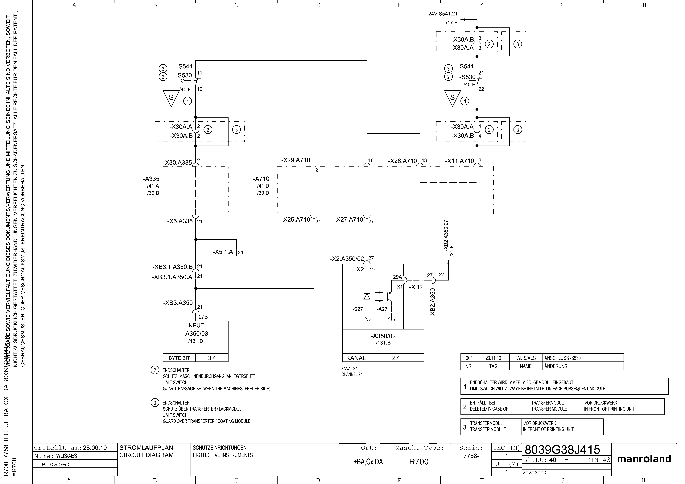

# +BA_Cx_DA — Sheet 40 of 247 — SCHUTZEINRICHTUNGEN

**PROTECTIVE INSTRUMENTS**

> Part of the manroland **R700** printing press IEC/UL circuit diagrams.
> Drawing class: **Stromlaufplan / Circuit diagram** (DIN A3).
> Document `+BA_Cx_DA` covers the **Printing units / main switch cabinet** machine section.

## At a glance

| Field | Value |
|---|---|
| Document | `+BA_Cx_DA`  (8039G38J415) |
| Sheet | **40** of 247 |
| Section (DE) | SCHUTZEINRICHTUNGEN |
| Section (EN) | PROTECTIVE INSTRUMENTS |
| Section type | CIRCUIT — Circuit diagram |
| Machine type | `R700` |
| Series | `7758` |
| Created | 28.06.10 |
| Replaces | — |
| Columns used | B, C, D, E, F, G, H |
| Path numbers | — |
| Labels on sheet | 126 |
| Cross-refs out | 10 |
| Cross-refs in | 30 |

**Previous:** [+BA_Cx_DA sheet 39](SHEET_0039.md) · **Next:** [+BA_Cx_DA sheet 41](SHEET_0041.md) · **Document TOC:** [_TOC.md](_TOC.md)  (+BA_Cx_DA) · **Master TOC:** [all sheets](../_MASTER_TOC.md)

## Sheet image (300 DPI, exact vector render)



_Rendered directly from the PDF vector layer at 300 DPI (1-bit), no OCR and no resampling. Use it to confirm anything ambiguous in the text below._

## Cross-references on this sheet

Each entry is a wire leaving this sheet. The printed token is `/sheet.column`; the link resolves to that sheet inside the same document.

| Ref | Target sheet | Col | Path | Destination on target | Target section | From col |
|---|---|---|---|---|---|---|
| `/17.E` | [+BA_Cx_DA sheet 17](SHEET_0017.md) | E | — | — | SPANNUNGSVERSORGUNG, SCHALTSCHRANKBELÜFTUNG | F |
| `/40.B` | [+BA_Cx_DA sheet 40](SHEET_0040.md) | B | — | — | SCHUTZEINRICHTUNGEN | F |
| `/40.F` | [+BA_Cx_DA sheet 40](SHEET_0040.md) | F | — | — | SCHUTZEINRICHTUNGEN | B |
| `/41.A` | [+BA_Cx_DA sheet 41](SHEET_0041.md) | A | — | — | SCHUTZEINRICHTUNGEN | B |
| `/39.B` | [+BA_Cx_DA sheet 39](SHEET_0039.md) | B | — | — | SCHUTZEINRICHTUNGEN | B |
| `/41.D` | [+BA_Cx_DA sheet 41](SHEET_0041.md) | D | — | — | SCHUTZEINRICHTUNGEN | C |
| `/39.D` | [+BA_Cx_DA sheet 39](SHEET_0039.md) | D | — | — | SCHUTZEINRICHTUNGEN | C |
| `/20.F` | [+BA_Cx_DA sheet 20](SHEET_0020.md) | F | — | XB2.A350:27 | BUSVERBINDUNGEN: SICHERHEITSBUS | F |
| `/131.D` | [+BA_Cx_DA sheet 131](SHEET_0131.md) | D | — | — | REFERENZMODUL | B |
| `/131.B` | [+BA_Cx_DA sheet 131](SHEET_0131.md) | B | — | — | REFERENZMODUL | E |

### Incoming references (sheets that point here)

Every other sheet that sends a wire to this one. `Back-ref` is the token printed on *that* sheet; `Path` is its line number.

| From sheet | Cols | Back-ref | Path | Refs | What continues there |
|---|---|---|---|---|---|
| [+BA_Cx_DA#17](SHEET_0017.md) | E | `/17.E` | — | 1 | 24V.S541:21 |
| [+BA_Cx_DA#20](SHEET_0020.md) | F | `/20.F` | — | 1 | XB2.A350:27 |
| [+BA_Cx_DA#39](SHEET_0039.md) | B, D | `/39.B`, `/39.D` | — | 2 | — |
| [+BA_Cx_DA#40](SHEET_0040.md) | B, F | `/40.B`, `/40.F` | — | 2 | — |
| [+BA_Cx_DA#41](SHEET_0041.md) | A, D | `/41.A`, `/41.D` | — | 2 | — |
| [+BA_Cx_DA#131](SHEET_0131.md) | B, D | `/131.B`, `/131.D` | — | 2 | — |
| [+BA_Cx_DA#153](SHEET_0153.md) | G | `/153.G` | — | 2 | — |
| [+BA_Cx_DA#157](SHEET_0157.md) | C, D, F | `/157.C`, `/157.D`, `/157.F` | — | 3 | — |
| [+BA_Cx_DA#160](SHEET_0160.md) | C | `/160.C` | — | 1 | — |
| [+BA_Cx_DA#161](SHEET_0161.md) | A | `/161.A` | — | 1 | — |
| [+BA_Cx_DA#168](SHEET_0168.md) | H | `/168.H` | — | 1 | — |
| [+BA_Cx_DA#175](SHEET_0175.md) | H | `/175.H` | — | 1 | — |
| [+BA_Cx_DA#177](SHEET_0177.md) | F | `/177.F` | — | 1 | — |
| [+BA_Cx_DA#178](SHEET_0178.md) | H | `/178.H` | — | 1 | — |
| [+BA_Cx_DA#179](SHEET_0179.md) | B, E | `/179.B`, `/179.E` | — | 9 | — |


## Devices on this sheet

| Tag | Class | Class meaning (IEC) | Col | Sub | Terminal | Sign |
|---|---|---|---|---|---|---|
| `S530` | S | Schalter / switch | B | — | — | — |
| `A335` | A | Baugruppe / assembly, module, PC board | B | — | — | — |
| `A710` | A | Baugruppe / assembly, module, PC board | C | — | — | — |
| `S530` | S | Schalter / switch | F | — | — | — |
| `A350/03` | A | Baugruppe / assembly, module, PC board | B | 03 | — | — |
| `S27` | S | Schalter / switch | D | — | — | — |
| `A27` | A | Baugruppe / assembly, module, PC board | E | — | — | — |
| `X1` | X | Klemme / terminal, plug connector | E | — | — | — |
| `X2` | X | Klemme / terminal, plug connector | E | — | — | — |
| `XB2` | XB |  | E | — | — | — |
| `A350/02` | A | Baugruppe / assembly, module, PC board | E | 02 | — | — |
| `S541` | S | Schalter / switch | B | — | — | — |
| `S541` | S | Schalter / switch | F | — | — | — |
| `X5.A335` | — | cross-device reference | B | — | — | — |
| `X30.A335` | — | cross-device reference | B | — | — | — |
| `X27.A710` | — | cross-device reference | D | — | — | — |
| `X25.A710` | — | cross-device reference | D | — | — | — |
| `X28.A710` | — | cross-device reference | E | — | — | — |
| `X11.A710` | — | cross-device reference | F | — | — | — |
| `X30A.A` | — | cross-device reference | B | — | — | — |
| `X30A.B` | — | cross-device reference | B | — | — | — |
| `X30A.A` | — | cross-device reference | F | — | — | — |
| `X30A.B` | — | cross-device reference | F | — | — | — |
| `X5.1.A` | — | cross-device reference | C | — | — | — |
| `3.4` | — | cross-device reference | C | — | — | — |
| `XB3.A350` | — | cross-device reference | B | — | — | — |
| `XB3.1.A350.B` | — | cross-device reference | B | — | — | — |
| `XB3.1.A350.A` | — | cross-device reference | B | — | — | — |
| `XB2.A350` | — | cross-device reference | E | — | — | — |
| `X30A.A` | — | cross-device reference | F | — | — | — |
| `X30A.B` | — | cross-device reference | F | — | — | — |
| `NR.` | — | cross-device reference | F | — | — | — |
| `23.11.10` | — | cross-device reference | F | — | — | — |
| `XB2.A350:27` | — | cross-device reference | F | — | 27 | — |
| `X29.A710` | — | cross-device reference | D | — | — | — |

## Potentials / nets

| Potential | Count | Columns | Attached devices | Terminals |
|---|---|---|---|---|
| `24V` | 1 | F | `S541` | `21` |


A potential such as `L24+/4` or `M24+` is a named supply/return rail; every place it appears on this sheet is electrically common.

## Wire-end annotations (grouped as printed)

A wire that continues elsewhere is annotated with a small cluster: the destination description, the path/line number `#NN`, and the `/sheet.column` cross reference. Each row below is one such cluster exactly as it is grouped on the drawing.

| Col | Y | Path | Cross-ref | Text on the wire |
|---|---|---|---|---|
| F | 20.1 | — | — | `24V.S541:21` |
| F | 35.7 | — | `/17.E` | — |
| F | 62.7 | — | — | `X30A.B 3` |
| F | 74.0 | — | — | `2 3` |
| F | 78.3 | — | — | `X30A.A 3` |
| B | 110.8 | — | — | `S541` |
| F | 110.8 | — | — | `3 S541` |
| B | 116.5 | — | — | `3` |
| C | 122.9 | — | — | `11` |
| F | 122.9 | — | — | `21` |
| B | 126.4 | — | — | `S530` |
| F | 129.3 | — | — | `S530` |
| B | 130.7 | — | — | `2` |
| F | 130.7 | — | — | `2` |
| F | 143.0 | — | `/40.B` | — |
| C | 151.3 | — | — | `12` |
| F | 151.3 | — | — | `22` |
| B | 151.9 | — | `/40.F` | — |
| B | 164.1 | — | — | `S` |
| F | 164.1 | — | — | `S` |
| B | 172.7 | — | — | `1` |
| F | 172.7 | — | — | `1` |
| B | 215.8 | — | — | `X30A.A 2` |
| F | 215.8 | — | — | `X30A.A 4` |
| C | 222.8 | — | — | `2 3` |
| F | 222.8 | — | — | `2 3` |
| B | 231.3 | — | — | `X30A.B 2` |
| F | 231.3 | — | — | `X30A.B 4` |
| D | 273.9 | — | — | `X29.A710` |
| B | 275.3 | — | — | `X30.A335 2` |
| E | 275.3 | — | — | `10` |
| E | 275.3 | — | — | `X28.A710 43 X11.A710 2` |
| D | 292.3 | — | — | `A710 9` |
| B | 306.4 | — | — | `A335` |
| B | 319.5 | — | `/41.A`, `/39.B` | — |
| C | 319.5 | — | `/41.D`, `/39.D` | — |
| D | 377.3 | — | — | `X25.A710 21 X27.A710 27` |
| B | 380.1 | — | — | `X5.A335 21` |
| F | 382.1 | — | `/20.F` | `XB2.A350:27` |
| C | 433.3 | — | — | `X5.1.A 21` |
| D | 445.4 | — | — | `X2.A350/02 27` |
| B | 459.5 | — | — | `XB3.1.A350.B 21` |
| E | 463.8 | — | — | `X2` |
| E | 465.2 | — | — | `27 27` |
| F | 473.7 | — | — | `27` |
| B | 476.5 | — | — | `XB3.1.A350.A 21` |
| E | 477.9 | — | — | `29A` |
| E | 494.9 | — | — | `X1` |
| E | 495.0 | — | — | `XB2` |
| E | 501.2 | — | — | `XB2.A350` |
| B | 521.9 | — | — | `XB3.A350 21` |
| E | 533.9 | — | — | `S27 A27` |
| C | 547.4 | — | — | `27B` |
| B | 561.9 | — | — | `INPUT` |
| B | 575.7 | — | — | `A350/03` |
| E | 580.0 | — | — | `A350/02` |
| B | 589.5 | — | `/131.D` | — |
| E | 592.4 | — | `/131.B` | — |
| E | 618.2 | — | — | `KANAL 27` |
| B | 618.6 | — | — | `BYTE.BIT 3.4` |
| G | 619.6 | — | — | `001 23.11.10 WLIS/AES ANSCHLUSS S530` |
| F | 633.8 | — | — | `NR. TAG NAME ÄNDERUNG` |
| D | 638.6 | — | — | `KANAL 27 CHANNEL 27` |
| B | 640.9 | — | — | `2` |
| B | 641.2 | — | — | `ENDSCHALTER:` |
| C | 651.9 | — | — | `LIMIT SWITCH: SCHUTZ: MASCHINENDURCHGANG (ANLEGERSEITE)` |
| G | 662.5 | — | — | `1 ENDSCHALTER WIRD IMMER IM FOLGEMODUL EINGEBAUT LIMIT SWITCH WILL ALWAYS BE INSTALLED IN EACH SUBSEQUENT MODULE` |
| C | 673.1 | — | — | `GUARD: PASSAGE BETWEEN THE MACHINES (FEEDER SIDE)` |
| B | 697.6 | — | — | `3` |
| B | 697.9 | — | — | `ENDSCHALTER:` |
| F | 697.9 | — | — | `2 ENTFÄLLT BEI DELETED IN CASE OF` |
| G | 697.9 | — | — | `TRANSFERMODUL TRANSFER MODULE IN FRONT OF PRINTING UNIT VOR DRUCKWERK` |
| C | 708.6 | — | — | `LIMIT SWITCH: SCHUTZ ÜBER TRANSFERTER / LACKMODUL` |
| C | 729.9 | — | — | `GUARD OVER TRANSFERTER / COATING MODULE` |
| F | 733.4 | — | — | `3 TRANSFERMODUL TRANSFER MODULE IN FRONT OF PRINTING UNIT VOR DRUCKWERK` |


## Reconstructed tables

This sheet carries tabular content (pin map / terminal assignment / index). The grid below was rebuilt from the drawing's own rule lines, so each row is exactly one physical row of the table.

### Table 1 — 6 data rows × 2 columns (at x=283.5, y=104.9)

| S541 S530 /40.F S 1 | 11 12 |
|---|---|
| `X30A.A X30A.B` | `2 2 2` |
| `X30.A335 X5.A335` | `2 21` |
| `XB3.1.A350.B XB3.1.A350.A` | `X5.1.A 21 21` |
| `XB3.A350` | `21 27B` |
| `INPUT` | `A350/03 /131.D` |
| `BYTE.BIT` | `3.4` |


### Table 2 — 5 data rows × 5 columns (at x=545.7, y=48.2)

| 9 |  | 10 | X28.A710 |  |
|---|---|---|---|---|
| `21` | `X27.A710 X2.A350/02` | `27 27` |  |  |
|  | `X2` | `27` | `29A X1` | `XB2` |
|  | `S27` | `A27` |  |  |
|  |  | `A350/02 /131.B` |  |  |
|  | `KANAL` |  | `27` |  |


### Table 3 — 8 data rows × 3 columns (at x=737.0, y=48.2)

|  | X30A.B X30A.A | 3 2 3 |
|---|---|---|
|  | `S541 3 S530 2 /40.B S 1` | `21 22` |
|  | `X30A.A` | `4 2` |
|  | `X30A.B` | `4` |
| `43` | `X11.A710` | `2` |
| `XB2.A350:27` | `/20.F` |  |
| `27 27` |  |  |
| `XB2.A350` |  |  |
|  | `001` | `23.11.10` |


## Notes and free text on this sheet

| Text | Col | Y (pt) |
|---|---|---|
| `27B` | C | 547.37 |
| `INPUT` | B | 561.9 |
| `BYTE.BIT` | B | 619.15 |
| `ENDSCHALTER:` | B | 641.25 |
| `SCHUTZ: MASCHINENDURCHGANG (ANLEGERSEITE)` | C | 651.91 |
| `LIMIT SWITCH:` | B | 662.46 |
| `GUARD: PASSAGE BETWEEN THE MACHINES (FEEDER SIDE)` | C | 673.14 |
| `KANAL 27` | D | 638.58 |
| `CHANNEL 27` | D | 648.52 |
| `29A` | E | 477.92 |
| `KANAL` | D | 618.25 |
| `X2.A350/02` | D | 445.35 |
| `TAG` | F | 633.88 |
| `NAME` | G | 633.87 |
| `ÄNDERUNG` | G | 633.92 |
| `WLIS/AES` | G | 619.69 |
| `ANSCHLUSS S530` | G | 619.76 |
| `S` | B | 164.08 |
| `S` | F | 164.08 |
| `ENDSCHALTER WIRD IMMER IM FOLGEMODUL EINGEBAUT` | F | 662.52 |
| `LIMIT SWITCH WILL ALWAYS BE INSTALLED IN EACH SUBSEQUENT MODULE` | G | 673.13 |
| `ENTFÄLLT BEI` | F | 697.91 |
| `DELETED IN CASE OF` | F | 708.57 |
| `VOR DRUCKWERK` | G | 697.94 |
| `IN FRONT OF PRINTING UNIT` | H | 708.58 |
| `TRANSFERMODUL` | G | 697.98 |
| `TRANSFER MODULE` | G | 708.6 |
| `IN FRONT OF PRINTING UNIT` | G | 744.02 |
| `TRANSFERMODUL` | F | 733.41 |
| `TRANSFER MODULE` | F | 744.03 |
| `SCHUTZ ÜBER TRANSFERTER / LACKMODUL` | C | 708.6 |
| `GUARD OVER TRANSFERTER / COATING MODULE` | C | 729.86 |

## Complete label inventory (exact text from the drawing)

Every text object inside the drawing area of this sheet, in DIN reading order (column A→H, then top→bottom). This is the authoritative list: if a string is not here it is not printed on this sheet.

| Col | Y | X | Dir | Type | Text |
|---|---|---|---|---|---|
| B | 110.9 | 306.7 | → | device tag | `S541` |
| B | 116.5 | 281.5 | → | number | `3` |
| B | 126.4 | 305.3 | → | device tag | `S530` |
| B | 130.7 | 281.5 | → | number | `2` |
| B | 151.9 | 311.8 | → | cross-reference | `/40.F` |
| B | 164.1 | 293.5 | → | text | `S` |
| B | 172.7 | 324.2 | → | number | `1` |
| B | 215.8 | 294.8 | → | device ref | `X30A.A` |
| B | 231.3 | 295.7 | → | device ref | `X30A.B` |
| B | 278.1 | 283.5 | → | device ref | `X30.A335` |
| B | 306.4 | 248.6 | → | device tag | `A335` |
| B | 319.5 | 255.7 | → | cross-reference | `/41.A` |
| B | 331.9 | 256.0 | → | cross-reference | `/39.B` |
| B | 380.2 | 290.8 | → | device ref | `X5.A335` |
| B | 459.5 | 265.0 | → | device ref | `XB3.1.A350.B` |
| B | 477.2 | 264.2 | → | device ref | `XB3.1.A350.A` |
| B | 521.9 | 283.7 | → | device ref | `XB3.A350` |
| B | 561.9 | 325.3 | → | text | `INPUT` |
| B | 575.7 | 318.8 | → | device tag | `A350/03` |
| B | 589.5 | 327.4 | → | cross-reference | `/131.D` |
| B | 619.1 | 293.4 | → | text | `BYTE.BIT` |
| B | 640.9 | 267.3 | → | number | `2` |
| B | 641.2 | 282.6 | → | text | `ENDSCHALTER:` |
| B | 662.5 | 282.6 | → | text | `LIMIT SWITCH:` |
| B | 697.6 | 267.3 | → | number | `3` |
| B | 697.9 | 282.6 | → | text | `ENDSCHALTER:` |
| B | 719.2 | 282.6 | → | text | `LIMIT SWITCH:` |
| C | 122.9 | 342.1 | → | number | `11` |
| C | 151.3 | 342.1 | → | number | `12` |
| C | 215.8 | 342.7 | → | number | `2` |
| C | 222.8 | 359.4 | → | number | `2` |
| C | 222.8 | 409.0 | → | number | `3` |
| C | 232.8 | 342.7 | → | number | `2` |
| C | 275.3 | 342.7 | → | number | `2` |
| C | 306.4 | 439.9 | → | device tag | `A710` |
| C | 319.5 | 447.0 | → | cross-reference | `/41.D` |
| C | 331.9 | 447.0 | → | cross-reference | `/39.D` |
| C | 381.6 | 342.7 | → | number | `21` |
| C | 433.3 | 369.9 | → | device ref | `X5.1.A` |
| C | 435.4 | 413.6 | → | number | `21` |
| C | 459.5 | 342.7 | → | number | `21` |
| C | 476.5 | 342.7 | → | number | `21` |
| C | 530.4 | 342.7 | → | number | `21` |
| C | 547.4 | 345.5 | → | text | `27B` |
| C | 618.6 | 361.7 | → | device ref | `3.4` |
| C | 651.9 | 283.2 | → | text | `SCHUTZ: MASCHINENDURCHGANG (ANLEGERSEITE)` |
| C | 673.1 | 283.2 | → | text | `GUARD: PASSAGE BETWEEN THE MACHINES (FEEDER SIDE)` |
| C | 708.6 | 283.2 | → | text | `SCHUTZ ÜBER TRANSFERTER / LACKMODUL` |
| C | 729.9 | 283.2 | → | text | `GUARD OVER TRANSFERTER / COATING MODULE` |
| D | 273.8 | 489.0 | → | device ref | `X29.A710` |
| D | 292.3 | 548.2 | → | number | `9` |
| D | 377.3 | 489.0 | → | device ref | `X25.A710` |
| D | 377.3 | 581.1 | → | device ref | `X27.A710` |
| D | 381.6 | 548.2 | → | number | `21` |
| D | 445.3 | 573.7 | → | text | `X2.A350/02` |
| D | 533.9 | 612.6 | → | device tag | `S27` |
| D | 618.3 | 601.5 | → | text | `KANAL` |
| D | 638.6 | 593.3 | → | text | `KANAL 27` |
| D | 648.5 | 593.6 | → | text | `CHANNEL 27` |
| E | 275.3 | 639.8 | → | number | `10` |
| E | 275.3 | 674.6 | → | device ref | `X28.A710` |
| E | 275.3 | 732.5 | → | number | `43` |
| E | 381.6 | 640.3 | → | number | `27` |
| E | 445.4 | 640.3 | → | number | `27` |
| E | 463.8 | 616.3 | → | device tag | `X2` |
| E | 465.2 | 643.2 | → | number | `27` |
| E | 475.1 | 742.4 | → | number | `27` |
| E | 477.9 | 683.1 | → | text | `29A` |
| E | 494.9 | 686.8 | → | device tag | `X1` |
| E | 495.0 | 711.2 | → | device tag | `XB2` |
| E | 501.2 | 747.2 | ↕ | device ref | `XB2.A350` |
| E | 533.9 | 655.1 | → | device tag | `A27` |
| E | 580.0 | 644.7 | → | device tag | `A350/02` |
| E | 592.4 | 653.5 | → | cross-reference | `/131.B` |
| E | 618.2 | 681.6 | → | number | `27` |
| F | 20.1 | 741.8 | → | potential | `24V.S541:21` |
| F | 35.7 | 775.0 | → | cross-reference | `/17.E` |
| F | 62.7 | 831.7 | → | number | `3` |
| F | 64.1 | 784.6 | → | device ref | `X30A.B` |
| F | 74.0 | 848.4 | → | number | `2` |
| F | 74.0 | 898.0 | → | number | `3` |
| F | 78.3 | 783.8 | → | device ref | `X30A.A` |
| F | 79.7 | 831.7 | → | number | `3` |
| F | 110.9 | 795.7 | → | device tag | `S541` |
| F | 116.5 | 777.5 | → | number | `3` |
| F | 122.9 | 831.7 | → | number | `21` |
| F | 129.3 | 798.5 | → | device tag | `S530` |
| F | 130.7 | 777.5 | → | number | `2` |
| F | 143.0 | 805.9 | → | cross-reference | `/40.B` |
| F | 151.3 | 831.7 | → | number | `22` |
| F | 164.1 | 782.5 | → | text | `S` |
| F | 172.7 | 806.1 | → | number | `1` |
| F | 215.8 | 783.8 | → | device ref | `X30A.A` |
| F | 215.8 | 831.7 | → | number | `4` |
| F | 222.8 | 848.4 | → | number | `2` |
| F | 222.8 | 898.0 | → | number | `3` |
| F | 231.3 | 784.6 | → | device ref | `X30A.B` |
| F | 232.8 | 831.7 | → | number | `4` |
| F | 275.3 | 773.9 | → | device ref | `X11.A710` |
| F | 275.3 | 831.7 | → | number | `2` |
| F | 382.1 | 771.3 | ↕ | device ref | `XB2.A350:27` |
| F | 426.3 | 781.2 | ↕ | cross-reference | `/20.F` |
| F | 473.7 | 763.1 | → | number | `27` |
| F | 619.6 | 809.7 | → | number | `001` |
| F | 619.8 | 843.9 | → | device ref | `23.11.10` |
| F | 633.8 | 808.8 | → | device ref | `NR.` |
| F | 633.9 | 850.4 | → | text | `TAG` |
| F | 662.5 | 816.9 | → | text | `ENDSCHALTER WIRD IMMER IM FOLGEMODUL EINGEBAUT` |
| F | 667.8 | 805.3 | → | number | `1` |
| F | 697.9 | 816.9 | → | text | `ENTFÄLLT BEI` |
| F | 703.3 | 805.0 | → | number | `2` |
| F | 708.6 | 816.9 | → | text | `DELETED IN CASE OF` |
| F | 733.4 | 817.5 | → | text | `TRANSFERMODUL` |
| F | 738.7 | 804.9 | → | number | `3` |
| F | 744.0 | 817.5 | → | text | `TRANSFER MODULE` |
| G | 619.7 | 897.7 | → | text | `WLIS/AES` |
| G | 619.8 | 946.3 | → | text | `ANSCHLUSS S530` |
| G | 633.9 | 903.8 | → | text | `NAME` |
| G | 633.9 | 946.3 | → | text | `ÄNDERUNG` |
| G | 673.1 | 816.9 | → | text | `LIMIT SWITCH WILL ALWAYS BE INSTALLED IN EACH SUBSEQUENT MODULE` |
| G | 697.9 | 1016.2 | → | text | `VOR DRUCKWERK` |
| G | 698.0 | 923.8 | → | text | `TRANSFERMODUL` |
| G | 708.6 | 923.8 | → | text | `TRANSFER MODULE` |
| G | 733.4 | 909.9 | → | text | `VOR DRUCKWERK` |
| G | 744.0 | 909.1 | → | text | `IN FRONT OF PRINTING UNIT` |
| H | 708.6 | 1015.4 | → | text | `IN FRONT OF PRINTING UNIT` |

## Reading-order text block

The same content as a plain block, grouped by DIN column — convenient to paste or to match against a visual description.

```text
=== Column B ===
 110.9  306.7  devtag       S541
 116.5  281.5  numeric      3
 126.4  305.3  devtag       S530
 130.7  281.5  numeric      2
 151.9  311.8  xref         /40.F
 164.1  293.5  text         S
 172.7  324.2  numeric      1
 215.8  294.8  devref       X30A.A
 231.3  295.7  devref       X30A.B
 278.1  283.5  devref       X30.A335
 306.4  248.6  devtag       A335
 319.5  255.7  xref         /41.A
 331.9  256.0  xref         /39.B
 380.2  290.8  devref       X5.A335
 459.5  265.0  devref       XB3.1.A350.B
 477.2  264.2  devref       XB3.1.A350.A
 521.9  283.7  devref       XB3.A350
 561.9  325.3  text         INPUT
 575.7  318.8  devtag       A350/03
 589.5  327.4  xref         /131.D
 619.1  293.4  text         BYTE.BIT
 640.9  267.3  numeric      2
 641.2  282.6  text         ENDSCHALTER:
 662.5  282.6  text         LIMIT SWITCH:
 697.6  267.3  numeric      3
 697.9  282.6  text         ENDSCHALTER:
 719.2  282.6  text         LIMIT SWITCH:
=== Column C ===
 122.9  342.1  numeric      11
 151.3  342.1  numeric      12
 215.8  342.7  numeric      2
 222.8  359.4  numeric      2
 222.8  409.0  numeric      3
 232.8  342.7  numeric      2
 275.3  342.7  numeric      2
 306.4  439.9  devtag       A710
 319.5  447.0  xref         /41.D
 331.9  447.0  xref         /39.D
 381.6  342.7  numeric      21
 433.3  369.9  devref       X5.1.A
 435.4  413.6  numeric      21
 459.5  342.7  numeric      21
 476.5  342.7  numeric      21
 530.4  342.7  numeric      21
 547.4  345.5  text         27B
 618.6  361.7  devref       3.4
 651.9  283.2  text         SCHUTZ: MASCHINENDURCHGANG (ANLEGERSEITE)
 673.1  283.2  text         GUARD: PASSAGE BETWEEN THE MACHINES (FEEDER SIDE)
 708.6  283.2  text         SCHUTZ ÜBER TRANSFERTER / LACKMODUL
 729.9  283.2  text         GUARD OVER TRANSFERTER / COATING MODULE
=== Column D ===
 273.8  489.0  devref       X29.A710
 292.3  548.2  numeric      9
 377.3  489.0  devref       X25.A710
 377.3  581.1  devref       X27.A710
 381.6  548.2  numeric      21
 445.3  573.7  text         X2.A350/02
 533.9  612.6  devtag       S27
 618.3  601.5  text         KANAL
 638.6  593.3  text         KANAL 27
 648.5  593.6  text         CHANNEL 27
=== Column E ===
 275.3  639.8  numeric      10
 275.3  674.6  devref       X28.A710
 275.3  732.5  numeric      43
 381.6  640.3  numeric      27
 445.4  640.3  numeric      27
 463.8  616.3  devtag       X2
 465.2  643.2  numeric      27
 475.1  742.4  numeric      27
 477.9  683.1  text         29A
 494.9  686.8  devtag       X1
 495.0  711.2  devtag       XB2
 501.2  747.2  devref       XB2.A350
 533.9  655.1  devtag       A27
 580.0  644.7  devtag       A350/02
 592.4  653.5  xref         /131.B
 618.2  681.6  numeric      27
=== Column F ===
  20.1  741.8  net          24V.S541:21
  35.7  775.0  xref         /17.E
  62.7  831.7  numeric      3
  64.1  784.6  devref       X30A.B
  74.0  848.4  numeric      2
  74.0  898.0  numeric      3
  78.3  783.8  devref       X30A.A
  79.7  831.7  numeric      3
 110.9  795.7  devtag       S541
 116.5  777.5  numeric      3
 122.9  831.7  numeric      21
 129.3  798.5  devtag       S530
 130.7  777.5  numeric      2
 143.0  805.9  xref         /40.B
 151.3  831.7  numeric      22
 164.1  782.5  text         S
 172.7  806.1  numeric      1
 215.8  783.8  devref       X30A.A
 215.8  831.7  numeric      4
 222.8  848.4  numeric      2
 222.8  898.0  numeric      3
 231.3  784.6  devref       X30A.B
 232.8  831.7  numeric      4
 275.3  773.9  devref       X11.A710
 275.3  831.7  numeric      2
 382.1  771.3  devref       XB2.A350:27
 426.3  781.2  xref         /20.F
 473.7  763.1  numeric      27
 619.6  809.7  numeric      001
 619.8  843.9  devref       23.11.10
 633.8  808.8  devref       NR.
 633.9  850.4  text         TAG
 662.5  816.9  text         ENDSCHALTER WIRD IMMER IM FOLGEMODUL EINGEBAUT
 667.8  805.3  numeric      1
 697.9  816.9  text         ENTFÄLLT BEI
 703.3  805.0  numeric      2
 708.6  816.9  text         DELETED IN CASE OF
 733.4  817.5  text         TRANSFERMODUL
 738.7  804.9  numeric      3
 744.0  817.5  text         TRANSFER MODULE
=== Column G ===
 619.7  897.7  text         WLIS/AES
 619.8  946.3  text         ANSCHLUSS S530
 633.9  903.8  text         NAME
 633.9  946.3  text         ÄNDERUNG
 673.1  816.9  text         LIMIT SWITCH WILL ALWAYS BE INSTALLED IN EACH SUBSEQUENT MODULE
 697.9 1016.2  text         VOR DRUCKWERK
 698.0  923.8  text         TRANSFERMODUL
 708.6  923.8  text         TRANSFER MODULE
 733.4  909.9  text         VOR DRUCKWERK
 744.0  909.1  text         IN FRONT OF PRINTING UNIT
=== Column H ===
 708.6 1015.4  text         IN FRONT OF PRINTING UNIT
```

---
_Generated from the PDF vector text layer; no OCR. Source: `R700_7758_IEC_UL_BA_CX_DA_8039G38J415_p`, sheet 40._
