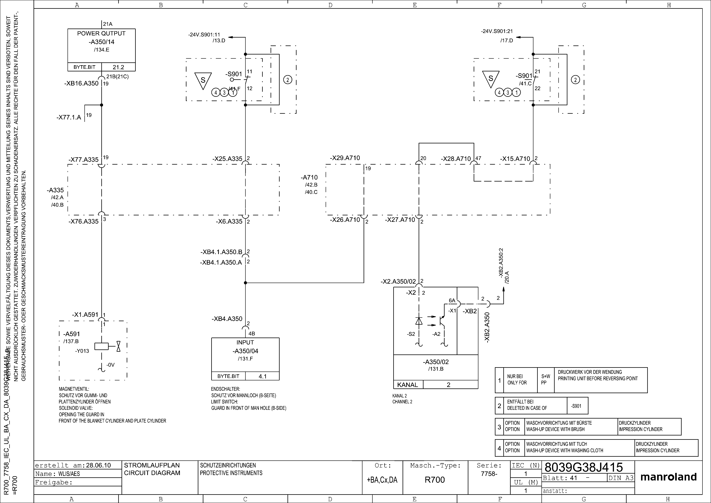

# +BA_Cx_DA — Sheet 41 of 247 — SCHUTZEINRICHTUNGEN

**PROTECTIVE INSTRUMENTS**

> Part of the manroland **R700** printing press IEC/UL circuit diagrams.
> Drawing class: **Stromlaufplan / Circuit diagram** (DIN A3).
> Document `+BA_Cx_DA` covers the **Printing units / main switch cabinet** machine section.

## At a glance

| Field | Value |
|---|---|
| Document | `+BA_Cx_DA`  (8039G38J415) |
| Sheet | **41** of 247 |
| Section (DE) | SCHUTZEINRICHTUNGEN |
| Section (EN) | PROTECTIVE INSTRUMENTS |
| Section type | CIRCUIT — Circuit diagram |
| Machine type | `R700` |
| Series | `7758` |
| Created | 28.06.10 |
| Replaces | — |
| Columns used | A, B, C, D, E, F, G, H |
| Path numbers | — |
| Labels on sheet | 132 |
| Cross-refs out | 13 |
| Cross-refs in | 31 |

**Previous:** [+BA_Cx_DA sheet 40](SHEET_0040.md) · **Next:** [+BA_Cx_DA sheet 42](SHEET_0042.md) · **Document TOC:** [_TOC.md](_TOC.md)  (+BA_Cx_DA) · **Master TOC:** [all sheets](../_MASTER_TOC.md)

## Sheet image (300 DPI, exact vector render)



_Rendered directly from the PDF vector layer at 300 DPI (1-bit), no OCR and no resampling. Use it to confirm anything ambiguous in the text below._

## Cross-references on this sheet

Each entry is a wire leaving this sheet. The printed token is `/sheet.column`; the link resolves to that sheet inside the same document.

| Ref | Target sheet | Col | Path | Destination on target | Target section | From col |
|---|---|---|---|---|---|---|
| `/13.D` | [+BA_Cx_DA sheet 13](SHEET_0013.md) | D | — | 24V.S901:11 | SPANNUNGSVERSORGUNG, SCHALTSCHRANKBELÜFTUNG | C |
| `/17.D` | [+BA_Cx_DA sheet 17](SHEET_0017.md) | D | — | — | SPANNUNGSVERSORGUNG, SCHALTSCHRANKBELÜFTUNG | F |
| `/134.E` | [+BA_Cx_DA sheet 134](SHEET_0134.md) | E | — | — | REFERENZMODUL | A |
| `/41.C` | [+BA_Cx_DA sheet 41](SHEET_0041.md) | C | — | — | SCHUTZEINRICHTUNGEN | F |
| `/41.F` | [+BA_Cx_DA sheet 41](SHEET_0041.md) | F | — | — | SCHUTZEINRICHTUNGEN | C |
| `/42.B` | [+BA_Cx_DA sheet 42](SHEET_0042.md) | B | — | — | SCHUTZEINRICHTUNGEN | D |
| `/40.C` | [+BA_Cx_DA sheet 40](SHEET_0040.md) | C | — | — | SCHUTZEINRICHTUNGEN | D |
| `/42.A` | [+BA_Cx_DA sheet 42](SHEET_0042.md) | A | — | — | SCHUTZEINRICHTUNGEN | A |
| `/40.B` | [+BA_Cx_DA sheet 40](SHEET_0040.md) | B | — | — | SCHUTZEINRICHTUNGEN | A |
| `/20.A` | [+BA_Cx_DA sheet 20](SHEET_0020.md) | A | — | XB2.A350:2 | BUSVERBINDUNGEN: SICHERHEITSBUS | F |
| `/137.B` | [+BA_Cx_DA sheet 137](SHEET_0137.md) | B | — | A591 | REFERENZMODUL | A |
| `/131.F` | [+BA_Cx_DA sheet 131](SHEET_0131.md) | F | — | — | REFERENZMODUL | C |
| `/131.B` | [+BA_Cx_DA sheet 131](SHEET_0131.md) | B | — | — | REFERENZMODUL | E |

### Incoming references (sheets that point here)

Every other sheet that sends a wire to this one. `Back-ref` is the token printed on *that* sheet; `Path` is its line number.

| From sheet | Cols | Back-ref | Path | Refs | What continues there |
|---|---|---|---|---|---|
| [+BA_Cx_DA#13](SHEET_0013.md) | D | `/13.D` | — | 1 | — |
| [+BA_Cx_DA#17](SHEET_0017.md) | C | `/17.C` | — | 1 | — |
| [+BA_Cx_DA#20](SHEET_0020.md) | A | `/20.A` | — | 1 | XB2.A350:2 |
| [+BA_Cx_DA#40](SHEET_0040.md) | B, C | `/40.B`, `/40.C` | — | 2 | — |
| [+BA_Cx_DA#41](SHEET_0041.md) | C, F | `/41.C`, `/41.F` | — | 2 | — |
| [+BA_Cx_DA#42](SHEET_0042.md) | A, B | `/42.A`, `/42.B` | — | 2 | — |
| [+BA_Cx_DA#131](SHEET_0131.md) | B, F | `/131.B`, `/131.F` | — | 2 | — |
| [+BA_Cx_DA#134](SHEET_0134.md) | E | `/134.E` | — | 1 | — |
| [+BA_Cx_DA#137](SHEET_0137.md) | B | `/137.B` | — | 1 | — |
| [+BA_Cx_DA#142](SHEET_0142.md) | B | `/142.B` | — | 1 | — |
| [+BA_Cx_DA#153](SHEET_0153.md) | F | `/153.F` | — | 2 | — |
| [+BA_Cx_DA#159](SHEET_0159.md) | F, G, H | `/159.F`, `/159.G`, `/159.H` | — | 3 | — |
| [+BA_Cx_DA#162](SHEET_0162.md) | D | `/162.D` | — | 1 | — |
| [+BA_Cx_DA#171](SHEET_0171.md) | H | `/171.H` | — | 1 | — |
| [+BA_Cx_DA#172](SHEET_0172.md) | F | `/172.F` | — | 1 | — |
| [+BA_Cx_DA#175](SHEET_0175.md) | F | `/175.F` | — | 1 | — |
| [+BA_Cx_DA#176](SHEET_0176.md) | E | `/176.E` | — | 1 | — |
| [+BA_Cx_DA#177](SHEET_0177.md) | E | `/177.E` | — | 1 | — |
| [+BA_Cx_DA#178](SHEET_0178.md) | H | `/178.H` | — | 1 | — |
| [+BA_Cx_DA#179](SHEET_0179.md) | B | `/179.B` | — | 2 | — |
| [+BA_Cx_DA#185](SHEET_0185.md) | C, E, G | `/185.C`, `/185.E`, `/185.G` | — | 3 | — |


## Devices on this sheet

| Tag | Class | Class meaning (IEC) | Col | Sub | Terminal | Sign |
|---|---|---|---|---|---|---|
| `A350/14` | A | Baugruppe / assembly, module, PC board | A | 14 | — | — |
| `S901` | S | Schalter / switch | C | — | — | — |
| `S901` | S | Schalter / switch | F | — | — | — |
| `S2` | S | Schalter / switch | E | — | — | — |
| `A2` | A | Baugruppe / assembly, module, PC board | E | — | — | — |
| `X1` | X | Klemme / terminal, plug connector | E | — | — | — |
| `X2` | X | Klemme / terminal, plug connector | E | — | — | — |
| `XB2` | XB |  | F | — | — | — |
| `A350/02` | A | Baugruppe / assembly, module, PC board | E | 02 | — | — |
| `A335` | A | Baugruppe / assembly, module, PC board | A | — | — | — |
| `A710` | A | Baugruppe / assembly, module, PC board | D | — | — | — |
| `Y013` | Y | Magnetventil / solenoid valve, actuator | A | — | — | — |
| `A591` | A | Baugruppe / assembly, module, PC board | A | — | — | — |
| `A350/04` | A | Baugruppe / assembly, module, PC board | C | 04 | — | — |
| `S901` | S | Schalter / switch | G | — | — | — |
| `21.2` | — | cross-device reference | A | — | — | — |
| `XB16.A350` | — | cross-device reference | A | — | — | — |
| `X77.1.A` | — | cross-device reference | A | — | — | — |
| `XB2.A350` | — | cross-device reference | F | — | — | — |
| `XB4.1.A350.B` | — | cross-device reference | C | — | — | — |
| `XB4.1.A350.A` | — | cross-device reference | C | — | — | — |
| `X76.A335` | — | cross-device reference | A | — | — | — |
| `X77.A335` | — | cross-device reference | A | — | — | — |
| `X6.A335` | — | cross-device reference | C | — | — | — |
| `X25.A335` | — | cross-device reference | C | — | — | — |
| `X27.A710` | — | cross-device reference | E | — | — | — |
| `X26.A710` | — | cross-device reference | D | — | — | — |
| `X28.A710` | — | cross-device reference | E | — | — | — |
| `X15.A710` | — | cross-device reference | F | — | — | — |
| `X1.A591` | — | cross-device reference | A | — | — | — |
| `4.1` | — | cross-device reference | C | — | — | — |
| `XB4.A350` | — | cross-device reference | C | — | — | — |
| `XB2.A350:2` | — | cross-device reference | F | — | 2 | — |
| `X29.A710` | — | cross-device reference | D | — | — | — |

## Potentials / nets

| Potential | Count | Columns | Attached devices | Terminals |
|---|---|---|---|---|
| `0V` | 1 | A | — | — |
| `24V` | 2 | C, F | `S901` | `11`, `21` |


A potential such as `L24+/4` or `M24+` is a named supply/return rail; every place it appears on this sheet is electrically common.

## Wire-end annotations (grouped as printed)

A wire that continues elsewhere is annotated with a small cluster: the destination description, the path/line number `#NN`, and the `/sheet.column` cross reference. Each row below is one such cluster exactly as it is grouped on the drawing.

| Col | Y | Path | Cross-ref | Text on the wire |
|---|---|---|---|---|
| A | 36.4 | — | — | `21A` |
| F | 48.5 | — | — | `24V.S901:21` |
| A | 51.6 | — | — | `POWER QUTPUT` |
| C | 54.1 | — | `/13.D` | `24V.S901:11` |
| F | 64.1 | — | `/17.D` | — |
| A | 65.5 | — | — | `A350/14` |
| A | 79.3 | — | `/134.E` | — |
| A | 108.3 | — | — | `BYTE.BIT 21.2` |
| E | 115.8 | — | — | `S901 21` |
| C | 115.8 | — | — | `11` |
| F | 122.2 | — | — | `S901` |
| A | 124.3 | — | — | `21B(21C)` |
| F | 125.8 | — | — | `S` |
| C | 128.7 | — | — | `S 2` |
| G | 130.7 | — | — | `2` |
| A | 134.9 | — | — | `XB16.A350 19` |
| F | 136.0 | — | `/41.C` | — |
| C | 144.2 | — | — | `12` |
| F | 144.2 | — | — | `22` |
| C | 144.8 | — | `/41.F` | — |
| C | 151.4 | — | — | `4 3 1` |
| F | 151.4 | — | — | `4 3 1` |
| A | 188.8 | — | — | `X77.1.A 19` |
| A | 259.7 | — | — | `X77.A335 19` |
| D | 259.7 | — | — | `X29.A710` |
| D | 261.1 | — | — | `X25.A335 2 20` |
| F | 261.1 | — | — | `X28.A710 47 X15.A710 2` |
| D | 278.1 | — | — | `A710 19` |
| D | 305.3 | — | `/42.B`, `/40.C` | — |
| A | 313.5 | — | — | `A335` |
| A | 326.6 | — | `/42.A`, `/40.B` | — |
| E | 363.1 | — | — | `X26.A710 2 X27.A710 2` |
| A | 363.2 | — | — | `X76.A335 3` |
| C | 366.0 | — | — | `X6.A335 2` |
| F | 415.3 | — | `/20.A` | `XB2.A350:2` |
| C | 417.0 | — | — | `XB4.1.A350.B 2` |
| C | 434.0 | — | — | `XB4.1.A350.A 2` |
| E | 466.6 | — | — | `X2.A350/02 2` |
| E | 485.1 | — | — | `X2` |
| E | 486.5 | — | — | `2 2` |
| F | 495.0 | — | — | `2` |
| E | 499.2 | — | — | `6A` |
| E | 516.2 | — | — | `X1` |
| F | 516.2 | — | — | `XB2` |
| A | 521.9 | — | — | `X1.A591 1` |
| F | 522.4 | — | — | `XB2.A350` |
| C | 529.0 | — | — | `XB4.A350 2` |
| A | 538.9 | — | — | `1` |
| C | 554.4 | — | — | `4B` |
| A | 554.5 | — | `/137.B` | `A591` |
| E | 555.2 | — | — | `S2 A2` |
| C | 569.0 | — | — | `INPUT` |
| C | 582.8 | — | — | `A350/04` |
| A | 583.5 | — | — | `Y013` |
| C | 596.6 | — | `/131.F` | — |
| E | 601.2 | — | — | `A350/02` |
| A | 606.9 | — | — | `0V` |
| E | 613.6 | — | `/131.B` | — |
| G | 620.0 | — | — | `DRUCKWERK VOR DER WENDUNG PRINTING UNIT BEFORE REVERSING POINT` |
| C | 625.6 | — | — | `BYTE.BIT 4.1` |
| F | 626.9 | — | — | `1 ONLY FOR PP S+W` |
| F | 627.0 | — | — | `NUR BEI` |
| E | 639.5 | — | — | `KANAL 2` |
| A | 648.3 | — | — | `PLATTENZYLINDER ÖFFNEN MAGNETVENTIL: SCHUTZ VOR GUMMI UND` |
| C | 648.3 | — | — | `ENDSCHALTER:` |
| C | 659.0 | — | — | `LIMIT SWITCH: SCHUTZ VOR MANNLOCH (B SEITE)` |
| E | 659.8 | — | — | `KANAL 2 CHANNEL 2` |
| F | 669.6 | — | — | `2 ENTFÄLLT BEI DELETED IN CASE OF S901` |
| A | 680.2 | — | — | `FRONT OF THE BLANKET CYLINDER AND PLATE CYLINDER SOLENOID VALVE: OPENING THE GUARD IN` |
| C | 680.2 | — | — | `GUARD IN FRONT OF MAN HOLE (B SIDE)` |
| G | 705.0 | — | — | `3 OPTION OPTION WASCHVORRICHTUNG MIT BÜRSTE WASH UP DEVICE WITH BRUSH DRUCKZYLINDER IMPRESSION CYLINDER` |
| G | 740.4 | — | — | `4 OPTION OPTION WASCHVORRICHTUNG MIT TUCH WASH UP DEVICE WITH WASHING CLOTH` |
| H | 740.5 | — | — | `DRUCKZYLINDER IMPRESSION CYLINDER` |


## Reconstructed tables

This sheet carries tabular content (pin map / terminal assignment / index). The grid below was rebuilt from the drawing's own rule lines, so each row is exactly one physical row of the table.

### Table 1 — 1 data rows × 2 columns (at x=113.4, y=48.2)

| POWER | QUTPUT A350/14 /134.E |
|---|---|
| `BYTE.BIT` | `21.2` |


### Table 2 — 4 data rows × 2 columns (at x=354.3, y=90.7)

| S901 /41.F 1 4 3 | 11 12 |
|---|---|
| `X25.A335 X6.A335 XB4.1.A350.B XB4.1.A350.A` | `2 2 2 2` |
| `XB4.A350` | `2 4B` |
| `INPUT` | `A350/04 /131.F` |
| `BYTE.BIT` | `4.1` |


### Table 3 — 4 data rows × 5 columns (at x=609.4, y=90.7)

| 19 |  | 20 | X28.A710 |  |
|---|---|---|---|---|
| `2` | `X27.A710 X2.A350/02` | `2 2` |  |  |
|  | `X2 S2` | `2 A2` | `6A X1` | `XB2` |
|  |  | `A350/02 /131.B` |  |  |
|  | `KANAL` |  | `2` |  |


### Table 4 — 5 data rows × 2 columns (at x=800.8, y=90.7)

| S901 S /41.C 1 4 3 | 21 22 |
|---|---|
| `X15.A710 47` | `2` |
| `XB2.A350:2 /20.A` |  |
| `2 2 XB2.A350` |  |
| `NUR BEI` | `S+W PRINTING` |
| `1 ONLY FOR` | `PP` |


## Notes and free text on this sheet

| Text | Col | Y (pt) |
|---|---|---|
| `21A` | A | 36.43 |
| `21B(21C)` | A | 124.34 |
| `POWER QUTPUT` | A | 51.59 |
| `BYTE.BIT` | A | 108.91 |
| `KANAL 2` | E | 659.83 |
| `CHANNEL 2` | E | 669.77 |
| `6A` | E | 499.17 |
| `KANAL` | E | 639.51 |
| `X2.A350/02` | E | 466.61 |
| `MAGNETVENTIL:` | A | 648.33 |
| `SCHUTZ VOR GUMMI UND` | A | 659.01 |
| `PLATTENZYLINDER ÖFFNEN` | A | 669.61 |
| `SOLENOID VALVE:` | A | 680.22 |
| `OPENING THE GUARD IN` | A | 690.87 |
| `FRONT OF THE BLANKET CYLINDER AND PLATE CYLINDER` | A | 701.51 |
| `4B` | C | 554.44 |
| `INPUT` | C | 568.98 |
| `BYTE.BIT` | C | 626.23 |
| `ENDSCHALTER:` | C | 648.33 |
| `SCHUTZ VOR MANNLOCH (B SEITE)` | C | 658.99 |
| `LIMIT SWITCH:` | C | 669.55 |
| `GUARD IN FRONT OF MAN HOLE (B SIDE)` | C | 680.25 |
| `S` | B | 128.65 |
| `DRUCKZYLINDER` | H | 705.05 |
| `IMPRESSION CYLINDER` | H | 715.67 |
| `OPTION` | F | 705.01 |
| `WASCHVORRICHTUNG MIT BÜRSTE` | G | 705.04 |
| `WASH UP DEVICE WITH BRUSH` | G | 715.64 |
| `WASCHVORRICHTUNG MIT TUCH` | G | 740.48 |
| `WASH UP DEVICE WITH WASHING CLOTH` | G | 751.07 |
| `NUR BEI` | F | 627.04 |
| `ONLY FOR` | F | 637.72 |
| `S+W` | G | 626.94 |
| `PP` | G | 637.57 |
| `DRUCKWERK VOR DER WENDUNG` | G | 619.98 |
| `PRINTING UNIT BEFORE REVERSING POINT` | G | 630.63 |
| `ENTFÄLLT BEI` | F | 669.57 |
| `DELETED IN CASE OF` | F | 680.22 |
| `S` | F | 125.81 |

## Complete label inventory (exact text from the drawing)

Every text object inside the drawing area of this sheet, in DIN reading order (column A→H, then top→bottom). This is the authoritative list: if a string is not here it is not printed on this sheet.

| Col | Y | X | Dir | Type | Text |
|---|---|---|---|---|---|
| A | 36.4 | 172.6 | → | text | `21A` |
| A | 51.6 | 129.3 | → | text | `POWER QUTPUT` |
| A | 65.5 | 148.7 | → | device tag | `A350/14` |
| A | 79.3 | 157.6 | → | cross-reference | `/134.E` |
| A | 108.3 | 188.9 | → | device ref | `21.2` |
| A | 108.9 | 123.3 | → | text | `BYTE.BIT` |
| A | 124.3 | 178.3 | → | text | `21B(21C)` |
| A | 134.9 | 107.7 | → | device ref | `XB16.A350` |
| A | 136.4 | 172.1 | → | number | `19` |
| A | 188.8 | 143.7 | → | number | `19` |
| A | 191.7 | 94.7 | → | device ref | `X77.1.A` |
| A | 259.7 | 172.1 | → | number | `19` |
| A | 262.5 | 114.8 | → | device ref | `X77.A335` |
| A | 313.5 | 78.5 | → | device tag | `A335` |
| A | 326.6 | 85.6 | → | cross-reference | `/42.A` |
| A | 339.0 | 85.9 | → | cross-reference | `/40.B` |
| A | 363.2 | 172.6 | → | number | `3` |
| A | 366.0 | 114.8 | → | device ref | `X76.A335` |
| A | 521.9 | 120.8 | → | device ref | `X1.A591` |
| A | 523.3 | 172.1 | → | number | `1` |
| A | 538.9 | 172.1 | → | number | `1` |
| A | 554.5 | 106.0 | → | device tag | `A591` |
| A | 567.5 | 106.3 | → | cross-reference | `/137.B` |
| A | 583.5 | 125.9 | → | device tag | `Y013` |
| A | 606.9 | 178.3 | → | potential | `0V` |
| A | 648.3 | 98.6 | → | text | `MAGNETVENTIL:` |
| A | 659.0 | 98.9 | → | text | `SCHUTZ VOR GUMMI UND` |
| A | 669.6 | 98.4 | → | text | `PLATTENZYLINDER ÖFFNEN` |
| A | 680.2 | 98.9 | → | text | `SOLENOID VALVE:` |
| A | 690.9 | 98.9 | → | text | `OPENING THE GUARD IN` |
| A | 701.5 | 98.4 | → | text | `FRONT OF THE BLANKET CYLINDER AND PLATE CYLINDER` |
| B | 128.6 | 336.0 | → | text | `S` |
| C | 54.1 | 315.2 | → | potential | `24V.S901:11` |
| C | 64.1 | 356.3 | → | cross-reference | `/13.D` |
| C | 115.8 | 413.0 | → | number | `11` |
| C | 119.4 | 377.6 | → | device tag | `S901` |
| C | 130.7 | 479.9 | → | number | `2` |
| C | 144.2 | 413.0 | → | number | `12` |
| C | 144.8 | 382.7 | → | cross-reference | `/41.F` |
| C | 151.4 | 388.0 | → | number | `1` |
| C | 151.9 | 359.4 | → | number | `4` |
| C | 151.9 | 373.6 | → | number | `3` |
| C | 261.1 | 355.7 | → | device ref | `X25.A335` |
| C | 261.1 | 413.6 | → | number | `2` |
| C | 366.0 | 361.7 | → | device ref | `X6.A335` |
| C | 367.4 | 413.6 | → | number | `2` |
| C | 417.0 | 335.9 | → | device ref | `XB4.1.A350.B` |
| C | 417.0 | 413.6 | → | number | `2` |
| C | 434.0 | 413.6 | → | number | `2` |
| C | 434.7 | 335.1 | → | device ref | `XB4.1.A350.A` |
| C | 529.0 | 354.6 | → | device ref | `XB4.A350` |
| C | 537.5 | 413.6 | → | number | `2` |
| C | 554.4 | 416.4 | → | text | `4B` |
| C | 569.0 | 396.1 | → | text | `INPUT` |
| C | 582.8 | 389.6 | → | device tag | `A350/04` |
| C | 596.6 | 398.7 | → | cross-reference | `/131.F` |
| C | 625.7 | 433.4 | → | device ref | `4.1` |
| C | 626.2 | 364.3 | → | text | `BYTE.BIT` |
| C | 648.3 | 353.5 | → | text | `ENDSCHALTER:` |
| C | 659.0 | 354.0 | → | text | `SCHUTZ VOR MANNLOCH (B SEITE)` |
| C | 669.5 | 353.5 | → | text | `LIMIT SWITCH:` |
| C | 680.3 | 354.0 | → | text | `GUARD IN FRONT OF MAN HOLE (B SIDE)` |
| D | 259.7 | 552.8 | → | device ref | `X29.A710` |
| D | 278.1 | 611.4 | → | number | `19` |
| D | 292.3 | 503.7 | → | device tag | `A710` |
| D | 305.3 | 511.1 | → | cross-reference | `/42.B` |
| D | 317.8 | 510.8 | → | cross-reference | `/40.C` |
| D | 363.1 | 552.8 | → | device ref | `X26.A710` |
| D | 367.4 | 612.0 | → | number | `2` |
| E | 261.1 | 704.1 | → | number | `20` |
| E | 261.1 | 738.4 | → | device ref | `X28.A710` |
| E | 363.1 | 644.9 | → | device ref | `X27.A710` |
| E | 367.4 | 704.1 | → | number | `2` |
| E | 466.6 | 637.5 | → | text | `X2.A350/02` |
| E | 466.6 | 704.1 | → | number | `2` |
| E | 485.0 | 680.0 | → | device tag | `X2` |
| E | 486.5 | 707.0 | → | number | `2` |
| E | 499.2 | 751.7 | → | text | `6A` |
| E | 516.2 | 750.6 | → | device tag | `X1` |
| E | 555.2 | 681.4 | → | device tag | `S2` |
| E | 555.2 | 724.0 | → | device tag | `A2` |
| E | 601.2 | 708.5 | → | device tag | `A350/02` |
| E | 613.6 | 717.3 | → | cross-reference | `/131.B` |
| E | 639.5 | 665.3 | → | text | `KANAL` |
| E | 639.5 | 748.3 | → | number | `2` |
| E | 659.8 | 657.1 | → | text | `KANAL 2` |
| E | 669.8 | 657.4 | → | text | `CHANNEL 2` |
| F | 48.5 | 805.6 | → | potential | `24V.S901:21` |
| F | 64.1 | 838.2 | → | cross-reference | `/17.D` |
| F | 115.8 | 895.5 | → | number | `21` |
| F | 122.2 | 863.7 | → | device tag | `S901` |
| F | 125.8 | 817.9 | → | text | `S` |
| F | 136.0 | 869.4 | → | cross-reference | `/41.C` |
| F | 144.2 | 895.5 | → | number | `22` |
| F | 151.4 | 862.8 | → | number | `1` |
| F | 151.9 | 834.2 | → | number | `4` |
| F | 151.9 | 848.4 | → | number | `3` |
| F | 261.1 | 796.3 | → | number | `47` |
| F | 261.1 | 837.6 | → | device ref | `X15.A710` |
| F | 261.1 | 895.5 | → | number | `2` |
| F | 415.3 | 835.1 | ↕ | device ref | `XB2.A350:2` |
| F | 454.1 | 845.0 | ↕ | cross-reference | `/20.A` |
| F | 495.0 | 832.0 | → | number | `2` |
| F | 496.4 | 806.2 | → | number | `2` |
| F | 516.2 | 775.0 | → | device tag | `XB2` |
| F | 522.4 | 811.0 | ↕ | device ref | `XB2.A350` |
| F | 627.0 | 849.5 | → | text | `NUR BEI` |
| F | 632.4 | 833.7 | → | number | `1` |
| F | 637.7 | 850.1 | → | text | `ONLY FOR` |
| F | 669.6 | 849.5 | → | text | `ENTFÄLLT BEI` |
| F | 674.9 | 833.4 | → | number | `2` |
| F | 680.2 | 849.5 | → | text | `DELETED IN CASE OF` |
| F | 705.0 | 845.9 | → | text | `OPTION` |
| F | 710.3 | 833.2 | → | number | `3` |
| F | 715.6 | 845.9 | → | text | `OPTION` |
| F | 740.4 | 845.9 | → | text | `OPTION` |
| F | 745.8 | 833.4 | → | number | `4` |
| F | 751.1 | 845.9 | → | text | `OPTION` |
| G | 130.7 | 961.8 | → | number | `2` |
| G | 620.0 | 934.6 | → | text | `DRUCKWERK VOR DER WENDUNG` |
| G | 626.9 | 906.8 | → | text | `S+W` |
| G | 630.6 | 934.6 | → | text | `PRINTING UNIT BEFORE REVERSING POINT` |
| G | 637.6 | 906.2 | → | text | `PP` |
| G | 676.6 | 956.4 | → | device tag | `S901` |
| G | 705.0 | 881.6 | → | text | `WASCHVORRICHTUNG MIT BÜRSTE` |
| G | 715.6 | 881.6 | → | text | `WASH UP DEVICE WITH BRUSH` |
| G | 740.5 | 881.6 | → | text | `WASCHVORRICHTUNG MIT TUCH` |
| G | 751.1 | 881.6 | → | text | `WASH UP DEVICE WITH WASHING CLOTH` |
| H | 705.0 | 1036.6 | → | text | `DRUCKZYLINDER` |
| H | 715.7 | 1036.6 | → | text | `IMPRESSION CYLINDER` |
| H | 740.5 | 1065.0 | → | text | `DRUCKZYLINDER` |
| H | 751.1 | 1065.0 | → | text | `IMPRESSION CYLINDER` |

## Reading-order text block

The same content as a plain block, grouped by DIN column — convenient to paste or to match against a visual description.

```text
=== Column A ===
  36.4  172.6  text         21A
  51.6  129.3  text         POWER QUTPUT
  65.5  148.7  devtag       A350/14
  79.3  157.6  xref         /134.E
 108.3  188.9  devref       21.2
 108.9  123.3  text         BYTE.BIT
 124.3  178.3  text         21B(21C)
 134.9  107.7  devref       XB16.A350
 136.4  172.1  numeric      19
 188.8  143.7  numeric      19
 191.7   94.7  devref       X77.1.A
 259.7  172.1  numeric      19
 262.5  114.8  devref       X77.A335
 313.5   78.5  devtag       A335
 326.6   85.6  xref         /42.A
 339.0   85.9  xref         /40.B
 363.2  172.6  numeric      3
 366.0  114.8  devref       X76.A335
 521.9  120.8  devref       X1.A591
 523.3  172.1  numeric      1
 538.9  172.1  numeric      1
 554.5  106.0  devtag       A591
 567.5  106.3  xref         /137.B
 583.5  125.9  devtag       Y013
 606.9  178.3  net          0V
 648.3   98.6  text         MAGNETVENTIL:
 659.0   98.9  text         SCHUTZ VOR GUMMI UND
 669.6   98.4  text         PLATTENZYLINDER ÖFFNEN
 680.2   98.9  text         SOLENOID VALVE:
 690.9   98.9  text         OPENING THE GUARD IN
 701.5   98.4  text         FRONT OF THE BLANKET CYLINDER AND PLATE CYLINDER
=== Column B ===
 128.6  336.0  text         S
=== Column C ===
  54.1  315.2  net          24V.S901:11
  64.1  356.3  xref         /13.D
 115.8  413.0  numeric      11
 119.4  377.6  devtag       S901
 130.7  479.9  numeric      2
 144.2  413.0  numeric      12
 144.8  382.7  xref         /41.F
 151.4  388.0  numeric      1
 151.9  359.4  numeric      4
 151.9  373.6  numeric      3
 261.1  355.7  devref       X25.A335
 261.1  413.6  numeric      2
 366.0  361.7  devref       X6.A335
 367.4  413.6  numeric      2
 417.0  335.9  devref       XB4.1.A350.B
 417.0  413.6  numeric      2
 434.0  413.6  numeric      2
 434.7  335.1  devref       XB4.1.A350.A
 529.0  354.6  devref       XB4.A350
 537.5  413.6  numeric      2
 554.4  416.4  text         4B
 569.0  396.1  text         INPUT
 582.8  389.6  devtag       A350/04
 596.6  398.7  xref         /131.F
 625.7  433.4  devref       4.1
 626.2  364.3  text         BYTE.BIT
 648.3  353.5  text         ENDSCHALTER:
 659.0  354.0  text         SCHUTZ VOR MANNLOCH (B SEITE)
 669.5  353.5  text         LIMIT SWITCH:
 680.3  354.0  text         GUARD IN FRONT OF MAN HOLE (B SIDE)
=== Column D ===
 259.7  552.8  devref       X29.A710
 278.1  611.4  numeric      19
 292.3  503.7  devtag       A710
 305.3  511.1  xref         /42.B
 317.8  510.8  xref         /40.C
 363.1  552.8  devref       X26.A710
 367.4  612.0  numeric      2
=== Column E ===
 261.1  704.1  numeric      20
 261.1  738.4  devref       X28.A710
 363.1  644.9  devref       X27.A710
 367.4  704.1  numeric      2
 466.6  637.5  text         X2.A350/02
 466.6  704.1  numeric      2
 485.0  680.0  devtag       X2
 486.5  707.0  numeric      2
 499.2  751.7  text         6A
 516.2  750.6  devtag       X1
 555.2  681.4  devtag       S2
 555.2  724.0  devtag       A2
 601.2  708.5  devtag       A350/02
 613.6  717.3  xref         /131.B
 639.5  665.3  text         KANAL
 639.5  748.3  numeric      2
 659.8  657.1  text         KANAL 2
 669.8  657.4  text         CHANNEL 2
=== Column F ===
  48.5  805.6  net          24V.S901:21
  64.1  838.2  xref         /17.D
 115.8  895.5  numeric      21
 122.2  863.7  devtag       S901
 125.8  817.9  text         S
 136.0  869.4  xref         /41.C
 144.2  895.5  numeric      22
 151.4  862.8  numeric      1
 151.9  834.2  numeric      4
 151.9  848.4  numeric      3
 261.1  796.3  numeric      47
 261.1  837.6  devref       X15.A710
 261.1  895.5  numeric      2
 415.3  835.1  devref       XB2.A350:2
 454.1  845.0  xref         /20.A
 495.0  832.0  numeric      2
 496.4  806.2  numeric      2
 516.2  775.0  devtag       XB2
 522.4  811.0  devref       XB2.A350
 627.0  849.5  text         NUR BEI
 632.4  833.7  numeric      1
 637.7  850.1  text         ONLY FOR
 669.6  849.5  text         ENTFÄLLT BEI
 674.9  833.4  numeric      2
 680.2  849.5  text         DELETED IN CASE OF
 705.0  845.9  text         OPTION
 710.3  833.2  numeric      3
 715.6  845.9  text         OPTION
 740.4  845.9  text         OPTION
 745.8  833.4  numeric      4
 751.1  845.9  text         OPTION
=== Column G ===
 130.7  961.8  numeric      2
 620.0  934.6  text         DRUCKWERK VOR DER WENDUNG
 626.9  906.8  text         S+W
 630.6  934.6  text         PRINTING UNIT BEFORE REVERSING POINT
 637.6  906.2  text         PP
 676.6  956.4  devtag       S901
 705.0  881.6  text         WASCHVORRICHTUNG MIT BÜRSTE
 715.6  881.6  text         WASH UP DEVICE WITH BRUSH
 740.5  881.6  text         WASCHVORRICHTUNG MIT TUCH
 751.1  881.6  text         WASH UP DEVICE WITH WASHING CLOTH
=== Column H ===
 705.0 1036.6  text         DRUCKZYLINDER
 715.7 1036.6  text         IMPRESSION CYLINDER
 740.5 1065.0  text         DRUCKZYLINDER
 751.1 1065.0  text         IMPRESSION CYLINDER
```

---
_Generated from the PDF vector text layer; no OCR. Source: `R700_7758_IEC_UL_BA_CX_DA_8039G38J415_p`, sheet 41._
