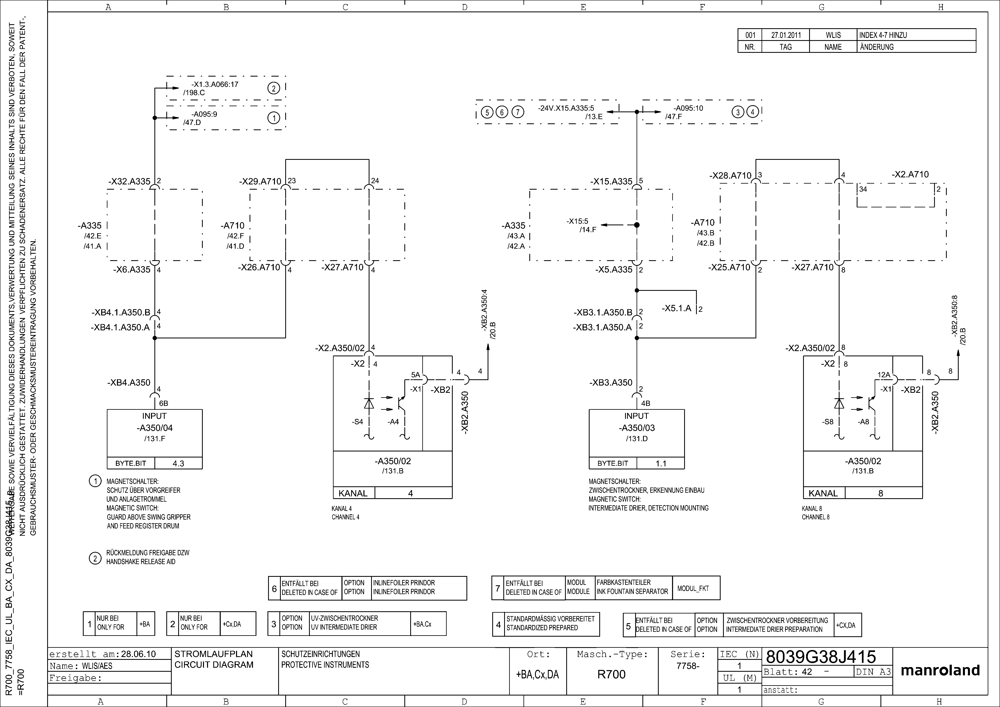

# +BA_Cx_DA — Sheet 42 of 247 — SCHUTZEINRICHTUNGEN

**PROTECTIVE INSTRUMENTS**

> Part of the manroland **R700** printing press IEC/UL circuit diagrams.
> Drawing class: **Stromlaufplan / Circuit diagram** (DIN A3).
> Document `+BA_Cx_DA` covers the **Printing units / main switch cabinet** machine section.

## At a glance

| Field | Value |
|---|---|
| Document | `+BA_Cx_DA`  (8039G38J415) |
| Sheet | **42** of 247 |
| Section (DE) | SCHUTZEINRICHTUNGEN |
| Section (EN) | PROTECTIVE INSTRUMENTS |
| Section type | CIRCUIT — Circuit diagram |
| Machine type | `R700` |
| Series | `7758` |
| Created | 28.06.10 |
| Replaces | — |
| Columns used | A, B, C, D, E, F, G, H |
| Path numbers | — |
| Labels on sheet | 182 |
| Cross-refs out | 19 |
| Cross-refs in | 43 |

**Previous:** [+BA_Cx_DA sheet 41](SHEET_0041.md) · **Next:** [+BA_Cx_DA sheet 43](SHEET_0043.md) · **Document TOC:** [_TOC.md](_TOC.md)  (+BA_Cx_DA) · **Master TOC:** [all sheets](../_MASTER_TOC.md)

## Sheet image (300 DPI, exact vector render)



_Rendered directly from the PDF vector layer at 300 DPI (1-bit), no OCR and no resampling. Use it to confirm anything ambiguous in the text below._

## Cross-references on this sheet

Each entry is a wire leaving this sheet. The printed token is `/sheet.column`; the link resolves to that sheet inside the same document.

| Ref | Target sheet | Col | Path | Destination on target | Target section | From col |
|---|---|---|---|---|---|---|
| `/198.C` | [+BA_Cx_DA sheet 198](SHEET_0198.md) | C | — | — | OPTION: WASCHVORRICHTUNG MIT BÜRSTE | B |
| `/13.E` | [+BA_Cx_DA sheet 13](SHEET_0013.md) | E | — | 24V.X15.A335:5 A095:10 | SPANNUNGSVERSORGUNG, SCHALTSCHRANKBELÜFTUNG | E |
| `/47.F` | [+BA_Cx_DA sheet 47](SHEET_0047.md) | F | — | A095:9 | SCHUTZEINRICHTUNGEN | D |
| `/47.D` | [+BA_Cx_DA sheet 47](SHEET_0047.md) | D | — | — | SCHUTZEINRICHTUNGEN | B |
| `/14.F` | [+BA_Cx_DA sheet 14](SHEET_0014.md) | F | — | X15:5 | SPANNUNGSVERSORGUNG, SCHALTSCHRANKBELÜFTUNG | E |
| `/43.B` | [+BA_Cx_DA sheet 43](SHEET_0043.md) | B | — | — | SCHUTZEINRICHTUNGEN | F |
| `/42.B` | [+BA_Cx_DA sheet 42](SHEET_0042.md) | B | — | — | SCHUTZEINRICHTUNGEN | F |
| `/42.E` | [+BA_Cx_DA sheet 42](SHEET_0042.md) | E | — | — | SCHUTZEINRICHTUNGEN | A |
| `/41.A` | [+BA_Cx_DA sheet 41](SHEET_0041.md) | A | — | — | SCHUTZEINRICHTUNGEN | A |
| `/43.A` | [+BA_Cx_DA sheet 43](SHEET_0043.md) | A | — | — | SCHUTZEINRICHTUNGEN | D |
| `/42.A` | [+BA_Cx_DA sheet 42](SHEET_0042.md) | A | — | — | SCHUTZEINRICHTUNGEN | D |
| `/42.F` | [+BA_Cx_DA sheet 42](SHEET_0042.md) | F | — | — | SCHUTZEINRICHTUNGEN | B |
| `/41.D` | [+BA_Cx_DA sheet 41](SHEET_0041.md) | D | — | — | SCHUTZEINRICHTUNGEN | B |
| `/20.B` | [+BA_Cx_DA sheet 20](SHEET_0020.md) | B | — | XB2.A350:4 | BUSVERBINDUNGEN: SICHERHEITSBUS | D |
| `/20.B` | [+BA_Cx_DA sheet 20](SHEET_0020.md) | B | — | XB2.A350:8 | BUSVERBINDUNGEN: SICHERHEITSBUS | H |
| `/131.F` | [+BA_Cx_DA sheet 131](SHEET_0131.md) | F | — | — | REFERENZMODUL | A |
| `/131.D` | [+BA_Cx_DA sheet 131](SHEET_0131.md) | D | — | — | REFERENZMODUL | E |
| `/131.B` | [+BA_Cx_DA sheet 131](SHEET_0131.md) | B | — | — | REFERENZMODUL | C |
| `/131.B` | [+BA_Cx_DA sheet 131](SHEET_0131.md) | B | — | — | REFERENZMODUL | G |

### Incoming references (sheets that point here)

Every other sheet that sends a wire to this one. `Back-ref` is the token printed on *that* sheet; `Path` is its line number.

| From sheet | Cols | Back-ref | Path | Refs | What continues there |
|---|---|---|---|---|---|
| [+BA_Cx_DA#13](SHEET_0013.md) | E | `/13.E` | — | 1 | 24V.X15.A335:5 |
| [+BA_Cx_DA#14](SHEET_0014.md) | F | `/14.F` | — | 1 | — |
| [+BA_Cx_DA#20](SHEET_0020.md) | B | `/20.B` | — | 2 | XB2.A350:4; XB2.A350:8 |
| [+BA_Cx_DA#41](SHEET_0041.md) | A, D | `/41.A`, `/41.D` | — | 2 | — |
| [+BA_Cx_DA#42](SHEET_0042.md) | A, B, D, F | `/42.A`, `/42.B`, `/42.D`, `/42.F` | — | 4 | — |
| [+BA_Cx_DA#43](SHEET_0043.md) | A, B | `/43.A`, `/43.B` | — | 2 | — |
| [+BA_Cx_DA#47](SHEET_0047.md) | D | `/47.D` | — | 2 | A095:8 A095:10; A095:9 |
| [+BA_Cx_DA#131](SHEET_0131.md) | B, D, F | `/131.B`, `/131.D`, `/131.F` | — | 4 | — |
| [+BA_Cx_DA#153](SHEET_0153.md) | F | `/153.F` | — | 4 | — |
| [+BA_Cx_DA#154](SHEET_0154.md) | B | `/154.B` | — | 1 | — |
| [+BA_Cx_DA#157](SHEET_0157.md) | C, D, F | `/157.C`, `/157.D`, `/157.F` | — | 3 | — |
| [+BA_Cx_DA#159](SHEET_0159.md) | F, G, H | `/159.F`, `/159.G`, `/159.H` | — | 3 | — |
| [+BA_Cx_DA#160](SHEET_0160.md) | C | `/160.C` | — | 1 | — |
| [+BA_Cx_DA#161](SHEET_0161.md) | A | `/161.A` | — | 1 | — |
| [+BA_Cx_DA#162](SHEET_0162.md) | D | `/162.D` | — | 1 | — |
| [+BA_Cx_DA#171](SHEET_0171.md) | E | `/171.E` | — | 1 | — |
| [+BA_Cx_DA#175](SHEET_0175.md) | H | `/175.H` | — | 1 | — |
| [+BA_Cx_DA#176](SHEET_0176.md) | E | `/176.E` | — | 1 | — |
| [+BA_Cx_DA#177](SHEET_0177.md) | E | `/177.E` | — | 2 | — |
| [+BA_Cx_DA#178](SHEET_0178.md) | G, H | `/178.G`, `/178.H` | — | 2 | — |
| [+BA_Cx_DA#179](SHEET_0179.md) | B, H | `/179.B`, `/179.H` | — | 3 | — |
| [+BA_Cx_DA#198](SHEET_0198.md) | C | `/198.C` | — | 1 | X1.3.A066:17 |


## Devices on this sheet

| Tag | Class | Class meaning (IEC) | Col | Sub | Terminal | Sign |
|---|---|---|---|---|---|---|
| `A335` | A | Baugruppe / assembly, module, PC board | A | — | — | — |
| `A335` | A | Baugruppe / assembly, module, PC board | D | — | — | — |
| `A710` | A | Baugruppe / assembly, module, PC board | B | — | — | — |
| `S4` | S | Schalter / switch | C | — | — | — |
| `A4` | A | Baugruppe / assembly, module, PC board | C | — | — | — |
| `X1` | X | Klemme / terminal, plug connector | D | — | — | — |
| `X2` | X | Klemme / terminal, plug connector | C | — | — | — |
| `XB2` | XB |  | D | — | — | — |
| `A350/02` | A | Baugruppe / assembly, module, PC board | C | 02 | — | — |
| `A350/04` | A | Baugruppe / assembly, module, PC board | A | 04 | — | — |
| `A350/03` | A | Baugruppe / assembly, module, PC board | E | 03 | — | — |
| `A710` | A | Baugruppe / assembly, module, PC board | F | — | — | — |
| `S8` | S | Schalter / switch | G | — | — | — |
| `A8` | A | Baugruppe / assembly, module, PC board | G | — | — | — |
| `X1` | X | Klemme / terminal, plug connector | H | — | — | — |
| `X2` | X | Klemme / terminal, plug connector | G | — | — | — |
| `XB2` | XB |  | H | — | — | — |
| `A350/02` | A | Baugruppe / assembly, module, PC board | G | 02 | — | — |
| `X15:5` | X | Klemme / terminal, plug connector | E | — | 5 | — |
| `A095:9` | A | Baugruppe / assembly, module, PC board | B | — | 9 | — |
| `A095:10` | A | Baugruppe / assembly, module, PC board | F | — | 10 | — |
| `X6.A335` | — | cross-device reference | A | — | — | — |
| `X32.A335` | — | cross-device reference | A | — | — | — |
| `X5.A335` | — | cross-device reference | E | — | — | — |
| `X29.A710` | — | cross-device reference | B | — | — | — |
| `XB2.A350` | — | cross-device reference | D | — | — | — |
| `X26.A710` | — | cross-device reference | B | — | — | — |
| `X27.A710` | — | cross-device reference | C | — | — | — |
| `4.3` | — | cross-device reference | B | — | — | — |
| `XB4.A350` | — | cross-device reference | A | — | — | — |
| `1.1` | — | cross-device reference | F | — | — | — |
| `XB3.A350` | — | cross-device reference | E | — | — | — |
| `X15.A335` | — | cross-device reference | E | — | — | — |
| `X28.A710` | — | cross-device reference | F | — | — | — |
| `XB2.A350` | — | cross-device reference | H | — | — | — |
| `X27.A710` | — | cross-device reference | G | — | — | — |
| `X25.A710` | — | cross-device reference | F | — | — | — |
| `XB3.1.A350.B` | — | cross-device reference | E | — | — | — |
| `XB3.1.A350.A` | — | cross-device reference | E | — | — | — |
| `XB4.1.A350.B` | — | cross-device reference | A | — | — | — |
| `XB4.1.A350.A` | — | cross-device reference | A | — | — | — |
| `X5.1.A` | — | cross-device reference | F | — | — | — |
| `XB2.A350:8` | — | cross-device reference | H | — | 8 | — |
| `XB2.A350:4` | — | cross-device reference | D | — | 4 | — |
| `X1.3.A066:17` | — | cross-device reference | B | — | 17 | — |
| `NR.` | — | cross-device reference | F | — | — | — |
| `27.01.2011` | — | cross-device reference | G | — | — | — |
| `X2.A710` | — | cross-device reference | H | — | — | — |

## Potentials / nets

| Potential | Count | Columns | Attached devices | Terminals |
|---|---|---|---|---|
| `24V` | 1 | E | `A335`, `X15` | `5` |


A potential such as `L24+/4` or `M24+` is a named supply/return rail; every place it appears on this sheet is electrically common.

## Wire-end annotations (grouped as printed)

A wire that continues elsewhere is annotated with a small cluster: the destination description, the path/line number `#NN`, and the `/sheet.column` cross reference. Each row below is one such cluster exactly as it is grouped on the drawing.

| Col | Y | Path | Cross-ref | Text on the wire |
|---|---|---|---|---|
| G | 38.5 | — | — | `001 27.01.2011 WLIS INDEX 4 7 HINZU` |
| G | 52.7 | — | — | `NR. TAG NAME ÄNDERUNG` |
| B | 96.7 | — | — | `X1.3.A066:17` |
| B | 102.3 | — | — | `2` |
| B | 106.6 | — | `/198.C` | — |
| E | 125.0 | — | `/13.E` | `24V.X15.A335:5 A095:10` |
| E | 130.2 | — | — | `5 6 7 4` |
| D | 130.7 | — | — | `1 3` |
| D | 132.1 | — | `/47.F` | `A095:9` |
| B | 142.0 | — | `/47.D` | — |
| H | 203.0 | — | — | `X2.A710` |
| G | 204.4 | — | — | `X28.A710 3 4` |
| A | 211.5 | — | — | `X32.A335 2` |
| C | 211.5 | — | — | `X29.A710 23 24` |
| E | 211.5 | — | — | `X15.A335 5` |
| H | 221.4 | — | — | `34 2` |
| E | 259.7 | — | `/14.F` | `X15:5` |
| F | 260.4 | — | — | `A710` |
| A | 263.9 | — | — | `A335` |
| B | 263.9 | — | — | `A710` |
| D | 263.9 | — | — | `A335` |
| F | 273.4 | — | `/43.B`, `/42.B` | — |
| A | 277.0 | — | `/42.E`, `/41.A` | — |
| B | 277.0 | — | `/42.F`, `/41.D` | — |
| D | 277.0 | — | `/43.A`, `/42.A` | — |
| C | 313.5 | — | — | `X26.A710 4 X27.A710 4` |
| G | 313.5 | — | — | `X25.A710 2 X27.A710 8` |
| A | 316.4 | — | — | `X6.A335 4` |
| E | 316.4 | — | — | `X5.A335 2` |
| D | 344.4 | — | `/20.B` | `XB2.A350:4` |
| H | 351.5 | — | `/20.B` | `XB2.A350:8` |
| F | 362.5 | — | — | `X5.1.A 2` |
| A | 367.4 | — | — | `XB4.1.A350.B 4` |
| E | 367.4 | — | — | `XB3.1.A350.B 2` |
| A | 384.4 | — | — | `XB4.1.A350.A 4` |
| E | 384.4 | — | — | `XB3.1.A350.A 2` |
| C | 409.9 | — | — | `X2.A350/02 4` |
| G | 409.9 | — | — | `X2.A350/02 8` |
| C | 428.4 | — | — | `X2` |
| G | 428.4 | — | — | `X2` |
| D | 429.8 | — | — | `4 4` |
| H | 429.8 | — | — | `8 8` |
| D | 438.3 | — | — | `4` |
| H | 438.3 | — | — | `8` |
| D | 442.5 | — | — | `5A` |
| H | 442.5 | — | — | `12A` |
| A | 451.0 | — | — | `XB4.A350 4` |
| E | 451.0 | — | — | `XB3.A350 2` |
| D | 459.5 | — | — | `X1` |
| D | 459.5 | — | — | `XB2` |
| H | 459.5 | — | — | `X1` |
| H | 459.5 | — | — | `XB2` |
| D | 465.7 | — | — | `XB2.A350` |
| H | 465.7 | — | — | `XB2.A350` |
| A | 476.5 | — | — | `6B` |
| F | 476.5 | — | — | `4B` |
| A | 491.0 | — | — | `INPUT` |
| E | 491.0 | — | — | `INPUT` |
| C | 498.5 | — | — | `S4 A4` |
| G | 498.5 | — | — | `S8 A8` |
| A | 504.9 | — | — | `A350/04` |
| E | 504.9 | — | — | `A350/03` |
| A | 518.7 | — | `/131.F` | — |
| E | 518.7 | — | `/131.D` | — |
| C | 544.6 | — | — | `A350/02` |
| G | 544.6 | — | — | `A350/02` |
| A | 547.7 | — | — | `BYTE.BIT 4.3` |
| E | 547.7 | — | — | `BYTE.BIT 1.1` |
| C | 556.9 | — | `/131.B` | — |
| G | 556.9 | — | `/131.B` | — |
| A | 569.5 | — | — | `1` |
| A | 570.4 | — | — | `UND ANLAGETROMMEL MAGNETSCHALTER: MAGNETIC SWITCH: SCHUTZ ÜBER VORGREIFER GUARD ABOVE SWING GRIPPER AND FEED REGISTER DRUM` |
| E | 570.4 | — | — | `MAGNETSCHALTER:` |
| F | 581.0 | — | — | `INTERMEDIATE DRIER, DETECTION MOUNTING MAGNETIC SWITCH: ZWISCHENTROCKNER, ERKENNUNG EINBAU` |
| C | 582.8 | — | — | `KANAL 4` |
| G | 582.8 | — | — | `KANAL 8` |
| C | 603.1 | — | — | `KANAL 4 CHANNEL 4` |
| G | 603.1 | — | — | `KANAL 8 CHANNEL 8` |
| A | 655.4 | — | — | `2 RÜCKMELDUNG FREIGABE DZW HANDSHAKE RELEASE AID` |
| F | 690.8 | — | — | `FARBKASTENTEILER INK FOUNTAIN SEPARATOR MODUL_FKT` |
| E | 690.9 | — | — | `MODUL MODULE` |
| C | 691.2 | — | — | `6 OPTION OPTION` |
| C | 691.2 | — | — | `INLINEFOILER PRINDOR INLINEFOILER PRINDOR` |
| D | 691.9 | — | — | `ENTFÄLLT BEI DELETED IN CASE OF 7 ENTFÄLLT BEI DELETED IN CASE OF` |
| A | 733.3 | — | — | `1 NUR BEI` |
| A | 733.3 | — | — | `ONLY FOR +BA 2 NUR BEI` |
| B | 733.4 | — | — | `ONLY FOR +Cx,DA 3 OPTION OPTION` |
| C | 733.4 | — | — | `UV ZWISCHENTROCKNER UV INTERMEDIATE DRIER +BA.Cx` |
| F | 734.1 | — | — | `4 STANDARDMÄSSIG VORBEREITET STANDARDIZED PREPARED 5 ENTFÄLLT BEI DELETED IN CASE OF INTERMEDIATE DRIER PREPARATION ZWISCHENTROCKNER VORBEREITUNG +CX,DA` |
| F | 736.1 | — | — | `OPTION OPTION` |


## Reconstructed tables

This sheet carries tabular content (pin map / terminal assignment / index). The grid below was rebuilt from the drawing's own rule lines, so each row is exactly one physical row of the table.

### Table 1 — 6 data rows × 9 columns (at x=127.6, y=189.9)

| X32.A335 X6.A335 XB4.1.A350.B XB4.1.A350.A | 2 4 4 4 | X29.A710 A710 /42.F /41.D X26.A710 | 23 4 | X27.A710 | 24 4 |  |  | XB2.A350:4 |
|---|---|---|---|---|---|---|---|---|
|  |  |  |  | `X2.A350/02` | `4` |  |  |  |
| `XB4.A350` | `4 6B` |  |  | `X2` | `4` | `5A X1` | `XB2` | `4 4` |
| `INPUT` | `A350/04 /131.F` |  |  | `S4` | `A4` |  |  | `XB2.A350` |
| `BYTE.BIT` | `4.3` |  |  |  | `A350/02` |  |  |  |
| `MAGNETSCHALTER:` |  |  |  |  | `/131.B` |  |  |  |
| `SCHUTZ ÜBER` | `VORGREIFER` |  |  | `KANAL` |  | `4` |  |  |


### Table 2 — 8 data rows × 9 columns (at x=701.6, y=189.9)

| X15.A335 | 5 | X28.A710 | 3 |  | 4 34 |  | X2.A710 | 2 |
|---|---|---|---|---|---|---|---|---|
| `X5.A335` | `2` | `A710 /43.B /42.B X25.A710` | `2` | `X27.A710` | `8` |  |  |  |
| `XB3.1.A350.B XB3.1.A350.A` | `X5.1.A 2 2` | `2` |  |  |  |  |  | `XB2.A350:8` |
|  |  |  |  | `X2.A350/02` | `8` |  |  |  |
| `XB3.A350` | `2 4B` |  |  | `X2` | `8` | `12A X1` | `XB2` | `8 8` |
| `INPUT` | `A350/03 /131.D` |  |  | `S8` | `A8` |  |  | `XB2.A350` |
| `BYTE.BIT` | `1.1` |  |  |  | `A350/02` |  |  |  |
| `MAGNETSCHALTER:` |  |  |  |  | `/131.B` |  |  |  |
| `ZWISCHENTROCKNER,` | `ERKENNUNG` | `EINBAU` |  | `KANAL` |  | `8` |  |  |


## Notes and free text on this sheet

| Text | Col | Y (pt) |
|---|---|---|
| `KANAL 4` | C | 603.14 |
| `CHANNEL 4` | C | 613.09 |
| `5A` | D | 442.47 |
| `KANAL` | C | 582.82 |
| `X2.A350/02` | C | 409.92 |
| `6B` | A | 476.49 |
| `INPUT` | A | 491.03 |
| `BYTE.BIT` | A | 548.28 |
| `MAGNETSCHALTER:` | A | 570.39 |
| `SCHUTZ ÜBER VORGREIFER` | A | 581.03 |
| `UND ANLAGETROMMEL` | A | 591.68 |
| `MAGNETIC SWITCH:` | A | 602.26 |
| `GUARD ABOVE SWING GRIPPER` | A | 612.9 |
| `AND FEED REGISTER DRUM` | A | 623.57 |
| `4B` | F | 476.49 |
| `INPUT` | E | 491.03 |
| `BYTE.BIT` | E | 548.28 |
| `MAGNETSCHALTER:` | E | 570.39 |
| `ZWISCHENTROCKNER, ERKENNUNG EINBAU` | F | 581.02 |
| `MAGNETIC SWITCH:` | E | 591.62 |
| `INTERMEDIATE DRIER, DETECTION MOUNTING` | F | 602.3 |
| `KANAL 8` | G | 603.14 |
| `CHANNEL 8` | G | 613.09 |
| `12A` | H | 442.49 |
| `KANAL` | G | 582.82 |
| `X2.A350/02` | G | 409.92 |
| `TAG` | G | 52.78 |
| `NAME` | G | 52.76 |
| `ÄNDERUNG` | G | 52.82 |
| `WLIS` | G | 38.54 |
| `INDEX 4 7 HINZU` | H | 38.64 |
| `RÜCKMELDUNG FREIGABE DZW` | A | 655.42 |
| `HANDSHAKE RELEASE AID` | A | 666.05 |
| `NUR BEI` | A | 733.33 |
| `ONLY FOR` | A | 744.02 |
| `+BA` | A | 740.44 |
| `NUR BEI` | B | 733.33 |
| `ONLY FOR` | B | 744.02 |
| `+Cx,DA` | B | 740.52 |
| `OPTION` | C | 733.35 |
| `UV ZWISCHENTROCKNER` | C | 733.37 |
| `UV INTERMEDIATE DRIER` | C | 744.01 |
| `+BA.Cx` | D | 740.5 |
| `OPTION` | F | 736.08 |
| `ZWISCHENTROCKNER VORBEREITUNG` | G | 736.11 |
| `INTERMEDIATE DRIER PREPARATION` | G | 746.74 |
| `ENTFÄLLT BEI` | F | 736.07 |
| `DELETED IN CASE OF` | F | 746.73 |
| `+CX,DA` | G | 741.78 |
| `STANDARDMÄSSIG VORBEREITET` | E | 734.13 |
| `STANDARDIZED PREPARED` | E | 744.76 |
| `INLINEFOILER PRINDOR` | C | 691.24 |
| `ENTFÄLLT BEI` | E | 691.86 |
| `DELETED IN CASE OF` | E | 702.51 |
| `ENTFÄLLT BEI` | C | 692.12 |
| `DELETED IN CASE OF` | C | 702.77 |
| `MODUL` | E | 690.85 |
| `MODULE` | E | 701.46 |
| `FARBKASTENTEILER` | E | 690.8 |
| `INK FOUNTAIN SEPARATOR` | E | 701.44 |
| `MODUL_FKT` | F | 697.85 |

## Complete label inventory (exact text from the drawing)

Every text object inside the drawing area of this sheet, in DIN reading order (column A→H, then top→bottom). This is the authoritative list: if a string is not here it is not printed on this sheet.

| Col | Y | X | Dir | Type | Text |
|---|---|---|---|---|---|
| A | 211.5 | 129.0 | → | device ref | `X32.A335` |
| A | 211.5 | 186.8 | → | number | `2` |
| A | 263.9 | 92.7 | → | device tag | `A335` |
| A | 277.0 | 100.3 | → | cross-reference | `/42.E` |
| A | 289.4 | 99.8 | → | cross-reference | `/41.A` |
| A | 316.4 | 134.9 | → | device ref | `X6.A335` |
| A | 317.8 | 186.8 | → | number | `4` |
| A | 367.4 | 109.1 | → | device ref | `XB4.1.A350.B` |
| A | 367.4 | 186.8 | → | number | `4` |
| A | 384.4 | 186.8 | → | number | `4` |
| A | 385.1 | 108.3 | → | device ref | `XB4.1.A350.A` |
| A | 451.0 | 127.8 | → | device ref | `XB4.A350` |
| A | 459.5 | 186.8 | → | number | `4` |
| A | 476.5 | 189.6 | → | text | `6B` |
| A | 491.0 | 169.4 | → | text | `INPUT` |
| A | 504.9 | 162.9 | → | device tag | `A350/04` |
| A | 518.7 | 171.9 | → | cross-reference | `/131.F` |
| A | 548.3 | 137.5 | → | text | `BYTE.BIT` |
| A | 569.5 | 111.6 | → | number | `1` |
| A | 570.4 | 127.0 | → | text | `MAGNETSCHALTER:` |
| A | 581.0 | 127.3 | → | text | `SCHUTZ ÜBER VORGREIFER` |
| A | 591.7 | 126.7 | → | text | `UND ANLAGETROMMEL` |
| A | 602.3 | 127.0 | → | text | `MAGNETIC SWITCH:` |
| A | 612.9 | 127.3 | → | text | `GUARD ABOVE SWING GRIPPER` |
| A | 623.6 | 127.6 | → | text | `AND FEED REGISTER DRUM` |
| A | 655.4 | 126.7 | → | text | `RÜCKMELDUNG FREIGABE DZW` |
| A | 662.2 | 111.4 | → | number | `2` |
| A | 666.0 | 126.7 | → | text | `HANDSHAKE RELEASE AID` |
| A | 733.3 | 115.4 | → | text | `NUR BEI` |
| A | 738.7 | 103.7 | → | number | `1` |
| A | 740.4 | 166.3 | → | text | `+BA` |
| A | 744.0 | 115.9 | → | text | `ONLY FOR` |
| B | 96.7 | 227.9 | → | device ref | `X1.3.A066:17` |
| B | 102.3 | 324.0 | → | number | `2` |
| B | 106.6 | 218.3 | → | cross-reference | `/198.C` |
| B | 132.1 | 227.9 | → | device tag | `A095:9` |
| B | 137.3 | 324.2 | → | number | `1` |
| B | 142.0 | 218.3 | → | cross-reference | `/47.D` |
| B | 211.5 | 284.9 | → | device ref | `X29.A710` |
| B | 263.9 | 262.8 | → | device tag | `A710` |
| B | 277.0 | 270.7 | → | cross-reference | `/42.F` |
| B | 289.4 | 269.9 | → | cross-reference | `/41.D` |
| B | 313.5 | 283.5 | → | device ref | `X26.A710` |
| B | 547.7 | 205.8 | → | device ref | `4.3` |
| B | 696.6 | 323.7 | → | number | `6` |
| B | 733.3 | 214.6 | → | text | `NUR BEI` |
| B | 738.7 | 202.7 | → | number | `2` |
| B | 738.7 | 323.0 | → | number | `3` |
| B | 740.5 | 265.5 | → | text | `+Cx,DA` |
| B | 744.0 | 215.1 | → | text | `ONLY FOR` |
| C | 211.5 | 342.7 | → | number | `23` |
| C | 211.5 | 441.9 | → | number | `24` |
| C | 313.5 | 382.7 | → | device ref | `X27.A710` |
| C | 317.8 | 342.7 | → | number | `4` |
| C | 317.8 | 441.9 | → | number | `4` |
| C | 409.9 | 375.3 | → | text | `X2.A350/02` |
| C | 409.9 | 441.9 | → | number | `4` |
| C | 428.4 | 417.8 | → | device tag | `X2` |
| C | 429.8 | 444.8 | → | number | `4` |
| C | 498.5 | 419.0 | → | device tag | `S4` |
| C | 498.5 | 461.5 | → | device tag | `A4` |
| C | 544.6 | 446.3 | → | device tag | `A350/02` |
| C | 556.9 | 455.1 | → | cross-reference | `/131.B` |
| C | 582.8 | 403.1 | → | text | `KANAL` |
| C | 603.1 | 394.9 | → | text | `KANAL 4` |
| C | 613.1 | 395.1 | → | text | `CHANNEL 4` |
| C | 691.2 | 409.5 | → | text | `OPTION` |
| C | 691.2 | 444.4 | → | text | `INLINEFOILER PRINDOR` |
| C | 692.1 | 335.5 | → | text | `ENTFÄLLT BEI` |
| C | 701.8 | 409.5 | → | text | `OPTION` |
| C | 701.9 | 444.4 | → | text | `INLINEFOILER PRINDOR` |
| C | 702.8 | 335.5 | → | text | `DELETED IN CASE OF` |
| C | 733.4 | 335.6 | → | text | `OPTION` |
| C | 733.4 | 370.5 | → | text | `UV ZWISCHENTROCKNER` |
| C | 744.0 | 335.6 | → | text | `OPTION` |
| C | 744.0 | 370.5 | → | text | `UV INTERMEDIATE DRIER` |
| D | 130.6 | 614.6 | → | number | `7` |
| D | 130.7 | 595.6 | → | number | `6` |
| D | 131.1 | 578.1 | → | number | `5` |
| D | 263.9 | 597.3 | → | device tag | `A335` |
| D | 277.0 | 604.3 | → | cross-reference | `/43.A` |
| D | 289.4 | 604.3 | → | cross-reference | `/42.A` |
| D | 344.4 | 572.9 | ↕ | device ref | `XB2.A350:4` |
| D | 383.2 | 582.8 | ↕ | cross-reference | `/20.B` |
| D | 438.3 | 569.5 | → | number | `4` |
| D | 439.7 | 544.0 | → | number | `4` |
| D | 442.5 | 489.5 | → | text | `5A` |
| D | 459.5 | 488.4 | → | device tag | `X1` |
| D | 459.5 | 512.8 | → | device tag | `XB2` |
| D | 465.7 | 548.8 | ↕ | device ref | `XB2.A350` |
| D | 582.8 | 486.1 | → | number | `4` |
| D | 696.1 | 589.8 | → | number | `7` |
| D | 739.4 | 590.8 | → | number | `4` |
| D | 740.5 | 492.2 | → | text | `+BA.Cx` |
| E | 125.0 | 640.6 | → | potential | `24V.X15.A335:5` |
| E | 134.9 | 697.0 | → | cross-reference | `/13.E` |
| E | 211.5 | 703.0 | → | device ref | `X15.A335` |
| E | 211.5 | 760.8 | → | number | `5` |
| E | 259.7 | 674.6 | → | device tag | `X15:5` |
| E | 269.6 | 690.2 | → | cross-reference | `/14.F` |
| E | 316.4 | 708.9 | → | device ref | `X5.A335` |
| E | 317.8 | 760.8 | → | number | `2` |
| E | 367.4 | 683.1 | → | device ref | `XB3.1.A350.B` |
| E | 367.4 | 760.8 | → | number | `2` |
| E | 384.4 | 760.8 | → | number | `2` |
| E | 385.1 | 682.3 | → | device ref | `XB3.1.A350.A` |
| E | 451.0 | 701.9 | → | device ref | `XB3.A350` |
| E | 459.5 | 760.8 | → | number | `2` |
| E | 491.0 | 743.4 | → | text | `INPUT` |
| E | 504.9 | 736.9 | → | device tag | `A350/03` |
| E | 518.7 | 745.5 | → | cross-reference | `/131.D` |
| E | 548.3 | 711.5 | → | text | `BYTE.BIT` |
| E | 570.4 | 701.0 | → | text | `MAGNETSCHALTER:` |
| E | 591.6 | 701.0 | → | text | `MAGNETIC SWITCH:` |
| E | 690.8 | 675.5 | → | text | `MODUL` |
| E | 690.8 | 710.6 | → | text | `FARBKASTENTEILER` |
| E | 691.9 | 602.5 | → | text | `ENTFÄLLT BEI` |
| E | 701.4 | 710.6 | → | text | `INK FOUNTAIN SEPARATOR` |
| E | 701.5 | 675.5 | → | text | `MODULE` |
| E | 702.5 | 602.5 | → | text | `DELETED IN CASE OF` |
| E | 734.1 | 603.2 | → | text | `STANDARDMÄSSIG VORBEREITET` |
| E | 741.3 | 745.2 | → | number | `5` |
| E | 744.8 | 603.2 | → | text | `STANDARDIZED PREPARED` |
| F | 38.5 | 887.7 | → | number | `001` |
| F | 52.7 | 886.7 | → | device ref | `NR.` |
| F | 125.0 | 801.9 | → | device tag | `A095:10` |
| F | 130.2 | 894.3 | → | number | `4` |
| F | 130.7 | 876.7 | → | number | `3` |
| F | 134.9 | 792.3 | → | cross-reference | `/47.F` |
| F | 204.4 | 844.7 | → | device ref | `X28.A710` |
| F | 204.4 | 902.6 | → | number | `3` |
| F | 260.4 | 822.6 | → | device tag | `A710` |
| F | 273.4 | 830.0 | → | cross-reference | `/43.B` |
| F | 285.8 | 830.0 | → | cross-reference | `/42.B` |
| F | 313.5 | 843.3 | → | device ref | `X25.A710` |
| F | 317.8 | 902.6 | → | number | `2` |
| F | 362.5 | 788.0 | → | device ref | `X5.1.A` |
| F | 364.6 | 831.7 | → | number | `2` |
| F | 476.5 | 763.7 | → | text | `4B` |
| F | 547.7 | 780.4 | → | device ref | `1.1` |
| F | 581.0 | 701.6 | → | text | `ZWISCHENTROCKNER, ERKENNUNG EINBAU` |
| F | 602.3 | 700.7 | → | text | `INTERMEDIATE DRIER, DETECTION MOUNTING` |
| F | 697.8 | 806.6 | → | text | `MODUL_FKT` |
| F | 736.1 | 757.0 | → | text | `ENTFÄLLT BEI` |
| F | 736.1 | 829.8 | → | text | `OPTION` |
| F | 746.7 | 757.0 | → | text | `DELETED IN CASE OF` |
| F | 746.7 | 829.8 | → | text | `OPTION` |
| G | 38.5 | 983.6 | → | text | `WLIS` |
| G | 38.6 | 918.6 | → | device ref | `27.01.2011` |
| G | 52.8 | 928.3 | → | text | `TAG` |
| G | 52.8 | 981.7 | → | text | `NAME` |
| G | 52.8 | 1024.3 | → | text | `ÄNDERUNG` |
| G | 204.4 | 1001.8 | → | number | `4` |
| G | 221.4 | 1023.0 | → | number | `34` |
| G | 313.5 | 942.5 | → | device ref | `X27.A710` |
| G | 317.8 | 1001.8 | → | number | `8` |
| G | 409.9 | 935.1 | → | text | `X2.A350/02` |
| G | 409.9 | 1001.8 | → | number | `8` |
| G | 428.4 | 977.7 | → | device tag | `X2` |
| G | 429.8 | 1004.6 | → | number | `8` |
| G | 498.5 | 978.8 | → | device tag | `S8` |
| G | 498.5 | 1021.3 | → | device tag | `A8` |
| G | 544.6 | 1006.2 | → | device tag | `A350/02` |
| G | 556.9 | 1014.9 | → | cross-reference | `/131.B` |
| G | 582.8 | 962.9 | → | text | `KANAL` |
| G | 582.8 | 1045.8 | → | number | `8` |
| G | 603.1 | 954.7 | → | text | `KANAL 8` |
| G | 613.1 | 955.0 | → | text | `CHANNEL 8` |
| G | 736.1 | 865.5 | → | text | `ZWISCHENTROCKNER VORBEREITUNG` |
| G | 741.8 | 995.6 | → | text | `+CX,DA` |
| G | 746.7 | 864.7 | → | text | `INTERMEDIATE DRIER PREPARATION` |
| H | 38.6 | 1023.2 | → | text | `INDEX 4 7 HINZU` |
| H | 203.0 | 1061.9 | → | device ref | `X2.A710` |
| H | 221.4 | 1115.1 | → | number | `2` |
| H | 351.5 | 1132.7 | ↕ | device ref | `XB2.A350:8` |
| H | 390.3 | 1142.6 | ↕ | cross-reference | `/20.B` |
| H | 438.3 | 1129.3 | → | number | `8` |
| H | 439.7 | 1103.8 | → | number | `8` |
| H | 442.5 | 1044.6 | → | text | `12A` |
| H | 459.5 | 1048.3 | → | device tag | `X1` |
| H | 459.5 | 1072.6 | → | device tag | `XB2` |
| H | 465.7 | 1108.7 | ↕ | device ref | `XB2.A350` |

## Reading-order text block

The same content as a plain block, grouped by DIN column — convenient to paste or to match against a visual description.

```text
=== Column A ===
 211.5  129.0  devref       X32.A335
 211.5  186.8  numeric      2
 263.9   92.7  devtag       A335
 277.0  100.3  xref         /42.E
 289.4   99.8  xref         /41.A
 316.4  134.9  devref       X6.A335
 317.8  186.8  numeric      4
 367.4  109.1  devref       XB4.1.A350.B
 367.4  186.8  numeric      4
 384.4  186.8  numeric      4
 385.1  108.3  devref       XB4.1.A350.A
 451.0  127.8  devref       XB4.A350
 459.5  186.8  numeric      4
 476.5  189.6  text         6B
 491.0  169.4  text         INPUT
 504.9  162.9  devtag       A350/04
 518.7  171.9  xref         /131.F
 548.3  137.5  text         BYTE.BIT
 569.5  111.6  numeric      1
 570.4  127.0  text         MAGNETSCHALTER:
 581.0  127.3  text         SCHUTZ ÜBER VORGREIFER
 591.7  126.7  text         UND ANLAGETROMMEL
 602.3  127.0  text         MAGNETIC SWITCH:
 612.9  127.3  text         GUARD ABOVE SWING GRIPPER
 623.6  127.6  text         AND FEED REGISTER DRUM
 655.4  126.7  text         RÜCKMELDUNG FREIGABE DZW
 662.2  111.4  numeric      2
 666.0  126.7  text         HANDSHAKE RELEASE AID
 733.3  115.4  text         NUR BEI
 738.7  103.7  numeric      1
 740.4  166.3  text         +BA
 744.0  115.9  text         ONLY FOR
=== Column B ===
  96.7  227.9  devref       X1.3.A066:17
 102.3  324.0  numeric      2
 106.6  218.3  xref         /198.C
 132.1  227.9  devtag       A095:9
 137.3  324.2  numeric      1
 142.0  218.3  xref         /47.D
 211.5  284.9  devref       X29.A710
 263.9  262.8  devtag       A710
 277.0  270.7  xref         /42.F
 289.4  269.9  xref         /41.D
 313.5  283.5  devref       X26.A710
 547.7  205.8  devref       4.3
 696.6  323.7  numeric      6
 733.3  214.6  text         NUR BEI
 738.7  202.7  numeric      2
 738.7  323.0  numeric      3
 740.5  265.5  text         +Cx,DA
 744.0  215.1  text         ONLY FOR
=== Column C ===
 211.5  342.7  numeric      23
 211.5  441.9  numeric      24
 313.5  382.7  devref       X27.A710
 317.8  342.7  numeric      4
 317.8  441.9  numeric      4
 409.9  375.3  text         X2.A350/02
 409.9  441.9  numeric      4
 428.4  417.8  devtag       X2
 429.8  444.8  numeric      4
 498.5  419.0  devtag       S4
 498.5  461.5  devtag       A4
 544.6  446.3  devtag       A350/02
 556.9  455.1  xref         /131.B
 582.8  403.1  text         KANAL
 603.1  394.9  text         KANAL 4
 613.1  395.1  text         CHANNEL 4
 691.2  409.5  text         OPTION
 691.2  444.4  text         INLINEFOILER PRINDOR
 692.1  335.5  text         ENTFÄLLT BEI
 701.8  409.5  text         OPTION
 701.9  444.4  text         INLINEFOILER PRINDOR
 702.8  335.5  text         DELETED IN CASE OF
 733.4  335.6  text         OPTION
 733.4  370.5  text         UV ZWISCHENTROCKNER
 744.0  335.6  text         OPTION
 744.0  370.5  text         UV INTERMEDIATE DRIER
=== Column D ===
 130.6  614.6  numeric      7
 130.7  595.6  numeric      6
 131.1  578.1  numeric      5
 263.9  597.3  devtag       A335
 277.0  604.3  xref         /43.A
 289.4  604.3  xref         /42.A
 344.4  572.9  devref       XB2.A350:4
 383.2  582.8  xref         /20.B
 438.3  569.5  numeric      4
 439.7  544.0  numeric      4
 442.5  489.5  text         5A
 459.5  488.4  devtag       X1
 459.5  512.8  devtag       XB2
 465.7  548.8  devref       XB2.A350
 582.8  486.1  numeric      4
 696.1  589.8  numeric      7
 739.4  590.8  numeric      4
 740.5  492.2  text         +BA.Cx
=== Column E ===
 125.0  640.6  net          24V.X15.A335:5
 134.9  697.0  xref         /13.E
 211.5  703.0  devref       X15.A335
 211.5  760.8  numeric      5
 259.7  674.6  devtag       X15:5
 269.6  690.2  xref         /14.F
 316.4  708.9  devref       X5.A335
 317.8  760.8  numeric      2
 367.4  683.1  devref       XB3.1.A350.B
 367.4  760.8  numeric      2
 384.4  760.8  numeric      2
 385.1  682.3  devref       XB3.1.A350.A
 451.0  701.9  devref       XB3.A350
 459.5  760.8  numeric      2
 491.0  743.4  text         INPUT
 504.9  736.9  devtag       A350/03
 518.7  745.5  xref         /131.D
 548.3  711.5  text         BYTE.BIT
 570.4  701.0  text         MAGNETSCHALTER:
 591.6  701.0  text         MAGNETIC SWITCH:
 690.8  675.5  text         MODUL
 690.8  710.6  text         FARBKASTENTEILER
 691.9  602.5  text         ENTFÄLLT BEI
 701.4  710.6  text         INK FOUNTAIN SEPARATOR
 701.5  675.5  text         MODULE
 702.5  602.5  text         DELETED IN CASE OF
 734.1  603.2  text         STANDARDMÄSSIG VORBEREITET
 741.3  745.2  numeric      5
 744.8  603.2  text         STANDARDIZED PREPARED
=== Column F ===
  38.5  887.7  numeric      001
  52.7  886.7  devref       NR.
 125.0  801.9  devtag       A095:10
 130.2  894.3  numeric      4
 130.7  876.7  numeric      3
 134.9  792.3  xref         /47.F
 204.4  844.7  devref       X28.A710
 204.4  902.6  numeric      3
 260.4  822.6  devtag       A710
 273.4  830.0  xref         /43.B
 285.8  830.0  xref         /42.B
 313.5  843.3  devref       X25.A710
 317.8  902.6  numeric      2
 362.5  788.0  devref       X5.1.A
 364.6  831.7  numeric      2
 476.5  763.7  text         4B
 547.7  780.4  devref       1.1
 581.0  701.6  text         ZWISCHENTROCKNER, ERKENNUNG EINBAU
 602.3  700.7  text         INTERMEDIATE DRIER, DETECTION MOUNTING
 697.8  806.6  text         MODUL_FKT
 736.1  757.0  text         ENTFÄLLT BEI
 736.1  829.8  text         OPTION
 746.7  757.0  text         DELETED IN CASE OF
 746.7  829.8  text         OPTION
=== Column G ===
  38.5  983.6  text         WLIS
  38.6  918.6  devref       27.01.2011
  52.8  928.3  text         TAG
  52.8  981.7  text         NAME
  52.8 1024.3  text         ÄNDERUNG
 204.4 1001.8  numeric      4
 221.4 1023.0  numeric      34
 313.5  942.5  devref       X27.A710
 317.8 1001.8  numeric      8
 409.9  935.1  text         X2.A350/02
 409.9 1001.8  numeric      8
 428.4  977.7  devtag       X2
 429.8 1004.6  numeric      8
 498.5  978.8  devtag       S8
 498.5 1021.3  devtag       A8
 544.6 1006.2  devtag       A350/02
 556.9 1014.9  xref         /131.B
 582.8  962.9  text         KANAL
 582.8 1045.8  numeric      8
 603.1  954.7  text         KANAL 8
 613.1  955.0  text         CHANNEL 8
 736.1  865.5  text         ZWISCHENTROCKNER VORBEREITUNG
 741.8  995.6  text         +CX,DA
 746.7  864.7  text         INTERMEDIATE DRIER PREPARATION
=== Column H ===
  38.6 1023.2  text         INDEX 4 7 HINZU
 203.0 1061.9  devref       X2.A710
 221.4 1115.1  numeric      2
 351.5 1132.7  devref       XB2.A350:8
 390.3 1142.6  xref         /20.B
 438.3 1129.3  numeric      8
 439.7 1103.8  numeric      8
 442.5 1044.6  text         12A
 459.5 1048.3  devtag       X1
 459.5 1072.6  devtag       XB2
 465.7 1108.7  devref       XB2.A350
```

---
_Generated from the PDF vector text layer; no OCR. Source: `R700_7758_IEC_UL_BA_CX_DA_8039G38J415_p`, sheet 42._
