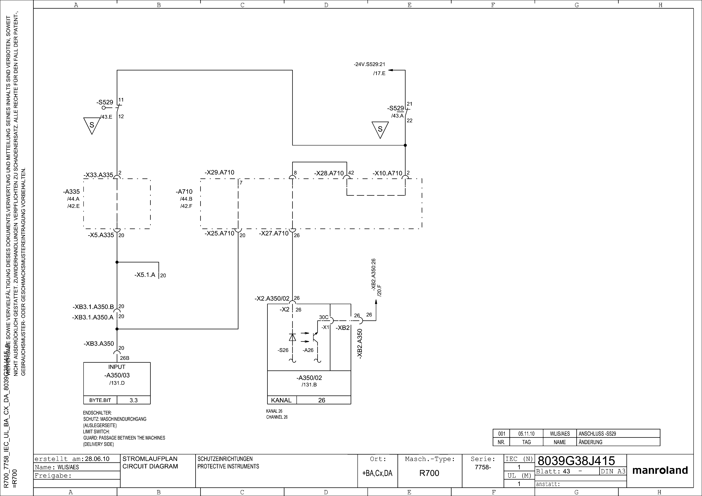

# +BA_Cx_DA — Sheet 43 of 247 — SCHUTZEINRICHTUNGEN

**PROTECTIVE INSTRUMENTS**

> Part of the manroland **R700** printing press IEC/UL circuit diagrams.
> Drawing class: **Stromlaufplan / Circuit diagram** (DIN A3).
> Document `+BA_Cx_DA` covers the **Printing units / main switch cabinet** machine section.

## At a glance

| Field | Value |
|---|---|
| Document | `+BA_Cx_DA`  (8039G38J415) |
| Sheet | **43** of 247 |
| Section (DE) | SCHUTZEINRICHTUNGEN |
| Section (EN) | PROTECTIVE INSTRUMENTS |
| Section type | CIRCUIT — Circuit diagram |
| Machine type | `R700` |
| Series | `7758` |
| Created | 28.06.10 |
| Replaces | — |
| Columns used | A, B, C, D, E, F, G |
| Path numbers | — |
| Labels on sheet | 81 |
| Cross-refs out | 10 |
| Cross-refs in | 24 |

**Previous:** [+BA_Cx_DA sheet 42](SHEET_0042.md) · **Next:** [+BA_Cx_DA sheet 44](SHEET_0044.md) · **Document TOC:** [_TOC.md](_TOC.md)  (+BA_Cx_DA) · **Master TOC:** [all sheets](../_MASTER_TOC.md)

## Sheet image (300 DPI, exact vector render)



_Rendered directly from the PDF vector layer at 300 DPI (1-bit), no OCR and no resampling. Use it to confirm anything ambiguous in the text below._

## Cross-references on this sheet

Each entry is a wire leaving this sheet. The printed token is `/sheet.column`; the link resolves to that sheet inside the same document.

| Ref | Target sheet | Col | Path | Destination on target | Target section | From col |
|---|---|---|---|---|---|---|
| `/17.E` | [+BA_Cx_DA sheet 17](SHEET_0017.md) | E | — | — | SPANNUNGSVERSORGUNG, SCHALTSCHRANKBELÜFTUNG | E |
| `/43.A` | [+BA_Cx_DA sheet 43](SHEET_0043.md) | A | — | — | SCHUTZEINRICHTUNGEN | C |
| `/43.E` | [+BA_Cx_DA sheet 43](SHEET_0043.md) | E | — | — | SCHUTZEINRICHTUNGEN | C |
| `/44.A` | [+BA_Cx_DA sheet 44](SHEET_0044.md) | A | — | — | SCHUTZEINRICHTUNGEN | A |
| `/44.B` | [+BA_Cx_DA sheet 44](SHEET_0044.md) | B | — | — | SCHUTZEINRICHTUNGEN | B |
| `/42.E` | [+BA_Cx_DA sheet 42](SHEET_0042.md) | E | — | — | SCHUTZEINRICHTUNGEN | A |
| `/42.F` | [+BA_Cx_DA sheet 42](SHEET_0042.md) | F | — | — | SCHUTZEINRICHTUNGEN | B |
| `/20.F` | [+BA_Cx_DA sheet 20](SHEET_0020.md) | F | — | XB2.A350:26 | BUSVERBINDUNGEN: SICHERHEITSBUS | E |
| `/131.D` | [+BA_Cx_DA sheet 131](SHEET_0131.md) | D | — | — | REFERENZMODUL | A |
| `/131.B` | [+BA_Cx_DA sheet 131](SHEET_0131.md) | B | — | — | REFERENZMODUL | D |

### Incoming references (sheets that point here)

Every other sheet that sends a wire to this one. `Back-ref` is the token printed on *that* sheet; `Path` is its line number.

| From sheet | Cols | Back-ref | Path | Refs | What continues there |
|---|---|---|---|---|---|
| [+BA_Cx_DA#17](SHEET_0017.md) | E | `/17.E` | — | 1 | 24V.S529:21 |
| [+BA_Cx_DA#20](SHEET_0020.md) | F | `/20.F` | — | 1 | XB2.A350:26 |
| [+BA_Cx_DA#42](SHEET_0042.md) | D, F | `/42.D`, `/42.F` | — | 2 | — |
| [+BA_Cx_DA#43](SHEET_0043.md) | C | `/43.C` | — | 2 | — |
| [+BA_Cx_DA#44](SHEET_0044.md) | A, B | `/44.A`, `/44.B` | — | 2 | — |
| [+BA_Cx_DA#131](SHEET_0131.md) | B, D | `/131.B`, `/131.D` | — | 2 | — |
| [+BA_Cx_DA#153](SHEET_0153.md) | G | `/153.G` | — | 2 | — |
| [+BA_Cx_DA#157](SHEET_0157.md) | C, D, F | `/157.C`, `/157.D`, `/157.F` | — | 3 | — |
| [+BA_Cx_DA#160](SHEET_0160.md) | C | `/160.C` | — | 1 | — |
| [+BA_Cx_DA#161](SHEET_0161.md) | A | `/161.A` | — | 1 | — |
| [+BA_Cx_DA#167](SHEET_0167.md) | E | `/167.E` | — | 1 | — |
| [+BA_Cx_DA#175](SHEET_0175.md) | H | `/175.H` | — | 1 | — |
| [+BA_Cx_DA#177](SHEET_0177.md) | F | `/177.F` | — | 1 | — |
| [+BA_Cx_DA#178](SHEET_0178.md) | H | `/178.H` | — | 1 | — |
| [+BA_Cx_DA#179](SHEET_0179.md) | B | `/179.B` | — | 2 | — |
| [+BA_Cx_DA#180](SHEET_0180.md) | A | `/180.A` | — | 1 | — |


## Devices on this sheet

| Tag | Class | Class meaning (IEC) | Col | Sub | Terminal | Sign |
|---|---|---|---|---|---|---|
| `A350/03` | A | Baugruppe / assembly, module, PC board | A | 03 | — | — |
| `A335` | A | Baugruppe / assembly, module, PC board | A | — | — | — |
| `A710` | A | Baugruppe / assembly, module, PC board | B | — | — | — |
| `S26` | S | Schalter / switch | C | — | — | — |
| `A26` | A | Baugruppe / assembly, module, PC board | D | — | — | — |
| `X1` | X | Klemme / terminal, plug connector | D | — | — | — |
| `X2` | X | Klemme / terminal, plug connector | D | — | — | — |
| `XB2` | XB |  | D | — | — | — |
| `A350/02` | A | Baugruppe / assembly, module, PC board | D | 02 | — | — |
| `S529` | S | Schalter / switch | E | — | — | — |
| `S529` | S | Schalter / switch | A | — | — | — |
| `3.3` | — | cross-device reference | B | — | — | — |
| `XB3.A350` | — | cross-device reference | A | — | — | — |
| `X5.A335` | — | cross-device reference | A | — | — | — |
| `X33.A335` | — | cross-device reference | A | — | — | — |
| `XB3.1.A350.B` | — | cross-device reference | A | — | — | — |
| `XB3.1.A350.A` | — | cross-device reference | A | — | — | — |
| `X27.A710` | — | cross-device reference | C | — | — | — |
| `X25.A710` | — | cross-device reference | C | — | — | — |
| `XB2.A350` | — | cross-device reference | D | — | — | — |
| `X28.A710` | — | cross-device reference | D | — | — | — |
| `X10.A710` | — | cross-device reference | E | — | — | — |
| `X5.1.A` | — | cross-device reference | B | — | — | — |
| `NR.` | — | cross-device reference | F | — | — | — |
| `05.11.10` | — | cross-device reference | F | — | — | — |
| `XB2.A350:26` | — | cross-device reference | E | — | 26 | — |
| `X29.A710` | — | cross-device reference | C | — | — | — |

## Potentials / nets

| Potential | Count | Columns | Attached devices | Terminals |
|---|---|---|---|---|
| `24V` | 1 | E | `S529` | `21` |


A potential such as `L24+/4` or `M24+` is a named supply/return rail; every place it appears on this sheet is electrically common.

## Wire-end annotations (grouped as printed)

A wire that continues elsewhere is annotated with a small cluster: the destination description, the path/line number `#NN`, and the `/sheet.column` cross reference. Each row below is one such cluster exactly as it is grouped on the drawing.

| Col | Y | Path | Cross-ref | Text on the wire |
|---|---|---|---|---|
| E | 105.2 | — | — | `24V.S529:21` |
| E | 120.7 | — | `/17.E` | — |
| B | 165.4 | — | — | `11` |
| A | 169.0 | — | — | `S529` |
| E | 172.5 | — | — | `21` |
| E | 178.9 | — | — | `S529` |
| C | 192.7 | — | `/43.A`, `/43.E` | — |
| B | 193.8 | — | — | `12` |
| E | 200.9 | — | — | `22` |
| C | 206.6 | — | — | `S S` |
| C | 288.0 | — | — | `X29.A710` |
| D | 289.4 | — | — | `X28.A710 42 X10.A710 2` |
| A | 289.5 | — | — | `X33.A335 2` |
| D | 289.5 | — | — | `8` |
| C | 306.5 | — | — | `A710 7` |
| A | 320.6 | — | — | `A335` |
| A | 333.7 | — | `/44.A` | — |
| B | 333.7 | — | `/44.B` | — |
| A | 346.1 | — | `/42.E` | — |
| B | 346.1 | — | `/42.F` | — |
| C | 391.5 | — | — | `X25.A710 20 X27.A710 26` |
| A | 394.3 | — | — | `X5.A335 20` |
| E | 438.8 | — | `/20.F` | `XB2.A350:26` |
| B | 461.7 | — | — | `X5.1.A 20` |
| C | 502.0 | — | — | `X2.A350/02 26` |
| A | 516.2 | — | — | `XB3.1.A350.B 20` |
| D | 520.5 | — | — | `X2` |
| D | 521.9 | — | — | `26 26` |
| E | 530.4 | — | — | `26` |
| A | 533.2 | — | — | `XB3.1.A350.A 20` |
| D | 534.7 | — | — | `30C` |
| D | 551.6 | — | — | `X1` |
| D | 551.7 | — | — | `XB2` |
| D | 557.9 | — | — | `XB2.A350` |
| A | 578.6 | — | — | `XB3.A350 20` |
| D | 590.6 | — | — | `S26 A26` |
| B | 604.1 | — | — | `26B` |
| A | 618.6 | — | — | `INPUT` |
| A | 632.4 | — | — | `A350/03` |
| D | 636.7 | — | — | `A350/02` |
| A | 646.2 | — | `/131.D` | — |
| D | 649.0 | — | `/131.B` | — |
| D | 674.9 | — | — | `KANAL 26` |
| A | 675.3 | — | — | `BYTE.BIT 3.3` |
| C | 695.3 | — | — | `KANAL 26 CHANNEL 26` |
| A | 697.9 | — | — | `ENDSCHALTER:` |
| A | 708.6 | — | — | `LIMIT SWITCH: (AUSLEGERSEITE) SCHUTZ: MASCHINENDURCHGANG` |
| G | 733.0 | — | — | `001 05.11.10 WLIS/AES ANSCHLUSS S529` |
| B | 740.5 | — | — | `(DELIVERY SIDE) GUARD: PASSAGE BETWEEN THE MACHINES` |
| G | 747.1 | — | — | `NR. TAG NAME ÄNDERUNG` |


## Reconstructed tables

This sheet carries tabular content (pin map / terminal assignment / index). The grid below was rebuilt from the drawing's own rule lines, so each row is exactly one physical row of the table.

### Table 1 — 4 data rows × 2 columns (at x=141.7, y=119.1)

| S529 /43.E S X33.A335 X5.A335 | 11 12 2 20 |
|---|---|
| `XB3.1.A350.B XB3.1.A350.A` | `X5.1.A 20 20` |
| `XB3.A350` | `20 26B` |
| `INPUT` | `A350/03 /131.D` |
| `BYTE.BIT` | `3.3` |


### Table 2 — 5 data rows × 7 columns (at x=403.9, y=119.1) — **/17.E S529 /43.A S**

| 7 |  | 8 | X28.A710 |  | 42 | X10.A710 |
|---|---|---|---|---|---|---|
| `20` | `X27.A710 X2.A350/02` | `26 26` |  |  | `XB2.A350:26` | `/20.F` |
|  | `X2` | `26` | `30C X1` | `XB2` | `26 26` |  |
|  | `S26` | `A26` |  |  | `XB2.A350` |  |
|  |  | `A350/02 /131.B` |  |  |  |  |
|  | `KANAL` |  | `26` |  |  |  |


## Notes and free text on this sheet

| Text | Col | Y (pt) |
|---|---|---|
| `26B` | B | 604.07 |
| `INPUT` | A | 618.59 |
| `BYTE.BIT` | A | 675.84 |
| `ENDSCHALTER:` | A | 697.94 |
| `SCHUTZ: MASCHINENDURCHGANG` | A | 708.61 |
| `(AUSLEGERSEITE)` | A | 719.2 |
| `LIMIT SWITCH:` | A | 729.79 |
| `GUARD: PASSAGE BETWEEN THE MACHINES` | B | 740.46 |
| `(DELIVERY SIDE)` | A | 751.1 |
| `KANAL 26` | C | 695.27 |
| `CHANNEL 26` | C | 705.22 |
| `30C` | D | 534.66 |
| `KANAL` | C | 674.94 |
| `X2.A350/02` | C | 502.04 |
| `TAG` | F | 747.27 |
| `NAME` | G | 747.25 |
| `ÄNDERUNG` | G | 747.31 |
| `WLIS/AES` | G | 733.08 |
| `ANSCHLUSS S529` | G | 733.15 |
| `S` | E | 213.69 |
| `S` | A | 206.6 |

## Complete label inventory (exact text from the drawing)

Every text object inside the drawing area of this sheet, in DIN reading order (column A→H, then top→bottom). This is the authoritative list: if a string is not here it is not printed on this sheet.

| Col | Y | X | Dir | Type | Text |
|---|---|---|---|---|---|
| A | 169.0 | 163.6 | → | device tag | `S529` |
| A | 194.4 | 169.8 | → | cross-reference | `/43.E` |
| A | 206.6 | 151.8 | → | text | `S` |
| A | 292.3 | 141.7 | → | device ref | `X33.A335` |
| A | 320.6 | 106.9 | → | device tag | `A335` |
| A | 333.7 | 114.0 | → | cross-reference | `/44.A` |
| A | 346.1 | 114.5 | → | cross-reference | `/42.E` |
| A | 394.3 | 149.1 | → | device ref | `X5.A335` |
| A | 516.2 | 123.3 | → | device ref | `XB3.1.A350.B` |
| A | 533.9 | 122.5 | → | device ref | `XB3.1.A350.A` |
| A | 578.6 | 142.0 | → | device ref | `XB3.A350` |
| A | 618.6 | 183.5 | → | text | `INPUT` |
| A | 632.4 | 177.0 | → | device tag | `A350/03` |
| A | 646.2 | 185.7 | → | cross-reference | `/131.D` |
| A | 675.8 | 151.7 | → | text | `BYTE.BIT` |
| A | 697.9 | 140.9 | → | text | `ENDSCHALTER:` |
| A | 708.6 | 141.4 | → | text | `SCHUTZ: MASCHINENDURCHGANG` |
| A | 719.2 | 141.2 | → | text | `(AUSLEGERSEITE)` |
| A | 729.8 | 140.9 | → | text | `LIMIT SWITCH:` |
| A | 751.1 | 141.2 | → | text | `(DELIVERY SIDE)` |
| B | 165.4 | 200.4 | → | number | `11` |
| B | 193.8 | 200.4 | → | number | `12` |
| B | 289.5 | 201.0 | → | number | `2` |
| B | 320.6 | 298.2 | → | device tag | `A710` |
| B | 333.7 | 305.6 | → | cross-reference | `/44.B` |
| B | 346.1 | 306.1 | → | cross-reference | `/42.F` |
| B | 395.8 | 201.0 | → | number | `20` |
| B | 461.7 | 228.2 | → | device ref | `X5.1.A` |
| B | 463.8 | 271.8 | → | number | `20` |
| B | 516.2 | 201.0 | → | number | `20` |
| B | 533.2 | 201.0 | → | number | `20` |
| B | 587.1 | 201.0 | → | number | `20` |
| B | 604.1 | 203.8 | → | text | `26B` |
| B | 675.3 | 220.0 | → | device ref | `3.3` |
| B | 740.5 | 141.4 | → | text | `GUARD: PASSAGE BETWEEN THE MACHINES` |
| C | 288.0 | 347.2 | → | device ref | `X29.A710` |
| C | 306.5 | 406.5 | → | number | `7` |
| C | 391.5 | 347.2 | → | device ref | `X25.A710` |
| C | 391.5 | 439.4 | → | device ref | `X27.A710` |
| C | 395.8 | 406.5 | → | number | `20` |
| C | 502.0 | 432.0 | → | text | `X2.A350/02` |
| C | 590.6 | 470.8 | → | device tag | `S26` |
| C | 674.9 | 459.8 | → | text | `KANAL` |
| C | 695.3 | 451.6 | → | text | `KANAL 26` |
| C | 705.2 | 451.8 | → | text | `CHANNEL 26` |
| D | 289.4 | 532.9 | → | device ref | `X28.A710` |
| D | 289.5 | 498.6 | → | number | `8` |
| D | 289.5 | 590.7 | → | number | `42` |
| D | 395.8 | 498.6 | → | number | `26` |
| D | 502.1 | 498.6 | → | number | `26` |
| D | 520.5 | 474.5 | → | device tag | `X2` |
| D | 521.9 | 501.4 | → | number | `26` |
| D | 531.8 | 600.7 | → | number | `26` |
| D | 534.7 | 541.4 | → | text | `30C` |
| D | 551.6 | 545.1 | → | device tag | `X1` |
| D | 551.7 | 569.5 | → | device tag | `XB2` |
| D | 557.9 | 605.5 | ↕ | device ref | `XB2.A350` |
| D | 590.6 | 513.4 | → | device tag | `A26` |
| D | 636.7 | 503.0 | → | device tag | `A350/02` |
| D | 649.0 | 511.8 | → | cross-reference | `/131.B` |
| D | 674.9 | 539.9 | → | number | `26` |
| E | 105.2 | 600.1 | → | potential | `24V.S529:21` |
| E | 120.7 | 633.3 | → | cross-reference | `/17.E` |
| E | 172.5 | 690.0 | → | number | `21` |
| E | 178.9 | 656.8 | → | device tag | `S529` |
| E | 192.7 | 663.9 | → | cross-reference | `/43.A` |
| E | 200.9 | 690.0 | → | number | `22` |
| E | 213.7 | 640.8 | → | text | `S` |
| E | 289.4 | 632.1 | → | device ref | `X10.A710` |
| E | 289.5 | 690.0 | → | number | `2` |
| E | 438.8 | 629.6 | ↕ | device ref | `XB2.A350:26` |
| E | 483.0 | 639.5 | ↕ | cross-reference | `/20.F` |
| E | 530.4 | 621.4 | → | number | `26` |
| F | 733.0 | 845.2 | → | number | `001` |
| F | 733.1 | 879.3 | → | device ref | `05.11.10` |
| F | 747.1 | 844.2 | → | device ref | `NR.` |
| F | 747.3 | 885.8 | → | text | `TAG` |
| G | 733.1 | 933.1 | → | text | `WLIS/AES` |
| G | 733.1 | 981.8 | → | text | `ANSCHLUSS S529` |
| G | 747.3 | 939.2 | → | text | `NAME` |
| G | 747.3 | 981.8 | → | text | `ÄNDERUNG` |

## Reading-order text block

The same content as a plain block, grouped by DIN column — convenient to paste or to match against a visual description.

```text
=== Column A ===
 169.0  163.6  devtag       S529
 194.4  169.8  xref         /43.E
 206.6  151.8  text         S
 292.3  141.7  devref       X33.A335
 320.6  106.9  devtag       A335
 333.7  114.0  xref         /44.A
 346.1  114.5  xref         /42.E
 394.3  149.1  devref       X5.A335
 516.2  123.3  devref       XB3.1.A350.B
 533.9  122.5  devref       XB3.1.A350.A
 578.6  142.0  devref       XB3.A350
 618.6  183.5  text         INPUT
 632.4  177.0  devtag       A350/03
 646.2  185.7  xref         /131.D
 675.8  151.7  text         BYTE.BIT
 697.9  140.9  text         ENDSCHALTER:
 708.6  141.4  text         SCHUTZ: MASCHINENDURCHGANG
 719.2  141.2  text         (AUSLEGERSEITE)
 729.8  140.9  text         LIMIT SWITCH:
 751.1  141.2  text         (DELIVERY SIDE)
=== Column B ===
 165.4  200.4  numeric      11
 193.8  200.4  numeric      12
 289.5  201.0  numeric      2
 320.6  298.2  devtag       A710
 333.7  305.6  xref         /44.B
 346.1  306.1  xref         /42.F
 395.8  201.0  numeric      20
 461.7  228.2  devref       X5.1.A
 463.8  271.8  numeric      20
 516.2  201.0  numeric      20
 533.2  201.0  numeric      20
 587.1  201.0  numeric      20
 604.1  203.8  text         26B
 675.3  220.0  devref       3.3
 740.5  141.4  text         GUARD: PASSAGE BETWEEN THE MACHINES
=== Column C ===
 288.0  347.2  devref       X29.A710
 306.5  406.5  numeric      7
 391.5  347.2  devref       X25.A710
 391.5  439.4  devref       X27.A710
 395.8  406.5  numeric      20
 502.0  432.0  text         X2.A350/02
 590.6  470.8  devtag       S26
 674.9  459.8  text         KANAL
 695.3  451.6  text         KANAL 26
 705.2  451.8  text         CHANNEL 26
=== Column D ===
 289.4  532.9  devref       X28.A710
 289.5  498.6  numeric      8
 289.5  590.7  numeric      42
 395.8  498.6  numeric      26
 502.1  498.6  numeric      26
 520.5  474.5  devtag       X2
 521.9  501.4  numeric      26
 531.8  600.7  numeric      26
 534.7  541.4  text         30C
 551.6  545.1  devtag       X1
 551.7  569.5  devtag       XB2
 557.9  605.5  devref       XB2.A350
 590.6  513.4  devtag       A26
 636.7  503.0  devtag       A350/02
 649.0  511.8  xref         /131.B
 674.9  539.9  numeric      26
=== Column E ===
 105.2  600.1  net          24V.S529:21
 120.7  633.3  xref         /17.E
 172.5  690.0  numeric      21
 178.9  656.8  devtag       S529
 192.7  663.9  xref         /43.A
 200.9  690.0  numeric      22
 213.7  640.8  text         S
 289.4  632.1  devref       X10.A710
 289.5  690.0  numeric      2
 438.8  629.6  devref       XB2.A350:26
 483.0  639.5  xref         /20.F
 530.4  621.4  numeric      26
=== Column F ===
 733.0  845.2  numeric      001
 733.1  879.3  devref       05.11.10
 747.1  844.2  devref       NR.
 747.3  885.8  text         TAG
=== Column G ===
 733.1  933.1  text         WLIS/AES
 733.1  981.8  text         ANSCHLUSS S529
 747.3  939.2  text         NAME
 747.3  981.8  text         ÄNDERUNG
```

---
_Generated from the PDF vector text layer; no OCR. Source: `R700_7758_IEC_UL_BA_CX_DA_8039G38J415_p`, sheet 43._
