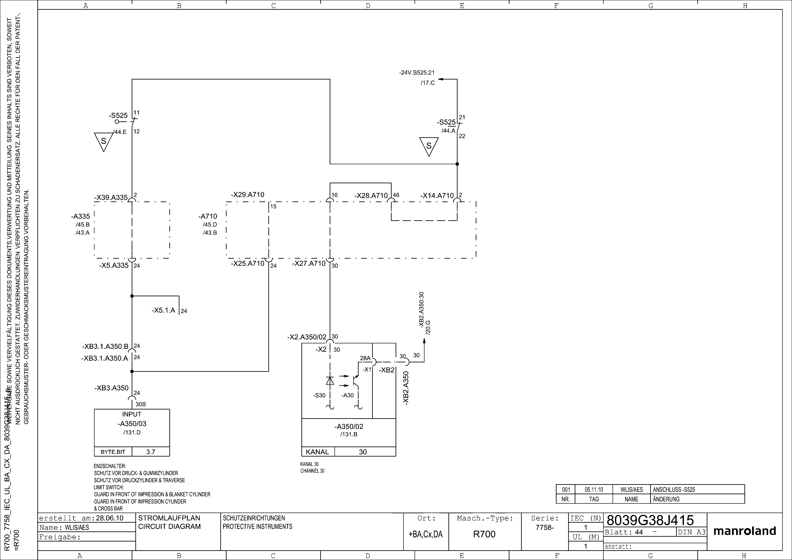

# +BA_Cx_DA — Sheet 44 of 247 — SCHUTZEINRICHTUNGEN

**PROTECTIVE INSTRUMENTS**

> Part of the manroland **R700** printing press IEC/UL circuit diagrams.
> Drawing class: **Stromlaufplan / Circuit diagram** (DIN A3).
> Document `+BA_Cx_DA` covers the **Printing units / main switch cabinet** machine section.

## At a glance

| Field | Value |
|---|---|
| Document | `+BA_Cx_DA`  (8039G38J415) |
| Sheet | **44** of 247 |
| Section (DE) | SCHUTZEINRICHTUNGEN |
| Section (EN) | PROTECTIVE INSTRUMENTS |
| Section type | CIRCUIT — Circuit diagram |
| Machine type | `R700` |
| Series | `7758` |
| Created | 28.06.10 |
| Replaces | — |
| Columns used | A, B, C, D, E, F, G |
| Path numbers | — |
| Labels on sheet | 82 |
| Cross-refs out | 10 |
| Cross-refs in | 24 |

**Previous:** [+BA_Cx_DA sheet 43](SHEET_0043.md) · **Next:** [+BA_Cx_DA sheet 45](SHEET_0045.md) · **Document TOC:** [_TOC.md](_TOC.md)  (+BA_Cx_DA) · **Master TOC:** [all sheets](../_MASTER_TOC.md)

## Sheet image (300 DPI, exact vector render)



_Rendered directly from the PDF vector layer at 300 DPI (1-bit), no OCR and no resampling. Use it to confirm anything ambiguous in the text below._

## Cross-references on this sheet

Each entry is a wire leaving this sheet. The printed token is `/sheet.column`; the link resolves to that sheet inside the same document.

| Ref | Target sheet | Col | Path | Destination on target | Target section | From col |
|---|---|---|---|---|---|---|
| `/17.C` | [+BA_Cx_DA sheet 17](SHEET_0017.md) | C | — | — | SPANNUNGSVERSORGUNG, SCHALTSCHRANKBELÜFTUNG | E |
| `/44.A` | [+BA_Cx_DA sheet 44](SHEET_0044.md) | A | — | — | SCHUTZEINRICHTUNGEN | C |
| `/44.E` | [+BA_Cx_DA sheet 44](SHEET_0044.md) | E | — | — | SCHUTZEINRICHTUNGEN | C |
| `/45.B` | [+BA_Cx_DA sheet 45](SHEET_0045.md) | B | — | — | SCHUTZEINRICHTUNGEN | A |
| `/43.A` | [+BA_Cx_DA sheet 43](SHEET_0043.md) | A | — | — | SCHUTZEINRICHTUNGEN | A |
| `/45.D` | [+BA_Cx_DA sheet 45](SHEET_0045.md) | D | — | — | SCHUTZEINRICHTUNGEN | B |
| `/43.B` | [+BA_Cx_DA sheet 43](SHEET_0043.md) | B | — | — | SCHUTZEINRICHTUNGEN | B |
| `/20.G` | [+BA_Cx_DA sheet 20](SHEET_0020.md) | G | — | XB2.A350:30 | BUSVERBINDUNGEN: SICHERHEITSBUS | E |
| `/131.D` | [+BA_Cx_DA sheet 131](SHEET_0131.md) | D | — | — | REFERENZMODUL | A |
| `/131.B` | [+BA_Cx_DA sheet 131](SHEET_0131.md) | B | — | — | REFERENZMODUL | D |

### Incoming references (sheets that point here)

Every other sheet that sends a wire to this one. `Back-ref` is the token printed on *that* sheet; `Path` is its line number.

| From sheet | Cols | Back-ref | Path | Refs | What continues there |
|---|---|---|---|---|---|
| [+BA_Cx_DA#17](SHEET_0017.md) | C | `/17.C` | — | 1 | — |
| [+BA_Cx_DA#20](SHEET_0020.md) | G | `/20.G` | — | 1 | XB2.A350:30 |
| [+BA_Cx_DA#43](SHEET_0043.md) | A, B | `/43.A`, `/43.B` | — | 2 | — |
| [+BA_Cx_DA#44](SHEET_0044.md) | C | `/44.C` | — | 2 | — |
| [+BA_Cx_DA#45](SHEET_0045.md) | B, D | `/45.B`, `/45.D` | — | 2 | — |
| [+BA_Cx_DA#131](SHEET_0131.md) | B, D | `/131.B`, `/131.D` | — | 2 | — |
| [+BA_Cx_DA#153](SHEET_0153.md) | G | `/153.G` | — | 2 | — |
| [+BA_Cx_DA#157](SHEET_0157.md) | C, D, F | `/157.C`, `/157.D`, `/157.F` | — | 3 | — |
| [+BA_Cx_DA#160](SHEET_0160.md) | C | `/160.C` | — | 1 | — |
| [+BA_Cx_DA#161](SHEET_0161.md) | A | `/161.A` | — | 1 | — |
| [+BA_Cx_DA#170](SHEET_0170.md) | H | `/170.H` | — | 1 | — |
| [+BA_Cx_DA#175](SHEET_0175.md) | H | `/175.H` | — | 1 | — |
| [+BA_Cx_DA#177](SHEET_0177.md) | F | `/177.F` | — | 1 | — |
| [+BA_Cx_DA#178](SHEET_0178.md) | H | `/178.H` | — | 1 | — |
| [+BA_Cx_DA#179](SHEET_0179.md) | B | `/179.B` | — | 2 | — |
| [+BA_Cx_DA#181](SHEET_0181.md) | A | `/181.A` | — | 1 | — |


## Devices on this sheet

| Tag | Class | Class meaning (IEC) | Col | Sub | Terminal | Sign |
|---|---|---|---|---|---|---|
| `A350/03` | A | Baugruppe / assembly, module, PC board | A | 03 | — | — |
| `A335` | A | Baugruppe / assembly, module, PC board | A | — | — | — |
| `A710` | A | Baugruppe / assembly, module, PC board | B | — | — | — |
| `S30` | S | Schalter / switch | C | — | — | — |
| `A30` | A | Baugruppe / assembly, module, PC board | D | — | — | — |
| `X1` | X | Klemme / terminal, plug connector | D | — | — | — |
| `X2` | X | Klemme / terminal, plug connector | D | — | — | — |
| `XB2` | XB |  | D | — | — | — |
| `A350/02` | A | Baugruppe / assembly, module, PC board | D | 02 | — | — |
| `S525` | S | Schalter / switch | E | — | — | — |
| `S525` | S | Schalter / switch | A | — | — | — |
| `3.7` | — | cross-device reference | B | — | — | — |
| `XB3.A350` | — | cross-device reference | A | — | — | — |
| `X5.A335` | — | cross-device reference | A | — | — | — |
| `X39.A335` | — | cross-device reference | A | — | — | — |
| `XB3.1.A350.B` | — | cross-device reference | A | — | — | — |
| `XB3.1.A350.A` | — | cross-device reference | A | — | — | — |
| `X27.A710` | — | cross-device reference | C | — | — | — |
| `X25.A710` | — | cross-device reference | C | — | — | — |
| `XB2.A350` | — | cross-device reference | D | — | — | — |
| `X28.A710` | — | cross-device reference | D | — | — | — |
| `X14.A710` | — | cross-device reference | E | — | — | — |
| `X5.1.A` | — | cross-device reference | B | — | — | — |
| `NR.` | — | cross-device reference | F | — | — | — |
| `05.11.10` | — | cross-device reference | F | — | — | — |
| `XB2.A350:30` | — | cross-device reference | E | — | 30 | — |
| `X29.A710` | — | cross-device reference | C | — | — | — |

## Potentials / nets

| Potential | Count | Columns | Attached devices | Terminals |
|---|---|---|---|---|
| `24V` | 1 | E | `S525` | `21` |


A potential such as `L24+/4` or `M24+` is a named supply/return rail; every place it appears on this sheet is electrically common.

## Wire-end annotations (grouped as printed)

A wire that continues elsewhere is annotated with a small cluster: the destination description, the path/line number `#NN`, and the `/sheet.column` cross reference. Each row below is one such cluster exactly as it is grouped on the drawing.

| Col | Y | Path | Cross-ref | Text on the wire |
|---|---|---|---|---|
| E | 105.2 | — | — | `24V.S525:21` |
| E | 120.8 | — | `/17.C` | — |
| B | 165.4 | — | — | `11` |
| A | 169.0 | — | — | `S525` |
| E | 172.5 | — | — | `21` |
| E | 178.9 | — | — | `S525` |
| C | 192.7 | — | `/44.A`, `/44.E` | — |
| B | 193.8 | — | — | `12` |
| E | 200.9 | — | — | `22` |
| C | 206.6 | — | — | `S S` |
| C | 288.0 | — | — | `X29.A710` |
| D | 289.4 | — | — | `X28.A710 46 X14.A710 2` |
| A | 289.5 | — | — | `X39.A335 2` |
| D | 289.5 | — | — | `16` |
| C | 306.5 | — | — | `A710 15` |
| A | 320.6 | — | — | `A335` |
| A | 333.7 | — | `/45.B`, `/43.A` | — |
| B | 333.7 | — | `/45.D`, `/43.B` | — |
| C | 391.5 | — | — | `X25.A710 24 X27.A710 30` |
| A | 394.3 | — | — | `X5.A335 24` |
| E | 438.8 | — | `/20.G` | `XB2.A350:30` |
| B | 461.7 | — | — | `X5.1.A 24` |
| C | 502.0 | — | — | `X2.A350/02 30` |
| A | 516.2 | — | — | `XB3.1.A350.B 24` |
| D | 520.5 | — | — | `X2` |
| D | 521.9 | — | — | `30 30` |
| E | 530.4 | — | — | `30` |
| A | 533.2 | — | — | `XB3.1.A350.A 24` |
| D | 534.6 | — | — | `28A` |
| D | 551.6 | — | — | `X1` |
| D | 551.7 | — | — | `XB2` |
| D | 557.9 | — | — | `XB2.A350` |
| A | 578.6 | — | — | `XB3.A350 24` |
| D | 590.6 | — | — | `S30 A30` |
| B | 604.1 | — | — | `30B` |
| A | 618.6 | — | — | `INPUT` |
| A | 632.4 | — | — | `A350/03` |
| D | 636.7 | — | — | `A350/02` |
| A | 646.2 | — | `/131.D` | — |
| D | 649.0 | — | `/131.B` | — |
| D | 674.9 | — | — | `KANAL 30` |
| A | 675.3 | — | — | `BYTE.BIT 3.7` |
| C | 695.3 | — | — | `KANAL 30 CHANNEL 30` |
| A | 697.9 | — | — | `ENDSCHALTER:` |
| B | 708.6 | — | — | `LIMIT SWITCH: SCHUTZ VOR DRUCK & GUMMIZYLINDER SCHUTZ VOR DRUCKZYLINDER & TRAVERSE` |
| G | 733.0 | — | — | `001 05.11.10 WLIS/AES ANSCHLUSS S525` |
| B | 740.5 | — | — | `GUARD IN FRONT OF IMPRESSION & BLANKET CYLINDER GUARD IN FRONT OF IMPRESSION CYLINDER & CROSS BAR` |
| G | 747.1 | — | — | `NR. TAG NAME ÄNDERUNG` |


## Reconstructed tables

This sheet carries tabular content (pin map / terminal assignment / index). The grid below was rebuilt from the drawing's own rule lines, so each row is exactly one physical row of the table.

### Table 1 — 4 data rows × 2 columns (at x=141.7, y=119.1)

| S525 /44.E S X39.A335 X5.A335 | 11 12 2 24 |
|---|---|
| `XB3.1.A350.B XB3.1.A350.A` | `X5.1.A 24 24` |
| `XB3.A350` | `24 30B` |
| `INPUT` | `A350/03 /131.D` |
| `BYTE.BIT` | `3.7` |


### Table 2 — 5 data rows × 7 columns (at x=403.9, y=119.1) — **/17.C S525 /44.A S**

| 15 |  | 16 | X28.A710 |  | 46 | X14.A710 |
|---|---|---|---|---|---|---|
| `24` | `X27.A710 X2.A350/02` | `30 30` |  |  | `XB2.A350:30` | `/20.G` |
|  | `X2` | `30` | `28A X1` | `XB2` | `30 30` |  |
|  | `S30` | `A30` |  |  | `XB2.A350` |  |
|  |  | `A350/02 /131.B` |  |  |  |  |
|  | `KANAL` |  | `30` |  |  |  |


## Notes and free text on this sheet

| Text | Col | Y (pt) |
|---|---|---|
| `30B` | B | 604.07 |
| `INPUT` | A | 618.59 |
| `BYTE.BIT` | A | 675.84 |
| `ENDSCHALTER:` | A | 697.94 |
| `SCHUTZ VOR DRUCK & GUMMIZYLINDER` | B | 708.6 |
| `SCHUTZ VOR DRUCKZYLINDER & TRAVERSE` | B | 719.22 |
| `LIMIT SWITCH:` | A | 729.79 |
| `GUARD IN FRONT OF IMPRESSION & BLANKET CYLINDER` | B | 740.49 |
| `GUARD IN FRONT OF IMPRESSION CYLINDER` | B | 751.12 |
| `& CROSS BAR` | A | 761.73 |
| `KANAL 30` | C | 695.27 |
| `CHANNEL 30` | C | 705.22 |
| `28A` | D | 534.62 |
| `KANAL` | C | 674.94 |
| `X2.A350/02` | C | 502.04 |
| `TAG` | F | 747.27 |
| `NAME` | G | 747.25 |
| `ÄNDERUNG` | G | 747.31 |
| `WLIS/AES` | G | 733.08 |
| `ANSCHLUSS S525` | G | 733.15 |
| `S` | E | 213.69 |
| `S` | A | 206.6 |

## Complete label inventory (exact text from the drawing)

Every text object inside the drawing area of this sheet, in DIN reading order (column A→H, then top→bottom). This is the authoritative list: if a string is not here it is not printed on this sheet.

| Col | Y | X | Dir | Type | Text |
|---|---|---|---|---|---|
| A | 169.0 | 163.6 | → | device tag | `S525` |
| A | 194.4 | 169.8 | → | cross-reference | `/44.E` |
| A | 206.6 | 151.8 | → | text | `S` |
| A | 292.3 | 141.7 | → | device ref | `X39.A335` |
| A | 320.6 | 106.9 | → | device tag | `A335` |
| A | 333.7 | 114.2 | → | cross-reference | `/45.B` |
| A | 346.1 | 114.0 | → | cross-reference | `/43.A` |
| A | 394.3 | 149.1 | → | device ref | `X5.A335` |
| A | 516.2 | 123.3 | → | device ref | `XB3.1.A350.B` |
| A | 533.9 | 122.5 | → | device ref | `XB3.1.A350.A` |
| A | 578.6 | 142.0 | → | device ref | `XB3.A350` |
| A | 618.6 | 183.5 | → | text | `INPUT` |
| A | 632.4 | 177.0 | → | device tag | `A350/03` |
| A | 646.2 | 185.7 | → | cross-reference | `/131.D` |
| A | 675.8 | 151.7 | → | text | `BYTE.BIT` |
| A | 697.9 | 140.9 | → | text | `ENDSCHALTER:` |
| A | 729.8 | 140.9 | → | text | `LIMIT SWITCH:` |
| A | 761.7 | 141.4 | → | text | `& CROSS BAR` |
| B | 165.4 | 200.4 | → | number | `11` |
| B | 193.8 | 200.4 | → | number | `12` |
| B | 289.5 | 201.0 | → | number | `2` |
| B | 320.6 | 298.2 | → | device tag | `A710` |
| B | 333.7 | 305.3 | → | cross-reference | `/45.D` |
| B | 346.1 | 305.6 | → | cross-reference | `/43.B` |
| B | 395.8 | 201.0 | → | number | `24` |
| B | 461.7 | 228.2 | → | device ref | `X5.1.A` |
| B | 463.8 | 271.8 | → | number | `24` |
| B | 516.2 | 201.0 | → | number | `24` |
| B | 533.2 | 201.0 | → | number | `24` |
| B | 587.1 | 201.0 | → | number | `24` |
| B | 604.1 | 203.8 | → | text | `30B` |
| B | 675.3 | 220.0 | → | device ref | `3.7` |
| B | 708.6 | 141.4 | → | text | `SCHUTZ VOR DRUCK & GUMMIZYLINDER` |
| B | 719.2 | 141.4 | → | text | `SCHUTZ VOR DRUCKZYLINDER & TRAVERSE` |
| B | 740.5 | 141.4 | → | text | `GUARD IN FRONT OF IMPRESSION & BLANKET CYLINDER` |
| B | 751.1 | 141.4 | → | text | `GUARD IN FRONT OF IMPRESSION CYLINDER` |
| C | 288.0 | 347.2 | → | device ref | `X29.A710` |
| C | 306.5 | 405.9 | → | number | `15` |
| C | 391.5 | 347.2 | → | device ref | `X25.A710` |
| C | 391.5 | 439.4 | → | device ref | `X27.A710` |
| C | 395.8 | 406.5 | → | number | `24` |
| C | 502.0 | 432.0 | → | text | `X2.A350/02` |
| C | 590.6 | 470.8 | → | device tag | `S30` |
| C | 674.9 | 459.8 | → | text | `KANAL` |
| C | 695.3 | 451.6 | → | text | `KANAL 30` |
| C | 705.2 | 451.8 | → | text | `CHANNEL 30` |
| D | 289.4 | 532.9 | → | device ref | `X28.A710` |
| D | 289.5 | 498.0 | → | number | `16` |
| D | 289.5 | 590.7 | → | number | `46` |
| D | 395.8 | 498.6 | → | number | `30` |
| D | 502.1 | 498.6 | → | number | `30` |
| D | 520.5 | 474.5 | → | device tag | `X2` |
| D | 521.9 | 501.4 | → | number | `30` |
| D | 531.8 | 600.7 | → | number | `30` |
| D | 534.6 | 541.4 | → | text | `28A` |
| D | 551.6 | 545.1 | → | device tag | `X1` |
| D | 551.7 | 569.5 | → | device tag | `XB2` |
| D | 557.9 | 605.5 | ↕ | device ref | `XB2.A350` |
| D | 590.6 | 513.4 | → | device tag | `A30` |
| D | 636.7 | 503.0 | → | device tag | `A350/02` |
| D | 649.0 | 511.8 | → | cross-reference | `/131.B` |
| D | 674.9 | 539.7 | → | number | `30` |
| E | 105.2 | 600.1 | → | potential | `24V.S525:21` |
| E | 120.8 | 632.7 | → | cross-reference | `/17.C` |
| E | 172.5 | 690.0 | → | number | `21` |
| E | 178.9 | 656.8 | → | device tag | `S525` |
| E | 192.7 | 663.9 | → | cross-reference | `/44.A` |
| E | 200.9 | 690.0 | → | number | `22` |
| E | 213.7 | 640.8 | → | text | `S` |
| E | 289.4 | 632.1 | → | device ref | `X14.A710` |
| E | 289.5 | 690.0 | → | number | `2` |
| E | 438.8 | 629.6 | ↕ | device ref | `XB2.A350:30` |
| E | 481.6 | 639.5 | ↕ | cross-reference | `/20.G` |
| E | 530.4 | 621.4 | → | number | `30` |
| F | 733.0 | 845.2 | → | number | `001` |
| F | 733.1 | 879.3 | → | device ref | `05.11.10` |
| F | 747.1 | 844.2 | → | device ref | `NR.` |
| F | 747.3 | 885.8 | → | text | `TAG` |
| G | 733.1 | 933.1 | → | text | `WLIS/AES` |
| G | 733.1 | 981.8 | → | text | `ANSCHLUSS S525` |
| G | 747.3 | 939.2 | → | text | `NAME` |
| G | 747.3 | 981.8 | → | text | `ÄNDERUNG` |

## Reading-order text block

The same content as a plain block, grouped by DIN column — convenient to paste or to match against a visual description.

```text
=== Column A ===
 169.0  163.6  devtag       S525
 194.4  169.8  xref         /44.E
 206.6  151.8  text         S
 292.3  141.7  devref       X39.A335
 320.6  106.9  devtag       A335
 333.7  114.2  xref         /45.B
 346.1  114.0  xref         /43.A
 394.3  149.1  devref       X5.A335
 516.2  123.3  devref       XB3.1.A350.B
 533.9  122.5  devref       XB3.1.A350.A
 578.6  142.0  devref       XB3.A350
 618.6  183.5  text         INPUT
 632.4  177.0  devtag       A350/03
 646.2  185.7  xref         /131.D
 675.8  151.7  text         BYTE.BIT
 697.9  140.9  text         ENDSCHALTER:
 729.8  140.9  text         LIMIT SWITCH:
 761.7  141.4  text         & CROSS BAR
=== Column B ===
 165.4  200.4  numeric      11
 193.8  200.4  numeric      12
 289.5  201.0  numeric      2
 320.6  298.2  devtag       A710
 333.7  305.3  xref         /45.D
 346.1  305.6  xref         /43.B
 395.8  201.0  numeric      24
 461.7  228.2  devref       X5.1.A
 463.8  271.8  numeric      24
 516.2  201.0  numeric      24
 533.2  201.0  numeric      24
 587.1  201.0  numeric      24
 604.1  203.8  text         30B
 675.3  220.0  devref       3.7
 708.6  141.4  text         SCHUTZ VOR DRUCK & GUMMIZYLINDER
 719.2  141.4  text         SCHUTZ VOR DRUCKZYLINDER & TRAVERSE
 740.5  141.4  text         GUARD IN FRONT OF IMPRESSION & BLANKET CYLINDER
 751.1  141.4  text         GUARD IN FRONT OF IMPRESSION CYLINDER
=== Column C ===
 288.0  347.2  devref       X29.A710
 306.5  405.9  numeric      15
 391.5  347.2  devref       X25.A710
 391.5  439.4  devref       X27.A710
 395.8  406.5  numeric      24
 502.0  432.0  text         X2.A350/02
 590.6  470.8  devtag       S30
 674.9  459.8  text         KANAL
 695.3  451.6  text         KANAL 30
 705.2  451.8  text         CHANNEL 30
=== Column D ===
 289.4  532.9  devref       X28.A710
 289.5  498.0  numeric      16
 289.5  590.7  numeric      46
 395.8  498.6  numeric      30
 502.1  498.6  numeric      30
 520.5  474.5  devtag       X2
 521.9  501.4  numeric      30
 531.8  600.7  numeric      30
 534.6  541.4  text         28A
 551.6  545.1  devtag       X1
 551.7  569.5  devtag       XB2
 557.9  605.5  devref       XB2.A350
 590.6  513.4  devtag       A30
 636.7  503.0  devtag       A350/02
 649.0  511.8  xref         /131.B
 674.9  539.7  numeric      30
=== Column E ===
 105.2  600.1  net          24V.S525:21
 120.8  632.7  xref         /17.C
 172.5  690.0  numeric      21
 178.9  656.8  devtag       S525
 192.7  663.9  xref         /44.A
 200.9  690.0  numeric      22
 213.7  640.8  text         S
 289.4  632.1  devref       X14.A710
 289.5  690.0  numeric      2
 438.8  629.6  devref       XB2.A350:30
 481.6  639.5  xref         /20.G
 530.4  621.4  numeric      30
=== Column F ===
 733.0  845.2  numeric      001
 733.1  879.3  devref       05.11.10
 747.1  844.2  devref       NR.
 747.3  885.8  text         TAG
=== Column G ===
 733.1  933.1  text         WLIS/AES
 733.1  981.8  text         ANSCHLUSS S525
 747.3  939.2  text         NAME
 747.3  981.8  text         ÄNDERUNG
```

---
_Generated from the PDF vector text layer; no OCR. Source: `R700_7758_IEC_UL_BA_CX_DA_8039G38J415_p`, sheet 44._
