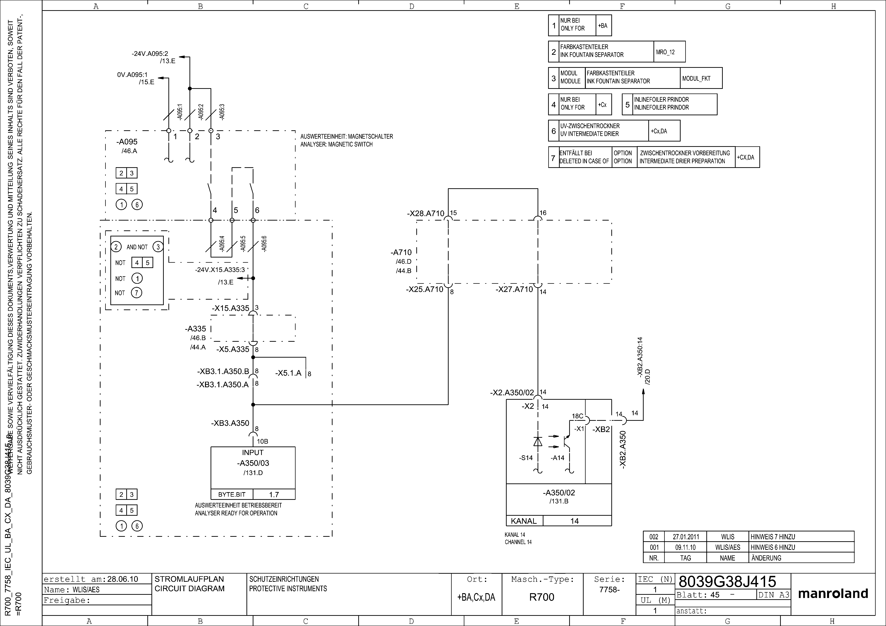

# +BA_Cx_DA — Sheet 45 of 247 — SCHUTZEINRICHTUNGEN

**PROTECTIVE INSTRUMENTS**

> Part of the manroland **R700** printing press IEC/UL circuit diagrams.
> Drawing class: **Stromlaufplan / Circuit diagram** (DIN A3).
> Document `+BA_Cx_DA` covers the **Printing units / main switch cabinet** machine section.

## At a glance

| Field | Value |
|---|---|
| Document | `+BA_Cx_DA`  (8039G38J415) |
| Sheet | **45** of 247 |
| Section (DE) | SCHUTZEINRICHTUNGEN |
| Section (EN) | PROTECTIVE INSTRUMENTS |
| Section type | CIRCUIT — Circuit diagram |
| Machine type | `R700` |
| Series | `7758` |
| Created | 28.06.10 |
| Replaces | — |
| Columns used | A, B, C, D, E, F, G |
| Path numbers | — |
| Labels on sheet | 142 |
| Cross-refs out | 11 |
| Cross-refs in | 23 |

**Previous:** [+BA_Cx_DA sheet 44](SHEET_0044.md) · **Next:** [+BA_Cx_DA sheet 46](SHEET_0046.md) · **Document TOC:** [_TOC.md](_TOC.md)  (+BA_Cx_DA) · **Master TOC:** [all sheets](../_MASTER_TOC.md)

## Sheet image (300 DPI, exact vector render)



_Rendered directly from the PDF vector layer at 300 DPI (1-bit), no OCR and no resampling. Use it to confirm anything ambiguous in the text below._

## Cross-references on this sheet

Each entry is a wire leaving this sheet. The printed token is `/sheet.column`; the link resolves to that sheet inside the same document.

| Ref | Target sheet | Col | Path | Destination on target | Target section | From col |
|---|---|---|---|---|---|---|
| `/13.E` | [+BA_Cx_DA sheet 13](SHEET_0013.md) | E | — | 24V.A095:2 | SPANNUNGSVERSORGUNG, SCHALTSCHRANKBELÜFTUNG | B |
| `/15.E` | [+BA_Cx_DA sheet 15](SHEET_0015.md) | E | — | 0V.A095:1 | SPANNUNGSVERSORGUNG, SCHALTSCHRANKBELÜFTUNG | A |
| `/46.A` | [+BA_Cx_DA sheet 46](SHEET_0046.md) | A | — | — | SCHUTZEINRICHTUNGEN | A |
| `/46.D` | [+BA_Cx_DA sheet 46](SHEET_0046.md) | D | — | — | SCHUTZEINRICHTUNGEN | D |
| `/44.B` | [+BA_Cx_DA sheet 44](SHEET_0044.md) | B | — | — | SCHUTZEINRICHTUNGEN | D |
| `/13.E` | [+BA_Cx_DA sheet 13](SHEET_0013.md) | E | — | — | SPANNUNGSVERSORGUNG, SCHALTSCHRANKBELÜFTUNG | B |
| `/46.B` | [+BA_Cx_DA sheet 46](SHEET_0046.md) | B | — | — | SCHUTZEINRICHTUNGEN | B |
| `/44.A` | [+BA_Cx_DA sheet 44](SHEET_0044.md) | A | — | — | SCHUTZEINRICHTUNGEN | B |
| `/20.D` | [+BA_Cx_DA sheet 20](SHEET_0020.md) | D | — | XB2.A350:14 | BUSVERBINDUNGEN: SICHERHEITSBUS | F |
| `/131.D` | [+BA_Cx_DA sheet 131](SHEET_0131.md) | D | — | — | REFERENZMODUL | B |
| `/131.B` | [+BA_Cx_DA sheet 131](SHEET_0131.md) | B | — | — | REFERENZMODUL | E |

### Incoming references (sheets that point here)

Every other sheet that sends a wire to this one. `Back-ref` is the token printed on *that* sheet; `Path` is its line number.

| From sheet | Cols | Back-ref | Path | Refs | What continues there |
|---|---|---|---|---|---|
| [+BA_Cx_DA#13](SHEET_0013.md) | E | `/13.E` | — | 2 | 24V.A095:2; 24V.X15.A335:3 |
| [+BA_Cx_DA#15](SHEET_0015.md) | E | `/15.E` | — | 1 | 0V.A095:1 |
| [+BA_Cx_DA#20](SHEET_0020.md) | D | `/20.D` | — | 1 | XB2.A350:14 |
| [+BA_Cx_DA#44](SHEET_0044.md) | A, B | `/44.A`, `/44.B` | — | 2 | — |
| [+BA_Cx_DA#46](SHEET_0046.md) | A, C | `/46.A`, `/46.C` | — | 3 | — |
| [+BA_Cx_DA#131](SHEET_0131.md) | B, D | `/131.B`, `/131.D` | — | 2 | — |
| [+BA_Cx_DA#153](SHEET_0153.md) | F | `/153.F` | — | 2 | — |
| [+BA_Cx_DA#157](SHEET_0157.md) | C, D, F | `/157.C`, `/157.D`, `/157.F` | — | 3 | — |
| [+BA_Cx_DA#160](SHEET_0160.md) | C | `/160.C` | — | 1 | — |
| [+BA_Cx_DA#161](SHEET_0161.md) | A | `/161.A` | — | 1 | — |
| [+BA_Cx_DA#171](SHEET_0171.md) | E | `/171.E` | — | 1 | — |
| [+BA_Cx_DA#175](SHEET_0175.md) | H | `/175.H` | — | 1 | — |
| [+BA_Cx_DA#177](SHEET_0177.md) | E | `/177.E` | — | 1 | — |
| [+BA_Cx_DA#178](SHEET_0178.md) | G | `/178.G` | — | 2 | — |


## Devices on this sheet

| Tag | Class | Class meaning (IEC) | Col | Sub | Terminal | Sign |
|---|---|---|---|---|---|---|
| `A095` | A | Baugruppe / assembly, module, PC board | A | — | — | — |
| `A335` | A | Baugruppe / assembly, module, PC board | B | — | — | — |
| `A350/03` | A | Baugruppe / assembly, module, PC board | B | 03 | — | — |
| `S14` | S | Schalter / switch | E | — | — | — |
| `A14` | A | Baugruppe / assembly, module, PC board | E | — | — | — |
| `X1` | X | Klemme / terminal, plug connector | F | — | — | — |
| `X2` | X | Klemme / terminal, plug connector | E | — | — | — |
| `XB2` | XB |  | F | — | — | — |
| `A350/02` | A | Baugruppe / assembly, module, PC board | E | 02 | — | — |
| `A710` | A | Baugruppe / assembly, module, PC board | D | — | — | — |
| `A095:3` | A | Baugruppe / assembly, module, PC board | B | — | 3 | — |
| `A095:2` | A | Baugruppe / assembly, module, PC board | B | — | 2 | — |
| `A095:1` | A | Baugruppe / assembly, module, PC board | B | — | 1 | — |
| `A095:4` | A | Baugruppe / assembly, module, PC board | B | — | 4 | — |
| `A095:5` | A | Baugruppe / assembly, module, PC board | B | — | 5 | — |
| `A095:6` | A | Baugruppe / assembly, module, PC board | C | — | 6 | — |
| `X5.A335` | — | cross-device reference | B | — | — | — |
| `X15.A335` | — | cross-device reference | B | — | — | — |
| `1.7` | — | cross-device reference | C | — | — | — |
| `XB3.A350` | — | cross-device reference | B | — | — | — |
| `X27.A710` | — | cross-device reference | E | — | — | — |
| `XB2.A350` | — | cross-device reference | F | — | — | — |
| `XB3.1.A350.B` | — | cross-device reference | B | — | — | — |
| `XB3.1.A350.A` | — | cross-device reference | B | — | — | — |
| `X25.A710` | — | cross-device reference | D | — | — | — |
| `X28.A710` | — | cross-device reference | D | — | — | — |
| `X5.1.A` | — | cross-device reference | C | — | — | — |
| `NR.` | — | cross-device reference | F | — | — | — |
| `09.11.10` | — | cross-device reference | G | — | — | — |
| `XB2.A350:14` | — | cross-device reference | F | — | 14 | — |
| `27.01.2011` | — | cross-device reference | G | — | — | — |

## Potentials / nets

| Potential | Count | Columns | Attached devices | Terminals |
|---|---|---|---|---|
| `0V` | 1 | A | `A095` | `1` |
| `24V` | 2 | B | `A095`, `A335`, `X15` | `2`, `3` |


A potential such as `L24+/4` or `M24+` is a named supply/return rail; every place it appears on this sheet is electrically common.

## Wire-end annotations (grouped as printed)

A wire that continues elsewhere is annotated with a small cluster: the destination description, the path/line number `#NN`, and the `/sheet.column` cross reference. Each row below is one such cluster exactly as it is grouped on the drawing.

| Col | Y | Path | Cross-ref | Text on the wire |
|---|---|---|---|---|
| E | 24.7 | — | — | `1 NUR BEI` |
| F | 31.8 | — | — | `ONLY FOR +BA` |
| F | 60.1 | — | — | `2 FARBKASTENTEILER INK FOUNTAIN SEPARATOR` |
| F | 67.3 | — | — | `MRO_12` |
| B | 68.3 | — | `/13.E` | `24V.A095:2` |
| E | 95.6 | — | — | `3 MODUL MODULE` |
| F | 95.6 | — | — | `FARBKASTENTEILER INK FOUNTAIN SEPARATOR` |
| A | 96.7 | — | `/15.E` | `0V.A095:1` |
| G | 102.7 | — | — | `MODUL_FKT` |
| E | 131.0 | — | — | `4 NUR BEI` |
| F | 131.0 | — | — | `5 INLINEFOILER PRINDOR INLINEFOILER PRINDOR` |
| F | 138.2 | — | — | `ONLY FOR +Cx` |
| B | 139.6 | — | — | `A095:1` |
| B | 139.9 | — | — | `A095:2` |
| B | 140.0 | — | — | `A095:3` |
| F | 166.4 | — | — | `6 UV ZWISCHENTROCKNER UV INTERMEDIATE DRIER` |
| F | 173.6 | — | — | `+Cx,DA` |
| B | 178.8 | — | — | `A095 1 2 3` |
| C | 180.6 | — | — | `AUSWERTEEINHEIT: MAGNETSCHALTER ANALYSER: MAGNETIC SWITCH` |
| A | 199.0 | — | `/46.A` | — |
| F | 203.1 | — | — | `7 ENTFÄLLT BEI DELETED IN CASE OF INTERMEDIATE DRIER PREPARATION ZWISCHENTROCKNER VORBEREITUNG +CX,DA` |
| F | 203.1 | — | — | `OPTION OPTION` |
| A | 229.2 | — | — | `2 3` |
| A | 250.5 | — | — | `4 5` |
| A | 271.9 | — | — | `1` |
| A | 272.4 | — | — | `6` |
| B | 278.1 | — | — | `4 5 6` |
| D | 282.4 | — | — | `X28.A710 15` |
| E | 282.4 | — | — | `16` |
| B | 317.1 | — | — | `A095:4` |
| B | 317.1 | — | — | `A095:5` |
| C | 317.1 | — | — | `A095:6` |
| A | 329.1 | — | — | `2 AND NOT 3` |
| D | 334.8 | — | — | `A710` |
| D | 347.9 | — | `/46.D`, `/44.B` | — |
| A | 349.7 | — | — | `NOT 4 5` |
| B | 358.9 | — | — | `24V.X15.A335:3` |
| A | 371.1 | — | — | `1` |
| A | 371.9 | — | — | `NOT` |
| B | 375.8 | — | `/13.E` | — |
| D | 384.4 | — | — | `X25.A710 8` |
| E | 384.4 | — | — | `X27.A710 14` |
| A | 391.0 | — | — | `NOT 7` |
| B | 409.9 | — | — | `X15.A335 3` |
| B | 437.6 | — | — | `A335` |
| B | 450.6 | — | `/46.B`, `/44.A` | — |
| F | 453.0 | — | `/20.D` | `XB2.A350:14` |
| B | 465.2 | — | — | `X5.A335 8` |
| B | 495.0 | — | — | `XB3.1.A350.B 8` |
| C | 497.1 | — | — | `X5.1.A 8` |
| B | 512.0 | — | — | `XB3.1.A350.A 8` |
| E | 523.3 | — | — | `X2.A350/02 14` |
| E | 541.7 | — | — | `X2` |
| F | 543.2 | — | — | `14 14` |
| F | 551.7 | — | — | `14` |
| F | 555.9 | — | — | `18C` |
| B | 564.4 | — | — | `XB3.A350 8` |
| F | 572.9 | — | — | `X1` |
| F | 572.9 | — | — | `XB2` |
| F | 579.1 | — | — | `XB2.A350` |
| C | 589.9 | — | — | `10B` |
| B | 604.4 | — | — | `INPUT` |
| E | 611.9 | — | — | `S14 A14` |
| B | 618.3 | — | — | `A350/03` |
| B | 632.1 | — | `/131.D` | — |
| E | 657.9 | — | — | `A350/02` |
| B | 661.1 | — | — | `BYTE.BIT 1.7` |
| A | 661.5 | — | — | `2 3` |
| E | 670.3 | — | `/131.B` | — |
| B | 676.7 | — | — | `AUSWERTEEINHEIT BETRIEBSBEREIT ANALYSER READY FOR OPERATION` |
| A | 682.8 | — | — | `4 5` |
| E | 696.2 | — | — | `KANAL 14` |
| A | 704.2 | — | — | `1` |
| A | 704.7 | — | — | `6` |
| E | 716.5 | — | — | `KANAL 14 CHANNEL 14` |
| G | 718.9 | — | — | `002 27.01.2011 WLIS HINWEIS 7 HINZU` |
| G | 733.0 | — | — | `001 09.11.10 WLIS/AES HINWEIS 6 HINZU` |
| G | 747.1 | — | — | `NR. TAG NAME ÄNDERUNG` |


## Reconstructed tables

This sheet carries tabular content (pin map / terminal assignment / index). The grid below was rebuilt from the drawing's own rule lines, so each row is exactly one physical row of the table.

### Table 1 — 4 data rows × 1 columns (at x=141.7, y=296.2)

| C1 |
|---|
| `2 3 AND NOT` |
| `4 5 NOT 1 NOT 7 NOT` |
| `2 3` |
| `4 5 1 6` |


### Table 2 — 8 data rows × 6 columns (at x=255.1, y=296.2)

|  | A095:4 | A095:5 |  | A095:6 |  |
|---|---|---|---|---|---|
|  | `24V.X15.A335:3 /13.E` |  |  |  |  |
|  | `X15.A335` |  |  | `3` |  |
| `A335 /46.B /44.A` |  | `X5.A335` |  | `8` |  |
|  | `XB3.1.A350.B XB3.1.A350.A` |  |  | `8 X5.1.A 8` | `8` |
|  | `XB3.A350` |  |  | `8 10B` |  |
|  |  |  | `INPUT` | `A350/03 /131.D` |  |
|  | `BYTE.BIT` |  |  | `1.7` |  |
| `ANALYSER` | `AUSWERTEEINHEIT READY` | `FOR` |  | `BETRIEBSBEREIT OPERATION` |  |


### Table 3 — 3 data rows × 6 columns (at x=602.4, y=253.7)

| 15 8 | X27.A710 X2.A350/02 | 16 14 14 |  |  | XB2.A350:14 |
|---|---|---|---|---|---|
|  | `X2 S14` | `14 A14` | `18C X1` | `XB2` | `14 14 XB2.A350` |
|  |  | `A350/02 /131.B` |  |  |  |
|  | `KANAL` |  | `14` |  |  |


## Notes and free text on this sheet

| Text | Col | Y (pt) |
|---|---|---|
| `AUSWERTEEINHEIT: MAGNETSCHALTER` | C | 180.62 |
| `ANALYSER: MAGNETIC SWITCH` | C | 191.24 |
| `10B` | C | 589.89 |
| `INPUT` | B | 604.42 |
| `BYTE.BIT` | B | 661.67 |
| `AUSWERTEEINHEIT BETRIEBSBEREIT` | B | 676.67 |
| `ANALYSER READY FOR OPERATION` | B | 687.32 |
| `KANAL 14` | E | 716.53 |
| `CHANNEL 14` | E | 726.48 |
| `18C` | F | 555.92 |
| `KANAL` | E | 696.2 |
| `X2.A350/02` | E | 523.3 |
| `TAG` | G | 747.27 |
| `NAME` | G | 747.25 |
| `ÄNDERUNG` | G | 747.31 |
| `WLIS/AES` | G | 733.08 |
| `HINWEIS 6 HINZU` | G | 733.1 |
| `WLIS` | G | 718.85 |
| `HINWEIS 7 HINZU` | G | 718.92 |
| `AND NOT` | A | 329.46 |
| `NOT` | A | 350.67 |
| `FARBKASTENTEILER` | F | 60.14 |
| `INK FOUNTAIN SEPARATOR` | F | 70.78 |
| `MODUL` | E | 95.62 |
| `MODULE` | F | 106.23 |
| `MRO_12` | F | 67.26 |
| `MODUL_FKT` | G | 102.7 |
| `INLINEFOILER PRINDOR` | F | 131.02 |
| `NUR BEI` | F | 24.67 |
| `ONLY FOR` | F | 35.36 |
| `+BA` | F | 31.78 |
| `UV ZWISCHENTROCKNER` | F | 166.45 |
| `UV INTERMEDIATE DRIER` | F | 177.08 |
| `+Cx` | F | 138.2 |
| `+Cx,DA` | F | 173.59 |
| `OPTION` | F | 203.12 |
| `ZWISCHENTROCKNER VORBEREITUNG` | G | 203.15 |
| `INTERMEDIATE DRIER PREPARATION` | G | 213.78 |
| `ENTFÄLLT BEI` | F | 203.11 |
| `DELETED IN CASE OF` | F | 213.77 |
| `+CX,DA` | G | 208.82 |

## Complete label inventory (exact text from the drawing)

Every text object inside the drawing area of this sheet, in DIN reading order (column A→H, then top→bottom). This is the authoritative list: if a string is not here it is not printed on this sheet.

| Col | Y | X | Dir | Type | Text |
|---|---|---|---|---|---|
| A | 96.7 | 157.6 | → | potential | `0V.A095:1` |
| A | 106.5 | 186.8 | → | cross-reference | `/15.E` |
| A | 186.0 | 156.5 | → | device tag | `A095` |
| A | 199.0 | 163.6 | → | cross-reference | `/46.A` |
| A | 229.2 | 160.7 | → | number | `2` |
| A | 229.2 | 174.8 | → | number | `3` |
| A | 250.5 | 160.6 | → | number | `4` |
| A | 250.5 | 174.8 | → | number | `5` |
| A | 271.9 | 161.2 | → | number | `1` |
| A | 272.4 | 182.3 | → | number | `6` |
| A | 329.1 | 153.9 | → | number | `2` |
| A | 329.5 | 170.4 | → | text | `AND NOT` |
| A | 349.7 | 181.8 | → | number | `4` |
| A | 349.7 | 196.0 | → | number | `5` |
| A | 350.7 | 155.1 | → | text | `NOT` |
| A | 371.1 | 182.5 | → | number | `1` |
| A | 371.9 | 155.1 | → | text | `NOT` |
| A | 391.0 | 181.6 | → | number | `7` |
| A | 391.3 | 154.4 | → | text | `NOT` |
| A | 661.5 | 160.7 | → | number | `2` |
| A | 661.5 | 174.8 | → | number | `3` |
| A | 682.8 | 160.6 | → | number | `4` |
| A | 682.8 | 174.8 | → | number | `5` |
| A | 704.2 | 161.2 | → | number | `1` |
| A | 704.7 | 182.3 | → | number | `6` |
| B | 68.3 | 177.2 | → | potential | `24V.A095:2` |
| B | 78.2 | 215.1 | → | cross-reference | `/13.E` |
| B | 139.5 | 238.7 | ↕ | device tag | `A095:1` |
| B | 139.9 | 267.1 | ↕ | device tag | `A095:2` |
| B | 140.0 | 295.4 | ↕ | device tag | `A095:3` |
| B | 178.9 | 232.7 | → | number | `1` |
| B | 178.9 | 261.9 | → | number | `2` |
| B | 178.9 | 290.0 | → | number | `3` |
| B | 278.1 | 286.0 | → | number | `4` |
| B | 278.1 | 314.1 | → | number | `5` |
| B | 317.1 | 295.4 | ↕ | device tag | `A095:4` |
| B | 317.1 | 323.8 | ↕ | device tag | `A095:5` |
| B | 329.1 | 210.6 | → | number | `3` |
| B | 358.9 | 262.2 | → | potential | `24V.X15.A335:3` |
| B | 375.8 | 293.1 | → | cross-reference | `/13.E` |
| B | 409.9 | 284.9 | → | device ref | `X15.A335` |
| B | 437.5 | 248.6 | → | device tag | `A335` |
| B | 450.6 | 256.0 | → | cross-reference | `/46.B` |
| B | 463.0 | 255.7 | → | cross-reference | `/44.A` |
| B | 465.2 | 290.8 | → | device ref | `X5.A335` |
| B | 495.0 | 265.0 | → | device ref | `XB3.1.A350.B` |
| B | 512.7 | 264.2 | → | device ref | `XB3.1.A350.A` |
| B | 564.4 | 283.7 | → | device ref | `XB3.A350` |
| B | 604.4 | 325.3 | → | text | `INPUT` |
| B | 618.3 | 318.8 | → | device tag | `A350/03` |
| B | 632.1 | 327.4 | → | cross-reference | `/131.D` |
| B | 661.7 | 293.4 | → | text | `BYTE.BIT` |
| B | 676.7 | 262.2 | → | text | `AUSWERTEEINHEIT BETRIEBSBEREIT` |
| B | 687.3 | 262.2 | → | text | `ANALYSER READY FOR OPERATION` |
| C | 180.6 | 403.9 | → | text | `AUSWERTEEINHEIT: MAGNETSCHALTER` |
| C | 191.2 | 403.9 | → | text | `ANALYSER: MAGNETIC SWITCH` |
| C | 278.1 | 342.7 | → | number | `6` |
| C | 317.1 | 352.1 | ↕ | device tag | `A095:6` |
| C | 409.9 | 342.7 | → | number | `3` |
| C | 466.6 | 342.7 | → | number | `8` |
| C | 495.0 | 342.7 | → | number | `8` |
| C | 497.1 | 369.9 | → | device ref | `X5.1.A` |
| C | 499.2 | 413.6 | → | number | `8` |
| C | 512.0 | 342.7 | → | number | `8` |
| C | 572.9 | 342.7 | → | number | `8` |
| C | 589.9 | 345.0 | → | text | `10B` |
| C | 661.1 | 361.4 | → | device ref | `1.7` |
| D | 282.4 | 547.1 | → | device ref | `X28.A710` |
| D | 282.4 | 604.3 | → | number | `15` |
| D | 334.8 | 525.0 | → | device tag | `A710` |
| D | 347.9 | 532.1 | → | cross-reference | `/46.D` |
| D | 360.2 | 532.3 | → | cross-reference | `/44.B` |
| D | 384.4 | 545.7 | → | device ref | `X25.A710` |
| D | 388.7 | 604.9 | → | number | `8` |
| E | 30.0 | 741.5 | → | number | `1` |
| E | 65.5 | 741.3 | → | number | `2` |
| E | 95.6 | 753.4 | → | text | `MODUL` |
| E | 100.9 | 741.1 | → | number | `3` |
| E | 136.3 | 741.3 | → | number | `4` |
| E | 171.8 | 741.3 | → | number | `6` |
| E | 208.3 | 740.4 | → | number | `7` |
| E | 282.4 | 724.8 | → | number | `16` |
| E | 384.4 | 666.1 | → | device ref | `X27.A710` |
| E | 388.7 | 724.8 | → | number | `14` |
| E | 523.3 | 658.8 | → | text | `X2.A350/02` |
| E | 523.3 | 724.8 | → | number | `14` |
| E | 541.7 | 701.3 | → | device tag | `X2` |
| E | 543.2 | 727.7 | → | number | `14` |
| E | 611.9 | 697.6 | → | device tag | `S14` |
| E | 611.9 | 740.1 | → | device tag | `A14` |
| E | 657.9 | 729.8 | → | device tag | `A350/02` |
| E | 670.3 | 738.6 | → | cross-reference | `/131.B` |
| E | 696.2 | 686.6 | → | text | `KANAL` |
| E | 716.5 | 678.3 | → | text | `KANAL 14` |
| E | 726.5 | 678.6 | → | text | `CHANNEL 14` |
| F | 24.7 | 753.2 | → | text | `NUR BEI` |
| F | 31.8 | 804.0 | → | text | `+BA` |
| F | 35.4 | 753.7 | → | text | `ONLY FOR` |
| F | 60.1 | 753.2 | → | text | `FARBKASTENTEILER` |
| F | 67.3 | 881.7 | → | text | `MRO_12` |
| F | 70.8 | 753.2 | → | text | `INK FOUNTAIN SEPARATOR` |
| F | 95.6 | 788.6 | → | text | `FARBKASTENTEILER` |
| F | 106.2 | 753.4 | → | text | `MODULE` |
| F | 106.2 | 788.6 | → | text | `INK FOUNTAIN SEPARATOR` |
| F | 131.0 | 753.2 | → | text | `NUR BEI` |
| F | 131.0 | 852.4 | → | text | `INLINEFOILER PRINDOR` |
| F | 136.3 | 840.3 | → | number | `5` |
| F | 138.2 | 804.0 | → | text | `+Cx` |
| F | 141.7 | 753.7 | → | text | `ONLY FOR` |
| F | 141.7 | 852.4 | → | text | `INLINEFOILER PRINDOR` |
| F | 166.4 | 753.2 | → | text | `UV ZWISCHENTROCKNER` |
| F | 173.6 | 874.9 | → | text | `+Cx,DA` |
| F | 177.1 | 753.2 | → | text | `UV INTERMEDIATE DRIER` |
| F | 203.1 | 752.0 | → | text | `ENTFÄLLT BEI` |
| F | 203.1 | 824.8 | → | text | `OPTION` |
| F | 213.8 | 752.0 | → | text | `DELETED IN CASE OF` |
| F | 213.8 | 824.8 | → | text | `OPTION` |
| F | 453.0 | 856.3 | ↕ | device ref | `XB2.A350:14` |
| F | 496.3 | 866.3 | ↕ | cross-reference | `/20.D` |
| F | 551.7 | 848.1 | → | number | `14` |
| F | 553.1 | 826.9 | → | number | `14` |
| F | 555.9 | 768.2 | → | text | `18C` |
| F | 572.9 | 771.9 | → | device tag | `X1` |
| F | 572.9 | 796.3 | → | device tag | `XB2` |
| F | 579.1 | 832.3 | ↕ | device ref | `XB2.A350` |
| F | 696.2 | 766.2 | → | number | `14` |
| F | 719.0 | 872.9 | → | number | `002` |
| F | 733.0 | 873.5 | → | number | `001` |
| F | 747.1 | 872.6 | → | device ref | `NR.` |
| G | 102.7 | 917.1 | → | text | `MODUL_FKT` |
| G | 203.1 | 860.5 | → | text | `ZWISCHENTROCKNER VORBEREITUNG` |
| G | 208.8 | 990.7 | → | text | `+CX,DA` |
| G | 213.8 | 859.7 | → | text | `INTERMEDIATE DRIER PREPARATION` |
| G | 718.9 | 904.5 | → | device ref | `27.01.2011` |
| G | 718.9 | 969.4 | → | text | `WLIS` |
| G | 718.9 | 1009.0 | → | text | `HINWEIS 7 HINZU` |
| G | 733.1 | 907.7 | → | device ref | `09.11.10` |
| G | 733.1 | 961.4 | → | text | `WLIS/AES` |
| G | 733.1 | 1009.0 | → | text | `HINWEIS 6 HINZU` |
| G | 747.3 | 914.1 | → | text | `TAG` |
| G | 747.3 | 967.5 | → | text | `NAME` |
| G | 747.3 | 1010.1 | → | text | `ÄNDERUNG` |

## Reading-order text block

The same content as a plain block, grouped by DIN column — convenient to paste or to match against a visual description.

```text
=== Column A ===
  96.7  157.6  net          0V.A095:1
 106.5  186.8  xref         /15.E
 186.0  156.5  devtag       A095
 199.0  163.6  xref         /46.A
 229.2  160.7  numeric      2
 229.2  174.8  numeric      3
 250.5  160.6  numeric      4
 250.5  174.8  numeric      5
 271.9  161.2  numeric      1
 272.4  182.3  numeric      6
 329.1  153.9  numeric      2
 329.5  170.4  text         AND NOT
 349.7  181.8  numeric      4
 349.7  196.0  numeric      5
 350.7  155.1  text         NOT
 371.1  182.5  numeric      1
 371.9  155.1  text         NOT
 391.0  181.6  numeric      7
 391.3  154.4  text         NOT
 661.5  160.7  numeric      2
 661.5  174.8  numeric      3
 682.8  160.6  numeric      4
 682.8  174.8  numeric      5
 704.2  161.2  numeric      1
 704.7  182.3  numeric      6
=== Column B ===
  68.3  177.2  net          24V.A095:2
  78.2  215.1  xref         /13.E
 139.5  238.7  devtag       A095:1
 139.9  267.1  devtag       A095:2
 140.0  295.4  devtag       A095:3
 178.9  232.7  numeric      1
 178.9  261.9  numeric      2
 178.9  290.0  numeric      3
 278.1  286.0  numeric      4
 278.1  314.1  numeric      5
 317.1  295.4  devtag       A095:4
 317.1  323.8  devtag       A095:5
 329.1  210.6  numeric      3
 358.9  262.2  net          24V.X15.A335:3
 375.8  293.1  xref         /13.E
 409.9  284.9  devref       X15.A335
 437.5  248.6  devtag       A335
 450.6  256.0  xref         /46.B
 463.0  255.7  xref         /44.A
 465.2  290.8  devref       X5.A335
 495.0  265.0  devref       XB3.1.A350.B
 512.7  264.2  devref       XB3.1.A350.A
 564.4  283.7  devref       XB3.A350
 604.4  325.3  text         INPUT
 618.3  318.8  devtag       A350/03
 632.1  327.4  xref         /131.D
 661.7  293.4  text         BYTE.BIT
 676.7  262.2  text         AUSWERTEEINHEIT BETRIEBSBEREIT
 687.3  262.2  text         ANALYSER READY FOR OPERATION
=== Column C ===
 180.6  403.9  text         AUSWERTEEINHEIT: MAGNETSCHALTER
 191.2  403.9  text         ANALYSER: MAGNETIC SWITCH
 278.1  342.7  numeric      6
 317.1  352.1  devtag       A095:6
 409.9  342.7  numeric      3
 466.6  342.7  numeric      8
 495.0  342.7  numeric      8
 497.1  369.9  devref       X5.1.A
 499.2  413.6  numeric      8
 512.0  342.7  numeric      8
 572.9  342.7  numeric      8
 589.9  345.0  text         10B
 661.1  361.4  devref       1.7
=== Column D ===
 282.4  547.1  devref       X28.A710
 282.4  604.3  numeric      15
 334.8  525.0  devtag       A710
 347.9  532.1  xref         /46.D
 360.2  532.3  xref         /44.B
 384.4  545.7  devref       X25.A710
 388.7  604.9  numeric      8
=== Column E ===
  30.0  741.5  numeric      1
  65.5  741.3  numeric      2
  95.6  753.4  text         MODUL
 100.9  741.1  numeric      3
 136.3  741.3  numeric      4
 171.8  741.3  numeric      6
 208.3  740.4  numeric      7
 282.4  724.8  numeric      16
 384.4  666.1  devref       X27.A710
 388.7  724.8  numeric      14
 523.3  658.8  text         X2.A350/02
 523.3  724.8  numeric      14
 541.7  701.3  devtag       X2
 543.2  727.7  numeric      14
 611.9  697.6  devtag       S14
 611.9  740.1  devtag       A14
 657.9  729.8  devtag       A350/02
 670.3  738.6  xref         /131.B
 696.2  686.6  text         KANAL
 716.5  678.3  text         KANAL 14
 726.5  678.6  text         CHANNEL 14
=== Column F ===
  24.7  753.2  text         NUR BEI
  31.8  804.0  text         +BA
  35.4  753.7  text         ONLY FOR
  60.1  753.2  text         FARBKASTENTEILER
  67.3  881.7  text         MRO_12
  70.8  753.2  text         INK FOUNTAIN SEPARATOR
  95.6  788.6  text         FARBKASTENTEILER
 106.2  753.4  text         MODULE
 106.2  788.6  text         INK FOUNTAIN SEPARATOR
 131.0  753.2  text         NUR BEI
 131.0  852.4  text         INLINEFOILER PRINDOR
 136.3  840.3  numeric      5
 138.2  804.0  text         +Cx
 141.7  753.7  text         ONLY FOR
 141.7  852.4  text         INLINEFOILER PRINDOR
 166.4  753.2  text         UV ZWISCHENTROCKNER
 173.6  874.9  text         +Cx,DA
 177.1  753.2  text         UV INTERMEDIATE DRIER
 203.1  752.0  text         ENTFÄLLT BEI
 203.1  824.8  text         OPTION
 213.8  752.0  text         DELETED IN CASE OF
 213.8  824.8  text         OPTION
 453.0  856.3  devref       XB2.A350:14
 496.3  866.3  xref         /20.D
 551.7  848.1  numeric      14
 553.1  826.9  numeric      14
 555.9  768.2  text         18C
 572.9  771.9  devtag       X1
 572.9  796.3  devtag       XB2
 579.1  832.3  devref       XB2.A350
 696.2  766.2  numeric      14
 719.0  872.9  numeric      002
 733.0  873.5  numeric      001
 747.1  872.6  devref       NR.
=== Column G ===
 102.7  917.1  text         MODUL_FKT
 203.1  860.5  text         ZWISCHENTROCKNER VORBEREITUNG
 208.8  990.7  text         +CX,DA
 213.8  859.7  text         INTERMEDIATE DRIER PREPARATION
 718.9  904.5  devref       27.01.2011
 718.9  969.4  text         WLIS
 718.9 1009.0  text         HINWEIS 7 HINZU
 733.1  907.7  devref       09.11.10
 733.1  961.4  text         WLIS/AES
 733.1 1009.0  text         HINWEIS 6 HINZU
 747.3  914.1  text         TAG
 747.3  967.5  text         NAME
 747.3 1010.1  text         ÄNDERUNG
```

---
_Generated from the PDF vector text layer; no OCR. Source: `R700_7758_IEC_UL_BA_CX_DA_8039G38J415_p`, sheet 45._
