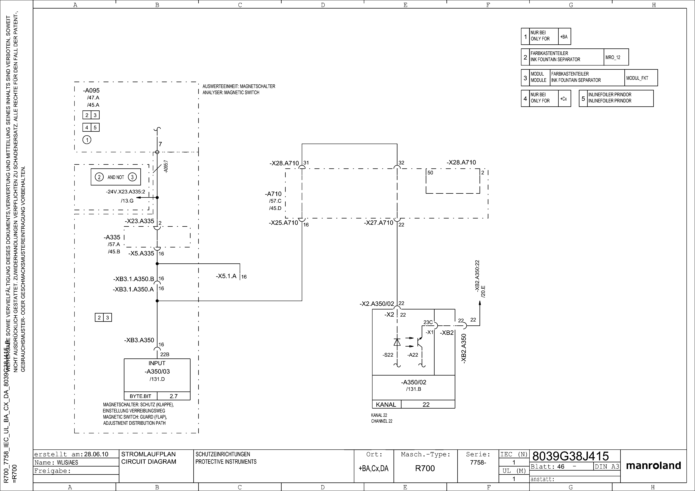

# +BA_Cx_DA — Sheet 46 of 247 — SCHUTZEINRICHTUNGEN

**PROTECTIVE INSTRUMENTS**

> Part of the manroland **R700** printing press IEC/UL circuit diagrams.
> Drawing class: **Stromlaufplan / Circuit diagram** (DIN A3).
> Document `+BA_Cx_DA` covers the **Printing units / main switch cabinet** machine section.

## At a glance

| Field | Value |
|---|---|
| Document | `+BA_Cx_DA`  (8039G38J415) |
| Sheet | **46** of 247 |
| Section (DE) | SCHUTZEINRICHTUNGEN |
| Section (EN) | PROTECTIVE INSTRUMENTS |
| Section type | CIRCUIT — Circuit diagram |
| Machine type | `R700` |
| Series | `7758` |
| Created | 28.06.10 |
| Replaces | — |
| Columns used | A, B, C, D, E, F, G, H |
| Path numbers | — |
| Labels on sheet | 98 |
| Cross-refs out | 10 |
| Cross-refs in | 24 |

**Previous:** [+BA_Cx_DA sheet 45](SHEET_0045.md) · **Next:** [+BA_Cx_DA sheet 47](SHEET_0047.md) · **Document TOC:** [_TOC.md](_TOC.md)  (+BA_Cx_DA) · **Master TOC:** [all sheets](../_MASTER_TOC.md)

## Sheet image (300 DPI, exact vector render)



_Rendered directly from the PDF vector layer at 300 DPI (1-bit), no OCR and no resampling. Use it to confirm anything ambiguous in the text below._

## Cross-references on this sheet

Each entry is a wire leaving this sheet. The printed token is `/sheet.column`; the link resolves to that sheet inside the same document.

| Ref | Target sheet | Col | Path | Destination on target | Target section | From col |
|---|---|---|---|---|---|---|
| `/47.A` | [+BA_Cx_DA sheet 47](SHEET_0047.md) | A | — | — | SCHUTZEINRICHTUNGEN | A |
| `/45.A` | [+BA_Cx_DA sheet 45](SHEET_0045.md) | A | — | — | SCHUTZEINRICHTUNGEN | A |
| `/13.G` | [+BA_Cx_DA sheet 13](SHEET_0013.md) | G | — | — | SPANNUNGSVERSORGUNG, SCHALTSCHRANKBELÜFTUNG | B |
| `/57.C` | [+BA_Cx_DA sheet 57](SHEET_0057.md) | C | — | — | MASCHINENBEDIENUNG: LAUFKOMMANDOS | C |
| `/45.D` | [+BA_Cx_DA sheet 45](SHEET_0045.md) | D | — | — | SCHUTZEINRICHTUNGEN | C |
| `/57.A` | [+BA_Cx_DA sheet 57](SHEET_0057.md) | A | — | — | MASCHINENBEDIENUNG: LAUFKOMMANDOS | A |
| `/45.B` | [+BA_Cx_DA sheet 45](SHEET_0045.md) | B | — | — | SCHUTZEINRICHTUNGEN | A |
| `/20.E` | [+BA_Cx_DA sheet 20](SHEET_0020.md) | E | — | XB2.A350:22 | BUSVERBINDUNGEN: SICHERHEITSBUS | F |
| `/131.D` | [+BA_Cx_DA sheet 131](SHEET_0131.md) | D | — | — | REFERENZMODUL | B |
| `/131.B` | [+BA_Cx_DA sheet 131](SHEET_0131.md) | B | — | — | REFERENZMODUL | E |

### Incoming references (sheets that point here)

Every other sheet that sends a wire to this one. `Back-ref` is the token printed on *that* sheet; `Path` is its line number.

| From sheet | Cols | Back-ref | Path | Refs | What continues there |
|---|---|---|---|---|---|
| [+BA_Cx_DA#13](SHEET_0013.md) | G | `/13.G` | — | 1 | 24V.X23.A335:2 |
| [+BA_Cx_DA#20](SHEET_0020.md) | E | `/20.E` | — | 1 | XB2.A350:22 |
| [+BA_Cx_DA#45](SHEET_0045.md) | A, B, D | `/45.A`, `/45.B`, `/45.D` | — | 3 | — |
| [+BA_Cx_DA#47](SHEET_0047.md) | A | `/47.A` | — | 1 | — |
| [+BA_Cx_DA#57](SHEET_0057.md) | A, C | `/57.A`, `/57.C` | — | 2 | — |
| [+BA_Cx_DA#131](SHEET_0131.md) | B, D | `/131.B`, `/131.D` | — | 2 | — |
| [+BA_Cx_DA#153](SHEET_0153.md) | G | `/153.G` | — | 2 | — |
| [+BA_Cx_DA#157](SHEET_0157.md) | C, D, F | `/157.C`, `/157.D`, `/157.F` | — | 3 | — |
| [+BA_Cx_DA#160](SHEET_0160.md) | C | `/160.C` | — | 1 | — |
| [+BA_Cx_DA#161](SHEET_0161.md) | A | `/161.A` | — | 1 | — |
| [+BA_Cx_DA#174](SHEET_0174.md) | G | `/174.G` | — | 1 | — |
| [+BA_Cx_DA#175](SHEET_0175.md) | H | `/175.H` | — | 1 | — |
| [+BA_Cx_DA#177](SHEET_0177.md) | F | `/177.F` | — | 1 | — |
| [+BA_Cx_DA#178](SHEET_0178.md) | G, H | `/178.G`, `/178.H` | — | 4 | — |


## Devices on this sheet

| Tag | Class | Class meaning (IEC) | Col | Sub | Terminal | Sign |
|---|---|---|---|---|---|---|
| `A095` | A | Baugruppe / assembly, module, PC board | A | — | — | — |
| `A335` | A | Baugruppe / assembly, module, PC board | A | — | — | — |
| `A350/03` | A | Baugruppe / assembly, module, PC board | B | 03 | — | — |
| `A710` | A | Baugruppe / assembly, module, PC board | C | — | — | — |
| `S22` | S | Schalter / switch | E | — | — | — |
| `A22` | A | Baugruppe / assembly, module, PC board | E | — | — | — |
| `X1` | X | Klemme / terminal, plug connector | E | — | — | — |
| `X2` | X | Klemme / terminal, plug connector | E | — | — | — |
| `XB2` | XB |  | F | — | — | — |
| `A350/02` | A | Baugruppe / assembly, module, PC board | E | 02 | — | — |
| `A095:7` | A | Baugruppe / assembly, module, PC board | B | — | 7 | — |
| `X5.A335` | — | cross-device reference | B | — | — | — |
| `X23.A335` | — | cross-device reference | B | — | — | — |
| `2.7` | — | cross-device reference | B | — | — | — |
| `XB3.A350` | — | cross-device reference | B | — | — | — |
| `XB3.1.A350.B` | — | cross-device reference | B | — | — | — |
| `XB3.1.A350.A` | — | cross-device reference | B | — | — | — |
| `X28.A710` | — | cross-device reference | D | — | — | — |
| `X25.A710` | — | cross-device reference | D | — | — | — |
| `X27.A710` | — | cross-device reference | E | — | — | — |
| `XB2.A350` | — | cross-device reference | F | — | — | — |
| `X5.1.A` | — | cross-device reference | C | — | — | — |
| `XB2.A350:22` | — | cross-device reference | F | — | 22 | — |
| `X28.A710` | — | cross-device reference | F | — | — | — |

## Potentials / nets

| Potential | Count | Columns | Attached devices | Terminals |
|---|---|---|---|---|
| `24V` | 1 | B | `A335`, `X23` | `2` |


A potential such as `L24+/4` or `M24+` is a named supply/return rail; every place it appears on this sheet is electrically common.

## Wire-end annotations (grouped as printed)

A wire that continues elsewhere is annotated with a small cluster: the destination description, the path/line number `#NN`, and the `/sheet.column` cross reference. Each row below is one such cluster exactly as it is grouped on the drawing.

| Col | Y | Path | Cross-ref | Text on the wire |
|---|---|---|---|---|
| G | 53.0 | — | — | `1 NUR BEI` |
| G | 60.1 | — | — | `ONLY FOR +BA` |
| G | 88.5 | — | — | `2 FARBKASTENTEILER INK FOUNTAIN SEPARATOR` |
| H | 95.6 | — | — | `MRO_12` |
| G | 123.9 | — | — | `FARBKASTENTEILER INK FOUNTAIN SEPARATOR` |
| G | 124.0 | — | — | `3 MODUL MODULE` |
| H | 131.0 | — | — | `MODUL_FKT` |
| C | 145.2 | — | — | `AUSWERTEEINHEIT: MAGNETSCHALTER ANALYSER: MAGNETIC SWITCH` |
| A | 150.5 | — | — | `A095` |
| G | 159.3 | — | — | `4 NUR BEI` |
| G | 159.4 | — | — | `ONLY FOR +Cx 5 INLINEFOILER PRINDOR INLINEFOILER PRINDOR` |
| A | 163.6 | — | `/47.A`, `/45.A` | — |
| A | 193.8 | — | — | `2 3` |
| A | 215.1 | — | — | `4 5` |
| A | 236.5 | — | — | `1` |
| B | 242.6 | — | — | `7` |
| F | 273.9 | — | — | `X28.A710` |
| B | 274.6 | — | — | `A095:7` |
| D | 275.3 | — | — | `X28.A710 31` |
| E | 275.3 | — | — | `32` |
| F | 292.3 | — | — | `50 2` |
| A | 300.8 | — | — | `2 AND NOT 3` |
| B | 324.9 | — | — | `24V.X23.A335:2` |
| C | 327.7 | — | — | `A710` |
| B | 340.4 | — | `/13.G` | — |
| C | 340.8 | — | `/57.C`, `/45.D` | — |
| B | 374.5 | — | — | `X23.A335 2` |
| D | 377.3 | — | — | `X25.A710 16 X27.A710 22` |
| A | 402.1 | — | — | `A335` |
| A | 415.2 | — | `/57.A`, `/45.B` | — |
| B | 429.8 | — | — | `X5.A335 16` |
| F | 445.9 | — | `/20.E` | `XB2.A350:22` |
| C | 468.8 | — | — | `X5.1.A 16` |
| B | 473.7 | — | — | `XB3.1.A350.B 16` |
| B | 490.7 | — | — | `XB3.1.A350.A 16` |
| E | 516.2 | — | — | `X2.A350/02 22` |
| E | 534.7 | — | — | `X2` |
| E | 536.1 | — | — | `22 22` |
| A | 541.0 | — | — | `2 3` |
| F | 544.6 | — | — | `22` |
| E | 548.8 | — | — | `23C` |
| E | 565.8 | — | — | `X1` |
| F | 565.8 | — | — | `XB2` |
| F | 572.0 | — | — | `XB2.A350` |
| B | 578.6 | — | — | `XB3.A350 16` |
| B | 604.1 | — | — | `22B` |
| E | 604.8 | — | — | `S22 A22` |
| B | 618.6 | — | — | `INPUT` |
| B | 632.4 | — | — | `A350/03` |
| B | 646.2 | — | `/131.D` | — |
| E | 650.9 | — | — | `A350/02` |
| E | 663.2 | — | `/131.B` | — |
| B | 675.3 | — | — | `BYTE.BIT 2.7` |
| E | 689.1 | — | — | `KANAL 22` |
| B | 690.9 | — | — | `EINSTELLUNG VERREIBUNGSWEG MAGNETSCHALTER: SCHUTZ (KLAPPE), MAGNETIC SWITCH: GUARD (FLAP),` |
| E | 709.4 | — | — | `KANAL 22 CHANNEL 22` |
| B | 722.8 | — | — | `ADJUSTMENT DISTRIBUTION PATH` |


## Reconstructed tables

This sheet carries tabular content (pin map / terminal assignment / index). The grid below was rebuilt from the drawing's own rule lines, so each row is exactly one physical row of the table.

### Table 1 — 6 data rows × 4 columns (at x=127.6, y=260.8)

| 2 AND NOT | 3 24V.X23.A335:2 /13.G |  | A095:7 |
|---|---|---|---|
| `A335 /57.A /45.B` | `X23.A335 X5.A335` |  | `2 16` |
|  | `XB3.1.A350.B XB3.1.A350.A` |  | `16 16` |
| `2 3` | `XB3.A350` |  | `16 22B` |
|  |  | `INPUT` | `A350/03 /131.D` |
|  | `BYTE.BIT` |  | `2.7` |
| `MAGNETSCHALTER: EINSTELLUNG MAGNETIC ADJUSTMENT` | `SCHUTZ VERREIBUNGSWEG SWITCH: GUARD DISTRIBUTION` |  | `(KLAPPE), (FLAP), PATH` |


### Table 2 — 3 data rows × 2 columns (at x=637.8, y=246.6) — **32**

| X27.A710 X2.A350/02 | 22 22 |
|---|---|
| `X2 S22` | `22 A22` |
|  | `A350/02 /131.B` |
| `KANAL` |  |


### Table 3 — 3 data rows × 3 columns (at x=729.9, y=246.6)

| 50 |  | X28.A710 |
|---|---|---|
|  |  | `XB2.A350:22` |
| `23C X1` | `XB2` | `22 22 XB2.A350` |
| `22` |  |  |


## Notes and free text on this sheet

| Text | Col | Y (pt) |
|---|---|---|
| `AUSWERTEEINHEIT: MAGNETSCHALTER` | C | 145.19 |
| `ANALYSER: MAGNETIC SWITCH` | C | 155.81 |
| `22B` | B | 604.07 |
| `INPUT` | B | 618.59 |
| `BYTE.BIT` | B | 675.84 |
| `MAGNETSCHALTER: SCHUTZ (KLAPPE),` | B | 690.86 |
| `EINSTELLUNG VERREIBUNGSWEG` | B | 701.48 |
| `MAGNETIC SWITCH: GUARD (FLAP),` | B | 712.12 |
| `ADJUSTMENT DISTRIBUTION PATH` | B | 722.76 |
| `KANAL 22` | E | 709.44 |
| `CHANNEL 22` | E | 719.38 |
| `23C` | E | 548.83 |
| `KANAL` | E | 689.12 |
| `X2.A350/02` | E | 516.21 |
| `FARBKASTENTEILER` | G | 88.48 |
| `INK FOUNTAIN SEPARATOR` | G | 99.13 |
| `MODUL` | G | 123.97 |
| `MODULE` | G | 134.58 |
| `MRO_12` | H | 95.61 |
| `MODUL_FKT` | H | 131.04 |
| `NUR BEI` | G | 159.32 |
| `ONLY FOR` | G | 170.01 |
| `+Cx` | G | 166.55 |
| `INLINEFOILER PRINDOR` | G | 159.37 |
| `+BA` | G | 60.12 |
| `AND NOT` | A | 301.11 |

## Complete label inventory (exact text from the drawing)

Every text object inside the drawing area of this sheet, in DIN reading order (column A→H, then top→bottom). This is the authoritative list: if a string is not here it is not printed on this sheet.

| Col | Y | X | Dir | Type | Text |
|---|---|---|---|---|---|
| A | 150.5 | 142.3 | → | device tag | `A095` |
| A | 163.6 | 149.4 | → | cross-reference | `/47.A` |
| A | 176.0 | 149.4 | → | cross-reference | `/45.A` |
| A | 193.8 | 146.6 | → | number | `2` |
| A | 193.8 | 160.6 | → | number | `3` |
| A | 215.0 | 146.4 | → | number | `4` |
| A | 215.0 | 160.6 | → | number | `5` |
| A | 236.5 | 147.1 | → | number | `1` |
| A | 300.8 | 168.1 | → | number | `2` |
| A | 301.1 | 184.5 | → | text | `AND NOT` |
| A | 402.1 | 177.7 | → | device tag | `A335` |
| A | 415.2 | 184.8 | → | cross-reference | `/57.A` |
| A | 427.6 | 185.1 | → | cross-reference | `/45.B` |
| A | 541.0 | 167.8 | → | number | `2` |
| A | 541.0 | 181.8 | → | number | `3` |
| B | 242.6 | 271.8 | → | number | `7` |
| B | 274.6 | 281.3 | ↕ | device tag | `A095:7` |
| B | 300.8 | 224.8 | → | number | `3` |
| B | 324.8 | 181.7 | → | potential | `24V.X23.A335:2` |
| B | 340.4 | 207.2 | → | cross-reference | `/13.G` |
| B | 374.5 | 214.0 | → | device ref | `X23.A335` |
| B | 378.7 | 271.8 | → | number | `2` |
| B | 429.8 | 220.0 | → | device ref | `X5.A335` |
| B | 431.2 | 271.3 | → | number | `16` |
| B | 473.7 | 194.2 | → | device ref | `XB3.1.A350.B` |
| B | 473.7 | 271.3 | → | number | `16` |
| B | 490.7 | 271.3 | → | number | `16` |
| B | 491.4 | 193.3 | → | device ref | `XB3.1.A350.A` |
| B | 578.6 | 212.9 | → | device ref | `XB3.A350` |
| B | 587.1 | 271.3 | → | number | `16` |
| B | 604.1 | 274.7 | → | text | `22B` |
| B | 618.6 | 254.4 | → | text | `INPUT` |
| B | 632.4 | 247.9 | → | device tag | `A350/03` |
| B | 646.2 | 256.5 | → | cross-reference | `/131.D` |
| B | 675.3 | 290.8 | → | device ref | `2.7` |
| B | 675.8 | 222.5 | → | text | `BYTE.BIT` |
| B | 690.9 | 176.6 | → | text | `MAGNETSCHALTER: SCHUTZ (KLAPPE),` |
| B | 701.5 | 176.3 | → | text | `EINSTELLUNG VERREIBUNGSWEG` |
| B | 712.1 | 176.6 | → | text | `MAGNETIC SWITCH: GUARD (FLAP),` |
| B | 722.8 | 177.2 | → | text | `ADJUSTMENT DISTRIBUTION PATH` |
| C | 145.2 | 347.2 | → | text | `AUSWERTEEINHEIT: MAGNETSCHALTER` |
| C | 155.8 | 347.2 | → | text | `ANALYSER: MAGNETIC SWITCH` |
| C | 327.7 | 454.1 | → | device tag | `A710` |
| C | 340.8 | 461.2 | → | cross-reference | `/57.C` |
| C | 353.2 | 461.2 | → | cross-reference | `/45.D` |
| C | 468.8 | 369.9 | → | device ref | `X5.1.A` |
| C | 470.9 | 413.0 | → | number | `16` |
| D | 275.3 | 462.0 | → | device ref | `X28.A710` |
| D | 275.3 | 519.9 | → | number | `31` |
| D | 377.3 | 460.6 | → | device ref | `X25.A710` |
| D | 381.6 | 519.3 | → | number | `16` |
| E | 275.3 | 682.9 | → | number | `32` |
| E | 292.3 | 732.5 | → | number | `50` |
| E | 377.3 | 623.6 | → | device ref | `X27.A710` |
| E | 381.6 | 682.9 | → | number | `22` |
| E | 516.2 | 616.3 | → | text | `X2.A350/02` |
| E | 516.2 | 682.9 | → | number | `22` |
| E | 534.7 | 658.8 | → | device tag | `X2` |
| E | 536.1 | 685.7 | → | number | `22` |
| E | 548.8 | 725.7 | → | text | `23C` |
| E | 565.8 | 729.4 | → | device tag | `X1` |
| E | 604.8 | 655.4 | → | device tag | `S22` |
| E | 604.8 | 697.9 | → | device tag | `A22` |
| E | 650.9 | 687.3 | → | device tag | `A350/02` |
| E | 663.2 | 696.0 | → | cross-reference | `/131.B` |
| E | 689.1 | 644.0 | → | text | `KANAL` |
| E | 689.1 | 724.1 | → | number | `22` |
| E | 709.4 | 635.8 | → | text | `KANAL 22` |
| E | 719.4 | 636.1 | → | text | `CHANNEL 22` |
| F | 58.4 | 897.4 | → | number | `1` |
| F | 93.8 | 897.2 | → | number | `2` |
| F | 129.2 | 897.0 | → | number | `3` |
| F | 164.7 | 897.2 | → | number | `4` |
| F | 273.8 | 765.4 | → | device ref | `X28.A710` |
| F | 292.3 | 824.6 | → | number | `2` |
| F | 445.9 | 813.8 | ↕ | device ref | `XB2.A350:22` |
| F | 489.5 | 823.7 | ↕ | cross-reference | `/20.E` |
| F | 544.6 | 805.9 | → | number | `22` |
| F | 546.0 | 784.9 | → | number | `22` |
| F | 565.8 | 753.7 | → | device tag | `XB2` |
| F | 572.0 | 789.8 | ↕ | device ref | `XB2.A350` |
| G | 53.0 | 909.1 | → | text | `NUR BEI` |
| G | 60.1 | 960.0 | → | text | `+BA` |
| G | 63.7 | 909.6 | → | text | `ONLY FOR` |
| G | 88.5 | 909.1 | → | text | `FARBKASTENTEILER` |
| G | 99.1 | 909.1 | → | text | `INK FOUNTAIN SEPARATOR` |
| G | 123.9 | 944.5 | → | text | `FARBKASTENTEILER` |
| G | 124.0 | 909.4 | → | text | `MODUL` |
| G | 134.6 | 909.4 | → | text | `MODULE` |
| G | 134.6 | 944.5 | → | text | `INK FOUNTAIN SEPARATOR` |
| G | 159.3 | 909.1 | → | text | `NUR BEI` |
| G | 159.4 | 1008.3 | → | text | `INLINEFOILER PRINDOR` |
| G | 164.7 | 996.2 | → | number | `5` |
| G | 166.5 | 960.0 | → | text | `+Cx` |
| G | 170.0 | 909.6 | → | text | `ONLY FOR` |
| G | 170.0 | 1008.3 | → | text | `INLINEFOILER PRINDOR` |
| H | 95.6 | 1037.6 | → | text | `MRO_12` |
| H | 131.0 | 1073.1 | → | text | `MODUL_FKT` |

## Reading-order text block

The same content as a plain block, grouped by DIN column — convenient to paste or to match against a visual description.

```text
=== Column A ===
 150.5  142.3  devtag       A095
 163.6  149.4  xref         /47.A
 176.0  149.4  xref         /45.A
 193.8  146.6  numeric      2
 193.8  160.6  numeric      3
 215.0  146.4  numeric      4
 215.0  160.6  numeric      5
 236.5  147.1  numeric      1
 300.8  168.1  numeric      2
 301.1  184.5  text         AND NOT
 402.1  177.7  devtag       A335
 415.2  184.8  xref         /57.A
 427.6  185.1  xref         /45.B
 541.0  167.8  numeric      2
 541.0  181.8  numeric      3
=== Column B ===
 242.6  271.8  numeric      7
 274.6  281.3  devtag       A095:7
 300.8  224.8  numeric      3
 324.8  181.7  net          24V.X23.A335:2
 340.4  207.2  xref         /13.G
 374.5  214.0  devref       X23.A335
 378.7  271.8  numeric      2
 429.8  220.0  devref       X5.A335
 431.2  271.3  numeric      16
 473.7  194.2  devref       XB3.1.A350.B
 473.7  271.3  numeric      16
 490.7  271.3  numeric      16
 491.4  193.3  devref       XB3.1.A350.A
 578.6  212.9  devref       XB3.A350
 587.1  271.3  numeric      16
 604.1  274.7  text         22B
 618.6  254.4  text         INPUT
 632.4  247.9  devtag       A350/03
 646.2  256.5  xref         /131.D
 675.3  290.8  devref       2.7
 675.8  222.5  text         BYTE.BIT
 690.9  176.6  text         MAGNETSCHALTER: SCHUTZ (KLAPPE),
 701.5  176.3  text         EINSTELLUNG VERREIBUNGSWEG
 712.1  176.6  text         MAGNETIC SWITCH: GUARD (FLAP),
 722.8  177.2  text         ADJUSTMENT DISTRIBUTION PATH
=== Column C ===
 145.2  347.2  text         AUSWERTEEINHEIT: MAGNETSCHALTER
 155.8  347.2  text         ANALYSER: MAGNETIC SWITCH
 327.7  454.1  devtag       A710
 340.8  461.2  xref         /57.C
 353.2  461.2  xref         /45.D
 468.8  369.9  devref       X5.1.A
 470.9  413.0  numeric      16
=== Column D ===
 275.3  462.0  devref       X28.A710
 275.3  519.9  numeric      31
 377.3  460.6  devref       X25.A710
 381.6  519.3  numeric      16
=== Column E ===
 275.3  682.9  numeric      32
 292.3  732.5  numeric      50
 377.3  623.6  devref       X27.A710
 381.6  682.9  numeric      22
 516.2  616.3  text         X2.A350/02
 516.2  682.9  numeric      22
 534.7  658.8  devtag       X2
 536.1  685.7  numeric      22
 548.8  725.7  text         23C
 565.8  729.4  devtag       X1
 604.8  655.4  devtag       S22
 604.8  697.9  devtag       A22
 650.9  687.3  devtag       A350/02
 663.2  696.0  xref         /131.B
 689.1  644.0  text         KANAL
 689.1  724.1  numeric      22
 709.4  635.8  text         KANAL 22
 719.4  636.1  text         CHANNEL 22
=== Column F ===
  58.4  897.4  numeric      1
  93.8  897.2  numeric      2
 129.2  897.0  numeric      3
 164.7  897.2  numeric      4
 273.8  765.4  devref       X28.A710
 292.3  824.6  numeric      2
 445.9  813.8  devref       XB2.A350:22
 489.5  823.7  xref         /20.E
 544.6  805.9  numeric      22
 546.0  784.9  numeric      22
 565.8  753.7  devtag       XB2
 572.0  789.8  devref       XB2.A350
=== Column G ===
  53.0  909.1  text         NUR BEI
  60.1  960.0  text         +BA
  63.7  909.6  text         ONLY FOR
  88.5  909.1  text         FARBKASTENTEILER
  99.1  909.1  text         INK FOUNTAIN SEPARATOR
 123.9  944.5  text         FARBKASTENTEILER
 124.0  909.4  text         MODUL
 134.6  909.4  text         MODULE
 134.6  944.5  text         INK FOUNTAIN SEPARATOR
 159.3  909.1  text         NUR BEI
 159.4 1008.3  text         INLINEFOILER PRINDOR
 164.7  996.2  numeric      5
 166.5  960.0  text         +Cx
 170.0  909.6  text         ONLY FOR
 170.0 1008.3  text         INLINEFOILER PRINDOR
=== Column H ===
  95.6 1037.6  text         MRO_12
 131.0 1073.1  text         MODUL_FKT
```

---
_Generated from the PDF vector text layer; no OCR. Source: `R700_7758_IEC_UL_BA_CX_DA_8039G38J415_p`, sheet 46._
