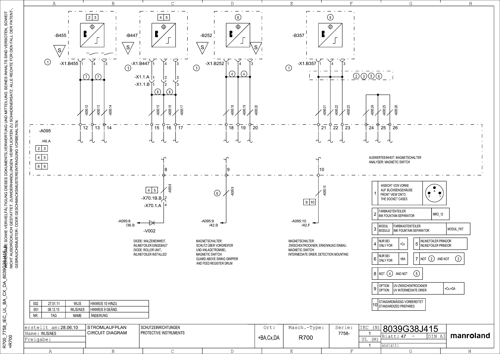

# +BA_Cx_DA — Sheet 47 of 247 — SCHUTZEINRICHTUNGEN

**PROTECTIVE INSTRUMENTS**

> Part of the manroland **R700** printing press IEC/UL circuit diagrams.
> Drawing class: **Stromlaufplan / Circuit diagram** (DIN A3).
> Document `+BA_Cx_DA` covers the **Printing units / main switch cabinet** machine section.

## At a glance

| Field | Value |
|---|---|
| Document | `+BA_Cx_DA`  (8039G38J415) |
| Sheet | **47** of 247 |
| Section (DE) | SCHUTZEINRICHTUNGEN |
| Section (EN) | PROTECTIVE INSTRUMENTS |
| Section type | CIRCUIT — Circuit diagram |
| Machine type | `R700` |
| Series | `7758` |
| Created | 28.06.10 |
| Replaces | — |
| Columns used | A, B, C, D, E, F, G, H |
| Path numbers | — |
| Labels on sheet | 187 |
| Cross-refs out | 4 |
| Cross-refs in | 24 |

**Previous:** [+BA_Cx_DA sheet 46](SHEET_0046.md) · **Next:** [+BA_Cx_DA sheet 48](SHEET_0048.md) · **Document TOC:** [_TOC.md](_TOC.md)  (+BA_Cx_DA) · **Master TOC:** [all sheets](../_MASTER_TOC.md)

## Sheet image (300 DPI, exact vector render)



_Rendered directly from the PDF vector layer at 300 DPI (1-bit), no OCR and no resampling. Use it to confirm anything ambiguous in the text below._

## Cross-references on this sheet

Each entry is a wire leaving this sheet. The printed token is `/sheet.column`; the link resolves to that sheet inside the same document.

| Ref | Target sheet | Col | Path | Destination on target | Target section | From col |
|---|---|---|---|---|---|---|
| `/46.A` | [+BA_Cx_DA sheet 46](SHEET_0046.md) | A | — | — | SCHUTZEINRICHTUNGEN | A |
| `/36.B` | [+BA_Cx_DA sheet 36](SHEET_0036.md) | B | — | A095:8 A095:10 | SCHUTZEINRICHTUNGEN | D |
| `/42.F` | [+BA_Cx_DA sheet 42](SHEET_0042.md) | F | — | A095:8 A095:10 | SCHUTZEINRICHTUNGEN | D |
| `/42.B` | [+BA_Cx_DA sheet 42](SHEET_0042.md) | B | — | A095:9 | SCHUTZEINRICHTUNGEN | D |

### Incoming references (sheets that point here)

Every other sheet that sends a wire to this one. `Back-ref` is the token printed on *that* sheet; `Path` is its line number.

| From sheet | Cols | Back-ref | Path | Refs | What continues there |
|---|---|---|---|---|---|
| [+BA_Cx_DA#36](SHEET_0036.md) | B | `/36.B` | — | 1 | — |
| [+BA_Cx_DA#42](SHEET_0042.md) | B, D | `/42.B`, `/42.D` | — | 2 | A095:9 |
| [+BA_Cx_DA#46](SHEET_0046.md) | A | `/46.A` | — | 1 | — |
| [+BA_Cx_DA#138](SHEET_0138.md) | A | `/138.A` | — | 6 | — |
| [+BA_Cx_DA#145](SHEET_0145.md) | G, H | `/145.G`, `/145.H` | — | 6 | — |
| [+BA_Cx_DA#146](SHEET_0146.md) | E, H | `/146.E`, `/146.H` | — | 6 | — |
| [+BA_Cx_DA#184](SHEET_0184.md) | B | `/184.B` | — | 2 | — |


## Devices on this sheet

| Tag | Class | Class meaning (IEC) | Col | Sub | Terminal | Sign |
|---|---|---|---|---|---|---|
| `A095` | A | Baugruppe / assembly, module, PC board | A | — | — | — |
| `B447` | B | Umformer / transducer, sensor | B | — | — | — |
| `B252` | B | Umformer / transducer, sensor | D | — | — | — |
| `V002` | V | Diode / semiconductor valve | C | — | — | — |
| `B455` | B | Umformer / transducer, sensor | A | — | — | — |
| `B357` | B | Umformer / transducer, sensor | E | — | — | — |
| `A095:9` | A | Baugruppe / assembly, module, PC board | D | — | 9 | — |
| `A095:10` | A | Baugruppe / assembly, module, PC board | E | — | 10 | — |
| `A095:8` | A | Baugruppe / assembly, module, PC board | B | — | 8 | — |
| `A095:17` | A | Baugruppe / assembly, module, PC board | C | — | 17 | — |
| `A095:16` | A | Baugruppe / assembly, module, PC board | C | — | 16 | — |
| `A095:15` | A | Baugruppe / assembly, module, PC board | C | — | 15 | — |
| `A095:20` | A | Baugruppe / assembly, module, PC board | D | — | 20 | — |
| `A095:19` | A | Baugruppe / assembly, module, PC board | D | — | 19 | — |
| `A095:18` | A | Baugruppe / assembly, module, PC board | D | — | 18 | — |
| `A095:9` | A | Baugruppe / assembly, module, PC board | D | — | 9 | — |
| `A095:12` | A | Baugruppe / assembly, module, PC board | B | — | 12 | — |
| `A095:14` | A | Baugruppe / assembly, module, PC board | B | — | 14 | — |
| `A095:13` | A | Baugruppe / assembly, module, PC board | B | — | 13 | — |
| `A095:8` | A | Baugruppe / assembly, module, PC board | C | — | 8 | — |
| `A095:23` | A | Baugruppe / assembly, module, PC board | F | — | 23 | — |
| `A095:22` | A | Baugruppe / assembly, module, PC board | F | — | 22 | — |
| `A095:21` | A | Baugruppe / assembly, module, PC board | F | — | 21 | — |
| `A095:26` | A | Baugruppe / assembly, module, PC board | G | — | 26 | — |
| `A095:25` | A | Baugruppe / assembly, module, PC board | G | — | 25 | — |
| `A095:24` | A | Baugruppe / assembly, module, PC board | F | — | 24 | — |
| `A095:10` | A | Baugruppe / assembly, module, PC board | F | — | 10 | — |
| `X1.B447` | — | cross-device reference | B | — | — | — |
| `X1.B252` | — | cross-device reference | D | — | — | — |
| `X70.1.A` | — | cross-device reference | C | — | — | — |
| `X1.1.B` | — | cross-device reference | B | — | — | — |
| `X1.1.A` | — | cross-device reference | B | — | — | — |
| `X1.B455` | — | cross-device reference | A | — | — | — |
| `X1.B357` | — | cross-device reference | E | — | — | — |
| `NR.` | — | cross-device reference | A | — | — | — |
| `08.12.10` | — | cross-device reference | A | — | — | — |
| `27.01.11` | — | cross-device reference | A | — | — | — |

## Potentials / nets

_No named potentials on this sheet._

## Wire-end annotations (grouped as printed)

A wire that continues elsewhere is annotated with a small cluster: the destination description, the path/line number `#NN`, and the `/sheet.column` cross reference. Each row below is one such cluster exactly as it is grouped on the drawing.

| Col | Y | Path | Cross-ref | Text on the wire |
|---|---|---|---|---|
| B | 37.9 | — | — | `2 3 4 5` |
| D | 38.6 | — | — | `6` |
| F | 38.6 | — | — | `9` |
| A | 79.7 | — | — | `B455` |
| B | 79.7 | — | — | `B447` |
| D | 79.7 | — | — | `B252` |
| E | 79.7 | — | — | `B357` |
| B | 107.4 | — | — | `S` |
| C | 107.4 | — | — | `S` |
| D | 107.4 | — | — | `S` |
| A | 114.5 | — | — | `S` |
| A | 144.3 | — | — | `1` |
| A | 146.3 | — | — | `X1.B455 1 4 3` |
| C | 146.3 | — | — | `X1.B447 1 4 3` |
| D | 146.3 | — | — | `X1.B252 1 4 3` |
| F | 146.3 | — | — | `X1.B357 1 4 3` |
| B | 158.5 | — | — | `1` |
| C | 158.5 | — | — | `1` |
| E | 158.5 | — | — | `1` |
| D | 173.2 | — | — | `4 4` |
| F | 178.1 | — | — | `5 6` |
| C | 178.2 | — | — | `X1.1.A 1 2 3` |
| F | 178.3 | — | — | `2 3` |
| B | 180.3 | — | — | `7 7` |
| C | 195.9 | — | — | `X1.1.B 1 2 3` |
| C | 215.7 | — | — | `8 8` |
| F | 249.5 | — | — | `A095:21` |
| B | 249.8 | — | — | `A095:12` |
| F | 249.8 | — | — | `A095:22` |
| B | 249.9 | — | — | `A095:13` |
| B | 249.9 | — | — | `A095:14` |
| C | 249.9 | — | — | `A095:15` |
| C | 249.9 | — | — | `A095:16` |
| C | 249.9 | — | — | `A095:17` |
| D | 249.9 | — | — | `A095:9 A095:18` |
| D | 249.9 | — | — | `A095:19` |
| D | 249.9 | — | — | `A095:20` |
| F | 249.9 | — | — | `A095:23` |
| F | 249.9 | — | — | `A095:24` |
| G | 249.9 | — | — | `A095:25` |
| G | 249.9 | — | — | `A095:26` |
| B | 299.3 | — | — | `12 13 14` |
| D | 299.3 | — | — | `15 16 17 18 19 20` |
| F | 299.3 | — | — | `21 22 23 24 25 26` |
| A | 306.4 | — | — | `A095` |
| A | 331.9 | — | `/46.A` | — |
| A | 349.7 | — | — | `2 3` |
| A | 370.9 | — | — | `4 5` |
| G | 372.0 | — | — | `AUSWERTEEINHEIT: MAGNETSCHALTER ANALYSER: MAGNETIC SWITCH` |
| A | 392.2 | — | — | `6 9` |
| C | 398.5 | — | — | `8` |
| D | 398.5 | — | — | `9` |
| F | 398.5 | — | — | `10` |
| C | 437.6 | — | — | `A095:8` |
| G | 438.6 | — | — | `FRONT VIEW ONTO ANSICHT VON VORNE AUF BUCHSENGEHÄUSE` |
| F | 441.3 | — | — | `A095:10` |
| E | 448.9 | — | — | `4 5 4` |
| G | 455.2 | — | — | `1 THE SOCKET CASES` |
| D | 456.7 | — | — | `6` |
| G | 463.6 | — | — | `3 1` |
| C | 466.6 | — | — | `X70.1B.B 2` |
| E | 477.2 | — | — | `9 10` |
| C | 483.6 | — | — | `X70.1.A 4` |
| G | 499.5 | — | — | `2 FARBKASTENTEILER INK FOUNTAIN SEPARATOR` |
| G | 506.6 | — | — | `MRO_12` |
| D | 521.9 | — | `/36.B`, `/42.F` | `A095:8 A095:10` |
| D | 521.9 | — | `/42.B` | `A095:9` |
| G | 534.9 | — | — | `FARBKASTENTEILER INK FOUNTAIN SEPARATOR` |
| G | 535.0 | — | — | `3 MODUL MODULE` |
| H | 542.1 | — | — | `MODUL_FKT` |
| C | 544.5 | — | — | `V002` |
| G | 570.3 | — | — | `4 NUR BEI` |
| C | 570.4 | — | — | `DIODE: WALZENEINHEIT, INLINEFOILER EINGEBAUT DIODE: ROLLER UNIT, INLINEFOILER INSTALLED` |
| D | 570.4 | — | — | `UND ANLAGETROMMEL MAGNETSCHALTER: MAGNETIC SWITCH: SCHUTZ ÜBER VORGREIFER GUARD ABOVE SWING GRIPPER AND FEED REGISTER DRUM` |
| E | 570.4 | — | — | `MAGNETSCHALTER:` |
| G | 570.4 | — | — | `ONLY FOR +Cx 5 INLINEFOILER PRINDOR INLINEFOILER PRINDOR` |
| E | 581.0 | — | — | `INTERMEDIATE DRIER, DETECTION MOUNTING MAGNETIC SWITCH: ZWISCHENTROCKNER, ERKENNUNG EINBAU` |
| G | 605.8 | — | — | `6 NUR BEI 7 NOT 2 AND NOT 3` |
| G | 612.9 | — | — | `ONLY FOR +BA` |
| G | 646.6 | — | — | `8 NOT 4 AND NOT 5` |
| G | 676.7 | — | — | `9 OPTION OPTION` |
| G | 676.7 | — | — | `UV ZWISCHENTROCKNER UV INTERMEDIATE DRIER +Cx,+DA` |
| G | 715.0 | — | — | `10 STANDARDMÄSSIG VORBEREITET STANDARDIZED PREPARED` |
| A | 718.9 | — | — | `002 27.01.11 WLIS HINWEIS 10 HINZU` |
| A | 733.0 | — | — | `001 08.12.10 WLIS/AES HINWEIS 9 GEÄND.` |
| A | 747.1 | — | — | `NR. TAG NAME ÄNDERUNG` |


## Reconstructed tables

This sheet carries tabular content (pin map / terminal assignment / index). The grid below was rebuilt from the drawing's own rule lines, so each row is exactly one physical row of the table.

### Table 1 — 1 data rows × 7 columns (at x=758.3, y=55.3)

| 1 A095:21 21 10 | 4 A095:22 22 | 3 2 3 A095:23 23 | 5 A095:24 24 ANALYSER: | 6 A095:25 25 AUSWERTEEINHEIT: | A095:26 26 MAGNETSCHALTER MAGNETIC SWITCH |  |
|---|---|---|---|---|---|---|
| `A095:10` |  |  | `1` | `ANSICHT AUF FRONT THE` | `VON VORNE BUCHSENGEHÄUSE VIEW ONTO SOCKET CASES` | `4 3 1` |


## Notes and free text on this sheet

| Text | Col | Y (pt) |
|---|---|---|
| `AUSWERTEEINHEIT: MAGNETSCHALTER` | G | 371.96 |
| `ANALYSER: MAGNETIC SWITCH` | G | 382.58 |
| `MAGNETSCHALTER:` | D | 570.39 |
| `SCHUTZ ÜBER VORGREIFER` | D | 581.03 |
| `UND ANLAGETROMMEL` | D | 591.68 |
| `MAGNETIC SWITCH:` | D | 602.26 |
| `GUARD ABOVE SWING GRIPPER` | D | 612.9 |
| `AND FEED REGISTER DRUM` | D | 623.57 |
| `DIODE: WALZENEINHEIT,` | C | 570.35 |
| `INLINEFOILER EINGEBAUT` | C | 581.02 |
| `DIODE: ROLLER UNIT,` | C | 591.65 |
| `INLINEFOILER INSTALLED` | C | 602.29 |
| `X70.1B.B` | C | 466.62 |
| `MAGNETSCHALTER:` | E | 570.39 |
| `ZWISCHENTROCKNER, ERKENNUNG EINBAU` | E | 581.02 |
| `MAGNETIC SWITCH:` | E | 591.62 |
| `INTERMEDIATE DRIER, DETECTION MOUNTING` | E | 602.3 |
| `TAG` | A | 747.27 |
| `NAME` | A | 747.25 |
| `ÄNDERUNG` | B | 747.31 |
| `WLIS/AES` | A | 733.08 |
| `HINWEIS 9 GEÄND.` | B | 733.09 |
| `WLIS` | A | 718.85 |
| `HINWEIS 10 HINZU` | B | 718.93 |
| `S` | B | 107.39 |
| `S` | C | 107.39 |
| `S` | A | 114.47 |
| `ANSICHT VON VORNE` | G | 438.58 |
| `AUF BUCHSENGEHÄUSE` | G | 449.22 |
| `FRONT VIEW ONTO` | G | 459.81 |
| `THE SOCKET CASES` | G | 470.46 |
| `FARBKASTENTEILER` | G | 499.51 |
| `INK FOUNTAIN SEPARATOR` | G | 510.15 |
| `MODUL` | G | 534.99 |
| `MODULE` | G | 545.6 |
| `MRO_12` | G | 506.63 |
| `MODUL_FKT` | H | 542.07 |
| `NUR BEI` | G | 570.34 |
| `ONLY FOR` | G | 581.03 |
| `+Cx` | G | 577.57 |
| `INLINEFOILER PRINDOR` | G | 570.39 |
| `NOT` | G | 612.87 |
| `AND NOT` | H | 612.93 |
| `+BA` | G | 612.88 |
| `AND NOT` | G | 648.36 |
| `S` | D | 107.39 |
| `OPTION` | G | 676.66 |
| `UV ZWISCHENTROCKNER` | G | 676.68 |
| `UV INTERMEDIATE DRIER` | G | 687.32 |
| `+Cx,+DA` | H | 683.82 |
| `STANDARDMÄSSIG VORBEREITET` | G | 714.96 |
| `STANDARDIZED PREPARED` | G | 725.59 |

## Complete label inventory (exact text from the drawing)

Every text object inside the drawing area of this sheet, in DIN reading order (column A→H, then top→bottom). This is the authoritative list: if a string is not here it is not printed on this sheet.

| Col | Y | X | Dir | Type | Text |
|---|---|---|---|---|---|
| A | 79.7 | 129.5 | → | device tag | `B455` |
| A | 114.5 | 137.6 | → | text | `S` |
| A | 144.3 | 111.6 | → | number | `1` |
| A | 146.3 | 142.0 | → | device ref | `X1.B455` |
| A | 147.7 | 193.3 | → | number | `1` |
| A | 306.4 | 92.7 | → | device tag | `A095` |
| A | 331.9 | 99.8 | → | cross-reference | `/46.A` |
| A | 349.7 | 89.9 | → | number | `2` |
| A | 349.7 | 103.9 | → | number | `3` |
| A | 371.0 | 89.7 | → | number | `4` |
| A | 371.0 | 103.9 | → | number | `5` |
| A | 392.2 | 89.7 | → | number | `6` |
| A | 392.2 | 103.9 | → | number | `9` |
| A | 718.9 | 114.6 | → | device ref | `27.01.11` |
| A | 718.9 | 175.7 | → | text | `WLIS` |
| A | 719.0 | 79.2 | → | number | `002` |
| A | 733.0 | 79.8 | → | number | `001` |
| A | 733.1 | 114.0 | → | device ref | `08.12.10` |
| A | 733.1 | 167.7 | → | text | `WLIS/AES` |
| A | 747.1 | 78.9 | → | device ref | `NR.` |
| A | 747.3 | 120.4 | → | text | `TAG` |
| A | 747.3 | 173.8 | → | text | `NAME` |
| B | 37.9 | 210.3 | → | number | `2` |
| B | 37.9 | 224.4 | → | number | `3` |
| B | 79.7 | 299.6 | → | device tag | `B447` |
| B | 107.4 | 300.6 | → | text | `S` |
| B | 146.3 | 312.1 | → | device ref | `X1.B447` |
| B | 147.7 | 222.2 | → | number | `4` |
| B | 147.7 | 250.6 | → | number | `3` |
| B | 158.5 | 303.0 | → | number | `1` |
| B | 178.2 | 320.3 | → | device ref | `X1.1.A` |
| B | 180.3 | 203.5 | → | number | `7` |
| B | 180.3 | 231.9 | → | number | `7` |
| B | 195.9 | 321.2 | → | device ref | `X1.1.B` |
| B | 249.8 | 203.3 | ↕ | device tag | `A095:12` |
| B | 249.9 | 231.7 | ↕ | device tag | `A095:13` |
| B | 249.9 | 260.0 | ↕ | device tag | `A095:14` |
| B | 299.3 | 197.3 | → | number | `12` |
| B | 299.3 | 225.6 | → | number | `13` |
| B | 299.3 | 254.0 | → | number | `14` |
| B | 521.9 | 280.1 | → | device tag | `A095:8` |
| B | 531.7 | 299.9 | → | cross-reference | `/36.B` |
| B | 718.9 | 215.3 | → | text | `HINWEIS 10 HINZU` |
| B | 733.1 | 215.3 | → | text | `HINWEIS 9 GEÄND.` |
| B | 747.3 | 216.4 | → | text | `ÄNDERUNG` |
| C | 37.9 | 380.3 | → | number | `4` |
| C | 37.9 | 394.4 | → | number | `5` |
| C | 107.4 | 477.8 | → | text | `S` |
| C | 147.7 | 363.4 | → | number | `1` |
| C | 147.7 | 392.3 | → | number | `4` |
| C | 147.7 | 420.7 | → | number | `3` |
| C | 158.5 | 466.0 | → | number | `1` |
| C | 180.3 | 363.4 | → | number | `1` |
| C | 180.3 | 392.3 | → | number | `2` |
| C | 180.3 | 420.7 | → | number | `3` |
| C | 197.3 | 363.4 | → | number | `1` |
| C | 197.3 | 392.3 | → | number | `2` |
| C | 197.3 | 420.7 | → | number | `3` |
| C | 215.7 | 373.6 | → | number | `8` |
| C | 215.7 | 401.9 | → | number | `8` |
| C | 249.9 | 373.4 | ↕ | device tag | `A095:15` |
| C | 249.9 | 401.7 | ↕ | device tag | `A095:16` |
| C | 249.9 | 430.1 | ↕ | device tag | `A095:17` |
| C | 299.3 | 367.4 | → | number | `15` |
| C | 299.3 | 395.7 | → | number | `16` |
| C | 299.3 | 424.1 | → | number | `17` |
| C | 398.5 | 392.0 | → | number | `8` |
| C | 437.6 | 401.7 | ↕ | device tag | `A095:8` |
| C | 448.9 | 351.9 | → | number | `4` |
| C | 448.9 | 366.1 | → | number | `5` |
| C | 466.6 | 336.5 | → | text | `X70.1B.B` |
| C | 466.6 | 392.3 | → | number | `2` |
| C | 483.6 | 392.3 | → | number | `4` |
| C | 484.3 | 342.7 | → | device ref | `X70.1.A` |
| C | 544.6 | 341.7 | → | device tag | `V002` |
| C | 570.4 | 318.0 | → | text | `DIODE: WALZENEINHEIT,` |
| C | 581.0 | 318.0 | → | text | `INLINEFOILER EINGEBAUT` |
| C | 591.6 | 318.0 | → | text | `DIODE: ROLLER UNIT,` |
| C | 602.3 | 318.0 | → | text | `INLINEFOILER INSTALLED` |
| D | 38.6 | 564.9 | → | number | `6` |
| D | 79.7 | 476.8 | → | device tag | `B252` |
| D | 107.4 | 605.3 | → | text | `S` |
| D | 146.3 | 489.3 | → | device ref | `X1.B252` |
| D | 147.7 | 540.6 | → | number | `1` |
| D | 147.7 | 569.5 | → | number | `4` |
| D | 147.7 | 597.8 | → | number | `3` |
| D | 173.2 | 550.8 | → | number | `4` |
| D | 173.2 | 579.1 | → | number | `4` |
| D | 249.9 | 550.6 | ↕ | device tag | `A095:18` |
| D | 249.9 | 578.9 | ↕ | device tag | `A095:19` |
| D | 249.9 | 607.3 | ↕ | device tag | `A095:20` |
| D | 299.3 | 544.5 | → | number | `18` |
| D | 299.3 | 572.9 | → | number | `19` |
| D | 299.3 | 602.1 | → | number | `20` |
| D | 398.5 | 540.9 | → | number | `9` |
| D | 444.7 | 550.6 | ↕ | device tag | `A095:9` |
| D | 456.7 | 515.3 | → | number | `6` |
| D | 521.9 | 478.5 | → | device tag | `A095:9` |
| D | 531.7 | 498.3 | → | cross-reference | `/42.B` |
| D | 570.4 | 467.1 | → | text | `MAGNETSCHALTER:` |
| D | 581.0 | 467.4 | → | text | `SCHUTZ ÜBER VORGREIFER` |
| D | 591.7 | 466.9 | → | text | `UND ANLAGETROMMEL` |
| D | 602.3 | 467.1 | → | text | `MAGNETIC SWITCH:` |
| D | 612.9 | 467.4 | → | text | `GUARD ABOVE SWING GRIPPER` |
| D | 623.6 | 467.7 | → | text | `AND FEED REGISTER DRUM` |
| E | 79.7 | 696.5 | → | device tag | `B357` |
| E | 146.3 | 708.9 | → | device ref | `X1.B357` |
| E | 147.7 | 760.3 | → | number | `1` |
| E | 158.5 | 685.6 | → | number | `1` |
| E | 477.3 | 727.5 | → | number | `9 10` |
| E | 521.9 | 693.4 | → | device tag | `A095:10` |
| E | 531.8 | 718.6 | → | cross-reference | `/42.F` |
| E | 570.4 | 686.8 | → | text | `MAGNETSCHALTER:` |
| E | 581.0 | 687.4 | → | text | `ZWISCHENTROCKNER, ERKENNUNG EINBAU` |
| E | 591.6 | 686.8 | → | text | `MAGNETIC SWITCH:` |
| E | 602.3 | 686.6 | → | text | `INTERMEDIATE DRIER, DETECTION MOUNTING` |
| F | 38.6 | 784.6 | → | number | `9` |
| F | 147.7 | 789.2 | → | number | `4` |
| F | 147.7 | 817.5 | → | number | `3` |
| F | 178.1 | 882.2 | → | number | `5` |
| F | 178.3 | 846.5 | → | number | `2` |
| F | 178.4 | 900.2 | → | number | `6` |
| F | 178.7 | 864.5 | → | number | `3` |
| F | 249.5 | 770.2 | ↕ | device tag | `A095:21` |
| F | 249.8 | 798.6 | ↕ | device tag | `A095:22` |
| F | 249.9 | 826.9 | ↕ | device tag | `A095:23` |
| F | 249.9 | 883.6 | ↕ | device tag | `A095:24` |
| F | 299.3 | 765.1 | → | number | `21` |
| F | 299.3 | 793.4 | → | number | `22` |
| F | 299.3 | 821.8 | → | number | `23` |
| F | 299.3 | 878.5 | → | number | `24` |
| F | 398.5 | 760.0 | → | number | `10` |
| F | 441.3 | 770.2 | ↕ | device tag | `A095:10` |
| F | 455.2 | 890.4 | → | number | `1` |
| F | 504.8 | 890.1 | → | number | `2` |
| F | 540.3 | 889.9 | → | number | `3` |
| F | 575.7 | 890.1 | → | number | `4` |
| F | 611.1 | 890.1 | → | number | `6` |
| F | 646.6 | 889.9 | → | number | `8` |
| F | 682.0 | 889.9 | → | number | `9` |
| F | 720.3 | 886.7 | → | number | `10` |
| G | 249.9 | 912.0 | ↕ | device tag | `A095:25` |
| G | 249.9 | 940.3 | ↕ | device tag | `A095:26` |
| G | 299.3 | 906.8 | → | number | `25` |
| G | 299.3 | 935.1 | → | number | `26` |
| G | 372.0 | 878.7 | → | text | `AUSWERTEEINHEIT: MAGNETSCHALTER` |
| G | 382.6 | 878.7 | → | text | `ANALYSER: MAGNETIC SWITCH` |
| G | 438.6 | 907.1 | → | text | `ANSICHT VON VORNE` |
| G | 449.2 | 907.1 | → | text | `AUF BUCHSENGEHÄUSE` |
| G | 450.9 | 1032.7 | → | number | `4` |
| G | 459.8 | 906.2 | → | text | `FRONT VIEW ONTO` |
| G | 463.6 | 1019.9 | → | number | `3` |
| G | 463.6 | 1045.8 | → | number | `1` |
| G | 470.5 | 906.8 | → | text | `THE SOCKET CASES` |
| G | 499.5 | 902.0 | → | text | `FARBKASTENTEILER` |
| G | 506.6 | 1030.5 | → | text | `MRO_12` |
| G | 510.1 | 902.0 | → | text | `INK FOUNTAIN SEPARATOR` |
| G | 534.9 | 937.4 | → | text | `FARBKASTENTEILER` |
| G | 535.0 | 902.3 | → | text | `MODUL` |
| G | 545.6 | 902.3 | → | text | `MODULE` |
| G | 545.6 | 937.4 | → | text | `INK FOUNTAIN SEPARATOR` |
| G | 570.3 | 902.0 | → | text | `NUR BEI` |
| G | 570.4 | 1001.2 | → | text | `INLINEFOILER PRINDOR` |
| G | 575.7 | 989.1 | → | number | `5` |
| G | 577.6 | 952.9 | → | text | `+Cx` |
| G | 581.0 | 902.6 | → | text | `ONLY FOR` |
| G | 581.0 | 1001.2 | → | text | `INLINEFOILER PRINDOR` |
| G | 605.8 | 902.0 | → | text | `NUR BEI` |
| G | 611.1 | 989.3 | → | number | `7` |
| G | 612.6 | 1025.6 | → | number | `2` |
| G | 612.9 | 952.9 | → | text | `+BA` |
| G | 612.9 | 1001.9 | → | text | `NOT` |
| G | 616.5 | 902.6 | → | text | `ONLY FOR` |
| G | 648.0 | 926.4 | → | number | `4` |
| G | 648.0 | 990.1 | → | number | `5` |
| G | 648.3 | 902.7 | → | text | `NOT` |
| G | 648.4 | 942.5 | → | text | `AND NOT` |
| G | 676.7 | 902.6 | → | text | `OPTION` |
| G | 676.7 | 937.4 | → | text | `UV ZWISCHENTROCKNER` |
| G | 687.3 | 902.6 | → | text | `OPTION` |
| G | 687.3 | 937.4 | → | text | `UV INTERMEDIATE DRIER` |
| G | 715.0 | 902.6 | → | text | `STANDARDMÄSSIG VORBEREITET` |
| G | 725.6 | 902.6 | → | text | `STANDARDIZED PREPARED` |
| H | 542.1 | 1066.0 | → | text | `MODUL_FKT` |
| H | 612.6 | 1089.3 | → | number | `3` |
| H | 612.9 | 1041.7 | → | text | `AND NOT` |
| H | 683.8 | 1059.2 | → | text | `+Cx,+DA` |

## Reading-order text block

The same content as a plain block, grouped by DIN column — convenient to paste or to match against a visual description.

```text
=== Column A ===
  79.7  129.5  devtag       B455
 114.5  137.6  text         S
 144.3  111.6  numeric      1
 146.3  142.0  devref       X1.B455
 147.7  193.3  numeric      1
 306.4   92.7  devtag       A095
 331.9   99.8  xref         /46.A
 349.7   89.9  numeric      2
 349.7  103.9  numeric      3
 371.0   89.7  numeric      4
 371.0  103.9  numeric      5
 392.2   89.7  numeric      6
 392.2  103.9  numeric      9
 718.9  114.6  devref       27.01.11
 718.9  175.7  text         WLIS
 719.0   79.2  numeric      002
 733.0   79.8  numeric      001
 733.1  114.0  devref       08.12.10
 733.1  167.7  text         WLIS/AES
 747.1   78.9  devref       NR.
 747.3  120.4  text         TAG
 747.3  173.8  text         NAME
=== Column B ===
  37.9  210.3  numeric      2
  37.9  224.4  numeric      3
  79.7  299.6  devtag       B447
 107.4  300.6  text         S
 146.3  312.1  devref       X1.B447
 147.7  222.2  numeric      4
 147.7  250.6  numeric      3
 158.5  303.0  numeric      1
 178.2  320.3  devref       X1.1.A
 180.3  203.5  numeric      7
 180.3  231.9  numeric      7
 195.9  321.2  devref       X1.1.B
 249.8  203.3  devtag       A095:12
 249.9  231.7  devtag       A095:13
 249.9  260.0  devtag       A095:14
 299.3  197.3  numeric      12
 299.3  225.6  numeric      13
 299.3  254.0  numeric      14
 521.9  280.1  devtag       A095:8
 531.7  299.9  xref         /36.B
 718.9  215.3  text         HINWEIS 10 HINZU
 733.1  215.3  text         HINWEIS 9 GEÄND.
 747.3  216.4  text         ÄNDERUNG
=== Column C ===
  37.9  380.3  numeric      4
  37.9  394.4  numeric      5
 107.4  477.8  text         S
 147.7  363.4  numeric      1
 147.7  392.3  numeric      4
 147.7  420.7  numeric      3
 158.5  466.0  numeric      1
 180.3  363.4  numeric      1
 180.3  392.3  numeric      2
 180.3  420.7  numeric      3
 197.3  363.4  numeric      1
 197.3  392.3  numeric      2
 197.3  420.7  numeric      3
 215.7  373.6  numeric      8
 215.7  401.9  numeric      8
 249.9  373.4  devtag       A095:15
 249.9  401.7  devtag       A095:16
 249.9  430.1  devtag       A095:17
 299.3  367.4  numeric      15
 299.3  395.7  numeric      16
 299.3  424.1  numeric      17
 398.5  392.0  numeric      8
 437.6  401.7  devtag       A095:8
 448.9  351.9  numeric      4
 448.9  366.1  numeric      5
 466.6  336.5  text         X70.1B.B
 466.6  392.3  numeric      2
 483.6  392.3  numeric      4
 484.3  342.7  devref       X70.1.A
 544.6  341.7  devtag       V002
 570.4  318.0  text         DIODE: WALZENEINHEIT,
 581.0  318.0  text         INLINEFOILER EINGEBAUT
 591.6  318.0  text         DIODE: ROLLER UNIT,
 602.3  318.0  text         INLINEFOILER INSTALLED
=== Column D ===
  38.6  564.9  numeric      6
  79.7  476.8  devtag       B252
 107.4  605.3  text         S
 146.3  489.3  devref       X1.B252
 147.7  540.6  numeric      1
 147.7  569.5  numeric      4
 147.7  597.8  numeric      3
 173.2  550.8  numeric      4
 173.2  579.1  numeric      4
 249.9  550.6  devtag       A095:18
 249.9  578.9  devtag       A095:19
 249.9  607.3  devtag       A095:20
 299.3  544.5  numeric      18
 299.3  572.9  numeric      19
 299.3  602.1  numeric      20
 398.5  540.9  numeric      9
 444.7  550.6  devtag       A095:9
 456.7  515.3  numeric      6
 521.9  478.5  devtag       A095:9
 531.7  498.3  xref         /42.B
 570.4  467.1  text         MAGNETSCHALTER:
 581.0  467.4  text         SCHUTZ ÜBER VORGREIFER
 591.7  466.9  text         UND ANLAGETROMMEL
 602.3  467.1  text         MAGNETIC SWITCH:
 612.9  467.4  text         GUARD ABOVE SWING GRIPPER
 623.6  467.7  text         AND FEED REGISTER DRUM
=== Column E ===
  79.7  696.5  devtag       B357
 146.3  708.9  devref       X1.B357
 147.7  760.3  numeric      1
 158.5  685.6  numeric      1
 477.3  727.5  numeric      9 10
 521.9  693.4  devtag       A095:10
 531.8  718.6  xref         /42.F
 570.4  686.8  text         MAGNETSCHALTER:
 581.0  687.4  text         ZWISCHENTROCKNER, ERKENNUNG EINBAU
 591.6  686.8  text         MAGNETIC SWITCH:
 602.3  686.6  text         INTERMEDIATE DRIER, DETECTION MOUNTING
=== Column F ===
  38.6  784.6  numeric      9
 147.7  789.2  numeric      4
 147.7  817.5  numeric      3
 178.1  882.2  numeric      5
 178.3  846.5  numeric      2
 178.4  900.2  numeric      6
 178.7  864.5  numeric      3
 249.5  770.2  devtag       A095:21
 249.8  798.6  devtag       A095:22
 249.9  826.9  devtag       A095:23
 249.9  883.6  devtag       A095:24
 299.3  765.1  numeric      21
 299.3  793.4  numeric      22
 299.3  821.8  numeric      23
 299.3  878.5  numeric      24
 398.5  760.0  numeric      10
 441.3  770.2  devtag       A095:10
 455.2  890.4  numeric      1
 504.8  890.1  numeric      2
 540.3  889.9  numeric      3
 575.7  890.1  numeric      4
 611.1  890.1  numeric      6
 646.6  889.9  numeric      8
 682.0  889.9  numeric      9
 720.3  886.7  numeric      10
=== Column G ===
 249.9  912.0  devtag       A095:25
 249.9  940.3  devtag       A095:26
 299.3  906.8  numeric      25
 299.3  935.1  numeric      26
 372.0  878.7  text         AUSWERTEEINHEIT: MAGNETSCHALTER
 382.6  878.7  text         ANALYSER: MAGNETIC SWITCH
 438.6  907.1  text         ANSICHT VON VORNE
 449.2  907.1  text         AUF BUCHSENGEHÄUSE
 450.9 1032.7  numeric      4
 459.8  906.2  text         FRONT VIEW ONTO
 463.6 1019.9  numeric      3
 463.6 1045.8  numeric      1
 470.5  906.8  text         THE SOCKET CASES
 499.5  902.0  text         FARBKASTENTEILER
 506.6 1030.5  text         MRO_12
 510.1  902.0  text         INK FOUNTAIN SEPARATOR
 534.9  937.4  text         FARBKASTENTEILER
 535.0  902.3  text         MODUL
 545.6  902.3  text         MODULE
 545.6  937.4  text         INK FOUNTAIN SEPARATOR
 570.3  902.0  text         NUR BEI
 570.4 1001.2  text         INLINEFOILER PRINDOR
 575.7  989.1  numeric      5
 577.6  952.9  text         +Cx
 581.0  902.6  text         ONLY FOR
 581.0 1001.2  text         INLINEFOILER PRINDOR
 605.8  902.0  text         NUR BEI
 611.1  989.3  numeric      7
 612.6 1025.6  numeric      2
 612.9  952.9  text         +BA
 612.9 1001.9  text         NOT
 616.5  902.6  text         ONLY FOR
 648.0  926.4  numeric      4
 648.0  990.1  numeric      5
 648.3  902.7  text         NOT
 648.4  942.5  text         AND NOT
 676.7  902.6  text         OPTION
 676.7  937.4  text         UV ZWISCHENTROCKNER
 687.3  902.6  text         OPTION
 687.3  937.4  text         UV INTERMEDIATE DRIER
 715.0  902.6  text         STANDARDMÄSSIG VORBEREITET
 725.6  902.6  text         STANDARDIZED PREPARED
=== Column H ===
 542.1 1066.0  text         MODUL_FKT
 612.6 1089.3  numeric      3
 612.9 1041.7  text         AND NOT
 683.8 1059.2  text         +Cx,+DA
```

---
_Generated from the PDF vector text layer; no OCR. Source: `R700_7758_IEC_UL_BA_CX_DA_8039G38J415_p`, sheet 47._
