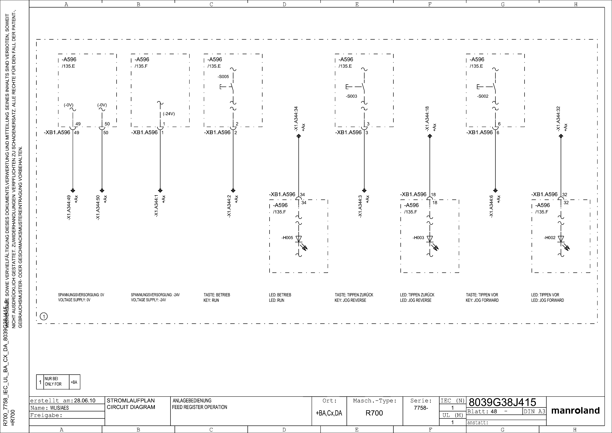

# +BA_Cx_DA — Sheet 48 of 247 — ANLAGEBEDIENUNG

**FEED REGISTER OPERATION**

> Part of the manroland **R700** printing press IEC/UL circuit diagrams.
> Drawing class: **Stromlaufplan / Circuit diagram** (DIN A3).
> Document `+BA_Cx_DA` covers the **Printing units / main switch cabinet** machine section.

## At a glance

| Field | Value |
|---|---|
| Document | `+BA_Cx_DA`  (8039G38J415) |
| Sheet | **48** of 247 |
| Section (DE) | ANLAGEBEDIENUNG |
| Section (EN) | FEED REGISTER OPERATION |
| Section type | CIRCUIT — Circuit diagram |
| Machine type | `R700` |
| Series | `7758` |
| Created | 28.06.10 |
| Replaces | — |
| Columns used | A, B, C, D, E, F, G, H |
| Path numbers | — |
| Labels on sheet | 90 |
| Cross-refs out | 8 |
| Cross-refs in | 17 |

**Previous:** [+BA_Cx_DA sheet 47](SHEET_0047.md) · **Next:** [+BA_Cx_DA sheet 49](SHEET_0049.md) · **Document TOC:** [_TOC.md](_TOC.md)  (+BA_Cx_DA) · **Master TOC:** [all sheets](../_MASTER_TOC.md)

## Sheet image (300 DPI, exact vector render)



_Rendered directly from the PDF vector layer at 300 DPI (1-bit), no OCR and no resampling. Use it to confirm anything ambiguous in the text below._

## Cross-references on this sheet

Each entry is a wire leaving this sheet. The printed token is `/sheet.column`; the link resolves to that sheet inside the same document.

| Ref | Target sheet | Col | Path | Destination on target | Target section | From col |
|---|---|---|---|---|---|---|
| `/135.E` | [+BA_Cx_DA sheet 135](SHEET_0135.md) | E | — | A596 | REFERENZMODUL | A |
| `/135.F` | [+BA_Cx_DA sheet 135](SHEET_0135.md) | F | — | A596 | REFERENZMODUL | B |
| `/135.E` | [+BA_Cx_DA sheet 135](SHEET_0135.md) | E | — | A596 | REFERENZMODUL | C |
| `/135.E` | [+BA_Cx_DA sheet 135](SHEET_0135.md) | E | — | A596 | REFERENZMODUL | E |
| `/135.E` | [+BA_Cx_DA sheet 135](SHEET_0135.md) | E | — | A596 | REFERENZMODUL | G |
| `/135.F` | [+BA_Cx_DA sheet 135](SHEET_0135.md) | F | — | A596 | REFERENZMODUL | D |
| `/135.F` | [+BA_Cx_DA sheet 135](SHEET_0135.md) | F | — | A596 | REFERENZMODUL | F |
| `/135.F` | [+BA_Cx_DA sheet 135](SHEET_0135.md) | F | — | A596 | REFERENZMODUL | H |

### Incoming references (sheets that point here)

Every other sheet that sends a wire to this one. `Back-ref` is the token printed on *that* sheet; `Path` is its line number.

| From sheet | Cols | Back-ref | Path | Refs | What continues there |
|---|---|---|---|---|---|
| [+BA_Cx_DA#135](SHEET_0135.md) | E, F | `/135.E`, `/135.F` | — | 8 | — |
| [+BA_Cx_DA#142](SHEET_0142.md) | E, F | `/142.E`, `/142.F` | — | 9 | — |


## Devices on this sheet

| Tag | Class | Class meaning (IEC) | Col | Sub | Terminal | Sign |
|---|---|---|---|---|---|---|
| `A596` | A | Baugruppe / assembly, module, PC board | A | — | — | — |
| `A596` | A | Baugruppe / assembly, module, PC board | B | — | — | — |
| `S005` | S | Schalter / switch | C | — | — | — |
| `A596` | A | Baugruppe / assembly, module, PC board | C | — | — | — |
| `A596` | A | Baugruppe / assembly, module, PC board | D | — | — | — |
| `S003` | S | Schalter / switch | E | — | — | — |
| `A596` | A | Baugruppe / assembly, module, PC board | E | — | — | — |
| `A596` | A | Baugruppe / assembly, module, PC board | F | — | — | — |
| `S002` | S | Schalter / switch | G | — | — | — |
| `A596` | A | Baugruppe / assembly, module, PC board | G | — | — | — |
| `A596` | A | Baugruppe / assembly, module, PC board | H | — | — | — |
| `XB1.A596` | — | cross-device reference | A | — | — | — |
| `XB1.A596` | — | cross-device reference | B | — | — | — |
| `X1.A344:1` | — | cross-device reference | B | — | 1 | — |
| `X1.A344:50` | — | cross-device reference | A | — | 50 | — |
| `X1.A344:49` | — | cross-device reference | A | — | 49 | — |
| `XB1.A596` | — | cross-device reference | C | — | — | — |
| `XB1.A596` | — | cross-device reference | D | — | — | — |
| `XB1.A596` | — | cross-device reference | E | — | — | — |
| `XB1.A596` | — | cross-device reference | F | — | — | — |
| `XB1.A596` | — | cross-device reference | G | — | — | — |
| `XB1.A596` | — | cross-device reference | H | — | — | — |
| `X1.A344:32` | — | cross-device reference | H | — | 32 | — |
| `X1.A344:18` | — | cross-device reference | F | — | 18 | — |
| `X1.A344:34` | — | cross-device reference | D | — | 34 | — |
| `X1.A344:2` | — | cross-device reference | C | — | 2 | — |
| `X1.A344:3` | — | cross-device reference | E | — | 3 | — |
| `X1.A344:6` | — | cross-device reference | G | — | 6 | — |

## Potentials / nets

| Potential | Count | Columns | Attached devices | Terminals |
|---|---|---|---|---|
| `H002` | 1 | H | — | — |
| `H003` | 1 | F | — | — |
| `H005` | 1 | D | — | — |


A potential such as `L24+/4` or `M24+` is a named supply/return rail; every place it appears on this sheet is electrically common.

## Wire-end annotations (grouped as printed)

A wire that continues elsewhere is annotated with a small cluster: the destination description, the path/line number `#NN`, and the `/sheet.column` cross reference. Each row below is one such cluster exactly as it is grouped on the drawing.

| Col | Y | Path | Cross-ref | Text on the wire |
|---|---|---|---|---|
| A | 110.8 | — | `/135.E` | `A596` |
| B | 110.8 | — | `/135.F` | `A596` |
| C | 110.8 | — | `/135.E` | `A596` |
| E | 110.8 | — | `/135.E` | `A596` |
| G | 110.8 | — | `/135.E` | `A596` |
| C | 145.3 | — | — | `S005` |
| E | 183.6 | — | — | `S003` |
| G | 183.6 | — | — | `S002` |
| A | 200.5 | — | — | `( 0V) ( 0V)` |
| D | 206.7 | — | — | `X1.A344:34` |
| F | 206.7 | — | — | `X1.A344:18` |
| H | 206.7 | — | — | `X1.A344:32` |
| B | 217.6 | — | — | `( 24V)` |
| A | 237.0 | — | — | `49 50` |
| B | 237.0 | — | — | `1` |
| C | 237.0 | — | — | `2` |
| E | 237.0 | — | — | `3` |
| G | 237.0 | — | — | `6` |
| D | 240.4 | — | — | `+Ax` |
| F | 240.4 | — | — | `+Ax` |
| H | 240.4 | — | — | `+Ax` |
| B | 252.6 | — | — | `XB1.A596 49 50 XB1.A596 1` |
| C | 252.6 | — | — | `XB1.A596 2` |
| E | 252.6 | — | — | `XB1.A596 3` |
| G | 252.6 | — | — | `XB1.A596 6` |
| D | 373.1 | — | — | `XB1.A596 34` |
| F | 373.1 | — | — | `XB1.A596 18` |
| H | 373.1 | — | — | `XB1.A596 32` |
| B | 378.1 | — | — | `X1.A344:1` |
| C | 379.3 | — | — | `X1.A344:2` |
| A | 379.6 | — | — | `X1.A344:49` |
| A | 379.6 | — | — | `X1.A344:50` |
| E | 379.6 | — | — | `X1.A344:3` |
| G | 379.6 | — | — | `X1.A344:6` |
| A | 379.8 | — | — | `+Ax` |
| B | 379.8 | — | — | `+Ax` |
| B | 379.8 | — | — | `+Ax` |
| C | 379.8 | — | — | `+Ax` |
| E | 379.8 | — | — | `+Ax` |
| G | 379.8 | — | — | `+Ax` |
| D | 390.1 | — | — | `34` |
| F | 390.1 | — | — | `18` |
| H | 390.1 | — | — | `32` |
| D | 394.3 | — | `/135.F` | `A596` |
| F | 394.3 | — | `/135.F` | `A596` |
| H | 394.3 | — | `/135.F` | `A596` |
| D | 458.5 | — | — | `H005` |
| F | 458.5 | — | — | `H003` |
| H | 458.5 | — | — | `H002` |
| C | 570.4 | — | — | `KEY: RUN TASTE: BETRIEB` |
| D | 570.4 | — | — | `LED: BETRIEB LED: RUN` |
| E | 570.4 | — | — | `KEY: JOG REVERSE TASTE: TIPPEN ZURÜCK` |
| F | 570.4 | — | — | `LED: TIPPEN ZURÜCK LED: JOG REVERSE` |
| G | 570.4 | — | — | `KEY: JOG FORWARD TASTE: TIPPEN VOR` |
| H | 570.4 | — | — | `LED: TIPPEN VOR LED: JOG FORWARD` |
| A | 570.5 | — | — | `SPANNUNGSVERSORGUNG: 0V VOLTAGE SUPPLY: 0V` |
| B | 570.5 | — | — | `SPANNUNGSVERSORGUNG: 24V VOLTAGE SUPPLY: 24V` |
| A | 612.1 | — | — | `1` |
| A | 733.3 | — | — | `1 NUR BEI` |
| A | 740.4 | — | — | `ONLY FOR +BA` |


## Reconstructed tables

This sheet carries tabular content (pin map / terminal assignment / index). The grid below was rebuilt from the drawing's own rule lines, so each row is exactly one physical row of the table.

### Table 1 — 2 data rows × 3 columns (at x=113.4, y=104.9)

| A596 /135.E ( 0V) | 49 | ( 0V) 50 |
|---|---|---|
|  | `49 +Ax` | `50 +Ax` |
| `X1.A344:49` | `X1.A344:50` |  |


### Table 2 — 2 data rows × 2 columns (at x=255.1, y=104.9)

| A596 /135.F | ( 24V) 1 |
|---|---|
| `XB1.A596` | `1 +Ax` |
| `X1.A344:1` |  |


### Table 3 — 2 data rows × 2 columns (at x=396.9, y=104.9)

| A596 /135.E S005 | 2 |
|---|---|
| `XB1.A596` | `2 +Ax` |
| `X1.A344:2` |  |


### Table 4 — 1 data rows × 2 columns (at x=524.4, y=104.9) — **X1.A344:34**

| XB1.A596 | +Ax 34 |
|---|---|
| `A596 /135.F H005` | `34` |


### Table 5 — 2 data rows × 2 columns (at x=652.0, y=104.9)

| A596 /135.E S003 | 3 |
|---|---|
| `XB1.A596` | `3 +Ax` |
| `X1.A344:3` |  |


### Table 6 — 1 data rows × 2 columns (at x=779.5, y=104.9) — **X1.A344:18**

| XB1.A596 | +Ax 18 |
|---|---|
| `A596 /135.F H003` | `18` |


### Table 7 — 2 data rows × 2 columns (at x=907.1, y=104.9)

| A596 /135.E S002 | 6 |
|---|---|
| `XB1.A596` | `6 +Ax` |
| `X1.A344:6` |  |


### Table 8 — 1 data rows × 2 columns (at x=1034.6, y=104.9) — **X1.A344:32**

| XB1.A596 | +Ax 32 |
|---|---|
| `A596 /135.F H002` | `32` |


## Notes and free text on this sheet

| Text | Col | Y (pt) |
|---|---|---|
| `( 0V)` | A | 200.54 |
| `SPANNUNGSVERSORGUNG: 0V` | A | 570.55 |
| `VOLTAGE SUPPLY: 0V` | A | 580.5 |
| `( 24V)` | B | 217.56 |
| `SPANNUNGSVERSORGUNG: 24V` | B | 570.55 |
| `VOLTAGE SUPPLY: 24V` | B | 580.5 |
| `+Ax` | B | 379.84 |
| `+Ax` | A | 379.84 |
| `TASTE: BETRIEB` | C | 570.36 |
| `KEY: RUN` | C | 580.98 |
| `LED: BETRIEB` | D | 570.36 |
| `LED: RUN` | D | 581 |
| `TASTE: TIPPEN ZURÜCK` | E | 570.38 |
| `KEY: JOG REVERSE` | E | 580.99 |
| `LED: TIPPEN ZURÜCK` | F | 570.39 |
| `LED: JOG REVERSE` | F | 581 |
| `TASTE: TIPPEN VOR` | G | 570.37 |
| `KEY: JOG FORWARD` | G | 580.98 |
| `LED: TIPPEN VOR` | H | 570.37 |
| `LED: JOG FORWARD` | H | 580.99 |
| `+Ax` | H | 240.38 |
| `+Ax` | F | 240.38 |
| `+Ax` | D | 240.38 |
| `+Ax` | C | 379.84 |
| `+Ax` | E | 379.84 |
| `+Ax` | G | 379.84 |
| `NUR BEI` | A | 733.33 |
| `ONLY FOR` | A | 744.02 |
| `+BA` | A | 740.44 |

## Complete label inventory (exact text from the drawing)

Every text object inside the drawing area of this sheet, in DIN reading order (column A→H, then top→bottom). This is the authoritative list: if a string is not here it is not printed on this sheet.

| Col | Y | X | Dir | Type | Text |
|---|---|---|---|---|---|
| A | 110.9 | 120.2 | → | device tag | `A596` |
| A | 124.6 | 120.5 | → | cross-reference | `/135.E` |
| A | 200.5 | 124.2 | → | text | `( 0V)` |
| A | 200.5 | 189.4 | → | text | `( 0V)` |
| A | 237.0 | 147.1 | → | number | `49` |
| A | 252.6 | 85.3 | → | device ref | `XB1.A596` |
| A | 254.0 | 144.3 | → | number | `49` |
| A | 379.6 | 130.0 | ↕ | device ref | `X1.A344:49` |
| A | 379.6 | 186.7 | ↕ | device ref | `X1.A344:50` |
| A | 379.8 | 144.2 | ↕ | text | `+Ax` |
| A | 570.5 | 113.1 | → | text | `SPANNUNGSVERSORGUNG: 0V` |
| A | 580.5 | 113.4 | → | text | `VOLTAGE SUPPLY: 0V` |
| A | 612.1 | 83.3 | → | number | `1` |
| A | 733.3 | 87.0 | → | text | `NUR BEI` |
| A | 738.7 | 75.4 | → | number | `1` |
| A | 740.4 | 137.9 | → | text | `+BA` |
| A | 744.0 | 87.6 | → | text | `ONLY FOR` |
| B | 110.9 | 261.9 | → | device tag | `A596` |
| B | 124.6 | 262.2 | → | cross-reference | `/135.F` |
| B | 217.6 | 316.9 | → | text | `( 24V)` |
| B | 237.0 | 203.8 | → | number | `50` |
| B | 237.0 | 316.6 | → | number | `1` |
| B | 252.6 | 255.4 | → | device ref | `XB1.A596` |
| B | 254.0 | 201.0 | → | number | `50` |
| B | 254.0 | 313.8 | → | number | `1` |
| B | 378.1 | 300.0 | ↕ | device ref | `X1.A344:1` |
| B | 379.8 | 200.9 | ↕ | text | `+Ax` |
| B | 379.8 | 314.3 | ↕ | text | `+Ax` |
| B | 570.5 | 254.8 | → | text | `SPANNUNGSVERSORGUNG: 24V` |
| B | 580.5 | 255.1 | → | text | `VOLTAGE SUPPLY: 24V` |
| C | 110.9 | 403.7 | → | device tag | `A596` |
| C | 124.6 | 403.9 | → | cross-reference | `/135.E` |
| C | 145.3 | 423.5 | → | device tag | `S005` |
| C | 237.0 | 458.9 | → | number | `2` |
| C | 252.6 | 397.1 | → | device ref | `XB1.A596` |
| C | 254.0 | 456.1 | → | number | `2` |
| C | 379.3 | 441.8 | ↕ | device ref | `X1.A344:2` |
| C | 379.8 | 456.0 | ↕ | text | `+Ax` |
| C | 570.4 | 396.6 | → | text | `TASTE: BETRIEB` |
| C | 581.0 | 396.0 | → | text | `KEY: RUN` |
| D | 206.6 | 572.2 | ↕ | device ref | `X1.A344:34` |
| D | 240.4 | 586.4 | ↕ | text | `+Ax` |
| D | 373.1 | 523.3 | → | device ref | `XB1.A596` |
| D | 374.5 | 583.7 | → | number | `34` |
| D | 390.1 | 586.5 | → | number | `34` |
| D | 394.3 | 531.2 | → | device tag | `A596` |
| D | 408.1 | 531.5 | → | cross-reference | `/135.F` |
| D | 458.5 | 547.7 | → | potential | `H005` |
| D | 570.4 | 523.6 | → | text | `LED: BETRIEB` |
| D | 581.0 | 523.6 | → | text | `LED: RUN` |
| E | 110.9 | 658.8 | → | device tag | `A596` |
| E | 124.6 | 659.1 | → | cross-reference | `/135.E` |
| E | 183.6 | 672.9 | → | device tag | `S003` |
| E | 237.0 | 714.0 | → | number | `3` |
| E | 252.6 | 652.3 | → | device ref | `XB1.A596` |
| E | 254.0 | 711.2 | → | number | `3` |
| E | 379.6 | 696.9 | ↕ | device ref | `X1.A344:3` |
| E | 379.8 | 711.1 | ↕ | text | `+Ax` |
| E | 570.4 | 651.7 | → | text | `TASTE: TIPPEN ZURÜCK` |
| E | 581.0 | 651.1 | → | text | `KEY: JOG REVERSE` |
| F | 206.6 | 827.3 | ↕ | device ref | `X1.A344:18` |
| F | 240.4 | 841.5 | ↕ | text | `+Ax` |
| F | 373.1 | 778.4 | → | device ref | `XB1.A596` |
| F | 374.5 | 838.2 | → | number | `18` |
| F | 390.1 | 841.0 | → | number | `18` |
| F | 394.3 | 786.3 | → | device tag | `A596` |
| F | 408.1 | 786.6 | → | cross-reference | `/135.F` |
| F | 458.5 | 802.8 | → | potential | `H003` |
| F | 570.4 | 778.7 | → | text | `LED: TIPPEN ZURÜCK` |
| F | 581.0 | 778.7 | → | text | `LED: JOG REVERSE` |
| G | 110.9 | 913.9 | → | device tag | `A596` |
| G | 124.6 | 914.2 | → | cross-reference | `/135.E` |
| G | 183.6 | 928.3 | → | device tag | `S002` |
| G | 237.0 | 969.2 | → | number | `6` |
| G | 252.6 | 907.4 | → | device ref | `XB1.A596` |
| G | 254.0 | 966.3 | → | number | `6` |
| G | 379.6 | 952.0 | ↕ | device ref | `X1.A344:6` |
| G | 379.8 | 966.3 | ↕ | text | `+Ax` |
| G | 570.4 | 906.8 | → | text | `TASTE: TIPPEN VOR` |
| G | 581.0 | 906.2 | → | text | `KEY: JOG FORWARD` |
| H | 206.6 | 1082.4 | ↕ | device ref | `X1.A344:32` |
| H | 240.4 | 1096.7 | ↕ | text | `+Ax` |
| H | 373.1 | 1033.5 | → | device ref | `XB1.A596` |
| H | 374.5 | 1093.9 | → | number | `32` |
| H | 390.1 | 1096.7 | → | number | `32` |
| H | 394.3 | 1041.4 | → | device tag | `A596` |
| H | 408.1 | 1041.7 | → | cross-reference | `/135.F` |
| H | 458.5 | 1058.2 | → | potential | `H002` |
| H | 570.4 | 1033.8 | → | text | `LED: TIPPEN VOR` |
| H | 581.0 | 1033.8 | → | text | `LED: JOG FORWARD` |

## Reading-order text block

The same content as a plain block, grouped by DIN column — convenient to paste or to match against a visual description.

```text
=== Column A ===
 110.9  120.2  devtag       A596
 124.6  120.5  xref         /135.E
 200.5  124.2  text         ( 0V)
 200.5  189.4  text         ( 0V)
 237.0  147.1  numeric      49
 252.6   85.3  devref       XB1.A596
 254.0  144.3  numeric      49
 379.6  130.0  devref       X1.A344:49
 379.6  186.7  devref       X1.A344:50
 379.8  144.2  text         +Ax
 570.5  113.1  text         SPANNUNGSVERSORGUNG: 0V
 580.5  113.4  text         VOLTAGE SUPPLY: 0V
 612.1   83.3  numeric      1
 733.3   87.0  text         NUR BEI
 738.7   75.4  numeric      1
 740.4  137.9  text         +BA
 744.0   87.6  text         ONLY FOR
=== Column B ===
 110.9  261.9  devtag       A596
 124.6  262.2  xref         /135.F
 217.6  316.9  text         ( 24V)
 237.0  203.8  numeric      50
 237.0  316.6  numeric      1
 252.6  255.4  devref       XB1.A596
 254.0  201.0  numeric      50
 254.0  313.8  numeric      1
 378.1  300.0  devref       X1.A344:1
 379.8  200.9  text         +Ax
 379.8  314.3  text         +Ax
 570.5  254.8  text         SPANNUNGSVERSORGUNG: 24V
 580.5  255.1  text         VOLTAGE SUPPLY: 24V
=== Column C ===
 110.9  403.7  devtag       A596
 124.6  403.9  xref         /135.E
 145.3  423.5  devtag       S005
 237.0  458.9  numeric      2
 252.6  397.1  devref       XB1.A596
 254.0  456.1  numeric      2
 379.3  441.8  devref       X1.A344:2
 379.8  456.0  text         +Ax
 570.4  396.6  text         TASTE: BETRIEB
 581.0  396.0  text         KEY: RUN
=== Column D ===
 206.6  572.2  devref       X1.A344:34
 240.4  586.4  text         +Ax
 373.1  523.3  devref       XB1.A596
 374.5  583.7  numeric      34
 390.1  586.5  numeric      34
 394.3  531.2  devtag       A596
 408.1  531.5  xref         /135.F
 458.5  547.7  net          H005
 570.4  523.6  text         LED: BETRIEB
 581.0  523.6  text         LED: RUN
=== Column E ===
 110.9  658.8  devtag       A596
 124.6  659.1  xref         /135.E
 183.6  672.9  devtag       S003
 237.0  714.0  numeric      3
 252.6  652.3  devref       XB1.A596
 254.0  711.2  numeric      3
 379.6  696.9  devref       X1.A344:3
 379.8  711.1  text         +Ax
 570.4  651.7  text         TASTE: TIPPEN ZURÜCK
 581.0  651.1  text         KEY: JOG REVERSE
=== Column F ===
 206.6  827.3  devref       X1.A344:18
 240.4  841.5  text         +Ax
 373.1  778.4  devref       XB1.A596
 374.5  838.2  numeric      18
 390.1  841.0  numeric      18
 394.3  786.3  devtag       A596
 408.1  786.6  xref         /135.F
 458.5  802.8  net          H003
 570.4  778.7  text         LED: TIPPEN ZURÜCK
 581.0  778.7  text         LED: JOG REVERSE
=== Column G ===
 110.9  913.9  devtag       A596
 124.6  914.2  xref         /135.E
 183.6  928.3  devtag       S002
 237.0  969.2  numeric      6
 252.6  907.4  devref       XB1.A596
 254.0  966.3  numeric      6
 379.6  952.0  devref       X1.A344:6
 379.8  966.3  text         +Ax
 570.4  906.8  text         TASTE: TIPPEN VOR
 581.0  906.2  text         KEY: JOG FORWARD
=== Column H ===
 206.6 1082.4  devref       X1.A344:32
 240.4 1096.7  text         +Ax
 373.1 1033.5  devref       XB1.A596
 374.5 1093.9  numeric      32
 390.1 1096.7  numeric      32
 394.3 1041.4  devtag       A596
 408.1 1041.7  xref         /135.F
 458.5 1058.2  net          H002
 570.4 1033.8  text         LED: TIPPEN VOR
 581.0 1033.8  text         LED: JOG FORWARD
```

---
_Generated from the PDF vector text layer; no OCR. Source: `R700_7758_IEC_UL_BA_CX_DA_8039G38J415_p`, sheet 48._
