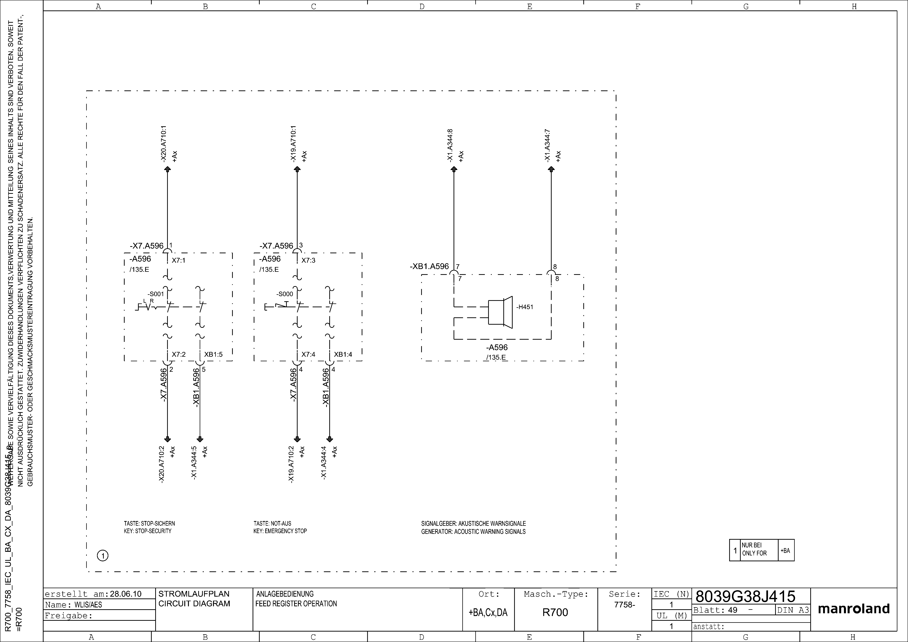

# +BA_Cx_DA — Sheet 49 of 247 — ANLAGEBEDIENUNG

**FEED REGISTER OPERATION**

> Part of the manroland **R700** printing press IEC/UL circuit diagrams.
> Drawing class: **Stromlaufplan / Circuit diagram** (DIN A3).
> Document `+BA_Cx_DA` covers the **Printing units / main switch cabinet** machine section.

## At a glance

| Field | Value |
|---|---|
| Document | `+BA_Cx_DA`  (8039G38J415) |
| Sheet | **49** of 247 |
| Section (DE) | ANLAGEBEDIENUNG |
| Section (EN) | FEED REGISTER OPERATION |
| Section type | CIRCUIT — Circuit diagram |
| Machine type | `R700` |
| Series | `7758` |
| Created | 28.06.10 |
| Replaces | — |
| Columns used | A, B, C, D, E, G |
| Path numbers | — |
| Labels on sheet | 60 |
| Cross-refs out | 3 |
| Cross-refs in | 11 |

**Previous:** [+BA_Cx_DA sheet 48](SHEET_0048.md) · **Next:** [+BA_Cx_DA sheet 50](SHEET_0050.md) · **Document TOC:** [_TOC.md](_TOC.md)  (+BA_Cx_DA) · **Master TOC:** [all sheets](../_MASTER_TOC.md)

## Sheet image (300 DPI, exact vector render)



_Rendered directly from the PDF vector layer at 300 DPI (1-bit), no OCR and no resampling. Use it to confirm anything ambiguous in the text below._

## Cross-references on this sheet

Each entry is a wire leaving this sheet. The printed token is `/sheet.column`; the link resolves to that sheet inside the same document.

| Ref | Target sheet | Col | Path | Destination on target | Target section | From col |
|---|---|---|---|---|---|---|
| `/135.E` | [+BA_Cx_DA sheet 135](SHEET_0135.md) | E | — | — | REFERENZMODUL | A |
| `/135.E` | [+BA_Cx_DA sheet 135](SHEET_0135.md) | E | — | — | REFERENZMODUL | C |
| `/135.E` | [+BA_Cx_DA sheet 135](SHEET_0135.md) | E | — | A596 | REFERENZMODUL | E |

### Incoming references (sheets that point here)

Every other sheet that sends a wire to this one. `Back-ref` is the token printed on *that* sheet; `Path` is its line number.

| From sheet | Cols | Back-ref | Path | Refs | What continues there |
|---|---|---|---|---|---|
| [+BA_Cx_DA#135](SHEET_0135.md) | E | `/135.E` | — | 3 | — |
| [+BA_Cx_DA#142](SHEET_0142.md) | E | `/142.E` | — | 4 | — |
| [+BA_Cx_DA#164](SHEET_0164.md) | B | `/164.B` | — | 4 | — |


## Devices on this sheet

| Tag | Class | Class meaning (IEC) | Col | Sub | Terminal | Sign |
|---|---|---|---|---|---|---|
| `A596` | A | Baugruppe / assembly, module, PC board | E | — | — | — |
| `X7:3` | X | Klemme / terminal, plug connector | C | — | 3 | — |
| `X7:4` | X | Klemme / terminal, plug connector | C | — | 4 | — |
| `XB1:4` | XB |  | C | — | 4 | — |
| `S000` | S | Schalter / switch | C | — | — | — |
| `A596` | A | Baugruppe / assembly, module, PC board | C | — | — | — |
| `X7:1` | X | Klemme / terminal, plug connector | B | — | 1 | — |
| `X7:2` | X | Klemme / terminal, plug connector | B | — | 2 | — |
| `XB1:5` | XB |  | B | — | 5 | — |
| `S001` | S | Schalter / switch | B | — | — | — |
| `A596` | A | Baugruppe / assembly, module, PC board | A | — | — | — |
| `XB1.A596` | — | cross-device reference | D | — | — | — |
| `X1.A344:8` | — | cross-device reference | D | — | 8 | — |
| `X1.A344:7` | — | cross-device reference | E | — | 7 | — |
| `X7.A596` | — | cross-device reference | C | — | — | — |
| `X7.A596` | — | cross-device reference | A | — | — | — |
| `X19.A710:1` | — | cross-device reference | C | — | 1 | — |
| `X20.A710:1` | — | cross-device reference | B | — | 1 | — |
| `XB1.A596` | — | cross-device reference | B | — | — | — |
| `X7.A596` | — | cross-device reference | B | — | — | — |
| `X20.A710:2` | — | cross-device reference | B | — | 2 | — |
| `X1.A344:5` | — | cross-device reference | B | — | 5 | — |
| `X19.A710:2` | — | cross-device reference | C | — | 2 | — |
| `X1.A344:4` | — | cross-device reference | C | — | 4 | — |
| `X7.A596` | — | cross-device reference | C | — | — | — |
| `XB1.A596` | — | cross-device reference | C | — | — | — |

## Potentials / nets

| Potential | Count | Columns | Attached devices | Terminals |
|---|---|---|---|---|
| `H451` | 1 | E | — | — |


A potential such as `L24+/4` or `M24+` is a named supply/return rail; every place it appears on this sheet is electrically common.

## Wire-end annotations (grouped as printed)

A wire that continues elsewhere is annotated with a small cluster: the destination description, the path/line number `#NN`, and the `/sheet.column` cross reference. Each row below is one such cluster exactly as it is grouped on the drawing.

| Col | Y | Path | Cross-ref | Text on the wire |
|---|---|---|---|---|
| B | 164.1 | — | — | `X20.A710:1` |
| C | 164.1 | — | — | `X19.A710:1` |
| D | 168.9 | — | — | `X1.A344:8` |
| E | 168.9 | — | — | `X1.A344:7` |
| B | 197.9 | — | — | `+Ax` |
| C | 197.9 | — | — | `+Ax` |
| D | 197.9 | — | — | `+Ax` |
| E | 197.9 | — | — | `+Ax` |
| B | 317.8 | — | — | `X7.A596 1 X7.A596 3` |
| A | 334.8 | — | — | `A596` |
| C | 334.8 | — | — | `A596` |
| B | 337.6 | — | — | `X7:1` |
| C | 337.6 | — | — | `X7:3` |
| E | 344.7 | — | — | `XB1.A596 7 8` |
| A | 349.6 | — | `/135.E` | — |
| C | 349.6 | — | `/135.E` | — |
| E | 361.7 | — | — | `7 8` |
| B | 382.0 | — | — | `S001` |
| C | 382.0 | — | — | `S000` |
| A | 391.4 | — | — | `L R` |
| E | 399.0 | — | — | `H451` |
| E | 451.0 | — | `/135.E` | `A596` |
| B | 460.9 | — | — | `X7:2 XB1:5` |
| C | 460.9 | — | — | `X7:4 XB1:4` |
| B | 480.8 | — | — | `2` |
| B | 480.8 | — | — | `5` |
| C | 480.8 | — | — | `4` |
| C | 480.8 | — | — | `4` |
| B | 482.7 | — | — | `X20.A710:2 X7.A596` |
| B | 482.7 | — | — | `XB1.A596` |
| C | 482.7 | — | — | `X7.A596` |
| C | 482.7 | — | — | `XB1.A596` |
| C | 584.8 | — | — | `X19.A710:2` |
| B | 585.1 | — | — | `X1.A344:5` |
| C | 585.1 | — | — | `X1.A344:4` |
| B | 585.4 | — | — | `+Ax` |
| B | 585.4 | — | — | `+Ax` |
| C | 585.4 | — | — | `+Ax` |
| C | 585.4 | — | — | `+Ax` |
| D | 683.8 | — | — | `SIGNALGEBER: AKUSTISCHE WARNSIGNALE GENERATOR: ACOUSTIC WARNING SIGNALS` |
| A | 683.9 | — | — | `KEY: STOP SECURITY TASTE: STOP SICHERN` |
| C | 683.9 | — | — | `KEY: EMERGENCY STOP TASTE: NOT AUS` |
| G | 712.1 | — | — | `1 NUR BEI` |
| D | 719.2 | — | — | `1 ONLY FOR +BA` |


## Reconstructed tables

This sheet carries tabular content (pin map / terminal assignment / index). The grid below was rebuilt from the drawing's own rule lines, so each row is exactly one physical row of the table.

### Table 1 — 1 data rows × 3 columns (at x=163.0, y=331.7)

| A596 /135.E S001 L R | X7:1 |  |
|---|---|---|
|  | `X7:2` | `XB1:5` |


### Table 2 — 1 data rows × 3 columns (at x=333.1, y=331.7)

| A596 /135.E S000 | X7:3 |  |
|---|---|---|
|  | `X7:4` | `XB1:4` |


## Notes and free text on this sheet

| Text | Col | Y (pt) |
|---|---|---|
| `SIGNALGEBER: AKUSTISCHE WARNSIGNALE` | D | 683.76 |
| `GENERATOR: ACOUSTIC WARNING SIGNALS` | D | 694.4 |
| `+Ax` | D | 197.86 |
| `+Ax` | E | 197.86 |
| `TASTE: NOT AUS` | C | 683.88 |
| `KEY: EMERGENCY STOP` | C | 693.88 |
| `+Ax` | C | 197.86 |
| `+Ax` | B | 197.86 |
| `TASTE: STOP SICHERN` | A | 683.91 |
| `KEY: STOP SECURITY` | A | 693.87 |
| `L R` | A | 391.36 |
| `NUR BEI` | G | 712.08 |
| `ONLY FOR` | G | 722.76 |
| `+BA` | G | 719.18 |

## Complete label inventory (exact text from the drawing)

Every text object inside the drawing area of this sheet, in DIN reading order (column A→H, then top→bottom). This is the authoritative list: if a string is not here it is not printed on this sheet.

| Col | Y | X | Dir | Type | Text |
|---|---|---|---|---|---|
| A | 317.8 | 170.4 | → | device ref | `X7.A596` |
| A | 334.8 | 169.8 | → | device tag | `A596` |
| A | 349.6 | 170.1 | → | cross-reference | `/135.E` |
| A | 391.4 | 187.8 | → | text | `L R` |
| A | 683.9 | 162.7 | → | text | `TASTE: STOP SICHERN` |
| A | 693.9 | 162.4 | → | text | `KEY: STOP SECURITY` |
| A | 725.4 | 132.9 | → | number | `1` |
| B | 164.1 | 210.8 | ↕ | device ref | `X20.A710:1` |
| B | 197.9 | 225.0 | ↕ | text | `+Ax` |
| B | 317.8 | 221.7 | → | number | `1` |
| B | 337.6 | 225.4 | → | device tag | `X7:1` |
| B | 382.0 | 193.6 | → | device tag | `S001` |
| B | 460.9 | 225.4 | → | device tag | `X7:2` |
| B | 460.9 | 267.9 | → | device tag | `XB1:5` |
| B | 480.8 | 222.2 | → | number | `2` |
| B | 480.8 | 264.8 | → | number | `5` |
| B | 482.7 | 210.1 | ↕ | device ref | `X7.A596` |
| B | 482.7 | 252.6 | ↕ | device ref | `XB1.A596` |
| B | 584.8 | 207.9 | ↕ | device ref | `X20.A710:2` |
| B | 585.1 | 250.4 | ↕ | device ref | `X1.A344:5` |
| B | 585.4 | 222.2 | ↕ | text | `+Ax` |
| B | 585.4 | 264.7 | ↕ | text | `+Ax` |
| C | 164.1 | 380.8 | ↕ | device ref | `X19.A710:1` |
| C | 197.9 | 395.1 | ↕ | text | `+Ax` |
| C | 317.8 | 340.4 | → | device ref | `X7.A596` |
| C | 317.8 | 392.3 | → | number | `3` |
| C | 334.8 | 339.9 | → | device tag | `A596` |
| C | 337.6 | 395.4 | → | device tag | `X7:3` |
| C | 349.6 | 340.2 | → | cross-reference | `/135.E` |
| C | 382.0 | 362.6 | → | device tag | `S000` |
| C | 460.9 | 395.4 | → | device tag | `X7:4` |
| C | 460.9 | 438.0 | → | device tag | `XB1:4` |
| C | 480.8 | 392.3 | → | number | `4` |
| C | 480.8 | 434.8 | → | number | `4` |
| C | 482.7 | 380.2 | ↕ | device ref | `X7.A596` |
| C | 482.7 | 422.7 | ↕ | device ref | `XB1.A596` |
| C | 584.8 | 378.0 | ↕ | device ref | `X19.A710:2` |
| C | 585.1 | 420.5 | ↕ | device ref | `X1.A344:4` |
| C | 585.4 | 392.2 | ↕ | text | `+Ax` |
| C | 585.4 | 434.8 | ↕ | text | `+Ax` |
| C | 683.9 | 332.8 | → | text | `TASTE: NOT AUS` |
| C | 693.9 | 332.5 | → | text | `KEY: EMERGENCY STOP` |
| D | 168.9 | 586.3 | ↕ | device ref | `X1.A344:8` |
| D | 197.9 | 600.6 | ↕ | text | `+Ax` |
| D | 344.7 | 537.4 | → | device ref | `XB1.A596` |
| D | 346.2 | 597.8 | → | number | `7` |
| D | 361.7 | 600.7 | → | number | `7` |
| D | 683.8 | 552.5 | → | text | `SIGNALGEBER: AKUSTISCHE WARNSIGNALE` |
| D | 694.4 | 552.5 | → | text | `GENERATOR: ACOUSTIC WARNING SIGNALS` |
| E | 168.9 | 713.9 | ↕ | device ref | `X1.A344:7` |
| E | 197.9 | 728.2 | ↕ | text | `+Ax` |
| E | 346.2 | 725.4 | → | number | `8` |
| E | 361.7 | 728.2 | → | number | `8` |
| E | 399.0 | 677.2 | → | potential | `H451` |
| E | 451.0 | 637.5 | → | device tag | `A596` |
| E | 464.8 | 637.8 | → | cross-reference | `/135.E` |
| G | 712.1 | 972.9 | → | text | `NUR BEI` |
| G | 717.4 | 961.2 | → | number | `1` |
| G | 719.2 | 1023.7 | → | text | `+BA` |
| G | 722.8 | 973.4 | → | text | `ONLY FOR` |

## Reading-order text block

The same content as a plain block, grouped by DIN column — convenient to paste or to match against a visual description.

```text
=== Column A ===
 317.8  170.4  devref       X7.A596
 334.8  169.8  devtag       A596
 349.6  170.1  xref         /135.E
 391.4  187.8  text         L R
 683.9  162.7  text         TASTE: STOP SICHERN
 693.9  162.4  text         KEY: STOP SECURITY
 725.4  132.9  numeric      1
=== Column B ===
 164.1  210.8  devref       X20.A710:1
 197.9  225.0  text         +Ax
 317.8  221.7  numeric      1
 337.6  225.4  devtag       X7:1
 382.0  193.6  devtag       S001
 460.9  225.4  devtag       X7:2
 460.9  267.9  devtag       XB1:5
 480.8  222.2  numeric      2
 480.8  264.8  numeric      5
 482.7  210.1  devref       X7.A596
 482.7  252.6  devref       XB1.A596
 584.8  207.9  devref       X20.A710:2
 585.1  250.4  devref       X1.A344:5
 585.4  222.2  text         +Ax
 585.4  264.7  text         +Ax
=== Column C ===
 164.1  380.8  devref       X19.A710:1
 197.9  395.1  text         +Ax
 317.8  340.4  devref       X7.A596
 317.8  392.3  numeric      3
 334.8  339.9  devtag       A596
 337.6  395.4  devtag       X7:3
 349.6  340.2  xref         /135.E
 382.0  362.6  devtag       S000
 460.9  395.4  devtag       X7:4
 460.9  438.0  devtag       XB1:4
 480.8  392.3  numeric      4
 480.8  434.8  numeric      4
 482.7  380.2  devref       X7.A596
 482.7  422.7  devref       XB1.A596
 584.8  378.0  devref       X19.A710:2
 585.1  420.5  devref       X1.A344:4
 585.4  392.2  text         +Ax
 585.4  434.8  text         +Ax
 683.9  332.8  text         TASTE: NOT AUS
 693.9  332.5  text         KEY: EMERGENCY STOP
=== Column D ===
 168.9  586.3  devref       X1.A344:8
 197.9  600.6  text         +Ax
 344.7  537.4  devref       XB1.A596
 346.2  597.8  numeric      7
 361.7  600.7  numeric      7
 683.8  552.5  text         SIGNALGEBER: AKUSTISCHE WARNSIGNALE
 694.4  552.5  text         GENERATOR: ACOUSTIC WARNING SIGNALS
=== Column E ===
 168.9  713.9  devref       X1.A344:7
 197.9  728.2  text         +Ax
 346.2  725.4  numeric      8
 361.7  728.2  numeric      8
 399.0  677.2  net          H451
 451.0  637.5  devtag       A596
 464.8  637.8  xref         /135.E
=== Column G ===
 712.1  972.9  text         NUR BEI
 717.4  961.2  numeric      1
 719.2 1023.7  text         +BA
 722.8  973.4  text         ONLY FOR
```

---
_Generated from the PDF vector text layer; no OCR. Source: `R700_7758_IEC_UL_BA_CX_DA_8039G38J415_p`, sheet 49._
