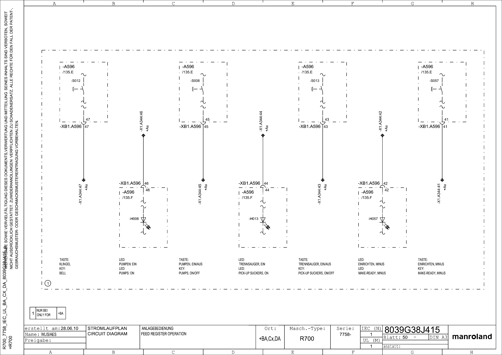

# +BA_Cx_DA — Sheet 50 of 247 — ANLAGEBEDIENUNG

**FEED REGISTER OPERATION**

> Part of the manroland **R700** printing press IEC/UL circuit diagrams.
> Drawing class: **Stromlaufplan / Circuit diagram** (DIN A3).
> Document `+BA_Cx_DA` covers the **Printing units / main switch cabinet** machine section.

## At a glance

| Field | Value |
|---|---|
| Document | `+BA_Cx_DA`  (8039G38J415) |
| Sheet | **50** of 247 |
| Section (DE) | ANLAGEBEDIENUNG |
| Section (EN) | FEED REGISTER OPERATION |
| Section type | CIRCUIT — Circuit diagram |
| Machine type | `R700` |
| Series | `7758` |
| Created | 28.06.10 |
| Replaces | — |
| Columns used | A, B, C, D, E, F, G, H |
| Path numbers | — |
| Labels on sheet | 89 |
| Cross-refs out | 7 |
| Cross-refs in | 14 |

**Previous:** [+BA_Cx_DA sheet 49](SHEET_0049.md) · **Next:** [+BA_Cx_DA sheet 51](SHEET_0051.md) · **Document TOC:** [_TOC.md](_TOC.md)  (+BA_Cx_DA) · **Master TOC:** [all sheets](../_MASTER_TOC.md)

## Sheet image (300 DPI, exact vector render)



_Rendered directly from the PDF vector layer at 300 DPI (1-bit), no OCR and no resampling. Use it to confirm anything ambiguous in the text below._

## Cross-references on this sheet

Each entry is a wire leaving this sheet. The printed token is `/sheet.column`; the link resolves to that sheet inside the same document.

| Ref | Target sheet | Col | Path | Destination on target | Target section | From col |
|---|---|---|---|---|---|---|
| `/135.E` | [+BA_Cx_DA sheet 135](SHEET_0135.md) | E | — | A596 | REFERENZMODUL | A |
| `/135.E` | [+BA_Cx_DA sheet 135](SHEET_0135.md) | E | — | A596 | REFERENZMODUL | C |
| `/135.E` | [+BA_Cx_DA sheet 135](SHEET_0135.md) | E | — | A596 | REFERENZMODUL | E |
| `/135.E` | [+BA_Cx_DA sheet 135](SHEET_0135.md) | E | — | A596 | REFERENZMODUL | G |
| `/135.F` | [+BA_Cx_DA sheet 135](SHEET_0135.md) | F | — | A596 | REFERENZMODUL | B |
| `/135.F` | [+BA_Cx_DA sheet 135](SHEET_0135.md) | F | — | A596 | REFERENZMODUL | D |
| `/135.F` | [+BA_Cx_DA sheet 135](SHEET_0135.md) | F | — | A596 | REFERENZMODUL | F |

### Incoming references (sheets that point here)

Every other sheet that sends a wire to this one. `Back-ref` is the token printed on *that* sheet; `Path` is its line number.

| From sheet | Cols | Back-ref | Path | Refs | What continues there |
|---|---|---|---|---|---|
| [+BA_Cx_DA#135](SHEET_0135.md) | E, F | `/135.E`, `/135.F` | — | 7 | — |
| [+BA_Cx_DA#142](SHEET_0142.md) | F | `/142.F` | — | 7 | — |


## Devices on this sheet

| Tag | Class | Class meaning (IEC) | Col | Sub | Terminal | Sign |
|---|---|---|---|---|---|---|
| `S012` | S | Schalter / switch | A | — | — | — |
| `A596` | A | Baugruppe / assembly, module, PC board | A | — | — | — |
| `A596` | A | Baugruppe / assembly, module, PC board | B | — | — | — |
| `S008` | S | Schalter / switch | C | — | — | — |
| `A596` | A | Baugruppe / assembly, module, PC board | C | — | — | — |
| `A596` | A | Baugruppe / assembly, module, PC board | D | — | — | — |
| `S013` | S | Schalter / switch | E | — | — | — |
| `A596` | A | Baugruppe / assembly, module, PC board | E | — | — | — |
| `A596` | A | Baugruppe / assembly, module, PC board | F | — | — | — |
| `S057` | S | Schalter / switch | G | — | — | — |
| `A596` | A | Baugruppe / assembly, module, PC board | G | — | — | — |
| `XB1.A596` | — | cross-device reference | A | — | — | — |
| `XB1.A596` | — | cross-device reference | B | — | — | — |
| `XB1.A596` | — | cross-device reference | C | — | — | — |
| `XB1.A596` | — | cross-device reference | D | — | — | — |
| `XB1.A596` | — | cross-device reference | E | — | — | — |
| `XB1.A596` | — | cross-device reference | F | — | — | — |
| `XB1.A596` | — | cross-device reference | G | — | — | — |
| `X1.A344:47` | — | cross-device reference | A | — | 47 | — |
| `X1.A344:46` | — | cross-device reference | B | — | 46 | — |
| `X1.A344:45` | — | cross-device reference | C | — | 45 | — |
| `X1.A344:44` | — | cross-device reference | D | — | 44 | — |
| `X1.A344:43` | — | cross-device reference | E | — | 43 | — |
| `X1.A344:42` | — | cross-device reference | F | — | 42 | — |
| `X1.A344:41` | — | cross-device reference | G | — | 41 | — |

## Potentials / nets

| Potential | Count | Columns | Attached devices | Terminals |
|---|---|---|---|---|
| `H008` | 1 | B | — | — |
| `H013` | 1 | D | — | — |
| `H057` | 1 | F | — | — |


A potential such as `L24+/4` or `M24+` is a named supply/return rail; every place it appears on this sheet is electrically common.

## Wire-end annotations (grouped as printed)

A wire that continues elsewhere is annotated with a small cluster: the destination description, the path/line number `#NN`, and the `/sheet.column` cross reference. Each row below is one such cluster exactly as it is grouped on the drawing.

| Col | Y | Path | Cross-ref | Text on the wire |
|---|---|---|---|---|
| A | 153.4 | — | `/135.E` | `A596` |
| C | 153.4 | — | `/135.E` | `A596` |
| E | 153.4 | — | `/135.E` | `A596` |
| G | 153.4 | — | `/135.E` | `A596` |
| A | 187.8 | — | — | `S012` |
| C | 187.8 | — | — | `S008` |
| E | 187.8 | — | — | `S013` |
| G | 187.8 | — | — | `S057` |
| B | 263.3 | — | — | `X1.A344:46` |
| D | 263.3 | — | — | `X1.A344:44` |
| F | 263.3 | — | — | `X1.A344:42` |
| B | 279.5 | — | — | `47` |
| D | 279.5 | — | — | `45` |
| F | 279.5 | — | — | `43` |
| H | 279.5 | — | — | `41` |
| A | 295.1 | — | — | `XB1.A596 47` |
| C | 295.1 | — | — | `XB1.A596 45` |
| E | 295.1 | — | — | `XB1.A596 43` |
| G | 295.1 | — | — | `XB1.A596 41` |
| C | 297.1 | — | — | `+Ax` |
| E | 297.1 | — | — | `+Ax` |
| G | 297.1 | — | — | `+Ax` |
| B | 429.8 | — | — | `XB1.A596 46` |
| D | 429.8 | — | — | `XB1.A596 44` |
| F | 429.8 | — | — | `XB1.A596 42` |
| G | 434.8 | — | — | `X1.A344:41` |
| A | 436.2 | — | — | `X1.A344:47` |
| C | 436.2 | — | — | `X1.A344:45` |
| E | 436.2 | — | — | `X1.A344:43` |
| B | 436.5 | — | — | `+Ax` |
| D | 436.5 | — | — | `+Ax` |
| F | 436.5 | — | — | `+Ax` |
| H | 436.5 | — | — | `+Ax` |
| C | 446.8 | — | — | `46` |
| E | 446.8 | — | — | `44` |
| G | 446.8 | — | — | `42` |
| B | 451.0 | — | `/135.F` | `A596` |
| D | 451.0 | — | `/135.F` | `A596` |
| F | 451.0 | — | `/135.F` | `A596` |
| B | 515.2 | — | — | `H008` |
| D | 515.2 | — | — | `H013` |
| F | 515.2 | — | — | `H057` |
| A | 612.8 | — | — | `KLINGEL KEY: BELL TASTE:` |
| B | 612.8 | — | — | `LED: PUMPEN: EIN LED: PUMPS: ON` |
| C | 612.8 | — | — | `PUMPEN, EIN/AUS KEY: PUMPS, ON/OFF TASTE:` |
| D | 612.8 | — | — | `LED:` |
| E | 612.8 | — | — | `KEY: PICK UP SUCKERS, ON/OFF TASTE: TRENNSAUGER, EIN/AUS` |
| F | 612.8 | — | — | `LED: EINRICHTEN, MINUS LED: MAKE READY, MINUS` |
| G | 612.8 | — | — | `EINRICHTEN, MINUS KEY: MAKE READY, MINUS TASTE:` |
| D | 623.5 | — | — | `LED: PICK UP SUCKERS, ON TRENNSAUGER, EIN` |
| A | 668.8 | — | — | `1` |
| A | 733.3 | — | — | `1 NUR BEI` |
| A | 740.4 | — | — | `ONLY FOR +BA` |


## Reconstructed tables

This sheet carries tabular content (pin map / terminal assignment / index). The grid below was rebuilt from the drawing's own rule lines, so each row is exactly one physical row of the table.

### Table 1 — 2 data rows × 2 columns (at x=141.7, y=147.4)

| A596 /135.E S012 | 47 |
|---|---|
| `XB1.A596` | `47 +Ax` |
| `X1.A344:47` |  |


### Table 2 — 1 data rows × 2 columns (at x=283.5, y=147.4) — **X1.A344:46**

| XB1.A596 | +Ax 46 |
|---|---|
| `A596 /135.F H008` | `46` |


### Table 3 — 2 data rows × 2 columns (at x=425.2, y=147.4)

| A596 /135.E S008 | 45 |
|---|---|
| `XB1.A596` | `45 +Ax` |
| `X1.A344:45` |  |


### Table 4 — 1 data rows × 2 columns (at x=566.9, y=147.4) — **X1.A344:44**

| XB1.A596 | +Ax 44 |
|---|---|
| `A596 /135.F H013` | `44` |


### Table 5 — 2 data rows × 2 columns (at x=708.7, y=147.4)

| A596 /135.E S013 | 43 |
|---|---|
| `XB1.A596` | `43 +Ax` |
| `X1.A344:43` |  |


### Table 6 — 1 data rows × 2 columns (at x=850.4, y=147.4) — **X1.A344:42**

| XB1.A596 | +Ax 42 |
|---|---|
| `A596 /135.F H057` | `42` |


### Table 7 — 2 data rows × 2 columns (at x=992.1, y=147.4)

| A596 /135.E S057 | 41 |
|---|---|
| `XB1.A596` | `41 +Ax` |
| `X1.A344:41` |  |


## Notes and free text on this sheet

| Text | Col | Y (pt) |
|---|---|---|
| `TASTE:` | A | 612.84 |
| `KLINGEL` | A | 623.52 |
| `KEY:` | A | 634.04 |
| `BELL` | A | 644.75 |
| `LED:` | B | 612.82 |
| `PUMPEN: EIN` | B | 623.52 |
| `PUMPS: ON` | B | 644.78 |
| `TASTE:` | C | 612.84 |
| `PUMPEN, EIN/AUS` | C | 623.52 |
| `KEY:` | C | 634.04 |
| `PUMPS, ON/OFF` | C | 644.8 |
| `LED:` | D | 612.82 |
| `TRENNSAUGER, EIN` | D | 623.54 |
| `PICK UP SUCKERS, ON` | D | 644.79 |
| `TASTE:` | E | 612.84 |
| `TRENNSAUGER, EIN/AUS` | E | 623.54 |
| `KEY:` | E | 634.04 |
| `PICK UP SUCKERS, ON/OFF` | E | 644.8 |
| `LED:` | F | 612.82 |
| `EINRICHTEN, MINUS` | F | 623.54 |
| `MAKE READY, MINUS` | F | 644.81 |
| `TASTE:` | G | 612.84 |
| `EINRICHTEN, MINUS` | G | 623.54 |
| `KEY:` | G | 634.04 |
| `MAKE READY, MINUS` | G | 644.81 |
| `+Ax` | B | 436.54 |
| `+Ax` | C | 297.07 |
| `+Ax` | D | 436.54 |
| `+Ax` | E | 297.07 |
| `+Ax` | F | 436.54 |
| `+Ax` | G | 297.07 |
| `+Ax` | H | 436.54 |
| `NUR BEI` | A | 733.33 |
| `ONLY FOR` | A | 744.02 |
| `+BA` | A | 740.44 |

## Complete label inventory (exact text from the drawing)

Every text object inside the drawing area of this sheet, in DIN reading order (column A→H, then top→bottom). This is the authoritative list: if a string is not here it is not printed on this sheet.

| Col | Y | X | Dir | Type | Text |
|---|---|---|---|---|---|
| A | 153.4 | 148.5 | → | device tag | `A596` |
| A | 167.2 | 148.8 | → | cross-reference | `/135.E` |
| A | 187.8 | 168.7 | → | device tag | `S012` |
| A | 295.1 | 142.0 | → | device ref | `XB1.A596` |
| A | 436.3 | 186.7 | ↕ | device ref | `X1.A344:47` |
| A | 612.8 | 141.4 | → | text | `TASTE:` |
| A | 623.5 | 140.9 | → | text | `KLINGEL` |
| A | 634.0 | 140.9 | → | text | `KEY:` |
| A | 644.8 | 140.9 | → | text | `BELL` |
| A | 668.8 | 111.6 | → | number | `1` |
| A | 733.3 | 87.0 | → | text | `NUR BEI` |
| A | 738.7 | 75.4 | → | number | `1` |
| A | 740.4 | 137.9 | → | text | `+BA` |
| A | 744.0 | 87.6 | → | text | `ONLY FOR` |
| B | 263.3 | 331.2 | ↕ | device ref | `X1.A344:46` |
| B | 279.5 | 203.8 | → | number | `47` |
| B | 296.5 | 201.0 | → | number | `47` |
| B | 429.8 | 282.3 | → | device ref | `XB1.A596` |
| B | 436.5 | 200.9 | ↕ | text | `+Ax` |
| B | 451.0 | 290.3 | → | device tag | `A596` |
| B | 464.8 | 290.6 | → | cross-reference | `/135.F` |
| B | 515.2 | 306.7 | → | potential | `H008` |
| B | 612.8 | 282.6 | → | text | `LED:` |
| B | 623.5 | 282.6 | → | text | `PUMPEN: EIN` |
| B | 634.1 | 282.6 | → | text | `LED:` |
| B | 644.8 | 282.6 | → | text | `PUMPS: ON` |
| C | 153.4 | 432.0 | → | device tag | `A596` |
| C | 167.2 | 432.3 | → | cross-reference | `/135.E` |
| C | 187.8 | 451.8 | → | device tag | `S008` |
| C | 295.1 | 425.5 | → | device ref | `XB1.A596` |
| C | 297.1 | 345.5 | ↕ | text | `+Ax` |
| C | 431.2 | 342.7 | → | number | `46` |
| C | 436.3 | 470.1 | ↕ | device ref | `X1.A344:45` |
| C | 446.8 | 345.5 | → | number | `46` |
| C | 612.8 | 424.9 | → | text | `TASTE:` |
| C | 623.5 | 424.3 | → | text | `PUMPEN, EIN/AUS` |
| C | 634.0 | 424.3 | → | text | `KEY:` |
| C | 644.8 | 424.3 | → | text | `PUMPS, ON/OFF` |
| D | 263.3 | 614.7 | ↕ | device ref | `X1.A344:44` |
| D | 279.5 | 487.3 | → | number | `45` |
| D | 296.5 | 484.4 | → | number | `45` |
| D | 429.8 | 565.8 | → | device ref | `XB1.A596` |
| D | 436.5 | 484.4 | ↕ | text | `+Ax` |
| D | 451.0 | 573.7 | → | device tag | `A596` |
| D | 464.8 | 574.0 | → | cross-reference | `/135.F` |
| D | 515.2 | 590.2 | → | potential | `H013` |
| D | 612.8 | 566.1 | → | text | `LED:` |
| D | 623.5 | 566.6 | → | text | `TRENNSAUGER, EIN` |
| D | 634.1 | 566.1 | → | text | `LED:` |
| D | 644.8 | 566.1 | → | text | `PICK UP SUCKERS, ON` |
| E | 153.4 | 715.5 | → | device tag | `A596` |
| E | 167.2 | 715.7 | → | cross-reference | `/135.E` |
| E | 187.8 | 735.3 | → | device tag | `S013` |
| E | 295.1 | 708.9 | → | device ref | `XB1.A596` |
| E | 297.1 | 628.9 | ↕ | text | `+Ax` |
| E | 431.2 | 626.2 | → | number | `44` |
| E | 436.3 | 753.6 | ↕ | device ref | `X1.A344:43` |
| E | 446.8 | 629.0 | → | number | `44` |
| E | 612.8 | 708.4 | → | text | `TASTE:` |
| E | 623.5 | 708.4 | → | text | `TRENNSAUGER, EIN/AUS` |
| E | 634.0 | 707.8 | → | text | `KEY:` |
| E | 644.8 | 707.8 | → | text | `PICK UP SUCKERS, ON/OFF` |
| F | 263.3 | 898.2 | ↕ | device ref | `X1.A344:42` |
| F | 279.5 | 770.7 | → | number | `43` |
| F | 296.5 | 767.9 | → | number | `43` |
| F | 429.8 | 849.3 | → | device ref | `XB1.A596` |
| F | 436.5 | 767.8 | ↕ | text | `+Ax` |
| F | 451.0 | 857.2 | → | device tag | `A596` |
| F | 464.8 | 857.5 | → | cross-reference | `/135.F` |
| F | 515.2 | 873.6 | → | potential | `H057` |
| F | 612.8 | 849.5 | → | text | `LED:` |
| F | 623.5 | 849.5 | → | text | `EINRICHTEN, MINUS` |
| F | 634.1 | 849.5 | → | text | `LED:` |
| F | 644.8 | 849.8 | → | text | `MAKE READY, MINUS` |
| G | 153.4 | 998.9 | → | device tag | `A596` |
| G | 167.2 | 999.2 | → | cross-reference | `/135.E` |
| G | 187.8 | 1018.8 | → | device tag | `S057` |
| G | 295.1 | 992.4 | → | device ref | `XB1.A596` |
| G | 297.1 | 912.4 | ↕ | text | `+Ax` |
| G | 431.2 | 909.6 | → | number | `42` |
| G | 434.8 | 1037.1 | ↕ | device ref | `X1.A344:41` |
| G | 446.8 | 912.5 | → | number | `42` |
| G | 612.8 | 991.8 | → | text | `TASTE:` |
| G | 623.5 | 991.3 | → | text | `EINRICHTEN, MINUS` |
| G | 634.0 | 991.3 | → | text | `KEY:` |
| G | 644.8 | 991.6 | → | text | `MAKE READY, MINUS` |
| H | 279.5 | 1054.2 | → | number | `41` |
| H | 296.5 | 1051.4 | → | number | `41` |
| H | 436.5 | 1051.3 | ↕ | text | `+Ax` |

## Reading-order text block

The same content as a plain block, grouped by DIN column — convenient to paste or to match against a visual description.

```text
=== Column A ===
 153.4  148.5  devtag       A596
 167.2  148.8  xref         /135.E
 187.8  168.7  devtag       S012
 295.1  142.0  devref       XB1.A596
 436.3  186.7  devref       X1.A344:47
 612.8  141.4  text         TASTE:
 623.5  140.9  text         KLINGEL
 634.0  140.9  text         KEY:
 644.8  140.9  text         BELL
 668.8  111.6  numeric      1
 733.3   87.0  text         NUR BEI
 738.7   75.4  numeric      1
 740.4  137.9  text         +BA
 744.0   87.6  text         ONLY FOR
=== Column B ===
 263.3  331.2  devref       X1.A344:46
 279.5  203.8  numeric      47
 296.5  201.0  numeric      47
 429.8  282.3  devref       XB1.A596
 436.5  200.9  text         +Ax
 451.0  290.3  devtag       A596
 464.8  290.6  xref         /135.F
 515.2  306.7  net          H008
 612.8  282.6  text         LED:
 623.5  282.6  text         PUMPEN: EIN
 634.1  282.6  text         LED:
 644.8  282.6  text         PUMPS: ON
=== Column C ===
 153.4  432.0  devtag       A596
 167.2  432.3  xref         /135.E
 187.8  451.8  devtag       S008
 295.1  425.5  devref       XB1.A596
 297.1  345.5  text         +Ax
 431.2  342.7  numeric      46
 436.3  470.1  devref       X1.A344:45
 446.8  345.5  numeric      46
 612.8  424.9  text         TASTE:
 623.5  424.3  text         PUMPEN, EIN/AUS
 634.0  424.3  text         KEY:
 644.8  424.3  text         PUMPS, ON/OFF
=== Column D ===
 263.3  614.7  devref       X1.A344:44
 279.5  487.3  numeric      45
 296.5  484.4  numeric      45
 429.8  565.8  devref       XB1.A596
 436.5  484.4  text         +Ax
 451.0  573.7  devtag       A596
 464.8  574.0  xref         /135.F
 515.2  590.2  net          H013
 612.8  566.1  text         LED:
 623.5  566.6  text         TRENNSAUGER, EIN
 634.1  566.1  text         LED:
 644.8  566.1  text         PICK UP SUCKERS, ON
=== Column E ===
 153.4  715.5  devtag       A596
 167.2  715.7  xref         /135.E
 187.8  735.3  devtag       S013
 295.1  708.9  devref       XB1.A596
 297.1  628.9  text         +Ax
 431.2  626.2  numeric      44
 436.3  753.6  devref       X1.A344:43
 446.8  629.0  numeric      44
 612.8  708.4  text         TASTE:
 623.5  708.4  text         TRENNSAUGER, EIN/AUS
 634.0  707.8  text         KEY:
 644.8  707.8  text         PICK UP SUCKERS, ON/OFF
=== Column F ===
 263.3  898.2  devref       X1.A344:42
 279.5  770.7  numeric      43
 296.5  767.9  numeric      43
 429.8  849.3  devref       XB1.A596
 436.5  767.8  text         +Ax
 451.0  857.2  devtag       A596
 464.8  857.5  xref         /135.F
 515.2  873.6  net          H057
 612.8  849.5  text         LED:
 623.5  849.5  text         EINRICHTEN, MINUS
 634.1  849.5  text         LED:
 644.8  849.8  text         MAKE READY, MINUS
=== Column G ===
 153.4  998.9  devtag       A596
 167.2  999.2  xref         /135.E
 187.8 1018.8  devtag       S057
 295.1  992.4  devref       XB1.A596
 297.1  912.4  text         +Ax
 431.2  909.6  numeric      42
 434.8 1037.1  devref       X1.A344:41
 446.8  912.5  numeric      42
 612.8  991.8  text         TASTE:
 623.5  991.3  text         EINRICHTEN, MINUS
 634.0  991.3  text         KEY:
 644.8  991.6  text         MAKE READY, MINUS
=== Column H ===
 279.5 1054.2  numeric      41
 296.5 1051.4  numeric      41
 436.5 1051.3  text         +Ax
```

---
_Generated from the PDF vector text layer; no OCR. Source: `R700_7758_IEC_UL_BA_CX_DA_8039G38J415_p`, sheet 50._
