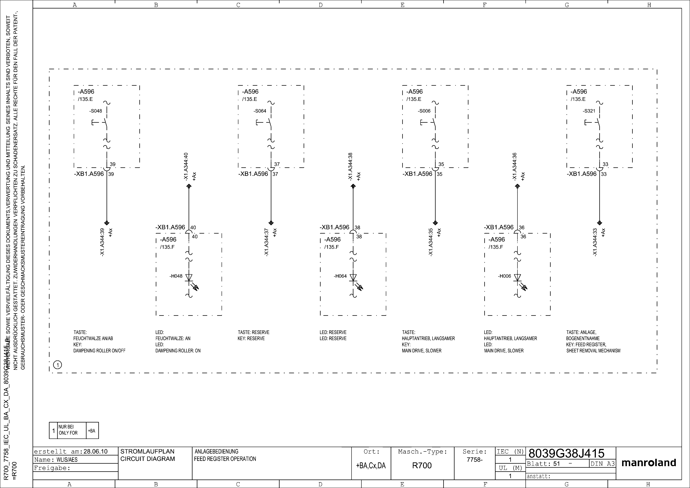

# +BA_Cx_DA — Sheet 51 of 247 — ANLAGEBEDIENUNG

**FEED REGISTER OPERATION**

> Part of the manroland **R700** printing press IEC/UL circuit diagrams.
> Drawing class: **Stromlaufplan / Circuit diagram** (DIN A3).
> Document `+BA_Cx_DA` covers the **Printing units / main switch cabinet** machine section.

## At a glance

| Field | Value |
|---|---|
| Document | `+BA_Cx_DA`  (8039G38J415) |
| Sheet | **51** of 247 |
| Section (DE) | ANLAGEBEDIENUNG |
| Section (EN) | FEED REGISTER OPERATION |
| Section type | CIRCUIT — Circuit diagram |
| Machine type | `R700` |
| Series | `7758` |
| Created | 28.06.10 |
| Replaces | — |
| Columns used | A, B, C, D, E, F, G |
| Path numbers | — |
| Labels on sheet | 85 |
| Cross-refs out | 7 |
| Cross-refs in | 14 |

**Previous:** [+BA_Cx_DA sheet 50](SHEET_0050.md) · **Next:** [+BA_Cx_DA sheet 52](SHEET_0052.md) · **Document TOC:** [_TOC.md](_TOC.md)  (+BA_Cx_DA) · **Master TOC:** [all sheets](../_MASTER_TOC.md)

## Sheet image (300 DPI, exact vector render)



_Rendered directly from the PDF vector layer at 300 DPI (1-bit), no OCR and no resampling. Use it to confirm anything ambiguous in the text below._

## Cross-references on this sheet

Each entry is a wire leaving this sheet. The printed token is `/sheet.column`; the link resolves to that sheet inside the same document.

| Ref | Target sheet | Col | Path | Destination on target | Target section | From col |
|---|---|---|---|---|---|---|
| `/135.E` | [+BA_Cx_DA sheet 135](SHEET_0135.md) | E | — | A596 | REFERENZMODUL | A |
| `/135.E` | [+BA_Cx_DA sheet 135](SHEET_0135.md) | E | — | A596 | REFERENZMODUL | C |
| `/135.E` | [+BA_Cx_DA sheet 135](SHEET_0135.md) | E | — | A596 | REFERENZMODUL | E |
| `/135.E` | [+BA_Cx_DA sheet 135](SHEET_0135.md) | E | — | A596 | REFERENZMODUL | G |
| `/135.F` | [+BA_Cx_DA sheet 135](SHEET_0135.md) | F | — | A596 | REFERENZMODUL | B |
| `/135.F` | [+BA_Cx_DA sheet 135](SHEET_0135.md) | F | — | A596 | REFERENZMODUL | D |
| `/135.F` | [+BA_Cx_DA sheet 135](SHEET_0135.md) | F | — | A596 | REFERENZMODUL | F |

### Incoming references (sheets that point here)

Every other sheet that sends a wire to this one. `Back-ref` is the token printed on *that* sheet; `Path` is its line number.

| From sheet | Cols | Back-ref | Path | Refs | What continues there |
|---|---|---|---|---|---|
| [+BA_Cx_DA#135](SHEET_0135.md) | E, F | `/135.E`, `/135.F` | — | 7 | — |
| [+BA_Cx_DA#142](SHEET_0142.md) | F | `/142.F` | — | 7 | — |


## Devices on this sheet

| Tag | Class | Class meaning (IEC) | Col | Sub | Terminal | Sign |
|---|---|---|---|---|---|---|
| `S048` | S | Schalter / switch | A | — | — | — |
| `A596` | A | Baugruppe / assembly, module, PC board | A | — | — | — |
| `A596` | A | Baugruppe / assembly, module, PC board | B | — | — | — |
| `S064` | S | Schalter / switch | C | — | — | — |
| `A596` | A | Baugruppe / assembly, module, PC board | C | — | — | — |
| `A596` | A | Baugruppe / assembly, module, PC board | D | — | — | — |
| `S006` | S | Schalter / switch | E | — | — | — |
| `A596` | A | Baugruppe / assembly, module, PC board | E | — | — | — |
| `A596` | A | Baugruppe / assembly, module, PC board | F | — | — | — |
| `S321` | S | Schalter / switch | G | — | — | — |
| `A596` | A | Baugruppe / assembly, module, PC board | G | — | — | — |
| `XB1.A596` | — | cross-device reference | A | — | — | — |
| `X1.A344:39` | — | cross-device reference | A | — | 39 | — |
| `XB1.A596` | — | cross-device reference | B | — | — | — |
| `X1.A344:40` | — | cross-device reference | B | — | 40 | — |
| `XB1.A596` | — | cross-device reference | C | — | — | — |
| `X1.A344:37` | — | cross-device reference | C | — | 37 | — |
| `XB1.A596` | — | cross-device reference | D | — | — | — |
| `X1.A344:38` | — | cross-device reference | D | — | 38 | — |
| `XB1.A596` | — | cross-device reference | E | — | — | — |
| `X1.A344:35` | — | cross-device reference | E | — | 35 | — |
| `XB1.A596` | — | cross-device reference | F | — | — | — |
| `X1.A344:36` | — | cross-device reference | F | — | 36 | — |
| `XB1.A596` | — | cross-device reference | G | — | — | — |
| `X1.A344:33` | — | cross-device reference | G | — | 33 | — |

## Potentials / nets

| Potential | Count | Columns | Attached devices | Terminals |
|---|---|---|---|---|
| `H006` | 1 | F | — | — |
| `H048` | 1 | B | — | — |
| `H064` | 1 | D | — | — |


A potential such as `L24+/4` or `M24+` is a named supply/return rail; every place it appears on this sheet is electrically common.

## Wire-end annotations (grouped as printed)

A wire that continues elsewhere is annotated with a small cluster: the destination description, the path/line number `#NN`, and the `/sheet.column` cross reference. Each row below is one such cluster exactly as it is grouped on the drawing.

| Col | Y | Path | Cross-ref | Text on the wire |
|---|---|---|---|---|
| A | 153.4 | — | `/135.E` | `A596` |
| C | 153.4 | — | `/135.E` | `A596` |
| E | 153.4 | — | `/135.E` | `A596` |
| G | 153.4 | — | `/135.E` | `A596` |
| A | 187.8 | — | — | `S048` |
| C | 187.8 | — | — | `S064` |
| E | 187.8 | — | — | `S006` |
| G | 187.8 | — | — | `S321` |
| B | 263.3 | — | — | `X1.A344:40` |
| D | 263.3 | — | — | `X1.A344:38` |
| F | 263.3 | — | — | `X1.A344:36` |
| A | 279.5 | — | — | `39` |
| C | 279.5 | — | — | `37` |
| E | 279.5 | — | — | `35` |
| G | 279.5 | — | — | `33` |
| A | 295.1 | — | — | `XB1.A596 39` |
| C | 295.1 | — | — | `XB1.A596 37` |
| E | 295.1 | — | — | `XB1.A596 35` |
| G | 295.1 | — | — | `XB1.A596 33` |
| B | 297.1 | — | — | `+Ax` |
| D | 297.1 | — | — | `+Ax` |
| F | 297.1 | — | — | `+Ax` |
| B | 387.2 | — | — | `XB1.A596 40` |
| D | 387.2 | — | — | `XB1.A596 38` |
| F | 387.2 | — | — | `XB1.A596 36` |
| A | 393.7 | — | — | `X1.A344:39` |
| C | 393.7 | — | — | `X1.A344:37` |
| E | 393.7 | — | — | `X1.A344:35` |
| G | 393.7 | — | — | `X1.A344:33` |
| A | 394.0 | — | — | `+Ax` |
| C | 394.0 | — | — | `+Ax` |
| E | 394.0 | — | — | `+Ax` |
| G | 394.0 | — | — | `+Ax` |
| B | 404.3 | — | — | `40` |
| D | 404.3 | — | — | `38` |
| F | 404.3 | — | — | `36` |
| B | 408.5 | — | `/135.F` | `A596` |
| D | 408.5 | — | `/135.F` | `A596` |
| F | 408.5 | — | `/135.F` | `A596` |
| B | 472.7 | — | — | `H048` |
| D | 472.7 | — | — | `H064` |
| F | 472.7 | — | — | `H006` |
| A | 570.3 | — | — | `FEUCHTWALZE AN/AB KEY: DAMPENING ROLLER ON/OFF TASTE:` |
| B | 570.3 | — | — | `LED: FEUCHTWALZE: AN LED: DAMPENING ROLLER: ON` |
| E | 570.3 | — | — | `HAUPTANTRIEB, LANGSAMER KEY: MAIN DRIVE, SLOWER TASTE:` |
| F | 570.3 | — | — | `LED: HAUPTANTRIEB, LANGSAMER LED: MAIN DRIVE, SLOWER` |
| C | 570.4 | — | — | `KEY: RESERVE TASTE: RESERVE` |
| D | 570.4 | — | — | `LED: RESERVE LED: RESERVE` |
| G | 570.4 | — | — | `BOGENENTNAHME KEY: FEED REGISTER, TASTE: ANLAGE,` |
| G | 602.3 | — | — | `SHEET REMOVAL MECHANISM` |
| A | 626.2 | — | — | `1` |
| A | 733.3 | — | — | `1 NUR BEI` |
| A | 740.4 | — | — | `ONLY FOR +BA` |


## Reconstructed tables

This sheet carries tabular content (pin map / terminal assignment / index). The grid below was rebuilt from the drawing's own rule lines, so each row is exactly one physical row of the table.

### Table 1 — 2 data rows × 2 columns (at x=127.6, y=147.4)

| A596 /135.E S048 | 39 |
|---|---|
| `XB1.A596` | `39 +Ax` |
| `X1.A344:39` |  |


### Table 2 — 1 data rows × 2 columns (at x=269.3, y=147.4) — **X1.A344:40**

| XB1.A596 | +Ax 40 |
|---|---|
| `A596 /135.F H048` | `40` |


### Table 3 — 2 data rows × 2 columns (at x=411.0, y=147.4)

| A596 /135.E S064 | 37 |
|---|---|
| `XB1.A596` | `37 +Ax` |
| `X1.A344:37` |  |


### Table 4 — 1 data rows × 2 columns (at x=552.8, y=147.4) — **X1.A344:38**

| XB1.A596 | +Ax 38 |
|---|---|
| `A596 /135.F H064` | `38` |


### Table 5 — 2 data rows × 2 columns (at x=694.5, y=147.4)

| A596 /135.E S006 | 35 |
|---|---|
| `XB1.A596` | `35 +Ax` |
| `X1.A344:35` |  |


### Table 6 — 1 data rows × 2 columns (at x=836.2, y=147.4) — **X1.A344:36**

| XB1.A596 | +Ax 36 |
|---|---|
| `A596 /135.F H006` | `36` |


### Table 7 — 2 data rows × 2 columns (at x=978.0, y=147.4)

| A596 /135.E S321 | 33 |
|---|---|
| `XB1.A596` | `33 +Ax` |
| `X1.A344:33` |  |


## Notes and free text on this sheet

| Text | Col | Y (pt) |
|---|---|---|
| `TASTE:` | A | 570.32 |
| `FEUCHTWALZE AN/AB` | A | 580.99 |
| `KEY:` | A | 591.52 |
| `DAMPENING ROLLER ON/OFF` | A | 602.3 |
| `+Ax` | A | 394.02 |
| `LED:` | B | 570.3 |
| `FEUCHTWALZE: AN` | B | 580.98 |
| `DAMPENING ROLLER: ON` | B | 602.29 |
| `+Ax` | B | 297.07 |
| `TASTE: RESERVE` | C | 570.36 |
| `KEY: RESERVE` | C | 580.98 |
| `+Ax` | C | 394.02 |
| `LED: RESERVE` | D | 570.36 |
| `+Ax` | D | 297.07 |
| `TASTE:` | E | 570.32 |
| `HAUPTANTRIEB, LANGSAMER` | E | 581.02 |
| `KEY:` | E | 591.52 |
| `MAIN DRIVE, SLOWER` | E | 602.26 |
| `+Ax` | E | 394.02 |
| `LED:` | F | 570.3 |
| `HAUPTANTRIEB, LANGSAMER` | F | 581.02 |
| `MAIN DRIVE, SLOWER` | F | 602.26 |
| `+Ax` | F | 297.07 |
| `TASTE: ANLAGE,` | G | 570.36 |
| `BOGENENTNAHME` | G | 581.03 |
| `KEY: FEED REGISTER,` | G | 591.62 |
| `SHEET REMOVAL MECHANISM` | G | 602.3 |
| `+Ax` | G | 394.02 |
| `NUR BEI` | A | 733.33 |
| `ONLY FOR` | A | 744.02 |
| `+BA` | A | 740.44 |

## Complete label inventory (exact text from the drawing)

Every text object inside the drawing area of this sheet, in DIN reading order (column A→H, then top→bottom). This is the authoritative list: if a string is not here it is not printed on this sheet.

| Col | Y | X | Dir | Type | Text |
|---|---|---|---|---|---|
| A | 153.4 | 134.4 | → | device tag | `A596` |
| A | 167.2 | 134.6 | → | cross-reference | `/135.E` |
| A | 187.8 | 154.2 | → | device tag | `S048` |
| A | 279.5 | 189.6 | → | number | `39` |
| A | 295.1 | 127.8 | → | device ref | `XB1.A596` |
| A | 296.5 | 186.8 | → | number | `39` |
| A | 393.7 | 172.5 | ↕ | device ref | `X1.A344:39` |
| A | 394.0 | 186.7 | ↕ | text | `+Ax` |
| A | 570.3 | 127.3 | → | text | `TASTE:` |
| A | 581.0 | 126.7 | → | text | `FEUCHTWALZE AN/AB` |
| A | 591.5 | 126.7 | → | text | `KEY:` |
| A | 602.3 | 126.7 | → | text | `DAMPENING ROLLER ON/OFF` |
| A | 626.2 | 97.5 | → | number | `1` |
| A | 733.3 | 101.2 | → | text | `NUR BEI` |
| A | 738.7 | 89.6 | → | number | `1` |
| A | 740.4 | 152.1 | → | text | `+BA` |
| A | 744.0 | 101.8 | → | text | `ONLY FOR` |
| B | 263.3 | 317.1 | ↕ | device ref | `X1.A344:40` |
| B | 297.1 | 331.3 | ↕ | text | `+Ax` |
| B | 387.2 | 268.2 | → | device ref | `XB1.A596` |
| B | 388.7 | 328.5 | → | number | `40` |
| B | 404.3 | 331.4 | → | number | `40` |
| B | 408.5 | 276.1 | → | device tag | `A596` |
| B | 422.3 | 276.4 | → | cross-reference | `/135.F` |
| B | 472.7 | 292.5 | → | potential | `H048` |
| B | 570.3 | 268.4 | → | text | `LED:` |
| B | 581.0 | 268.4 | → | text | `FEUCHTWALZE: AN` |
| B | 591.6 | 268.4 | → | text | `LED:` |
| B | 602.3 | 268.4 | → | text | `DAMPENING ROLLER: ON` |
| C | 153.4 | 417.8 | → | device tag | `A596` |
| C | 167.2 | 418.1 | → | cross-reference | `/135.E` |
| C | 187.8 | 437.7 | → | device tag | `S064` |
| C | 279.5 | 473.1 | → | number | `37` |
| C | 295.1 | 411.3 | → | device ref | `XB1.A596` |
| C | 296.5 | 470.3 | → | number | `37` |
| C | 393.7 | 456.0 | ↕ | device ref | `X1.A344:37` |
| C | 394.0 | 470.2 | ↕ | text | `+Ax` |
| C | 570.4 | 410.7 | → | text | `TASTE: RESERVE` |
| C | 581.0 | 410.2 | → | text | `KEY: RESERVE` |
| D | 263.3 | 600.5 | ↕ | device ref | `X1.A344:38` |
| D | 297.1 | 614.8 | ↕ | text | `+Ax` |
| D | 387.2 | 551.6 | → | device ref | `XB1.A596` |
| D | 388.7 | 612.0 | → | number | `38` |
| D | 404.3 | 614.8 | → | number | `38` |
| D | 408.5 | 559.6 | → | device tag | `A596` |
| D | 422.3 | 559.8 | → | cross-reference | `/135.F` |
| D | 472.7 | 576.0 | → | potential | `H064` |
| D | 570.4 | 551.9 | → | text | `LED: RESERVE` |
| D | 581.0 | 551.9 | → | text | `LED: RESERVE` |
| E | 153.4 | 701.3 | → | device tag | `A596` |
| E | 167.2 | 701.6 | → | cross-reference | `/135.E` |
| E | 187.8 | 721.1 | → | device tag | `S006` |
| E | 279.5 | 756.6 | → | number | `35` |
| E | 295.1 | 694.8 | → | device ref | `XB1.A596` |
| E | 296.5 | 753.7 | → | number | `35` |
| E | 393.7 | 739.4 | ↕ | device ref | `X1.A344:35` |
| E | 394.0 | 753.7 | ↕ | text | `+Ax` |
| E | 570.3 | 694.2 | → | text | `TASTE:` |
| E | 581.0 | 693.6 | → | text | `HAUPTANTRIEB, LANGSAMER` |
| E | 591.5 | 693.6 | → | text | `KEY:` |
| E | 602.3 | 693.9 | → | text | `MAIN DRIVE, SLOWER` |
| F | 263.3 | 884.0 | ↕ | device ref | `X1.A344:36` |
| F | 297.1 | 898.2 | ↕ | text | `+Ax` |
| F | 387.2 | 835.1 | → | device ref | `XB1.A596` |
| F | 388.7 | 895.5 | → | number | `36` |
| F | 404.3 | 898.3 | → | number | `36` |
| F | 408.5 | 843.0 | → | device tag | `A596` |
| F | 422.3 | 843.3 | → | cross-reference | `/135.F` |
| F | 472.7 | 859.5 | → | potential | `H006` |
| F | 570.3 | 835.4 | → | text | `LED:` |
| F | 581.0 | 835.4 | → | text | `HAUPTANTRIEB, LANGSAMER` |
| F | 591.6 | 835.4 | → | text | `LED:` |
| F | 602.3 | 835.7 | → | text | `MAIN DRIVE, SLOWER` |
| G | 153.4 | 984.8 | → | device tag | `A596` |
| G | 167.2 | 985.0 | → | cross-reference | `/135.E` |
| G | 187.8 | 1005.7 | → | device tag | `S321` |
| G | 279.5 | 1040.0 | → | number | `33` |
| G | 295.1 | 978.2 | → | device ref | `XB1.A596` |
| G | 296.5 | 1037.2 | → | number | `33` |
| G | 393.7 | 1022.9 | ↕ | device ref | `X1.A344:33` |
| G | 394.0 | 1037.1 | ↕ | text | `+Ax` |
| G | 570.4 | 977.7 | → | text | `TASTE: ANLAGE,` |
| G | 581.0 | 977.1 | → | text | `BOGENENTNAHME` |
| G | 591.6 | 977.1 | → | text | `KEY: FEED REGISTER,` |
| G | 602.3 | 977.7 | → | text | `SHEET REMOVAL MECHANISM` |

## Reading-order text block

The same content as a plain block, grouped by DIN column — convenient to paste or to match against a visual description.

```text
=== Column A ===
 153.4  134.4  devtag       A596
 167.2  134.6  xref         /135.E
 187.8  154.2  devtag       S048
 279.5  189.6  numeric      39
 295.1  127.8  devref       XB1.A596
 296.5  186.8  numeric      39
 393.7  172.5  devref       X1.A344:39
 394.0  186.7  text         +Ax
 570.3  127.3  text         TASTE:
 581.0  126.7  text         FEUCHTWALZE AN/AB
 591.5  126.7  text         KEY:
 602.3  126.7  text         DAMPENING ROLLER ON/OFF
 626.2   97.5  numeric      1
 733.3  101.2  text         NUR BEI
 738.7   89.6  numeric      1
 740.4  152.1  text         +BA
 744.0  101.8  text         ONLY FOR
=== Column B ===
 263.3  317.1  devref       X1.A344:40
 297.1  331.3  text         +Ax
 387.2  268.2  devref       XB1.A596
 388.7  328.5  numeric      40
 404.3  331.4  numeric      40
 408.5  276.1  devtag       A596
 422.3  276.4  xref         /135.F
 472.7  292.5  net          H048
 570.3  268.4  text         LED:
 581.0  268.4  text         FEUCHTWALZE: AN
 591.6  268.4  text         LED:
 602.3  268.4  text         DAMPENING ROLLER: ON
=== Column C ===
 153.4  417.8  devtag       A596
 167.2  418.1  xref         /135.E
 187.8  437.7  devtag       S064
 279.5  473.1  numeric      37
 295.1  411.3  devref       XB1.A596
 296.5  470.3  numeric      37
 393.7  456.0  devref       X1.A344:37
 394.0  470.2  text         +Ax
 570.4  410.7  text         TASTE: RESERVE
 581.0  410.2  text         KEY: RESERVE
=== Column D ===
 263.3  600.5  devref       X1.A344:38
 297.1  614.8  text         +Ax
 387.2  551.6  devref       XB1.A596
 388.7  612.0  numeric      38
 404.3  614.8  numeric      38
 408.5  559.6  devtag       A596
 422.3  559.8  xref         /135.F
 472.7  576.0  net          H064
 570.4  551.9  text         LED: RESERVE
 581.0  551.9  text         LED: RESERVE
=== Column E ===
 153.4  701.3  devtag       A596
 167.2  701.6  xref         /135.E
 187.8  721.1  devtag       S006
 279.5  756.6  numeric      35
 295.1  694.8  devref       XB1.A596
 296.5  753.7  numeric      35
 393.7  739.4  devref       X1.A344:35
 394.0  753.7  text         +Ax
 570.3  694.2  text         TASTE:
 581.0  693.6  text         HAUPTANTRIEB, LANGSAMER
 591.5  693.6  text         KEY:
 602.3  693.9  text         MAIN DRIVE, SLOWER
=== Column F ===
 263.3  884.0  devref       X1.A344:36
 297.1  898.2  text         +Ax
 387.2  835.1  devref       XB1.A596
 388.7  895.5  numeric      36
 404.3  898.3  numeric      36
 408.5  843.0  devtag       A596
 422.3  843.3  xref         /135.F
 472.7  859.5  net          H006
 570.3  835.4  text         LED:
 581.0  835.4  text         HAUPTANTRIEB, LANGSAMER
 591.6  835.4  text         LED:
 602.3  835.7  text         MAIN DRIVE, SLOWER
=== Column G ===
 153.4  984.8  devtag       A596
 167.2  985.0  xref         /135.E
 187.8 1005.7  devtag       S321
 279.5 1040.0  numeric      33
 295.1  978.2  devref       XB1.A596
 296.5 1037.2  numeric      33
 393.7 1022.9  devref       X1.A344:33
 394.0 1037.1  text         +Ax
 570.4  977.7  text         TASTE: ANLAGE,
 581.0  977.1  text         BOGENENTNAHME
 591.6  977.1  text         KEY: FEED REGISTER,
 602.3  977.7  text         SHEET REMOVAL MECHANISM
```

---
_Generated from the PDF vector text layer; no OCR. Source: `R700_7758_IEC_UL_BA_CX_DA_8039G38J415_p`, sheet 51._
