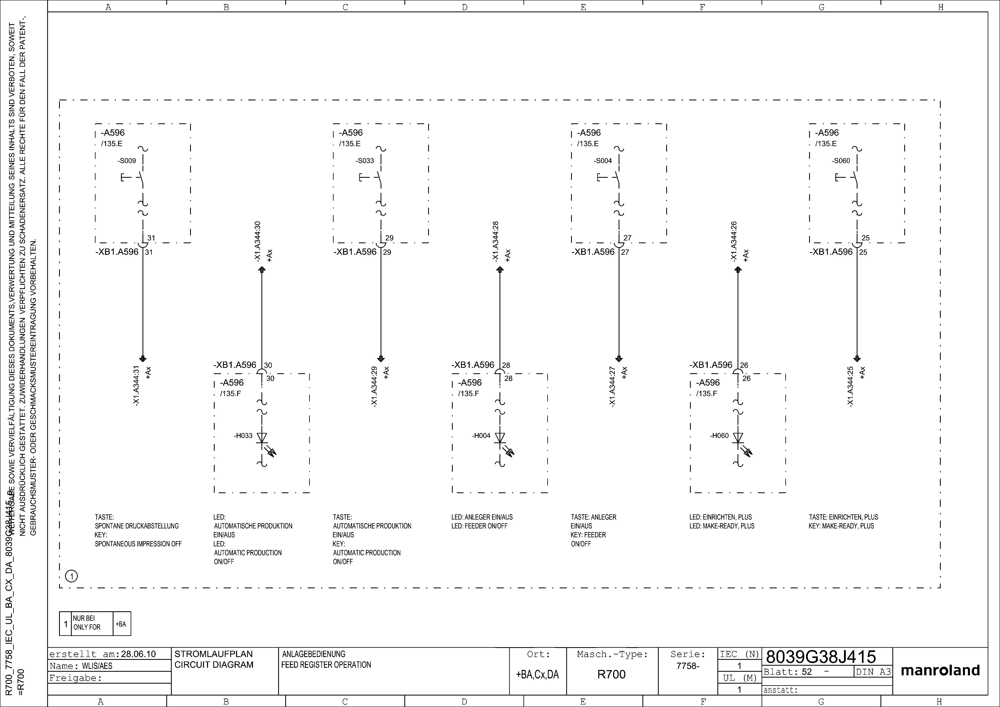

# +BA_Cx_DA — Sheet 52 of 247 — ANLAGEBEDIENUNG

**FEED REGISTER OPERATION**

> Part of the manroland **R700** printing press IEC/UL circuit diagrams.
> Drawing class: **Stromlaufplan / Circuit diagram** (DIN A3).
> Document `+BA_Cx_DA` covers the **Printing units / main switch cabinet** machine section.

## At a glance

| Field | Value |
|---|---|
| Document | `+BA_Cx_DA`  (8039G38J415) |
| Sheet | **52** of 247 |
| Section (DE) | ANLAGEBEDIENUNG |
| Section (EN) | FEED REGISTER OPERATION |
| Section type | CIRCUIT — Circuit diagram |
| Machine type | `R700` |
| Series | `7758` |
| Created | 28.06.10 |
| Replaces | — |
| Columns used | A, B, C, D, E, F, G |
| Path numbers | — |
| Labels on sheet | 87 |
| Cross-refs out | 7 |
| Cross-refs in | 14 |

**Previous:** [+BA_Cx_DA sheet 51](SHEET_0051.md) · **Next:** [+BA_Cx_DA sheet 53](SHEET_0053.md) · **Document TOC:** [_TOC.md](_TOC.md)  (+BA_Cx_DA) · **Master TOC:** [all sheets](../_MASTER_TOC.md)

## Sheet image (300 DPI, exact vector render)



_Rendered directly from the PDF vector layer at 300 DPI (1-bit), no OCR and no resampling. Use it to confirm anything ambiguous in the text below._

## Cross-references on this sheet

Each entry is a wire leaving this sheet. The printed token is `/sheet.column`; the link resolves to that sheet inside the same document.

| Ref | Target sheet | Col | Path | Destination on target | Target section | From col |
|---|---|---|---|---|---|---|
| `/135.E` | [+BA_Cx_DA sheet 135](SHEET_0135.md) | E | — | A596 | REFERENZMODUL | A |
| `/135.E` | [+BA_Cx_DA sheet 135](SHEET_0135.md) | E | — | A596 | REFERENZMODUL | C |
| `/135.E` | [+BA_Cx_DA sheet 135](SHEET_0135.md) | E | — | A596 | REFERENZMODUL | E |
| `/135.E` | [+BA_Cx_DA sheet 135](SHEET_0135.md) | E | — | A596 | REFERENZMODUL | G |
| `/135.F` | [+BA_Cx_DA sheet 135](SHEET_0135.md) | F | — | A596 | REFERENZMODUL | B |
| `/135.F` | [+BA_Cx_DA sheet 135](SHEET_0135.md) | F | — | A596 | REFERENZMODUL | D |
| `/135.F` | [+BA_Cx_DA sheet 135](SHEET_0135.md) | F | — | A596 | REFERENZMODUL | F |

### Incoming references (sheets that point here)

Every other sheet that sends a wire to this one. `Back-ref` is the token printed on *that* sheet; `Path` is its line number.

| From sheet | Cols | Back-ref | Path | Refs | What continues there |
|---|---|---|---|---|---|
| [+BA_Cx_DA#135](SHEET_0135.md) | E, F | `/135.E`, `/135.F` | — | 7 | — |
| [+BA_Cx_DA#142](SHEET_0142.md) | E, F | `/142.E`, `/142.F` | — | 7 | — |


## Devices on this sheet

| Tag | Class | Class meaning (IEC) | Col | Sub | Terminal | Sign |
|---|---|---|---|---|---|---|
| `S009` | S | Schalter / switch | A | — | — | — |
| `A596` | A | Baugruppe / assembly, module, PC board | A | — | — | — |
| `A596` | A | Baugruppe / assembly, module, PC board | B | — | — | — |
| `S033` | S | Schalter / switch | C | — | — | — |
| `A596` | A | Baugruppe / assembly, module, PC board | C | — | — | — |
| `A596` | A | Baugruppe / assembly, module, PC board | D | — | — | — |
| `S004` | S | Schalter / switch | E | — | — | — |
| `A596` | A | Baugruppe / assembly, module, PC board | E | — | — | — |
| `A596` | A | Baugruppe / assembly, module, PC board | F | — | — | — |
| `S060` | S | Schalter / switch | G | — | — | — |
| `A596` | A | Baugruppe / assembly, module, PC board | G | — | — | — |
| `XB1.A596` | — | cross-device reference | A | — | — | — |
| `XB1.A596` | — | cross-device reference | B | — | — | — |
| `XB1.A596` | — | cross-device reference | C | — | — | — |
| `XB1.A596` | — | cross-device reference | D | — | — | — |
| `XB1.A596` | — | cross-device reference | E | — | — | — |
| `XB1.A596` | — | cross-device reference | F | — | — | — |
| `XB1.A596` | — | cross-device reference | G | — | — | — |
| `X1.A344:25` | — | cross-device reference | G | — | 25 | — |
| `X1.A344:26` | — | cross-device reference | F | — | 26 | — |
| `X1.A344:27` | — | cross-device reference | E | — | 27 | — |
| `X1.A344:28` | — | cross-device reference | D | — | 28 | — |
| `X1.A344:29` | — | cross-device reference | C | — | 29 | — |
| `X1.A344:30` | — | cross-device reference | B | — | 30 | — |
| `X1.A344:31` | — | cross-device reference | A | — | 31 | — |

## Potentials / nets

| Potential | Count | Columns | Attached devices | Terminals |
|---|---|---|---|---|
| `H004` | 1 | D | — | — |
| `H033` | 1 | B | — | — |
| `H060` | 1 | F | — | — |


A potential such as `L24+/4` or `M24+` is a named supply/return rail; every place it appears on this sheet is electrically common.

## Wire-end annotations (grouped as printed)

A wire that continues elsewhere is annotated with a small cluster: the destination description, the path/line number `#NN`, and the `/sheet.column` cross reference. Each row below is one such cluster exactly as it is grouped on the drawing.

| Col | Y | Path | Cross-ref | Text on the wire |
|---|---|---|---|---|
| A | 153.4 | — | `/135.E` | `A596` |
| C | 153.4 | — | `/135.E` | `A596` |
| E | 153.4 | — | `/135.E` | `A596` |
| G | 153.4 | — | `/135.E` | `A596` |
| A | 187.8 | — | — | `S009` |
| C | 187.8 | — | — | `S033` |
| E | 187.8 | — | — | `S004` |
| G | 187.8 | — | — | `S060` |
| B | 263.3 | — | — | `X1.A344:30` |
| D | 263.3 | — | — | `X1.A344:28` |
| F | 263.3 | — | — | `X1.A344:26` |
| A | 279.5 | — | — | `31` |
| C | 279.5 | — | — | `29` |
| E | 279.5 | — | — | `27` |
| G | 279.5 | — | — | `25` |
| A | 295.1 | — | — | `XB1.A596 31` |
| C | 295.1 | — | — | `XB1.A596 29` |
| E | 295.1 | — | — | `XB1.A596 27` |
| G | 295.1 | — | — | `XB1.A596 25` |
| B | 297.1 | — | — | `+Ax` |
| D | 297.1 | — | — | `+Ax` |
| F | 297.1 | — | — | `+Ax` |
| B | 429.8 | — | — | `XB1.A596 30` |
| D | 429.8 | — | — | `XB1.A596 28` |
| F | 429.8 | — | — | `XB1.A596 26` |
| A | 434.8 | — | — | `X1.A344:31` |
| C | 436.2 | — | — | `X1.A344:29` |
| E | 436.2 | — | — | `X1.A344:27` |
| G | 436.2 | — | — | `X1.A344:25` |
| A | 436.5 | — | — | `+Ax` |
| C | 436.5 | — | — | `+Ax` |
| E | 436.5 | — | — | `+Ax` |
| G | 436.5 | — | — | `+Ax` |
| B | 446.8 | — | — | `30` |
| D | 446.8 | — | — | `28` |
| F | 446.8 | — | — | `26` |
| B | 451.0 | — | `/135.F` | `A596` |
| D | 451.0 | — | `/135.F` | `A596` |
| F | 451.0 | — | `/135.F` | `A596` |
| B | 515.2 | — | — | `H033` |
| D | 515.2 | — | — | `H004` |
| F | 515.2 | — | — | `H060` |
| A | 612.8 | — | — | `KEY: TASTE: SPONTANE DRUCKABSTELLUNG` |
| B | 612.8 | — | — | `LED:` |
| C | 612.8 | — | — | `EIN/AUS KEY: TASTE: AUTOMATISCHE PRODUKTION` |
| D | 612.9 | — | — | `LED: ANLEGER EIN/AUS LED: FEEDER ON/OFF` |
| E | 612.9 | — | — | `EIN/AUS KEY: FEEDER TASTE: ANLEGER` |
| F | 612.9 | — | — | `LED: EINRICHTEN, PLUS LED: MAKE READY, PLUS` |
| G | 612.9 | — | — | `KEY: MAKE READY, PLUS TASTE: EINRICHTEN, PLUS` |
| B | 623.5 | — | — | `EIN/AUS LED: AUTOMATISCHE PRODUKTION` |
| A | 644.8 | — | — | `SPONTANEOUS IMPRESSION OFF` |
| E | 644.8 | — | — | `ON/OFF` |
| B | 655.5 | — | — | `ON/OFF AUTOMATIC PRODUCTION` |
| C | 655.5 | — | — | `ON/OFF AUTOMATIC PRODUCTION` |
| A | 682.9 | — | — | `1` |
| A | 733.3 | — | — | `1 NUR BEI` |
| A | 740.4 | — | — | `ONLY FOR +BA` |


## Reconstructed tables

This sheet carries tabular content (pin map / terminal assignment / index). The grid below was rebuilt from the drawing's own rule lines, so each row is exactly one physical row of the table.

### Table 1 — 2 data rows × 2 columns (at x=113.4, y=147.4)

| A596 /135.E S009 | 31 |
|---|---|
| `XB1.A596` | `31 +Ax` |
| `X1.A344:31` |  |


### Table 2 — 1 data rows × 2 columns (at x=255.1, y=147.4) — **X1.A344:30**

| XB1.A596 | +Ax 30 |
|---|---|
| `A596 /135.F H033` | `30` |


### Table 3 — 2 data rows × 2 columns (at x=396.9, y=147.4)

| A596 /135.E S033 | 29 |
|---|---|
| `XB1.A596` | `29 +Ax` |
| `X1.A344:29` |  |


### Table 4 — 1 data rows × 2 columns (at x=538.6, y=147.4) — **X1.A344:28**

| XB1.A596 | +Ax 28 |
|---|---|
| `A596 /135.F H004` | `28` |


### Table 5 — 2 data rows × 2 columns (at x=680.3, y=147.4)

| A596 /135.E S004 | 27 |
|---|---|
| `XB1.A596` | `27 +Ax` |
| `X1.A344:27` |  |


### Table 6 — 1 data rows × 2 columns (at x=822.0, y=147.4) — **X1.A344:26**

| XB1.A596 | +Ax 26 |
|---|---|
| `A596 /135.F H060` | `26` |


### Table 7 — 2 data rows × 2 columns (at x=963.8, y=147.4)

| A596 /135.E S060 | 25 |
|---|---|
| `XB1.A596` | `25 +Ax` |
| `X1.A344:25` |  |


## Notes and free text on this sheet

| Text | Col | Y (pt) |
|---|---|---|
| `TASTE:` | A | 612.84 |
| `SPONTANE DRUCKABSTELLUNG` | A | 623.55 |
| `KEY:` | A | 634.04 |
| `SPONTANEOUS IMPRESSION OFF` | A | 644.81 |
| `LED:` | B | 612.82 |
| `AUTOMATISCHE PRODUKTION` | B | 623.55 |
| `EIN/AUS` | B | 634.12 |
| `AUTOMATIC PRODUCTION` | B | 655.46 |
| `ON/OFF` | B | 666.07 |
| `TASTE:` | C | 612.84 |
| `AUTOMATISCHE PRODUKTION` | C | 623.55 |
| `EIN/AUS` | C | 634.12 |
| `KEY:` | C | 644.67 |
| `AUTOMATIC PRODUCTION` | C | 655.46 |
| `ON/OFF` | C | 666.07 |
| `LED: ANLEGER EIN/AUS` | D | 612.89 |
| `LED: FEEDER ON/OFF` | D | 623.53 |
| `TASTE: ANLEGER` | E | 612.9 |
| `EIN/AUS` | E | 623.49 |
| `KEY: FEEDER` | E | 634.14 |
| `ON/OFF` | E | 644.81 |
| `LED: EINRICHTEN, PLUS` | F | 612.9 |
| `LED: MAKE READY, PLUS` | F | 623.53 |
| `TASTE: EINRICHTEN, PLUS` | G | 612.9 |
| `KEY: MAKE READY, PLUS` | G | 623.52 |
| `+Ax` | G | 436.54 |
| `+Ax` | F | 297.07 |
| `+Ax` | E | 436.54 |
| `+Ax` | D | 297.07 |
| `+Ax` | C | 436.54 |
| `+Ax` | B | 297.07 |
| `+Ax` | A | 436.54 |
| `NUR BEI` | A | 733.33 |
| `ONLY FOR` | A | 744.02 |
| `+BA` | A | 740.44 |

## Complete label inventory (exact text from the drawing)

Every text object inside the drawing area of this sheet, in DIN reading order (column A→H, then top→bottom). This is the authoritative list: if a string is not here it is not printed on this sheet.

| Col | Y | X | Dir | Type | Text |
|---|---|---|---|---|---|
| A | 153.4 | 120.2 | → | device tag | `A596` |
| A | 167.2 | 120.5 | → | cross-reference | `/135.E` |
| A | 187.8 | 140.0 | → | device tag | `S009` |
| A | 279.5 | 175.5 | → | number | `31` |
| A | 295.1 | 113.7 | → | device ref | `XB1.A596` |
| A | 296.5 | 172.6 | → | number | `31` |
| A | 434.8 | 158.3 | ↕ | device ref | `X1.A344:31` |
| A | 436.5 | 172.6 | ↕ | text | `+Ax` |
| A | 612.8 | 113.1 | → | text | `TASTE:` |
| A | 623.6 | 113.1 | → | text | `SPONTANE DRUCKABSTELLUNG` |
| A | 634.0 | 112.5 | → | text | `KEY:` |
| A | 644.8 | 113.1 | → | text | `SPONTANEOUS IMPRESSION OFF` |
| A | 682.9 | 83.3 | → | number | `1` |
| A | 733.3 | 87.0 | → | text | `NUR BEI` |
| A | 738.7 | 75.4 | → | number | `1` |
| A | 740.4 | 137.9 | → | text | `+BA` |
| A | 744.0 | 87.6 | → | text | `ONLY FOR` |
| B | 263.3 | 302.9 | ↕ | device ref | `X1.A344:30` |
| B | 297.1 | 317.1 | ↕ | text | `+Ax` |
| B | 429.8 | 254.0 | → | device ref | `XB1.A596` |
| B | 431.2 | 314.4 | → | number | `30` |
| B | 446.8 | 317.2 | → | number | `30` |
| B | 451.0 | 261.9 | → | device tag | `A596` |
| B | 464.8 | 262.2 | → | cross-reference | `/135.F` |
| B | 515.2 | 278.4 | → | potential | `H033` |
| B | 612.8 | 254.3 | → | text | `LED:` |
| B | 623.6 | 255.1 | → | text | `AUTOMATISCHE PRODUKTION` |
| B | 634.1 | 254.3 | → | text | `EIN/AUS` |
| B | 644.7 | 254.3 | → | text | `LED:` |
| B | 655.5 | 255.1 | → | text | `AUTOMATIC PRODUCTION` |
| B | 666.1 | 254.8 | → | text | `ON/OFF` |
| C | 153.4 | 403.7 | → | device tag | `A596` |
| C | 167.2 | 403.9 | → | cross-reference | `/135.E` |
| C | 187.8 | 423.5 | → | device tag | `S033` |
| C | 279.5 | 458.9 | → | number | `29` |
| C | 295.1 | 397.1 | → | device ref | `XB1.A596` |
| C | 296.5 | 456.1 | → | number | `29` |
| C | 436.3 | 441.8 | ↕ | device ref | `X1.A344:29` |
| C | 436.5 | 456.0 | ↕ | text | `+Ax` |
| C | 612.8 | 396.6 | → | text | `TASTE:` |
| C | 623.6 | 396.9 | → | text | `AUTOMATISCHE PRODUKTION` |
| C | 634.1 | 396.0 | → | text | `EIN/AUS` |
| C | 644.7 | 396.0 | → | text | `KEY:` |
| C | 655.5 | 396.9 | → | text | `AUTOMATIC PRODUCTION` |
| C | 666.1 | 396.6 | → | text | `ON/OFF` |
| D | 263.3 | 586.3 | ↕ | device ref | `X1.A344:28` |
| D | 297.1 | 600.6 | ↕ | text | `+Ax` |
| D | 429.8 | 537.4 | → | device ref | `XB1.A596` |
| D | 431.2 | 597.8 | → | number | `28` |
| D | 446.8 | 600.7 | → | number | `28` |
| D | 451.0 | 545.4 | → | device tag | `A596` |
| D | 464.8 | 545.7 | → | cross-reference | `/135.F` |
| D | 515.2 | 561.8 | → | potential | `H004` |
| D | 612.9 | 537.7 | → | text | `LED: ANLEGER EIN/AUS` |
| D | 623.5 | 537.7 | → | text | `LED: FEEDER ON/OFF` |
| E | 153.4 | 687.1 | → | device tag | `A596` |
| E | 167.2 | 687.4 | → | cross-reference | `/135.E` |
| E | 187.8 | 707.0 | → | device tag | `S004` |
| E | 279.5 | 742.4 | → | number | `27` |
| E | 295.1 | 680.6 | → | device ref | `XB1.A596` |
| E | 296.5 | 739.6 | → | number | `27` |
| E | 436.3 | 725.2 | ↕ | device ref | `X1.A344:27` |
| E | 436.5 | 739.5 | ↕ | text | `+Ax` |
| E | 612.9 | 680.0 | → | text | `TASTE: ANLEGER` |
| E | 623.5 | 679.5 | → | text | `EIN/AUS` |
| E | 634.1 | 679.5 | → | text | `KEY: FEEDER` |
| E | 644.8 | 680.0 | → | text | `ON/OFF` |
| F | 263.3 | 869.8 | ↕ | device ref | `X1.A344:26` |
| F | 297.1 | 884.1 | ↕ | text | `+Ax` |
| F | 429.8 | 820.9 | → | device ref | `XB1.A596` |
| F | 431.2 | 881.3 | → | number | `26` |
| F | 446.8 | 884.1 | → | number | `26` |
| F | 451.0 | 828.9 | → | device tag | `A596` |
| F | 464.8 | 829.1 | → | cross-reference | `/135.F` |
| F | 515.2 | 845.3 | → | potential | `H060` |
| F | 612.9 | 821.2 | → | text | `LED: EINRICHTEN, PLUS` |
| F | 623.5 | 821.2 | → | text | `LED: MAKE READY, PLUS` |
| G | 153.4 | 970.6 | → | device tag | `A596` |
| G | 167.2 | 970.9 | → | cross-reference | `/135.E` |
| G | 187.8 | 990.4 | → | device tag | `S060` |
| G | 279.5 | 1025.9 | → | number | `25` |
| G | 295.1 | 964.1 | → | device ref | `XB1.A596` |
| G | 296.5 | 1023.0 | → | number | `25` |
| G | 436.3 | 1008.7 | ↕ | device ref | `X1.A344:25` |
| G | 436.5 | 1023.0 | ↕ | text | `+Ax` |
| G | 612.9 | 963.5 | → | text | `TASTE: EINRICHTEN, PLUS` |
| G | 623.5 | 962.9 | → | text | `KEY: MAKE READY, PLUS` |

## Reading-order text block

The same content as a plain block, grouped by DIN column — convenient to paste or to match against a visual description.

```text
=== Column A ===
 153.4  120.2  devtag       A596
 167.2  120.5  xref         /135.E
 187.8  140.0  devtag       S009
 279.5  175.5  numeric      31
 295.1  113.7  devref       XB1.A596
 296.5  172.6  numeric      31
 434.8  158.3  devref       X1.A344:31
 436.5  172.6  text         +Ax
 612.8  113.1  text         TASTE:
 623.6  113.1  text         SPONTANE DRUCKABSTELLUNG
 634.0  112.5  text         KEY:
 644.8  113.1  text         SPONTANEOUS IMPRESSION OFF
 682.9   83.3  numeric      1
 733.3   87.0  text         NUR BEI
 738.7   75.4  numeric      1
 740.4  137.9  text         +BA
 744.0   87.6  text         ONLY FOR
=== Column B ===
 263.3  302.9  devref       X1.A344:30
 297.1  317.1  text         +Ax
 429.8  254.0  devref       XB1.A596
 431.2  314.4  numeric      30
 446.8  317.2  numeric      30
 451.0  261.9  devtag       A596
 464.8  262.2  xref         /135.F
 515.2  278.4  net          H033
 612.8  254.3  text         LED:
 623.6  255.1  text         AUTOMATISCHE PRODUKTION
 634.1  254.3  text         EIN/AUS
 644.7  254.3  text         LED:
 655.5  255.1  text         AUTOMATIC PRODUCTION
 666.1  254.8  text         ON/OFF
=== Column C ===
 153.4  403.7  devtag       A596
 167.2  403.9  xref         /135.E
 187.8  423.5  devtag       S033
 279.5  458.9  numeric      29
 295.1  397.1  devref       XB1.A596
 296.5  456.1  numeric      29
 436.3  441.8  devref       X1.A344:29
 436.5  456.0  text         +Ax
 612.8  396.6  text         TASTE:
 623.6  396.9  text         AUTOMATISCHE PRODUKTION
 634.1  396.0  text         EIN/AUS
 644.7  396.0  text         KEY:
 655.5  396.9  text         AUTOMATIC PRODUCTION
 666.1  396.6  text         ON/OFF
=== Column D ===
 263.3  586.3  devref       X1.A344:28
 297.1  600.6  text         +Ax
 429.8  537.4  devref       XB1.A596
 431.2  597.8  numeric      28
 446.8  600.7  numeric      28
 451.0  545.4  devtag       A596
 464.8  545.7  xref         /135.F
 515.2  561.8  net          H004
 612.9  537.7  text         LED: ANLEGER EIN/AUS
 623.5  537.7  text         LED: FEEDER ON/OFF
=== Column E ===
 153.4  687.1  devtag       A596
 167.2  687.4  xref         /135.E
 187.8  707.0  devtag       S004
 279.5  742.4  numeric      27
 295.1  680.6  devref       XB1.A596
 296.5  739.6  numeric      27
 436.3  725.2  devref       X1.A344:27
 436.5  739.5  text         +Ax
 612.9  680.0  text         TASTE: ANLEGER
 623.5  679.5  text         EIN/AUS
 634.1  679.5  text         KEY: FEEDER
 644.8  680.0  text         ON/OFF
=== Column F ===
 263.3  869.8  devref       X1.A344:26
 297.1  884.1  text         +Ax
 429.8  820.9  devref       XB1.A596
 431.2  881.3  numeric      26
 446.8  884.1  numeric      26
 451.0  828.9  devtag       A596
 464.8  829.1  xref         /135.F
 515.2  845.3  net          H060
 612.9  821.2  text         LED: EINRICHTEN, PLUS
 623.5  821.2  text         LED: MAKE READY, PLUS
=== Column G ===
 153.4  970.6  devtag       A596
 167.2  970.9  xref         /135.E
 187.8  990.4  devtag       S060
 279.5 1025.9  numeric      25
 295.1  964.1  devref       XB1.A596
 296.5 1023.0  numeric      25
 436.3 1008.7  devref       X1.A344:25
 436.5 1023.0  text         +Ax
 612.9  963.5  text         TASTE: EINRICHTEN, PLUS
 623.5  962.9  text         KEY: MAKE READY, PLUS
```

---
_Generated from the PDF vector text layer; no OCR. Source: `R700_7758_IEC_UL_BA_CX_DA_8039G38J415_p`, sheet 52._
