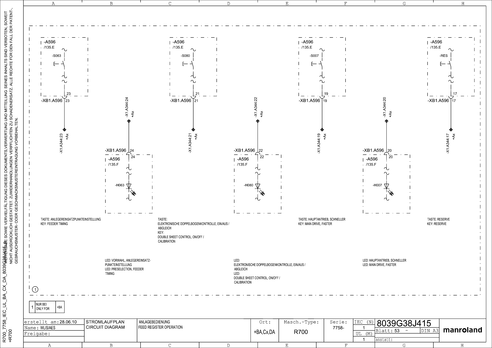

# +BA_Cx_DA — Sheet 53 of 247 — ANLAGEBEDIENUNG

**FEED REGISTER OPERATION**

> Part of the manroland **R700** printing press IEC/UL circuit diagrams.
> Drawing class: **Stromlaufplan / Circuit diagram** (DIN A3).
> Document `+BA_Cx_DA` covers the **Printing units / main switch cabinet** machine section.

## At a glance

| Field | Value |
|---|---|
| Document | `+BA_Cx_DA`  (8039G38J415) |
| Sheet | **53** of 247 |
| Section (DE) | ANLAGEBEDIENUNG |
| Section (EN) | FEED REGISTER OPERATION |
| Section type | CIRCUIT — Circuit diagram |
| Machine type | `R700` |
| Series | `7758` |
| Created | 28.06.10 |
| Replaces | — |
| Columns used | A, B, C, D, E, F, G, H |
| Path numbers | — |
| Labels on sheet | 85 |
| Cross-refs out | 7 |
| Cross-refs in | 14 |

**Previous:** [+BA_Cx_DA sheet 52](SHEET_0052.md) · **Next:** [+BA_Cx_DA sheet 54](SHEET_0054.md) · **Document TOC:** [_TOC.md](_TOC.md)  (+BA_Cx_DA) · **Master TOC:** [all sheets](../_MASTER_TOC.md)

## Sheet image (300 DPI, exact vector render)



_Rendered directly from the PDF vector layer at 300 DPI (1-bit), no OCR and no resampling. Use it to confirm anything ambiguous in the text below._

## Cross-references on this sheet

Each entry is a wire leaving this sheet. The printed token is `/sheet.column`; the link resolves to that sheet inside the same document.

| Ref | Target sheet | Col | Path | Destination on target | Target section | From col |
|---|---|---|---|---|---|---|
| `/135.E` | [+BA_Cx_DA sheet 135](SHEET_0135.md) | E | — | A596 | REFERENZMODUL | A |
| `/135.E` | [+BA_Cx_DA sheet 135](SHEET_0135.md) | E | — | A596 | REFERENZMODUL | C |
| `/135.E` | [+BA_Cx_DA sheet 135](SHEET_0135.md) | E | — | A596 | REFERENZMODUL | E |
| `/135.E` | [+BA_Cx_DA sheet 135](SHEET_0135.md) | E | — | A596 | REFERENZMODUL | H |
| `/135.F` | [+BA_Cx_DA sheet 135](SHEET_0135.md) | F | — | A596 | REFERENZMODUL | B |
| `/135.F` | [+BA_Cx_DA sheet 135](SHEET_0135.md) | F | — | A596 | REFERENZMODUL | D |
| `/135.F` | [+BA_Cx_DA sheet 135](SHEET_0135.md) | F | — | A596 | REFERENZMODUL | F |

### Incoming references (sheets that point here)

Every other sheet that sends a wire to this one. `Back-ref` is the token printed on *that* sheet; `Path` is its line number.

| From sheet | Cols | Back-ref | Path | Refs | What continues there |
|---|---|---|---|---|---|
| [+BA_Cx_DA#135](SHEET_0135.md) | E, F | `/135.E`, `/135.F` | — | 7 | — |
| [+BA_Cx_DA#142](SHEET_0142.md) | E | `/142.E` | — | 7 | — |


## Devices on this sheet

| Tag | Class | Class meaning (IEC) | Col | Sub | Terminal | Sign |
|---|---|---|---|---|---|---|
| `S080` | S | Schalter / switch | C | — | — | — |
| `A596` | A | Baugruppe / assembly, module, PC board | C | — | — | — |
| `S007` | S | Schalter / switch | E | — | — | — |
| `A596` | A | Baugruppe / assembly, module, PC board | E | — | — | — |
| `A596` | A | Baugruppe / assembly, module, PC board | H | — | — | — |
| `A596` | A | Baugruppe / assembly, module, PC board | F | — | — | — |
| `A596` | A | Baugruppe / assembly, module, PC board | D | — | — | — |
| `S063` | S | Schalter / switch | A | — | — | — |
| `A596` | A | Baugruppe / assembly, module, PC board | A | — | — | — |
| `A596` | A | Baugruppe / assembly, module, PC board | B | — | — | — |
| `XB1.A596` | — | cross-device reference | C | — | — | — |
| `XB1.A596` | — | cross-device reference | E | — | — | — |
| `XB1.A596` | — | cross-device reference | H | — | — | — |
| `X1.A344:21` | — | cross-device reference | C | — | 21 | — |
| `X1.A344:19` | — | cross-device reference | F | — | 19 | — |
| `X1.A344:17` | — | cross-device reference | H | — | 17 | — |
| `XB1.A596` | — | cross-device reference | F | — | — | — |
| `X1.A344:20` | — | cross-device reference | G | — | 20 | — |
| `XB1.A596` | — | cross-device reference | D | — | — | — |
| `X1.A344:22` | — | cross-device reference | D | — | 22 | — |
| `XB1.A596` | — | cross-device reference | A | — | — | — |
| `X1.A344:23` | — | cross-device reference | A | — | 23 | — |
| `XB1.A596` | — | cross-device reference | B | — | — | — |
| `X1.A344:24` | — | cross-device reference | B | — | 24 | — |

## Potentials / nets

| Potential | Count | Columns | Attached devices | Terminals |
|---|---|---|---|---|
| `H007` | 1 | G | — | — |
| `H063` | 1 | B | — | — |
| `H080` | 1 | D | — | — |


A potential such as `L24+/4` or `M24+` is a named supply/return rail; every place it appears on this sheet is electrically common.

## Wire-end annotations (grouped as printed)

A wire that continues elsewhere is annotated with a small cluster: the destination description, the path/line number `#NN`, and the `/sheet.column` cross reference. Each row below is one such cluster exactly as it is grouped on the drawing.

| Col | Y | Path | Cross-ref | Text on the wire |
|---|---|---|---|---|
| A | 96.7 | — | `/135.E` | `A596` |
| C | 96.7 | — | `/135.E` | `A596` |
| E | 96.7 | — | `/135.E` | `A596` |
| H | 96.7 | — | `/135.E` | `A596` |
| A | 131.1 | — | — | `S063` |
| C | 131.1 | — | — | `S080` |
| E | 131.1 | — | — | `S007` |
| H | 131.1 | — | — | `RES` |
| A | 222.8 | — | — | `23` |
| C | 222.8 | — | — | `21` |
| F | 222.8 | — | — | `19` |
| H | 222.8 | — | — | `17` |
| B | 235.0 | — | — | `X1.A344:24` |
| D | 235.0 | — | — | `X1.A344:22` |
| G | 235.0 | — | — | `X1.A344:20` |
| A | 238.4 | — | — | `XB1.A596 23` |
| C | 238.4 | — | — | `XB1.A596 21` |
| E | 238.4 | — | — | `XB1.A596 19` |
| H | 238.4 | — | — | `XB1.A596 17` |
| B | 268.7 | — | — | `+Ax` |
| E | 268.7 | — | — | `+Ax` |
| G | 268.7 | — | — | `+Ax` |
| C | 321.4 | — | — | `X1.A344:21` |
| A | 322.9 | — | — | `X1.A344:23` |
| F | 322.9 | — | — | `X1.A344:19` |
| H | 322.9 | — | — | `X1.A344:17` |
| A | 323.1 | — | — | `+Ax` |
| C | 323.1 | — | — | `+Ax` |
| F | 323.1 | — | — | `+Ax` |
| H | 323.1 | — | — | `+Ax` |
| B | 358.9 | — | — | `XB1.A596 24` |
| D | 358.9 | — | — | `XB1.A596 22` |
| G | 358.9 | — | — | `XB1.A596 20` |
| B | 375.9 | — | — | `24` |
| E | 375.9 | — | — | `22` |
| G | 375.9 | — | — | `20` |
| B | 380.1 | — | `/135.F` | `A596` |
| D | 380.1 | — | `/135.F` | `A596` |
| F | 380.1 | — | `/135.F` | `A596` |
| B | 444.4 | — | — | `H063` |
| D | 444.4 | — | — | `H080` |
| G | 444.4 | — | — | `H007` |
| C | 527.8 | — | — | `ELEKTRONISCHE DOPPELBOGENKONTROLLE, EIN/AUS / TASTE:` |
| H | 527.8 | — | — | `KEY: RESERVE TASTE: RESERVE` |
| A | 527.9 | — | — | `KEY: FEEDER TIMING TASTE: ANLEGEREINSATZPUNKTEINSTELLUNG` |
| F | 527.9 | — | — | `KEY: MAIN DRIVE, FASTER TASTE: HAUPTANTRIEB, SCHNELLER` |
| C | 549.1 | — | — | `KEY: DOUBLE SHEET CONTROL, ON/OFF / ABGLEICH` |
| C | 581.0 | — | — | `CALIBRATION` |
| E | 627.0 | — | — | `LED: ELEKTRONISCHE DOPPELBOGENKONTROLLE, EIN/AUS /` |
| B | 627.1 | — | — | `LED: VORWAHL, ANLEGEREINSATZ PUNKTEINSTELLUNG LED: PRESELECTION, FEEDER` |
| G | 627.1 | — | — | `LED: HAUPTANTRIEB, SCHNELLER LED: MAIN DRIVE, FASTER` |
| D | 648.3 | — | — | `LED: DOUBLE SHEET CONTROL, ON/OFF / ABGLEICH` |
| B | 659.0 | — | — | `TIMING` |
| D | 680.2 | — | — | `CALIBRATION` |
| A | 697.1 | — | — | `1` |
| A | 733.3 | — | — | `1 NUR BEI` |
| A | 740.4 | — | — | `ONLY FOR +BA` |


## Reconstructed tables

This sheet carries tabular content (pin map / terminal assignment / index). The grid below was rebuilt from the drawing's own rule lines, so each row is exactly one physical row of the table.

### Table 1 — 1 data rows × 2 columns (at x=99.2, y=90.7)

| A596 /135.E S063 | 23 |
|---|---|
| `XB1.A596 X1.A344:23` | `23 +Ax` |


### Table 2 — 1 data rows × 2 columns (at x=255.1, y=90.7)

| X1.A344:24 XB1.A596 | +Ax 24 |
|---|---|
| `A596 /135.F H063` | `24` |


### Table 3 — 1 data rows × 2 columns (at x=411.0, y=90.7)

| A596 /135.E S080 | 21 |
|---|---|
| `XB1.A596 X1.A344:21` | `21 +Ax` |


### Table 4 — 1 data rows × 2 columns (at x=566.9, y=90.7)

| X1.A344:22 XB1.A596 | +Ax 22 |
|---|---|
| `A596 /135.F H080` | `22` |


### Table 5 — 1 data rows × 2 columns (at x=722.8, y=90.7)

| A596 /135.E S007 | 19 |
|---|---|
| `XB1.A596 X1.A344:19` | `19 +Ax` |


### Table 6 — 1 data rows × 2 columns (at x=878.7, y=90.7)

| X1.A344:20 XB1.A596 | +Ax 20 |
|---|---|
| `A596 /135.F H007` | `20` |


### Table 7 — 1 data rows × 2 columns (at x=1034.6, y=90.7)

| A596 /135.E RES | 17 |
|---|---|
| `XB1.A596 X1.A344:17` | `17 +Ax` |


## Notes and free text on this sheet

| Text | Col | Y (pt) |
|---|---|---|
| `TASTE:` | C | 527.8 |
| `ELEKTRONISCHE DOPPELBOGENKONTROLLE, EIN/AUS /` | C | 538.5 |
| `ABGLEICH` | C | 549.12 |
| `KEY:` | C | 559.63 |
| `DOUBLE SHEET CONTROL, ON/OFF /` | C | 570.4 |
| `CALIBRATION` | C | 581.02 |
| `TASTE: HAUPTANTRIEB, SCHNELLER` | F | 527.87 |
| `KEY: MAIN DRIVE, FASTER` | E | 538.48 |
| `RES` | H | 131.13 |
| `TASTE: RESERVE` | H | 527.84 |
| `KEY: RESERVE` | H | 538.46 |
| `+Ax` | C | 323.15 |
| `+Ax` | F | 323.15 |
| `+Ax` | H | 323.15 |
| `LED: HAUPTANTRIEB, SCHNELLER` | G | 627.08 |
| `LED: MAIN DRIVE, FASTER` | G | 637.7 |
| `+Ax` | G | 268.73 |
| `LED:` | D | 626.99 |
| `ELEKTRONISCHE DOPPELBOGENKONTROLLE, EIN/AUS /` | E | 637.72 |
| `ABGLEICH` | D | 648.34 |
| `DOUBLE SHEET CONTROL, ON/OFF /` | D | 669.62 |
| `CALIBRATION` | D | 680.23 |
| `+Ax` | E | 268.73 |
| `TASTE: ANLEGEREINSATZPUNKTEINSTELLUNG` | A | 527.87 |
| `KEY: FEEDER TIMING` | A | 538.48 |
| `+Ax` | A | 323.15 |
| `LED: VORWAHL, ANLEGEREINSATZ` | B | 627.07 |
| `PUNKTEINSTELLUNG` | B | 637.72 |
| `LED: PRESELECTION, FEEDER` | B | 648.34 |
| `TIMING` | B | 658.98 |
| `+Ax` | B | 268.73 |
| `NUR BEI` | A | 733.33 |
| `ONLY FOR` | A | 744.02 |
| `+BA` | A | 740.44 |

## Complete label inventory (exact text from the drawing)

Every text object inside the drawing area of this sheet, in DIN reading order (column A→H, then top→bottom). This is the authoritative list: if a string is not here it is not printed on this sheet.

| Col | Y | X | Dir | Type | Text |
|---|---|---|---|---|---|
| A | 96.7 | 106.0 | → | device tag | `A596` |
| A | 110.5 | 106.3 | → | cross-reference | `/135.E` |
| A | 131.1 | 125.9 | → | device tag | `S063` |
| A | 222.8 | 161.3 | → | number | `23` |
| A | 238.4 | 99.5 | → | device ref | `XB1.A596` |
| A | 239.9 | 158.5 | → | number | `23` |
| A | 322.9 | 144.1 | ↕ | device ref | `X1.A344:23` |
| A | 323.2 | 158.4 | ↕ | text | `+Ax` |
| A | 527.9 | 98.9 | → | text | `TASTE: ANLEGEREINSATZPUNKTEINSTELLUNG` |
| A | 538.5 | 98.4 | → | text | `KEY: FEEDER TIMING` |
| A | 697.1 | 83.3 | → | number | `1` |
| A | 733.3 | 87.0 | → | text | `NUR BEI` |
| A | 738.7 | 75.4 | → | number | `1` |
| A | 740.4 | 137.9 | → | text | `+BA` |
| A | 744.0 | 87.6 | → | text | `ONLY FOR` |
| B | 235.0 | 302.9 | ↕ | device ref | `X1.A344:24` |
| B | 268.7 | 317.1 | ↕ | text | `+Ax` |
| B | 358.9 | 254.0 | → | device ref | `XB1.A596` |
| B | 360.3 | 314.4 | → | number | `24` |
| B | 375.9 | 317.2 | → | number | `24` |
| B | 380.1 | 261.9 | → | device tag | `A596` |
| B | 393.9 | 262.2 | → | cross-reference | `/135.F` |
| B | 444.3 | 278.4 | → | potential | `H063` |
| B | 627.1 | 254.3 | → | text | `LED: VORWAHL, ANLEGEREINSATZ` |
| B | 637.7 | 254.3 | → | text | `PUNKTEINSTELLUNG` |
| B | 648.3 | 254.3 | → | text | `LED: PRESELECTION, FEEDER` |
| B | 659.0 | 254.8 | → | text | `TIMING` |
| C | 96.7 | 417.8 | → | device tag | `A596` |
| C | 110.5 | 418.1 | → | cross-reference | `/135.E` |
| C | 131.1 | 437.7 | → | device tag | `S080` |
| C | 222.8 | 473.1 | → | number | `21` |
| C | 238.4 | 411.3 | → | device ref | `XB1.A596` |
| C | 239.9 | 470.3 | → | number | `21` |
| C | 321.4 | 456.0 | ↕ | device ref | `X1.A344:21` |
| C | 323.2 | 470.2 | ↕ | text | `+Ax` |
| C | 527.8 | 382.4 | → | text | `TASTE:` |
| C | 538.5 | 381.8 | → | text | `ELEKTRONISCHE DOPPELBOGENKONTROLLE, EIN/AUS /` |
| C | 549.1 | 382.7 | → | text | `ABGLEICH` |
| C | 559.6 | 381.8 | → | text | `KEY:` |
| C | 570.4 | 381.8 | → | text | `DOUBLE SHEET CONTROL, ON/OFF /` |
| C | 581.0 | 382.4 | → | text | `CALIBRATION` |
| D | 235.0 | 614.7 | ↕ | device ref | `X1.A344:22` |
| D | 358.9 | 565.8 | → | device ref | `XB1.A596` |
| D | 380.1 | 573.7 | → | device tag | `A596` |
| D | 393.9 | 574.0 | → | cross-reference | `/135.F` |
| D | 444.3 | 590.2 | → | potential | `H080` |
| D | 627.0 | 566.1 | → | text | `LED:` |
| D | 648.3 | 566.9 | → | text | `ABGLEICH` |
| D | 658.9 | 566.1 | → | text | `LED:` |
| D | 669.6 | 566.1 | → | text | `DOUBLE SHEET CONTROL, ON/OFF /` |
| D | 680.2 | 566.6 | → | text | `CALIBRATION` |
| E | 96.7 | 729.6 | → | device tag | `A596` |
| E | 110.5 | 729.9 | → | cross-reference | `/135.E` |
| E | 131.1 | 749.5 | → | device tag | `S007` |
| E | 238.4 | 723.1 | → | device ref | `XB1.A596` |
| E | 268.7 | 628.9 | ↕ | text | `+Ax` |
| E | 360.3 | 626.2 | → | number | `22` |
| E | 375.9 | 629.0 | → | number | `22` |
| E | 538.5 | 722.0 | → | text | `KEY: MAIN DRIVE, FASTER` |
| E | 637.7 | 566.1 | → | text | `ELEKTRONISCHE DOPPELBOGENKONTROLLE, EIN/AUS /` |
| F | 222.8 | 784.3 | → | number | `19` |
| F | 239.9 | 781.5 | → | number | `19` |
| F | 322.9 | 767.8 | ↕ | device ref | `X1.A344:19` |
| F | 323.2 | 782.0 | ↕ | text | `+Ax` |
| F | 358.9 | 877.6 | → | device ref | `XB1.A596` |
| F | 380.1 | 885.5 | → | device tag | `A596` |
| F | 393.9 | 885.8 | → | cross-reference | `/135.F` |
| F | 527.9 | 722.6 | → | text | `TASTE: HAUPTANTRIEB, SCHNELLER` |
| G | 235.0 | 926.5 | ↕ | device ref | `X1.A344:20` |
| G | 268.7 | 940.8 | ↕ | text | `+Ax` |
| G | 360.3 | 938.0 | → | number | `20` |
| G | 375.9 | 940.8 | → | number | `20` |
| G | 444.3 | 902.0 | → | potential | `H007` |
| G | 627.1 | 877.9 | → | text | `LED: HAUPTANTRIEB, SCHNELLER` |
| G | 637.7 | 877.9 | → | text | `LED: MAIN DRIVE, FASTER` |
| H | 96.7 | 1041.4 | → | device tag | `A596` |
| H | 110.5 | 1041.7 | → | cross-reference | `/135.E` |
| H | 131.1 | 1063.8 | → | text | `RES` |
| H | 222.8 | 1096.2 | → | number | `17` |
| H | 238.4 | 1034.9 | → | device ref | `XB1.A596` |
| H | 239.9 | 1093.3 | → | number | `17` |
| H | 322.9 | 1079.6 | ↕ | device ref | `X1.A344:17` |
| H | 323.2 | 1093.8 | ↕ | text | `+Ax` |
| H | 527.8 | 1034.4 | → | text | `TASTE: RESERVE` |
| H | 538.5 | 1033.8 | → | text | `KEY: RESERVE` |

## Reading-order text block

The same content as a plain block, grouped by DIN column — convenient to paste or to match against a visual description.

```text
=== Column A ===
  96.7  106.0  devtag       A596
 110.5  106.3  xref         /135.E
 131.1  125.9  devtag       S063
 222.8  161.3  numeric      23
 238.4   99.5  devref       XB1.A596
 239.9  158.5  numeric      23
 322.9  144.1  devref       X1.A344:23
 323.2  158.4  text         +Ax
 527.9   98.9  text         TASTE: ANLEGEREINSATZPUNKTEINSTELLUNG
 538.5   98.4  text         KEY: FEEDER TIMING
 697.1   83.3  numeric      1
 733.3   87.0  text         NUR BEI
 738.7   75.4  numeric      1
 740.4  137.9  text         +BA
 744.0   87.6  text         ONLY FOR
=== Column B ===
 235.0  302.9  devref       X1.A344:24
 268.7  317.1  text         +Ax
 358.9  254.0  devref       XB1.A596
 360.3  314.4  numeric      24
 375.9  317.2  numeric      24
 380.1  261.9  devtag       A596
 393.9  262.2  xref         /135.F
 444.3  278.4  net          H063
 627.1  254.3  text         LED: VORWAHL, ANLEGEREINSATZ
 637.7  254.3  text         PUNKTEINSTELLUNG
 648.3  254.3  text         LED: PRESELECTION, FEEDER
 659.0  254.8  text         TIMING
=== Column C ===
  96.7  417.8  devtag       A596
 110.5  418.1  xref         /135.E
 131.1  437.7  devtag       S080
 222.8  473.1  numeric      21
 238.4  411.3  devref       XB1.A596
 239.9  470.3  numeric      21
 321.4  456.0  devref       X1.A344:21
 323.2  470.2  text         +Ax
 527.8  382.4  text         TASTE:
 538.5  381.8  text         ELEKTRONISCHE DOPPELBOGENKONTROLLE, EIN/AUS /
 549.1  382.7  text         ABGLEICH
 559.6  381.8  text         KEY:
 570.4  381.8  text         DOUBLE SHEET CONTROL, ON/OFF /
 581.0  382.4  text         CALIBRATION
=== Column D ===
 235.0  614.7  devref       X1.A344:22
 358.9  565.8  devref       XB1.A596
 380.1  573.7  devtag       A596
 393.9  574.0  xref         /135.F
 444.3  590.2  net          H080
 627.0  566.1  text         LED:
 648.3  566.9  text         ABGLEICH
 658.9  566.1  text         LED:
 669.6  566.1  text         DOUBLE SHEET CONTROL, ON/OFF /
 680.2  566.6  text         CALIBRATION
=== Column E ===
  96.7  729.6  devtag       A596
 110.5  729.9  xref         /135.E
 131.1  749.5  devtag       S007
 238.4  723.1  devref       XB1.A596
 268.7  628.9  text         +Ax
 360.3  626.2  numeric      22
 375.9  629.0  numeric      22
 538.5  722.0  text         KEY: MAIN DRIVE, FASTER
 637.7  566.1  text         ELEKTRONISCHE DOPPELBOGENKONTROLLE, EIN/AUS /
=== Column F ===
 222.8  784.3  numeric      19
 239.9  781.5  numeric      19
 322.9  767.8  devref       X1.A344:19
 323.2  782.0  text         +Ax
 358.9  877.6  devref       XB1.A596
 380.1  885.5  devtag       A596
 393.9  885.8  xref         /135.F
 527.9  722.6  text         TASTE: HAUPTANTRIEB, SCHNELLER
=== Column G ===
 235.0  926.5  devref       X1.A344:20
 268.7  940.8  text         +Ax
 360.3  938.0  numeric      20
 375.9  940.8  numeric      20
 444.3  902.0  net          H007
 627.1  877.9  text         LED: HAUPTANTRIEB, SCHNELLER
 637.7  877.9  text         LED: MAIN DRIVE, FASTER
=== Column H ===
  96.7 1041.4  devtag       A596
 110.5 1041.7  xref         /135.E
 131.1 1063.8  text         RES
 222.8 1096.2  numeric      17
 238.4 1034.9  devref       XB1.A596
 239.9 1093.3  numeric      17
 322.9 1079.6  devref       X1.A344:17
 323.2 1093.8  text         +Ax
 527.8 1034.4  text         TASTE: RESERVE
 538.5 1033.8  text         KEY: RESERVE
```

---
_Generated from the PDF vector text layer; no OCR. Source: `R700_7758_IEC_UL_BA_CX_DA_8039G38J415_p`, sheet 53._
