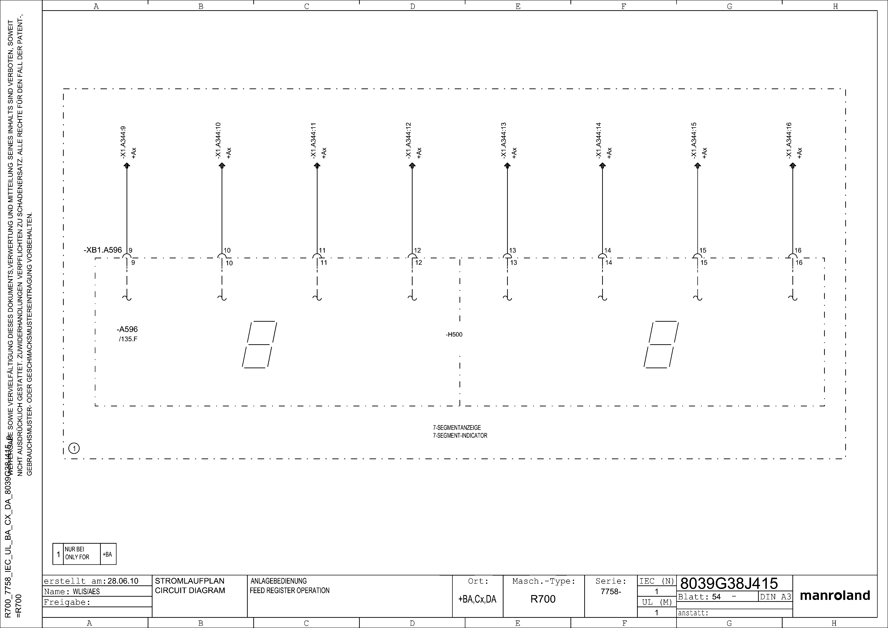

# +BA_Cx_DA — Sheet 54 of 247 — ANLAGEBEDIENUNG

**FEED REGISTER OPERATION**

> Part of the manroland **R700** printing press IEC/UL circuit diagrams.
> Drawing class: **Stromlaufplan / Circuit diagram** (DIN A3).
> Document `+BA_Cx_DA` covers the **Printing units / main switch cabinet** machine section.

## At a glance

| Field | Value |
|---|---|
| Document | `+BA_Cx_DA`  (8039G38J415) |
| Sheet | **54** of 247 |
| Section (DE) | ANLAGEBEDIENUNG |
| Section (EN) | FEED REGISTER OPERATION |
| Section type | CIRCUIT — Circuit diagram |
| Machine type | `R700` |
| Series | `7758` |
| Created | 28.06.10 |
| Replaces | — |
| Columns used | A, B, C, D, E, F, G, H |
| Path numbers | — |
| Labels on sheet | 43 |
| Cross-refs out | 1 |
| Cross-refs in | 9 |

**Previous:** [+BA_Cx_DA sheet 53](SHEET_0053.md) · **Next:** [+BA_Cx_DA sheet 55](SHEET_0055.md) · **Document TOC:** [_TOC.md](_TOC.md)  (+BA_Cx_DA) · **Master TOC:** [all sheets](../_MASTER_TOC.md)

## Sheet image (300 DPI, exact vector render)



_Rendered directly from the PDF vector layer at 300 DPI (1-bit), no OCR and no resampling. Use it to confirm anything ambiguous in the text below._

## Cross-references on this sheet

Each entry is a wire leaving this sheet. The printed token is `/sheet.column`; the link resolves to that sheet inside the same document.

| Ref | Target sheet | Col | Path | Destination on target | Target section | From col |
|---|---|---|---|---|---|---|
| `/135.F` | [+BA_Cx_DA sheet 135](SHEET_0135.md) | F | — | — | REFERENZMODUL | A |

### Incoming references (sheets that point here)

Every other sheet that sends a wire to this one. `Back-ref` is the token printed on *that* sheet; `Path` is its line number.

| From sheet | Cols | Back-ref | Path | Refs | What continues there |
|---|---|---|---|---|---|
| [+BA_Cx_DA#135](SHEET_0135.md) | F | `/135.F` | — | 1 | — |
| [+BA_Cx_DA#142](SHEET_0142.md) | E | `/142.E` | — | 8 | — |


## Devices on this sheet

| Tag | Class | Class meaning (IEC) | Col | Sub | Terminal | Sign |
|---|---|---|---|---|---|---|
| `A596` | A | Baugruppe / assembly, module, PC board | A | — | — | — |
| `XB1.A596` | — | cross-device reference | A | — | — | — |
| `X1.A344:9` | — | cross-device reference | A | — | 9 | — |
| `X1.A344:10` | — | cross-device reference | B | — | 10 | — |
| `X1.A344:11` | — | cross-device reference | C | — | 11 | — |
| `X1.A344:12` | — | cross-device reference | D | — | 12 | — |
| `X1.A344:13` | — | cross-device reference | E | — | 13 | — |
| `X1.A344:14` | — | cross-device reference | F | — | 14 | — |
| `X1.A344:15` | — | cross-device reference | G | — | 15 | — |
| `X1.A344:16` | — | cross-device reference | H | — | 16 | — |

## Potentials / nets

| Potential | Count | Columns | Attached devices | Terminals |
|---|---|---|---|---|
| `H500` | 1 | D | — | — |


A potential such as `L24+/4` or `M24+` is a named supply/return rail; every place it appears on this sheet is electrically common.

## Wire-end annotations (grouped as printed)

A wire that continues elsewhere is annotated with a small cluster: the destination description, the path/line number `#NN`, and the `/sheet.column` cross reference. Each row below is one such cluster exactly as it is grouped on the drawing.

| Col | Y | Path | Cross-ref | Text on the wire |
|---|---|---|---|---|
| B | 164.1 | — | — | `X1.A344:10` |
| C | 164.1 | — | — | `X1.A344:11` |
| D | 164.1 | — | — | `X1.A344:12` |
| E | 164.1 | — | — | `X1.A344:13` |
| F | 164.1 | — | — | `X1.A344:14` |
| G | 164.1 | — | — | `X1.A344:15` |
| H | 164.1 | — | — | `X1.A344:16` |
| A | 168.9 | — | — | `X1.A344:9` |
| A | 197.9 | — | — | `+Ax` |
| B | 197.9 | — | — | `+Ax` |
| C | 197.9 | — | — | `+Ax` |
| D | 197.9 | — | — | `+Ax` |
| E | 197.9 | — | — | `+Ax` |
| F | 197.9 | — | — | `+Ax` |
| G | 197.9 | — | — | `+Ax` |
| H | 197.9 | — | — | `+Ax` |
| D | 330.5 | — | — | `XB1.A596 9 10 11 12 13 14 15 16` |
| E | 348.3 | — | — | `9 10 11 12 13 14 15 16` |
| A | 436.8 | — | — | `A596` |
| D | 444.8 | — | — | `H500` |
| A | 450.6 | — | `/135.F` | — |
| D | 570.4 | — | — | `7 SEGMENTANZEIGE 7 SEGMENT INDICATOR` |
| A | 597.9 | — | — | `1` |
| A | 733.3 | — | — | `1 NUR BEI` |
| A | 740.4 | — | — | `ONLY FOR +BA` |


## Notes and free text on this sheet

| Text | Col | Y (pt) |
|---|---|---|
| `7 SEGMENTANZEIGE` | D | 570.39 |
| `7 SEGMENT INDICATOR` | D | 581.04 |
| `+Ax` | A | 197.86 |
| `+Ax` | B | 197.86 |
| `+Ax` | C | 197.86 |
| `+Ax` | D | 197.86 |
| `+Ax` | E | 197.86 |
| `+Ax` | F | 197.86 |
| `+Ax` | G | 197.86 |
| `+Ax` | H | 197.86 |
| `NUR BEI` | A | 733.33 |
| `ONLY FOR` | A | 744.02 |
| `+BA` | A | 740.44 |

## Complete label inventory (exact text from the drawing)

Every text object inside the drawing area of this sheet, in DIN reading order (column A→H, then top→bottom). This is the authoritative list: if a string is not here it is not printed on this sheet.

| Col | Y | X | Dir | Type | Text |
|---|---|---|---|---|---|
| A | 168.9 | 161.1 | ↕ | device ref | `X1.A344:9` |
| A | 197.9 | 175.4 | ↕ | text | `+Ax` |
| A | 330.5 | 112.3 | → | device ref | `XB1.A596` |
| A | 332.0 | 172.6 | → | number | `9` |
| A | 348.3 | 176.2 | → | number | `9` |
| A | 436.8 | 156.5 | → | device tag | `A596` |
| A | 450.6 | 159.6 | → | cross-reference | `/135.F` |
| A | 597.9 | 97.5 | → | number | `1` |
| A | 733.3 | 87.0 | → | text | `NUR BEI` |
| A | 738.7 | 75.4 | → | number | `1` |
| A | 740.4 | 137.9 | → | text | `+BA` |
| A | 744.0 | 87.6 | → | text | `ONLY FOR` |
| B | 164.1 | 288.7 | ↕ | device ref | `X1.A344:10` |
| B | 197.9 | 303.0 | ↕ | text | `+Ax` |
| B | 332.0 | 299.6 | → | number | `10` |
| B | 349.0 | 302.5 | → | number | `10` |
| C | 164.1 | 416.3 | ↕ | device ref | `X1.A344:11` |
| C | 197.9 | 430.5 | ↕ | text | `+Ax` |
| C | 332.0 | 427.2 | → | number | `11` |
| C | 348.3 | 429.3 | → | number | `11` |
| D | 164.1 | 543.8 | ↕ | device ref | `X1.A344:12` |
| D | 197.9 | 558.1 | ↕ | text | `+Ax` |
| D | 332.0 | 554.7 | → | number | `12` |
| D | 348.3 | 556.3 | → | number | `12` |
| D | 444.8 | 597.8 | → | potential | `H500` |
| D | 570.4 | 580.8 | → | text | `7 SEGMENTANZEIGE` |
| D | 581.0 | 580.8 | → | text | `7 SEGMENT INDICATOR` |
| E | 164.1 | 671.4 | ↕ | device ref | `X1.A344:13` |
| E | 197.9 | 685.6 | ↕ | text | `+Ax` |
| E | 332.0 | 682.3 | → | number | `13` |
| E | 348.3 | 683.7 | → | number | `13` |
| F | 164.1 | 798.9 | ↕ | device ref | `X1.A344:14` |
| F | 197.9 | 813.2 | ↕ | text | `+Ax` |
| F | 332.0 | 809.9 | → | number | `14` |
| F | 348.3 | 811.3 | → | number | `14` |
| G | 164.1 | 926.5 | ↕ | device ref | `X1.A344:15` |
| G | 197.9 | 940.8 | ↕ | text | `+Ax` |
| G | 332.0 | 937.4 | → | number | `15` |
| G | 348.3 | 938.8 | → | number | `15` |
| H | 164.1 | 1054.1 | ↕ | device ref | `X1.A344:16` |
| H | 197.9 | 1068.3 | ↕ | text | `+Ax` |
| H | 332.0 | 1065.0 | → | number | `16` |
| H | 348.3 | 1066.4 | → | number | `16` |

## Reading-order text block

The same content as a plain block, grouped by DIN column — convenient to paste or to match against a visual description.

```text
=== Column A ===
 168.9  161.1  devref       X1.A344:9
 197.9  175.4  text         +Ax
 330.5  112.3  devref       XB1.A596
 332.0  172.6  numeric      9
 348.3  176.2  numeric      9
 436.8  156.5  devtag       A596
 450.6  159.6  xref         /135.F
 597.9   97.5  numeric      1
 733.3   87.0  text         NUR BEI
 738.7   75.4  numeric      1
 740.4  137.9  text         +BA
 744.0   87.6  text         ONLY FOR
=== Column B ===
 164.1  288.7  devref       X1.A344:10
 197.9  303.0  text         +Ax
 332.0  299.6  numeric      10
 349.0  302.5  numeric      10
=== Column C ===
 164.1  416.3  devref       X1.A344:11
 197.9  430.5  text         +Ax
 332.0  427.2  numeric      11
 348.3  429.3  numeric      11
=== Column D ===
 164.1  543.8  devref       X1.A344:12
 197.9  558.1  text         +Ax
 332.0  554.7  numeric      12
 348.3  556.3  numeric      12
 444.8  597.8  net          H500
 570.4  580.8  text         7 SEGMENTANZEIGE
 581.0  580.8  text         7 SEGMENT INDICATOR
=== Column E ===
 164.1  671.4  devref       X1.A344:13
 197.9  685.6  text         +Ax
 332.0  682.3  numeric      13
 348.3  683.7  numeric      13
=== Column F ===
 164.1  798.9  devref       X1.A344:14
 197.9  813.2  text         +Ax
 332.0  809.9  numeric      14
 348.3  811.3  numeric      14
=== Column G ===
 164.1  926.5  devref       X1.A344:15
 197.9  940.8  text         +Ax
 332.0  937.4  numeric      15
 348.3  938.8  numeric      15
=== Column H ===
 164.1 1054.1  devref       X1.A344:16
 197.9 1068.3  text         +Ax
 332.0 1065.0  numeric      16
 348.3 1066.4  numeric      16
```

---
_Generated from the PDF vector text layer; no OCR. Source: `R700_7758_IEC_UL_BA_CX_DA_8039G38J415_p`, sheet 54._
