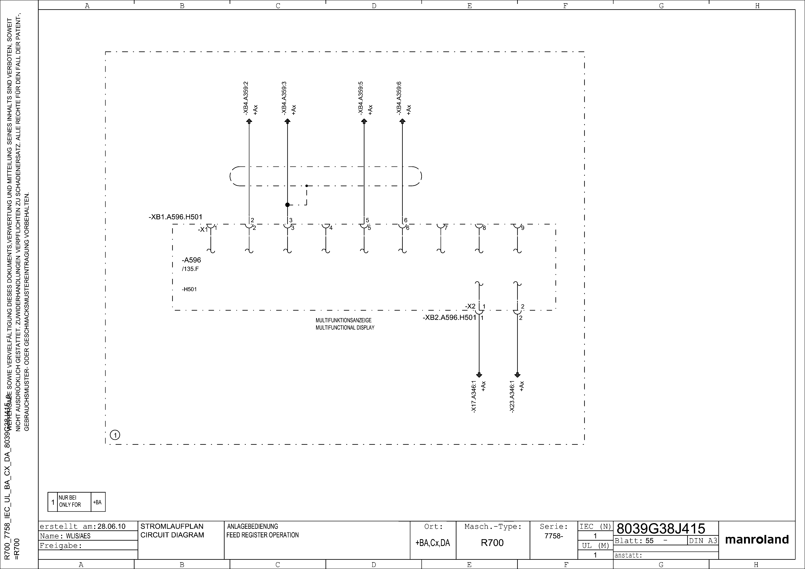

# +BA_Cx_DA — Sheet 55 of 247 — ANLAGEBEDIENUNG

**FEED REGISTER OPERATION**

> Part of the manroland **R700** printing press IEC/UL circuit diagrams.
> Drawing class: **Stromlaufplan / Circuit diagram** (DIN A3).
> Document `+BA_Cx_DA` covers the **Printing units / main switch cabinet** machine section.

## At a glance

| Field | Value |
|---|---|
| Document | `+BA_Cx_DA`  (8039G38J415) |
| Sheet | **55** of 247 |
| Section (DE) | ANLAGEBEDIENUNG |
| Section (EN) | FEED REGISTER OPERATION |
| Section type | CIRCUIT — Circuit diagram |
| Machine type | `R700` |
| Series | `7758` |
| Created | 28.06.10 |
| Replaces | — |
| Columns used | A, B, C, D, E, F |
| Path numbers | — |
| Labels on sheet | 43 |
| Cross-refs out | 1 |
| Cross-refs in | 7 |

**Previous:** [+BA_Cx_DA sheet 54](SHEET_0054.md) · **Next:** [+BA_Cx_DA sheet 56](SHEET_0056.md) · **Document TOC:** [_TOC.md](_TOC.md)  (+BA_Cx_DA) · **Master TOC:** [all sheets](../_MASTER_TOC.md)

## Sheet image (300 DPI, exact vector render)



_Rendered directly from the PDF vector layer at 300 DPI (1-bit), no OCR and no resampling. Use it to confirm anything ambiguous in the text below._

## Cross-references on this sheet

Each entry is a wire leaving this sheet. The printed token is `/sheet.column`; the link resolves to that sheet inside the same document.

| Ref | Target sheet | Col | Path | Destination on target | Target section | From col |
|---|---|---|---|---|---|---|
| `/135.F` | [+BA_Cx_DA sheet 135](SHEET_0135.md) | F | — | A596 | REFERENZMODUL | B |

### Incoming references (sheets that point here)

Every other sheet that sends a wire to this one. `Back-ref` is the token printed on *that* sheet; `Path` is its line number.

| From sheet | Cols | Back-ref | Path | Refs | What continues there |
|---|---|---|---|---|---|
| [+BA_Cx_DA#135](SHEET_0135.md) | F | `/135.F` | — | 1 | — |
| [+BA_Cx_DA#143](SHEET_0143.md) | A | `/143.A` | — | 4 | — |
| [+BA_Cx_DA#154](SHEET_0154.md) | B | `/154.B` | — | 2 | — |


## Devices on this sheet

| Tag | Class | Class meaning (IEC) | Col | Sub | Terminal | Sign |
|---|---|---|---|---|---|---|
| `A596` | A | Baugruppe / assembly, module, PC board | B | — | — | — |
| `X2` | X | Klemme / terminal, plug connector | E | — | — | — |
| `X1` | X | Klemme / terminal, plug connector | B | — | — | — |
| `XB1.A596.H501` | — | cross-device reference | B | — | — | — |
| `XB2.A596.H501` | — | cross-device reference | E | — | — | — |
| `XB4.A359:2` | — | cross-device reference | C | — | 2 | — |
| `XB4.A359:3` | — | cross-device reference | C | — | 3 | — |
| `XB4.A359:5` | — | cross-device reference | D | — | 5 | — |
| `XB4.A359:6` | — | cross-device reference | D | — | 6 | — |
| `X17.A346:1` | — | cross-device reference | E | — | 1 | — |
| `X23.A346:1` | — | cross-device reference | E | — | 1 | — |

## Potentials / nets

| Potential | Count | Columns | Attached devices | Terminals |
|---|---|---|---|---|
| `H501` | 1 | B | — | — |


A potential such as `L24+/4` or `M24+` is a named supply/return rail; every place it appears on this sheet is electrically common.

## Wire-end annotations (grouped as printed)

A wire that continues elsewhere is annotated with a small cluster: the destination description, the path/line number `#NN`, and the `/sheet.column` cross reference. Each row below is one such cluster exactly as it is grouped on the drawing.

| Col | Y | Path | Cross-ref | Text on the wire |
|---|---|---|---|---|
| C | 120.5 | — | — | `XB4.A359:2` |
| C | 120.5 | — | — | `XB4.A359:3` |
| D | 120.5 | — | — | `XB4.A359:5` |
| D | 120.5 | — | — | `XB4.A359:6` |
| C | 155.3 | — | — | `+Ax` |
| C | 155.3 | — | — | `+Ax` |
| D | 155.3 | — | — | `+Ax` |
| D | 155.3 | — | — | `+Ax` |
| C | 316.4 | — | — | `XB1.A596.H501 2 3 5 6` |
| D | 333.4 | — | — | `1 2 3 4 5 6 7 8 9` |
| B | 335.4 | — | — | `X1` |
| B | 380.1 | — | `/135.F` | `A596` |
| B | 424.5 | — | — | `H501` |
| E | 448.8 | — | — | `X2` |
| E | 449.6 | — | — | `1 2` |
| E | 465.2 | — | — | `XB2.A596.H501 1` |
| F | 466.6 | — | — | `2` |
| D | 471.2 | — | — | `MULTIFUNKTIONSANZEIGE MULTIFUNCTIONAL DISPLAY` |
| E | 562.4 | — | — | `X17.A346:1` |
| E | 562.4 | — | — | `X23.A346:1` |
| E | 564.1 | — | — | `+Ax` |
| F | 564.1 | — | — | `+Ax` |
| A | 640.4 | — | — | `1` |
| A | 733.3 | — | — | `1 NUR BEI` |
| A | 740.4 | — | — | `ONLY FOR +BA` |


## Notes and free text on this sheet

| Text | Col | Y (pt) |
|---|---|---|
| `MULTIFUNKTIONSANZEIGE` | D | 471.18 |
| `MULTIFUNCTIONAL DISPLAY` | D | 481.82 |
| `+Ax` | C | 155.34 |
| `+Ax` | D | 155.34 |
| `+Ax` | E | 564.1 |
| `+Ax` | F | 564.1 |
| `NUR BEI` | A | 733.33 |
| `ONLY FOR` | A | 744.02 |
| `+BA` | A | 740.44 |

## Complete label inventory (exact text from the drawing)

Every text object inside the drawing area of this sheet, in DIN reading order (column A→H, then top→bottom). This is the authoritative list: if a string is not here it is not printed on this sheet.

| Col | Y | X | Dir | Type | Text |
|---|---|---|---|---|---|
| A | 640.4 | 168.3 | → | number | `1` |
| A | 733.3 | 87.0 | → | text | `NUR BEI` |
| A | 738.7 | 75.4 | → | number | `1` |
| A | 740.4 | 137.9 | → | text | `+BA` |
| A | 744.0 | 87.6 | → | text | `ONLY FOR` |
| B | 316.4 | 220.0 | → | device ref | `XB1.A596.H501` |
| B | 333.4 | 316.6 | → | number | `1` |
| B | 335.4 | 292.8 | → | device tag | `X1` |
| B | 380.1 | 269.0 | → | device tag | `A596` |
| B | 393.9 | 269.3 | → | cross-reference | `/135.F` |
| B | 424.5 | 269.0 | → | potential | `H501` |
| C | 120.5 | 359.6 | ↕ | device ref | `XB4.A359:2` |
| C | 120.5 | 416.3 | ↕ | device ref | `XB4.A359:3` |
| C | 155.3 | 373.8 | ↕ | text | `+Ax` |
| C | 155.3 | 430.5 | ↕ | text | `+Ax` |
| C | 322.1 | 371.1 | → | number | `2` |
| C | 322.1 | 427.7 | → | number | `3` |
| C | 333.4 | 373.9 | → | number | `2` |
| C | 333.4 | 430.6 | → | number | `3` |
| D | 120.5 | 529.6 | ↕ | device ref | `XB4.A359:5` |
| D | 120.5 | 586.3 | ↕ | device ref | `XB4.A359:6` |
| D | 155.3 | 543.9 | ↕ | text | `+Ax` |
| D | 155.3 | 600.6 | ↕ | text | `+Ax` |
| D | 322.1 | 541.1 | → | number | `5` |
| D | 322.1 | 597.8 | → | number | `6` |
| D | 333.4 | 487.3 | → | number | `4` |
| D | 333.4 | 544.0 | → | number | `5` |
| D | 333.4 | 600.7 | → | number | `6` |
| D | 471.2 | 467.1 | → | text | `MULTIFUNKTIONSANZEIGE` |
| D | 481.8 | 467.1 | → | text | `MULTIFUNCTIONAL DISPLAY` |
| E | 333.4 | 657.4 | → | number | `7` |
| E | 333.4 | 714.0 | → | number | `8` |
| E | 448.8 | 688.0 | → | device tag | `X2` |
| E | 449.6 | 713.5 | → | number | `1` |
| E | 465.2 | 625.3 | → | device ref | `XB2.A596.H501` |
| E | 466.6 | 710.6 | → | number | `1` |
| E | 562.4 | 696.9 | ↕ | device ref | `X17.A346:1` |
| E | 562.4 | 753.6 | ↕ | device ref | `X23.A346:1` |
| E | 564.1 | 711.1 | ↕ | text | `+Ax` |
| F | 333.4 | 770.7 | → | number | `9` |
| F | 449.6 | 770.7 | → | number | `2` |
| F | 466.6 | 767.9 | → | number | `2` |
| F | 564.1 | 767.8 | ↕ | text | `+Ax` |

## Reading-order text block

The same content as a plain block, grouped by DIN column — convenient to paste or to match against a visual description.

```text
=== Column A ===
 640.4  168.3  numeric      1
 733.3   87.0  text         NUR BEI
 738.7   75.4  numeric      1
 740.4  137.9  text         +BA
 744.0   87.6  text         ONLY FOR
=== Column B ===
 316.4  220.0  devref       XB1.A596.H501
 333.4  316.6  numeric      1
 335.4  292.8  devtag       X1
 380.1  269.0  devtag       A596
 393.9  269.3  xref         /135.F
 424.5  269.0  net          H501
=== Column C ===
 120.5  359.6  devref       XB4.A359:2
 120.5  416.3  devref       XB4.A359:3
 155.3  373.8  text         +Ax
 155.3  430.5  text         +Ax
 322.1  371.1  numeric      2
 322.1  427.7  numeric      3
 333.4  373.9  numeric      2
 333.4  430.6  numeric      3
=== Column D ===
 120.5  529.6  devref       XB4.A359:5
 120.5  586.3  devref       XB4.A359:6
 155.3  543.9  text         +Ax
 155.3  600.6  text         +Ax
 322.1  541.1  numeric      5
 322.1  597.8  numeric      6
 333.4  487.3  numeric      4
 333.4  544.0  numeric      5
 333.4  600.7  numeric      6
 471.2  467.1  text         MULTIFUNKTIONSANZEIGE
 481.8  467.1  text         MULTIFUNCTIONAL DISPLAY
=== Column E ===
 333.4  657.4  numeric      7
 333.4  714.0  numeric      8
 448.8  688.0  devtag       X2
 449.6  713.5  numeric      1
 465.2  625.3  devref       XB2.A596.H501
 466.6  710.6  numeric      1
 562.4  696.9  devref       X17.A346:1
 562.4  753.6  devref       X23.A346:1
 564.1  711.1  text         +Ax
=== Column F ===
 333.4  770.7  numeric      9
 449.6  770.7  numeric      2
 466.6  767.9  numeric      2
 564.1  767.8  text         +Ax
```

---
_Generated from the PDF vector text layer; no OCR. Source: `R700_7758_IEC_UL_BA_CX_DA_8039G38J415_p`, sheet 55._
