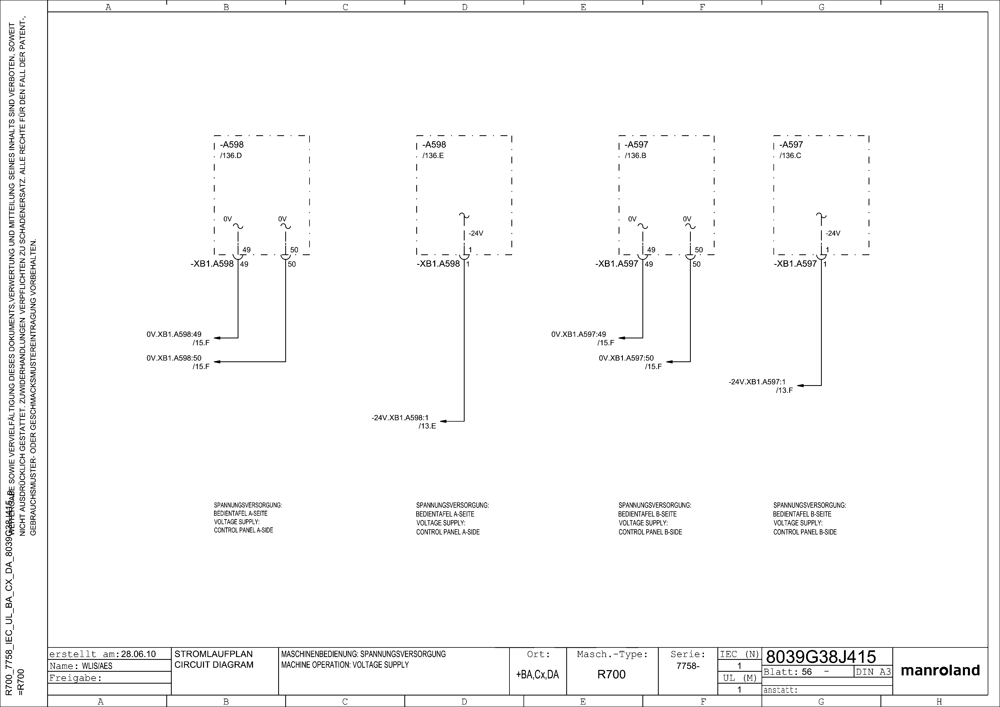

# +BA_Cx_DA — Sheet 56 of 247 — MASCHINENBEDIENUNG: SPANNUNGSVERSORGUNG

**MACHINE OPERATION: VOLTAGE SUPPLY**

> Part of the manroland **R700** printing press IEC/UL circuit diagrams.
> Drawing class: **Stromlaufplan / Circuit diagram** (DIN A3).
> Document `+BA_Cx_DA` covers the **Printing units / main switch cabinet** machine section.

## At a glance

| Field | Value |
|---|---|
| Document | `+BA_Cx_DA`  (8039G38J415) |
| Sheet | **56** of 247 |
| Section (DE) | MASCHINENBEDIENUNG: SPANNUNGSVERSORGUNG |
| Section (EN) | MACHINE OPERATION: VOLTAGE SUPPLY |
| Section type | POWER_SUPPLY — Voltage supply |
| Machine type | `R700` |
| Series | `7758` |
| Created | 28.06.10 |
| Replaces | — |
| Columns used | B, C, D, E, F, G |
| Path numbers | — |
| Labels on sheet | 58 |
| Cross-refs out | 10 |
| Cross-refs in | 16 |

**Previous:** [+BA_Cx_DA sheet 55](SHEET_0055.md) · **Next:** [+BA_Cx_DA sheet 57](SHEET_0057.md) · **Document TOC:** [_TOC.md](_TOC.md)  (+BA_Cx_DA) · **Master TOC:** [all sheets](../_MASTER_TOC.md)

## Sheet image (300 DPI, exact vector render)



_Rendered directly from the PDF vector layer at 300 DPI (1-bit), no OCR and no resampling. Use it to confirm anything ambiguous in the text below._

## Cross-references on this sheet

Each entry is a wire leaving this sheet. The printed token is `/sheet.column`; the link resolves to that sheet inside the same document.

| Ref | Target sheet | Col | Path | Destination on target | Target section | From col |
|---|---|---|---|---|---|---|
| `/136.D` | [+BA_Cx_DA sheet 136](SHEET_0136.md) | D | — | A598 | REFERENZMODUL | B |
| `/136.E` | [+BA_Cx_DA sheet 136](SHEET_0136.md) | E | — | A598 | REFERENZMODUL | D |
| `/136.B` | [+BA_Cx_DA sheet 136](SHEET_0136.md) | B | — | A597 | REFERENZMODUL | E |
| `/136.C` | [+BA_Cx_DA sheet 136](SHEET_0136.md) | C | — | A597 | REFERENZMODUL | G |
| `/15.F` | [+BA_Cx_DA sheet 15](SHEET_0015.md) | F | — | 0V.XB1.A598:49 | SPANNUNGSVERSORGUNG, SCHALTSCHRANKBELÜFTUNG | B |
| `/15.F` | [+BA_Cx_DA sheet 15](SHEET_0015.md) | F | — | 0V.XB1.A597:49 | SPANNUNGSVERSORGUNG, SCHALTSCHRANKBELÜFTUNG | E |
| `/15.F` | [+BA_Cx_DA sheet 15](SHEET_0015.md) | F | — | 0V.XB1.A598:50 | SPANNUNGSVERSORGUNG, SCHALTSCHRANKBELÜFTUNG | B |
| `/15.F` | [+BA_Cx_DA sheet 15](SHEET_0015.md) | F | — | 0V.XB1.A597:50 | SPANNUNGSVERSORGUNG, SCHALTSCHRANKBELÜFTUNG | E |
| `/13.F` | [+BA_Cx_DA sheet 13](SHEET_0013.md) | F | — | 24V.XB1.A597:1 | SPANNUNGSVERSORGUNG, SCHALTSCHRANKBELÜFTUNG | F |
| `/13.E` | [+BA_Cx_DA sheet 13](SHEET_0013.md) | E | — | 24V.XB1.A598:1 | SPANNUNGSVERSORGUNG, SCHALTSCHRANKBELÜFTUNG | C |

### Incoming references (sheets that point here)

Every other sheet that sends a wire to this one. `Back-ref` is the token printed on *that* sheet; `Path` is its line number.

| From sheet | Cols | Back-ref | Path | Refs | What continues there |
|---|---|---|---|---|---|
| [+BA_Cx_DA#13](SHEET_0013.md) | E, F | `/13.E`, `/13.F` | — | 2 | 24V.XB1.A597:1; 24V.XB1.A598:1 |
| [+BA_Cx_DA#15](SHEET_0015.md) | F | `/15.F` | — | 4 | 0V.XB1.A597:49; 0V.XB1.A597:50; 0V.XB1.A598:49; 0V.XB1.A598:50 |
| [+BA_Cx_DA#136](SHEET_0136.md) | B, E | `/136.B`, `/136.E` | — | 4 | — |
| [+BA_Cx_DA#143](SHEET_0143.md) | B, C, D, E | `/143.B`, `/143.C`, `/143.D`, `/143.E` | — | 6 | — |


## Devices on this sheet

| Tag | Class | Class meaning (IEC) | Col | Sub | Terminal | Sign |
|---|---|---|---|---|---|---|
| `A598` | A | Baugruppe / assembly, module, PC board | B | — | — | — |
| `A597` | A | Baugruppe / assembly, module, PC board | E | — | — | — |
| `A597` | A | Baugruppe / assembly, module, PC board | G | — | — | — |
| `A598` | A | Baugruppe / assembly, module, PC board | D | — | — | — |
| `XB1.A598` | — | cross-device reference | B | — | — | — |
| `XB1.A597` | — | cross-device reference | E | — | — | — |
| `XB1.A597` | — | cross-device reference | G | — | — | — |
| `XB1.A598` | — | cross-device reference | D | — | — | — |

## Potentials / nets

| Potential | Count | Columns | Attached devices | Terminals |
|---|---|---|---|---|
| `0V` | 8 | B, E, F | `A597`, `A598`, `XB1` | `49`, `50` |
| `24V` | 4 | C, D, F, G | `A597`, `A598`, `XB1` | `1` |


A potential such as `L24+/4` or `M24+` is a named supply/return rail; every place it appears on this sheet is electrically common.

## Wire-end annotations (grouped as printed)

A wire that continues elsewhere is annotated with a small cluster: the destination description, the path/line number `#NN`, and the `/sheet.column` cross reference. Each row below is one such cluster exactly as it is grouped on the drawing.

| Col | Y | Path | Cross-ref | Text on the wire |
|---|---|---|---|---|
| B | 167.6 | — | `/136.D` | `A598` |
| D | 167.6 | — | `/136.E` | `A598` |
| E | 167.6 | — | `/136.B` | `A597` |
| G | 167.6 | — | `/136.C` | `A597` |
| B | 257.3 | — | — | `0V 0V` |
| F | 257.3 | — | — | `0V 0V` |
| D | 274.3 | — | — | `24V` |
| G | 274.3 | — | — | `24V` |
| B | 293.7 | — | — | `49 50` |
| D | 293.7 | — | — | `1` |
| F | 293.7 | — | — | `49 50` |
| G | 293.7 | — | — | `1` |
| B | 309.3 | — | — | `XB1.A598 49` |
| D | 309.3 | — | — | `50 XB1.A597 49 50` |
| D | 309.3 | — | — | `XB1.A598 1` |
| G | 309.3 | — | — | `XB1.A597 1` |
| B | 394.3 | — | `/15.F` | `0V.XB1.A598:49` |
| E | 394.3 | — | `/15.F` | `0V.XB1.A597:49` |
| B | 422.6 | — | `/15.F` | `0V.XB1.A598:50` |
| E | 422.6 | — | `/15.F` | `0V.XB1.A597:50` |
| F | 451.0 | — | `/13.F` | `24V.XB1.A597:1` |
| C | 493.5 | — | `/13.E` | `24V.XB1.A598:1` |
| D | 598.8 | — | — | `BEDIENTAFEL A SEITE SPANNUNGSVERSORGUNG:` |
| F | 598.8 | — | — | `BEDIENTAFEL B SEITE SPANNUNGSVERSORGUNG:` |
| G | 598.8 | — | — | `BEDIENTAFEL B SEITE SPANNUNGSVERSORGUNG:` |
| B | 598.9 | — | — | `BEDIENTAFEL A SEITE SPANNUNGSVERSORGUNG:` |
| B | 618.8 | — | — | `CONTROL PANEL A SIDE VOLTAGE SUPPLY:` |
| D | 620.0 | — | — | `CONTROL PANEL A SIDE VOLTAGE SUPPLY:` |
| F | 620.0 | — | — | `CONTROL PANEL B SIDE VOLTAGE SUPPLY:` |
| G | 620.0 | — | — | `CONTROL PANEL B SIDE VOLTAGE SUPPLY:` |


## Reconstructed tables

This sheet carries tabular content (pin map / terminal assignment / index). The grid below was rebuilt from the drawing's own rule lines, so each row is exactly one physical row of the table.

### Table 1 — 1 data rows × 3 columns (at x=255.1, y=161.6)

| A598 /136.D 0V | 0V 49 | 50 |
|---|---|---|
|  | `49` | `50` |


## Notes and free text on this sheet

| Text | Col | Y (pt) |
|---|---|---|
| `SPANNUNGSVERSORGUNG:` | B | 598.88 |
| `BEDIENTAFEL A SEITE` | B | 608.84 |
| `VOLTAGE SUPPLY:` | B | 618.78 |
| `CONTROL PANEL A SIDE` | B | 628.73 |
| `SPANNUNGSVERSORGUNG:` | F | 598.75 |
| `BEDIENTAFEL B SEITE` | F | 609.34 |
| `VOLTAGE SUPPLY:` | F | 619.98 |
| `CONTROL PANEL B SIDE` | F | 630.64 |
| `SPANNUNGSVERSORGUNG:` | G | 598.75 |
| `BEDIENTAFEL B SEITE` | G | 609.34 |
| `VOLTAGE SUPPLY:` | G | 619.98 |
| `CONTROL PANEL B SIDE` | G | 630.64 |
| `SPANNUNGSVERSORGUNG:` | D | 598.75 |
| `BEDIENTAFEL A SEITE` | D | 609.34 |
| `VOLTAGE SUPPLY:` | D | 619.98 |
| `CONTROL PANEL A SIDE` | D | 630.64 |

## Complete label inventory (exact text from the drawing)

Every text object inside the drawing area of this sheet, in DIN reading order (column A→H, then top→bottom). This is the authoritative list: if a string is not here it is not printed on this sheet.

| Col | Y | X | Dir | Type | Text |
|---|---|---|---|---|---|
| B | 167.5 | 261.9 | → | device tag | `A598` |
| B | 181.4 | 262.2 | → | cross-reference | `/136.D` |
| B | 257.3 | 266.2 | → | potential | `0V` |
| B | 257.3 | 331.4 | → | potential | `0V` |
| B | 293.7 | 288.9 | → | number | `49` |
| B | 309.3 | 227.1 | → | device ref | `XB1.A598` |
| B | 310.7 | 286.0 | → | number | `49` |
| B | 394.3 | 174.6 | → | potential | `0V.XB1.A598:49` |
| B | 404.2 | 229.6 | → | cross-reference | `/15.F` |
| B | 422.6 | 174.6 | → | potential | `0V.XB1.A598:50` |
| B | 432.5 | 229.6 | → | cross-reference | `/15.F` |
| B | 598.9 | 254.8 | → | text | `SPANNUNGSVERSORGUNG:` |
| B | 608.8 | 254.6 | → | text | `BEDIENTAFEL A SEITE` |
| B | 618.8 | 255.1 | → | text | `VOLTAGE SUPPLY:` |
| B | 628.7 | 254.8 | → | text | `CONTROL PANEL A SIDE` |
| C | 293.7 | 345.5 | → | number | `50` |
| C | 310.7 | 342.7 | → | number | `50` |
| C | 493.5 | 442.5 | → | potential | `24V.XB1.A598:1` |
| D | 167.5 | 502.9 | → | device tag | `A598` |
| D | 181.3 | 503.1 | → | cross-reference | `/136.E` |
| D | 274.3 | 558.1 | → | potential | `24V` |
| D | 293.7 | 557.6 | → | number | `1` |
| D | 309.3 | 496.3 | → | device ref | `XB1.A598` |
| D | 310.7 | 554.7 | → | number | `1` |
| D | 503.4 | 498.6 | → | cross-reference | `/13.E` |
| D | 598.7 | 495.8 | → | text | `SPANNUNGSVERSORGUNG:` |
| D | 609.3 | 495.2 | → | text | `BEDIENTAFEL A SEITE` |
| D | 620.0 | 496.1 | → | text | `VOLTAGE SUPPLY:` |
| D | 630.6 | 495.8 | → | text | `CONTROL PANEL A SIDE` |
| E | 167.5 | 743.8 | → | device tag | `A597` |
| E | 181.3 | 744.1 | → | cross-reference | `/136.B` |
| E | 257.3 | 748.1 | → | potential | `0V` |
| E | 309.3 | 708.9 | → | device ref | `XB1.A597` |
| E | 394.3 | 656.5 | → | potential | `0V.XB1.A597:49` |
| E | 404.2 | 711.5 | → | cross-reference | `/15.F` |
| E | 422.6 | 713.2 | → | potential | `0V.XB1.A597:50` |
| F | 257.3 | 813.3 | → | potential | `0V` |
| F | 293.7 | 770.7 | → | number | `49` |
| F | 293.7 | 827.4 | → | number | `50` |
| F | 310.7 | 767.9 | → | number | `49` |
| F | 310.7 | 824.6 | → | number | `50` |
| F | 432.5 | 768.2 | → | cross-reference | `/15.F` |
| F | 451.0 | 867.7 | → | potential | `24V.XB1.A597:1` |
| F | 598.7 | 736.7 | → | text | `SPANNUNGSVERSORGUNG:` |
| F | 609.3 | 736.2 | → | text | `BEDIENTAFEL B SEITE` |
| F | 620.0 | 737.0 | → | text | `VOLTAGE SUPPLY:` |
| F | 630.6 | 736.7 | → | text | `CONTROL PANEL B SIDE` |
| G | 167.5 | 928.1 | → | device tag | `A597` |
| G | 181.4 | 928.3 | → | cross-reference | `/136.C` |
| G | 274.3 | 983.3 | → | potential | `24V` |
| G | 293.7 | 982.8 | → | number | `1` |
| G | 309.3 | 921.5 | → | device ref | `XB1.A597` |
| G | 310.7 | 979.9 | → | number | `1` |
| G | 460.9 | 924.1 | → | cross-reference | `/13.F` |
| G | 598.7 | 921.0 | → | text | `SPANNUNGSVERSORGUNG:` |
| G | 609.3 | 920.4 | → | text | `BEDIENTAFEL B SEITE` |
| G | 620.0 | 921.3 | → | text | `VOLTAGE SUPPLY:` |
| G | 630.6 | 921.0 | → | text | `CONTROL PANEL B SIDE` |

## Reading-order text block

The same content as a plain block, grouped by DIN column — convenient to paste or to match against a visual description.

```text
=== Column B ===
 167.5  261.9  devtag       A598
 181.4  262.2  xref         /136.D
 257.3  266.2  net          0V
 257.3  331.4  net          0V
 293.7  288.9  numeric      49
 309.3  227.1  devref       XB1.A598
 310.7  286.0  numeric      49
 394.3  174.6  net          0V.XB1.A598:49
 404.2  229.6  xref         /15.F
 422.6  174.6  net          0V.XB1.A598:50
 432.5  229.6  xref         /15.F
 598.9  254.8  text         SPANNUNGSVERSORGUNG:
 608.8  254.6  text         BEDIENTAFEL A SEITE
 618.8  255.1  text         VOLTAGE SUPPLY:
 628.7  254.8  text         CONTROL PANEL A SIDE
=== Column C ===
 293.7  345.5  numeric      50
 310.7  342.7  numeric      50
 493.5  442.5  net          24V.XB1.A598:1
=== Column D ===
 167.5  502.9  devtag       A598
 181.3  503.1  xref         /136.E
 274.3  558.1  net          24V
 293.7  557.6  numeric      1
 309.3  496.3  devref       XB1.A598
 310.7  554.7  numeric      1
 503.4  498.6  xref         /13.E
 598.7  495.8  text         SPANNUNGSVERSORGUNG:
 609.3  495.2  text         BEDIENTAFEL A SEITE
 620.0  496.1  text         VOLTAGE SUPPLY:
 630.6  495.8  text         CONTROL PANEL A SIDE
=== Column E ===
 167.5  743.8  devtag       A597
 181.3  744.1  xref         /136.B
 257.3  748.1  net          0V
 309.3  708.9  devref       XB1.A597
 394.3  656.5  net          0V.XB1.A597:49
 404.2  711.5  xref         /15.F
 422.6  713.2  net          0V.XB1.A597:50
=== Column F ===
 257.3  813.3  net          0V
 293.7  770.7  numeric      49
 293.7  827.4  numeric      50
 310.7  767.9  numeric      49
 310.7  824.6  numeric      50
 432.5  768.2  xref         /15.F
 451.0  867.7  net          24V.XB1.A597:1
 598.7  736.7  text         SPANNUNGSVERSORGUNG:
 609.3  736.2  text         BEDIENTAFEL B SEITE
 620.0  737.0  text         VOLTAGE SUPPLY:
 630.6  736.7  text         CONTROL PANEL B SIDE
=== Column G ===
 167.5  928.1  devtag       A597
 181.4  928.3  xref         /136.C
 274.3  983.3  net          24V
 293.7  982.8  numeric      1
 309.3  921.5  devref       XB1.A597
 310.7  979.9  numeric      1
 460.9  924.1  xref         /13.F
 598.7  921.0  text         SPANNUNGSVERSORGUNG:
 609.3  920.4  text         BEDIENTAFEL B SEITE
 620.0  921.3  text         VOLTAGE SUPPLY:
 630.6  921.0  text         CONTROL PANEL B SIDE
```

---
_Generated from the PDF vector text layer; no OCR. Source: `R700_7758_IEC_UL_BA_CX_DA_8039G38J415_p`, sheet 56._
