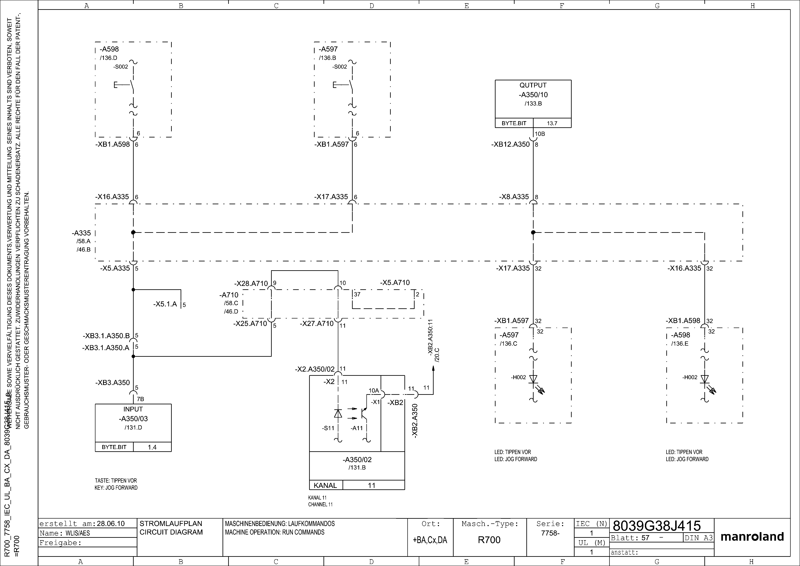

# +BA_Cx_DA — Sheet 57 of 247 — MASCHINENBEDIENUNG: LAUFKOMMANDOS

**MACHINE OPERATION: RUN COMMANDS**

> Part of the manroland **R700** printing press IEC/UL circuit diagrams.
> Drawing class: **Stromlaufplan / Circuit diagram** (DIN A3).
> Document `+BA_Cx_DA` covers the **Printing units / main switch cabinet** machine section.

## At a glance

| Field | Value |
|---|---|
| Document | `+BA_Cx_DA`  (8039G38J415) |
| Sheet | **57** of 247 |
| Section (DE) | MASCHINENBEDIENUNG: LAUFKOMMANDOS |
| Section (EN) | MACHINE OPERATION: RUN COMMANDS |
| Section type | CIRCUIT — Circuit diagram |
| Machine type | `R700` |
| Series | `7758` |
| Created | 28.06.10 |
| Replaces | — |
| Columns used | A, B, C, D, E, F, G, H |
| Path numbers | — |
| Labels on sheet | 100 |
| Cross-refs out | 12 |
| Cross-refs in | 35 |

**Previous:** [+BA_Cx_DA sheet 56](SHEET_0056.md) · **Next:** [+BA_Cx_DA sheet 58](SHEET_0058.md) · **Document TOC:** [_TOC.md](_TOC.md)  (+BA_Cx_DA) · **Master TOC:** [all sheets](../_MASTER_TOC.md)

## Sheet image (300 DPI, exact vector render)



_Rendered directly from the PDF vector layer at 300 DPI (1-bit), no OCR and no resampling. Use it to confirm anything ambiguous in the text below._

## Cross-references on this sheet

Each entry is a wire leaving this sheet. The printed token is `/sheet.column`; the link resolves to that sheet inside the same document.

| Ref | Target sheet | Col | Path | Destination on target | Target section | From col |
|---|---|---|---|---|---|---|
| `/136.D` | [+BA_Cx_DA sheet 136](SHEET_0136.md) | D | — | A598 | REFERENZMODUL | A |
| `/136.B` | [+BA_Cx_DA sheet 136](SHEET_0136.md) | B | — | A597 | REFERENZMODUL | D |
| `/133.B` | [+BA_Cx_DA sheet 133](SHEET_0133.md) | B | — | — | REFERENZMODUL | F |
| `/58.A` | [+BA_Cx_DA sheet 58](SHEET_0058.md) | A | — | — | MASCHINENBEDIENUNG: LAUFKOMMANDOS | A |
| `/46.B` | [+BA_Cx_DA sheet 46](SHEET_0046.md) | B | — | — | SCHUTZEINRICHTUNGEN | A |
| `/58.C` | [+BA_Cx_DA sheet 58](SHEET_0058.md) | C | — | — | MASCHINENBEDIENUNG: LAUFKOMMANDOS | C |
| `/46.D` | [+BA_Cx_DA sheet 46](SHEET_0046.md) | D | — | — | SCHUTZEINRICHTUNGEN | C |
| `/20.C` | [+BA_Cx_DA sheet 20](SHEET_0020.md) | C | — | XB2.A350:11 | BUSVERBINDUNGEN: SICHERHEITSBUS | E |
| `/136.C` | [+BA_Cx_DA sheet 136](SHEET_0136.md) | C | — | A597 | REFERENZMODUL | E |
| `/136.E` | [+BA_Cx_DA sheet 136](SHEET_0136.md) | E | — | A598 | REFERENZMODUL | G |
| `/131.D` | [+BA_Cx_DA sheet 131](SHEET_0131.md) | D | — | — | REFERENZMODUL | A |
| `/131.B` | [+BA_Cx_DA sheet 131](SHEET_0131.md) | B | — | — | REFERENZMODUL | D |

### Incoming references (sheets that point here)

Every other sheet that sends a wire to this one. `Back-ref` is the token printed on *that* sheet; `Path` is its line number.

| From sheet | Cols | Back-ref | Path | Refs | What continues there |
|---|---|---|---|---|---|
| [+BA_Cx_DA#20](SHEET_0020.md) | C | `/20.C` | — | 1 | XB2.A350:11 |
| [+BA_Cx_DA#46](SHEET_0046.md) | A, C | `/46.A`, `/46.C` | — | 2 | — |
| [+BA_Cx_DA#58](SHEET_0058.md) | A, C | `/58.A`, `/58.C` | — | 2 | — |
| [+BA_Cx_DA#131](SHEET_0131.md) | B, D | `/131.B`, `/131.D` | — | 2 | — |
| [+BA_Cx_DA#133](SHEET_0133.md) | B | `/133.B` | — | 1 | — |
| [+BA_Cx_DA#136](SHEET_0136.md) | B, C, D, E | `/136.B`, `/136.C`, `/136.D`, `/136.E` | — | 4 | — |
| [+BA_Cx_DA#143](SHEET_0143.md) | B, C, D, E | `/143.B`, `/143.C`, `/143.D`, `/143.E` | — | 4 | — |
| [+BA_Cx_DA#153](SHEET_0153.md) | F | `/153.F` | — | 2 | — |
| [+BA_Cx_DA#157](SHEET_0157.md) | C, D, F | `/157.C`, `/157.D`, `/157.F` | — | 3 | — |
| [+BA_Cx_DA#160](SHEET_0160.md) | C | `/160.C` | — | 1 | — |
| [+BA_Cx_DA#161](SHEET_0161.md) | A, H | `/161.A`, `/161.H` | — | 2 | — |
| [+BA_Cx_DA#165](SHEET_0165.md) | E | `/165.E` | — | 1 | — |
| [+BA_Cx_DA#169](SHEET_0169.md) | G | `/169.G` | — | 1 | — |
| [+BA_Cx_DA#172](SHEET_0172.md) | B, C | `/172.B`, `/172.C` | — | 2 | — |
| [+BA_Cx_DA#173](SHEET_0173.md) | B, C | `/173.B`, `/173.C` | — | 2 | — |
| [+BA_Cx_DA#175](SHEET_0175.md) | H | `/175.H` | — | 1 | — |
| [+BA_Cx_DA#177](SHEET_0177.md) | E | `/177.E` | — | 1 | — |
| [+BA_Cx_DA#178](SHEET_0178.md) | G, H | `/178.G`, `/178.H` | — | 3 | — |


## Devices on this sheet

| Tag | Class | Class meaning (IEC) | Col | Sub | Terminal | Sign |
|---|---|---|---|---|---|---|
| `A598` | A | Baugruppe / assembly, module, PC board | G | — | — | — |
| `S002` | S | Schalter / switch | A | — | — | — |
| `A598` | A | Baugruppe / assembly, module, PC board | A | — | — | — |
| `A335` | A | Baugruppe / assembly, module, PC board | A | — | — | — |
| `S002` | S | Schalter / switch | D | — | — | — |
| `A597` | A | Baugruppe / assembly, module, PC board | D | — | — | — |
| `A350/10` | A | Baugruppe / assembly, module, PC board | F | 10 | — | — |
| `A597` | A | Baugruppe / assembly, module, PC board | E | — | — | — |
| `A350/03` | A | Baugruppe / assembly, module, PC board | A | 03 | — | — |
| `A710` | A | Baugruppe / assembly, module, PC board | C | — | — | — |
| `S11` | S | Schalter / switch | D | — | — | — |
| `A11` | A | Baugruppe / assembly, module, PC board | D | — | — | — |
| `X1` | X | Klemme / terminal, plug connector | D | — | — | — |
| `X2` | X | Klemme / terminal, plug connector | D | — | — | — |
| `XB2` | XB |  | D | — | — | — |
| `A350/02` | A | Baugruppe / assembly, module, PC board | D | 02 | — | — |
| `XB1.A598` | — | cross-device reference | G | — | — | — |
| `X16.A335` | — | cross-device reference | G | — | — | — |
| `XB1.A598` | — | cross-device reference | A | — | — | — |
| `X16.A335` | — | cross-device reference | A | — | — | — |
| `X5.A335` | — | cross-device reference | A | — | — | — |
| `XB1.A597` | — | cross-device reference | D | — | — | — |
| `XB12.A350` | — | cross-device reference | E | — | — | — |
| `13.7` | — | cross-device reference | F | — | — | — |
| `XB1.A597` | — | cross-device reference | E | — | — | — |
| `X8.A335` | — | cross-device reference | E | — | — | — |
| `X17.A335` | — | cross-device reference | E | — | — | — |
| `X17.A335` | — | cross-device reference | D | — | — | — |
| `1.4` | — | cross-device reference | B | — | — | — |
| `XB3.A350` | — | cross-device reference | A | — | — | — |
| `XB3.1.A350.B` | — | cross-device reference | A | — | — | — |
| `XB3.1.A350.A` | — | cross-device reference | A | — | — | — |
| `X27.A710` | — | cross-device reference | C | — | — | — |
| `X28.A710` | — | cross-device reference | C | — | — | — |
| `X25.A710` | — | cross-device reference | C | — | — | — |
| `XB2.A350` | — | cross-device reference | D | — | — | — |
| `X5.1.A` | — | cross-device reference | B | — | — | — |
| `XB2.A350:11` | — | cross-device reference | E | — | 11 | — |
| `X5.A710` | — | cross-device reference | D | — | — | — |

## Potentials / nets

| Potential | Count | Columns | Attached devices | Terminals |
|---|---|---|---|---|
| `H002` | 2 | F, G | — | — |


A potential such as `L24+/4` or `M24+` is a named supply/return rail; every place it appears on this sheet is electrically common.

## Wire-end annotations (grouped as printed)

A wire that continues elsewhere is annotated with a small cluster: the destination description, the path/line number `#NN`, and the `/sheet.column` cross reference. Each row below is one such cluster exactly as it is grouped on the drawing.

| Col | Y | Path | Cross-ref | Text on the wire |
|---|---|---|---|---|
| A | 68.3 | — | `/136.D` | `A598` |
| D | 68.3 | — | `/136.B` | `A597` |
| A | 95.7 | — | — | `S002` |
| D | 95.7 | — | — | `S002` |
| F | 122.5 | — | — | `QUTPUT` |
| F | 136.4 | — | — | `A350/10` |
| F | 150.2 | — | `/133.B` | — |
| F | 179.8 | — | — | `BYTE.BIT 13.7` |
| B | 194.5 | — | — | `6` |
| D | 194.5 | — | — | `6` |
| F | 195.2 | — | — | `10B` |
| A | 210.1 | — | — | `XB1.A598 6` |
| E | 210.1 | — | — | `XB1.A597 6 XB12.A350 8` |
| A | 288.0 | — | — | `X16.A335 6` |
| D | 288.0 | — | — | `X17.A335 6` |
| F | 288.0 | — | — | `X8.A335 8` |
| A | 341.9 | — | — | `A335` |
| A | 354.9 | — | `/58.A`, `/46.B` | — |
| A | 394.3 | — | — | `X5.A335 5` |
| F | 394.3 | — | — | `X17.A335 32` |
| G | 394.3 | — | — | `X16.A335 32` |
| D | 415.6 | — | — | `X5.A710` |
| C | 417.0 | — | — | `X28.A710 9` |
| D | 417.0 | — | — | `10` |
| C | 434.0 | — | — | `A710` |
| D | 434.0 | — | — | `37 2` |
| C | 447.1 | — | `/58.C`, `/46.D` | — |
| B | 447.5 | — | — | `X5.1.A 5` |
| F | 472.3 | — | — | `XB1.A597 32` |
| G | 472.3 | — | — | `XB1.A598 32` |
| E | 474.2 | — | `/20.C` | `XB2.A350:11` |
| C | 476.5 | — | — | `X25.A710 5` |
| C | 476.5 | — | — | `X27.A710 11` |
| F | 489.3 | — | — | `32` |
| H | 489.3 | — | — | `32` |
| E | 493.5 | — | `/136.C` | `A597` |
| G | 493.5 | — | `/136.E` | `A598` |
| A | 495.0 | — | — | `XB3.1.A350.B 5` |
| A | 512.0 | — | — | `XB3.1.A350.A 5` |
| C | 544.6 | — | — | `X2.A350/02 11` |
| F | 557.7 | — | — | `H002` |
| G | 557.7 | — | — | `H002` |
| D | 563.0 | — | — | `X2` |
| A | 564.4 | — | — | `XB3.A350 5` |
| D | 564.4 | — | — | `11 11` |
| E | 572.9 | — | — | `11` |
| D | 577.1 | — | — | `10A` |
| B | 589.9 | — | — | `7B` |
| D | 594.1 | — | — | `X1` |
| D | 594.2 | — | — | `XB2` |
| D | 600.4 | — | — | `XB2.A350` |
| A | 604.4 | — | — | `INPUT` |
| A | 618.3 | — | — | `A350/03` |
| A | 632.1 | — | `/131.D` | — |
| D | 633.1 | — | — | `S11 A11` |
| A | 661.1 | — | — | `BYTE.BIT 1.4` |
| F | 669.6 | — | — | `LED: TIPPEN VOR LED: JOG FORWARD` |
| G | 669.6 | — | — | `LED: TIPPEN VOR LED: JOG FORWARD` |
| D | 679.2 | — | — | `A350/02` |
| D | 691.6 | — | `/131.B` | — |
| A | 712.1 | — | — | `KEY: JOG FORWARD TASTE: TIPPEN VOR` |
| D | 717.4 | — | — | `KANAL 11` |
| C | 737.8 | — | — | `KANAL 11 CHANNEL 11` |


## Reconstructed tables

This sheet carries tabular content (pin map / terminal assignment / index). The grid below was rebuilt from the drawing's own rule lines, so each row is exactly one physical row of the table.

### Table 1 — 6 data rows × 2 columns (at x=141.7, y=62.4)

| A598 /136.D S002 | 6 |
|---|---|
| `XB1.A598 X16.A335` | `6 6` |
| `X5.A335` | `5` |
| `XB3.1.A350.B XB3.1.A350.A` | `X5.1.A 5 5` |
| `XB3.A350` | `5 7B` |
| `INPUT` | `A350/03 /131.D` |
| `BYTE.BIT` | `1.4` |


### Table 2 — 2 data rows × 1 columns (at x=403.9, y=62.4)

| C1 |
|---|
| `9` |
| `5` |


### Table 3 — 9 data rows × 4 columns (at x=467.7, y=62.4)

| A597 /136.B | S002 |  |  |
|---|---|---|---|
|  |  | `6` |  |
| `XB1.A597 X17.A335` |  | `6 6` |  |
|  | `10` | `37` |  |
| `X27.A710` | `11` |  |  |
| `X2.A350/02` | `11` |  |  |
| `X2` | `11` |  | `10A X1` |
| `S11` |  | `A11` |  |
|  |  | `A350/02 /131.B` |  |
| `KANAL` |  |  | `11` |


### Table 4 — 9 data rows × 5 columns (at x=581.1, y=62.4)

|  |  |  | QUTPUT | A350/10 /133.B |
|---|---|---|---|---|
|  |  |  | `BYTE.BIT` | `13.7` |
|  |  |  |  | `10B` |
|  |  |  | `XB12.A350 X8.A335` | `8 8` |
|  |  |  | `X17.A335` | `32` |
| `X5.A710` | `2` |  |  |  |
|  |  |  | `XB1.A597` | `32` |
|  | `XB2.A350:11` | `/20.C` | `A597 /136.C` | `32` |
| `XB2` | `11 11 XB2.A350` |  | `H002` |  |
|  |  |  | `LED: TIPPEN VOR LED: JOG FORWARD` |  |


### Table 5 — 1 data rows × 2 columns (at x=992.1, y=345.8)

| X16.A335 XB1.A598 | 32 32 |
|---|---|
| `A598 /136.E H002` | `32` |


## Notes and free text on this sheet

| Text | Col | Y (pt) |
|---|---|---|
| `LED: TIPPEN VOR` | G | 669.58 |
| `LED: JOG FORWARD` | G | 680.21 |
| `10B` | F | 195.17 |
| `QUTPUT` | F | 122.5 |
| `BYTE.BIT` | E | 179.78 |
| `LED: TIPPEN VOR` | E | 669.58 |
| `LED: JOG FORWARD` | F | 680.21 |
| `7B` | B | 589.88 |
| `INPUT` | A | 604.42 |
| `BYTE.BIT` | A | 661.67 |
| `TASTE: TIPPEN VOR` | A | 712.1 |
| `KEY: JOG FORWARD` | A | 722.72 |
| `KANAL 11` | C | 737.76 |
| `CHANNEL 11` | C | 747.71 |
| `10A` | D | 577.14 |
| `KANAL` | D | 717.46 |
| `X2.A350/02` | C | 544.56 |

## Complete label inventory (exact text from the drawing)

Every text object inside the drawing area of this sheet, in DIN reading order (column A→H, then top→bottom). This is the authoritative list: if a string is not here it is not printed on this sheet.

| Col | Y | X | Dir | Type | Text |
|---|---|---|---|---|---|
| A | 68.3 | 148.5 | → | device tag | `A598` |
| A | 82.1 | 148.8 | → | cross-reference | `/136.D` |
| A | 95.7 | 168.7 | → | device tag | `S002` |
| A | 210.1 | 142.0 | → | device ref | `XB1.A598` |
| A | 288.0 | 141.7 | → | device ref | `X16.A335` |
| A | 341.9 | 106.9 | → | device tag | `A335` |
| A | 354.9 | 114.0 | → | cross-reference | `/58.A` |
| A | 367.3 | 114.2 | → | cross-reference | `/46.B` |
| A | 394.3 | 149.1 | → | device ref | `X5.A335` |
| A | 495.0 | 123.3 | → | device ref | `XB3.1.A350.B` |
| A | 512.7 | 122.5 | → | device ref | `XB3.1.A350.A` |
| A | 564.4 | 142.0 | → | device ref | `XB3.A350` |
| A | 604.4 | 183.5 | → | text | `INPUT` |
| A | 618.3 | 177.0 | → | device tag | `A350/03` |
| A | 632.1 | 185.7 | → | cross-reference | `/131.D` |
| A | 661.7 | 151.7 | → | text | `BYTE.BIT` |
| A | 712.1 | 141.4 | → | text | `TASTE: TIPPEN VOR` |
| A | 722.7 | 140.9 | → | text | `KEY: JOG FORWARD` |
| B | 194.5 | 203.8 | → | number | `6` |
| B | 211.5 | 201.0 | → | number | `6` |
| B | 289.5 | 201.0 | → | number | `6` |
| B | 395.8 | 201.0 | → | number | `5` |
| B | 447.5 | 228.2 | → | device ref | `X5.1.A` |
| B | 449.6 | 271.8 | → | number | `5` |
| B | 495.0 | 201.0 | → | number | `5` |
| B | 512.0 | 201.0 | → | number | `5` |
| B | 572.9 | 201.0 | → | number | `5` |
| B | 589.9 | 203.8 | → | text | `7B` |
| B | 661.1 | 219.7 | → | device ref | `1.4` |
| C | 417.0 | 348.7 | → | device ref | `X28.A710` |
| C | 417.0 | 406.5 | → | number | `9` |
| C | 434.0 | 326.6 | → | device tag | `A710` |
| C | 447.1 | 333.6 | → | cross-reference | `/58.C` |
| C | 459.5 | 333.6 | → | cross-reference | `/46.D` |
| C | 476.5 | 347.2 | → | device ref | `X25.A710` |
| C | 476.5 | 446.5 | → | device ref | `X27.A710` |
| C | 480.8 | 406.5 | → | number | `5` |
| C | 544.6 | 439.1 | → | text | `X2.A350/02` |
| C | 737.8 | 458.6 | → | text | `KANAL 11` |
| C | 747.7 | 458.9 | → | text | `CHANNEL 11` |
| D | 68.3 | 474.5 | → | device tag | `A597` |
| D | 82.1 | 474.8 | → | cross-reference | `/136.B` |
| D | 95.7 | 494.6 | → | device tag | `S002` |
| D | 194.5 | 529.8 | → | number | `6` |
| D | 210.1 | 468.0 | → | device ref | `XB1.A597` |
| D | 211.5 | 527.0 | → | number | `6` |
| D | 288.0 | 467.7 | → | device ref | `X17.A335` |
| D | 289.5 | 527.0 | → | number | `6` |
| D | 415.6 | 565.8 | → | device ref | `X5.A710` |
| D | 417.0 | 505.1 | → | number | `10` |
| D | 434.0 | 527.0 | → | number | `37` |
| D | 434.0 | 619.1 | → | number | `2` |
| D | 480.8 | 505.1 | → | number | `11` |
| D | 544.6 | 505.1 | → | number | `11` |
| D | 563.0 | 481.6 | → | device tag | `X2` |
| D | 564.4 | 508.0 | → | number | `11` |
| D | 574.3 | 607.2 | → | number | `11` |
| D | 577.1 | 548.5 | → | text | `10A` |
| D | 594.2 | 552.2 | → | device tag | `X1` |
| D | 594.2 | 576.6 | → | device tag | `XB2` |
| D | 600.4 | 612.6 | ↕ | device ref | `XB2.A350` |
| D | 633.1 | 479.3 | → | device tag | `S11` |
| D | 633.1 | 521.9 | → | device tag | `A11` |
| D | 679.2 | 510.1 | → | device tag | `A350/02` |
| D | 691.6 | 518.9 | → | cross-reference | `/131.B` |
| D | 717.4 | 547.2 | → | number | `11` |
| D | 717.5 | 466.9 | → | text | `KANAL` |
| E | 179.8 | 746.9 | → | text | `BYTE.BIT` |
| E | 210.1 | 731.3 | → | device ref | `XB12.A350` |
| E | 288.0 | 743.0 | → | device ref | `X8.A335` |
| E | 394.3 | 738.4 | → | device ref | `X17.A335` |
| E | 472.3 | 735.9 | → | device ref | `XB1.A597` |
| E | 474.2 | 636.7 | ↕ | device ref | `XB2.A350:11` |
| E | 493.5 | 743.8 | → | device tag | `A597` |
| E | 507.3 | 744.1 | → | cross-reference | `/136.C` |
| E | 517.6 | 646.6 | ↕ | cross-reference | `/20.C` |
| E | 572.9 | 629.9 | → | number | `11` |
| E | 669.6 | 736.2 | → | text | `LED: TIPPEN VOR` |
| F | 122.5 | 773.4 | → | text | `QUTPUT` |
| F | 136.4 | 772.3 | → | device tag | `A350/10` |
| F | 150.1 | 781.1 | → | cross-reference | `/133.B` |
| F | 179.8 | 813.8 | → | device ref | `13.7` |
| F | 195.2 | 795.7 | → | text | `10B` |
| F | 211.5 | 796.3 | → | number | `8` |
| F | 289.5 | 796.3 | → | number | `8` |
| F | 395.8 | 796.3 | → | number | `32` |
| F | 473.7 | 796.3 | → | number | `32` |
| F | 489.3 | 799.1 | → | number | `32` |
| F | 557.7 | 760.5 | → | potential | `H002` |
| F | 680.2 | 736.2 | → | text | `LED: JOG FORWARD` |
| G | 394.3 | 993.5 | → | device ref | `X16.A335` |
| G | 472.3 | 991.0 | → | device ref | `XB1.A598` |
| G | 493.5 | 998.9 | → | device tag | `A598` |
| G | 507.3 | 999.2 | → | cross-reference | `/136.E` |
| G | 557.7 | 1015.7 | → | potential | `H002` |
| G | 669.6 | 991.3 | → | text | `LED: TIPPEN VOR` |
| G | 680.2 | 991.3 | → | text | `LED: JOG FORWARD` |
| H | 395.8 | 1051.4 | → | number | `32` |
| H | 473.7 | 1051.4 | → | number | `32` |
| H | 489.3 | 1054.2 | → | number | `32` |

## Reading-order text block

The same content as a plain block, grouped by DIN column — convenient to paste or to match against a visual description.

```text
=== Column A ===
  68.3  148.5  devtag       A598
  82.1  148.8  xref         /136.D
  95.7  168.7  devtag       S002
 210.1  142.0  devref       XB1.A598
 288.0  141.7  devref       X16.A335
 341.9  106.9  devtag       A335
 354.9  114.0  xref         /58.A
 367.3  114.2  xref         /46.B
 394.3  149.1  devref       X5.A335
 495.0  123.3  devref       XB3.1.A350.B
 512.7  122.5  devref       XB3.1.A350.A
 564.4  142.0  devref       XB3.A350
 604.4  183.5  text         INPUT
 618.3  177.0  devtag       A350/03
 632.1  185.7  xref         /131.D
 661.7  151.7  text         BYTE.BIT
 712.1  141.4  text         TASTE: TIPPEN VOR
 722.7  140.9  text         KEY: JOG FORWARD
=== Column B ===
 194.5  203.8  numeric      6
 211.5  201.0  numeric      6
 289.5  201.0  numeric      6
 395.8  201.0  numeric      5
 447.5  228.2  devref       X5.1.A
 449.6  271.8  numeric      5
 495.0  201.0  numeric      5
 512.0  201.0  numeric      5
 572.9  201.0  numeric      5
 589.9  203.8  text         7B
 661.1  219.7  devref       1.4
=== Column C ===
 417.0  348.7  devref       X28.A710
 417.0  406.5  numeric      9
 434.0  326.6  devtag       A710
 447.1  333.6  xref         /58.C
 459.5  333.6  xref         /46.D
 476.5  347.2  devref       X25.A710
 476.5  446.5  devref       X27.A710
 480.8  406.5  numeric      5
 544.6  439.1  text         X2.A350/02
 737.8  458.6  text         KANAL 11
 747.7  458.9  text         CHANNEL 11
=== Column D ===
  68.3  474.5  devtag       A597
  82.1  474.8  xref         /136.B
  95.7  494.6  devtag       S002
 194.5  529.8  numeric      6
 210.1  468.0  devref       XB1.A597
 211.5  527.0  numeric      6
 288.0  467.7  devref       X17.A335
 289.5  527.0  numeric      6
 415.6  565.8  devref       X5.A710
 417.0  505.1  numeric      10
 434.0  527.0  numeric      37
 434.0  619.1  numeric      2
 480.8  505.1  numeric      11
 544.6  505.1  numeric      11
 563.0  481.6  devtag       X2
 564.4  508.0  numeric      11
 574.3  607.2  numeric      11
 577.1  548.5  text         10A
 594.2  552.2  devtag       X1
 594.2  576.6  devtag       XB2
 600.4  612.6  devref       XB2.A350
 633.1  479.3  devtag       S11
 633.1  521.9  devtag       A11
 679.2  510.1  devtag       A350/02
 691.6  518.9  xref         /131.B
 717.4  547.2  numeric      11
 717.5  466.9  text         KANAL
=== Column E ===
 179.8  746.9  text         BYTE.BIT
 210.1  731.3  devref       XB12.A350
 288.0  743.0  devref       X8.A335
 394.3  738.4  devref       X17.A335
 472.3  735.9  devref       XB1.A597
 474.2  636.7  devref       XB2.A350:11
 493.5  743.8  devtag       A597
 507.3  744.1  xref         /136.C
 517.6  646.6  xref         /20.C
 572.9  629.9  numeric      11
 669.6  736.2  text         LED: TIPPEN VOR
=== Column F ===
 122.5  773.4  text         QUTPUT
 136.4  772.3  devtag       A350/10
 150.1  781.1  xref         /133.B
 179.8  813.8  devref       13.7
 195.2  795.7  text         10B
 211.5  796.3  numeric      8
 289.5  796.3  numeric      8
 395.8  796.3  numeric      32
 473.7  796.3  numeric      32
 489.3  799.1  numeric      32
 557.7  760.5  net          H002
 680.2  736.2  text         LED: JOG FORWARD
=== Column G ===
 394.3  993.5  devref       X16.A335
 472.3  991.0  devref       XB1.A598
 493.5  998.9  devtag       A598
 507.3  999.2  xref         /136.E
 557.7 1015.7  net          H002
 669.6  991.3  text         LED: TIPPEN VOR
 680.2  991.3  text         LED: JOG FORWARD
=== Column H ===
 395.8 1051.4  numeric      32
 473.7 1051.4  numeric      32
 489.3 1054.2  numeric      32
```

---
_Generated from the PDF vector text layer; no OCR. Source: `R700_7758_IEC_UL_BA_CX_DA_8039G38J415_p`, sheet 57._
