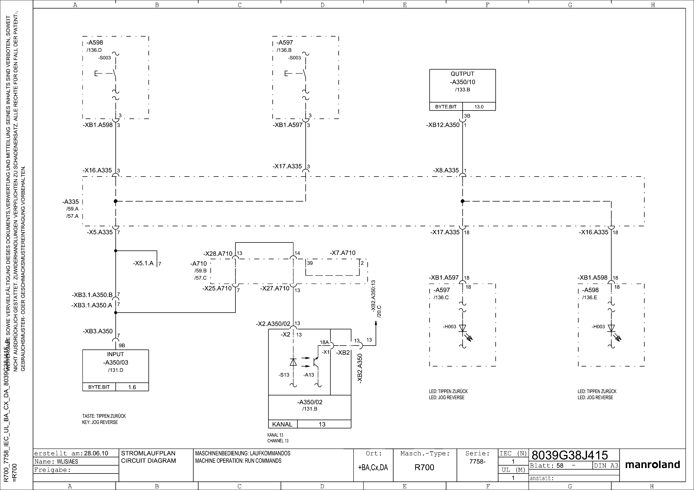

# +BA_Cx_DA — Sheet 58 of 247 — MASCHINENBEDIENUNG: LAUFKOMMANDOS

**MACHINE OPERATION: RUN COMMANDS**

> Part of the manroland **R700** printing press IEC/UL circuit diagrams.
> Drawing class: **Stromlaufplan / Circuit diagram** (DIN A3).
> Document `+BA_Cx_DA` covers the **Printing units / main switch cabinet** machine section.

## At a glance

| Field | Value |
|---|---|
| Document | `+BA_Cx_DA`  (8039G38J415) |
| Sheet | **58** of 247 |
| Section (DE) | MASCHINENBEDIENUNG: LAUFKOMMANDOS |
| Section (EN) | MACHINE OPERATION: RUN COMMANDS |
| Section type | CIRCUIT — Circuit diagram |
| Machine type | `R700` |
| Series | `7758` |
| Created | 28.06.10 |
| Replaces | — |
| Columns used | A, B, C, D, E, F, G, H |
| Path numbers | — |
| Labels on sheet | 100 |
| Cross-refs out | 12 |
| Cross-refs in | 33 |

**Previous:** [+BA_Cx_DA sheet 57](SHEET_0057.md) · **Next:** [+BA_Cx_DA sheet 59](SHEET_0059.md) · **Document TOC:** [_TOC.md](_TOC.md)  (+BA_Cx_DA) · **Master TOC:** [all sheets](../_MASTER_TOC.md)

## Sheet image (300 DPI, exact vector render)



_Rendered directly from the PDF vector layer at 300 DPI (1-bit), no OCR and no resampling. Use it to confirm anything ambiguous in the text below._

## Cross-references on this sheet

Each entry is a wire leaving this sheet. The printed token is `/sheet.column`; the link resolves to that sheet inside the same document.

| Ref | Target sheet | Col | Path | Destination on target | Target section | From col |
|---|---|---|---|---|---|---|
| `/136.D` | [+BA_Cx_DA sheet 136](SHEET_0136.md) | D | — | A598 | REFERENZMODUL | A |
| `/136.B` | [+BA_Cx_DA sheet 136](SHEET_0136.md) | B | — | A597 | REFERENZMODUL | D |
| `/133.B` | [+BA_Cx_DA sheet 133](SHEET_0133.md) | B | — | — | REFERENZMODUL | F |
| `/59.A` | [+BA_Cx_DA sheet 59](SHEET_0059.md) | A | — | — | MASCHINENBEDIENUNG: LAUFKOMMANDOS | A |
| `/57.A` | [+BA_Cx_DA sheet 57](SHEET_0057.md) | A | — | — | MASCHINENBEDIENUNG: LAUFKOMMANDOS | A |
| `/59.B` | [+BA_Cx_DA sheet 59](SHEET_0059.md) | B | — | — | MASCHINENBEDIENUNG: LAUFKOMMANDOS | C |
| `/57.C` | [+BA_Cx_DA sheet 57](SHEET_0057.md) | C | — | — | MASCHINENBEDIENUNG: LAUFKOMMANDOS | C |
| `/20.C` | [+BA_Cx_DA sheet 20](SHEET_0020.md) | C | — | XB2.A350:13 | BUSVERBINDUNGEN: SICHERHEITSBUS | E |
| `/136.C` | [+BA_Cx_DA sheet 136](SHEET_0136.md) | C | — | A597 | REFERENZMODUL | E |
| `/136.E` | [+BA_Cx_DA sheet 136](SHEET_0136.md) | E | — | A598 | REFERENZMODUL | G |
| `/131.D` | [+BA_Cx_DA sheet 131](SHEET_0131.md) | D | — | — | REFERENZMODUL | A |
| `/131.B` | [+BA_Cx_DA sheet 131](SHEET_0131.md) | B | — | — | REFERENZMODUL | D |

### Incoming references (sheets that point here)

Every other sheet that sends a wire to this one. `Back-ref` is the token printed on *that* sheet; `Path` is its line number.

| From sheet | Cols | Back-ref | Path | Refs | What continues there |
|---|---|---|---|---|---|
| [+BA_Cx_DA#20](SHEET_0020.md) | C | `/20.C` | — | 1 | XB2.A350:13 |
| [+BA_Cx_DA#57](SHEET_0057.md) | A, C | `/57.A`, `/57.C` | — | 2 | — |
| [+BA_Cx_DA#59](SHEET_0059.md) | A, B | `/59.A`, `/59.B` | — | 2 | — |
| [+BA_Cx_DA#131](SHEET_0131.md) | B, D | `/131.B`, `/131.D` | — | 2 | — |
| [+BA_Cx_DA#133](SHEET_0133.md) | B | `/133.B` | — | 1 | — |
| [+BA_Cx_DA#136](SHEET_0136.md) | B, C, D, E | `/136.B`, `/136.C`, `/136.D`, `/136.E` | — | 4 | — |
| [+BA_Cx_DA#143](SHEET_0143.md) | B, D | `/143.B`, `/143.D` | — | 4 | — |
| [+BA_Cx_DA#153](SHEET_0153.md) | F | `/153.F` | — | 2 | — |
| [+BA_Cx_DA#157](SHEET_0157.md) | C, D, F | `/157.C`, `/157.D`, `/157.F` | — | 3 | — |
| [+BA_Cx_DA#160](SHEET_0160.md) | C | `/160.C` | — | 1 | — |
| [+BA_Cx_DA#161](SHEET_0161.md) | A | `/161.A` | — | 1 | — |
| [+BA_Cx_DA#165](SHEET_0165.md) | E | `/165.E` | — | 1 | — |
| [+BA_Cx_DA#169](SHEET_0169.md) | G | `/169.G` | — | 1 | — |
| [+BA_Cx_DA#172](SHEET_0172.md) | B | `/172.B` | — | 2 | — |
| [+BA_Cx_DA#173](SHEET_0173.md) | B | `/173.B` | — | 2 | — |
| [+BA_Cx_DA#175](SHEET_0175.md) | H | `/175.H` | — | 1 | — |
| [+BA_Cx_DA#177](SHEET_0177.md) | E | `/177.E` | — | 1 | — |
| [+BA_Cx_DA#178](SHEET_0178.md) | G | `/178.G` | — | 2 | — |


## Devices on this sheet

| Tag | Class | Class meaning (IEC) | Col | Sub | Terminal | Sign |
|---|---|---|---|---|---|---|
| `A598` | A | Baugruppe / assembly, module, PC board | G | — | — | — |
| `A335` | A | Baugruppe / assembly, module, PC board | A | — | — | — |
| `S003` | S | Schalter / switch | A | — | — | — |
| `A598` | A | Baugruppe / assembly, module, PC board | A | — | — | — |
| `S003` | S | Schalter / switch | D | — | — | — |
| `A597` | A | Baugruppe / assembly, module, PC board | D | — | — | — |
| `A597` | A | Baugruppe / assembly, module, PC board | E | — | — | — |
| `A350/10` | A | Baugruppe / assembly, module, PC board | F | 10 | — | — |
| `A350/03` | A | Baugruppe / assembly, module, PC board | A | 03 | — | — |
| `A710` | A | Baugruppe / assembly, module, PC board | C | — | — | — |
| `S13` | S | Schalter / switch | D | — | — | — |
| `A13` | A | Baugruppe / assembly, module, PC board | D | — | — | — |
| `X1` | X | Klemme / terminal, plug connector | D | — | — | — |
| `X2` | X | Klemme / terminal, plug connector | D | — | — | — |
| `XB2` | XB |  | D | — | — | — |
| `A350/02` | A | Baugruppe / assembly, module, PC board | D | 02 | — | — |
| `X16.A335` | — | cross-device reference | G | — | — | — |
| `XB1.A598` | — | cross-device reference | G | — | — | — |
| `X16.A335` | — | cross-device reference | A | — | — | — |
| `X5.A335` | — | cross-device reference | A | — | — | — |
| `XB1.A598` | — | cross-device reference | A | — | — | — |
| `XB1.A597` | — | cross-device reference | D | — | — | — |
| `X17.A335` | — | cross-device reference | E | — | — | — |
| `XB1.A597` | — | cross-device reference | E | — | — | — |
| `X8.A335` | — | cross-device reference | E | — | — | — |
| `XB12.A350` | — | cross-device reference | E | — | — | — |
| `13.0` | — | cross-device reference | F | — | — | — |
| `X17.A335` | — | cross-device reference | D | — | — | — |
| `1.6` | — | cross-device reference | B | — | — | — |
| `XB3.A350` | — | cross-device reference | A | — | — | — |
| `XB3.1.A350.B` | — | cross-device reference | A | — | — | — |
| `XB3.1.A350.A` | — | cross-device reference | A | — | — | — |
| `X5.1.A` | — | cross-device reference | B | — | — | — |
| `X27.A710` | — | cross-device reference | C | — | — | — |
| `X28.A710` | — | cross-device reference | C | — | — | — |
| `X25.A710` | — | cross-device reference | C | — | — | — |
| `XB2.A350` | — | cross-device reference | D | — | — | — |
| `XB2.A350:13` | — | cross-device reference | E | — | 13 | — |
| `X7.A710` | — | cross-device reference | D | — | — | — |

## Potentials / nets

| Potential | Count | Columns | Attached devices | Terminals |
|---|---|---|---|---|
| `H003` | 2 | F, G | — | — |


A potential such as `L24+/4` or `M24+` is a named supply/return rail; every place it appears on this sheet is electrically common.

## Wire-end annotations (grouped as printed)

A wire that continues elsewhere is annotated with a small cluster: the destination description, the path/line number `#NN`, and the `/sheet.column` cross reference. Each row below is one such cluster exactly as it is grouped on the drawing.

| Col | Y | Path | Cross-ref | Text on the wire |
|---|---|---|---|---|
| A | 68.3 | — | `/136.D` | `A598` |
| D | 68.3 | — | `/136.B` | `A597` |
| A | 95.7 | — | — | `S003` |
| D | 95.7 | — | — | `S003` |
| F | 122.5 | — | — | `QUTPUT` |
| F | 136.4 | — | — | `A350/10` |
| F | 150.2 | — | `/133.B` | — |
| F | 179.8 | — | — | `BYTE.BIT 13.0` |
| B | 194.5 | — | — | `3` |
| D | 194.5 | — | — | `3` |
| F | 195.2 | — | — | `3B` |
| A | 210.1 | — | — | `XB1.A598 3` |
| D | 210.1 | — | — | `XB1.A597 3` |
| F | 210.1 | — | — | `XB12.A350 1` |
| D | 280.9 | — | — | `X17.A335 3` |
| A | 288.0 | — | — | `X16.A335 3` |
| F | 288.0 | — | — | `X8.A335 1` |
| A | 341.9 | — | — | `A335` |
| A | 354.9 | — | `/59.A`, `/57.A` | — |
| A | 394.3 | — | — | `X5.A335 7` |
| F | 394.3 | — | — | `X17.A335 18` |
| G | 394.3 | — | — | `X16.A335 18` |
| D | 429.8 | — | — | `X7.A710` |
| C | 431.2 | — | — | `X28.A710 13` |
| D | 431.2 | — | — | `14` |
| B | 447.5 | — | — | `X5.1.A 7` |
| C | 448.2 | — | — | `A710` |
| D | 448.2 | — | — | `39 2` |
| C | 461.2 | — | `/59.B`, `/57.C` | — |
| F | 472.3 | — | — | `XB1.A597 18` |
| G | 472.3 | — | — | `XB1.A598 18` |
| E | 481.3 | — | `/20.C` | `XB2.A350:13` |
| F | 489.3 | — | — | `18` |
| H | 489.3 | — | — | `18` |
| C | 490.7 | — | — | `X25.A710 7` |
| C | 490.7 | — | — | `X27.A710 13` |
| E | 493.5 | — | `/136.C` | `A597` |
| G | 493.5 | — | `/136.E` | `A598` |
| A | 502.1 | — | — | `XB3.1.A350.B 7` |
| A | 519.1 | — | — | `XB3.1.A350.A 7` |
| C | 551.6 | — | — | `X2.A350/02 13` |
| F | 557.7 | — | — | `H003` |
| G | 557.7 | — | — | `H003` |
| A | 564.4 | — | — | `XB3.A350 7` |
| D | 570.1 | — | — | `X2` |
| D | 571.5 | — | — | `13 13` |
| E | 580.0 | — | — | `13` |
| D | 584.2 | — | — | `18A` |
| B | 589.9 | — | — | `9B` |
| D | 601.2 | — | — | `X1` |
| D | 601.3 | — | — | `XB2` |
| A | 604.4 | — | — | `INPUT` |
| D | 607.5 | — | — | `XB2.A350` |
| A | 618.3 | — | — | `A350/03` |
| A | 632.1 | — | `/131.D` | — |
| D | 640.2 | — | — | `S13 A13` |
| A | 661.1 | — | — | `BYTE.BIT 1.6` |
| F | 669.6 | — | — | `LED: TIPPEN ZURÜCK LED: JOG REVERSE` |
| G | 669.6 | — | — | `LED: TIPPEN ZURÜCK LED: JOG REVERSE` |
| D | 686.3 | — | — | `A350/02` |
| D | 698.6 | — | `/131.B` | — |
| A | 712.1 | — | — | `KEY: JOG REVERSE TASTE: TIPPEN ZURÜCK` |
| D | 724.5 | — | — | `KANAL 13` |
| C | 744.9 | — | — | `KANAL 13 CHANNEL 13` |


## Reconstructed tables

This sheet carries tabular content (pin map / terminal assignment / index). The grid below was rebuilt from the drawing's own rule lines, so each row is exactly one physical row of the table.

### Table 1 — 6 data rows × 2 columns (at x=141.7, y=62.4)

| A598 /136.D S003 | 3 |
|---|---|
| `XB1.A598 X16.A335` | `3 3` |
| `X5.A335` | `7` |
| `XB3.1.A350.B XB3.1.A350.A` | `X5.1.A 7 7` |
| `XB3.A350` | `7 9B` |
| `INPUT` | `A350/03 /131.D` |
| `BYTE.BIT` | `1.6` |


### Table 2 — 2 data rows × 1 columns (at x=403.9, y=62.4)

| C1 |
|---|
| `13` |
| `7` |


### Table 3 — 9 data rows × 4 columns (at x=467.7, y=62.4)

| A597 /136.B | S003 |  |  |
|---|---|---|---|
|  |  | `3` |  |
| `XB1.A597 X17.A335` |  | `3 3` |  |
|  | `14` | `39` |  |
| `X27.A710` | `13` |  |  |
| `X2.A350/02` | `13` |  |  |
| `X2` | `13` |  | `18A X1` |
| `S13` |  | `A13` |  |
|  |  | `A350/02 /131.B` |  |
| `KANAL` |  |  | `13` |


### Table 4 — 11 data rows × 5 columns (at x=581.1, y=62.4)

|  |  |  | QUTPUT | A350/10 /133.B |
|---|---|---|---|---|
|  |  |  | `BYTE.BIT` | `13.0` |
|  |  |  |  | `3B` |
|  |  |  | `XB12.A350 X8.A335` | `1 1` |
|  |  |  | `X17.A335` | `18` |
| `X7.A710` | `2` |  |  |  |
|  |  |  | `XB1.A597` | `18` |
|  | `XB2.A350:13` | `/20.C` | `A597 /136.C` | `18` |
|  |  |  | `H003` |  |
| `XB2` | `13 13` |  |  |  |
|  | `XB2.A350` |  | `LED: TIPPEN ZURÜCK` |  |
|  |  |  | `LED: JOG REVERSE` |  |


### Table 5 — 1 data rows × 2 columns (at x=992.1, y=345.8)

| X16.A335 XB1.A598 | 18 18 |
|---|---|
| `A598 /136.E H003` | `18` |


## Notes and free text on this sheet

| Text | Col | Y (pt) |
|---|---|---|
| `LED: TIPPEN ZURÜCK` | G | 669.6 |
| `LED: JOG REVERSE` | G | 680.21 |
| `LED: TIPPEN ZURÜCK` | F | 669.6 |
| `LED: JOG REVERSE` | F | 680.21 |
| `3B` | F | 195.15 |
| `QUTPUT` | F | 122.5 |
| `BYTE.BIT` | E | 179.78 |
| `9B` | B | 589.88 |
| `INPUT` | A | 604.42 |
| `BYTE.BIT` | A | 661.67 |
| `TASTE: TIPPEN ZURÜCK` | A | 712.12 |
| `KEY: JOG REVERSE` | A | 722.72 |
| `KANAL 13` | C | 744.88 |
| `CHANNEL 13` | C | 754.82 |
| `18A` | D | 584.22 |
| `KANAL` | D | 724.55 |
| `X2.A350/02` | C | 551.65 |

## Complete label inventory (exact text from the drawing)

Every text object inside the drawing area of this sheet, in DIN reading order (column A→H, then top→bottom). This is the authoritative list: if a string is not here it is not printed on this sheet.

| Col | Y | X | Dir | Type | Text |
|---|---|---|---|---|---|
| A | 68.3 | 148.5 | → | device tag | `A598` |
| A | 82.1 | 148.8 | → | cross-reference | `/136.D` |
| A | 95.7 | 168.4 | → | device tag | `S003` |
| A | 210.1 | 142.0 | → | device ref | `XB1.A598` |
| A | 288.0 | 141.7 | → | device ref | `X16.A335` |
| A | 341.9 | 106.9 | → | device tag | `A335` |
| A | 354.9 | 114.0 | → | cross-reference | `/59.A` |
| A | 367.3 | 114.0 | → | cross-reference | `/57.A` |
| A | 394.3 | 149.1 | → | device ref | `X5.A335` |
| A | 502.1 | 123.3 | → | device ref | `XB3.1.A350.B` |
| A | 519.8 | 122.5 | → | device ref | `XB3.1.A350.A` |
| A | 564.4 | 142.0 | → | device ref | `XB3.A350` |
| A | 604.4 | 183.5 | → | text | `INPUT` |
| A | 618.3 | 177.0 | → | device tag | `A350/03` |
| A | 632.1 | 185.7 | → | cross-reference | `/131.D` |
| A | 661.7 | 151.7 | → | text | `BYTE.BIT` |
| A | 712.1 | 141.4 | → | text | `TASTE: TIPPEN ZURÜCK` |
| A | 722.7 | 140.9 | → | text | `KEY: JOG REVERSE` |
| B | 194.5 | 203.8 | → | number | `3` |
| B | 211.5 | 201.0 | → | number | `3` |
| B | 289.5 | 201.0 | → | number | `3` |
| B | 395.8 | 201.0 | → | number | `7` |
| B | 447.5 | 228.2 | → | device ref | `X5.1.A` |
| B | 449.6 | 271.8 | → | number | `7` |
| B | 502.1 | 201.0 | → | number | `7` |
| B | 519.1 | 201.0 | → | number | `7` |
| B | 572.9 | 201.0 | → | number | `7` |
| B | 589.9 | 203.8 | → | text | `9B` |
| B | 661.1 | 219.7 | → | device ref | `1.6` |
| C | 431.2 | 348.7 | → | device ref | `X28.A710` |
| C | 431.2 | 405.9 | → | number | `13` |
| C | 448.2 | 326.6 | → | device tag | `A710` |
| C | 461.2 | 333.9 | → | cross-reference | `/59.B` |
| C | 473.7 | 333.6 | → | cross-reference | `/57.C` |
| C | 490.7 | 347.2 | → | device ref | `X25.A710` |
| C | 490.7 | 446.5 | → | device ref | `X27.A710` |
| C | 495.0 | 406.5 | → | number | `7` |
| C | 551.6 | 439.1 | → | text | `X2.A350/02` |
| C | 744.9 | 458.6 | → | text | `KANAL 13` |
| C | 754.8 | 458.9 | → | text | `CHANNEL 13` |
| D | 68.3 | 474.5 | → | device tag | `A597` |
| D | 82.1 | 474.8 | → | cross-reference | `/136.B` |
| D | 95.7 | 494.4 | → | device tag | `S003` |
| D | 194.5 | 529.8 | → | number | `3` |
| D | 210.1 | 468.0 | → | device ref | `XB1.A597` |
| D | 211.5 | 527.0 | → | number | `3` |
| D | 280.9 | 467.7 | → | device ref | `X17.A335` |
| D | 282.4 | 527.0 | → | number | `3` |
| D | 429.8 | 565.8 | → | device ref | `X7.A710` |
| D | 431.2 | 505.1 | → | number | `14` |
| D | 448.2 | 527.0 | → | number | `39` |
| D | 448.2 | 619.1 | → | number | `2` |
| D | 495.0 | 505.1 | → | number | `13` |
| D | 551.7 | 505.1 | → | number | `13` |
| D | 570.1 | 481.6 | → | device tag | `X2` |
| D | 571.5 | 508.0 | → | number | `13` |
| D | 581.4 | 607.2 | → | number | `13` |
| D | 584.2 | 548.5 | → | text | `18A` |
| D | 601.2 | 552.2 | → | device tag | `X1` |
| D | 601.3 | 576.6 | → | device tag | `XB2` |
| D | 607.5 | 612.6 | ↕ | device ref | `XB2.A350` |
| D | 640.2 | 477.9 | → | device tag | `S13` |
| D | 640.2 | 520.4 | → | device tag | `A13` |
| D | 686.3 | 510.1 | → | device tag | `A350/02` |
| D | 698.6 | 518.9 | → | cross-reference | `/131.B` |
| D | 724.5 | 546.5 | → | number | `13` |
| D | 724.6 | 466.9 | → | text | `KANAL` |
| E | 179.8 | 746.9 | → | text | `BYTE.BIT` |
| E | 210.1 | 731.3 | → | device ref | `XB12.A350` |
| E | 288.0 | 743.0 | → | device ref | `X8.A335` |
| E | 394.3 | 738.4 | → | device ref | `X17.A335` |
| E | 472.3 | 735.9 | → | device ref | `XB1.A597` |
| E | 481.3 | 636.7 | ↕ | device ref | `XB2.A350:13` |
| E | 493.5 | 743.8 | → | device tag | `A597` |
| E | 507.3 | 744.1 | → | cross-reference | `/136.C` |
| E | 524.7 | 646.6 | ↕ | cross-reference | `/20.C` |
| E | 580.0 | 628.4 | → | number | `13` |
| F | 122.5 | 773.4 | → | text | `QUTPUT` |
| F | 136.4 | 772.3 | → | device tag | `A350/10` |
| F | 150.1 | 781.1 | → | cross-reference | `/133.B` |
| F | 179.8 | 813.8 | → | device ref | `13.0` |
| F | 195.2 | 796.3 | → | text | `3B` |
| F | 211.5 | 795.7 | → | number | `1` |
| F | 289.5 | 795.7 | → | number | `1` |
| F | 395.8 | 795.7 | → | number | `18` |
| F | 473.7 | 795.7 | → | number | `18` |
| F | 489.3 | 798.5 | → | number | `18` |
| F | 557.7 | 760.3 | → | potential | `H003` |
| F | 669.6 | 736.2 | → | text | `LED: TIPPEN ZURÜCK` |
| F | 680.2 | 736.2 | → | text | `LED: JOG REVERSE` |
| G | 394.3 | 993.5 | → | device ref | `X16.A335` |
| G | 472.3 | 991.0 | → | device ref | `XB1.A598` |
| G | 493.5 | 998.9 | → | device tag | `A598` |
| G | 507.3 | 999.2 | → | cross-reference | `/136.E` |
| G | 557.7 | 1015.4 | → | potential | `H003` |
| G | 669.6 | 991.3 | → | text | `LED: TIPPEN ZURÜCK` |
| G | 680.2 | 991.3 | → | text | `LED: JOG REVERSE` |
| H | 395.8 | 1050.8 | → | number | `18` |
| H | 473.7 | 1050.8 | → | number | `18` |
| H | 489.3 | 1053.6 | → | number | `18` |

## Reading-order text block

The same content as a plain block, grouped by DIN column — convenient to paste or to match against a visual description.

```text
=== Column A ===
  68.3  148.5  devtag       A598
  82.1  148.8  xref         /136.D
  95.7  168.4  devtag       S003
 210.1  142.0  devref       XB1.A598
 288.0  141.7  devref       X16.A335
 341.9  106.9  devtag       A335
 354.9  114.0  xref         /59.A
 367.3  114.0  xref         /57.A
 394.3  149.1  devref       X5.A335
 502.1  123.3  devref       XB3.1.A350.B
 519.8  122.5  devref       XB3.1.A350.A
 564.4  142.0  devref       XB3.A350
 604.4  183.5  text         INPUT
 618.3  177.0  devtag       A350/03
 632.1  185.7  xref         /131.D
 661.7  151.7  text         BYTE.BIT
 712.1  141.4  text         TASTE: TIPPEN ZURÜCK
 722.7  140.9  text         KEY: JOG REVERSE
=== Column B ===
 194.5  203.8  numeric      3
 211.5  201.0  numeric      3
 289.5  201.0  numeric      3
 395.8  201.0  numeric      7
 447.5  228.2  devref       X5.1.A
 449.6  271.8  numeric      7
 502.1  201.0  numeric      7
 519.1  201.0  numeric      7
 572.9  201.0  numeric      7
 589.9  203.8  text         9B
 661.1  219.7  devref       1.6
=== Column C ===
 431.2  348.7  devref       X28.A710
 431.2  405.9  numeric      13
 448.2  326.6  devtag       A710
 461.2  333.9  xref         /59.B
 473.7  333.6  xref         /57.C
 490.7  347.2  devref       X25.A710
 490.7  446.5  devref       X27.A710
 495.0  406.5  numeric      7
 551.6  439.1  text         X2.A350/02
 744.9  458.6  text         KANAL 13
 754.8  458.9  text         CHANNEL 13
=== Column D ===
  68.3  474.5  devtag       A597
  82.1  474.8  xref         /136.B
  95.7  494.4  devtag       S003
 194.5  529.8  numeric      3
 210.1  468.0  devref       XB1.A597
 211.5  527.0  numeric      3
 280.9  467.7  devref       X17.A335
 282.4  527.0  numeric      3
 429.8  565.8  devref       X7.A710
 431.2  505.1  numeric      14
 448.2  527.0  numeric      39
 448.2  619.1  numeric      2
 495.0  505.1  numeric      13
 551.7  505.1  numeric      13
 570.1  481.6  devtag       X2
 571.5  508.0  numeric      13
 581.4  607.2  numeric      13
 584.2  548.5  text         18A
 601.2  552.2  devtag       X1
 601.3  576.6  devtag       XB2
 607.5  612.6  devref       XB2.A350
 640.2  477.9  devtag       S13
 640.2  520.4  devtag       A13
 686.3  510.1  devtag       A350/02
 698.6  518.9  xref         /131.B
 724.5  546.5  numeric      13
 724.6  466.9  text         KANAL
=== Column E ===
 179.8  746.9  text         BYTE.BIT
 210.1  731.3  devref       XB12.A350
 288.0  743.0  devref       X8.A335
 394.3  738.4  devref       X17.A335
 472.3  735.9  devref       XB1.A597
 481.3  636.7  devref       XB2.A350:13
 493.5  743.8  devtag       A597
 507.3  744.1  xref         /136.C
 524.7  646.6  xref         /20.C
 580.0  628.4  numeric      13
=== Column F ===
 122.5  773.4  text         QUTPUT
 136.4  772.3  devtag       A350/10
 150.1  781.1  xref         /133.B
 179.8  813.8  devref       13.0
 195.2  796.3  text         3B
 211.5  795.7  numeric      1
 289.5  795.7  numeric      1
 395.8  795.7  numeric      18
 473.7  795.7  numeric      18
 489.3  798.5  numeric      18
 557.7  760.3  net          H003
 669.6  736.2  text         LED: TIPPEN ZURÜCK
 680.2  736.2  text         LED: JOG REVERSE
=== Column G ===
 394.3  993.5  devref       X16.A335
 472.3  991.0  devref       XB1.A598
 493.5  998.9  devtag       A598
 507.3  999.2  xref         /136.E
 557.7 1015.4  net          H003
 669.6  991.3  text         LED: TIPPEN ZURÜCK
 680.2  991.3  text         LED: JOG REVERSE
=== Column H ===
 395.8 1050.8  numeric      18
 473.7 1050.8  numeric      18
 489.3 1053.6  numeric      18
```

---
_Generated from the PDF vector text layer; no OCR. Source: `R700_7758_IEC_UL_BA_CX_DA_8039G38J415_p`, sheet 58._
