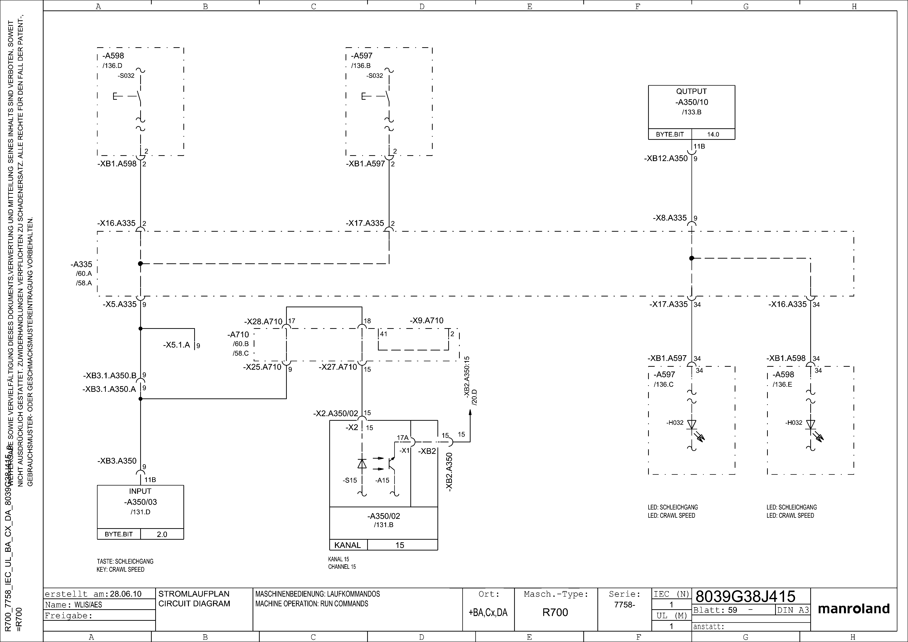

# +BA_Cx_DA — Sheet 59 of 247 — MASCHINENBEDIENUNG: LAUFKOMMANDOS

**MACHINE OPERATION: RUN COMMANDS**

> Part of the manroland **R700** printing press IEC/UL circuit diagrams.
> Drawing class: **Stromlaufplan / Circuit diagram** (DIN A3).
> Document `+BA_Cx_DA` covers the **Printing units / main switch cabinet** machine section.

## At a glance

| Field | Value |
|---|---|
| Document | `+BA_Cx_DA`  (8039G38J415) |
| Sheet | **59** of 247 |
| Section (DE) | MASCHINENBEDIENUNG: LAUFKOMMANDOS |
| Section (EN) | MACHINE OPERATION: RUN COMMANDS |
| Section type | CIRCUIT — Circuit diagram |
| Machine type | `R700` |
| Series | `7758` |
| Created | 28.06.10 |
| Replaces | — |
| Columns used | A, B, C, D, F, G, H |
| Path numbers | — |
| Labels on sheet | 100 |
| Cross-refs out | 12 |
| Cross-refs in | 33 |

**Previous:** [+BA_Cx_DA sheet 58](SHEET_0058.md) · **Next:** [+BA_Cx_DA sheet 60](SHEET_0060.md) · **Document TOC:** [_TOC.md](_TOC.md)  (+BA_Cx_DA) · **Master TOC:** [all sheets](../_MASTER_TOC.md)

## Sheet image (300 DPI, exact vector render)



_Rendered directly from the PDF vector layer at 300 DPI (1-bit), no OCR and no resampling. Use it to confirm anything ambiguous in the text below._

## Cross-references on this sheet

Each entry is a wire leaving this sheet. The printed token is `/sheet.column`; the link resolves to that sheet inside the same document.

| Ref | Target sheet | Col | Path | Destination on target | Target section | From col |
|---|---|---|---|---|---|---|
| `/136.D` | [+BA_Cx_DA sheet 136](SHEET_0136.md) | D | — | A598 | REFERENZMODUL | A |
| `/136.B` | [+BA_Cx_DA sheet 136](SHEET_0136.md) | B | — | A597 | REFERENZMODUL | C |
| `/133.B` | [+BA_Cx_DA sheet 133](SHEET_0133.md) | B | — | — | REFERENZMODUL | G |
| `/60.A` | [+BA_Cx_DA sheet 60](SHEET_0060.md) | A | — | — | MASCHINENBEDIENUNG: BEDIENUNGKOMMANDOS | A |
| `/58.A` | [+BA_Cx_DA sheet 58](SHEET_0058.md) | A | — | — | MASCHINENBEDIENUNG: LAUFKOMMANDOS | A |
| `/60.B` | [+BA_Cx_DA sheet 60](SHEET_0060.md) | B | — | — | MASCHINENBEDIENUNG: BEDIENUNGKOMMANDOS | B |
| `/58.C` | [+BA_Cx_DA sheet 58](SHEET_0058.md) | C | — | — | MASCHINENBEDIENUNG: LAUFKOMMANDOS | B |
| `/20.D` | [+BA_Cx_DA sheet 20](SHEET_0020.md) | D | — | XB2.A350:15 | BUSVERBINDUNGEN: SICHERHEITSBUS | D |
| `/136.C` | [+BA_Cx_DA sheet 136](SHEET_0136.md) | C | — | A597 | REFERENZMODUL | F |
| `/136.E` | [+BA_Cx_DA sheet 136](SHEET_0136.md) | E | — | A598 | REFERENZMODUL | G |
| `/131.D` | [+BA_Cx_DA sheet 131](SHEET_0131.md) | D | — | — | REFERENZMODUL | A |
| `/131.B` | [+BA_Cx_DA sheet 131](SHEET_0131.md) | B | — | — | REFERENZMODUL | D |

### Incoming references (sheets that point here)

Every other sheet that sends a wire to this one. `Back-ref` is the token printed on *that* sheet; `Path` is its line number.

| From sheet | Cols | Back-ref | Path | Refs | What continues there |
|---|---|---|---|---|---|
| [+BA_Cx_DA#20](SHEET_0020.md) | D | `/20.D` | — | 1 | XB2.A350:15 |
| [+BA_Cx_DA#58](SHEET_0058.md) | A, C | `/58.A`, `/58.C` | — | 2 | — |
| [+BA_Cx_DA#60](SHEET_0060.md) | A, B | `/60.A`, `/60.B` | — | 2 | — |
| [+BA_Cx_DA#131](SHEET_0131.md) | B, D | `/131.B`, `/131.D` | — | 2 | — |
| [+BA_Cx_DA#133](SHEET_0133.md) | B | `/133.B` | — | 1 | — |
| [+BA_Cx_DA#136](SHEET_0136.md) | B, C, D, E | `/136.B`, `/136.C`, `/136.D`, `/136.E` | — | 4 | — |
| [+BA_Cx_DA#143](SHEET_0143.md) | B, C, D, E | `/143.B`, `/143.C`, `/143.D`, `/143.E` | — | 4 | — |
| [+BA_Cx_DA#153](SHEET_0153.md) | F | `/153.F` | — | 2 | — |
| [+BA_Cx_DA#157](SHEET_0157.md) | C, D, F | `/157.C`, `/157.D`, `/157.F` | — | 3 | — |
| [+BA_Cx_DA#160](SHEET_0160.md) | C | `/160.C` | — | 1 | — |
| [+BA_Cx_DA#161](SHEET_0161.md) | A | `/161.A` | — | 1 | — |
| [+BA_Cx_DA#165](SHEET_0165.md) | E | `/165.E` | — | 1 | — |
| [+BA_Cx_DA#169](SHEET_0169.md) | G | `/169.G` | — | 1 | — |
| [+BA_Cx_DA#172](SHEET_0172.md) | B, C | `/172.B`, `/172.C` | — | 2 | — |
| [+BA_Cx_DA#173](SHEET_0173.md) | B, C | `/173.B`, `/173.C` | — | 2 | — |
| [+BA_Cx_DA#175](SHEET_0175.md) | H | `/175.H` | — | 1 | — |
| [+BA_Cx_DA#177](SHEET_0177.md) | E | `/177.E` | — | 1 | — |
| [+BA_Cx_DA#178](SHEET_0178.md) | G | `/178.G` | — | 2 | — |


## Devices on this sheet

| Tag | Class | Class meaning (IEC) | Col | Sub | Terminal | Sign |
|---|---|---|---|---|---|---|
| `S032` | S | Schalter / switch | D | — | — | — |
| `A597` | A | Baugruppe / assembly, module, PC board | C | — | — | — |
| `A335` | A | Baugruppe / assembly, module, PC board | A | — | — | — |
| `S032` | S | Schalter / switch | A | — | — | — |
| `A598` | A | Baugruppe / assembly, module, PC board | A | — | — | — |
| `A350/10` | A | Baugruppe / assembly, module, PC board | G | 10 | — | — |
| `A597` | A | Baugruppe / assembly, module, PC board | F | — | — | — |
| `A598` | A | Baugruppe / assembly, module, PC board | G | — | — | — |
| `A350/03` | A | Baugruppe / assembly, module, PC board | A | 03 | — | — |
| `A710` | A | Baugruppe / assembly, module, PC board | B | — | — | — |
| `S15` | S | Schalter / switch | C | — | — | — |
| `A15` | A | Baugruppe / assembly, module, PC board | D | — | — | — |
| `X1` | X | Klemme / terminal, plug connector | D | — | — | — |
| `X2` | X | Klemme / terminal, plug connector | C | — | — | — |
| `XB2` | XB |  | D | — | — | — |
| `A350/02` | A | Baugruppe / assembly, module, PC board | D | 02 | — | — |
| `XB1.A597` | — | cross-device reference | C | — | — | — |
| `X5.A335` | — | cross-device reference | A | — | — | — |
| `XB1.A598` | — | cross-device reference | A | — | — | — |
| `X16.A335` | — | cross-device reference | A | — | — | — |
| `X17.A335` | — | cross-device reference | C | — | — | — |
| `14.0` | — | cross-device reference | G | — | — | — |
| `XB12.A350` | — | cross-device reference | F | — | — | — |
| `X8.A335` | — | cross-device reference | F | — | — | — |
| `XB1.A597` | — | cross-device reference | F | — | — | — |
| `XB1.A598` | — | cross-device reference | G | — | — | — |
| `XB3.1.A350.B` | — | cross-device reference | A | — | — | — |
| `XB3.1.A350.A` | — | cross-device reference | A | — | — | — |
| `2.0` | — | cross-device reference | B | — | — | — |
| `XB3.A350` | — | cross-device reference | A | — | — | — |
| `X17.A335` | — | cross-device reference | F | — | — | — |
| `X27.A710` | — | cross-device reference | C | — | — | — |
| `X28.A710` | — | cross-device reference | C | — | — | — |
| `X25.A710` | — | cross-device reference | C | — | — | — |
| `XB2.A350` | — | cross-device reference | D | — | — | — |
| `X5.1.A` | — | cross-device reference | B | — | — | — |
| `X16.A335` | — | cross-device reference | G | — | — | — |
| `XB2.A350:15` | — | cross-device reference | D | — | 15 | — |
| `X9.A710` | — | cross-device reference | D | — | — | — |

## Potentials / nets

| Potential | Count | Columns | Attached devices | Terminals |
|---|---|---|---|---|
| `H032` | 2 | F, G | — | — |


A potential such as `L24+/4` or `M24+` is a named supply/return rail; every place it appears on this sheet is electrically common.

## Wire-end annotations (grouped as printed)

A wire that continues elsewhere is annotated with a small cluster: the destination description, the path/line number `#NN`, and the `/sheet.column` cross reference. Each row below is one such cluster exactly as it is grouped on the drawing.

| Col | Y | Path | Cross-ref | Text on the wire |
|---|---|---|---|---|
| A | 68.3 | — | `/136.D` | `A598` |
| C | 68.3 | — | `/136.B` | `A597` |
| A | 95.7 | — | — | `S032` |
| D | 95.7 | — | — | `S032` |
| F | 115.4 | — | — | `QUTPUT` |
| G | 129.3 | — | — | `A350/10` |
| G | 143.1 | — | `/133.B` | — |
| F | 172.7 | — | — | `BYTE.BIT 14.0` |
| G | 188.1 | — | — | `11B` |
| A | 194.5 | — | — | `2` |
| D | 194.5 | — | — | `2` |
| F | 203.0 | — | — | `XB12.A350 9` |
| A | 210.1 | — | — | `XB1.A598 2` |
| D | 210.1 | — | — | `XB1.A597 2` |
| F | 280.9 | — | — | `X8.A335 9` |
| B | 288.0 | — | — | `X16.A335 2 X17.A335 2` |
| A | 341.9 | — | — | `A335` |
| A | 354.9 | — | `/60.A`, `/58.A` | — |
| A | 394.3 | — | — | `X5.A335 9` |
| F | 394.3 | — | — | `X17.A335 34` |
| G | 394.3 | — | — | `X16.A335 34` |
| D | 415.6 | — | — | `X9.A710` |
| C | 417.0 | — | — | `X28.A710 17` |
| C | 417.0 | — | — | `18` |
| B | 434.0 | — | — | `A710` |
| D | 434.0 | — | — | `41 2` |
| B | 447.1 | — | `/60.B`, `/58.C` | — |
| B | 447.5 | — | — | `X5.1.A 9` |
| F | 465.2 | — | — | `XB1.A597 34` |
| G | 465.2 | — | — | `XB1.A598 34` |
| D | 467.1 | — | `/20.D` | `XB2.A350:15` |
| C | 476.5 | — | — | `X25.A710 9` |
| C | 476.5 | — | — | `X27.A710 15` |
| G | 482.2 | — | — | `34` |
| H | 482.2 | — | — | `34` |
| F | 486.4 | — | `/136.C` | `A597` |
| G | 486.4 | — | `/136.E` | `A598` |
| A | 487.9 | — | — | `XB3.1.A350.B 9` |
| A | 504.9 | — | — | `XB3.1.A350.A 9` |
| C | 537.5 | — | — | `X2.A350/02 15` |
| F | 550.6 | — | — | `H032` |
| G | 550.6 | — | — | `H032` |
| C | 555.9 | — | — | `X2` |
| D | 557.3 | — | — | `15 15` |
| D | 565.8 | — | — | `15` |
| D | 570.0 | — | — | `17A` |
| D | 587.1 | — | — | `X1` |
| D | 587.1 | — | — | `XB2` |
| D | 593.3 | — | — | `XB2.A350` |
| A | 599.8 | — | — | `XB3.A350 9` |
| A | 625.3 | — | — | `11B` |
| C | 626.0 | — | — | `S15 A15` |
| A | 639.9 | — | — | `INPUT` |
| A | 653.7 | — | — | `A350/03` |
| F | 662.5 | — | — | `LED: SCHLEICHGANG LED: CRAWL SPEED` |
| G | 662.5 | — | — | `LED: SCHLEICHGANG LED: CRAWL SPEED` |
| A | 667.5 | — | `/131.D` | — |
| D | 672.1 | — | — | `A350/02` |
| D | 684.5 | — | `/131.B` | — |
| A | 696.5 | — | — | `BYTE.BIT 2.0` |
| D | 710.4 | — | — | `KANAL 15` |
| C | 730.7 | — | — | `KANAL 15 CHANNEL 15` |
| A | 733.4 | — | — | `KEY: CRAWL SPEED TASTE: SCHLEICHGANG` |


## Reconstructed tables

This sheet carries tabular content (pin map / terminal assignment / index). The grid below was rebuilt from the drawing's own rule lines, so each row is exactly one physical row of the table.

### Table 1 — 6 data rows × 2 columns (at x=127.6, y=62.4)

| A598 /136.D S032 | 2 |
|---|---|
| `XB1.A598 X16.A335` | `2 2` |
| `X5.A335` | `9` |
| `XB3.1.A350.B XB3.1.A350.A` | `X5.1.A 9 9` |
| `XB3.A350` | `9 11B` |
| `INPUT` | `A350/03 /131.D` |
| `BYTE.BIT` | `2.0` |


### Table 2 — 7 data rows × 7 columns (at x=375.6, y=62.4)

|  |  | A597 /136.B | S032 |  | 2 |  |
|---|---|---|---|---|---|---|
|  |  |  | `XB1.A597 X17.A335` | `2 2` |  |  |
| `17` |  |  | `18 41` |  |  | `X9.A710` |
| `9` | `X27.A710` |  | `15` |  |  |  |
|  | `X2.A350/02` |  | `15` |  |  |  |
|  |  | `X2 S15` | `15 A15` |  | `17A X1` | `XB2` |
|  |  |  | `A350/02 /131.B` |  |  |  |
|  |  | `KANAL` |  |  | `15` |  |


### Table 3 — 3 data rows × 1 columns (at x=574.0, y=62.4)

| C1 |
|---|
| `2` |
| `XB2.A350:15` |
| `15 15 XB2.A350` |


### Table 4 — 4 data rows × 2 columns (at x=850.4, y=112.0)

| QUTPUT | A350/10 /133.B |
|---|---|
| `BYTE.BIT` | `14.0` |
| `XB12.A350 X8.A335` | `11B 9 9` |
| `X17.A335 XB1.A597` | `34 34` |
| `A597 /136.C H032` | `34` |


### Table 5 — 1 data rows × 2 columns (at x=1006.3, y=112.0)

| X16.A335 XB1.A598 | 34 34 |
|---|---|
| `A598 /136.E H032` | `34` |


## Notes and free text on this sheet

| Text | Col | Y (pt) |
|---|---|---|
| `11B` | G | 188.08 |
| `QUTPUT` | F | 115.42 |
| `BYTE.BIT` | F | 172.69 |
| `LED: SCHLEICHGANG` | F | 662.52 |
| `LED: CRAWL SPEED` | F | 673.11 |
| `LED: SCHLEICHGANG` | G | 662.52 |
| `LED: CRAWL SPEED` | G | 673.11 |
| `11B` | A | 625.33 |
| `INPUT` | A | 639.85 |
| `BYTE.BIT` | A | 697.1 |
| `TASTE: SCHLEICHGANG` | A | 733.38 |
| `KEY: CRAWL SPEED` | A | 743.97 |
| `KANAL 15` | C | 730.71 |
| `CHANNEL 15` | C | 740.65 |
| `17A` | D | 570.05 |
| `KANAL` | C | 710.38 |
| `X2.A350/02` | C | 537.47 |

## Complete label inventory (exact text from the drawing)

Every text object inside the drawing area of this sheet, in DIN reading order (column A→H, then top→bottom). This is the authoritative list: if a string is not here it is not printed on this sheet.

| Col | Y | X | Dir | Type | Text |
|---|---|---|---|---|---|
| A | 68.3 | 134.4 | → | device tag | `A598` |
| A | 82.1 | 134.6 | → | cross-reference | `/136.D` |
| A | 95.7 | 154.5 | → | device tag | `S032` |
| A | 194.5 | 189.6 | → | number | `2` |
| A | 210.1 | 127.8 | → | device ref | `XB1.A598` |
| A | 211.5 | 186.8 | → | number | `2` |
| A | 288.0 | 127.6 | → | device ref | `X16.A335` |
| A | 289.5 | 186.8 | → | number | `2` |
| A | 341.9 | 92.7 | → | device tag | `A335` |
| A | 354.9 | 99.8 | → | cross-reference | `/60.A` |
| A | 367.3 | 99.8 | → | cross-reference | `/58.A` |
| A | 394.3 | 134.9 | → | device ref | `X5.A335` |
| A | 395.8 | 186.8 | → | number | `9` |
| A | 487.9 | 109.1 | → | device ref | `XB3.1.A350.B` |
| A | 487.9 | 186.8 | → | number | `9` |
| A | 504.9 | 186.8 | → | number | `9` |
| A | 505.6 | 108.3 | → | device ref | `XB3.1.A350.A` |
| A | 599.8 | 127.8 | → | device ref | `XB3.A350` |
| A | 608.4 | 186.8 | → | number | `9` |
| A | 625.3 | 189.1 | → | text | `11B` |
| A | 639.8 | 169.4 | → | text | `INPUT` |
| A | 653.7 | 162.9 | → | device tag | `A350/03` |
| A | 667.5 | 171.5 | → | cross-reference | `/131.D` |
| A | 697.1 | 137.5 | → | text | `BYTE.BIT` |
| A | 733.4 | 127.3 | → | text | `TASTE: SCHLEICHGANG` |
| A | 744.0 | 126.7 | → | text | `KEY: CRAWL SPEED` |
| B | 434.0 | 298.2 | → | device tag | `A710` |
| B | 447.1 | 305.6 | → | cross-reference | `/60.B` |
| B | 447.5 | 214.0 | → | device ref | `X5.1.A` |
| B | 449.6 | 257.7 | → | number | `9` |
| B | 459.5 | 305.3 | → | cross-reference | `/58.C` |
| B | 696.5 | 205.8 | → | device ref | `2.0` |
| C | 68.3 | 460.3 | → | device tag | `A597` |
| C | 82.1 | 460.6 | → | cross-reference | `/136.B` |
| C | 210.1 | 453.8 | → | device ref | `XB1.A597` |
| C | 288.0 | 453.5 | → | device ref | `X17.A335` |
| C | 417.0 | 320.3 | → | device ref | `X28.A710` |
| C | 417.0 | 377.6 | → | number | `17` |
| C | 417.0 | 476.8 | → | number | `18` |
| C | 476.5 | 318.9 | → | device ref | `X25.A710` |
| C | 476.5 | 418.1 | → | device ref | `X27.A710` |
| C | 480.8 | 378.1 | → | number | `9` |
| C | 480.8 | 476.8 | → | number | `15` |
| C | 537.5 | 410.7 | → | text | `X2.A350/02` |
| C | 537.5 | 476.8 | → | number | `15` |
| C | 555.9 | 453.3 | → | device tag | `X2` |
| C | 626.1 | 449.6 | → | device tag | `S15` |
| C | 710.4 | 438.5 | → | text | `KANAL` |
| C | 730.7 | 430.3 | → | text | `KANAL 15` |
| C | 740.6 | 430.6 | → | text | `CHANNEL 15` |
| D | 95.7 | 480.5 | → | device tag | `S032` |
| D | 194.5 | 515.6 | → | number | `2` |
| D | 211.5 | 512.8 | → | number | `2` |
| D | 289.5 | 512.8 | → | number | `2` |
| D | 415.6 | 537.4 | → | device ref | `X9.A710` |
| D | 434.0 | 498.6 | → | number | `41` |
| D | 434.0 | 590.7 | → | number | `2` |
| D | 467.1 | 608.3 | ↕ | device ref | `XB2.A350:15` |
| D | 510.5 | 618.2 | ↕ | cross-reference | `/20.D` |
| D | 557.3 | 479.6 | → | number | `15` |
| D | 565.8 | 600.1 | → | number | `15` |
| D | 567.3 | 578.8 | → | number | `15` |
| D | 570.1 | 520.2 | → | text | `17A` |
| D | 587.1 | 523.8 | → | device tag | `X1` |
| D | 587.1 | 548.2 | → | device tag | `XB2` |
| D | 593.3 | 584.2 | ↕ | device ref | `XB2.A350` |
| D | 626.1 | 492.1 | → | device tag | `A15` |
| D | 672.1 | 481.7 | → | device tag | `A350/02` |
| D | 684.5 | 490.5 | → | cross-reference | `/131.B` |
| D | 710.3 | 518.2 | → | number | `15` |
| F | 115.4 | 886.8 | → | text | `QUTPUT` |
| F | 172.7 | 860.3 | → | text | `BYTE.BIT` |
| F | 203.0 | 844.7 | → | device ref | `XB12.A350` |
| F | 280.9 | 856.3 | → | device ref | `X8.A335` |
| F | 394.3 | 851.8 | → | device ref | `X17.A335` |
| F | 465.2 | 849.3 | → | device ref | `XB1.A597` |
| F | 486.4 | 857.2 | → | device tag | `A597` |
| F | 500.3 | 857.5 | → | cross-reference | `/136.C` |
| F | 550.6 | 873.9 | → | potential | `H032` |
| F | 662.5 | 849.5 | → | text | `LED: SCHLEICHGANG` |
| F | 673.1 | 849.5 | → | text | `LED: CRAWL SPEED` |
| G | 129.3 | 885.7 | → | device tag | `A350/10` |
| G | 143.1 | 894.5 | → | cross-reference | `/133.B` |
| G | 172.7 | 927.2 | → | device ref | `14.0` |
| G | 188.1 | 909.1 | → | text | `11B` |
| G | 204.4 | 909.6 | → | number | `9` |
| G | 282.4 | 909.6 | → | number | `9` |
| G | 394.3 | 1007.7 | → | device ref | `X16.A335` |
| G | 395.8 | 909.6 | → | number | `34` |
| G | 465.2 | 1005.2 | → | device ref | `XB1.A598` |
| G | 466.6 | 909.6 | → | number | `34` |
| G | 482.2 | 912.5 | → | number | `34` |
| G | 486.4 | 1013.1 | → | device tag | `A598` |
| G | 500.2 | 1013.4 | → | cross-reference | `/136.E` |
| G | 550.6 | 1029.8 | → | potential | `H032` |
| G | 662.5 | 1005.4 | → | text | `LED: SCHLEICHGANG` |
| G | 673.1 | 1005.4 | → | text | `LED: CRAWL SPEED` |
| H | 395.8 | 1065.5 | → | number | `34` |
| H | 466.6 | 1065.5 | → | number | `34` |
| H | 482.2 | 1068.4 | → | number | `34` |

## Reading-order text block

The same content as a plain block, grouped by DIN column — convenient to paste or to match against a visual description.

```text
=== Column A ===
  68.3  134.4  devtag       A598
  82.1  134.6  xref         /136.D
  95.7  154.5  devtag       S032
 194.5  189.6  numeric      2
 210.1  127.8  devref       XB1.A598
 211.5  186.8  numeric      2
 288.0  127.6  devref       X16.A335
 289.5  186.8  numeric      2
 341.9   92.7  devtag       A335
 354.9   99.8  xref         /60.A
 367.3   99.8  xref         /58.A
 394.3  134.9  devref       X5.A335
 395.8  186.8  numeric      9
 487.9  109.1  devref       XB3.1.A350.B
 487.9  186.8  numeric      9
 504.9  186.8  numeric      9
 505.6  108.3  devref       XB3.1.A350.A
 599.8  127.8  devref       XB3.A350
 608.4  186.8  numeric      9
 625.3  189.1  text         11B
 639.8  169.4  text         INPUT
 653.7  162.9  devtag       A350/03
 667.5  171.5  xref         /131.D
 697.1  137.5  text         BYTE.BIT
 733.4  127.3  text         TASTE: SCHLEICHGANG
 744.0  126.7  text         KEY: CRAWL SPEED
=== Column B ===
 434.0  298.2  devtag       A710
 447.1  305.6  xref         /60.B
 447.5  214.0  devref       X5.1.A
 449.6  257.7  numeric      9
 459.5  305.3  xref         /58.C
 696.5  205.8  devref       2.0
=== Column C ===
  68.3  460.3  devtag       A597
  82.1  460.6  xref         /136.B
 210.1  453.8  devref       XB1.A597
 288.0  453.5  devref       X17.A335
 417.0  320.3  devref       X28.A710
 417.0  377.6  numeric      17
 417.0  476.8  numeric      18
 476.5  318.9  devref       X25.A710
 476.5  418.1  devref       X27.A710
 480.8  378.1  numeric      9
 480.8  476.8  numeric      15
 537.5  410.7  text         X2.A350/02
 537.5  476.8  numeric      15
 555.9  453.3  devtag       X2
 626.1  449.6  devtag       S15
 710.4  438.5  text         KANAL
 730.7  430.3  text         KANAL 15
 740.6  430.6  text         CHANNEL 15
=== Column D ===
  95.7  480.5  devtag       S032
 194.5  515.6  numeric      2
 211.5  512.8  numeric      2
 289.5  512.8  numeric      2
 415.6  537.4  devref       X9.A710
 434.0  498.6  numeric      41
 434.0  590.7  numeric      2
 467.1  608.3  devref       XB2.A350:15
 510.5  618.2  xref         /20.D
 557.3  479.6  numeric      15
 565.8  600.1  numeric      15
 567.3  578.8  numeric      15
 570.1  520.2  text         17A
 587.1  523.8  devtag       X1
 587.1  548.2  devtag       XB2
 593.3  584.2  devref       XB2.A350
 626.1  492.1  devtag       A15
 672.1  481.7  devtag       A350/02
 684.5  490.5  xref         /131.B
 710.3  518.2  numeric      15
=== Column F ===
 115.4  886.8  text         QUTPUT
 172.7  860.3  text         BYTE.BIT
 203.0  844.7  devref       XB12.A350
 280.9  856.3  devref       X8.A335
 394.3  851.8  devref       X17.A335
 465.2  849.3  devref       XB1.A597
 486.4  857.2  devtag       A597
 500.3  857.5  xref         /136.C
 550.6  873.9  net          H032
 662.5  849.5  text         LED: SCHLEICHGANG
 673.1  849.5  text         LED: CRAWL SPEED
=== Column G ===
 129.3  885.7  devtag       A350/10
 143.1  894.5  xref         /133.B
 172.7  927.2  devref       14.0
 188.1  909.1  text         11B
 204.4  909.6  numeric      9
 282.4  909.6  numeric      9
 394.3 1007.7  devref       X16.A335
 395.8  909.6  numeric      34
 465.2 1005.2  devref       XB1.A598
 466.6  909.6  numeric      34
 482.2  912.5  numeric      34
 486.4 1013.1  devtag       A598
 500.2 1013.4  xref         /136.E
 550.6 1029.8  net          H032
 662.5 1005.4  text         LED: SCHLEICHGANG
 673.1 1005.4  text         LED: CRAWL SPEED
=== Column H ===
 395.8 1065.5  numeric      34
 466.6 1065.5  numeric      34
 482.2 1068.4  numeric      34
```

---
_Generated from the PDF vector text layer; no OCR. Source: `R700_7758_IEC_UL_BA_CX_DA_8039G38J415_p`, sheet 59._
